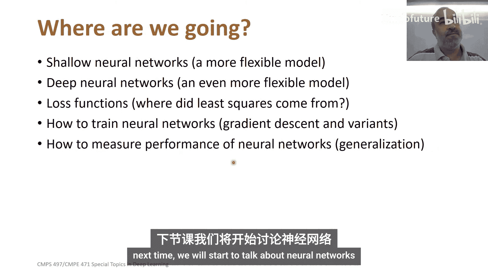
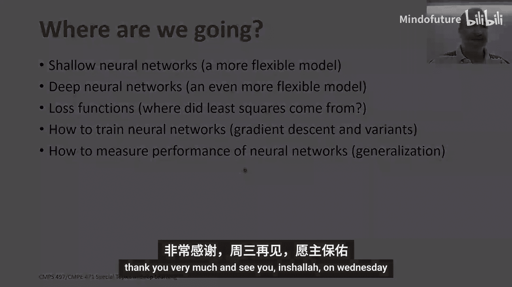

# 【卡塔尔大学】深度学习 CMPS497 ｜ Understanding Deep Learning ｜ Fall 2024 p03 P03_第三讲-监督学习 -BV1vQvNz1EeK_p3-

will I know him。And Charlotterlo today we will will talk about supervised learning in more detail last time we went through quick。

 very quick definitions， our introduction with examples to the three types of supervised learning what were these three types remember？

What are the three types we discussed last time？Supervised。

 unsubupervised and reinforcement learning okay， quickly。

 what is the difference between supervised and unsupervised learning？啊。😮，Yeah， the label data。

 right in which one has label data。The supervised learning okay。

 so supervised learning we have we are given label data to guide the learning。

 but in unsupervised we don't。Today in Sha we will talk in a bit more detail about supervised learning we will go through first we'll go through an overview with giving you some notations that we will use throughout the semester and then we will talk about very simple example。

😊，Of supervised learning， but it is really good example because we using Gt we will go through all the main concepts of supervised learning and even in general machine learning。

So we'll start with an overview of supervised learning last time we said that supervised learning is about mapping from one or more input to one or more outputs。

K engineer。And by mapping， we mean a mathematical equation。

 so mathematical equation that will take the value of the input and will give us the value of output。

😊，Okay， so the model is just an equation。Type this equation we can later use to compute。

Predicted output so if I give you it will be an equation of the input values right I will give it the value of the input and then I will get back a value for the output we call this inferences。

So for example， if you remember last time we talked about kind of prediction of estimated cost of a house。

 today we talk about an example of estimatedestating price of a car given two input values。

 the age of the car and the mileage of the car。And we want to estimate the price of the car。

 if I have a model。that represents the mapping between the infinite output。

 I can give it a specific value of the age and specific value of the mileage。

 and then from that equation we can get a value for the estimated price of the car。

 we call this again inference。😊，Now， in general， a model， as we said it a mathematical equation。

 right， the equation in general has parameters。😊，Has parameters。When we change these parameters。

 we actually change the equation。😮，Which means we are changing the output of that equation。Right。😊。

We'll talk about an example to make it very clear in Sha law later today， but in general， as I said。

 an equation， mathematical equation， any mathematical equation has parameters if we get if we know the values of the parameters。

 we can compute the value of the function for any input value。😊，And that's why， we say that a model。

Doesn't just represent one equation。😡，But represents a family of equations。

Why is it a family of equations because we have parameters with every specific set of values for the parameters。

 we get one specific equation。😡，ok。If we change the values of the parameters， we change the equation。

 which means we change the model。😡，So in general， the model represents a family of equations。😡。

If we are given specific data， then we can find specific values of the parameters for a specific model that might be good for such data and we will see that in Shar La today。

😊，And that's exactly what we mean by training a model when we train a model。

 that means that we want to find the parameters。😡，That will predict good values for this data。

That would give us good predictions。Okay for this set of data。

If we change the value that the parameters， of course， the predicted values would be different。😡。

So we are in training， we are trying to find a good model， a good set of values of the parameters。😡。

That will fit well to the training。Now let's talk about the notation that we will use in Ch La in the semester and it will be matching what the textbook is using。

We have input， me change this point of。😮，We have the input and the input can be normal。

 which means that it's not bold， its monotic， it means that it will be scalar just one value。

And the output is the same。If it's bold， then it's a vector of values。😡， if it's capital and bold。

 that means that it's a matrix。😡，So that's the notation of the input and output。And about the model。

 again， the model is a function。😊，and a function of the input if I gave the model the input values。

 then I would get back the output value， the model。

 the name of the model usually you use the FG and so on as names of the functions of the models。😡。

Similarly， normal means it returns scalar， bold means it returns a victory of values and capital means it returns a metrics。

😊，Here's the example， X here， it's bold， it represents a vector of values。

 which are the age and mileage。😊，And here the output is just one output， one value。

 which is the predicted price。Okay， so that's why it's a scalar。

 it's just one value it's not bold here and the function again。

 it represents one just output so it's not bold。Okay， any question about this notation， yes。Yeah。

This。Yes。😊，诶。No， no， no， doesn't matter it doesn't it's not no， no， no， it's not always， of course。

 okay， the input can be multiple， the output might be one。😡，Anything， it can be many。

 many too many in general。Yes。好。Yeah， X here is bold， which means that it is subject vector。

 So that's the notation。 I'm just getting the quick understanding of of how to。To represent these。

 these values。When we have more than one value， when we have vectors or values。

 we call this structured or tabular data because we can put this data in a table。

Where the columns are the。The values and rows are the examples it just will be easier to think of it as a table。

Now the model we said that the model has parameters right。

 we usually use the Greek letters for the parameters。

 he will use phi later we use theta and phii and so on。😊。

And the model in reality is a function of both the input and the parameters。😡。

So usually we have f of x and phi and in short we just use f of phi， we just ignore x。

 that does mean that the input is not given to the function。

 but we just say that we will just think that this is implicit okay and we will always think of the model as a function of the parameters。

我不是。不好的。So x is the input。😡，Okay， and5 are the parameters of the model。

We see examples of love this lecture。So。Ex。No， no， no， x is the input values， you mean。

 that's we get back here。😡，X is the real input values， like for a specific call。

 the age of the car and the mileage of the car。😊，The parameters phi。

 the parameters of the model itself， if we will represent as we will see later on show today。

 if we will represent the relationship between the age and mileage and the predicted price as a lion。

😊，Then phi would be the parameters of the line。😡，The intercept and the slope of the line would see that。

Is that clear now？Now， in order to measure how good the model is when we do the training。

We will use what we call the loss function。We also call it cost function， or error function。😮。

So you can think of it as measuring how far we are。

 how far the predicted values of the model from the actual values that we should get。😡，Okay。

 so it should give us an indication of how good the model is。 if the loss value is very high。

 what does that mean。We are losing much， right， which means this is good or bad， bad， of course。

 Okay， if the loss value is very small， that means that we are closer to the to the actual values。

 the output values that we want。So we compute the loss function。When we do training。

 we compute the loss function on using the training examples。😡，Remember。

 in supervised learning that any examples are labeled right， we have input and corresponding output。

 input and corresponding output。 So we know that corresponding output is the actual output that we want to。

呃For model。Okay。😊，So given the training data we use the notation X， Y and Yi， so this is one example。

 one pair of input and output， and we have I pairs of them in the training data。Fit from one to eye。

Now， given this training data， we can define a loss function。So the lost function is a function of。

The parameters of the model。The model itself。😮，And the training data， let's explain that。😡。

We want to know or to measure how good the model is， right？😡。

I think we agree that we need the training data。😡，Because we need to compare between the predicted values and。

😡，The actual output values right so the training data has to be part of the loss function。Okay。

 we are also computing the loss function for a specific model。😡。

We want to see if that model is good or bad right so if we want。

 if we are talking about specific model， then we are talking about specific values of the parameters。

😡，That's why the parameters are。Iput for that loss function。 So we have to know the parameters phi。😡。

The parametersers of the model。Okay， so we have to know the parameters of the model because we are talking about the loss value or how good a specific model is。

😡，And we have to have the model equation。Right why do you need the model equation？

We said that we want to compare between the predicted value and the actual values。

 The actual values are entertaining data， right， where is the predicted value。😡。

We have to compute to get it from。The equation。Okay， which is the model function， the model equation。

So we need to know the parameters， we need to know the model。

 and we need to know how to get the training data in short。We just use the parameters。

 We just say that the loss function is a function of the parameters。 Of course。

 it's also a function of the model and the function of the training set， but for short。

For simplicity， we will just say that the loss function is a function of the parameters， which means。

It's a function of。The model， right， Because if I gave you the specific。Values of the。

 of the parameters。Then that means that I'm pointing to a specific model。Okay。

 all of that in Cha will be more clear with the regression example that we will discuss today。Now。

 in training。We can use the loss function to see how good the model that we have now is。

But our target is to get the best possible model， right？😡。

Which means that we need inter training to find the values of the parameters that will make the loss the minimum possible。

😡，we said that the loss is like the error right， so we want to minimize the error。😡，So。In training。

 we want to get the minimum， we want to get them the values of the parameters that will make the loss function the minimum。

😡，Are you familiar with this argument notation， terminlogy？So argument means。Yeah， find。

This will return the values of that variable。😡，That will make this。Mathematical function。

 the minimum。Okay， so that will live within what we call Phi hat。

 which is the values that the values of the parameters that will give us the best model。😊。

So this is actually this is actually the best model we can get。😡。

Because it minimizes the loss function。The best model that we can get from the training data that we are。

 yes。Is a function that will return。The values of the parameters that will minimize this function in general augment can be used with any function with any variable。

😡，Okay so it gives us the minimum， this is just a notation by the way。

 how to implement this function this is bad and it will be a lecture two okay but this is just a notation that we target in in in the training phase。

 we target or the goal is to find the parameters phi phi hat that will minimize this loss function。😡。

Why do you need to minimize the loss function？你说是。Yeah。

 because the function represent an error right and we want to minimize the error between what we predict from the model and the actual output of in the training data。

Any questions so far。Okay， now after we today， I'm older。What do we have。

Yeah when we say within a model。What does that mean？Back to the previous slide， what does that mean？

We found。Specific values over the parameters that hopefully will minimize the loss function， okay。

 but we have a specific model now right type。😡，Is it guaranteed that this is really the best model？😡。

We have to test it， right after we trained it。😮，We have to test it。TTo test it。

 we have to do the testing on a set of examples。😡，That was not used in training。Otherwise。

 it would be like cheat， right。Okay， so for example。

 the the class example that I usually usually use is the。Studying a course。Okay。

 when you study a course， you are trained using with solving problems then start tries to solve problems with you right。

😡，Okay， so you are trained with homework， with project， with quizzes， right， but then。In the。

After you solve many problems， you will be tested on problems that you have C ID no usually they are similar but not exactly the same right otherwise you would memorize the answers right and that will not be a good indication of how good you are in understanding the material of the course so the test set has to be separate from the training set。

😡，Separate means different。😡，in teaching beauty learning， should I test you on chemistry problems？

It should be also in deepgar， but in different problems。But in the same field。The same distribution。

Why we need to test on a separate set？I to say。可以。没有。把这。

So you mean the performance might not be good， we need to see the actual performance is our goal in reality。

😊，To test on just any unseen any separate set or to。To see。

 to get an indication of how good the model is when it is tested on unseen data in general。😡。

In a reality， any this model should be used in a real in the real world， right？😡。

It will see examples that it's so in training in the real world， no。

 it will see uneen data before right so this is what we call generalization。

 We want to get an indication of how general the model is how the model generalizes generalizes to what to unseen data to data that was never seen to it before。

😡，And using it this fit is。A way to， to get that indication。

Because the test set we will try to think of the test set as if it is data in the real world that the model didn't see before。

😡，Okay， that's why it has to be separate from the phone the set。

So this will make us see how well it can generalize to new data。

 new data means data that is never seen by the model。Okay， is that clear？

So I always do that the rule of thumb here is never， ever touch your test date， What does that mean？

And when you attain a model。You should not look at touch means and it doesn't mean touch okay physically。

 but it means that you should not look at all to the test data。😊。

The model doesn't look at the this data or you doesn't look at the this data。😡，Both。Both， okay。

 it's clear why the model should not see the test data， right， Otherwise。

 it will consider it in training。Like why don't you look at the data， Not the model。

Because you will be biased， right， if you look at the this data， you see， okay， this special cases。

 let let me cover it in the model。Okay， let me change the model so that it will perform well on these cases。

 even if it's unintentional。😡，Okay， you never know how we can consider it。

So the test data should be completely separate。Okay， any questions on that？ let's take a quick poll。

Supervised learning is mapping from one input to one output。😡。

Mapping from one input to multiple outputs here mapping from multiple inputs to one output。😡。

Which one is。Oh。So you mean it should be mapping from。😡，I。I。Exactly， so it's none of them actually。

 so none of them， it should be mapping from one or more inputs to one or more outputs。Inineed。Good。

A learning model has。😮，Training data， test data。Prameters， all of them。好了好了。😔。

think before you answer， please。A learning model， the model itself。Has training data。

 has test data has parameters well has all of these three things。我天。

Why should we say that the learning model has training data and test data。The model has the data。No。

 now， we use the data。 We use the training data。都 train the model。We use the test data。

To measure how good demo mod generalizes。But that's not part of the model the model has。タメです。Okay。

 the data is not part of the model。😡，The data is completely separate from the model Its different。

 Okay， we use the data to fit the model to。For a specific problem。Good。Is that clear。

Please think before you answer。Okay， generalization of a model。😡。

Generalization of a model is about how well it performs on the training set。😡。

How will it performs on the test set？😮，How would it performs on both？😮。

Or how well it performs on unseen data？嗯。Who says the first one。A second one。这一个。放。Okay， yeah。

 so it performs on unseen data that why not we say perform on the test set。😡，Yeah， so it's。

 it should be also in the test set， right， test set is uneen。But not on this decisions， like we want。

 we want to see our world that conforms on。Yeah， so so it's not only our goal is not only on the test set。

 we use the test set as a means to measure how it generalizes， but our goal。

 the concept of generalization is not about specifically the test set because we can change the test set。

 by the way， test set is just a subset from reality。😡，Okay。

 but the goal in general is to perform on unseen data。Okay。

 now let's talk about and after getting this quick introduction overview。

 let's talk about this specific example of supervisorvisly。

Although this is probably the simplest example we can discuss， but it will show us exactly I hope。

 how to understand the concept that we just mentioned。So the example will be 1 d linear regression。

What do you mean by your I think we discussed that before。What is regression， yes。Yeah。

 when the output is it continuous value， Okay， when the output is continuous value。

when we say linear regression。That means that the model will be。Lar。Would be a linear equation。

As you will see， and 1 D means the input is just one input。So it's the simplest ever。

 so it predicts a single output from a single input。😊，And。To do that。

 it describes the relationship between the infinite output as a straight line。As a state。

So the model is， as I said， it just an equation， a linear equation。And an equation of a lion。😊。

How many parameters we have。Just do right。Intercept with the Y axis。And素。So the parameters are 2。

 phi0， which is the y offset or y intercept and phi 1， which is the slope。And here is one example。L。

😡，And with this line， the 50 is 0， so they interscept with the y axis is 0。😡，And Phi1 is one。

 which means that the slope is one。Okay。W has 45 degrees。Tpe this function。Is a function of one line。

Of one specific line。No， it's far a function of。Not many lines。

 how many lines we can represent with that function。Infinite number of lines， right。

 But if I know the specific values of Phi 0 and Phi 1。

Then we are presenting a specific line like like this case。If I change phi 0 and phi 1。😡。

I will get a different line。Okay， and the remember here。

 the line is the relationship that we want to get from the input to the output。😡，Okay。

 because heres the input， here is the output， it's a single input， single output。😡。

So that9 represents the relation between x and y。If we change the values of the parameters。

 we get a different line， so the green line here is a different line。😊，5hi0 is 1。2。

 so the intercept is 1。2。With the y axis and the slope is minus0。1。Okay。

Is the third one when 50 is 1。Thecept is at one， and the slope is negative。Point4。

And we can have so many lines with every different set of values or parameters， we get another line。

So as we said， this equation represents a family of possible input outputs。

It present actually all possible lines。😡，If we want to point to specific line。

 then we are talking about specific values of。😡，5，0 n and 51。Okay。Which line we will get。

 which model we are targeting， which equation we want。😡，It depends on。

It letL on what on the training data， so it depends on the training data。😡。

Right if you give me training data， I can fit specific line to them。 If you change the training data。

 that might be a different line， but all of them are。😡，Lines are linear regression models。Right， yes。

So you understand that we have so many lines presented by this equation， right？

Which line we will use as a model？It depends on the problem that we are solving right and the problem we are solving we are given。

😡，Specific data， specific label data， right， input and output pairs。 Remember。

 this is supervised learning， right， So we have the input and output input and output。

 so many pairs of input and output So we can now given this data。

 We can try to find a line that is good for them。 Good to match them。Okay。😊，So。Okay， good question。

In general， it doesn't have to be a line， of course。 but here we are talking about linear regression。

 So we are trying to fit a line to any data that will will be given。

 even if the data is not actually or should not be represented as a line。😡，Kid。

That's a very good question。Now， let's say that we want to get a specific client。Right。

 how can we find a good one。We need， we need an indication， sorry it？啊。You have another question。是找。

About how we can fight what right。不定。As soon as possible to。Yes， how can we find such line？Yeah。

 we need to have an indication。Of how good the line is right and we to do that。

 we use what we call the loss function。Okay， so as we said earlier。

 the loss function is an indication of the error。😊，So we have to have the loss function。

 a specific loss function， and we use it to guide the choice of the line that we will use to represent the relation between the input and the output。

😡， usually for delegation problems， we use a function a loss function code least squares loss function。

What is it？Now， we want to compare。Between the predicted values and the actual values。😡，Right。😊。

What are the predicted values。Given the specific model， we gave the value of x。😡。

And we compute the the output of the of the linear function， right。

 that would be the predicted value。 We want to compare it with the actual value of that input。

 That's exactly what we do here。 So F of X I and P。 What is finehi。The parameters。

 the vector of the parameters。 Okay， it's not just one， by the way， right， This is bold。

 It's a vector so。F of X and phi is the predicted value given X。😡，The predicted value for Xi。😡，Okay。

 type where is the actual value of X？😡，y i。😡，So we subtract the predicted value。😮。

Minus the actual value。And because we don't care of the direction， we don't care of the sign。

 we don't care whether one is higher than the other or not。

 we care about the difference between them， so we squ it to get rid of the sign。😡，So we square it。

 this is for just one example， right， we have to sum over all。😮，All what。No。

 not all the parameters all。What are these what we call these points， no， not not input。谁命这。

All the training examples。Okay， remember， we have eye training examples。

 so over all training examples for each one， we will compute the predicted value。😡。

Minus the actual value for it this this is like an error for one example， I square it。😡。

That's why it's least squares。😡，And some overall training did。That will give us one value， right。

So that will give us one value， which is the loss for specific model。😡，Where is the specific model。

 How do we know that it's a specific model。Yeah， because we are using specific parameters。

 here phi is specific parameters indicating one more。😊，Do you have a question。And it actually。我。No。

 the actual values are given。 of course， remember supervised learning， we have labeled data， X， Y， X。

 Y。This is for Gonhi。Okay， for test。We should not look at why， of course。系。

We don't use the values of the labels in the test set， we just compare between them。

 but for training you'll see that we use them to guide the choice of the product。😡。

We talk about later lot the details， yes。Yes， exactly。 Yeah， X is the input。Now。

 Yi is not the predicted value is the actual value from the training data。😡，Yeah。

 mean let me show you an example。😡，Here's an example， here is a model， this is a model， right。

 this is a linear model。😡，Right， that's a line。It has the two parameters。

 specific values of the two parameters，50 and。Phi 1。

 so that's a specific model type how good that model is。😡。

We have to use the loss function the loss function tries to the the loss function computes the difference between the predicted value and the actual value。

 let's see how how this is on that figure， Let's see that we have this point。😡，You see this point？

Okay。😊，What is the x value for it， Let's say my， this is 045。Okay。😊。

Where is the predicted value for that input？😡，The predicted we have to get it from the line the line right。

 so the predicted value is the y value for this x。😡，Which is here， right？It's again like 。45， maybe。

Okay， what is the actual alpha value？It's one， exactly。So the doted line here is the difference。😡。

The dotted line here is the difference for that point。

For every point you see there's a dotted dotted line that indicates the difference between the actual value from the training data and the predicted value。

 and we square each of these。😊，Yes。Does that mean the model is bad？

It seems like it seems like from what we see， it is bad because it's very far from from the actual values。

 yes， and if you compute the loss in this case， it's 7。11 given the exact values of there。😊。

Of the feeling。Okay， here's another one。Again， you will compute the differences。

 square them and sum them。😡，Right here you can see that some of them are positive。

 some of them are negative， we don't care about positive negative， we care about how far they are。

 so we square them and sum them is that better or worse than the previous one。😡，Why。

 how did you know that this was？Okay。Is that subjective or you， you can say。From the loss， yeah。

 the loss here is 10。22。And the other one was 7。11 Yeah， okay， so so based on the loss function。😊。

This one is worse or better， is worse。😡，ok。But here's the third one。对。あです。That that's clearly better。

 right？Just from looking at it。😡，And also from the loss， of course， right。

 you see that thearrow are very small。Maybe there is more better than that， by the way。

But this is at least better than the previous two。Okay， the loss here is 0。19。Yes。天说麻。可以で。Okay。

 so yeah， good question in general when we train we the goal is to find the global minimum。

Of the function， okay。Most of the time， it's not easy to find that global。😡，So it's not easy to say。

 okay， this is enough foras， so there are some heuristics that we would use to stop the search process we talk about that later on。

😡，Yes。其就这个。We can point another。Buttter notline。Rtter。Yes， equation to。Okay， this is just an example。

I thought you from the beginning， this is the simplest example ever， okay， linear regression， okay。

 but doesn't mean that always the relationships would be linear， of course not。😊，Life is not linear。

 is life is very nonlinear。Okay， but sometimes by linear equation might be good enough。上 down道。

But it's a good enough example for us to talk about these issues。😡，Otherwise， it be very complex。😊。

But if you understand the concepts from that simple example， simple model。😊，Then Shalah。

 the example can be easily understood for the other models that are much more complex。Yeah。Okay。

 now let me show you how we can look at the loss function。Remember here that we tried multiple lines。

 right？Some of them have very large laws。 Some of them have very small loss。 What is our target。

Is to find the minimum loss Okay， so imagine that we can visualize the loss function。

In that specific example。😊，We have two parameters， right， it's a function of two parameters。

 What are the two parameters。😡，Phi0 and  phi1， the intercept and the slope right so we can represent5hi0 on5hi0 on the x axis。

 phi 1 on the y axis， and then the value of the loss itself will be the z axis。😊，The height。

 it's a 3D function。3D because we have two parameters and then the value of the loss is the height。

Okay， of course it's like a surface now， right， it's a 3D function。 It's a surface， not very clear。

Because it we don't see it 3D， we see it actually on 2D， so we don't have the depth here。

But you can to get an indication of the values here， you can think of the shading。😡，Okay。

 to indicate the value。 So brightness here。嗯。Is high values is indicating high values and darkness is in indicating low values。

我俾我。Yes， so we actually target。Too many to find the darkest point of this surface。Now。

 what are these points？You see these three points。Each point here in that space is represented by specific value y for phi0 and specific value for5hi1 and the height is。

😡，The last four， which are specific line， right？😮，Remember， the line。

The model here is linear regression right is a line。 If you give me the the values of phi0 and  Phi1。

 then we have specified the specific line。😡，So every point here， actually。😮。

Represents the lost full specific line in the space。Because every point has50 value and  p1 value。

And the height is the loss。So actually， this point is that line。😡，Do you see the mapping？Okay。

And this line。It has a higher loss， right， It's， it's that point。In that space。

how come that align is appointed， Is that clear to you。可。Yeah。

 the line in 3D is here because it's represented by just the value of 50 and  phi1。😡，Okay。

 and the height in that 3D space is the loss， the loss value。Here， the loss value is not is not thin。

 right， It's just8。But， it's not thin。Okay。And the third one， which looks the best。Is， is this one。

The lowest among the three。You don't know if it's the global lowest， the global minimum or not。

 but at least the lowest and you can see that it's the darkest probably on that figure。😡。

Is that figure clear？😊，Any question on that？Okay。we can also represent the loss function a different way。

😊，Now we are presented in 2D， not 3D。And again。We use the shading to indicate the。

The value of the loss。So brightness means。Higher values。So here we have phi0 on the x axis。

 phi1 on the y axis， we don't have z of course， because this is 2D。

 but the color indicates the value of the loss forget about these curves now okay。

 forget about these curves。😡，Look at the shading and the color in this area。

 that means that the loss is very high。In this area， it seems。Much lower。In this area。

ALittle bit higher than than this。 right， So it seems like it's。The surface and as you see here。

 the surface is like like that right， Yeah， it's curved like that。

 which is the simplest or the the the one that we always hope because that's the simplest to find the minimum。

Okay， but again， life is not like that。Okay。But here in this case it's very very simple we call it a convex function。

 the convex function we can find the global minimum easily at least much easier than in other cases。

😊，And again， the shading here， the darkness means the we are going towards the minimum of the function what are these three points？

The same three points here， but now they are presented in this 2D space and you can see again and again this one is in the darkest area relative to the other two。

Good。😊，Now， what are these。Cbs， we these contours。Each one of these。

Represent a level of the loss function。 Every point。

 and you's see that we are talking about this curve， this controlour。😡。

Every point on that controltour。😮，Has the same equal loss value。

So all points on that control has the same loss value。

All point on that other contour had the same loss value。And so on。Okay， so it indicates to you。

 where are the points that have the same loss value。So。According to this loss function。This。Point。

This point， you see this point， which means a line， right？Or linear model。Has the same loss function。

 loss value like。😮，This point。How did I know they are on the same controlour？

Although they look far from each other， right， they are two different models。

 but they have the same rose be， which means they have the same quality goodness。😡。

According to this loss function。Okay。These are different lines， of course， yes。

 you mean linear models or you mean the contours。Yeah， the two dots are on the same control。 Yeah。

 Oh yeah， maybe you don't。 You didn't。 Yeah， yeah。 if I think this was the line， the the point sorry。

 Yeah， so they are on the same control。Yes， that's what I meant， least。Yeah。Okay， so shades。

The brightness means the loss is increasing。Daarness means loss is decreasing and this contours gives us the points where the loss is the same。

Good。😊，how can we find a good model？Usually， this is an iterative process we start with one。😡。

This point could say this point。And we hope to move towards minimizing the loss function。Okay， now。

 if you remember from calculus， when we compute the gradient or this the if we go if we go through the direction of the slope of the function。

 we are increasing the function or decreasing the function。

We are increasing the output of the function or we are decreasing the output of the function if we are going through the slope in the direction of the slope of the function。

😊，Okay， lets that let's say that we are talking about this line。😡，Okay yeah。

 says slope is positive right， so if we go through the direction of the slope。

 which is the positive direction， we are increasing the value of the function right。😊。

This is if we talking about this function， but we are talking about the loss function。😡，Okay。

 so if we。Go through the slope of the loss function。😡。

 what we mean by going through the slope of the loss function。

 we are changing the values of the parameters in the direction of the slope of the loss function。😡。

Then， we all。Increasing the value of the loss， right？Because we are going to through this slope。

Is that what we want？Now we want them to decrease， right。

 so we usually go through the reverse direction of the slope。😮，Step by step。Okay。😊，So。

 going from this point。The slope of the loss function is this is this way because we are increasing the loss function in this way。

 so we go。😡，In the reverse direction， we go this way。Okay。😊。

And then again repeat again and go to another point。

 so whenever we take steps like that we are changing the values of the parameters to find better models。

 how do we know that that might be better model。😡，If the loss is decreasing。Right。

 so we continue in iterations until we find。A isn'。This process is done in the training phase。😡，Okay。

 we'll talk about details of this attention of this that's the idea we try to minimize to find a global minimum。

😊，Of the loss function。 So we go in the reverse direction of the slope， which is the gradient。Okay。

 with respect to the parameters， we talk in detail about that in later。And as we move。

What are we changing， then from 0。0 to 0。1， What are we changing。The parameters。

 which means the line， the linear model okay， so if you look on the right side。

 you will see that this is 00。😡，This is 01 and because we are going seems like we are going in the right direction right。

 right direction of minimizing the loss， we are actually moving closer to the training points。😡，Okay。

 so to 02 to 0。3， 0。4， it seems like we are getting better models over time。

This is very simple example and very simple problem。

 usually it's not that easy to find the global meaning。Again， this is the mathematical form。

 We try to find the。The minimum values of the parameters Phi hat。I mean。

 not the minimum values of the parameters， the values of the parameters that make。The loss function。

 minimum。There is a difference， by the way， okay， it's not about the minimizing the parameters。😡。

We are not minimizing the values of the parameters。

 we are trying to find the values of the parameters。

 whatever they are that minimizes the loss function， we want to minimize the loss。

 we want to minimize the error。😡，Okay， so we are trying to find the parameters。

That will do that When we find the parent， it's like finding a line， right。Because the line is。

Specified by the two parameters。In general， any model is specified by a set of parameters。

 so in general in training any model not just the linear regression model。

 we are trying to find the parameters that minimize the loss function。😡，A value for each permit。

But in reality， how many parameters we have in the model？😡，That不办。In general， there's so many。

Let me give you just one example， you know ChaGBT。😡，How many panel does we have。Any idea？

Billions of parameters hundreds of billions of parameters。Not just two。Okay。

 so here we managed to look at the loss function， right。

 because we have just two parameters and just the height that3d。Okay， if it's not's the。

Can you see it。If we have three parameters。Can we visualize it in 4D， Can we think of 4D space？

Imagine billions， not just three。Okay very， very complex， but the idea is the same。😡，Okay。

 we are trying to find the values of the parameters that we minimize the loss function。😊。

Did you understand now why we started with this linear equation。

 because that's the maybe among few that we can actually visualize。The。

And it will in Char act as a very good basis for the neural networks that we will discuss in Char。

 hopefully maybe you can start today or next time。And now we talked about this format right of the loss function。

😡，Its the model minus the predicted value minus the actual value。

 the predicted value if we expand the function is just phi0 plus phi1 times Xi that' is the predicted value from the line equation。

😊，Now the process that we just discussed is called or the procedure that we just discussed of trying to find the global minimum is called gradient descent。

Okay， and we'll talk about the again in detail later。

It's an edit process to find a good model in training。Now。If you remember from linear algebra。

We can find the minimum of a function light， I think you learn how to find minimum of a function light。

 we just get the derivative and we equal it to0， we solve for the parent right。😊。

And for this specific example， yes， you can do that， you can get a closed formula。😡。

You can get a closed formula。Okay， so why don't we get a close formula and don't do this it is the process？

😡，We don't need to tie multiple lines。To try multiple values of parameters to get the best of them。

 we can actually compute it mathematically， we can find the minimum of this function。😡，Then。

 why should we use gradient and descent？有什么会啊9分钟。Yes。

 so in this simple case there is a closed formula okay。

 because we have two parameters its the function is convex， it's really easy， but in general。😊。

In more complex problems， that's not possible。Okay， so it's not possible to get this closed folks。

 So we have to do it。Tだよ it。But why don't we just die every possible line？😡，Or every possible model。

Any we will be we will go effectivelyly right， we are tying one mode and then we change it。

 try another mode and so on right， why don't we just try all of them and get their best。😡，So yeah。

 two with two parameters， we have so many right with billions of parameters。Okay， so。

 so we will not be able to do that， of course。So that means that the training。

 the algorithm of the procedure to find the best parameters has to be very efficient。😊。

Because it searches in a huge space。Of parameters。Any billions of parameters and each parameter probably is a real number。

So it has infinite possible values so it's。On the imaginary。

Unless we do it in an efficient way and effective way。

And do it quickly and do it in a way that will really give us something that is reasonable。

Quick poll， fittinging a model is to find values of parameters for good predictions in and then dots。

😡，Okay， is it in training？😮，All in testing， or in both training and testing。

So fitting a model is to find values of parameters for good predictions in。

Is training only testing only over both training and testing。I mean5 a model。

We are feeling a model now。Sobo。还个。So do we get the do we find the various of parameters based on the test？

😡，내。So that's only for training0 in training0。You， but then also。

We don't use the predictions of tests to guide the fitting。😡，Okay。goThat's we don't call it test set。

 we'll talk about it later， that's called div set okay that's a different story。

 but for test set it's completely unseen test set means you cannot see or use in fitting the model。

Ever。😡，Good。Heres another one in training a model。 Now it's very clear in training a model。

 we seek parameters that。😊，那个。可以吗？Maximize or minimize the loss function on training or test。😊。

So minimize or maximize， minimize the loss function on。Ontaining it。 Okay， that's easy，Okay。Okay。

 so now on testing， as we said earlier， we have to test on separate unseen set of input output pair。

Okay， so we will compute the predictions on the。on the unseen input values and compare it and use the loss and we can compute either the loss or we can compute a performance measure。

 we talk about performance measures in Jo data to tell us whether it's a good or bad model。

And the degree to which this is same as training is。😡，Indicating journalism。So we will measure。

 as we saw， we measure the performance using the loss function while we are doing the training。

 right？😡，Will do something similar on test。Time， what if both are good。You mean。

 when we compute the loss on the training， it was really good。

And when we computed the loss on the or the performance on the test set， it was also good。

 as good as the training。So does that indicate somehow their generalization， yes。

 if the choice of the test set is good。ok。😊，Yes， but that's not always the case sometimes。

We get what we call underfitting。The quality or the performance on the training set is bad and on the test set is bad。

Why could that be the problem related to what you said okay。

 sometimes we try to fit a model that is very simple to very complex problem， very complex data。😡。

Okay， so let's say that the data was curve like that， okay， but we try to represent it as a lion。😡。

If you if you try infinite lines， it will be bad okay， let's go underfitting the model is too simple。

Okay。😊，第い。In the other extreme， maybe the model might be too complex。

 so when you try to fit it to the data。😡，It was fit。Even to the noise in the data。

 sometimes data has noise。😡，Case。And the air was nothing im。And mean， for example。嗯。If I。

instead of saying the age as a in number， like mass than than 15。6。I tell you 15 or I measure is 15。

Okay， and that's a noise。 That's noise based on how we collected the data。

 The noise also can be in the output， not only in the input。给。So if the model is too complex。

 it it will give attention to every detail in the data。So it will fit even through the noise。Now。

 when we tie it on this set。So when we do it on the training， it will be perfect。😡。

You might even get zero loss。Because it fit input the data very well。

But that will not generalize well， so if you test it on the unseen data。😡。

It will not be as good as the training。 We call this overfitting。Okay， so you see the difference。

 let me show you this example， I think it would be even more clear。😡。

This is again like the data that looks like quadratic。Okay， this one。

But we try to fit it with a line。It's a simple model， this model is not quadratic anyway。

 it's linear。😡，And it tries to fit to data that is that to a relationship that is quadratic whenever you will do it will be bad。

 so this is underfitting， why is it underfitting not because the look of it but because it has very bad training data training error and also on the test it will be bad。

😊，look at the other， the other way， this is same data， by the way。

 the points are the same over the three。😡，A plot here。Look now at that model。

 this is noterennial model and not quatic now this is polynomial model that' is very complex。😊。

So as you see， it tries to fit the data very well。Although the best actually model that I present this data is just this。

😡，So this one will give us very good。😊，Erl value， right， very minimal in on training。But in test。

 it might not be good。So it doesn't generalize it actually fit even to the noise in the。😡。

So this this is an example of overfitting and this is balanced For。

 this is the one that will generalize better to onC data。You mean the the performance Okay， yes。

 there will be a performance function that we would use on test and there is also the loss function that we use on team。

Okay， for now， think of a way to measure the performance。 How good it is。So for overfitting。

 it will for underfitting， it would be best for both to any tests。😡，Because it doesn't fit asthmana。

 Okay， it's very simple for overfitting。It's very。Yes。

 the testing will be much worse than the performance on testing will be much worse than testing。😡。

Yeah。So that's an indication of overfitting。几。Okay， quick question。

 a model that has zero loss on training data， think about this please before you answer again and again and again。

 Okay， a model that has zero loss。On training date。Is the best possible model we can get。😡。

Is not guaranteed to be good in reality。😡，Indicates overfitting。Indicates underfetting。

So which of the we might have zero answer， might have one answer， might have more than one answer。😮。

Think of it and you know what what's the next？Question right for any answer。You know。

When you when you give me an answer， what's my next question， why okay。

 so you have to be prepared for that， yes。It indicates。Yeah。Can we， okay。

 so let's take one by one so you set two answers， right？😡，It indicates overfitting end。Okay。

 let's take one by one indicates overfitting。 Can we， can we say that it's overfitting without。

Without this set。The statement says that the model has zero lost on training data。

 does it say anything about this？😡，No， so we cannot say overfitting， right？

I cannot say overfitting having zero loss on training set doesn't mean always overfitting。

 by the way。Maybe it would be good also this set。😡，ok。

So the model is balanced and it fits the well the data well on test on thing。It's not over。

Let's okay， you' are trying to change the question now。 Okay。

 let's let's continue the answer and then we get back to you。 So yes， so your next answer。

It's not guaranteedty to be good in reality， why。Yeah， we have to test it on uneen data。 Okay。

 It doesn't mean if if we got0 L on training data， it doesn't mean that。It's the best we got。

 that's the first answer， of course not， it's not guaranteed to be good in reality。Maybe找 a we。哎。

 maybe别做非的。😊，But it doesn't also indicate overfitting。

 we cannot say for sure that it indicates overfitting and of course it's not underfitting。

 underfitting is really bad on rot。Okay， so why not the first answer？W know the first answer。

It's the best possible model we can get， No it might not generalize， right？😡，Yeah， yeah。

 but with the information that we have， we cannot say it's the best。By the way。

If if we have good error on， I mean， good performance on training and good performance on test。

 does that mean that it will work very well in reality？It depends on how you Yeah。

 it's not also guaranteed because maybe that test set is not chosen well。

Maybe this set was chosen to be easy examples。😡，It's like an example of you were really good。

 you got you got A in the course。Okay， does that mean that in reality if you youre a student。

Maybe the exam was very easy， it didn't actually examine you well or indicate how good you understood the material。

😊，Good。Hopefully it's good， but it depends on how you were tested on unseen data Okay。

 any other questions？😡，Okay， we'll stop in Shala next time we will talk about we'll start talk about neural networks。

😡。

Okay。😊，Thank you very much and see you on Shalo Monday on Wednesday。

