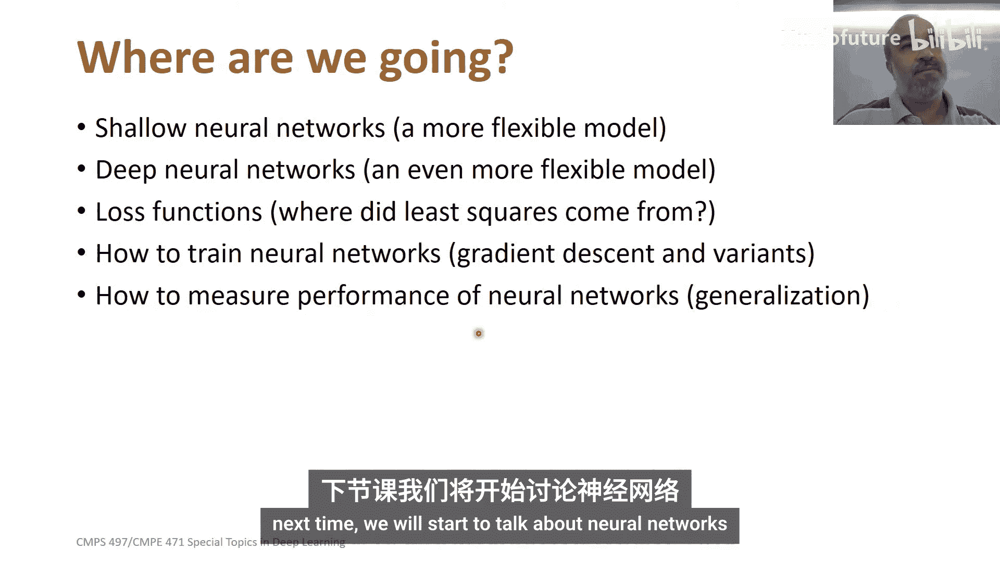
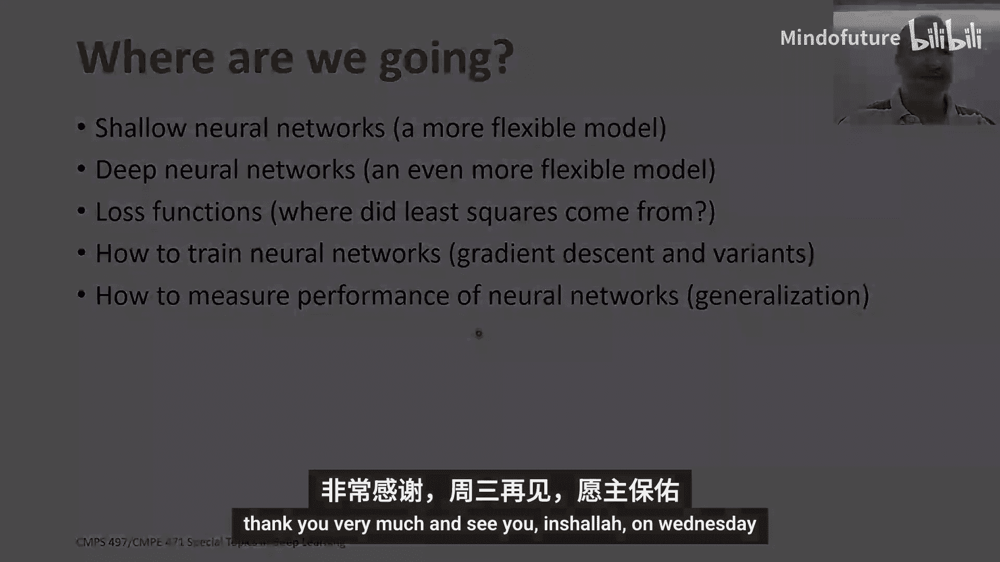

# 深度学习 CMPS497：P03：监督学习详解 🧠

在本节课中，我们将深入学习监督学习。我们将从概述和基本符号开始，然后通过一个简单的线性回归示例，详细讲解模型、参数、损失函数、训练、测试以及过拟合与欠拟合等核心概念。

## 概述与符号 📝

上一节我们快速介绍了机器学习的三种类型。本节中，我们将聚焦于**监督学习**。监督学习的核心是，我们拥有**带标签的数据**来指导学习过程。其目标是找到一个**映射函数**，将输入（一个或多个）关联到输出（一个或多个）。

这个映射函数本质上是一个**数学方程**。我们称之为**模型**。模型通常包含可调整的**参数**。改变参数的值，就会改变方程本身，从而改变模型的预测行为。因此，一个模型实际上代表了一整个**方程族**。

以下是本课程将使用的基本符号约定：
*   **输入**：通常用 `x` 表示。如果 `x` 是普通字体，代表标量（单个值）；如果是粗体 `x`，代表向量（多个值）；如果是大写粗体 `X`，代表矩阵。
*   **输出**：通常用 `y` 表示。字体规则与输入相同。
*   **模型**：是一个函数，例如 `f(x)`。它接收输入 `x`，返回预测输出 `ŷ`。字体规则表示其输出是标量还是向量。
*   **参数**：模型的内部变量，通常用希腊字母表示，如 `φ`（phi）或 `θ`（theta）。模型完整表示为 `f(x, φ)`，简写时我们常只说 `f(φ)`，隐含了输入 `x`。

例如，在预测汽车价格的例子中，输入 `x` 是一个向量，包含车龄和里程数两个值，输出 `y` 是预测的单一价格标量。

## 损失函数与模型训练 ⚖️

为了衡量一个模型的好坏，我们需要一个**损失函数**（也称为成本函数或误差函数）。损失函数衡量的是模型预测值 `ŷ` 与真实标签值 `y` 之间的差距。

对于包含 `I` 个样本的训练数据 `{x_i, y_i}`，一个常用的损失函数是**最小二乘损失**：

**L(φ) = Σ_i (f(x_i, φ) - y_i)^2**

这个函数是模型参数 `φ` 的函数（当然也依赖于训练数据）。损失值越小，说明模型预测得越准确。

**训练模型**的目标就是：找到一组参数值 `φ̂`，使得损失函数 `L(φ)` 的值**最小化**。用数学公式表达就是：

**φ̂ = argmin_φ L(φ)**

这个过程就是寻找对当前训练数据来说“最好”的模型。

## 一个具体示例：一维线性回归 📈

为了具体理解上述概念，我们来看一个最简单的监督学习例子：**一维线性回归**。它用一条直线来建模单个输入 `x` 和单个输出 `y` 之间的关系。

线性回归的模型方程是：

**f(x, φ) = φ₀ + φ₁ * x**

其中，`φ₀` 是截距，`φ₁` 是斜率。这两个参数决定了直线的具体形态。每给出一组 `(φ₀, φ₁)`，就确定了一条具体的直线。

### 损失函数的可视化

对于这个简单模型，我们可以将其损失函数可视化。因为只有两个参数 `φ₀` 和 `φ₁`，损失值可以作为第三个维度，形成一个三维曲面。下图展示了损失函数曲面，以及三条不同直线（对应三组不同参数）在曲面上的位置及其损失值：

我们也可以使用等高线图在二维平面上表示，颜色深浅代表损失值的高低，同一等高线上的点具有相同的损失值：

**训练的目标就是在这个参数空间中，找到损失值最低（最暗）的区域。**

### 如何找到最优参数：梯度下降

寻找最小损失点的一个常用方法是**梯度下降**。其核心思想是：
1.  随机初始化一组参数（在图上随机选一个点）。
2.  计算损失函数在该点关于各个参数的**梯度**（即最陡峭的上升方向）。
3.  朝梯度的**反方向**（即最陡峭的下降方向）更新参数。
4.  重复步骤2和3，逐步向损失最低点移动。

这是一个迭代过程。在之前的线性回归例子中，通过梯度下降，参数从 `(0.0, 0.0)` 逐步更新到 `(0.4, 1.1)`，对应的直线对数据的拟合也越来越好。

你可能会问，对于这种简单的线性模型，难道不能直接通过解方程 `∂L/∂φ = 0` 来求出最优参数的解析解吗？是的，对于线性回归存在解析解。但对于更复杂的模型（如包含数百万参数的神经网络），解析解不存在或难以计算，梯度下降这类迭代优化算法就成为唯一可行的途径。

## 模型评估与泛化 🧪

找到在训练集上损失最小的模型后，工作并未结束。我们必须评估这个模型在**未见过的数据**上的表现，这称为模型的**泛化**能力。

为了客观评估，我们需要一个独立的**测试集**。测试集必须与训练集完全分开，在训练过程中**绝对不能使用**。这就像学生通过做练习题（训练）学习后，参加一场全新的考试（测试）来检验真实水平。

以下是评估模型时可能遇到的三种情况：

1.  **欠拟合**：模型过于简单（如用直线拟合曲线数据），无法捕捉数据中的基本规律。导致在**训练集**和**测试集**上的表现都很差。
2.  **适度拟合**：模型复杂度适中，能够很好地捕捉数据中的主要规律，同时忽略噪声。在训练集和测试集上都有良好且相近的表现，泛化能力强。
3.  **过拟合**：模型过于复杂（如用高阶多项式拟合简单趋势），它“死记硬背”了训练数据，甚至记住了数据中的噪声。导致在**训练集**上表现极好（损失甚至为0），但在**测试集**上表现显著变差，泛化能力弱。

一个在训练集上损失为零的模型，并不一定是“最好”的模型，它很可能只是过拟合了。

## 总结 ✨

本节课我们一起深入学习了监督学习：
*   我们明确了监督学习是利用带标签数据学习输入到输出的映射。
*   我们引入了模型、参数和损失函数的核心概念，并用数学公式 `f(x, φ)` 和 `L(φ)` 来描述它们。
*   我们通过**一维线性回归**这个具体示例，直观地理解了模型如何表示一个方程族，以及损失函数如何在参数空间中形成曲面。
*   我们介绍了通过**梯度下降**最小化损失函数来训练模型的基本思想。
*   最后，我们强调了使用独立的**测试集**评估模型**泛化**能力的重要性，并区分了**欠拟合**、**适度拟合**和**过拟合**三种关键情况。

理解这些基础概念是进入更复杂的深度学习模型（如神经网络）的基石。下一节课，我们将开始探讨神经网络。