# 【卡塔尔大学】深度学习 CMPS497 ｜ Understanding Deep Learning ｜ Fall 2024 p04 P04_第四讲-浅层神经网络 I -BV1vQvNz1EeK_p4-

Somes him and Charlotte today we will start to talk about human networks for the first time in the course last time we covered a very simple example of supervised learning models。

 which is。😊，W which was？What did it recover last time， What did it recover last time。

Lineal regression， okay， so 1 D linear regression， which was really simple， it was just align okay。

 and with that we went through many concepts。That are general to supervise learning like training。

 testing， like loss function， right？Okay， so in China today we will switch to another model。

You saw that with one de regression model it is a bit limited right because it's just aligned。

 not everything is linear in life actually life is much more complex than that。

 so we would like to have a model that can map between first it can fit to more complex functions and also can map between multiple inputs to month without。

Okay， what we saw last time， it was just one to one。

And we will see that in Sha law today that channel neural networks in general are flexible enough to fit much more complex functions。

 and it can allow to have mapping between multiple inputs through multiple outputs。

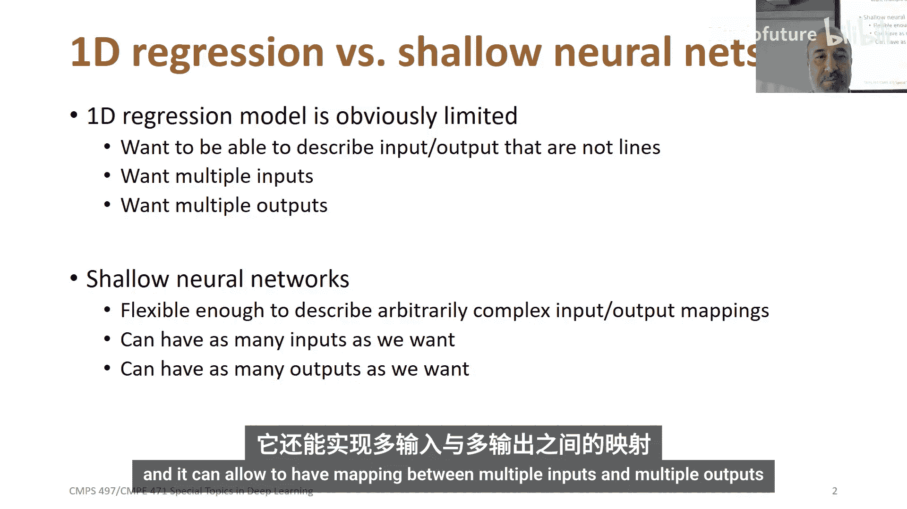

So we'll start again very simple， we'll start with the simplest shallow network。

 which has just one input and one output。Okay， and then we can Sha extended with more inputs and more outputs。

 but let's understand first how one input one output network works and then we'll talk about the more complex ones。

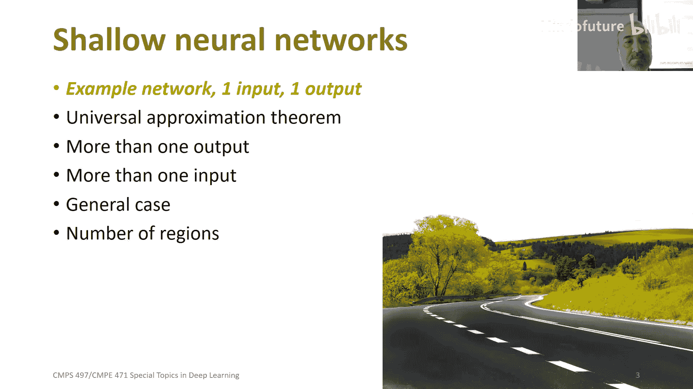

This is the equation for the linear equation that we saw before， right， it's a linear equation。

 how many parameters we have here。😊，Two， what are these two。

 the slope and the intercept of the Y axis， very good。Now， here is an example of a shallow network。

It's just。A more complex function。again， it is like linear regression， it's a function as any model。

 by the way， it would be a function of the input and the parameters。😊，Okay。系。

If you look at this equation。Can you tell me how many parameters we have in this equation？

 So this equation represents a shadow network。 Of course。

 we will understand how this works and what it means。

 But can you recognize here what are the parameters and how many are are they。14 10。Why is it 10。

 so let's count them。😡，Let me change this。Yeah， so what is the first one， where is the first one？

5hi0， Okay， so any， any Greek symbols of the are the parameters， by the way。 Okay。

 so Phi0 is a parameter。😊，快 one。Okay， how about this？No， why not。It's a function。

 we said that the function has a square brackets like that， So this is a function。

 and then this is a parameter that's a fourth one。😊，5th，6，7，8，9，10。 Okay。

 so we have 10 parameters here。Okay，10 parameters。 How many inputs。

Which is x just one input x here and how many outputs。One。

 because that's if we know the values of the parameters。

 that will eventually be a number and that's the one input， the one output。Okay。😊，Yes。

 so a function that uses another function。So a here is a function。

 and we actually call it an activation function。Okay， so a is for an activation function。Now。

 as you can see， the activation function is applied actually three times here。😡。

And it is usually the same the activation function。😊。

And there are many possible activation function that are used in neural networks。

 the most widely used of them is called rectified Line unit。😊，Or in short， value。

So the radio function is one of their very commonly used functions and we will use it a lot。

 at least as an example in our course。T， let's look at this value function first before we look into back into the the neural network equation and and understand how this function actually works The value function takes an input。

And if the input is positive。😡，It will just pass it。So here the input is z okay。

 the output is also z if z is greater than or equal to0， so whenever the input is positive。

 it passes as it is as an output。😡，if the input is negative。Then the output is 0。 So it's like clips。

The output， the input。In the negative regions， okay， whenever the input is negative。

 it's tipped to be0， whenever the input is positive， it passes as an output。

 so it looks like this exactly。😡，If the input is negative， the output is 0。If the input is positive。

 then the output is exactly like the input。Whatever the values of the input is will be the output。

 This is how the radio function works。Okay， so it's like removing all the negative parts。

 Every negative point value will be mapped to。To 0。Okay， this is how the radio function works。Now。

 back to the network。😡，Back to that equation， the this complex equation。As you said。

 it has 10 parameters。Last time we talked about。The notion of having parameters in a function。

As indication of the fact that it is a family of equations its not just one  equationator right because with changing the values of these parameters we have other functions they have all the same form。

 but they are actually different functions。So。The function that you saw here representss a family of functions。

The values of the parameters determine a specific function of them。😊。

And if we know the values of the parameters， then we can compute the function。

 we can compute the output of the function right so given the parameter values we can perform inference。

 we talked about that last time when we have the values of the parameters。

 now given the value of the input we can do inference。

 which means we can get the output of the function or the prediction in this case。

And if we have training data and loss function， then we can change the parameters to find the best values of the parameters that can fit the data or can minimize the loss function。

有拉长时我们他就出来了。Yes， it's much more complex， we'll see how it looks。系啊。

But all of these are just concepts that we discussed last time， so nothing new here。

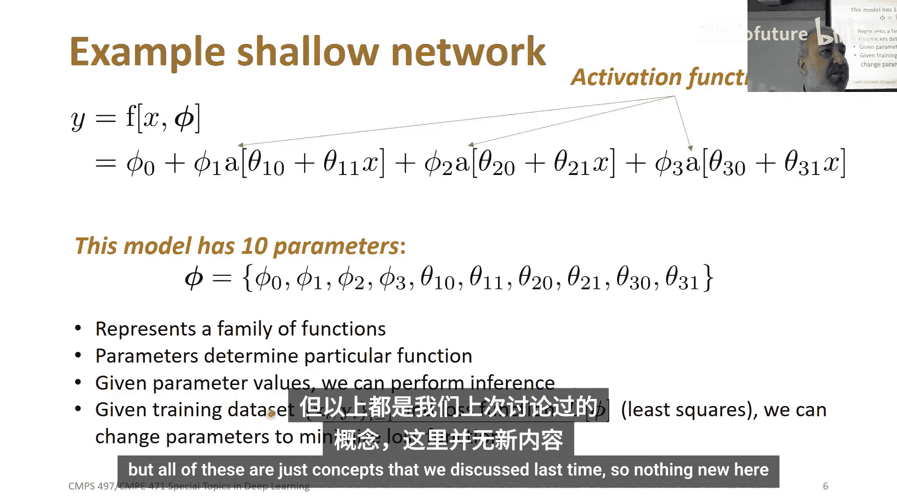

Now what does it actually present that' the question that I just got？It looks very complex， right。

Usually in computer science， when something is complex， we decompose it into smaller parts， but just。

In short， this is how the function will look like。😡，Okay， eventually。

 these are just three examples of how this complex function will look like eventually。

It might not of course look very trivian now， okay， but it will look something like that。

Before we understand how actually this is the case。

From the form or from the shapes that you that you see here， the three examples that we see here。

 we can say that the output function will be piecewise linear piecewise linear means it has pieces of linear。

Functions， okay， each region here is a linear part。This is what we call linear。

 a piecewise linear function。Okay， it's connected pieces of lines。

And all the shapes of the family of the functions of this equation will be like that。

But which shape exactly depends， of course， on the parameters。Now let's see how we get we can get。

A simple like that。

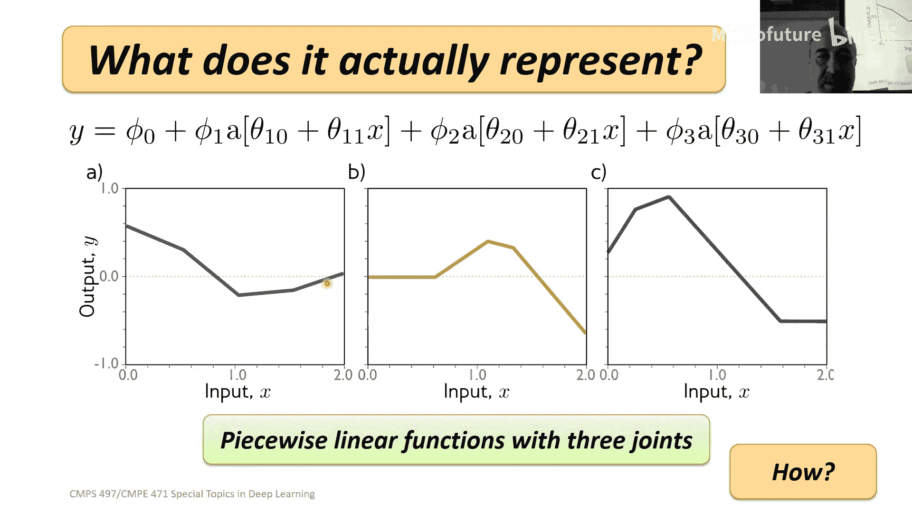

As I said， we will have to decompose it into small parts。

So let's break it down， we will first break it down into two parts。

You can see here in the equation that we have。Three things that are similar。

 if you look at each one of them， this part。What is this？Did we see something like that before？

This is， this is a linear function。 This is looks exactly like。The linear。Okay。

 so it seems like there are three linear functions here， this is one。😡，This is second， this is third。

Okay。😊，And each one of these are apply to the activation function。😡，Because you see a of this。

 a of this， a of this， right the output of the activation function is called a hidden unit。

 so each one of these is called the hidden unit， so we have three hidden units in this model。

So the hidden unit is a linear function。😡，Okay， apply to。The activation function。

Will apply it by the activation function as an input to the activation function。ok。

We call the first H1， H2H3， these are the heading units。

And then if we now plug in H1 and H2 and H3 in the original function， well get this。 So now we have。

Phi 1 multiplied by h1 plus P phi 2 multiplied by h2 plus phi 3 multiplied by h3 plus。Fize you。

So it's like we are scaling。The values of the hidden units。

adding them together and adding another parameter， another value。Okay。

 now let's look at every single step。 actually， you will have four parts first the so let's make it further。

First， we will look at the linear functions。So these are the three linear functions as we saw before。

 this is the linear function so it would be aligned right so the first one can be like this the second can be like that。

 the third can be like that。Okay， but which。Lions， exactly。

It depends on the values from now on here in this lecture。

 we will assume that we know already the values of the parameters。 We will just want to understand。

The behavior of the function， Okay， assuming that we know already the values of the parameters。😡。

Okay so depending on theta 1，0 and theta 11， we have this slide。

Do we know anything about Theta 10 and theta 11 from that line now？So what how about theta 10。

 What is theta 10。It's the y intercept， right， So it is probably minus。-02 probably。Yeah， right。

 but how about theta 11？Is the slope， it looks like a positive， of course。

 and probably is less than one。Okay。Right， here。This is the y intercept again is phi is theta 20 and the slope is theta 2 1。

 and it is positive。And I think the stop here is larger than the previous one， how about this one？

A negative slope and the wire intercept is high。Okay， we saw this last time， these are just lines。

游戏啊。Yeah， yeah， we will assume that we know the values of course right we know the values of the parameters here we just want to understand no。

 no no， no this is not the best， this is just one example of the of the model。😡。

the goal today is to understand the behavior of the function。It's not about training。

 we it's assumed that we trained the already， we have these values。Whether it's the best or not。

 we don't care， about how it will work。So that's the first step， it's a linear function。

One pair hidden unit。Okay， after the linear function， we apply to。The activation function， right。

 so what do you expect。😮，Will happen if we apply， for example， this one to the to the radio function。

Remember， the radio function clips the negative path at0。😊，And passes。The positive part。Yeah。

 so the negative part will be0 and the positive will be。The same it will not change。

 That's exactly what we will see here。 Okay， so the negative part is gone。 It's now 0。And。

The positive stays the same。Same here。Negative is gonem， positive is the same。

so it's like clipping the negative part。For the third one， it's the same concept。The positive part。

Okay， it stays the same and the negative path is different。

So this is the second step so the first thing the linear function okay then the linear function is applied to the value function right and that's the output from the value function actually these are the hidden units these are the values of the hidden units。

😡，Okay， these are the values of the hidden units。😡，Okay， now are these value is linear。😡。

Of course no now they are no longer linear。😡，Because of。The activation function。

Case with activation function makes them non nonlinear。对 yes。我这是谁。Yeah。Very good question。😊。

Let me let me generalize the question to what is name of the activation function in general。

 so one of the main goals of the activation function is to make the output eventually to be nonlinear so that it can fit nonlinear functions。

😡，As we said， life is very complex right life is not linear。

 not everything will be linear in the problems that we will we will see。

 so we need a way a mechanism to make the output nonlinear。One of them。Is to use the radio function。

 Okay， but there are many other functions， by the way。Interal nonlinear function， yes， in general。

 yes， exactly。And what happens， imagine if the activation function is linear。😡，现他。

It will be applied to the to the input， but the output will be。No， it will not be wrong， it will be。

And imagine that the area not the area， imagine that the activation function is just a linear function。

😊，It is another linear function， so we apply a linear function to a linear input。

What would be the output linear， Okay， so we still have a linear。 So at the end。

We don't need to have this lecture if the activation function is linear， because at the end。

 it will be aligned。Whatever value you do， as long as whatever you do is linear。

 the output is linear。Okay， but now it's a different story。So that's now the second step。

 what's after that？😡，Remember actual the original model we have we have a linear function。

 the linear function is applied to an activation function。

 then we add so that's now the hidden unit right now we add the hidden units together no before we add the hidden units we multiply by a weight。

So we scale the activation， the hidden unit， so scaling means we multiply by a constant。😊，Okay。

 now when we multiply by a constant， we multiply something like that by a constant， what will happen？

😡，Let's say the constant is positive。😡，Yes。我是。The zero part， the clipped part。

 what will happen to it， it will stay 0 right0 times positive times positive0 type about the other part that's not clipped。

😡，It will be scaled。based on the weight， if the weight is higher than 1。

 the values will increase if it's less than one， it will decrease。😡，Okay， if it's negative。

It will invest the sign。Okay，And that's exactly what happens here。

So look at this okay this is now so in the first row that's the h1 and this is h2 and this is h3 now we multiply by h1 by phi1。

😡，We would get this one。Okay， now。Can you guess if Phi1 is positive or negative， it's negative。

It's negative because the sign has changed。😡，And how about how about the second one。

It's positive positive more greater than one or less than one greater than one because there seems like the values increase about this one。

😡，Poibly positive that。Okay。😊，There was a question here， yes。我没就那个。No， no， no， these are no vectors。

 we are multiplying a bio scalar。😡，Yeah， so it's just a multiplication。嗯。Yes。😊，And the first。嗯。

this one。Why that there's no negative here。you mean this one okay。

 because when we multiply by a value， this value if it' if the value is negative。😡。

Then we are multiplying positive value with a negative value， the result is negative。😡，Right。Yes。

So it's switches the sign。I think you had that question。all it done。I think think。 Okay， yes。

Thiss party on。Is what？5，3 is。So。It doesn't look like one if it's one， then it has no effect， right。

 it doesn't change the value。😡，But I think the I to change it here。 It was， I think。

 lower than them before。Right。Yeah， you can see that even the interceptor was is higher is lower now。

 Okay， so it looks like we scaled it down。喂。Okay， other questions。

Tpe what what it means is to sum these， okay， let me get back here， sum these okay。After skating。

 we sum them and。Add the final offset， the final constant， right， forgetge about the final constant。

 When we add these functions together， what will happen。And， now we have these three functions。

 right？And we just add them。What will happen？These two are gonna cancel。It might be might be。

 but in general， what will happen？We will have linear lesion。😡。

linear regions in each region will probably add the slopes of the lion in in this region。😡，Okay。

 let me show you the example here。For these three。Forget about5hi0 now we are just adding phi1 h1 plus phi to h2 plus 5hi3 h3。

😡，These values are already this a， this is 51 h1 after scaling okay。

 now we are just adding that these three。😡，Okay， now when we add them in every region。

Market with the joints。We will add the slopes， so first of all。😡，If you look at the output here。

 you will see these breaks， right breaking points， we call them noises。Okay。😊。

T why did we get these joints？😡，嗯。Because the function is not continuous at these points， right？😡。

What is the source of discontinuity？😡，Why did we get this discontinu contiity？

Because of the clipping that happens， right？😡，Because of these clips。😡，Right。

 because of these joints。We call these joints。So for every joint。In the hidden units。

We will have a corresponding joint in the output function。When we add them。

 these joints will also appear。So， for example， you see this。😡，Okay， the value of x here may be 0。5。

You will see here at 0。5 or so we have a joint。Okay， here we have this because of。This one。Okay。

 and we have this because of。This one。Okay， now。It's the same x values。😡，Okay。

 now how about this loop。If you look at if you look at this region。

 okay from0 to let's say that let's assume that this is 0。5 okay， from 0 to 0。5。Yeah。

 we add the slopes。 This is how what， what's that slope，0， What's that slope0。It will be that stop。

欢迎。Exactly， it is exactly that stop。And the same for the others。Okay， the same for the others。嗯。Okay。

😊，And that's why we will have this shape， this is what we call piece wise linear function。Yes。

A sequence of。Small piece， small， linear pieces。The slope of each piece depends on。

The slope of each function at that region。Okay。this is when we add。

The three functions together right， but still we have one small step5hi0 when we add phi0 is a constant right it iss considered like a constant its just a number right when we add a number to another value what will happen No not scaling it will。

😡，It will either raise it up or lower it down。Case we're just moving the curve。

Depending on the value of the of fiveio， if pio is positive。

 you see that the curve has moved up and if it's negative， it moves down。

So this is to give flexibility on where we want the curve exactly。Okay。

So that's I think now we understand how we can get something like that again。

 this is piecewise linear function with three joins， why it is with three joins。

Because we have to hidden units， hidden units， each hidden unit has a joint。

Or contributed with a joint in the final output。And that's why we could have。These three functions。

 remember， in the first slide， I showed you this， these three examples。 These are three examples。

 depending on the values of。Of what。The values of what， the parameters。The parameters。

 whenever we change the rise of the parameters， we will have a different function like that。😊。

Is that line？Much more complex than a lot， right？Much more complex than a line and of course。

 a network。Or a shallow network doesn't have to have only three。Hidden units， it can have much more。

 but it's the same concept Each one has a a linear function。Apply to an exhibition function。

Then we add them together， then we add we sorry， before we add them， we scale each one。

And then we add them， then we add the offset， the final offset。Peace wise dinner。Yes。

 it will always be a piecewise linear function。No， it is a curve， by the way。

 but it's a piece wise linear， it's not smooth， you know mean， it's not smooth。

We talk about that data today， okay？Yes。No。Okay， so yeah， there are many others。 personal Oh， no。

 of course， that's not it's not personal。 And in reality， the types of。

Problems or types of outputs for which we choose specific activation functions okay and there are other facts also like whether the activation function will make the training much faster or not we'll talk about that data。

😊，Okay， any question on that？So again， this is pwise linear functions， one joint per reo function。

Okay， now let's talk about。The the value of the slope of each linear region。

We call the slope here following an activation pattern。 What does that mean？

If you look at this lesion， for example， the shaded one， okay？😡，For that reason。

Every hidden unit is either active， which means it has nonze value。Or inactive。

 which means has 0 value。So every piece， every line here， every region。Has some hidden units active。

And some inactive。Let's at this hidden， let's look at this shaded region。For that is a reason。

Which units are active and which are not。😡，How about each one。

Each one is active because it's nonze right in that region， it's nonze。So it's active。

How about H2 inactive。How about H3。Active， why is it H2 inactive， Because it's0 at that。Okay。

 so this is what we call the activation pattern for this region。😡。

And you'll find that for every reason。Some of the hidden units might be active and some might be inactive。

Type， how about the， How about the next one， about this one。OK。What do you think。This one。

What is the activation pattern here？Which hidden， which hidden units are active。 All of them。

 and none are inactive about the last one。 H1 is active。 H2 is active。 H P is inactive。过。都 we的。

It the or。Do need this card like the zero part， because I'm didn't forget at how How was there didn like not active。

It's not actually because it's not。Affecting the output。Yeah let me show you for the first piece。

Okay， what actually affects the output， the final output？😡，这个感看。No， I mean， here for this piece。

 what makes it like that？😡，What， what affects the the output for that lesion。

Is it the first hidden unit， second hidden unit， third dating unit？The first one。

 the first one has no effect， because it's 0。So it doesn't add or doesn't change anything in the output。

 okay？😡，The second one， the theme。So only the third one。Is active。Okay。

 active here means it actually affects， it has an effect on on the output。 Okay。

 so you can see each region has a pattern in each region from of the of the hidden units are active and others might not act。

Okay。So I think we already answered this， which hidden units are activated in the shade visual。Okay。

 no one asked me， what is the network case？We we call it neural network。

Where is the neural world and where is the network？Itt。没。Okay， usually。

 usually when machine learning courses or specifically deep learning courses are taught and we talk about neural networks。

The usual additional way to teach it is to talk about history first。

And why they are called neural networks and why they are neuraler neuraler and how this is related to how our brain works。

 okay？I think we don't know yet how the brain works， and this is not how the brain works。Okay。

 but the guys who thought about that first， they were trying to mimic what they think or how they think the brain works。

But nowadays， it has nothing to do， I think， with what the thing was。

 but still we use the word newer。Okay。😊，Second。嗯。We focus here on understanding how the model works。

If I told you this is neuraler a network and this is how the brain works。

 you might think that this is the only something that is。Beyond what we can we can really understand。

 but it is eventually。an equation， any model， whether it's neural a network or not。

 any learning model， it eventually is an equation， whether this equation is very simple or very complex。

 it's an equation at the end or a function at the end。

 and we are fitting that function to whatever data that we have。😊。

so it's important first to tell you that a neural network is an equation。😡。

But it's important to know how this equation works or how this function that behaves。

 and then I can tell you now why it is called the network。Okay。

 but I won't tell you why it scored newer。Because I don't think it matters to us。

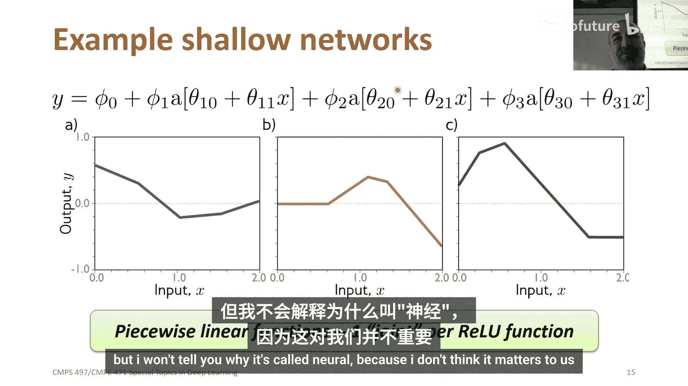

Now， why is it called the network because we usually do it as a network？😡，Okay， actually。

 this is the model that we saw， this are the hidden units and this is the output。😊。

And we depict or draw this model as an network like that。Okay， we have。嗯。The input here。

We have the hidden units。Okay， and we have the output。And the links between these。

 we can call them neurons or nodes or hidden units。Are representing the weights。Okay。

 over the parameters， the slopes， actually。Okay， so far we we， we use them as slopes right。

 the parameter that is multiplied by the input directly。 Okay， so for example， here。

 X okay will be multiplied by。From the equation here is far a theta 11。

 So this link represents theta 11。Okay， this link represents。😮，Theta 2，1， these links。

 this link represents theta 31。But then we also want to add。😡，The offset， right？

Okay so we added by same notion， we have one here multiplied by phi10 theta 10。

 so this is like adding theta 10。And at every hidden unit。

 we add with some together the input multiplied by the weight。Okay， so here this is x， so for h1。

 this is x multiplied by whatever the weight here， which is theta 11 plus 1 multiplied by theta 10。

Then we apply the activation function。Okay， so this is the activation function is。

 and the output out of this node is the hidden unit。😊。

Is applying the activation function to the input。Do you understand this network now。

 but it's still not clear。Okay， so this again， these are the slopes。😡。

So the the black lines are the slopes， the brown lines are the offsets。Okay， we the slopes。

 we call them weights。We will no longer sayloavs， they all waits。Okay。

 and offsets we call them biases。Okay， and that's the termlogy that we would use and usually we don't add any biases to the to the network。

 I mean， we don't add it to the drawing of the network。Okay， they are there by default fourth。😡，Okay。

 but we just represent the widths。By the links。Okay。😊，So again， some terminology。

 these are the weights of the parameters， these are neurons or hidden units。Usually。

 we look at the network in layers。 This is the input layer。 We always have one input layer。😡。

And one output layer。And one or more hidden layers。In shallow neural networks。

 it's just one hidden layer。😡，That's why we call it channel。Okay。

 so we have just one hidden layer here， one input， of course， and one output。Yes。😊，Yeah， so far。

 yeah yeah the input layer has multiple input in general。

 but so far because we are talking about this example。

 it's just one input and one output we't we didn't yet generalize two more， but we will。😡，Okay。Yes。嗯。

Can I just finish this slide and then take your question。 So again， the offsets are the。

 slopes are the width， the values after the value。We call them activations and after we apply the radio function。

 we call the value activation， and before we apply the radio function that's the linear path。

 we call it three activations。😊，Okay， so if we go back here。Seta 10 plus theta 11 times x。

 this is the pre activation value。Applying the activation function to it。

 we get the activation value。Okay， before and after。So that's and as we said。

 the shadow neural network is just one hidden layer and if we have more than one hidden layer。

 we call it deep neural network。Okay。And of course， in neural networks in general。

 we can change the number of hidden units as we increase the number of hidden units。

 we increase what we call the network capacity。Okay， any， if I ask you， if I add more hidden units。

 will that make the network more complex？Or more flexible。😮，hy。😡，morning。What is it there have。No。

 more hidden unitss doesn't mean more data。 It means more parameters。

More parameters and when we have more parameters， that gives us more flexibility to fit more complex。

Problems。Okay， that's why the number of hidden units represent somehow or indicates somehow the capacity of the network。

Okay， yes。嗯。Sure。Here。不说有。Yeah，5hi0 is the is an offset of if we go back here。

 it's an offset that is added to before for the value of y。It's like it's a bias for why。嗯。Okay。

 remember that we are presenting these equations。😊， so to represent why。😮。

And we say that for every node like that， we sum the inputs and then add the bias。

Okay so with some actually in general， with sum the input for this for this figure with sum the input。

 so with sum the output of this。Scaled by or multi by the weight。

Plus the output of this multip by the width， plus the output of this multi by the width。

 this is the part from here to here。But then we need to add this also。😡，So to make it a general。

 we just multiplied by one so that it looks like we are always adding multiplying the source。

In general， multiply their weight by the source and adding it to the target。

And to just make it constant like that， we multiply by。But in reality we don't do that。

 I mean we don't do it like that， we just do the hidden units， the input output and the hidden units。

 and we assume that we know that for every hidden unit and for the output there is a bias always added to the input so the parameters of the network with this termlogy。

What are the parameters of the network？The biases end。En with。

And that's the term that we use we will never say why offsets or slopes unless us， okay。

 you understand how it works， we will just say weights and biases。Yes。

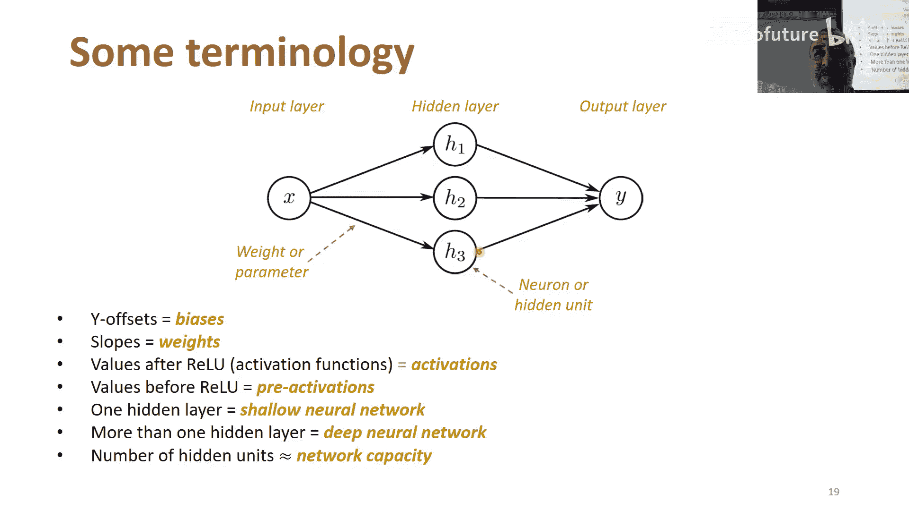

ok。Quick Paul。In one input， one output channel network， which is the one that we discussed today。

If we have five hidden units。If we have five hidden units。

 then the number of joins in the output function is 5。😡。

The number of linear regions in the output function is file。

The maximum number of joins in the output function is 5。

 the maximum number of linear regionss in the output function is 5。Which of these， if any。

 is correct？不。Let's take one by one。How about the first one。If we have five hidden units。

 the number of joints in the output function is five。😡，Not always。 Why is not always。

And we said that every he unit。Has a joint right because of activation the radio function， right？😊。

Will that contribute to a new joint in the output function always？Why not。你开始要。No。

 but we have five hidden units， right Each hidden unit is broken somewhere。

 Each hidden unit has a a joint。 So does does that mean that this will will give us an output with five。

😡，Joins。😊，后。When we sum them， I mean when we sum the slopes。

 it might not change from the previous one so it doesn't look as a joint。

 but there is even easier reason than that and I think more clear what if two joins are aligned together。

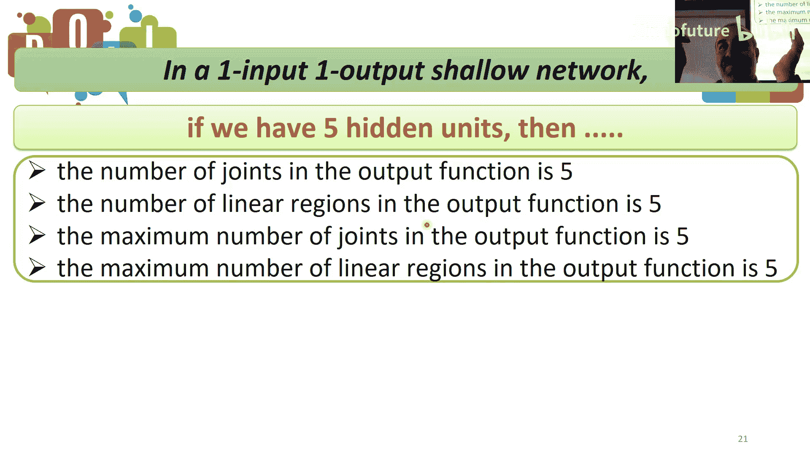

And if we get back here。Okay， here， this function is clipped here right at 0。5。😡。

Maybe this function also will be clip at 0。5。😡，So each one has a joint， but they are all the same。

 So they will point to the same joint in。In the output function。Right， so it doesn't。

 We don't have to have five。But we， we have to have。Maximum of five。So the maximum will be five。

 but we might have five， we might have four， we might have three。

 depending on the alignment and also the slopes， maybe some slopes will cancel each other。😡。

So the maximum is five if they are all different。😡，If we have five different joints。几。😊。

Prob you will have five joints。 if if the slopes will be different。Yes。😊，Not three hidden layers。水起点。

Uns。All in one layer， we call it that one layer。😡，Okay， we didn't talk about more layers yet。Okay。

 is that clear now， so back to the question。

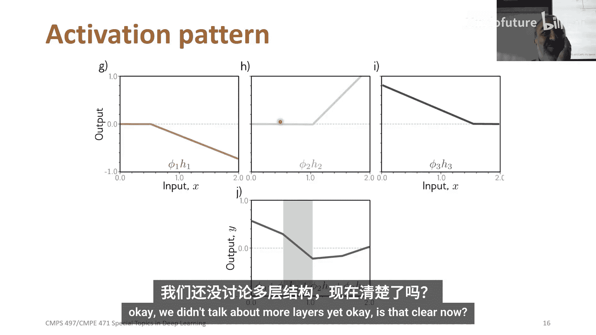

So the first one is204。😡。

First， because it might not be fine5 type then the second one。

The number of linear regionss in the output function is5。Yeah， not necessarily， not necessarily。

 the maximum number of variance is five。Do you agree now， Did you understand it why， Okay。

 the last one。Because we have the I say we have the maximum。Very good five joints yes。

Then we then how many linear lesion will we have。How many。我觉他朋友。

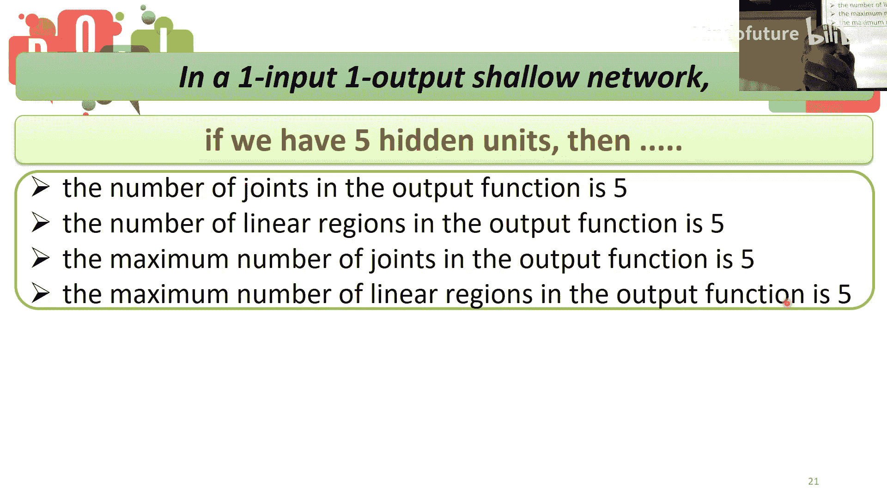

分别。Okay， let's get back to the function that we saw before。How many linear lesions we have here？4our。

 how many joints， three， when we have three joints， we have four agentss when we have five joints。6。

 so is that the maximum number of linear regions in this case or that's the actual linear lesion。

In general， if we have five hidden units。在是2。Maxum maximum with the actual。

 and then we said that we have maximum of five， so maximum five join right。

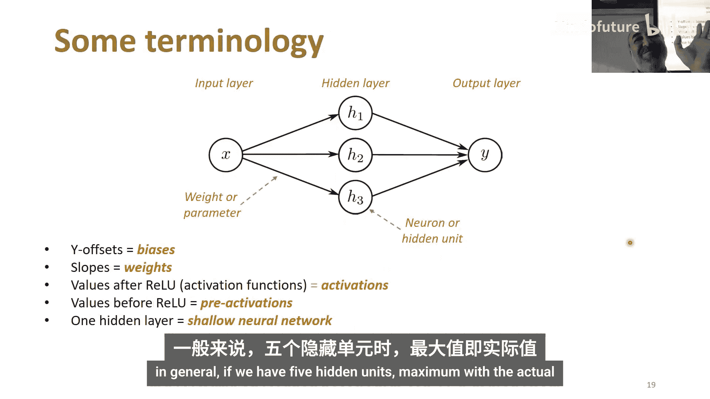

That turns leads to maximum 6 linear issues。 What if we say the number of linear issues is。6。Again。

 it's the maximum。 Okay， we cannot guarantee if， if we have6。 Okay。

 so the maximum joins 5 maximum linear lesions。6， is that clear？Yeah。

 the maximum is personal on because yeah， because if you think about it， five joints means6。No， okay。

 another question， a linear reason can have。Zoactive hidden units。😮，Only one activ unit。😮。

All hidden units active。All of them are correct。So we can have zeroactive hidden units in one Asian。

😡，Can we have one only？It can happen， it can happen that all of them are active， Yes。

 so all of them are great。没有。

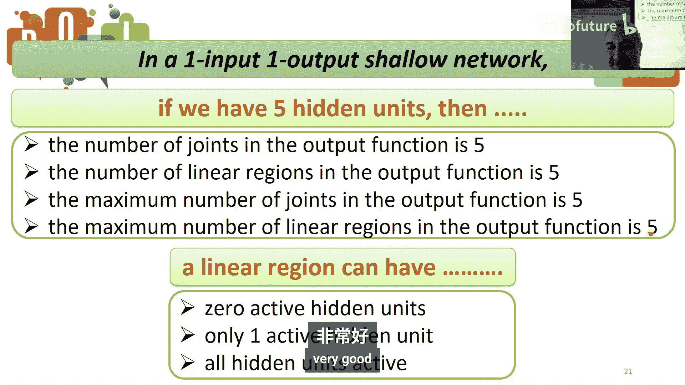

Okay。how many parameters are in a shadow network with one input， six hidden units and one output？

Think about that， okay。How many parameters are in a shadow network with one input， six hidden units。

 and one output？So one input and one output like what we saw， that's what we started today。

 six hidden units。😡，First， how can we？How can we do this？嗯。So we have one input。And。1，2，3，4，5，6。

 right。YouHave。Links like that。And then we have one output。Right。😮，晚安嗯。Yeah。嗯。Okay。

So that's the input。That's the output， and that's the hidden layer。How many parameters we have。Yes。😊。

19， okay， why。So you said 19， right？Okay， let's see why。One is what。在关。Let's talk in the terminology。

 so in the termmeninology， we have weights and biases。😡。

That we said that parameters are weight on biases， anything else other than that， No。

 so how many weights and how many biases。😡，对。So which six weights， so these are six， right？

So we have six widths， so's this is widths， six， which are these， any other widths？嗯。How about these。

 these are not weights。😮，Yeah I also wait tonight？Yeah， wait's awesome。

These are waves multiplied by x。😡，And these weights are the weights multiplied by the hidden unit。

remember they were3 and fine？So these are theaters and these are fives。are the scaling。

 this is the scaling of the output of the hidden unit。

 and these are the parts of the linear functions。Okay， so we have six plus six weights。

 any other weights？Any other weights。No， about the biases。

Only1 bias we have one bias for each hidden unit， so usually we do that to indicate biases。Okay。

 so these are the biases。 How many biases we have。6 plus one here， also。Okay。

 so we have six plus one。😮，So。Or what exactly， Okay， so the question is。

 does that represent one network？😡，Or what。Yes， that's the network。

But there are things that are implicit here because we this is a way that's the usual way to do neural networks。

 We don't do biases， We just do the weights， but we know that for every neuron。😡。

We have a bias except the input。No， no， no， okay， let me show you where is the equation？😡。

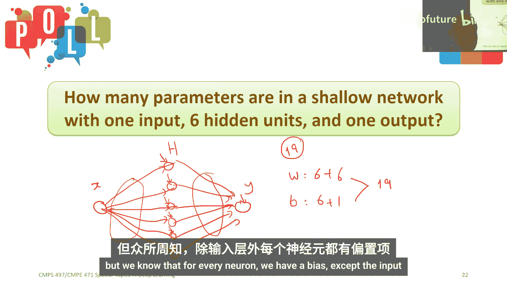

This is the equation right， this is the equation right， where are the biases。

 where are the widths here。😡，我会找到整个是间，整个路点。Not only the slopes。 are the these are weights and also。

These are its。Anything that is multiplied by the input is the is the width。😡，Okay， so Cs。

 these are cs。Fs， these are fires。But where are the biases？For no in equation。This is a bias。

 these are the biases。Only。And this one also。Okay， so we have a bias for each。Note or neon。

 whatever you call it。😮，For each hidden unit and the output also。那你们。Okay。

 did we say anything about preceptton here， We didn't。 We didn't。 Okay， don't confuse yourself。 Okay。

 preceptton is just one neuron， just one neuron， not one layer。1 neuron only is called preceptor。

So again， these are the weights。So we can we can write this theta 10 and oh， sorry， theta 11。

And this one is。Theta 21 and this one is。Get the three one。And how about this？No。No，5 one。F，2，5，3。

But where is theater10。Yeah。he is a bias。And so on。 and where's phi0 on y？Okay。😊，Actually。

 the the ones written here are the biases only。Yeah， not the the other the links。

 the other links that are unnamed are actually the width。可以吗。啊 you mean you mean infants。

It depends on， of course， the value of x。😡，The value of x will determine which reading unit is。Is。

Active。Okay。Depending on the value of x。We will the value of x will determine which hidden units are active。

😡，And thus， which of them will affect the value of。The output。Okay。HAny other questions？Okay。

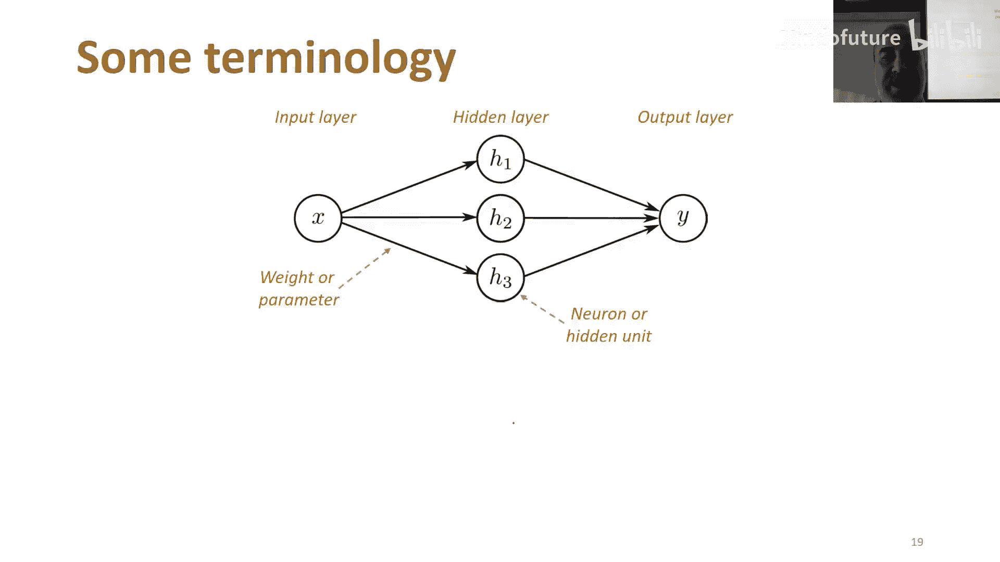

对。Now let's talk about very important property of neural networks in general， okay not only shallow。

 but we'll talk about Sha now it's called universal approximation theory， what do we mean by that？

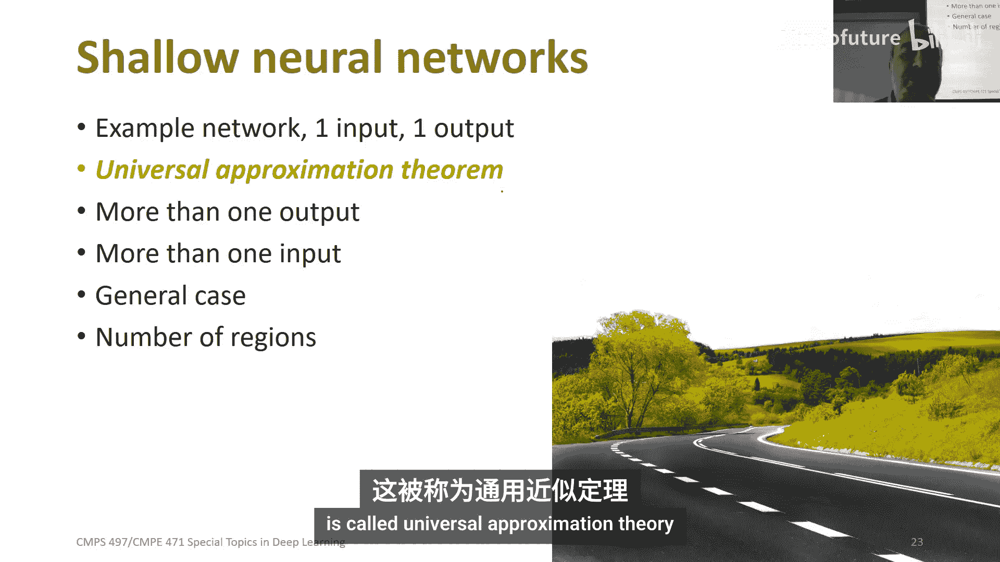

This is what we studied so far in the lecture has only three hidden units， right？😡。

Can we expand that or extend that to any number of finiteity hidden units？😡。

What should we change in this equation？Yeah， let's say Maana， we have 10 hidden units。

 what should we do？What would be the model？Well add more hidden units here and about this。

 we also some more right， so in general， when we have D hidden units。Each one will be。

Exactly the same， I mean， similar linear function and then applying the activation function。

 and then here we will just add all of them。😊，Scaling after waiting， of course。Okay。😊。

So that's the shadow neural network Engine。With the humans。但。

You saw the network with three hidden neurons， right？第。If we add more hidden units。

 what will happen to the function？More more linear pieces， you mean， more linear lesion。😡。

But when we add more linear lesion。What will be the effect that that it will get smoother over time right when we add and thus it will it can represent more complex functions Okay。

 so let me show you an example。Actually， the example is then yeah here。

Let's say that this is the dotted curve here is the actual function that we want to fit。😡。

If we have if we fit it with five linear lesions， we can have something like that。😡，Remember。

 all of them are doing， right。If we have 10 linear lesion。😮，It will be。Even better， right？

If we have 20。😮，It's。Almost。Exactly。The function， right？Okay。😊，If we have more complex function。

 ending more hidden units。😊，Eventually we we will get to it。So in general。

 we can describe any 1 d function。😮，To arbitrary accuracy to some accuracy of course it won't be exactly the same right because eventually this is linear right this is piecewise linear it's not 100 percent smooth right of course when we add more it will look like smooth but eventually it's piecewise linear okay so there might be some difference between the model that we have and the actual function if the function is not piecewise linear okay but it will match it to a great extent。

😊，So this is what we mean by the universal approximation theory with enough hidden units。

 a shallow neural network can describe any continuous function on a compact subset of the real number line to arbitrary precision。

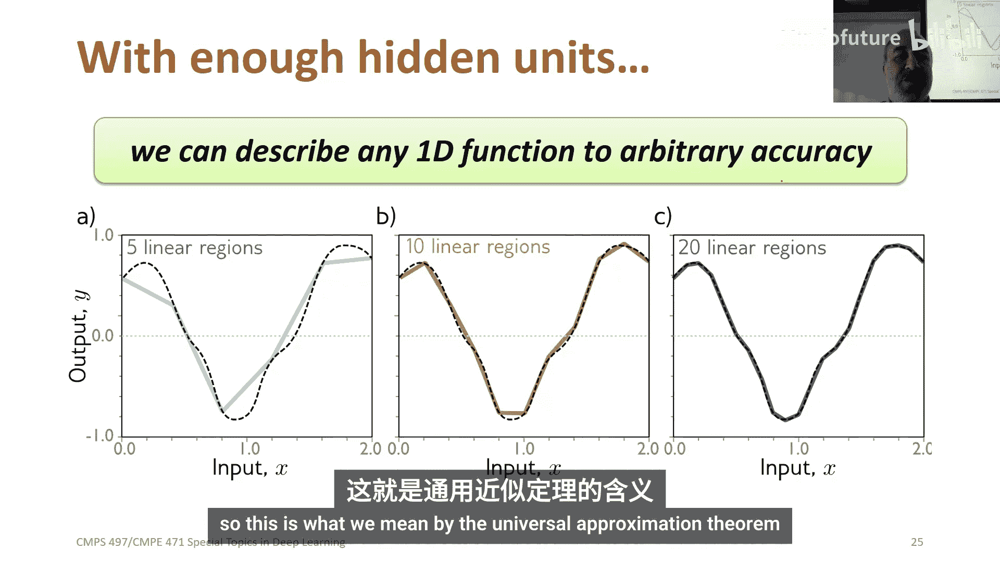

To specific accuracy。Okay， which means that we can do anything with。With a shallow neural network。

But the key point here is specific word here in the the。 Can you tell me which word here is the key。

Key point。With enough， very good， with enough hidden units， can we in advance know what is enough？

Maybe that enough will be million billion okay， we don't know， but with enough we can reach it， okay。

 how many maybe that will be very expensive to do。Okay，And that's why in Sha。

 we will talk about deep networks。But with shallow， we can theoretically， we can do everything。😊。

Okay， any question about that？

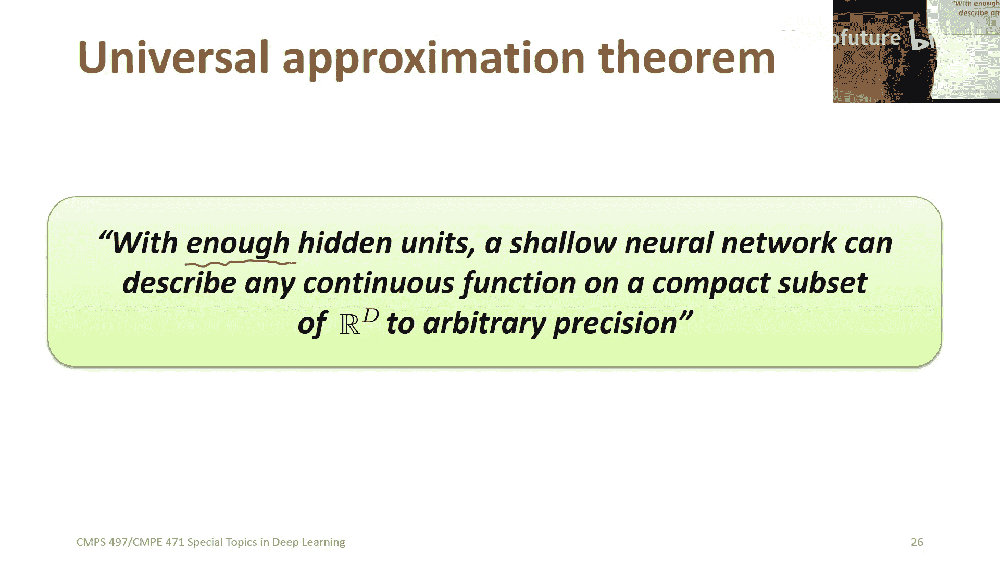

Okay， we wouldn't shut to continue next time。