# 深度学习 CMPS497：P04：浅层神经网络 I 🧠

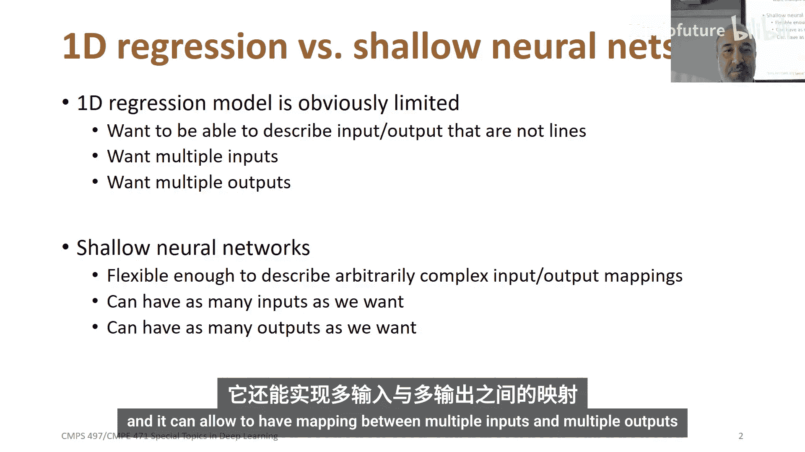

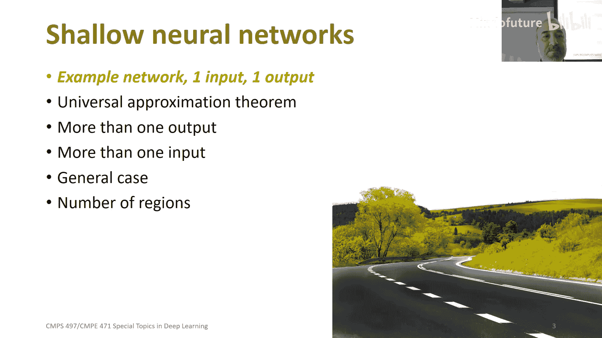

在本节课中，我们将首次在课程中讨论神经网络。上节课我们介绍了一个非常简单的监督学习模型——一维线性回归。它只是一个线性函数，功能有限。现实世界要复杂得多，因此我们需要一个能够拟合更复杂函数，并能处理多输入到多输出映射的模型。本节课我们将看到，浅层神经网络足够灵活，可以拟合更复杂的函数，并允许在多输入和多输出之间进行映射。

我们将从一个非常简单的模型开始：只有一个输入和一个输出的网络。理解了它的工作原理后，我们再扩展到更复杂的多输入多输出网络。

## 从线性回归到神经网络 🔄

上一节我们介绍了线性回归模型，它是一个简单的线性函数。本节中，我们来看看一个更复杂的模型——浅层神经网络。

这是我们之前看到的线性回归方程：
`y = θ₀ + θ₁x`
它有两个参数：斜率 `θ₁` 和 y 轴截距 `θ₀`。

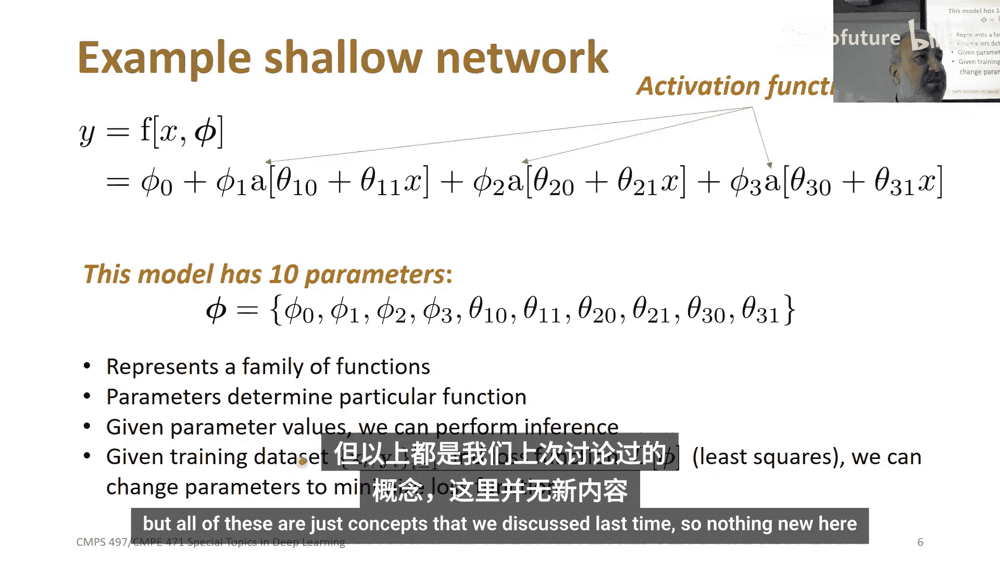

现在，这是一个浅层神经网络的方程：
`y = φ₀ + φ₁ * a(θ₁₀ + θ₁₁x) + φ₂ * a(θ₂₀ + θ₂₁x) + φ₃ * a(θ₃₀ + θ₃₁x)`

这个方程代表了一个浅层神经网络。让我们数一数它有多少个参数。以下是参数列表：
*   `φ₀`
*   `φ₁`
*   `φ₂`
*   `φ₃`
*   `θ₁₀`
*   `θ₁₁`
*   `θ₂₀`
*   `θ₂₁`
*   `θ₃₀`
*   `θ₃₁`

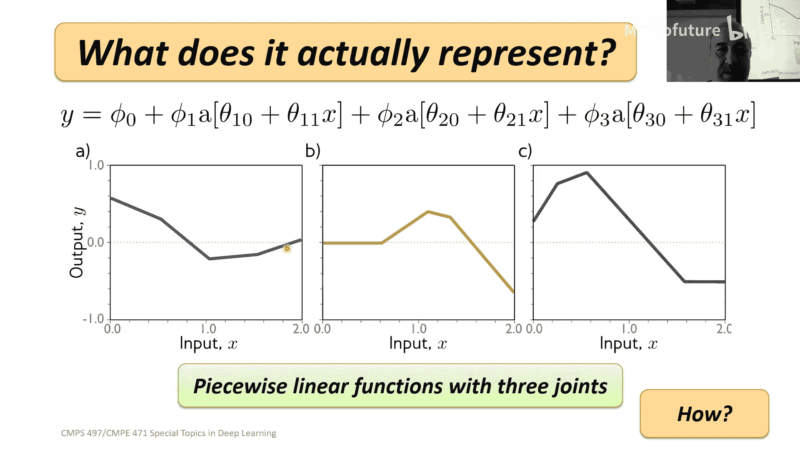


这个方程总共有 10 个参数。它有一个输入 `x` 和一个输出 `y`。这里的 `a` 是一个函数，我们称之为**激活函数**。在这个方程中，激活函数被应用了三次。激活函数通常是同一个函数。

神经网络中使用了多种激活函数，其中最广泛使用的是 **ReLU**（修正线性单元）。让我们先了解 ReLU 函数，再回到神经网络方程。

## 激活函数：ReLU ⚡

ReLU 函数接收一个输入 `z`。
*   如果输入 `z` 为正数或零，则输出等于输入：`a(z) = z`。
*   如果输入 `z` 为负数，则输出为零：`a(z) = 0`。

用代码描述其行为如下：
```python
def relu(z):
    if z >= 0:
        return z
    else:
        return 0
```
它的作用就像是“裁剪”掉输入的负值部分。所有负值点都被映射为 0，正值部分则原样通过。

## 理解神经网络方程 🧩

回到那个复杂的神经网络方程。它有 10 个参数，这意味着它代表了一个函数族，而不仅仅是一个方程。改变这些参数的值，我们就能得到形式相同但具体不同的函数。如果我们知道了参数的值，就可以进行**推断**：给定输入值，计算函数的输出（即预测值）。如果我们有训练数据和损失函数，就可以调整参数，找到能最好地拟合数据或最小化损失函数的最佳参数值。

这个函数看起来非常复杂。在计算机科学中，处理复杂事物的方法通常是将其分解为更小的部分。这个函数的最终形态会是**分段线性**的，即由多段线性函数连接而成。具体是哪一种分段线性形状，则取决于参数的值。

为了理解它是如何工作的，我们需要将其分解。

### 分解步骤 1：识别线性部分

观察方程，我们可以看到三个相似的部分：
`a(θ₁₀ + θ₁₁x)`, `a(θ₂₀ + θ₂₁x)`, `a(θ₃₀ + θ₃₁x)`

每一部分内部 `θᵢ₀ + θᵢ₁x` 都是一个线性函数，就像我们之前看到的线性回归一样。然后，这个线性函数的输出被送入激活函数 `a`。激活函数的输出被称为一个**隐藏单元**。因此，这个模型有三个隐藏单元：`h₁`, `h₂`, `h₃`。

将隐藏单元代入原方程，我们得到：
`y = φ₀ + φ₁ * h₁ + φ₂ * h₂ + φ₃ * h₃`

现在，方程看起来像是将隐藏单元的值缩放（乘以 `φᵢ`），然后相加，最后加上一个常数 `φ₀`。

### 分解步骤 2：从线性函数到隐藏单元

首先，我们看三个线性函数。假设我们已经知道参数的值（本讲座中我们假设参数已知，目的是理解函数行为）。每个线性函数在图上都是一条直线，其斜率和截距由对应的 `θᵢ₁` 和 `θᵢ₀` 决定。

接着，我们将线性函数的输出送入 ReLU 激活函数。ReLU 会“裁剪”掉负值部分（变为0），正值部分则保持不变。经过激活函数后，原本的直线变成了在某个点（“关节”处）发生转折的折线。这些折线就是隐藏单元 `h₁`, `h₂`, `h₃` 的值。**激活函数的作用是引入非线性**。如果激活函数本身是线性的，那么整个网络的输出最终仍然是线性的，就无法拟合复杂的非线性关系。

### 分解步骤 3：缩放与求和

得到隐藏单元后，我们将其乘以权重 `φ₁`, `φ₂`, `φ₃`（缩放）。
*   如果权重为正数，正值部分会被按比例放大或缩小，零值部分保持为零。
*   如果权重为负数，正值部分的符号会被反转。

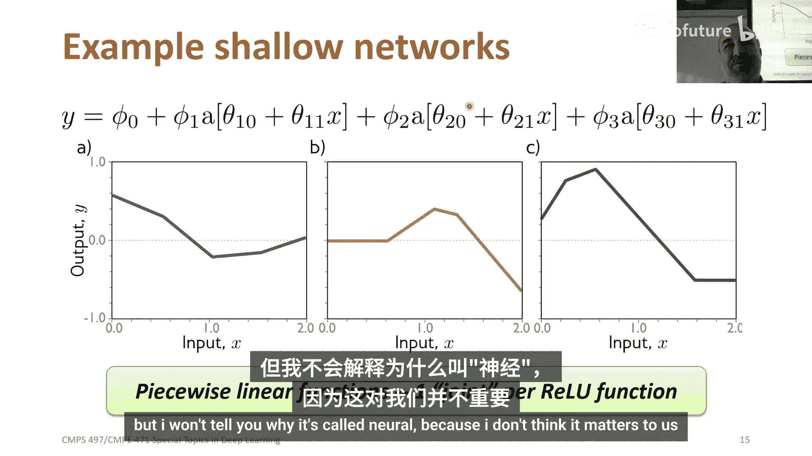

缩放之后，我们将三个缩放后的隐藏单元加在一起。在相加时，每个线性区域的斜率是各个隐藏单元在该区域斜率的加权和。同时，每个隐藏单元自带的“关节”也会在最终输出函数中体现出来，成为最终分段线性函数的转折点。

最后，我们加上偏置 `φ₀`。这会将整个曲线向上或向下平移，提供了调整函数垂直位置的灵活性。

通过以上步骤，我们就得到了一个具有三个“关节”的分段线性函数。每个隐藏单元贡献一个潜在的“关节”。浅层神经网络可以拥有更多隐藏单元，但概念相同：每个隐藏单元都是一个线性函数加上激活函数，然后被缩放、求和，最后加上一个输出偏置。其结果总是一个分段线性函数。

## 网络图示与术语 📊

为什么它被称为“网络”？因为我们通常用网络图来描绘它。

```
输入 (x) → [隐藏单元 h₁] → 输出 (y)
         → [隐藏单元 h₂] →
         → [隐藏单元 h₃] →
```
（图中，从输入到隐藏单元的连线代表权重 `θᵢ₁`，每个隐藏单元和输出单元还有一个额外的偏置连接 `θᵢ₀` 和 `φ₀`，图中通常省略但默认存在）

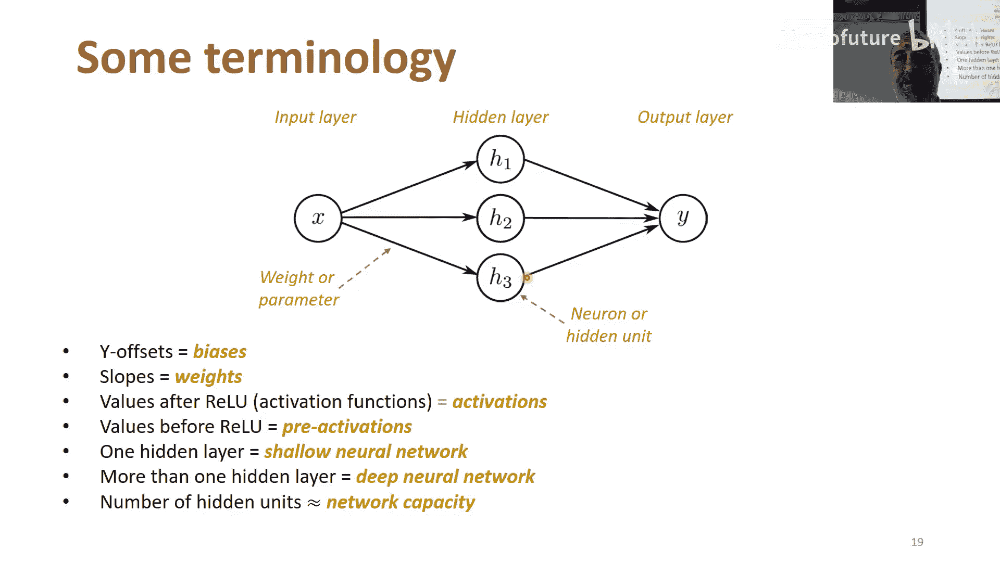

以下是标准术语：
*   **权重**：连接线上标明的参数（如 `θᵢ₁`, `φᵢ`），即之前所说的“斜率”和“缩放因子”。
*   **偏置**：每个神经元（隐藏单元和输出单元）附加的常数（如 `θᵢ₀`, `φ₀`），即“截距”。
*   **激活值**：应用激活函数后的值（即隐藏单元的值 `hᵢ`）。
*   **预激活值**：应用激活函数前的线性组合值（`θᵢ₀ + θᵢ₁x`）。
*   **层**：网络由层组成。我们总是有一个输入层和一个输出层。**浅层神经网络**只有一个**隐藏层**。如果有多于一个隐藏层，则称为**深度神经网络**。
*   **网络容量**：隐藏单元的数量表示了网络的容量。更多的隐藏单元意味着更多的参数和更高的灵活性，可以拟合更复杂的问题。

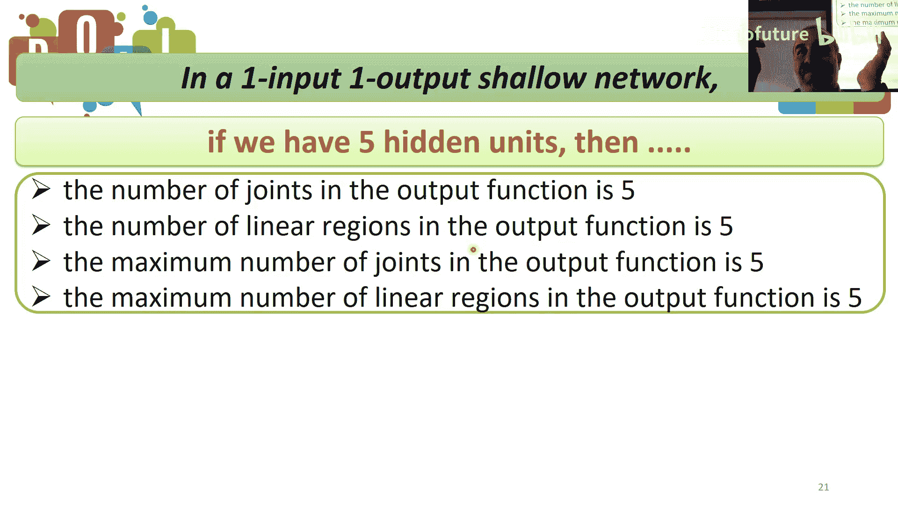

## 关键特性问答 ❓

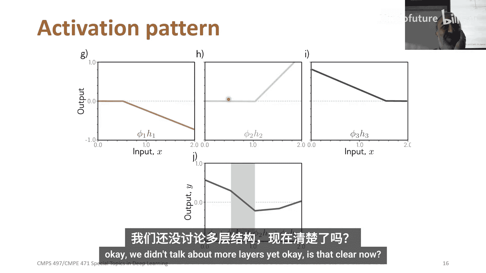

**问题**：在一个具有 5 个隐藏单元的单输入单输出浅层网络中，关于输出函数，以下哪项正确？
1.  关节数量是 5。
2.  线性区域数量是 5。
3.  关节的最大数量是 5。
4.  线性区域的最大数量是 5。


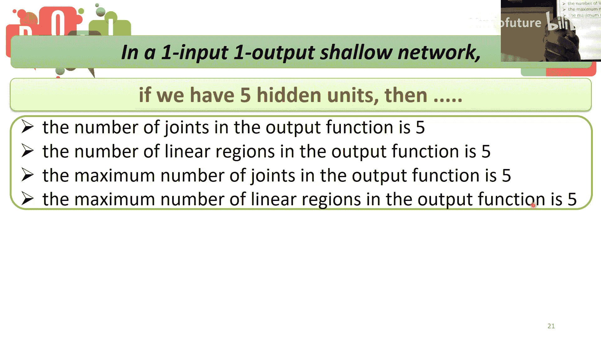

**分析**：
*   每个隐藏单元由于 ReLU 激活会产生一个“关节”。但是，如果两个或更多隐藏单元的关节恰好发生在相同的输入值 `x` 上，它们在输出函数中会合并为一个关节。因此，实际关节数可能小于 5。所以第 1 点不正确。
*   关节数决定了线性区域数。N 个关节最多可以产生 N+1 个线性区域。因此，5 个关节最多产生 6 个线性区域。实际数量可能更少。所以第 2 点和第 4 点不正确。
*   当所有隐藏单元的关节都位于不同输入值时，可以达到最大关节数 5。所以第 3 点正确。

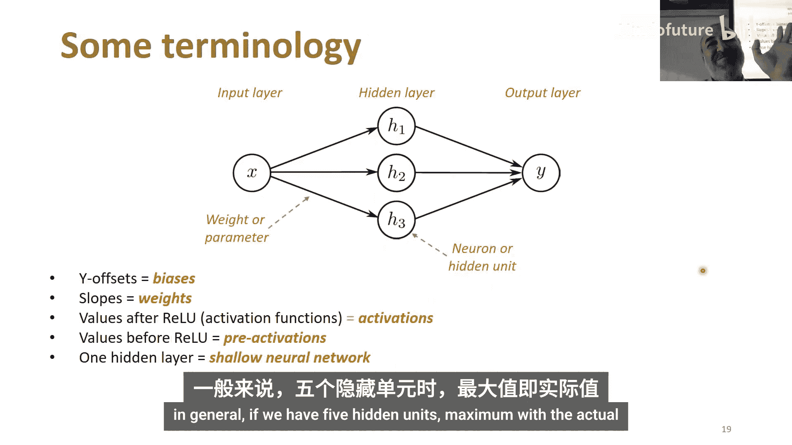

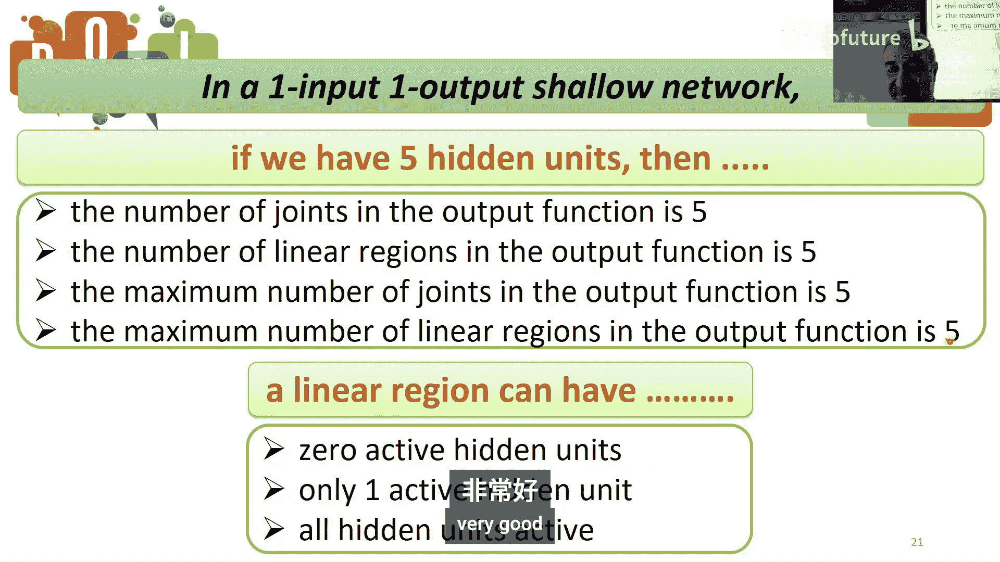

**答案**：关节的最大数量是 5。

**参数数量计算**：对于一个具有 1 个输入、6 个隐藏单元和 1 个输出的浅层网络：
*   **权重**：
    *   从输入到 6 个隐藏单元：6 个权重 (`θ₁₁ ... θ₆₁`)。
    *   从 6 个隐藏单元到输出：6 个权重 (`φ₁ ... φ₆`)。
    *   总计：12 个权重。
*   **偏置**：
    *   每个隐藏单元有一个偏置：6 个偏置 (`θ₁₀ ... θ₆₀`)。
    *   输出单元有一个偏置：1 个偏置 (`φ₀`)。
    *   总计：7 个偏置。
*   **参数总数**：12 (权重) + 7 (偏置) = 19 个参数。

## 万能近似定理 🌐

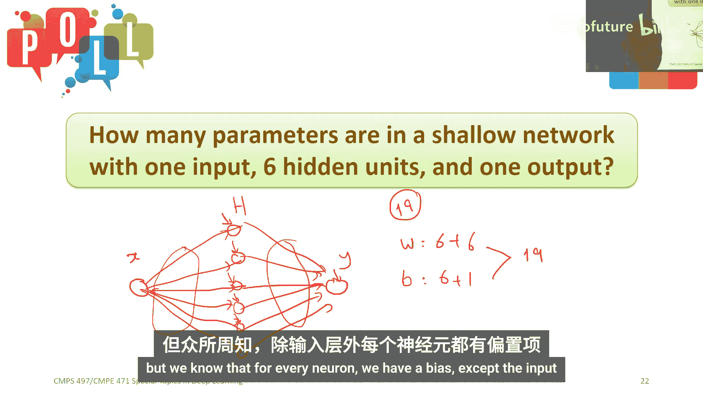

我们目前讨论的网络只有 3 个隐藏单元。我们可以将其扩展到任意有限数量 `D` 个隐藏单元。通用形式如下：
`y = φ₀ + Σᵢ₌₁ᴰ [φᵢ * a(θᵢ₀ + θᵢ₁x)]`

随着隐藏单元数量增加，分段线性区域的数量也会增加，使得函数能够越来越精确地逼近复杂的目标函数。这就是**万能近似定理**的核心思想：**在拥有足够多隐藏单元的情况下，一个浅层神经网络可以以任意精度逼近定义在实数集紧子集上的任何连续函数**。

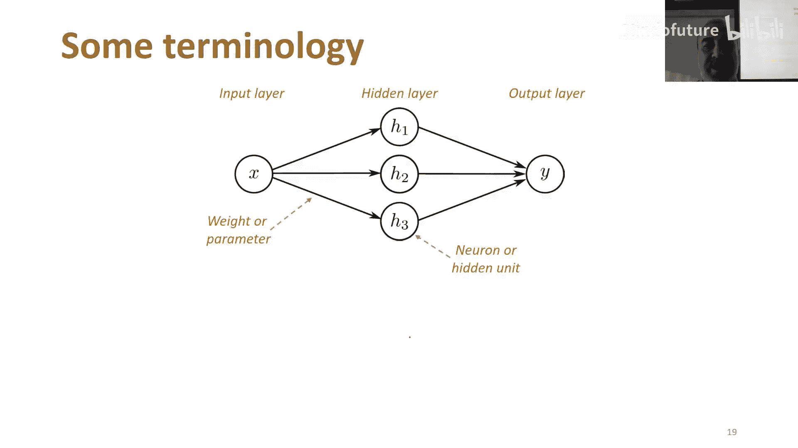

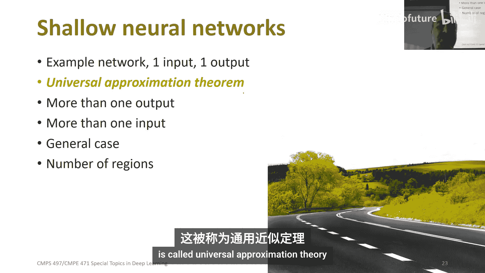

关键词是“足够多”。理论上，浅层网络可以逼近任何函数，但“足够多”可能意味着需要极大量的隐藏单元，这在实践中可能计算成本很高。这也引出了我们对深度网络（多个隐藏层）的需求，这将在后续课程中讨论。

## 总结 📝

本节课中，我们一起学习了浅层神经网络的基本概念。
*   我们从简单的线性回归出发，引入了更强大的神经网络模型。
*   我们详细剖析了一个单输入单输出、具有三个隐藏单元的浅层网络，将其分解为线性变换、激活函数（以 ReLU 为例）、缩放求和以及添加偏置等步骤。
*   我们学习了神经网络的标准图示和术语，如权重、偏置、激活值、层和容量。
*   我们探讨了网络输出是分段线性函数这一特性，以及关节和线性区域的数量关系。
*   最后，我们了解了万能近似定理，它说明了浅层神经网络在理论上的强大拟合能力。

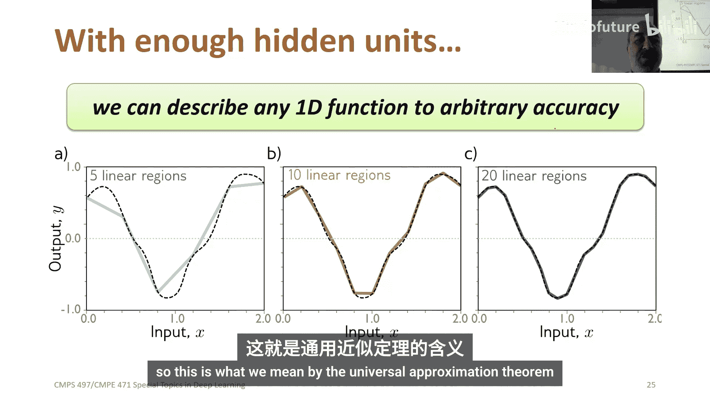

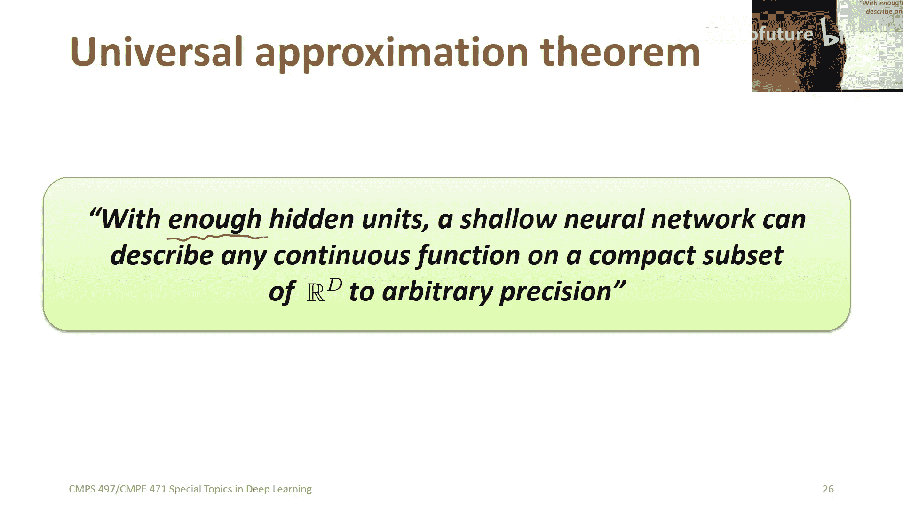

下节课我们将继续深入探讨神经网络。