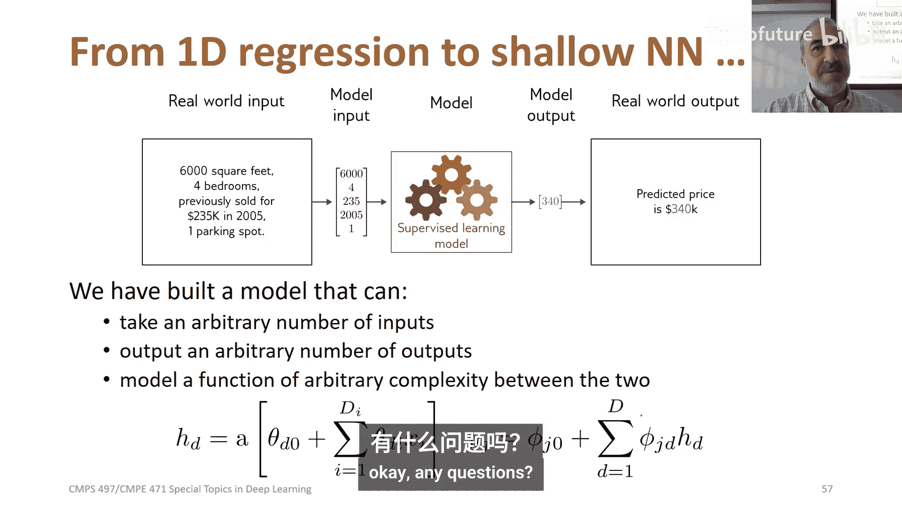
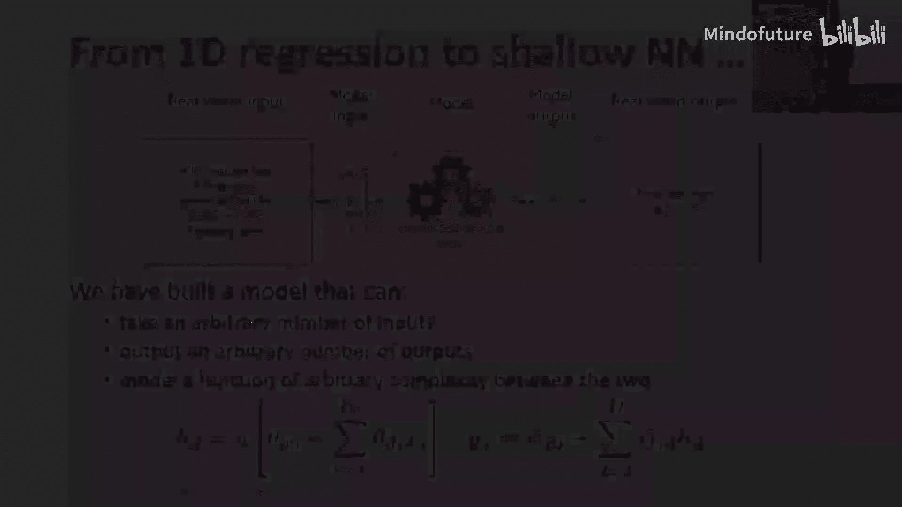

# 【卡塔尔大学】深度学习 CMPS497 ｜ Understanding Deep Learning ｜ Fall 2024 p05 P05_第五讲-浅层神经网络 II -BV1vQvNz1EeK_p5-

today will continue talking about shadow neural networks and might start talking about deep networks。

This is where we stopped last time we were talking about what we call universal approximation Theem。

 this is a very interesting and important theorem that tells us that with a shallow network we can approximate any 1D function。

To of course， arbitrary precision if we have enough he units。

 which shows us how powerful the shadow networks are。Okay， of course， if we have any。

Good budget where we can spend on the hidden units。

Just to equal what we have covered last time because we will build on that。

 we started with this example with the shallow network that has one input。

 three hidden units and one output and we move from the equations to the diagram and I want you to focus more on the diagram and over time we we will not every time have a new network right the equations。

 maybe we will continue doing this picture but over time we will will reduce that and well focus more on the diagrams because they actually present the equations so I want you to focus more on the meaning of of the relationship between the diagram and the equations for every neuron here。

It is like a weighted sum okay here weighted sum of the input here because we have just one input。

 it's just a weighted sum of one input， which is theta 11 times x plus the bias and then we apply at the hidden unit。

 we apply the activation function。😡，Here we have a weighted sum of all the inputs。

 so we have phi1 times h1 plus phi2 times h2 plus phi 3 times h3 plus the bias。

And for now we don't apply an activation function to the output。

So from that you can write the equations， you can map to the equations。ok。😊，Any questions on that？

And we also said that usually when we though the diagram we not write the。The parameters， right。

 because we know that for every link here， this is。This is what I await Okay， and at every node。

 except the input， they will be。Abo。Okay， so that' these are the parameters of the network。

And we discussed， I think， in detail how this network works last time we started with the pre activationiv。

 which is the linear function of the input。At each hidden unit and then applying the activation function which clips the negative part and keeps the positive part and then we scale because we wanted the weighted sum at the end for the output。

 we scale them we scale each hidden unit。Right， and then add them。And when we。

 I think we saw that last time， right in detail。 And when we add them， we get what we call。

What is the name of the shape of the function that we get eventually？Pace y is D function。

 P y is D function。And last time we talked about these joints， right。

 we said that the maximum number of joints is the the number of。what。😡。

The maximum number of joints is the number of。How do we get these drawings， the hidden units。

 exactly， each hidden unit。😡，Contributes to a one joint right so the maximum number of joints is the number of hidden units as we increase the number of hidden units we will see more joints。

 which means this curve will be more broken， will be more complex。

Right and still which will be a piecewise linear function and we talked also about the activation patterns。

 each piece of flying here has a corresponding pattern in activation。

 some of the hidden units are active， some are inactive。This is what we covered last time。

Any questions before we start the new stuff？Okay， so far we talked about one input and one output right today we will we want to extend that to more than one output。

😡，And。More than one input。 And then we look at the general case。

 which is multiple outputs and multiple input。Okay， this is the plan for today。Okay。

If we think about two input， two outputs， still， we have one input， okay。

 now let's think about two outputs when we have two outputs， still we have the hidden units。😡，Right。

 and the equations of the are the same。Doesn't change， right， It's just that linear function。

 Then we apply it to we apply the activation function to it。

and still also the first output is the same， it's a weighted sum of the hidden units。😡，Plus the bias。

 Okay， all what we added here is a new output， which is very similar to the other one。

 It will be also awaited some of the hidden units。But with， of course， different parameters。

So if we want to draw this network。😮，It will be very similar to the one that we saw before。

 except that we added one new output here， so instead of having one output we have two outputs so this one will be weighted some of the hidden units。

😡，And this one also will be weighted some of the hidden units。T， will be， will they be the same。我下。

I mean， the same values， the same functions， of course not。

 it depends on these values of the parameters right so both are both are weighted some of the hidden units。

 but the weights are different。 and of course， also the biases might be different。Okay。😊。

T how about now the output function itself？😡，Can we imagine how the output functions will be。

For one output， we said that it will be Pwise linear function， right？😡。

And it was piecewise linear function because we have hidden units here， right？第。

So we expect that the first output will also still be a linear a piecewise d function because it is await weighted sum of the hidden units。

Right， so that doesn't change or will not change。 how about the other output。

 Will it be also a piecewise linear function。Yes， because also it is weighted some of the hidden units。

 but it's a different。Different pieces。Okay，It's a different piece。

 So we will get something like this， actually。This one is y1。

 I think this is the one exactly that we saw before， and that might be y2。😡，Again。

 both are piece wise linear functions。But， they are。

Similar in one sense and different in another sense。Similar in that， you will， if you look at them。

 you will see that they have the same。Joints， they have the same joints， Why is that？😡，说是。

Because because of the same hidden units yeah， we said that the brakes or the joints are due to the hidden units right due to the clipping that happens at the hidden units by the activation functions the hidden units are the same。

😊，Okay， so it's just way that some of them。😡，So the joints will be the same。

 but the slopes of the linear pieces will be different Why is that？😡。

why do we see the slopes of the orange curve different from the other one？Because of the weights。

 yeah， the parameters。Okay， these parameters，52，1，5，2，2，5，2，3，5，2，4 might be different from 5，1，1，5。

1，2，5，1，3， 5，1，4。And also， of course， the bias will move the function up or that。Kious。私も？

Y2 is the complement of5hi of y1， no， doesn't have to be。😡，Doesn't have to be。No。

 it depends the on the weight it might look like here， of course， not exactly， not exactly。

 So in general， no， of course。Yeah。Good observation。Any other questions。

 did you understand why we have the same joins？😊，Why do we have the same drawings？

Because we have the same Hadden units， the Hadden units didn't change， by the way。

 and if you look at the equations of the Hadden units，😡，They they didn't change。Same hidden units。

 same equation for the hidden units and same hidden units that we use to compute the output any y1 is awaited sum of the hidden units and y2 is is awaited sum of the hidden units。

 same hidden units。😡，Okay， so that's why the joints here are the same。

 but the slopes will be different because the you remember the hidden units。

 we scale them and then we add them right to get the output。

 So when we do these two steps scaling and adding， we will have a different shape of the function。

 I mean， different。Slopes K of the pieces， but at the same exact joints。

 at the same exact values of x。Of the input。Okay， is that any question about that。Okay。

 if you don't have questions， then I have。A shadow network with two outputs。😮。

A shallow network with two outputs like the one that we just saw will have the same exact joints in the output functions。

😊，Or will generally have different joints in the output functions。

 or will have the same exact joints in the output functions only if both of their sets of weights are the same。

😡，Okay。First one or the third one。About the second one。 Second one， Of course， not。で在。Like。

 they have the same number。等下。本专。No， same exact joints。In general。

 they are same at the same values of x。😡，Yeah。But the widths might be different right。

 so it's not that we will have the same joints because the widths are the same actually the widths in general will be different right so the slopes would be different but at the same values of the joints the same values of mix。

😡，Okay， is that clear。Sure。ok嘅。Very good， another one。

 how many parameters are in a shallow network with one input， 60 hidden units and two outputs。Okay。

 I collected my mistake last time I told you3 so you started to write equations， right。

 I decided today to make it actually I was about to make it 600 and I said 660 same idea。

 you will not be able to write the equations okay so。Then what should we do。

 Then you should imagine the the network。 Okay， that's what I want you to do。

 Imagine the network and think of the number of parameters。

When we talk about the number of parameters， we talk about the number of。Weeds and biases。

 How about the weights？Yeah。It's easy， Okay， let me show you how its。Okay， so we have one input。

 right？😡，And。60 hidden units and how many outputs？2， okay。

 so we have something like that here and we have something like。That， and also。That's right。Okay。

How many weights we have， These are the number of links， right。Okay。

 what is the number of links in this site？😡，60 because it's one times 68 here。

 we have 60 times two because each one here is connected to the two here。😡，Right。

 so it's one times 60。😮，Plus。60 times 2。Right没。That's what。That's the width。 How about the biases。

This see on。60。For the hidden units。Plus，2，4D output。That's very easy， write the equations， please。

Okay， next time it would be 6000。Okay， any questions on how to do that？Okay， so from now on。

 you should always think about the diagram okay， and you should be able to move from the diagram to write the equations。

 right。😡，It's difficult。You过去。Again， okay， so this is the network right Okay， okay。

 this is the network right Okay， you see the point here Okay， so this is the network。

 we have one input unit， I mean， one input 608 units and two outputs Okay。

 so it's fully connected so from this。😊，Input， there is a link to every one of the hidden units。

 So we have one times 60。Here we have 60 units， all of them connected to the two outputs。

 so each one here is connected to these two okay， so it's 60 times2 so one times 60 plus 6 times 2 these are the weights。

😡，And for the biases， each node except the input has a bias。😡，So we have 60 here。And to here。Okay。

 so these are the biases and the total is， of course， the sum of them。Okay， whatever the sum is。

Any question about that， I that clear now？Okay， so that was one output。

 what if I told you three outputs， what will you change in this slide？😡，No， no。

 I'm not talking about the fact， I'm talking about this slide。Again， I'm not talking about the p。

 I'm talking about the outputs。 Okay， so here what will change。 we have a third one， right。

 Maybe the third one will， let me maybe the third one will look like mess this。And then。That。

And then。Maybe this。And then that。And then， I don't know。Maybe this。Something like that。Okay。

 same joint， different loops。Okay。😊，Any questions？How about 10 outputs。10 functions。

 10 piece wise linear functions。Okay， question。That is。The same。It depends on the weight side。

It depends on the weights and the bias also， maybe the bias will increase or decrease。Good。

There is no restriction that y 10 by2 should be， you see here it's actually obscitating。

 sometimes positive， sometimes negative， it depends on the parameters that we learned。😡，Okay。Okay。

 any questions。Okay， now we extend to。So we extended more output side。

 so the idea of the more output is very similar to one output side just that we have new piecewise linear function。

😡，At the output。Right。Now let's see what will happen with one input， but before that。

 I want to make sure that you already understand how things go here。😡，H。If I have one。

 let's say that I learned the network right， I have the parameters， and I have a value for x。😡，Yeah。

 let's say my the value of x is， I don't know， 5。And I want to compute Y1 and Y2。

 How can I compute Y1 and Y2？😡，First， what do we call this， what do we call this process。

 given the input I want to get the output。😡，不谢谢。No， the process。This is inference， right？

We talked about that before In means given a model， we have a model now we learned the model。

 we have the parameters， so we have a model given the input， give me the output。

 this is an inference。 I want to do some prediction I want to use this model to predict a value。😡。

Now this is what I want to do， I want given the value5。😡，Or whatever 1。5 maybe to be used here， 1。5。

 I want to get y1 and 12。From that network。And for a second， forget about this figure now。

 don't look at the curves okay， imagine that we have the network when we say we have the model。

 what does that mean？😡，We have the values of the。Piameters， which are the weights and biases。

 So we know all the parameters。😡，Can we now compute y1 and y2？

Will that be one value for each or a curve It depends on them。No， the input now is determined 1。5。

 right？Value for each one value for each， right， There will be no curves。😡，Right。

 so we be just one value of y1 and one value of y2。 how can I compute Y1。😡，A substitute what。X。

 so I will so I can use the equations if I write the equations or I just want you to minimize using the equations okay and do use the diagram。

😡，So， it's。1。5 times whatever by the value here。Okay。

 that would be the pre activationivation for H1 and then apply the activation function。😊，Right。😊。

To get one value of the hidden unit， right。Same here。 multiply whatever the parameter here will。

With X。😮，Then apply the activation function get h2， so this is H1， this H2。

 then similarly you get H3 and H4 then。The weight ats sum for y1， right。 So again。

 each link is a weight。 So we multiply the weight here by the value here。

 So whatever the value of H one will multipplly by that weight。😡，Add by all this。

 so this would be the weighted sum right from all the hidden units for hidden units we。

We have the weighted sum add the bias。 We good to add the bias right。

 there's a bias for each hidden unity here。 Then we add the bias to this and apply the the。No。

 there is no activation function here， so this is just at the output so far。

 there is no activation function， so it's just a weighted sum that weighted sum will give us。威云。

Similarly， you can also do。Why do I？What would be the difference， same hidden units。

 were not tocomp data dating units， right？😡，We will not re computeute the data units。

 we will only re computeute， we will only computeute the weighted sum here。😡。

And you understand what you mean by the weighted sum here right so each value of hidden unit would be multiplied by whatever the parameter on that link。

ok。😊，Like if we have the curvebs。😡，Which which doesn't happen in reality， of course， in reality。

 we have the parameters， by the way， and we know how to do this computation。

 This is called by the way follow tests in the network。 We go from the input to the output。

If I have the curves， just there any for fun。Then if I told you I want to get the value of y1 if x is 1。

5， what should I do？😡，Look， look at the is 1。5 here。I think this。LetLet's make it 1。

4 to make to be more interesting Okay， 1。4， I think this is 1。5 probably。All right。

 so maybe this is 1。4。😊，Right， so you go up here， sorry up here， this is。This is y 1， not51， Y 1。

 Okay， how about y2。我 up here。And。喂。That would be white。喂。And these values， of course。

 should match what we will compute from the network。Usually we don't have these curve。

 we have the network， which means we have the parameters and we know how these parameters are used in the model okay so what we did here is exactly like the equations。

 but without writing the equations， we know how the diagram is mapped to the equations。😡，Okay。😊。

You lost。Right。Okay， you lost where。Do know， if I told you， I know all the parameters。

 where are the parameters here。😡，Where are the parameters？Get it me your business。

If I give you this network。😡，Can you tell me where are the parameters。Now don't look at equations。

 Al， forget about the equations， okay。为上在哪点。We have the dagger and the network now。

 where are the parameters。Every link is a wait。Okay， so actually， this is， again， this is the。

What's this what's this one？Did don't one。啊。It's multi by x here， again。

 let's just for a second get back to the equations。Okay。😊，So。This is the slope right。

 So this is the actually the weight。 So this is theta 11。 If I told you， what is this specific link。

 How did， How will you get it。From there。What is multi appliedpl by H here？😡，Yeah， it's 5，1，3。

And so on， okay， at every node， we do the weighted sum of the inputs。😡。

Because every link has a source right and the weight on the link。

 so we multiply the source by the weight and edit。😡。

Then apply the activation form and then add the bias and apply the activation。Okay， that again now。

 this is the computation through the network。😊，Any other questions？Okay， I hope this is now clear。

Okay， now。Now， what if we have more than one input so having more than one output。

 so we have different functions right with the same joints we know that and all of them will be。😡。

Peacewise linear functions， right， All of the outputs will be piecewise linear functions。 Now。

 let's see what will happen if we add one more input。😡，Of course we will have more parametersers。

 but more importantly， how the network will behave。😡，Okay， so heres an example。😡，Still。

 we make it one one output for now。 And we have now two。Two inputs。Okay， now we have to input。

And one output。As you said， there are now more。Prameterters。

 and you can see each one now is a weighted sum of both input plus the bias。

 So if you look back at the equations， you see it's a still linear function， by the way。

So before there was no x2， so it was theta 10 plus theta 11 times x1。 Now we added theta 12 times x2。

Still， this part is linear， but linear in both inputs， not just one in two inputs。😡，Okay。

 so now this is the hidden units。😊，And as I told you， at every note。

It's await to some of the of the incoming links。Okay， same for H2。

 same for H 3 and why will not change Y， I mean， not not change in terms of the。Of the function。

 it is awaited some of the three hidden units。Okay that's in terms of the shape and the equations of the network。

 any questions， so no no big not a big change， the hidden unit now is it still it's an linear function but linear function of two inputs let's see about how this will make a difference in the in the output in the network the behavior of the network。

😡，Okay， we'll have another dimension。Okay， remember when we talked about last time。

 when we talked about the linear functions of the hidden before the pre activation values。

 the will line inside。😡，The way lines because we have just one input now we have two inputs so we have x1 and x2 and if you remember we talked about control plot before right。

 this shading gives us indication of the value of the function because it's now a function of two inputs x1 and x2。

So it seems like here this function， which is the pre activation value of the Hadden unit。😡。

Not yet the hidden unit， right， we didn't apply the activation function yet。😡。

It's the pre acquisition value。😡，It is。It's not a lion now， it's a plane。It's align aligning 2D。

 which is a plane。Okay。😊，The plane， of course， changes the values。 So， as I said。

 the brightness means high values。 darkness means。Low white。 So it seems like it is。

Something like that。 values decrease as we go up and sorry。

 increase as we go up decrease as we go down。Okay。😊，Is that clear。 So this is one。

The preocation value of one hidden unit。😡，Because we have three8 units。We have3。Linear functions。

Still， these are linear functions， both in3d。也农隆给你徒题。The iron 3D can type。

 Why do we have different functions， Why is it not one only， Remember before we had three lines。

 right？Each one is a line is a different line。 Why do you have to be different is？😡。

Re asked the other act。Not exactly。because of what。What is the function here。

 It's a linear function of the inputs， right？😡，It has parameters， right。

 so with different parameters， we have different functions。

the values of theta 11 and theta 12 here is different than the values of theta 21 and theta 22 different from theta 31 and theta 32 right and also the biases are different。

😊，Okay， so these are three different linear functions before we have three different lines， right？😊。

Because of the parameters of the line。Right， this is a plane。 It has parameters。

Still linear this is still linear， but linear in two inputs。😡。

There's no quadra we didn't say x1 squared or we didn't say x1 x2。😡，To be exploreable。可。

It is linear if it's just giving getting the input as it is， right， it's linear， but in two inputs。

 Okay， it's linear， but it's two inputs。 It will not provide a line Now， it's a plane。😡，Okay。

 so these are three different planes right now these are the pre activations， right？

I shall be with me， please。Yeah。These are three different lines right。

 I mean different planes and these are the three activations for the three different hidden units right what is the next step。

The which function， the activation function， okay now。The radio function。 What does it do。

 the radio function。It removes the negative part， makes it zero and passes the positive part as it is。

😡，if you look at this function now。What do we expect to be to look like after applying the radio function？

The negative part will be will go away， right will be0 will be clipped where is the negative part？😡。

The the one that is mostly the darkest， right。 So it seems like maybe that this part is negative。

 We don't know exactly here， right， But let's assume that that the darkness here means negative。

 So this part will be clipped。Clpped means。It will replace by， replaced by。😮，By zeal。Okay。

 so you will see here because all the area here will be0， it would be just one shade right。

 which represents the zero value。😊，Okay， that's exactly what we see here。

So it seems like this whole part is the negative part。That's why all of that site is zero now。

 and that shade is actually the zero。ok。😊，And the other， and the other part。It it's still the same。

 right that the activation function passeses everything that is positive as it is and clips the negative part。

😡，Okay， type。What is this line？😮，Remember in 1 D， when we have one input。😡，What did we have。

We had a joint right， when we clip， we had a point where the lion is 0。I mean， gives zero output。😡。

But now we have 2D， so this joint becomes。A line is no longer a point。Okay， it becomes a line。

And as I told you last time， the contour lines here means。😊。

All the points on the same line have the same。😮，Value。The same alpha value， which is in this case。😡。

Vi。So that's now the joint。Same concept like what we did before right before it was a point。😡，Okay。

 here now it is aligned because we have two inputs。

Same idea for the second for the other hidden units。Where is the negative part， the darkest right。

 darkest， so it was clipped and the zero replaces。Same here。 Where the darkest side。This part， okay。

 so it was clipped and all of this area now is zero。Are you following so far。Yes。

The absolute value is we don't see the absolute value here。Yeah， but， but it is there。 Of course。

 Yeah， yeah。 we just imagine that this part is。Is the and of course the shade。

 the shade gives us that indication， but it's not that easy to see exactly where the zero okay。

Any questions。So we understand these figures now。Okay。😊，Tpe what are these。

 these three figures at the bottom， the hidden units， yeah you see the equation right？😡。

So this is the pre activation before applying the activation function。

 this is after applying the activation function。😊，Okay， so this is the hidden unit value。After this。

So this one， okay， how did we how did we get the joint here？😡，Where is the negative part？😡。

Towards the darkest side。 Okay， so the negative path here is。This way。Okay。

 the color here just indicates the values， but this is computed exactly based on the values。

 based on the exact values of the parameters。😡，Okay remember。

 we assume that we know the parameters here， it doesn't matter to us the exact values of the parameter here。

 but the idea is what we need here。😡，Okay， that you。3月。你啊。If you think this is green， then yes。あ。

Okay， I don't know。 this is Gu in X， whatever。 Okay， but yes， this line is。😊。

Is present the zero value。And is what we call the joint。Okay， is the joint。Whatin to地。Okay。

 what's the next step after the activation？Before we sum them。We scale them。

 we must apply by the weights。😡，what will happen when we multiply， let's say this one by a weight。😡。

Let's see that。 this weight is3。So how about the zero part， the clipped part will it change？😡。

It will be zero right， Okay， so this area will be will stay the same when we scale what happens when the other side？

😡，If it's positive， if we are multipllyied by a positive value that's greater than  one like three。😡。

It will the value will increase， right， So the darkness， if it's the， the darkness will increase。

 So you know the darkness， the bright the brightness will increase。😊，Right。

 the brightness will increase here if it's positive， if it's negative。If the weight is negative。

ItThe darkness would increase， it would be dark。Okay because it will go to the negative side。

 same idea here， same idea here， so let's see when we when when that happens。

 this is step number three， which is applying waitinging okay multiplying the widths can you guess here from the figures。

The sign of the weight and whether it is more than one or less than one。How about the first one。

The first one， it seems like it's negative。😡，Right and is it greater than one or less than one。

 it's around one， I think。It's。We cannot cannot easily guess here。

 whether it's it's more than one or less than one。 How about this one。So。Positive and。

And greater than one， because brightness is more now， so it seems like the values increases。

 the values increase。😡，Yeah， these are indicating the same values， right？😡，Probably the value。

 the difference between the values here is the same。 Okay， so there are more。

More in the same area now。 How about this one。It's negative。

And it seems like bigger than one because the reduction increases a lot。Yeah。Right。

And it's not not very clear if it's greater than one or not， actually， but it's negative。

 but it is negative。Okay， this is negative。Because we are not it's not it's not easy to map the shades to numbers so but clearly this is negative。

😡，Right， clearly， this is。Positive and clearly this is Nick。Okay， okay， what's the next step。

adding them。Okay， so adding them with a bias。When we have them？When we had the one input。

We had this piecewise linear functions， and we had joint insight。And the joints where。

Where the joints where points yes， and where the joints of the hidden units。Same idea here。

Each one of these green oceanN lines is a joint。😡，Okay， and you will be kept in the output。Okay。

 but they will be separating the space。😊，So when we add these three， we'll get something like that。

Steve， we have the same joints， right， we all the joints。The lines， this is， this is for H1。

 this is for。H3 and this one is， is for H2。 Now the R separating the space。 exactly like the。

 remember the the piecewise linear function in 1 D。

 the slopes depending were dependent on the slopes of the lines， right， and the bias。

 here is the same。Okay， the slope of the plane now。Its the slope of the plane。

 it's no longer a slope of a line， it the slope of the plane depends on the slopes of the hidden units。

 which I mean the slopes that are actually multiplied by the hidden units。Which are these parameters。

 Theta 1， Theta 2 and Theta 3。Okay， and also the actual slope of the of course， the of the function。

So now how many lesion do we have？嗯。You have the agency。那在个。7。Okay。

 type why do we see that the control lines are different in each region？

Because these are the sum of the hidden units， right？😡， some of the units and of course。

 the slope of that equation still is a。 The slope of that e depends on the slope of the input to that function。

W whichch is the top of that hidden unit。 Stop of that。 Stop of that。ok。for example。

 why do we have this like that here？😡，What is the value here？Is it you。First。

 is it constant or different？Constent or or or not negative。公ント not？Conistant because we have C。

 we see one line here and one color here， right type。 What is the value of this。😡，Zero type。

 let's let's see how how did we get this equation？😡，It's， it's the intersection of these two joints。

 right。Summing over all the functions。 So it is that part。😡，From。From the first hidden unit。

 which is 0， right。And that thought。From the second hidden unit， which is Z and that part。😊。

Which is 0， right？ So is that 0。Actually， no， this is5hi 0 because we added the bias。 Okay， Okay。

 don't， don't forget the bias。 If theres no bias here， Yes， it would be 0。😊，Okay。

 but it depends on5hi0， if phi0 is 0， it would be0 if p1 is negative， it would be negative。

 seems like positive the V dont not。😡，Okay。😊，Okay， that clear。

Every region here is the sum of the corresponding lesion in the weighted sum。ok。😊，Questions。

Getting more and tasting now。More complex， right？ButBut it's same idea， right？

It was a piecewise linear function in 1 d and still we will have what we call here convicx polygons。

 okay convex polygons， every region here is a polygon。And this convicts， okay， it is a plane。

 a piece of a plane。Okay， and and these planes are connected together， so。The joins。Okay。

 before the joints were just points。😡，And now， the joints are。Ls。Can you imagine this in 3D？Why not。

Okay， it is。It's still a plane， but the plane that is like it's， it's not a plane now。

 It's a surface。 Each Each region is a plane。Each region is a plane。Okay。😊，It's， again， it is。

It's a connected pieces of planes。Okay， and as you can imagine here you see this。

 do you see this brightness and we said that imagine that this is increasing。😡，This is this area。

 right？Because we are looking at it from top。😡，Okay， so that's， that's the right。

 So this area actually is。Dis plane。Okay。😊，And how about this one？That's， that's this part。

 which should be constant。Okay。😊，Any question on that？ok。

So one slide before I just wanted to give you the all in all picture Okay。

 so we started with two inputs， we get these as hidden units。And the hidden units now。

 they are not just clipped lines， they are clipped planes。Okay， and then we sum them。

 we wait them and sum them and add the bias to get the final function。Okay， which are。

Connected convex polygons。Yeah。And this is in terms of diagram and equations just to put everything side by side thats。

That's the diagram， which is presenting these equations。

 and this is the behavior of one example of that network。Okay， now。If we add one more output now。

 what will happen？So this is two inputs。😡，This is two inputs with one output， right？😡，Now。

 imagine that we added one more output here。 What will happen。 What What did we。

 What did we do when we had one input， We had two functions two piecewise linear functions。

 Now we will have two。But this。We have another one like this， right。

 We will have another one like this for Y2。😡，Okay， what how different it will be。Yeah。

Will we have the same joints， yes， we have the same exact joints， but the slopes will be different。😡。

So it won't be exactly like this surface。😡，If we have the same joints。😮，But different stops。

So two services。Two different surfaces， but they are broken at the same joints。Yeah。Okay。

 is that clear。So have something like that。With the same joins。

 but of course the slopes here will be different， which means the value of the functions will be different。

Any questions？So how about 10 outputs。10 like that，1010 functions like that right same idea halas。

 you can expand with the outputs with the outputs and also you can expand with the inputs right outputs you can you can think of it when we have one input and two inputs。

 but if we have3 inputs 4D it will be very hard to measure right we cannot imagine it it will be 4D the function will be 4D so it's very hard halas。

 but but it's the same idea。The joints will will be planes。Will be a complete lane。Okay， in 4D。

 in 5D， hyperplanes back 5 for 6。You cannot not imagine Kaas It's very enough for us to understand it in 2D and 3D。

 I think， and you can expand it。 Carlas， the same idea。 Of course， the the any many applications now。

 we have many inputs。Okay， sometimes millions of inputs， by the way， imagine images。Pixs。Okay， many。

 many inputs and many outputs also can be。Okay， but the same idea。

You can expand in terms of inputs and can expand in terms of outputs。

 okay output is easier because output is just it will be similar， it's aed some of the hidden units。

 hidden units。😡，Okay， inputs will it will increase the space。😡，Beyond 3D， it will be hard to imagine。

 but same idea， linear， still linear， still piecewise linear functions， by the way。😡。

And even this one， it is piecewise linear function， okay， but it's in 3D。

 so the pieces are planes are pieces of planes instead of pieces of lines。Okay。

I hope it's very clear now。Let's now talk about the general case it won't add any new sub butt putting it in general if we have DO outputs。

😡，In general， okay， it's not， it's no longer one and one。 it's D outputs。😡。

D hidden units and DI inputs。😡，If we have this， then we can write the equations in a compact form like that。

 so this is the hidden unit number D， it's equal to the activation function applied to the bias and weighted sum of the inputs。

And the output is the bias plus await sum of the hidden units。Okay， how many we have of this？对嗯。D。

 how many we have of this？😡，Of this equation， how many we have， is that one equation？嗯J。No。

 we have D outputs， right， so there is an equation for each output。嗯下。

Right so we have D hidden units， so one equation pair hidden unit， so we have D of them。😡，Okay。

 and we have the output the O of these equations。The number of outputs。Right。😊，Okay。😊。

And this is example when we have three inputs。Three hidden units， two outputs。Okay。Of course， here。

 what is a D O。What is the， What' is the value of D over here。The O， O output， right。

 So this is2 D I。33 and D，3。This is just a notation。Okay。😊，Questions。So that's a general case。

 I think now you understand when we have more inputs and when we have more outputs。

 how the network will behave。Okay， question， how many parameters does this model have？😡。

Without writing the equations。Just looking at that diagram， Can you tell me。And don't count。

 don't count the links， you can count the nodes， and that's enough。😡。

So knowing that three inputs and three hidden units， how many， how many weights we have here。那贼白随缘。

having two outputs here， how many how many weights we have here， three times two， right。

 so these are the weights。 I mean how about the biases。See you here。1 for each node， except。

The inputs。Okay， so three for the hidden units and two for。The output。嗯。

I don't know what's what's over。Okay， clear。Any questions？Okay。

 now we will just give you examples of other activation functions。

 We said that the activation function is not always radio right radio is the most widely used one。

 but there are also other activation functions that are actually used。We said earlier。

 what is the role of any activation function？你这是B准备是什么名？2。

Why do we have activation functions in any neural network？😡，To make the output not nonlinear。 Okay。

 to make the output nonlinear nonlinear， because as you see anything。

Other than the activation functions in all the equations we saw and all the networks we saw is linear right and if you remove the activation function。

 everything is linear， which means always the output will be linear。😡，At the end。Okay， but of course。

 we need to have more complex functions than linear and the source of that。

Is the activation function。Okay。😊，So that are different activation functions and another thing also for the activation function is that it it。

Based on the specific activation function， for example， the radio。

 it activates and deactivates some nodes at different values of the input。😊，Okay。

 so it has at every range of the input， it will have an activation pattern so it's like controlling the parts of the network that should be active and parts that should be negative for specific that of the input。

Well talk Sha later about the activation functions。

 and you will see them also some of them in the homework okay。Okay。

 so we'll extend a little bit that immuno that we discussed last time。😊，W offsets are the biases。

 slopes are the widths。If everything in one layer is connected to everything in the next layer。

 we call this network fully connected network。😡，Which is all the networks that we discussed so far。

 okay， every node here is connected to every node here right and every node here is connected to every node here。

 so it's always fully connected。Between the layers， this is called fully connected network。😊。

If we don't have any loops。我 do mean日 like。That can be seen more in deep networks when the output of one node is going as input to itself or to another node in the previous layer or other layers。

In previous layers that that that's what we mean by loops。

 if we don't have any loops like what we saw before。Up to this point。

 we call the network feed forward network。 feed forward network。We don't go back in any computation。

 right？And as we said last time， the values after value are called activations。

 after we apply the activation functions are called the activation activations。

 and the values before the value are the pre activations values。😊，When we have one hidden layer。

 we call it shallow network and this is all what we saw before and if we have more than one hidden layer we call it a deep network and as we said last time the number of hidden units indicates the capacity of the network。

Okay。Okay， what remains from this session is to talk a little bit about the number of visual。😡。

If you remember when we talked last lecture about the number of visions。

 if we have one input and let's see as an on four hidden units。

How many regionss we will get maximum five， right， right， maximum five。

Type you saw today when we added an input。😡，The number of visions increased， right。

And with two inputs， I think it was three hidden units， we had seven regions。It's not four， right。

 We had seven regions。 So actually， the number of fis grow with the number of inputs and the number of feeding units。

How let's discuss this。So。This is showing， this is a graph。 let's look at the left left one。

 it's a graph that shows how the number of fusions increases。😊。

The maximum number of fissions increases when we increase the number of fitting units and when we increase the number of inputs。

😡，So the lowest curve here， so the axis here is the number of hitting units。Remember。

 this is shallow network st right， so it's one hidden layer。

 it's just this is the number of hidden units in this one hidden layer。😡。

So x axis is the number of fittinging units， y axis is the maximum number of fussions。😡，Okay。

 if you look at。Now， these curves， these curves are four different number of inputs。

So the lowest one is when D is1。😡，Which means。Input is one When input is one。

 what is the maximum number of fis？😡，嗯。No。When input is one and we are changing， remember。

 we are changing the number of hidden units。😡，What will be the number of issues？Plus one， yes。

 so it's very small and it's's almost， it's going with the number of video noise。 But this is。

 remember， this is that log scale。It is increasing， but it is increasing just by one over time。

Vennially。ok。😊，This is the slowest one。😡，As we increase the number of hidden number of inputs。

The number of regions， of course， increases。In particular， if you look at this point。

This is on the curve where that number of inputs is 100。😡。

So we plotted this curve when the number of inputs is0 and we are changing the number of。😮。

Heden units。So we are fixing the number of inputs， and we are changing the number of hidden units。

 the number of neurons in the hidden layer。😡，Okay， and we are looking at。

 we are plotting the maximum number of fus。You see here it is going。Okay。😊，And， very excessively。

this is log scale， this is not linear the Y axis here is a log scale。

 so for this particular point how many hidden units we have。It's 500。How many Asians we have？

Something like more than 10。To the power0， can you imagine that number， that's 100 zeros。

 one with 100 zero。Okay。😊，That's the number of。Asians。With what with which network。Hunded inputs。

And5008 units。Yeah， they're not even thousands yet。100 inputs，5008 units。

 we can get up to 10 to the power hundred。Asians。What does that indicate。About the output function。

Is it very simple。Or very complex。Now these issues are what。

 these are the pieces of the line right of the linear functions。关用他。No， not this line。 this line。

 this， this is not the output function。 right， This is this is just the the number of lesions。

 I'm talking about this point。😡，It is every point on any of these curve represents one network。😡。

One network。What's the。D is the is the number of inputs sorry， D is the number of hidden units。😡。

D is the number of hidden units， which is the x axis。😡，The Y axis is the number of fusions。

These different curves are for different number of inputs。Okay。

 so this point represents a network that has 500 hidden units。😡，And。100 input。

 it gives us 10 to the power 00 regions。That's very complex function， right。

Ts10 to 1 hundred0 pieces。Okay，It's still piecewise linear function， but it is very complex。😡。

Same point here the on the right side of the figure， it is a plot where we。

Apppl the function between the number of parameters。

 so the axis here is not data in units is the total number of parameters。😡，Okay。

 and still the Y axis is the number of fus。😡，And under the curves here are the different number of inputs。

 so that same point， by the way， it's the same point here。Okay。

 but instead of representing gate with 500 hidden units， it is presented by。😊。

Whatever the number of parameters here， which is more than 50，000 parameters。Okay。😊，So with 50。

000 parameters。😮，We get 10 to the power 00 regions。Okay， that's a big number。Actually， it is 51。

0001 times you can， by the way， compute this number exactly。Because you know， this is a network。

 right？You can compute， you can make sure that you know how to get this number。Okay。

So the idea of this of this slide is that the number of equations goes。

Very quickly with increasing the number of hidden units and increasing the number of。Inputs。Okay。

 you see the curvebs and are very high。Which means which gives you an indication of how powerful are these functions。

 right， these networks， now each each point here is a network， right？Is a family of functions。

 by the way。 And now we said that one network。Is a of one model is a family of equations。

 right because of the parameters， right？😡，And mean， this point is a network that has more than 50。

000 parameters。😡，Changing the parameters give us different。Different model。Okay。

 but each of these model has abound on the number of lesions， which is。😡。

About 10 to the power hundred， in this case， yes。Right。We didn't get deeper yet。 Okay， Of course。

 you could expect the number of fish would increase or decrease。😊。

Will increase with more hidden units， with more hidden layers。Of course， it would increase。

It be more powerful。Okay。Okay， the number of fusions can be computed actually with an equation。😡。

With a formula， which is actually proved and proposed in 1975。

It's actually the number of visual created by specific number of planes。😊。

In a space of specific dimensions。 So if we have D dimensions。

 which are in in in our context of presenting the number of inputs and we have D planes。

 which are actually the hidden units。 Remember the hidden units， each hidden unit is like。嗯。

It's it's a plane that is dividing the actual space Okay by the activation function one by by the clipping it is or actually without even the clipping it is dividing the space into parts into two parts。

 so if we have。😊，The space。So if we have a space of the I dimensions and we have the D planes。

 which are the the hidden units in our context， then this is the number of the maximum number of lesionions。

😊，Are you familiar with this notation of the combination notation。Okay， so this is D choose3， right。

 so if this if this is if this is D。😡，If this is D， not D， D is the number of  hidden units。

 if this is D， then you know from mathematics that this submission is 2 to the power D is equal to 2 to the power D。

😡，Due to the power， if， if we do this。If we say。Choose 0 plus D， Choose1。

 This is the expansion of this submission， right。Plus， D chooses 2。 So this is D， Okay plus。D。

 choose the。Where there any addition。Of coursese， positive integer。Then， this is equal to。

To to the poverty。 This is proved。Okay， so。数。This is if D is equal to D。😡。

But since here we say d is greater than the， then this number is greater than 2 to the power D。😡。

And less then to to the poverty。Okay。Did you get that？

Because this is this D is greater than the I Okay， so this submission。😡。

Is greater than two to the poverty I to the to the minimum of them。

 and this then two to the power maximum of them， which is2 to the poverty。So for example。

 if let's say as an Ndi， which is the number of inputs is is。Let's say three。And the D。

 which is the number of hidden in neurons is 10。😡，So you can compute the maximum number of fus by this equation by this formula。

 or you can。To to get an enough idea of how many we have。Then this number will be greater than。😡。

2 to the power D， which is2 to the power 3 and less than 2 to the power 10。

So so greater than it and this than 1024。Okay， something like that。Okay， quickly。

 I know that we are over， but quickly the intuition， how did we get how did we get this。

 the intuition behind that just one minute。嗯。If we have just one input and one hidden unit so this hidden unit will be like a point that separates the space into two parts if we have two inputs and two hidden units。

 each one would be like a line if if we align it with the x's。

 it will be like a line that separates the space so we have two lines separates to these space then it would be four reasons right if we have three and three three inputs and three hidden unit。

😡，Aligned with the Xs， then。So then it they are each， each new hidden unit。

 each plane now will divide the space into two parts。 Okay， so two。

 then two of of two and then two of two of two， which means here it will be2 to the power 0， I mean。

And so it's two to the power 1 here it would be  two to the power 2。

 here it would be 2 to the power 3。P answer。So that's the intuition Okay， so what do we have so far。

 we have a model that instead of the regression that we started with。

 I think two or three lectures ago。We started with one input， one output， right， deian model。😡。

Now we have a model that takes many inputs and produces many outputs， and it's not linear。

 It can actually approximate any non nonlinear function with some precision if we have enough hidden units。

😡，Okay， any questions？

Thank you。 See you on Shalo on Wednesday。

