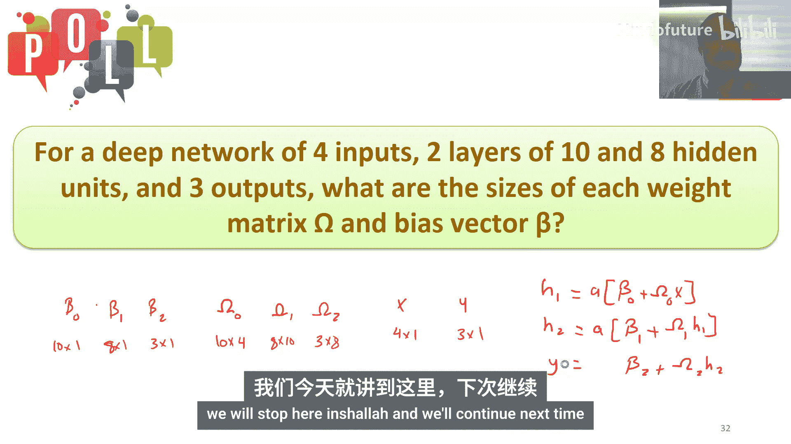

# 【卡塔尔大学】深度学习 CMPS497 ｜ Understanding Deep Learning ｜ Fall 2024 p06 P06_第六讲-深度神经网络 -BV1vQvNz1EeK_p6-

。This him。 Where are we in the course so far。I know that we are talking about chapter four today。

 but in terms of topics。Yeah， so we started with an introduction。

 then we went through an example of linear regression， right？😊。

And then we talked in more detail about the shallow neural networks last lecture actually we in two lectures before we started with one input on output。

 then the last lecture we added more inputs， we added more outputs and we saw the effect of that on the output functions。

Today， Shala will extend that to deep networks， but before that。

 let me remind you some of the things that we studied already and will be really important for the meaning of the course。

And to do that， I will show you the interactive figures that come actually with along with the textbook。

 I'm not sure if I shared the link with you or not， but the link is on the slides。

And these are mainly some of the figures that we discussed in the lectures。

 but you will see that they are interactive so that you can change some of the values and you see the effect on the outcome so let me show you a couple of examples here and I want you really to go through the list。

嗯。Okay， so on the left here youll see some of the all figures Okay number as the figures in the textbook。

 for example， the first one is the most the most simpler one。 This is just a linear model。

 so you can see that we have two parameters here and we can change the values of。

 that's the intercept。 So you can see that the effect of it is。嗯。

Adding or subtracting a value from the from the value of the function。 and the slope， of course。

 will change the slope。Okay， so all of the figures are like that those figures。

 you will see that there are parameters and for each parent there's a slider and you can with changing the slider change the value of the parameter and then you will see the effect of that of that change。

So for example， this is the least square loss， if you remember we went through that linear regression。

 if we changed the parameters of the line， the loss changes but the l change change and the loss value here also change and again with the slope。

You can also see the loss function if you remember that example。

 we were showing the model in terms of a line and also where it is in terms of the loss value of it so if you can take this point and changing its position in the space that change the line actually。

 you see that？So if we go to the brightest part， that means that the loss is very high and you can see on the right that the model is very bad right as we move to the darkest to the dark region。

 the model is getting better and better so the loss actually is decreasing。喂。

So this is very nice because you can actually understand more the effect of changing such parameters another example。

 this is the example that we went through I think two lectures before when we decompose the network and we saw the shallow network and we saw the effect of or the output of each of each unit here if you remember the network had 10 parameters right so you can actually control here the values of the parameters to some extent so you can for example see the effect of changing this intercept which changes the value of the。

the pre activationiv of the first unit and the value of the activation， of course。

 and the effect of that on the output， so whenever we change this parameter。

 we change the first hidden unit， which changes also the shape of the output function。Okay。

 and and so on for for the other， of course。For the other parameters。Okay。

 so we can play with that and see。That the shape of the function actually changes。

And sometimes the joints also change， right？And。That's。Yeah， that's what we saw last time， I think。

 when we added more inputs， now we are talking about 3D functions。

 again these are the values of the parameters， if we change them， we are changing xctuata functions。

So， this one。Can see here the effect。Right。So do you see the effect on the first function here。

 the first hidden unit， when we change the intercept。

 the values of course change and even the position of the joint， of course。

 if you look at the output function， you see that the position of the joint。changesnges。喂。

You see that。嗯。Okay， now let's get back to to the lecture。

To Shao we'll talk about deep neural networks can you remind me what is the difference between shallow and D why we should why we call one shallow and the other DPS。

Can you be more specific， Is it just more hidden layers or。More than one yes。

 so the shallow network has just one hidden layer and the deep networks have more than one hidden layer。

 right？With that， the intuition will be a little bit harder。

 but still it is aligned with what we discussed before， we'll see that。

So that's the outline of the lecture， we will talk first about a two layer a neural network and then when Shao will generalize it。

 we'll talk about what we call hyperparameters of the network and then we will make a very important change in the notation that we will use in the rest of the course in Char La which we make the implementation of such networks much more efficient and actually compact also the presentation and then we will do a comparison between cello and deep networks。

ok。So this is an example of a two layer neural network。

How many hidden days we have here if you look at the change this。So from this diagram。

 you can see that we have two hidden layers， right？Now， look at the equations here。

The first set of equations， these equations are the equations for the first hidden layer。

Is there any change from what we saw before？No， okay。

 so each hidden unit is a linear function of the input。Right， now。

The equations for the second hidden layer will be very similar to the first hidden layer。

Except that now we have more incoming links to it， which means we have now awaited some。

Okay so h1 prime is await weighted sum of the incoming links right so it is h1 times the weight on this link plus h2 times the weight of this link plus H3 times the weight of this link plus the opposite then applying the the exhibition function so this is exactly represented here right so it is a linear combination or weighted sum of whatever the hidden unit in the previous layer。

Okay， plus the offset。And then applying the activation function。

 So it's very similar to how the hidden units in the first day actually computed。Except that here。

 it's just one input we have， so the weight of sum is just a weight of the input。Okay。

 plus the opposite。If we have multiple inputs here。

 you'll see that this is also await weighted sum of the inputs。Okay， so in terms of equations。

 they are not very different。Right every hidden layer we will add each unit in that layer will be awaited some of the previous hidden units。

 the hidden units of the previous layer， plus adding the offset and applying the activation function again and again and again。

Okay， so this is in terms of the mathematical model。Any question about this？Okay， now。We can plug in。

The values of course here we didn't mention that the output is again awaited sum right like any of these hidden units except that we don't apply the activation function in the output so just again awaited sum of the incoming links h1 prime times its weight plus h2 prime times its weight plus h3 prime times its weight plus the offset and that that's the output here。

Right now I can since the output here is a function of H1 prime and H2 prime and H2 prime。

 I can plug there。Expressions here。Right and then I can plug also the expressions of h1 H2 and H3 right if I do that。

 I come up with this huge equation。Okay， so white climb is all of that。Okay。

 this is equivalent to the seven equations that you saw。😡，At at the top of the slide here。Right。😊。

Just plugging the expressions of the other variables。Of the hidden units， actually。

Which means that this is although very big equation。

 but still the network is a mathematical equation at the end。

 even if we add more equations when we add more layers， it's still a big mathematical equation。😊。

Okay。It's one equation， but we actually decompose it into smaller things so that we can understand it。

Okay， that's in terms of mathematical representation now let's decompose it as usual and see how the output will look like at the end。

😊，P。😊，对。Recall that when we have a shallow network with two outputs， we will just have different。

Functions。Okay， one for each output。Now this diagram， is that a shallow or deep network？

It's a shallow， right。 We have one hidden layer， So this is very similar to what we saw actually in the previous previous lecture right in the previous lecture。

 we started to think about more outputs when we have more outputs。

 we just have more functions like that Okay still at every output。

 we have a piecewise linear function。Okay， and we also mentioned last time that these functions。

Will have the same。Same what， same joints。Okay， so at the same values of x。

We have joints for all the output functions， so just the shape of the function will change。

 the slope of the pieces will change， but they will be at the same joints。Okay。

 what if we added a third one here。We have a third function， right。

 but every one of them is a piecewise linear function。That there's nothing new here。

 that's what we saw in the previous lecture right now let's get back to the deep network。

ThisThis is an example of a network of two hidden layers。Right。😊，Now， if I hide。😡，This spot。ok。😊。

Let's imagine that this part is not there。And we replaced this with output nodes。😡。

So instead of a hidden layer here， we have three three output nodes right would that be now considered deep or shallow shallow right and this is exactly like what we just mentioned what we just discussed right a function thats shallow sorry a shallow network that has three outputs。

喂。😊，And these outputs actually are the pre activations of the second hidden layer of the original network。

😊，Nanny， if you look at the original network。Right before applying the activation function。

Before applying that division function， this is like an output function。😡，Right， exactly。

In the output function， we don't apply the activation function， right in the output nodes。

 we don't apply the activation function， so I can say that at that moment before we apply the activation function。

 this is like a shallow network that has three outputs。😊，RightWhere are the the three outputs。

 the three outputs are these。So， again， the。The network now is like having that the pre。

 if we consider only the pre activations at the second hidden layer， this is like output for one。

Hidden layer for the network with one hidden layer right type now。This is the first one。

 just making sure that you really can align things， so this is the first output。

 that's the second output， that's a third output。Okay。

 as if we have a shallow network up to this point。😡，Okay， are you following with me？Now。

 what is the shape of the functions here？If we consider this as output nodes。😡，It's。

Pacewise linear functions， right， similar to what we saw before， right。

 So we have at each point here at each node here， we have a piecewise linear function。

 So we can assume that these are the three piecewise linear functions at。The output nodes。

 which are actually the pre activations。😊，Off。The second hidden。Right， with me so far。Okay， now。

In the deep network map in the second layer， what is the next step？😡，他们多人。

App the activation function， right， What happens when we apply the activation function to this。

 let's consider the first one。We remove the negative part， so this part will be0。

 this part will stay the same， then this part will be0。

 then this part will stay the same right and similarly for these two。Right。

 why do you have three here。Because we have three hidden units right in the second hidden layer。

 so that's the outcome of applying the activation function to these three three activation values。

Right so now we have function like that at the first hidden the first hidden unit of the second hidden layer and that's at the second unit and that's the third unit。

Okay， next， what do we do。So this is actually H1 prime， H2 prime H3 prime。

 which are which are the three hidden units of。Off。Of the second hidden layer。Right。😊，After that。

 what do we do now we have the output， right， Yeah， so we multiply each by a width。😡。

And add them and add the bias。 And that will be the out， so。

This is the three that we saw in the previous slide and now we applied the weights。

 we multiplied by the weights， so what happens here？

So this is that was h1 prime now this is phi1 prime h1 prime we scale it by a weight。

 and it seems that the weight here is negative。Okay， here。

 the way it is positive and greater than one seems like because it's， it's higher。 and here。😊。

Looks like positive and。And there's then one。Right。Next。😮，We add them and add the， right。

 and that will produce for us what。The output function， the output function of the two layer network。

That's the output when we sum these three piecewise linear functions。

So this function is at that node now， that's the output， that's the output of the network。

Can we say that this is a still piecewise linear function？Yes， it is， of course。

How is that different from the ones that we saw before？The number of drawings。Increases a lot。

 I mean， when we add more， it will increase more， much more。why de increased？

Because because we clip more， we apply the activation function more to the piecewise D functions in the previous day。

And then we add them， so we we have more joints。more joints means more lesions。

 in the output function， which means the function is more powerful， more flexible right。

 so it can approximate more complex functions。Right。So is that much， much。

 much different from what we saw before。No， it's the same concept， right？

Same concept before we had one layer。 So the output of one layer was。

A piecewise linear function of the hidden units right now the next the hidden units of the next layer。

OkayWhen we apply the activation function at them， then it is also adding it's a weighted sum it's a piecewise linear function。

 we apply the activation function and then we add again now awaited sum for the output。Okay。

 so the output will be just more complex。P Y is linear function。Is that clear。Questions。

 you still have the question okay。嗯。Any other questions。Okay so we started with the linear model。

 then we had the shallow network when we have a piecewise linear function right now its we are adding we are applying the activation function to these functions。

Getting more joints， and adding them still it is a piecewise linear function， but it's more complex。

Good。So I can show you now in more detail the effect of the steps that we are doing。

So this is a shallow network with one output。😊，We just here apply the bias and the width。😮，Okay。

 of the of the input。😮，Then we apply the activation function。We are going from left to right。Okay。

 so started with the weight and the bias。To get the pre activationiv values。

 to get the activation values， to apply the activation function。

 and then we some we have aed sum here plus the bias that would give us the value of the output。

And that's a piece wise linear function， right that was two lectures before。Okay。😊。

When we added more outputs。Like last lecture， what's the difference？

Instead of having one piecewise linear function we have now。More。

 right we have for this network we have。Three K one for each， so we will have a weighted sum here。

 we will， and then this will be the the outputs。Now is that deep network now okay no right this is still a shadow network。

 but when we add the more up thats of course these are all piecewise linear functions right now when we add the output at the end and that becomes now a hidden layer。

Now， this is still up to this point， which are the P activation values， the Rpwise linear functions。

 but simple。Okay， relatively simple。Then we apply the activation function， now you see more joins。

Then。The output is awaited some of them。Okay， and now you can see， of course。

 the difference between this function。And these functions。This is more complex one。Still。

 all of them are piecewise linear functions， those and this one is piecewise linear function。我。对呀。

我是安微信。Like first， like it at first。没 they don't have。

Practically I didn't see changing the activation functions across hidden layers。

 but I saw that there is an activation one type of activation function at all the hidden layers。

 but a different one at the output and we'll talk about that later and shoulder and usually we do that at the output because we want to control how the output will look like because we understand the output that's going to the real life so we need to control it in some way so we apply specific activation function at the end。

Okay， any questions so far？ok。No。If we have， instead of one output， we have two outputs。

So two output nodes here， what will change。Two functions instead of one like that。

 well have some another one that had the same joints。same joins。

 but it had different slopes and offset of course， so we have another function here that is still piecewise linear a function with the same joins。

Okay， what if we have instead of two layers， two hidden layers， we have three hidden layers。我关机。

More joints。 Okay， a third layer will be more complex than the pre activations of the previous layer。

Right， and then the output will be will be more complex。 Okay， because we are clipping。

And adding morejos， scaling， and then adding them that will make the function more complex。Okay。

 so instead of maybe I don't know how many reasons here， maybe this is。

Like I think9 or 10 will have much more if we add just one hidden layer or more。Okay。

 what if we have two inputs instead of one？应该看到去。What will change？

And instead of a function a 2D function like that， it would be a 3D function like what we saw in the previous lecture。

 right， it would be a surface。It would be a surface。这好。Yes， the joins will be lines， yes， very good。

 yes， the joins would be lines and the function itself would be a surface。😊，Okay and again。

 in that case， if we have multiple outputs to be multiple surfaces at the same points。With the same。

Okay same concept， so remember these three questions last time it took the entire lecture to explain。

 right？Today is just a couple of minutes because it's the same same concept。😡。

And now you can apply to how many layers。As many as you want colors， it doesn't matter， okay。

 we started with one， we added another one and or two or three or four it's the same concept。Okay。😊。

So we're done with deep neural networks on。That that's the end of the course。We see， with see。Okay。

 any other questions？Okay， now let's switch to another concept in deep neural networks。

Which is hypoparamus。These are two quick definitions when we have K hidden layers。😊。

This is what we call the depth of the network。Okay， so if we have four hidden layers。

 so the depth of the network is4。If each of the hidden layer has， let's say10 hidden units。

Then we say that the width of the network is 10。Okay。

 so the depth of the network is the number of hidden layers。

 the width of the network is the number of hidden units per layer。And by the way。

 we don't have to have the same number of hidden units in each layer， generally are different。Okay。

 so we can have three units in the first one， five in the second， seven in the third。Okay。

 that's possible when the units are， when the layers have the same number of units。

 then the number of units is the with。The。对。Now are these actually values learned in training and when we train a network。

 do we learn how many layers we should have and how many units in each layer？What do you think？

We talked about the depth and the width right， the number of layers and the number of hidden units in each layer。

 Do we learn the values of these。We learn them in training when we train the network。Okay。

 that's different。 Okay， so here we are talking about the training phase when we train the network。

We actually know the number of layers and the number of units。😡。

Because when when we train the network， when we say training the network。

 that means that finding the values for the parameters， which are the widths and the biases。😊，Now。

 the weights and the biases， the number of weights， and number of biases I'll fix it given。😡，Given。

Given the number of layers and the number of units in each layer。Right，我 so。So。

These values are not learned。 we have to start with them。😡，Okay。

 we have to start with number of layers。So we say， okay。

 we have three layers and the number of units in each layer are such and such。

 and then we try to find optimal values for the parameters。

And that's why these are called hyperparmeters。High， they look like parameters。 Okay。

 but they are actually not。 They are high。 We call them high parameters to distinguish them from the actual parameters of the network。

 Okay， which are the weights and the。Bases。Okay， is that clear， yes。I think。Okay， let me。

 let me show you， okay。嗯。Yeah。Okay， screen in。Whyitesscreen， okay，对。

Let's say that we have a network that has。And it talk like that， okay。Yeah。Yeah。

Let's assume that we have it's a fully connected network okay。So。like that。嗯 have this。

Is that a shallow network or deep network deep network， right？ how many hidden layers we have two。

 So we have two two hidden layers and let's assume that we have same number of units in each Okay so so the depth is2 right。

The depth is2 and the width。Is for。 Very good。🤧Now。How many parameters we have here？Only parameters。

 Only two parameters。Co not， what are the parameters？The widths and the devices right okay。

 so we have two times four here weights right and here we have four times4 right and here we have two times  one。

 right？All of that are the weights and the biases。I don't know。 That's 4 plus 4 plus  one， right。

Okay， so all of that， if we add all of that， that's the number of parameters， right okay。

T if I change this network by adding one more。One more layer。嗯。Okay。😊，I would add one more layer。

 one more hidden layer。 So I have like that。Yeah。Okay， before we add one more layer。

 before we add one more layer。I can train this network and get good values for the parameters， right？

Okay， will that change the number of layers， will that change the number of hidden units， no。

 that's for the fixed number of layers and the fixed number of hidden units in each layer。

If we changed the number of layers or the number of hidden units。Then we have a different network。

 right？It even has。Different number of parameters if we if we calculate this now。

 that will be different， right？😡，That's a different network if we attain it we get different values。

 right different model。😊，So for the fixed high bar parameters。😮，We have a network and we contain it。

Right， type this network。The architecture of the network。

It represents one function or a family of functions。😡，嗯， no no嗯。The model itself， the network。

 the architectural of the network， we didn't turn it yet。

 but the mathematical equation represents representss one function family of functions， right？😡。

Why it's a am functions， because different values of the parameters will give me different equations。

 right？By different models。 So this is。A family。Yeah。F。Functions， right？how about this one。

 it's another family of functions， right？Another family functions， different parameters。

And different architecture， different， right。 So this， this is another family。Or functions。Yeah。

What's the difference between these two， we added more hidden layers， right， So we change it。

The hyperparmeter， but I can change again。 Also the hyperplan right。

 I can add another layer with adding another layer will have。A third the family of functions， right？

That means that neuraler networks in general。Is a family of families。Or functions。Right。😊，So。

 this fe change。By changing。The hyperparmeters。Within one specific set of values for the hyperparmeters。

We have eial functions。Okay， so that's the difference between the hyperparmeter and the parameters。

The parameters change。😮，The model with with this fixed set of parameters， fixed architecture。

 but the hyper parametersameter change the architecture of the network。

 it gives me a different family of functions。Okay， exactly now the difference？😊，Yes。😊。

Can we have like them the training process where we make the model。like change the family each time。

 Okay， so what you， what you are aiming for now is what we call hyper parametermeter optimization or hyper parametermeter search so。

In reality， we clean with different values of these hyperparics。K andy。

To try to find a good values for these hyperparmeters， but for each set of values。

 we have to train the network right and this process of searching for good values。

 this is called Hyventa optimization Sha I will talk about later。Okay。

 so did you understand now the difference between parameters and hyperpar。

 So the parameters are the ones that we。Learn in training。 Okay， the hyper parametersmeter。

 they choose for us which family of the functions。 We said that we have so many families， right。好。

Who they， Who are they。2。Okay。Deciians scientist。The designers of the network。Abody thats talking。

But but okay， we can， we can choose values， okay， but we don't know in advance if these values are really the optimal ones or not。

Okay， so like the parameters， changing the parameters will change the function， right。

 also changing the hyper parametersmeter will change the function。😡，Okay。

 so we need to find a way to get good values。The the way to get good values for the parameters we call it training。

But the way to find good values for the hyperparentus， we call it hyperus hyperparentas optimization。

Okay， and it's much harder。It's much harder because we have because it has huge effect actually on the performance changing the network will might change completely the performance of the network。

Okay， so for fixed hyperparmeter values， we have we describe a familiaramilial functions。

And the parameters determine which one of this family。Right。😊。

The value of the parameters determine specifically which one of this family。

 but now when we consider the hyperparmeter， we are talking about family of families of functions。

Okay， I think now this is clear。Well at least， I hope。Any questions about that？Okay。

Now question for you。Consider a deep manual neural network with five inputs。

 two outputs and 20 hidden layers。Each containing 30 hidden units each okay that's maybe each area is repeated。

What is the depth of this network and what is the width？That is 20。

 We have 20 hidden layers and the width is 30。 so that's easy。

Then comes to the question that you were afraid of。How many them does in this network？Yes。

Should I leave you for a week and come back。 Actually， I know， actually I know。 Okay。

 so let let's let's do it。 Okay， let's do it。 So we have five input， right，5， that's 5。

 And then we have。Okay， let me let me just write the numbers。I is it。So we have five。Input。

 and then we have how many hidden layers，20 each is 35。 So we have 30 units here。

30 units here and so on。And how many are these。We have 20 of these， right。

And then how many output units to？Okay， so this is like presenting the network， right。

 in terms of of layers。 Now let's count the the parameters。

How many the parameters are weights and vicees， right， the weights are the length。😡，Right， how many。

 how many links between the input and the first hidden layer， five times 30。 Very good。

How many links between the first and the second there， 30 times？嗯。Second and third， second and third。

 30 times how many times we will do this notplication？19 times。 okay， so we'll keep。Doing that。

19 times。And then。Then，30 times 24。The last between the last hidden layer and。And the output。

 Very good。 You can add this， right。So this is 50 times 30 plus 3030 times 30 times。

19 plus 30 times2。Okay， whatever These are the weights， right， How about the biases。嗯。你知。

Do we have voices at the input， No， so。30 times 20。 Very good plus 2。Add all of these numbers。

 That will give you。The number。Okay。😊，But to understand now how this works， right？Adding more layers。

 adding more complexity to the functions。Okay， and why is that good。这是个从看再发的。Yeah。

 so we can approximate more complex functions。嗯。ok。But but the question is。

Do we have actually that complex functions in reality？Oh。It's not not's not 100% any yes。

 functions we have some functions that are complex and maybe very complex。

But all of them are complex。 We don't know。 We don't know it。 we die whenever we have a new problem。

 we die， right。Okay。Any questions so far。Okay now let's talk about a change in the notation that is really very important。

 and that will make us represent the networks in a much more compact way and also in a general way。😊。

This is the network that we started with， is that deep or shallow？😊，You how many day we have here？

To hidden this。 Very good。Okay， now look at these equations。

We can present it in a vector matrix notation。Right？So this is the equation for the hidden units。

 right？So we can say that this is the hidden vector。 It's a vector of values。

 This is equal to applying the activation function to the outcome of this。

Ma matrix vector expression。 So this is the vector of what。If you look at these equations。

 what are these values？These are the biases。And these are the weights。Okay。

 so this is like multiplying the vector by a scalar because here we assume that we have one input and this is adding two vectors and this is applying the activation function to the vector here we assume by this notation that when we apply a function to a vector。

 we actually apply the function to every element。In the middle of thematics。

 if we are talking aboutmatics。Okay， so do you understand now this notation？Okay，Similarly。

 we can do。With we can do the same with the hidden units of the second layer right so we can represent that this way。

 so this is the hidden units。Equal to activation function of。The， what are these。The biases again。

 and now this is the matrix， the weights are amatics right because now we are talking about three hidden units in the previous day。

😊，So， it's。嗯。Each hidden unit in the second layer has three incoming connections。

 right from the previous day。So let say that let's see how we can get this this equation actually。

 so this is h1 prime right equals activation function of the first element of the outcome of this expression right let's look at this expression。

This one， this is the matrix x times a vector， right。

 so the first row with the with the vector right， so this is。Eps Psi 11。

 this is called thepssi letter Greek letter Psi 11 times h1 plus Epssi 1。

2 times h2 plus Epssi 13 times H3， right， and that's exactly what we have here。Thisory。Plus。Like10。

 which is this。Then applying the activation function， and that will be H12。

And that's also for the other two。Are you following with me。对。Also the output can be similar。

So we can say this as the bias， these are the weights and these are。What are these。

 These are the hidden units of the previous layer， right like this here， These are the hidden units。

Of the previous day。嗯。And this is also。It's like the hidden units or the previous previous there here is just the input and it's it's one。

 but generally， by the way， the input can be more than one in that case that will be。😡。

X will be a vector and the weight will be matrix x。Okay， now it would be methods。

 so that's the first change in the notation， the second change now will replace these big vectors and metases by just letters。

So now we can say H。Bold， which means it's a vector equals a。😮，Of theta  zero plus theta x。 Okay。

 remember， this is very similar to what。Any to the to the linear linear equations。

 original linear equation。 but now the difference is。These are not scalar values。

 these are now vectors and metes。Okay。😊，Similar here。Itsplan。

Which represents the hidden units at the first hidden layer。Is applying the division function to Ei0。

 which is the biases。At the first layer， first in layer， timessi， which is。The width。Okay。

 and what is H。The hidden units off of the first of the previous day。

And the output also bias of the output plus the weights times the hidden units of the previous。Okay。

 so that's more much more compact presentation。And that， actually。

When you when you see that the third change will be generalized more so we start with this。

 this is what we got in the previous slide now we will fix the notation more instead of using theta and phi and the psi and all of that。

 we will have the same letter for the weights and the same letter for the。

So we will use beta for devices and omega for the widths。

 that's the notation that the book the textbook is using。Other books use a bit different notation。

 but this is the notation that we will use。Okay， so that's H1， which means。

The hidden units of the first hidden layer。Okay， H 2。Hidden units of the second hidden layer。

 and then y is the output， and you can see now all the devices are bats。All the weights are omegas。

So they are now even look across them look very similar。Because actually。

 we are doing the same thing。 Okay， it's multiplying weighted sum。Plus。

 bias applying the activation function。At every hidden there。嗯。What if we add the third one。

 third hidden layer。 So we see here， H 3 equal a of。Beta K in this case， would be beta 2 plus。Omega2。

 H2。And he will， We need to change this， too。23。That's it。 And thiss the three also。喂。第。

What's the effect of that or what's the consequence of that？Now。

 instead of implementing every equation separately， like what you will do in homework  one。

We will convert that into matrices and vectors and multiplication of matrices and vectors are very efficient。

Okay， much more efficient than computing each equation separately。That it can be paralyzed。Okay。

So that's the bias vector and that's the weight matrixs， and this is overall， if we have K layers。

Then， these equations are repeated。Every hidden layer is a function of the biases and weights between that layer and the previous layer and also the hidden values of the previous layer。

Okay， and notice that the first one。I is using bias 0 and omega0 beta 0 and omega0 and instead of the hidden units here。

It is the input vector even in some books we have instead of x we have H0 just to normalize with everything but here to make sure that this is distinguished this is x0。

Okay。😊，Any questions about this notation？Okay， now can we， can we plug all of these？Here。Yeah。

To have this one big equation。Yes。😊，What is this now？That's the model。 That's the network。😡。

That's the actual network， by the way， Okay， that's the actual network。 It's just。我发呢。

A mathematicalthe equation。Yes， okay that's no more the final output is is what we want right it the whole model which is again and again it's a mathematical equation。

 although it's very complex， but we just be composed by these equations。

 but it is actually that whole thing。😊，Then。Okay。this is just an example of the notation to make sure that you understand how these mechanisms and vectors are actually composed。

We have for the input for the input layer， we have a vector right here we add the again。

 the biases in orange or ground， I don't know， but usuallyt use them we don't throw them in the network diagrams。

But just here for illustration of the biases at the input layer， we have a vector， of course。

 right here we have how many inputs we have here。Three so it will be a vector 3 by one， right？

The output also it's two here， so it will be a vector 2 by one right the hidden units also are vectors。

Okay， so here we have how many hes we have here for， so it would be。

4 by one vector and here' is 2 by one and3 by one。 These are the dimensions。

 dimensions of of the vectors。 Now the widths are metataes。

the weights are matses and the weights are the omega the matses and the biases are just vectors right so if we talk about the biases at the first layer it is beta 0 that's the notation。

😊，Okay， so how many vicees we have here？4， so beta 0 would be 4 by one。Right， beta 1。2 by one。

 because we have just two here。And here we have three， so that will be。飞闭云。

and here for the output we have bias as also right and we have t 2。

 so we have two by  one so these are all the vectors now the C is the weights。The weights， okay。

 so we have weights between the input and the first layer。

 we have weights between each hidden layer and the previous one and so on until the output right type let's see the dimensions of the weight matrix in each case。

Let's take a general case between the hidden layers。

 so between the first hidden layer and the second hidden layer。Usually or always the dimensions。😮。

Are the number of hidden units。In the next layer。By the number of venues of the previous day。

So here the matrix will be two by four because we have two here and four here。

They just will align if you do it mathematically， you will see that we will be aligned this way。Okay。

 so this is2 by4， this is。3 by two， right because we have three units here and two units here。

 here's the same concept also because here we have two here we have three， so it's two by three。

And also， the first one。对。4 by three， because we have four units here and three inputs here。

 So it's 4 by three。Okay， if you do the math， you will see that everything would be aligned this way。

Okay。😊，Any questions about that。Yeah。Clear。Yes。😊，Please。4 and within。嗯ello。The way next。Let's。

 let's see， let's see。 Okay， so Hannah， the H1。If you remember H1 equals the activation of。Beta 0。

Plus omega 0 times。Times X。ok。😊，Type。Let's see what are the dimensions。

 and we said beta 0 is 4 times 1 right and？😡，Oomega 0 is。4 not times by  four by3， a 4 by。Yeah。

 four by three。And of course， this is3 by one。Okay， so we have the input。X 1， X 2， x 3。

Any you want to bite by。Yeah。没有。It should be where the equations if if you like。

 I think it was theta 1， I don't know， let's call it anything， Theta 11， theta 1，2， theta 1，3。Okay。

 and。And so these are the widths。Yeah。That will be multiplied by the input right。

 So these are if you okay， if you add the activation here。This multiplied by that is the equation of。

😡，The first hidden。Unit off of the first day， maybe H 1，1。Okay。And last the， of course， yes， yes。

 you're right。 So here it is。 Okay， yes。You right。嗯。Usually， the bus comes first。Yeah， so yes。So。

So here the buy， I don't know where we call it what。Oh sorry嘢呀 okay， not so噶。ok。Yeah a awake。

And I'm sleepy。Okay， so yes， so无 sorry谓。That。That's。I don't know what what it was called。

 That's anything。Did yeah， one you。对。And that's three by one， right， four by one？我在玩。Okay。对。Right。

And that's the activation function。Of all of that。Let me， Let me do it。Just to be。Here， more clear。

I will do it this way。嗯。Don' say요。Should use another， another， another cutter。ok。sThat often now？

And let me write it here。 Then this is H， I think，1，1 and so on。 Okay So how many of we have here。

 this is4 so H。😊，1，2， H1，3， H 1，4。So H11， which is， I think the first。Hidden unit in the first。

Heden layer。Okay is equal to theta 10 plus。😊，Seta 1，1， x 1， Theta 1，2， x 2， Theta 1，3， x x 3， Okay。

 so where are these， Can you， can you show me these parameters in the network。嗯。那么今。

Where are these on in terms of length here， Which one is theta 11？😡，It's a first blue line。

Is that blue。I see it getting， I don't know。Okay， so you mean this one。

So this one is what is theta 11 very good and what is theta 12。我们这种。There's one right， that's data12。

Yes is。Yeah， so because this is H1。H11。Okay， and that's。这个。Let's stay down。1，3， where is data 10。

 It's this one。你家玩笑。😔，Okay， you got it now， Okay， there you go， and of course。

 you can also do for the others。Okay。Any other questions。这样。

Then I have a question for the deep network of full inputs。

 two layers of 10 and 8 hidden units and three outputs。

 what are the sizes of each weight matrix and bias vector？Yeah。So the bias， lets let's do the biases。

 I think they are they are much easier， right， The biases， how many bias vectors we have。

How many bio vectors we have the first layer has 10 hidden units and the second layer has 8。

How many bias vectors？W is the number of hidden layers and also the output。

 so be as u is the basises for the first hidden layer。

And beta 1 for the second and beta 2 for the output。What are the dimensions？

But the size means the dimensions right size of meta， the dimensions so beta0。Beta 0。W as you。Yeah。

 so。Be 0 is the basis of the first heading so it's 10 by one， yes。Right，8 by one。And then 3 by one。

 because we have three outputide。 Yes， how about omegas， we have omega 0。 This is4。

Between the input and the first layer。 Okay， so that will be。10 by by  four。 Very good。

10 because you have 10 units in the first day and for the second by omega 1，8 by。8 by 10。 Very good。

 and omega 2。You buy8。We buy it。And that's it， right。H any questions on that？Yeah。

How about the input and the output？ Also， X here is。4 by one and why。这合同从新。3 by one。

That's everything。If I want to write the equations。😡，For the hidden。For everything。Okay。

 so I want to write the question in the matrix notation， okay， so we need H1。And H2， by and。

Do we have H3？2 days and。And the output。So， H1 is。嗯。Who can tell me。做几个声。It one。Achiition。Offf。

B is you， plus。Oomega 0。Times。Times， X， very good。And you will see in when we implement this。😊。

It's very easy。Okay， in one line of code， we can implement this。In homework one。

 you will see how many lines you need to。To compute one line per equation， you will do it。H2。

A of beta 1 plus。Oomega 1， H1。And why？这没这吗。ello。Why is the activation？

We we applied the activation function at the output， no。Yes。😊。

We applied that condition function at the open。Yeah， but so far。

 we assume that we don't have the the activation function。 Yeah， general， we use。But so far。

 we assume no， so we don't have this。Okay， so it is。Meta2 plus。Meと。Thats said。

We stop here other and we'll continue next time。 Thank you。

