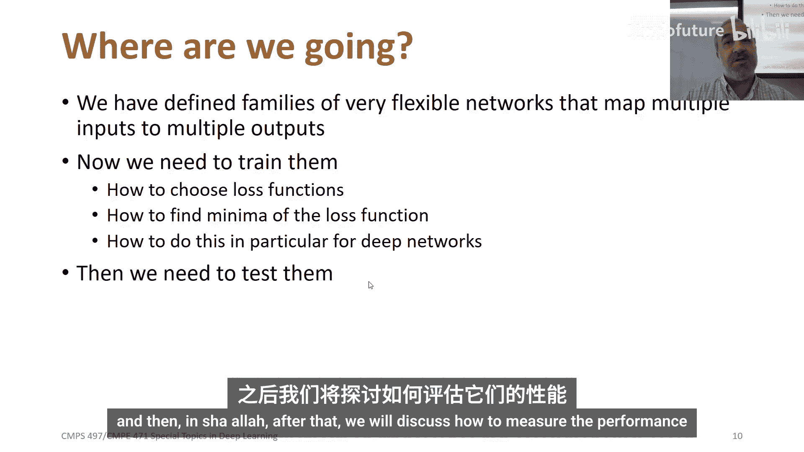
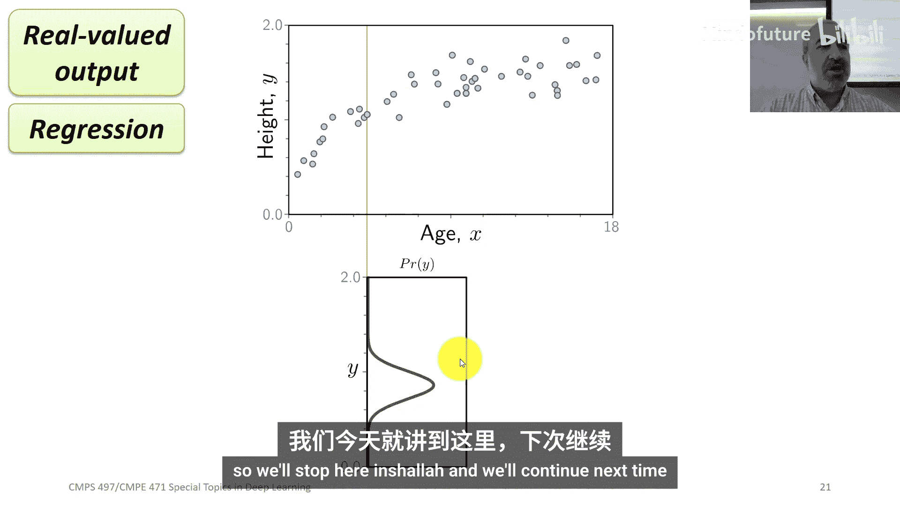

# 【卡塔尔大学】深度学习 CMPS497 ｜ Understanding Deep Learning ｜ Fall 2024 p07 P07_第七讲-损失函数 I -BV1vQvNz1EeK_p7-

Sbody K Kahi today we will for some time maybe 10 or 50 minutes we continue the session that we we were supposed to end last time。

 which is about deep networks right the remaining part is comparing between deep networks and channel networks and trying to show you that deep networks have。

More attractive features than shadow networks。And in fact。

 the deep networks exhibited or showed much better performance than shadow networks in many applications in many areas。

 up to maybe 1，000 days or more in some applications。

 in computer visions in NLP and reinforcement learning in many applications and areas。And Charlotte。

 in these few comic slides， we will discuss why is that？Okay， the first thing is to show you a to to。

To compare between deep networks and channel networks in terms in terms of the ability to approximate any 1D function we mentioned earlier that with the universal approximation theem we know that the a shadow network can approximate any  one D function with enough hidden units right now。

Do you agree with me that channel network networks in general is special case of deep networks？

So just one layer， deep networks is more and if we want to see to reduce the deep network to be a shallow network。

 we can just arrange for the layers after the first one to just act as if it is the identity function。

 so it's like doing nothing。Okay，If that's the case。

 then we can say that the deep network can approximate any 1D function because it can be used to a shadow network。

Okay， so in terms of this theem， we are both the same。Anything that we can do with a shared network。

 we can actually also do with a deep network。The second thing is the number of linear regions and you will see a big difference here。

We saw a similar app to that when we talk about shallow networks， right？

Here with deep networks we are adding more layers on the left side。

 we plot the number of parameters versus the number of regions。Okay， and the curves here。

 we are changing the number of layers。So。Where is the shallow network here in that plot。

The first curve right when k is 1 so with k is 1， when we are changing the number of parameters。

 of course， the number of fusions is increasing。But with increasing the number of layers。

We see that we have even more vision。Right。And that's expected。

 So for this specific point we have five layers this is on the plot of five layers right the number of parameters is like 471 parameters。

 and in that case we have 160，000 linear regions。 So if we go to the Y axis this is dog scale again。

 this is more than 160，000 parameters。Okay， with just five layers and 10 hidden units per layer。

So this is huge Now， if you look at this vertical line。

This vertical line shows us that with the same number of parameters。

 how many visual we can get with different。Layers with more layers。Okay。

 so we fixed the number of parameters and let's say that this is 470 okay， with one layer we can get。

😊，About 100 regions。Okay， with two layers， we get more with three layers。

 we get even more with four layers， we can get more than 10。

000 regions Okay this is with the same number of parameters。Okay， and。

 you can think of it like the same number and roughly the same number of hidden units。😡。

And instead of putting them all in one shallow in one layer， okay， if we put them in multiple layers。

 then we can get even higher number of features。Yes。对。We案 and。

You can arrange and if I give you the number of parameters， if I give you number of nodes of neurons。

 okay， you can arrange it in a network to get the same number of parameters the architecture will be different。

 of course。😡，Okay， and imagine， okay， let me explain this even better。

Let's say that we have a deep network with three number of three layers with a specific number of hidden parameters hidden units。

 okay we can calculate the number of parameters right， let's see that these are 1000 parameters。😊。

If I told you with this 1000 parameters， can you represent a channel network could not？😡，Yes。

 with okay， with this with maybe more than 900 or close to 1000 hidden units right so with the same number of parameters。

These two networks will have different number of issues， actually， with the deep network。

 we have even more， yes。Im the second line I stand。Yeah。This is for the point here。

 for this point specifically for this point。Okay， so as we add more layers。

 the number of visualions increases if we fix even the number of parameters。😊，Okay。

 well have even more lesions when we add when we have more layers on the right side。Yes。😊，不定。嗯。Yes。

 when we add dealss， we increase the depth， yes。The what。Yes， of course。

 now this is what what the curves are telling us okay。

 what what these plots are what these curves are telling us okay， with adding more layers， okay。

 the number of fissions increase。Even with the same number of parameters。Yeah。On the right side。

 we are okay so on the left side actually we are plotting all of this when we have just one input。😊。

Okay， on the right side， it's the same plot， but when we have 10 inputs。

And you can see the change in the scale here on the y axis here it's between one to million here between  one to 10 to the power 200。

😡，Okay， so the number of fusions even increase a lot with more inputs。Specifically this point。

 five layers again， 50 hidden units per layer， we have now 10。

000 parameters or more and with that we have more than 10 to the power 40 linear regions Okay so the number of vision really really increases a lot with adding more layers and with adding more input。

With having more inputs。Okay。Same idea here， if we look at same number of parameters with increasing the number of layers。

 we have more visual， although the number of parameters is the same。Okay， that means that。

If we have specific budget in terms of time or cost of computation。😡。

We can increase the complexity of the network by adding more layers by arranging the same parameters within a network that is more deep than shallow one。

Okay， is that clear。So this is telling it in summary for a fixed parameter budget。

 deeper networks produce more linear regions than shallower ones。

But we need to mention here that these parameters， the number of parameters here in a deep network are not all completely independent。

 there are some dependencies between the parameters。

 okay and that's because of the interaction between the layers weights are affected by the outputs of the previous layers and so on。

 so they are not all completely dependent。Whether this is similar to what we can see in real life or not。

 this is unknown， some applications we can manage to use such deep networks to approximate the needed functions and some are not yes。

Okay。Not exactly that， but even with the feet forward there are interactions between each layer right each layer is interacting with the previous one。

 so the weights that are learned in between are affected by the previous layer okay the output of the previous layer which is affected by the weights and so on so there is some dependency of course。

悟空。其他了。Yes， exactly， even without these loop。Okay， so the third one is very。

 the third property we'll talk about here is very related to the previous one。

 which is called depth efficiency。Depth efficiency means that。To approximate a specific function。

 we might need so many nodes。😡，In a shadow network。Okay， to approximate the same function。

With deep network， we might need much less number of nodes。Much less number of parameters。 Okay。

 that means that。The shadow， the， the deep network with。

Less number of hidden units can approximate the same function that the shallow network can approximate with much more units。

Okay， this is what we call depth efficiency。Again， in realityities。

 we are not very sure that all of the real world functions work like that， but many of them。

 depending on， I mean， as showed in research and in civil applications。

 but still although this is attractive property， but it is unknown whether we really need that in real world functions or not。

This one is really important and we will talk about it in Sha law later in the course。

 large structured networks， deep networks can be viewed as large structured networks。

 think about images。If we want to process images， first of all， the size of the image is huge。

 right millions of pixels if we use fully connected network。

 then we need billions of links to process such images。😡，Do we really need that， first of all。

 this is not practical to have such very large networks， but also do we need that？

Think of an image of that class。😡，Do I need to process every position， I mean。

 to recognize something like the chair or a table in that classroom。

 in the image of that classroom Do I need to do that independently or the same way of recognizing a chair will be the same regardless of the position of the chair in in the image right It is the same right so we don't really need so many weights to do that。

 so many links to do that we might share weights and well get back into to that later in the course when we talk about convolutional networks。

You will see that to process parts of the image， we can do that with the same weights， okay。

 we don't need to have different weights over the entire image to do specific tasks like recognizing specific object in the image。

Also， when we process images， we might need to do some processing on different levels of details for example。

 first you might need to detect edges in the image。

 then you recognize from the edges you recognize shapes and then you recognize objects like a chair or a table or a human face and then putting all of these together you you might recognize a scene。

So this is incremental right， so you really need something that is structured that way to do the processing。

 you cannot do the processing all at once。Like in cello network in deep deep network allow us to do some interaction。

 to do some processing in sequence okay and this is really can be done much easier or actually can be done easily with deep networks because we can add layers that can interact with the previous ones。

And we cannot do that with a shallow network。Okay， so we cannot integrate actual information across the different levels of details of the image without adding more layers。

Okay， so the idea from that is that the deep network allows us to do structure processing。Okay。

 processinging that is done in sequence because there is interaction between the hidden neurons or the neurons or the nodes across layers。

 and that's not done in shallow networks。The last attractive property of deep networks that we will discuss today is the fact that fitting deep models up to some specific depth。

Is much easier than training in a training channel networks。

 And this is an example for an experiment， this plot shows， forget about this this word Epoch now。

 imagine that this X axis is the size of the training data。 Okay， so as we increase the training。

 the size of the training data， we expect the performance to be better right。

 we expect the l to be less over time as we add more training examples， right。

And this is done in all of these curves。 All of these curves are different with changing the number of hidden layers。

 so this one is with one hidden layer， which means a shadow network and the others this one is two hidden layers。

 this one is three and this one is4 okay。And you can see that， yes。

 the error is increasing with adding more training examples。

 but that's not the point of this of this plot。 The point of this plot is that。As we add more layers。

The training is faster。Okay， the training is easier， easier here means faster。

How can we get that from the plot？要 see。All of the networks here， the experimented networks reached。

Almost 0 ever， right， at the end。Right。But the one that has two hidden layers reaches that much faster than。

Or with much less training data than the shallow one。

And the one that has three hidden layers was even faster。OkayThe one that has four layers was faster。

 Okay， so we we were able to fit the model to a good training error to a good performance。

 much faster with less number of iterations over the training data or with less number of training examples。

Okay， and that's a feature of deep networks。To some extent。

 beyond number of layers it will get harder again， it will take a lot of time to do that and we'll see some tricks。

 we'll discuss some tricks later to handle that。It is also the case that practically the generalization of deep networks is better What do you mean by generalization？

Yeah。The performance on Ansceeen data so in general。

 the performance on unsceeen data with deep networks is better than shallow networks。Okay。

 any question on this， so we discussed now four or five properties that are attractive more with deep networks and advantages with deep networks over channelnel1 years。

And I decided。Okay。IThe talk about function。Okay， when we say faster here。

 we are not talking about how the time of the processing， actually overall time is also faster。

 but we mean here that we will reach the same performance。Faster with this number of three examples。

And instead of taking， let me give you a complete example， instead of taking， for example， two hours。

To fit the model to a specific error like 5% error， two hours with shallow network。

 maybe in 10 minutes we can get it with deep network。

Getting getting the same the same error in less time， or you can think of it also in another way。

 getting better performance in with the same time budget。😡，And， if you look at。

If if you plot a vertical line here。Okay。😊，This vertical line means that these are points that with the same time or the same training examples。

 right， same number of training examples， the performance of the deep network is much better。

Is better。 Okay， so with the same time budget， we can get better performance。

And all with the same to get the same performance， we can get it faster。You can look at it。

 both ways。Okay， any other questions？Okay， then I will ask。With same number of parameters。

 a deeper network generally has less or equal or more regionss compared to shallow ones。

 That one is easier more Okay， second one， depth efficiency means。

Adding more hidden layers in a deep network can achieve equivalent approximation of shallow ones。

A shallow network might need exponentially more hidden units to achieve equivalent approximation of a deep network。

Paise your hand， please， yesterday May。So， the second one。Okay。

 so the second one is the meaning actuallyary of depth efficiency。Right， you agree with that。

Do you agree with them。Okay， wild。So what is depth efficiency， what do we mean by depth efficiencyh？

Yeah， as we add more layers， okay， when we add more layers。We。We do that。With much less cost。😮。

Then a shallow network that is doing the same job。ok。😊，Right。Type which one of these then？First one。

Or the second one。Or both。Iello该。第。嗯。Can we see from both sides， any it's either。

For the deep network， we add more layers。😡，Okay。😊，To approximate the same function that is approximated with the channel network with much more nodes。

 right？😊，Or can do it from the other perspective。😡，From the perspective of the Sha network。

 we can add more hidden units in the Sha network to approximate the same function that can be approximated with list nodes in a deep network。

😊，So both of them are quite。 actually， we are looking。In each from different angle。

 okay from the angle of the shallow network or from the angle of the deep network。

 but both are the same。Okay， exactly now。Is it you know， okay。Now we are done with this session。

 where are we going from here？We started linear regression， then we started cello networks。

 then we started。Deep networks， okay， but we don't know how to do the training。

We know how these networks behave。I hope， okay， but we don't know how we actually reach a model that is really good。

 And that's what we will shall discuss next。 So we will discuss those functions。

 We discuss how to do the。To learn the weights and to compute the gradients and then Charlotte。

 after that， we will discuss how to measure the performance of the。

He， any questions before we start the new session？Yes。😊，嗯，Okay， so。Like the question。

But in which situation would a shallow be like a shadow。Be better than。Okay。

 and is this is the question for all of us， actually。

Which situation you think a shadow network can be better than。Better than a deep network。

 simple problems， which means it'ss， yeah， it's， it's a simpler functions。 Okay。

 and simple functions， you don't really need deep network。 Okay， maybe with a shallow one， you might。

 you might fit the model well。Then。Some tests， not every task in reality is very complex。

 some tests are much simpler than the others。So perhaps。

 I wouldn't go for a deep network before I saw a shadow network。😊，嗯。But of course。

 not with exponential number of hidden units， otherwise this would be very costly and it's better it's much more efficient to do a deep network in this case。

Now we switch to loss functions。Before that， let's recall some of the concepts that you went through in high school。

 I think， and also in the class in the first or second week。

First， the logarithm and the exponential functions。Do you remember these functions。

 both are monotonally increasing as we increase the input， the output would increase。

When we talk about the loggarin function in this course。

 we will assume that the base is the oiler number E so it is actually the natural loggar。

 which sometimes we call it L but we just use log in discourse， but you know that the base is E。嗯。

Quickly， some quick numbers about the logith function。 What is Do  one。嗯。Log 1 is0 okay。

 and this is this point actually， so this is 1 and the value is 0 here。How about log0。

Negative infinity， Okay， so it's negative infinity。Yeah。Its negative infinity。Okay。

 and it is increasing with increasing the input and it is where only for positive or non negative numbers。

Okay， for the exponential function。😊，It takes any input with negative or positive and it provides a positive value actually。

Okay。😊，Or at is not negative value。What is E to the power0。One， okay， which is this point。

What is e to the power of minus infinity。00。And of course， as we increase the input。

 the output is increase is increasing。Okay two quick rules about these two functions。

Of E to the power Z。因此。Z。Right。You study that， I think， in high school。

 and log A B equals log A plus log B， we would use both those chart in this。Okay。

 so this is back from math now earlier in the course we discussed the loss function right what is the purpose of a loss function。

嗯，这短。Who was。あバ。Yes， so to measure how good or bad a model is， why is that， when do we need that？

In training， when we do training， okay， in training， we need， we need a guidance okay。

 whether the model that we we each in that moment in training， go to bed。😡，Okay。

 so we need a single number， scalar number that tells us， is that good or bad。 Okay， if we。

 if we go through this direction， we that we will increase the loss function or decrease the loss function and so。

Okay so the loss function of course， is defined given a training data， okay。

 so in neural networks of course we have pairs， XI and YI。Okay。

 so the rose function actually is defined。😊，Out of is a function out of the parameters of the model。

 the model itself。And the training examples okay， and usually you just mention we just use the notation that it is a function of the parameters。

 but in reality， it is function also of the training examples。

W is it functional that any examples because we need to measure it on something that for which we need we have the ground tooth。

 we have the predicted outputs right so that we can measure how good or bad the model is。

And in training， we aim to find the values of the parameters that minimize that loss。

Because the loss is like a coast， like an air。Okay。

 so we want to find the parameters the values of the parameters of the model that will make the minimum possible loss。

Right。And remember this linear regression example， okay。

 we had this training data and we wanted to fit a line。

So we used what we called at the time least squares loss function and the least squares loss function was just measuring the square of the differences between the predictions and the actual ground to values observed with values。

Okay， so these are the differences。And we just square them and sum them。

 And that that's the the loss function that we used here。 That was just one example。

Now in this session， we want to know why exactly we used leaf squares for that type of problems。

 is it just given from another planet that you should use this squares loss function or or what？

And how in general we construct or we develop or we design lost functions for other types of problems。

So if you are given a type of problem， you want to know which or how how you can design your loss function。

 what loss function will be good for that type of problems。所。😊，Oh， okay， good question。

The loss function is fix it for all problems。Of course not。Okay， of course not。 Okay。

 for regression is different than binary classification。

 is different than multi class classification。Okay， the type of problems in life is different， right。

 So you need to deal with every or different types of problems Okay and with with different type of problems。

 the loss function which。Okay， so we'll start with a concept that is very important called maximum likelihood concept。

Okay， so far。First of all， in this session， the main objective is to find a general procedure general process of finding a good loss function for a given problem so we are given a problem how can I design in general what are the steps that I should do to design a loss function that is good for that type of problem。

Okay， so far， any model that we discussed the linear regression or shallow networks or deep networks。

We assume that the model predicts the upper di。Y， for example。

 remember the classical simple problem of given the age of a child predicted the height。

Whatever model that we designed based on what we studied so far will directly provide the predicted height as the output right so we'll say the output is the height and then we design it as a shadow network call deep network with different layers and so on。

 but the output will be the predicted height of the child right so always so far the model predicts the output given the input。

Now we will switch to that。We will change that。To what instead of predicting the output。😮。

Which means the model will produce one value， right？Instead of that。

 the model will produce a proability distribution。😊，Over the possible outputs。Okay。😊。

It's a conditional for distribution because it is conditioned on the input， so for any input。

 for any given input。😡，The model， instead of producing just one number。

 it will produce probabilityability for each possible output。😡，And if I have 10 possible outputs。

 it will produce probability distribution over them。

 which means it will give us probability for every single possible output of them instead of just giving us one output。

😡，我觉得你。Kind of that， we'll talk about that。 Okay， we'll talk about that，I will explain it more， okay。

 wait， but just give it and get it in mind instead of predicting one number， it will predict。😡。

A distribution of possible values。 then if we do that。😡，Then the loss function。

Aims to make the predictions。Matching the order probabilityability of the observant output to be as high as possible。

What does that mean。We said that the model will produce a priority distribution right。

 so it will save for this value of the output。😡，The priority is 10% for this one is 20% for this one is 50% and so on。

 right？One of these only is the correct one right based on the training data， right？😡。

And what is better is to give high probability for the correct value or low probability for the correct value。

 high probability for the correct value， and that's what the loss function will push the training to do。

😡，Okay， so the loss function will tie to encourage giving high probability。😡，For the correct。

 observed value。For the given input and for a given input we know that what is the observed value right for given input X I we know Yi。

 but the model doesn't know Yi right， the model will provide a probability84 Yi。😡。

If that orbit is very high。Then the loss would be high or low。No， right， because this is really good。

 if the probability of that observed with value is low， then the loss should be very high。Okay。

that still might not be very clear right， so let me explain that in the next。

 I think maybe 10 or 15 slides。Okay， first， first example。😡，Dig example that I just mentioned， right。

 the H given the H， what is the height okay and these are the training data。😊，Okay。

 now imagine that instead of providing instead of providing producing or predicting just one value for the height。

 given the edge。The model will produce at for distribution。 So， for example。This age。

 let's say that this age is what is 2。5， maybe years， right？收。

What is the observed value for this input？😡，The height， yeah for it， what is the height for it？

This point， right， So let's say that this is。1。1 method。Okay，1。1 M。Okay。😊，For example。Okay。

 this is the ob value， right？😡，Now the model previously the model can produce one output。

 right it can same as 1 or 0。8。😡，Right。😊，Now well change that the model will not produce one number。

 it will produce probability distribution like this one。😡，What does that mean。

The x axis of that distribution， this is， of course reverse， right？

The X axis of this distribution is all possible values of the output， which is what here。From 0。

 the height cannot be negative， right， Okay， so from0 to whatever by， the maximum possible。

 let's say2 meters。 I don't think a child can be more than 2 m high。 Okay， so from 0 to2 meters。😊。

And the y axis， of course， is the probability。 So this is actually a a probability density function if you remember from the your probability class okay and。

😊，There is a probability for every possible。Value of the output。Okay， now what is the。

The value of the output with the maximum probability here in this distribution。😡，Probably this point。

 right Yeah，s it's very good actually， it's I think it's the same by its 1。1。

 So this actually probability distribution is really good because it assigned the highest probability。

To the。To the。The actual output is the correct output， which is 1。1。😡，But still， it's not perfect。

 right？Because the probability of this point is not one。😡，It's maybe， I don't know。 maybe 07。

A better model should provide higher probability。 so if it's 0。8。Be even better 0。9。

 as it's getting close to one， it's even better。😡，Right。😊，Okay， with me so far。

 so that can be the output。Of the model， given this input。Another example。

Let's say that we have the input to be this point okay now。The model will produce a different。

So weight distribution， that's why we call it conditional， it's conditional on the input。😡，Okay。

 for a given input， the model will produce。Another of a different probabilityb distribution。

 if you see here， these are different， right？s。These are different， right？Okay。

 this one now is centered。At maybe this is 2。5 1。5。Okay。😊，The other one was centered at 1。1。

So you see the difference now between。Before we assume that the output would be just one number。😡。

Now， the output is a probability distribution。 you can think of it， by the way， this this way。

The model now is。Not very certain of the output。So it captures its uncertainty within this probability distribution。

 so the model thinks that the output is 1。5， but with a probability of 60%。

And it is less than one with 4 04。Okay， and and so on。Okay， so it indicates。

How uncertain or certain it is about the output with this probability distribution。Okay time。

 you see this is a flow distribution that I think is very familiar to us， right？😡。

Do you remember the shape of this？The normal distribution， the Gausian Gaussian distribution， right？

The normal distribution has two parameters， right。What are the two parameters？

The mean and the variance， Okay， the mean is where the the distribution is centered and the variance is the width of of the build shape。

 right。T this variance， if it is smaller。😡，Okay， and the center is actually matching with。

The with the with the correct answer， that means that the probability of the center will be higher。

So actually the distribution even can have different parameters the model can produce a distribution that is more certain about the outcome than another。

And if this is flatten。Okay。😊，So that， if the variance is 8。Hi。

Then this is indicating that the model is not very set。Okay， then the one that has lower values。

Here's another example， do you have a question any questions， you had a question I think。有能。耶稣几个人。我者。

穿出来。有。滚好。你都咩自己大钱。Okay， good question。In training， we always give。 We always use。

The peers that we have in in the training set。 So we are sure that we have。

Appear with that input and that output。 Okay， so there must be an output for that input。Okay。

 that we will compare the predicted output with。Okay type in reality。

 in reality when after we build the model， can we use it for inputs that are not that will not in the training。

 of course yes， because now the model is general for any input。😡，But to train it。

 we have to compare with something that is from that is observed， okay。

 so we have to go through the points that we already observed in the training sense。Okay。

 so here's another example。😊，In that example， the input is a number of words in an email and we want to predict whether the email is spam or not。

 it's very simplistic right with just the number of words in the email。

 we want to predict whether the email is spam or not。Okay， so we have how many possible outputs here。

Only two。In the previous one， it was continuous。😡，Okay， that's why it was a regression problem。

 right here we have just two。😡，好。Okay。APos outputs here。

 its it's infinite right Yeah and continuous values right， so this is equation。😊，In that example。

 we have only two possible outputs spa or not。😡，Okay， it is binary， okay， so the distribution。

The output distribution okay of the model now has to be continuous or discrete discrete Okay。

 so for example， for this point， it has to give an a probability for 01。

0 means not spam one means spam。😊，So it will be a discrete distribution can we use the normal distribution here no normal version is for continuous variables right this is a discrete variable。

 so we have to find the appropriate probabilityb distribution for that type of input for that type of output。

Okay。So here， for example， the model。😊，Produces this。This distribution， okay。

 which means that it prefers not spam， but not very sure， right， it's maybe 60，40。Okay。

 a better distribution for that will be maybe 80，20 or 9010。Of course， based on the correct answer。

 which is not experimentalally。Okay here's another one we have here here we have it's a spam the model still is good。

 it's not bad okay and it's even better from the previous case because it gave the correct label higher probability。

It's still not 100%， by the way， so the model will be penalized here。😡，Okay。

 but not as much as it will be penalized in this case。😡，Right， because here。Here。

 the the probability of the correct table is very's much closer to one。Then in， in this case。Okay。

 so you got the idea， so the loss function should capture this。😊。

The loss function should give us high penalty。😡，When the model is not very certain or if the model is very uncertain about the correct label。

😡，And low penalty， if the model is certain of the correct label。

 the model assign a high probability for the correct level。Yes yes。😊，So okay， then。In the regression。

Yeah， should we get back here？When we have the。对。开始。Right， and we， we have like。

The probability like the probability distribution， we have many values，Is it possible to take。

A lot of these values。 and then do classification on them。ok嗯。Okay， so you are saying。

 is it possible to just？😡，Live with the priority distribution as an output and then do something with it。

😡，It depends on the application and depends on what do you want to do next with the output of that model。

😡，If you want to process that will process this output with an next member classifier。

 another classifier， yes， you can take the entire priority distribution。

But if you want to show that to the user。Of course， you will not show the user priority distribution。

 right， you need to show one value in this case， the best possible。😡。

Strategy is to show the value that has。The highest probability exactly which is which should be maximized in the loss function and you will see that okay and that's why it's called maximum likelihood okay we will maximize the probability of the ob value of the ob output value。

😡，有 a also the。对一下。Now are we are talking about loss function， right。

 that the goal of the loss function is to show that there is an error。Okay， so if thearrow is high。

 that means that the model is not doing good。😡，Which means penalty here。

 that's what I mean by penalty， okay， the penalty means the loss will be high。Okay。

 in when whenever the model is making mistakes is making。Large mistakes to big mistakes。真。😊。

Any other questions， so we'll stop P line well continue next time， Sam can ahead。

