# 【卡塔尔大学】深度学习 CMPS497 ｜ Understanding Deep Learning ｜ Fall 2024 p08 P08_第八讲-损失函数 II -BV1vQvNz1EeK_p8-

Sm and Charlotte today we continue talking about those functions， probably also for the next lecture。

This decision is really really important， so I want you to really pay a lot of attention and make sure that you really understand the steps that we will go through。

Last lecture， we started to think of changing our view of the output of any model and instead of predicting the output right away。

 we want to predict probability distribution over the possible values of the output。

Do you remember something like this， depending on the type of the problem。

 we will choose a probability distribution， either for continuous values it would be something like normal for discrete values would be something like or categorical we'll talk about that and then we assume that the model will actually predict that probability distribution and instead of just one value。

So you can think of it that way that the model will assign a priority for each possible output。

So for that value of the output， maybe this is 10%， the other is 40%， the other is 35% and so on。

 instead of just giving one value and this as you will see will make it easy for us to construct a loss function that is appropriate for that type of problems。

So for every type of problem， as you see here。😊，We might choose a different probability distribution here this is a regression problem so we choose normal distribution here this is a categorical distribution because the output is discrete another categorical distribution here this is another continuous distribution also that is suitable for the output which is a direction so the point here is that for every type of a problem we might get a different we should choose a different probability distribution Now we see that very easy right we said that the model will predict a probability distribution。

Now what does that mean how actually a model can predict a forward distribution we know that in a neural network the output nodes will produce numbers right okay so it won't be a separated distribution so that trick here is very easy we will have it in two steps first as we said we will have to pick a known parametric distribution。

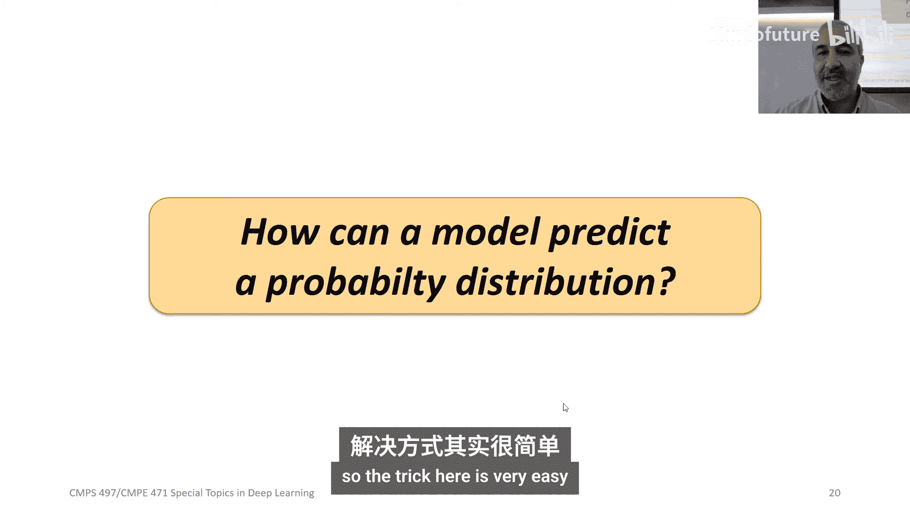

That is good for the output or that can work over the output， the possible values of the output。

First， what do you mean by pmetric distribution？😡，The word parametric， Okay， what does that。

 It has parameters， Okay， a distribution that has parameters。嗯。

So we assume of course that the distribution has parameters and here's an example。

 the normal distribution of course has two parameters， which are the mean and the variance。Right。😊。

So first step， quick， specific probability weight distribution， how depending on。

 as you will see in the example， depending on the the possible values of the output。

 whether they are continuous or discrete， that would make a difference。

Then we set the model to predict the parameters of this probability weight distribution。😮。

So the model actually will not produce a distribution。

 the model would produce values that are the parameters of that distribution。So in that example。

 the model the distribution solution that we selected is normal。

 so we will set the model to predict the mean and the variance of that model。

Of that distribution sorry。Okay。😊，And this is how we will make the model to predict at private institution。

 Well pick one， one distribution， and then we will design the model， which is in our case what。

In this course， what is the model？A neural network， right。

 So we will design the neural network so that the output。

Will be the parameters of the probability distribution。Okay， we'll see that controller in detail。嗯。

Now， as we said last time， we want the model to give high or low probabilities for the correct answers。

High probabilities right， we want the model to be accurate。

 Ac means it is actually given giving high probability for the values that are the ground tools。

 the values that correct the correct output。😊，So， for example， if。If I have。

If this is the training data， let's say that we are back to the example of the height and age given given the age I want over tried it I want to predict the height okay so let's say that these are the pairs the X X and y over the examples over the training examples okay for each age。

There is a height， right？And I want the model to predict those values。😡。

So let's say SNN among the values here is when the age is 2。5 years。

 let's say asN the height will be 140 centimeters。Okay， so this is given entertaining data， right。

 I want the model when I gave it。😊，2。5 as an input。

To give me a distribution where 140 has a high probability。

Okay so let's say that for that input the model gave me a distribution like this。

 of course let's assume that for this problem the normal distribution would be would be good distribution and let's say that the center the mean of that distribution was at 170。

😊，Okay， is that a correct or a good estimate。Why？What is too high。170。

 but what we look actually for is the probability of the correct answer。

So the rate of the correct enter would be something like this side， this is maybe here。

 this is 140 right。😊，So this probability is high or low is low relatively right so this is not a good this is not a good model yet okay so a model that will give high probability here。

😊，Something like。Like this one method。Okay， if we have this distribution。

 then maybe the highest square rate is 142。 Okay， so 140 will be still high。 Okay。

 so we want when when we are turning， we want。When we are training。

 we want the module to assign high probabilities for the correct answers。😡。

The correct answers are here what are for a given X I。😮，The correct answer is Yi。

From the training data， right， because we have pairs x，y， x，y， x1 x to y2 y1， x 2 y 2 X I， Y I。

 so for an input X I。I want the model to get or to set or to assign a high probability for Yi。😡。

Will the model will be penalized as much as the probability is far from one because one is the maximum possible probability right so if it's close to one。

 then the penalty would be very small if it's very far from  one like 0。1。😡。

Then the penalty would be high。Good。😊，And that's exactly captured in this equation。😡，Okay。

 let's think what is this？Here we are going over all the training examples。 So this is a product。

 you know， this symbol for the product is from one to I I capital is the number of the training example。

 So this is going through all the training examples。Multiplying the probability that given Xi。😮。

I will get Y I。So this is the probability of get the probability。😊。

Of the probability that the model assign signed for the correct answer， Y I for the input X I。Okay。

 is that clear。So， here。X 1， Y 1。 So I want。From this。

 this will be probability of y1 given x1 times probability of y2 given x2 times the probability of y3 x given x3 and so on。

 and I want actually to find the parameters of the model phi that maximize this product。😡。

Because if we maximize this product， that means that the Mora assign high probabilities for。

The ob output for the correct output。Are you following with me。Okay。😊，And。If we maximize this。😡。

Function。Then we reach the model that we want to to get eventually。

 So this is the process of training。 We want to find phi。Okay， we want to find phi。 Phi is what here。

 Phi are the parameters of。😡，Of the model， which I want。The， weights and voicees。Okay， in our case。

But by the way， in general， this lecture today is not only about neural networks。

 it's about any learning model。But in our case， the parameters which are always denoted by phi in this course。

 the parameters of the model are the weights and the biases。Yes。😊，等你。

The parameters will be learned using the training data。😡，Okay， so phi is the parameters of the model。

 which are the weights and devices， so we want out of this equation now we want to so let me clean it up。

A bit。So， we want。2。JustOne second。 we want to maximize， okay， we want to maximize。

The product of the probabilities that the more than assign to the correct answers。😡，Yes。😊，It like。

他电他。are have。Yeah， with a second。 Okay， That's why I'm asking you about Phi in particular。

 Phi is the parameters of。Of the model， we also talked about the parameters of。

That probability distribution。😡，Okay， we call it Theta。Okay， so theta is the parameters of。

The poverty distribution。Now。Since。嗯。Since the， the the output。Will depend。

On this probability distribution， which is a function of its parameters。

 then we can say we are maximizing the probability of yi given theta I。😡，ok。😊。

Because this probability is a fluid distribution over the possible values of the output right。

 and the values of the output is function of theta I。😡，Okay。

 so we can say that we are maximizing the probability to4i given theta I， it's not only X。

 it's also the parameters of the probability distribution。Now distinguish between two。

Stets of parameters。Phi is the parameters of the model。😡。

Which are the weights and deviceses of the network if we are talking about a neural network。

And theta is the parameters is a set of parameters of the probability distribution that the model will predict。

😊，Okay。Okay。Now we said that。For the model to predict a fluid distribution。

 it will actually predict the parameters of the distribution right so actually these parameters。😊。

All the output of the model。😡，Right， which is。Remember the model always， we call it F， right。

 so theta I actually is f of X I and phi。😡，Is the output of the model。

 So if I have a model like that。It's the SN we have。X here。 That's the input。And we have three。嗯。

So we have。We have three layers like that， this is the output of the model， right？😊。

We said that we will set the output of the model to predict。😡，I mean。

 we set the model to predict the parameters， okay， let's say that there is one parameter of the probability distribution。

 so this is theta。😊，So this is， as a whole， the model is a mathematical function。 if you remember。

 right， right It's F of。It's a function of what。Of the input X， and。And。

And the parameters of the modeluchche is phi， exactly。Which is the output？So that's theta theta。

 Okay， so theta I is f of X I and phi。Okay， you got that。Any question about this， yes。我那。Exactly。

 yes， this is what this is what we are saying here。 So this is the output of the model now right。

 So this is not directly the output that we want in the application in our problem。

 No this is this will be now the one or more of the parameters of the probability distribution。😡。

So for every input， for every input x， we will predict the distribution and if I give you SNN。

 if they give the model the value 2。1， it will produce， let's say SNN this distribution。😡，Let's3。

Okay， for another point， it will give a different distribution for a third input。

 it will give a third distribution and so on for every input， it will give a distribution。

 This distribution is determined by its parameters right So we will set the model to predict these parameters。

 Once I know the values of the parameters， I know that distribution completely。天见没。Yes。Okay。

 very good。 If theta is the output of the model， then what is Y I？😡。

We thought that why I is the output of the model is why I the output of the model。

It seems not right because we have here Yi and theta I。

 so what is the difference between Yi and theta I？😡。

Yi is the correct answer from the training examples for Xi。😊，Okay， so this is Xi， this is Yi。

 but that's not now the output of the model。😡，And we never， by the way， any。

 this is just the reference to us to see if the model will give us the correct answer or not。

 whatever the output we will compare it with with that observable value。

 but now we have the output to be theta。😡，Why is this theta I not theta？😡。

Because it's different for each training example。For every x will have theta， so x1 have theta 1。

 x 2 have theta 2， that's what the network will predict for that input。Okay， is that clear now。

 it's very important that this is Charlotte to be clear， okay。

 to make sure that you really understand the rest of the lecture。ok。😊，はい。

Why why do we want to maximize x， so what is the meaning of this that means that we want to find the values of phi。

😡，Which are what again。The model， the parameters off of the model。

 weights and biass that will make this function this product。The maximum possible。

 that's why this equation is called maximum likelihood criteria。 maximum likelihood。

 likelihood of what likelihood of seeing the ob output。😡，like root means probability， right。

 so I want to maximize the probability that the model will assign to the correct answers。😡，Okay。

 so this is called maximum likelihood criteriait。Okay， are you for。O。Any questions？

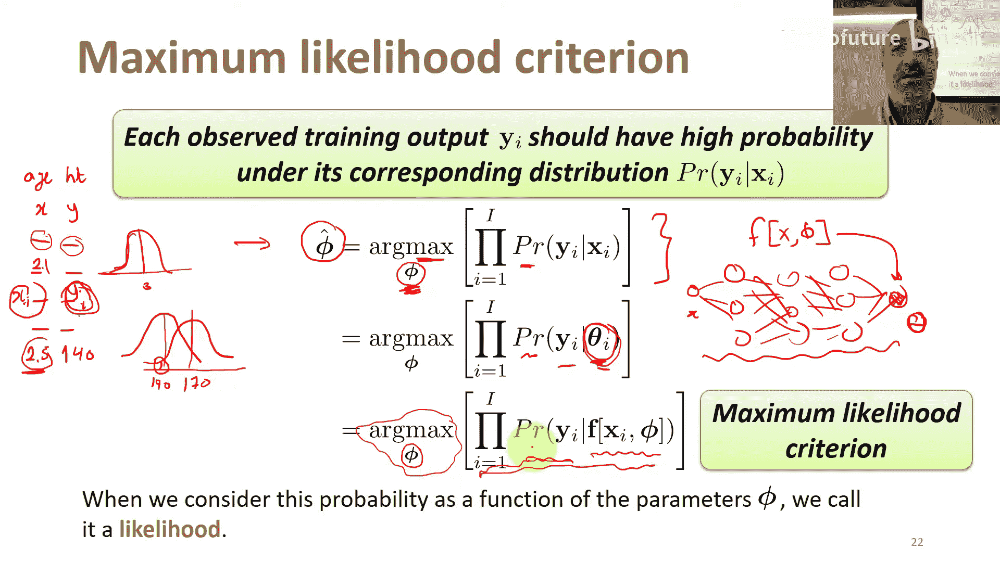

Is everything clear so far。ok。Now， to do this， to do this， to have this maximum likelihood criterion。

 we actually have two assumptions。

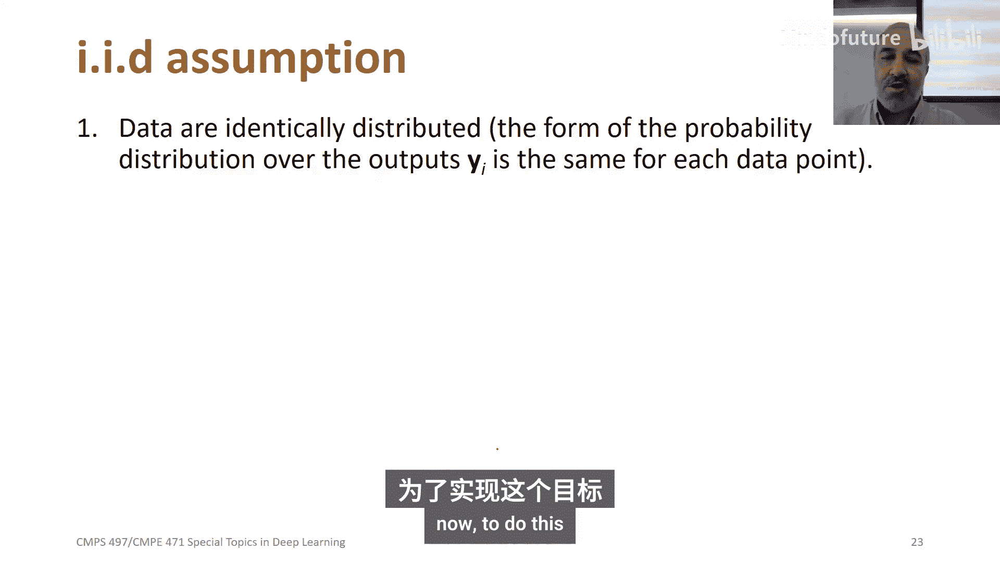

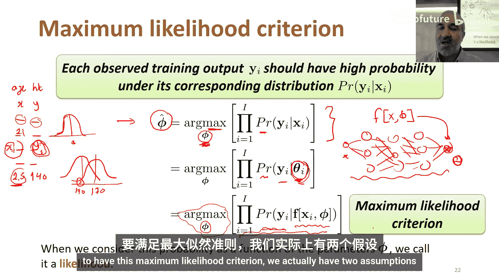

First。Is that for every input， we have the same type of the distribution。

 We have the same type of the probability distribution。😡。

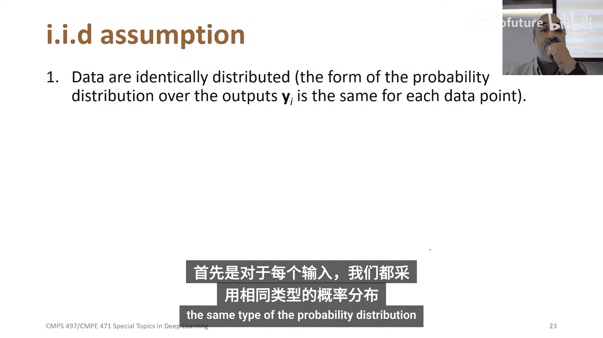

So I cannot say as anN that for x1， I will have normal distribution。

 but for x2 I will have forone distribution No we assume that all the distributions are the same。😡。

But of course， we have different parameters， right for every input， we have different parameters。

 but they are the same， so the data are identically distributed and also those probability distributions are also independent。

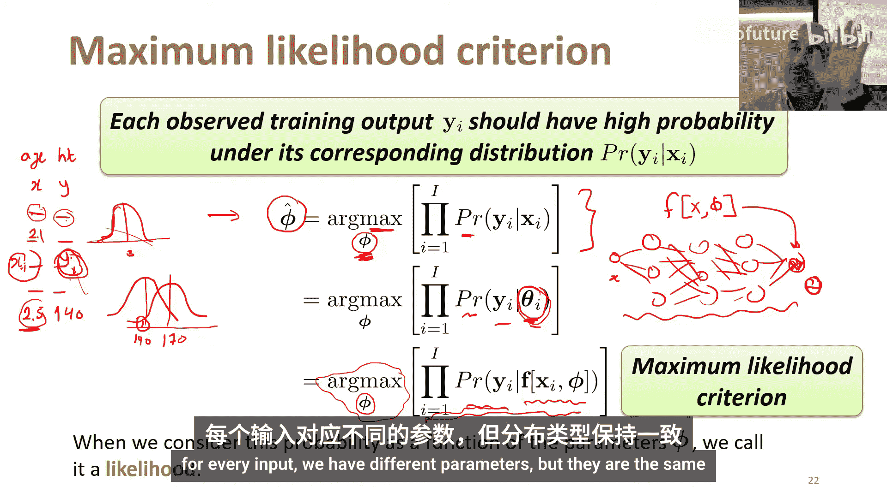

Are the independent。Which allow us to。Have this product this way。

 So this is actually the the original， the exact real probability that we want to maximize the probability of Y 1 and Y 2 up to Y I。

 given X1 and X2 up to X I。 But because we assume that the。

For which institutionss are independent so we can approximate this complex probability。

 very complex probability to the product of the individual probabilities。Okay。

 so this is by the IID assumption， the independent and identically distributed data。

This assumption is used a lot in statistics and machine learning to make our life much easier when we do the calculations。

Okay。😊，Okay， now back to the maximum likelihood crit。 so again， this is the likelihood function。Okay。

 we want to maximize it， we want actually to find the model parameters that will maximize it。😡。

Which will get will be5 hat。Okay， now if you look at this function。

The likelihood function is now it's now a product of probabilities right and we know that pro are between zero and 1 and many of these proities might be very small What happens when you multiply small numbers。

😡，Together。W will comes the output will be smaller okay whenever you multiplied by a number that less than one and very small。

 it will get smaller and smaller and smaller， maybe it will be very close to0 if that the number of the multiply factors are many okay so that's a problem because we might not be able to present that number actually accurately we might get under flow。

So well have to handle this。Because if we really have this function to maximize， it will be。

In practice would be almost zero。😡，Okay， when we compute it。

 so we have to solve this problem and the solution is really easy。Using the log function。

 remember the log function we talked about last time， you have a question。😡，No。

 we will not be able to which parameters has we change？That's not about changing the parameters。

It's about the fact that。These are probaities。😡，And many of them are very small。

 which means many of them are close to  zero。 When you multiply very small numbers like that。

 many of them。The product will be very， very close to zero。😡，嗯次。No。

 it means that because we did this assumption。😡，The consequence of that is that the。

 these values will be always 0。Okay so to solve this problem we use the log function remember last time we said that the log function is monotonic so whenever we increase the the input the log will increase okay so let's assume that we have this function here this function。

Okay。😊，Let me change this。So let's say that we have this function。Okay。

 and we take the lobe of that function。When we do that， we get this function。Okay。

 now the question is， are these two functions the same？我。No， of course。

 this is the original function， sorry this is the original function and this is the logo of that function。

 right？😡，But remember that we want if we want to maximize it。

 we'll find that the maximum value of this function。😡，The maximum value of this function， okay。

 let me get back to the pen then。😊，The maximum value of this function is at a specific value of the input right。

😊，Which is its same as an N this is I don't know， minus 0 minus4。Okay。😊。

When we take the log of that function， the maximum of the new function will still be at the same point。

Which is -4。Okay， although the function itself changed it。😡。

But the value at which we get the maximum of that function will not change if we take the log。😡，Okay。

 is that that clear keep that in mind because we would use it in the next slide。😡，Okay， so again。

 the message here is that。If we have a function。The function。

Will reach the maximum add specific value of the input。😡。

That' specific value of the input we not change if we take the logo of that function。😡，Okay。

 now getting back to the original likelihood。Function， which is this。We want to maximize it， right？

And we want to find the value phi that will maximize it if we take the log of that function。

 phi will be the same。😡，RightThis is exactly what we said last in the previous not previous lecture。

 previous slide。Okay。😊，So5 will still be the same if we take the log of that function。😡。

So now it's like instead of maximizing this function。

 we actually want to maximize the log of that function。 Now， Now， when we take the log of a product。

 what happens。It's converted to。Submission。 So now， instead of of of having log of the product。

 we have the sum。Of the log of the individual values。Type how that solved the problem。

Instead of multiplying very small numbers。😡，We are just adding， adding the logo of them。Okay。

 so we not have this problem and still we will have the same learned model。Which is the parameters。

 right， we are trying to find the parameters that will maximize this or that and they will be the same。

😡，Okay。The clear。So now it is a sum of terms， so it doesn't matter so much if the terms are small because were just adding them。

Okay。Any questions so far。好ello。Yes。😊，你。Can we can。We can use this function in practice， yes。

 because the value that we will get will not be very small， like the multiplication。😡，一。

So this is from the practical sense。Okay， so this function is called the likelihood function。😡。

This function now is called。D log likelihood function right？And these are the same， of course。

These two are the same。And this one， I mean， both are the log likelihood function and this is the likelihood function before taking the log。

 this is just the terminlogy。Okay。😊，T usually in optimization。

And because we have a loss function or we want to have a loss function。We don't want to maximize it。

 we want to minimize a function。So instead of using the log likelihood function and maximize it。😡。

We can just。Take the negatives of it and minimize it。

So this is the look likelihood function that we saw on the previous slide。

 we just multiplied by minus1。😊，Now， it's called negative log likelihood。And we minimize it。

What is the same， is the same， like maximizing the log likelihood function。Okay。

 so maximizing the log function。😊，Dog likelihood is the same like minimizing the negative dog likelihood。

嗯。Okay。And后。We are getting the same model parameters。

 the same values of model of the parameters of the model。Okay， these two equations。Are equivalent。

When we maximize the function。We are actually also minimizing the negative of the function。

 It's the same。 But in this case， in particular。It's a lost function。

 so a loss function means we want to find a value that is small， so we want to minimize it actually。

Okay， so to call this， this is not a loss function。😡，We cannot call it a lost function， actually。

It's the likelihood or log likelihood function， but now we can call this。😡。

A loss function actually this is the loss function okay this is the loss function that will reduce actually so the loss function is the negative log likelihood and we will minimize it now yes。

😊，你 know。但 this时间。Now， if we， okay， so let me ask you a question now， if you look at this。

This function。What is needed to compute the loss？😡，Yeah。

Now if I'm telling you now this is the loss function。 Okay， and in training。

 we need to compute the loss function， the loss value， right， Remember deigation。

 we computed the loss for every point， right， for every model。every model we train。

 we can compute the loss now to compute the value of out of this loss function。What do we need。对，那个。

We need to know these probabilities， right， We need to know these probabilities and of course。

 we need to also to know this。The parameters of the model need to have the model。😡。

And we need to know the probabilities right from the distribution that the model will predict for this input。

For every single input。In the training pit。Right。他现在上。我也原个是。Okay。

 did you agree with me that we want to maximize the probability。

That that the model will assign to the correct answers。RightSo when we may maximize this function。

 that means that the model will be better right， it is also equivalent to maximizing the log of that function。

 right。😡，It is equivalent to minimizing the negative of the log of that function。😊，Okay。

 now this is minimizing。A function Okay， so now we can call this function a loss function because we are minimizing it。

😡，那后。Okay。😊，Is that clear now， okay？嗯。It's the same yeah yeah yeah。

 it's just mathematical manipulation okay so that now we can have a function to minimize and instead of maximize。

 but it's the same concept maximizing the likelihood is the same life maximizing the log likelihood。

😊，Is the same like？Minimizing the negative look like it。

But the last one is the one that we call it loss because we want to minimize。😡，Okay。

We cannot call this loss， we cannot call this function loss because we want to actually have high values of it。

对。Okay， now let's assume that we found。嗯。are good values for the model parameters。Okay。😊，Time。

 I want to use this model in reality。😡，In reality， we given in our classical example， given age。

 I want to get the height， right？😊，But now we set the network to predict not the height。

 It predicts a priority distribution， right， So what should we do。

 Should we give the priority distribution to the user to say， okay， okay， so what should we do。Yeah。

 so we have to get one number okay， so to get one number。

 I think the logic thing to do is to find the value that has the highest probability in that distribution。

😡，And that's exactly what we do in inferences， so in inferences。😊。

We can we need actually an actual prediction。 We need just one point point estimate that we can we can pass as the predicted value。

 so we will find the peak。Of the pre distribution， Okay。

 the maximum value of the probability and then assign the output to it to the value that gave us this highest probability。

 So we will maximize the probability， which is coming from the probability distribution from distribution。

 Okay， so the value that will。Get the highest probability is the predicted value。Okay。

But in our case， if we use the normal distribution。What will be the。

The value that would give us the highest is the mean it just happened that the mean will be the highest value in that case。

 and it happened that the mean is the one that we actually predicted from the model。😊，Okay。

 just in that case， in other cases might not be exactly the one that the thing that we predicted from the model。

OkayBut in general， we want the value that will give us the highest probability。

 That's the best we can do right you give me a great distribution。 If I want just one value。

 then logical thing is to get the value that has the highest probability。Right。😊，So here。

 if we have the normal distribution， then of course， will be y hat in this case will be mue。Okay。

 questions。Okay， question for me。

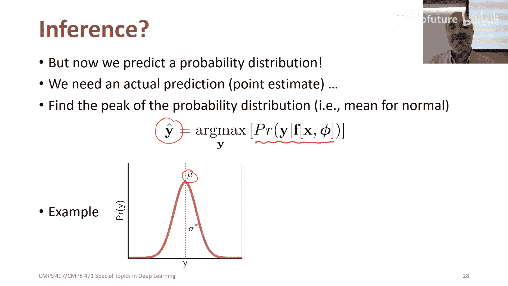

To construct a loss function， we set the model to predict。Input。What output。

For distribution or parameters of a distribution。我认为案。Read the model to predict what。The model。Okay。

 do we do we set the model to predict the output directly， How about the input first， Of course。

 we don't predict the input right， we predict。😡，We don't predict the output diet。Okay。

 to construct the loss function， we don't predict the output directly。 We predict。

The political decision or the parameters， both are correct。Actually。

 we we to predict a probability distribution， we predict a parameter。 So both are all correct Okay。

 but not the input， of course， and not directly the output。Okay。

 any question about this this answers type another question。

 I want you to really think about it okay in training a model。😊。

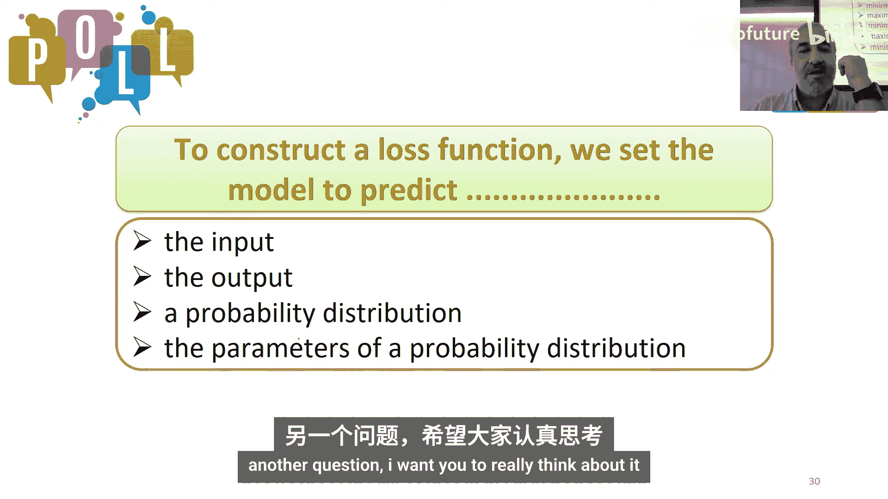

We maximize the likelihood or minimize the likelihood or maximize the log likelihood。

 minimize the log likelihood， maximize the negative log likelihood or minimize the negative log likelihood。

 Okay， Thank you before you answer， please。你来。So do we have one answer only one more？

Sos let's take it one by one， is it maximize maximize the likelihood？😡，对。We。

 we really want to maximize the likelihood probability。嗯，叶松龙。Why know。我现在。

That's why this is actually what we want。We want to maximize the likelihood you。

 This is what we started the lecture with， right that's our goal。😊。

So our goal is to maximize the likelihood。😡，喂。😮，Right type。

 so that means that minimize the likelihood is wrong， guy？Okay， type， maximize the log likelihood。

 Yes， is the same like。Maximizing the likelihood， that minimize no maximize the negative log likelihood。

 no， minimize。Yes， so this is also。Good。That clear now。

So all of these three will give us the same thing。😡，But mathematically。

 we use is minimize the negative block likelihood hood， because now we can call it the loss function。

😊，Okay。Yes。都不在。Yes。😊，I没就。对。Okay。No， no， look like who doesn't have negative。It's just the log。

And the log， if， if。So taking the log will not change that sign。😡，Okay， I mean， it will give us。

If we the maximum of both functions， the original analog will be at the same point。😡。

Would be at the same input。We don't care， okay， that's a good question， okay？😡，And let's get back to。

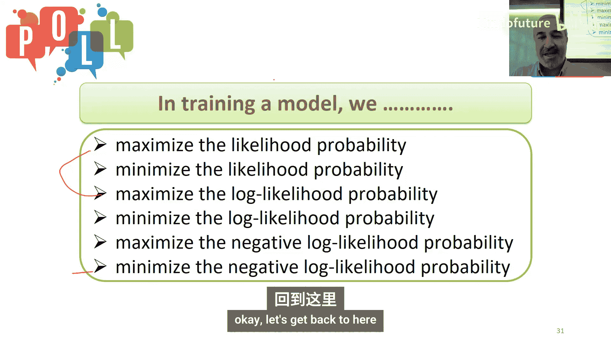

做 here。Okay。Yes， this one。This one。And this is the likelihood， right？Okay。

 we want to maximize it do we maximize it to get what， what's the goal of maximizing this function？😡。

To get to get the the values of the model that will get that maximum。

 right to duplicate it about the value of the maximum itself。We게。We don't care。

That's why we don't care if we take the log。 Yes， the taking the log here will give us different those values。

 by the way， any this function。😡，Is different than this， right？They are different。

They will give us different values， the loss， the value of the law of whatever not not the loss sorry。

 the value of the function of this function will be different than the values of this function。😡。

But we don't care， okay， we care about the value of phi that will give us this maximum。😡。

That's this maximum， okay。And they would be at the same point。Same here。Okay。

 we don't care about the value of the loss function。 We care about。

Which value of the parameters that will give us that value？😡，Of course。

 we want to minimize it over time。 Okay， but the absolute value is。

It will be different from here to there。Is that clear now。

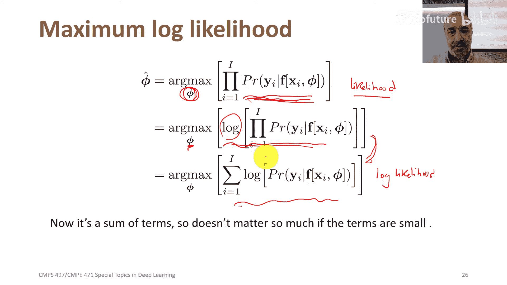

Any questions before we continue？

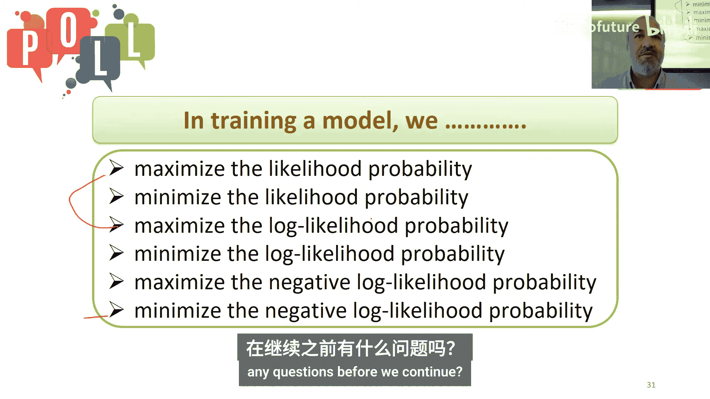

Okay， now we need to have a recipe for loss functions， recipe for constructing loss functions。

What do you think out of our discussion so far， What are the steps。That we need to do。

What is the first， the very first step？Yes， so the first thing is to choose a reasonable。

P distribution for that type of a problem。 So given a problem。

 we need to think about what is the output of that that we need from that from the model that we want。

 And based on that， which was suitable probability distribution then。哎。啊。😮，Now。

 after we selected the fluid distribution， we said that we will do something with the model。

 with the network itself。Yeah， we set the output of the model to be。

One or more of these of the parameters of the period distribution and if we pick the normal distribution。

 we have mu and sigma square right， the mean and variance。Okay。

 then now the output of the model will not be the actual output。 The output will be。

One or more of these parameters。Okay so that's the second step and then we minimize by the loss function now we have we have the deployed solution。

 we can have the negative log likelihood which is the loss function okay so we will minimize it and that's the topquebe of the next session and then the fourth after we train the model to do inference。

We need to pick the one， the value that has the maximum probability， given an input。

We have a query distribution as an output， we picked the value that has the maximum。Okay。

 these are four steps。 We go through them for， I think three or four examples。 Okay。

 so that you really understand this process。So first， we choose a suitable correlated solution。😊。

That is defined over the domain of the output， so we need to think about what is the domain。

 what is the range of the possible values of the output。😡。

Whether they are discrete or continuous and so on。And then we set the model to predict one or more of those parameters。

Of that distribution。Then to train the model， we need to find the optimal values that will minimize the loss function。

And the rose function is the negative。😡，Log likelihood function。

And we do that over all training examples， of course， okay。

 we do this computation over all training examples。

 and finally to do inference with we we for a test example。

 we get the value that will maximize the distribution， the output distribution。

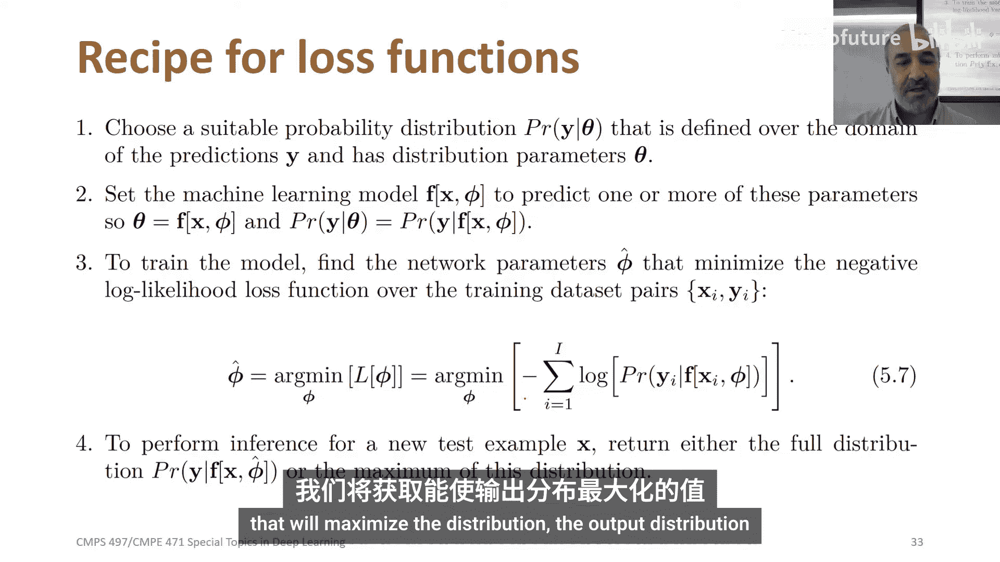

Now let's do that over multiple examples okay we'll start with the un verification and I think we saw this this example application before given the some information about the house。

 we want to estimate the price of that house okay why that regression problem。😊。

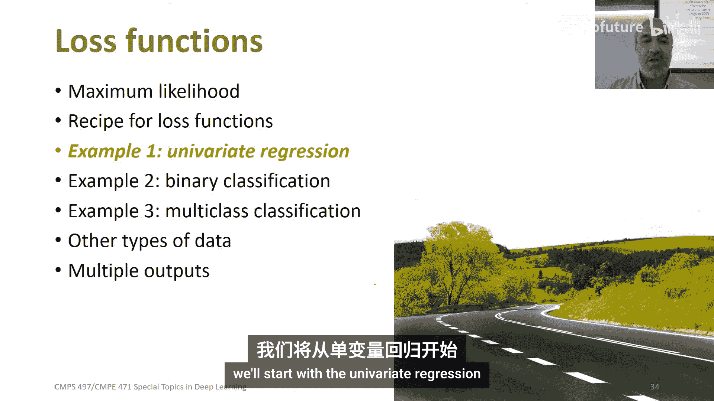

The output is continuous， right， di output is continuous。

 what could be a good for weight distribution for that？For that output。当是。

Gussian distribution okay or normal distribution okay so normal distribution will be good here so that's the first step is to select the probability distribution for that the normal distribution would be will be good type the normal distribution has two parameters the mean and the variance and with different values of the mean and the variance of course will have different shapes of the be curve。

Right so here the mean， this is the mean and the variance is small or high。

Small right when the variance is really large or high you will see that the bell shape is flattened so this this is an example of a higher variance than this and actually this is also higher variance than the other two so the shape of the be shape will depend of course on both the mean which is the center of the shape or the curve and the variance which is how。

It indicates the width of the ship， yes。What没。And what is the。Depending on the domain of the output。

 of course there are many distributions so you can pick one that is that can be defined over the domain of the output so here the domain of the output is real the numbers okay so normal distribution is one candidate if there is another distribution that is also defined over continuous domain then you can use it of course。

But but the knowledge， it it also depends or you should factor in the knowledge of the application itself Okay and sometimes you will see that。

There are some restrictions about the output。That will make you focus on specific type of distributions。

对。We'll see over the examples。嗯。Okay， now picking a distribution means that now we can。

See the actual probability density function。😊，Okay， remember this one statistics class。

This is the for weight density function of the normal distribution。Okay， given any value。

We want to get the prob of it。 We just plug it in。The the function， the density function。ok。😊。

As you see here， the density function is function of the two parameters of the normal solution。

 which is mu and sigma squared， the mean and the variance。If I know the mean and the variance。

Given any input I can produce， I can compute the probability of that value。Okay。Type second step。

因为这个。We need to set the output。Set the model to predict。One of of these parameters or more。Okay。

 so we will assume here that we want to predict mu， which is the mean。

So we pick the normal distribution， okay， once we pick a distribution。

 we want to predict its parameters， we want to make the model predicting predicting its parameters。

 not the actual output， the parameters of the co distribution that we picked okay。😡。

We can either predict one of these parameters and assume that the others are constant。

 which is the case that start we will start with or we can assume that we don't know any the or the any of the parameters so we will predict all of them so we'll start with the first case which is we want to predict one of them and the other will assume that it is a constant so that means that now mu which is one of the parameters will be the output of the model right remember the output of the model is f of x and and phi。

Right。Again， what is fine？Okay。Cmeters off。Or the for distribution， the model， which are。

The weights and voices。 So then what are the parameters of the distribution。In this case。

 the aremin and variance in our termin， it is。😊，F。Just to make sure that you are following with me。

Okay， so now we can plug in。The， the expression， the poly distribution expression。 Okay。

 instead of having y minus mu in the normal distribution function will substitute mu by。

By the model itself。😡，Okay， F of x and5。Because we said that。We will predict mu at。

 which means that the output of the model is mu， so mu is actually equal to the output of the model。

 which is f of x and to。😡，Okay。😊，T iss that the loss function？How can we make this a loss function？对。

Take the negative lock。😮，And。Mip and do the sum overall all data examples， okay。

 and that's what we will do here。😡，Okay， so this is the likelihood function。Take the log。

And the negative。Okay， now this is the loss function。

 So if we make it on the on the normal distribution that we saw in the previous slide， then this is。

Because we this is normal distribution now right， so we know the expression of the normal distribution and we just put it plug it back here。

 so this is now the loss function， the original loss function。For that problem。Okay， type。

 notice something。This is why I， not why。啊。520。Yeah， because for this is a over what。

Over the training examples， right？Not over the possible outputs。😡，Okay。

 not over the possible outputs。 This is the submission。

 It was product before right before we take the log， Okay， it was this now submission over。

All training examples。For everything in example。X， I。We have Yi right in the technical examples。

 we want to see the probability of that Yi， that's why we have here Yi。😡，Okay， so for every eye。

We have Yi。 We want to compute。 This is the probability of seeing Yi。

 This is the probability that the model assigns to the correct answer。😡，Okay， this one。Oh sorry。嗯。

Where is the probability that than the model assigned to the correct answer？

It's the likelihood to ability， right， where is it？Are you Yes here， this one。

This is the probability， right this is exactly the normal distribution。

 the probability density function of the normal distribution。😡，That's the probability。 And when we。

 when we。Set Y to Yi。That that's the probability of the observ output。

 that's authority of the correct answer。😊，Okay， we take the logo of it。😮。

Some over creating examples and and at the negative。But what if we forgot to put this negative？Now。

 we will minimize。We will will get a bad model。 Okay， okay， we will minimize something that's good。😊。

Okay。So that will give us a bad model， not a good model。Okay。Any questions so far？

T now let's try to simplify this that looks really complex， right？😡，Let's try to simplify it。

So this is again， the negative like this is this is where is the loss function？😡。

The whole thing right from here。So here， that's the log function， not the log function。

 the loss function。Okay。😊，第。So we want to find phi that minimize this type。 Now you see log of。

Product， right。When we have log of a product， we can convert it to some， so it will be log this。Plus。

😮，Log this， right， when we do log。E to the power something。对。

Then we it will remove the log and the U right。 So we'll get something like this。

 It will be log this。 This is this part。Okay， plus log the exponential and then we can remove the log and the exponential。

All right， so we can remove this。Right。So now it is simplified。

 but still it's exactly the same right， we didn't do any approximation here。😡。

That's not the approximation。 This is just mathematical manipulation。Okay。

 log of a product is sum of the logs， and then log of E to the power x is x。ok。😊，Okay。

 now we are each of this， right？We do this right。 Now， look at this。Partt。Is that。

 remember that we want to find Phi。That will minimize all of this right this part doesn't have any phi。

 is that a function of phi？😡，No， right。 And we said that the variance is constant。

 so this part actually is constant。So we can just remove it。

 we are minimizing constant class something。😡，So we don't care about this constant。

So now we do an approximation。Okay， so it's not approximation in terms of the process。

 but approximation in terms of values。😡，Now we can remove it。😮，And we only focus on the other part。

The value， this value is different than this， and this function is different than this function。😡。

But we don't care because we both will give us the same。The same result， which is the same want here。

Same parameters。Good。So minimizing this， minimizing this function。😡。

Is equivalent to minimizing this function with respect to phi yes。H。我的音。We just ignore it。

 ignoring it。 Okay， we' just close it， okay， because we don't need because this is constant。😡，Okay。

 it will not change the value of phi that's that's the meaning of it。 Okay。

 if we remove this from the equation， it will not affect the value of Phi that we will get eventually。

😡，Like what we did with log right we have a function， we take the log of it， the value will change。

 but the value of the function will change， but the maximum of both functions would be at the same point。

😡，Okay。Can we do something similar again to this now？我哋呢。What is constant。

Yeah two sigma squared is also constant right， so multiplying or dividing by constant will not change the value that will give us the maximum。

 so we also ignore it and reach this。Okay， minus minus times minus of course， is positive。

 so we now we have。The submission of Y I minus。F of X I and and Phi， Did you see that before。

 What is it？It's the least squares loss function， so they didn't come from mass。Okay。

But imagine that in the first lecture， I gave you all of this。 Now it is the list squares。

 You know it， Okay， of course， it was， it was easy to to talk about it before without that details。

 But now I think， you know how we got it。😊，It's not just given we can get it from this mathematical manipulation。

Okay。Any question about this？we could have， by the way， kept。😮，This function。

And all of these functions are equivalent all of these equations are equivalent， by the way。

 they will give us the same model。😡，But the last expression is much simpler。 It's easier。Okay。

 and also。Easier to understand， right now you can understand that this is。

 this is actually the least squeeze。 We are just。Minimizing the differences between what let's put names here。

😊，What is f of X I and Phi？😡，That's the mean， the predicted mean， right and this is。

This is the actual， the actual output。That the go to the the correct output。诶。Questions。No questions。

系い。Now let's show the difference between the list squares function and the maximum likelihood function。

 Can you tell me where is the maximum likelihood function here？对。

Or the log likelihood would function， where is the log likelihood would function？Which， which line？

Yeah， this part is the likelihood function。And this part is the log likelihood function。Okay。😊。

And with the negative， it is the negative look like time。If I compute。

This this is now how can I call this， by the way。The loss function， very good。

 so this is the original loss function。😡，And this is the approximated loss function。

And this is what we plot here。This is the original。Negative， actually， this is the negative。

Negative log， actually。嗯。Okay， because that's how it is calculated here。Okay。

 so this is the original。Lost function。Which is， in one case， it's minus-6。0。

57 and this is the simple one that's that is squares。

 simplest the simplet simpler expression that we got at the end。Okay。

 let's see what's the difference between them？Remember this example in de。

 the I think first one or two lectures。This is the model that we trained the green line。😮。

And for this， for this。Point。Is the model doing good job or bad job？Good job， right， why？

Because the difference is very small， right， this difference？😊，Is very small。 Okay。

 let's see that when we see it。From the original loss function。How it would look like。Okay。

 this is the same line， same green line。Okay， and the same point here， this one。Okay。😊。

What's happening here， instead of。Predicting one point here。😮。

Here we are not predicting one point we' are predicting。A parade distribution， right。

A probability distribution。 Where is the probability distribution here？This one。我。Okay， this one。

Okay。T。When we are talking about Yi， the probability of Yi。😡，明白 this is for to fire are right。😡，是。

Is it the orange dotted lion or the green dotted line？你可fi。Why I， is it the orange or the green。

 the orange。Because this is this is this is the orange point is the actual output。

 not the actual output， the correct output。Okay， the correct output， This is the predicted。 Okay。

 so the model predicted the distribution to be like that。And assign the value to the correct one。😮。

That is， is it far from the， the maximuma， No， not far。Okay， no fire。

 so this is any relatively high probability to the correct answer， so it's not very bad。😡，Okay。

 how about you。In this case。Also not very bad， right， because the model， instead of predicting。

This predicting this to be the correct answer， predicting this so that again。

 this probability of fori is not very bad。Okay， now look at these two examples。😡，Okay。

 forget about the left side。 Let's focus on the right side。Okay， on the right side。

 where is the probabilityative Y I here， This one very small， right。Very small。

 So the model for this point。😮，To predicted a distribution that assign a very small probability to the correct answer。

Okay， so how about this one。O。Where is you see， where is the distribution that the model predicted us on？

😊，It's， it's this one。What is the assigned probability to the correct answer？😮，Or zero。Almost0。 So。

 of course， this is very bad。 And that's reflected by， reflected by the way in the these squares。

 you see。So the very bad probability here， which is almost0。Is。Is representing the same bad job。

That is seen in the list square by the big difference here。So minimizing， I'm telling you。

 I'm showing you that。Either you use the original loss function or you use the simplified loss function。

 which is the squares will give us the same thing。It will eventually penalize。Bed。Predictions。

And penalize much less good predictions。Okay。😊，That clear from this example。

Although the values by the way are different， any， if you compute the loss function here with that model。

 this is a model， right？😡，The line， the green line， so this model。

 if we use the this squares as the loss function， which is the simplified version of the original  one。

 we get 10。22。😊，Here， we get。400。The values are different。So。No， penalty means the loss function。

 you can think of it as a penalty function。Whenever you make a mistake， the value would be high。😡。

Okay， so yes， here the total loss is very high value。Okay。And different from that value if。

 if we get back to the the previous example， you will see here the loss is small and here also relatively is smaller。

Okay， although the loss here is computed in different way。

 so here it's computed from the original loss function without any simplification。This one。

 of course， is the simplified one， that least is squares。But both eventually will give us the same。

Same learned model weights and biaseses。Yes。😊，Good。any questions？Now to do inferences。

 what should we do？Let's say that we learned the model for us。😡，Yes， given a test test input。

 I want to get a prediction， what would be the value of the， how can I get the prediction？😡。

I have a model now。 Okay， I have a model。 Let's say that this is a neuraler network， okay。

Okay and this is an input， I give an input here， and I want an output from the other side。Okay。😊。

I learned， I learned all the parameters here all of these parameters I learned。

 What do we call these parameters， by the way， what what do we call this parameters parameters of the model phi。

 So we learned at Phi80 has。😡，Now given given， no， no， given input。😡，Okay， X。

Let's say minus an x dot， okay。For x dot， I want to predict a value。😡。

Actual value that can use in reality。Okay， the next one in our， in this specific case。The。

 the highest probability is what。Is the mean at the mean。

 It happened that it aligned very well with what the network itself is predicting。

 We said that the network key is predicting what。The mean， right？Did didn't we say that mu is f of x？

Here， right？That means that we the network is actually computing the means Okay。

 so we'll just say this is the value。 this is the predicted value because at the mean。

 the normal distribution is assigning the highest probability。Okay， so for infants。

We will maximize this probability。😮，Which is actually what we predicted， which is the mean。Okay。

 so y hat will be the center of the distribution。没有。Is that clear now。Any any questions？

You have a question。No， unfortunately， you don't have。What fortune do you you have you don't have。

Okay， good。 is。Yeah。This one。Yes， again， this is negative low maximum likelihood。

 okay because its it's this is the expression， yes。对安。嗯。😊，And for for this， for this， I think。

For this model， now the loss function is computed for the model over all training examples。😊，Yeah。

 if we compute it， we get this value。W this。You mean the distribution。反正之前。I choose very。Okay， why。

 why are we plotting。Yeah， this is， of course， just to show you， okay。Why are we plotting。

The predicted foreign institution centered at this value。你个是。No， no， no， no， no， no。

Because the network predicts the mean， the network itself predicts the mean。😡，Okay。

 which is the center of the protein distribution。😡，Of the normal institution。So现在。Now， the。

 the model doesn't know the actual value， doesn't know the correct value。😡，Okay， so actually。

 this is a very bad prediction。Because the correct value is getting very small probability in that distribution but what could be a good prediction。

😡，If， if the model actually。Predicted this as the mean okay， in that case。

 the distribution would be something like this。In that case。

 the probability of this point is very high。Okay， but that didn't happen with that line。Okay。

 the other one would be something as unlike like this。Okay。😊。

That the penalty for this value that would be very， very small。Okay。any other questions？

Is that a hard lecture。It is hard。 To me， it's really hard。

But I think after we go through the steps one by one， and I hope that it is clear now。Okay。

 and next time Charla we will here we assume that we have a constant variance。

Next time we will see if we don't want to assume the constant variance then or constant standard deviation。

 then what what we should do okay that's what we will see in China next time。

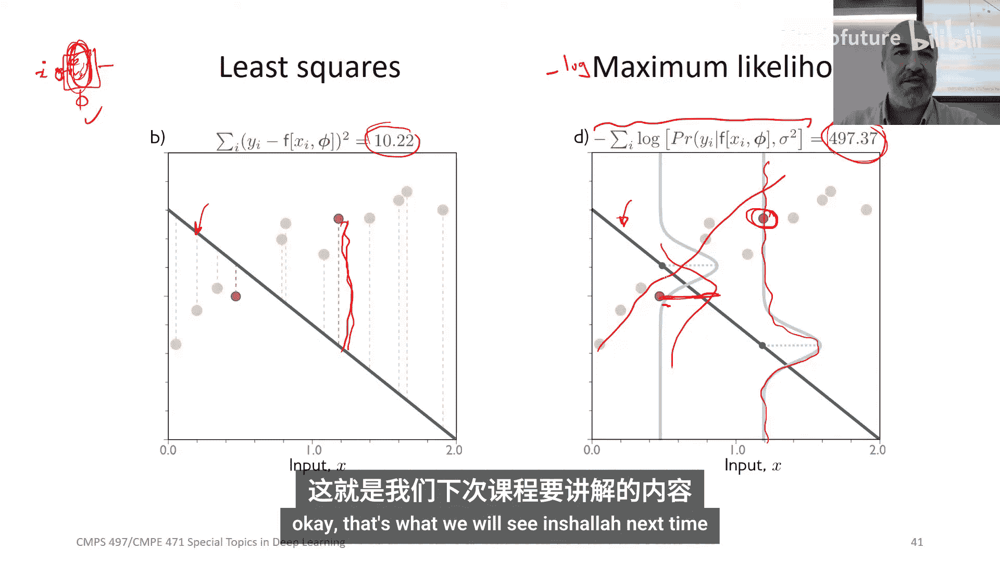