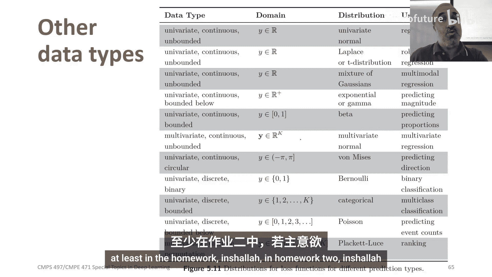
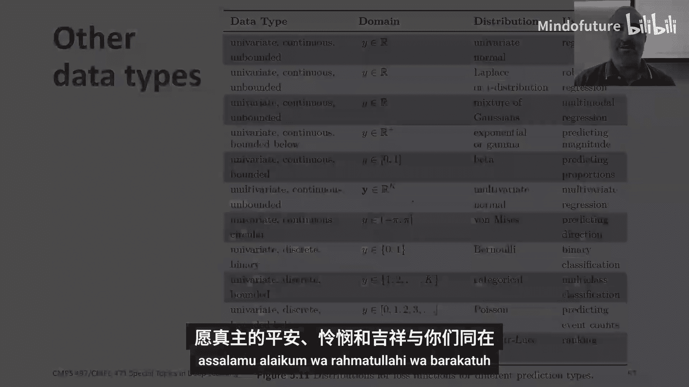

# 【卡塔尔大学】深度学习 CMPS497 ｜ Understanding Deep Learning ｜ Fall 2024 p09 P09_第九讲-损失函数 III -BV1vQvNz1EeK_p9-

m Charlotte today we will continue talking about loss functions we spent last lecture and I think part of the lecture before that discussing how we can construct loss functions for any type of problems we went through one example last time which was regressiong problem and we saw that with the steps that we had we reached the least squares function that we already know from before to make sure that you are on the same page with me let's go through this couple of questions the first one among the steps of constructing a loss function。

Which of these。How many steps we discussed last time for Yeah so among these four。

 which of these are correct？Choosing a suitable model for the problem。

Choosing a suitable probability distribution for the problem but why not the first one？

Are we actually choosing a suitable model using the loss function。

We are trying to find a model okay to find a good model okay but we are not choosing the model among and neural networks and linear regression and so on。

 that's not the purpose of constructing a loss function。

 but we choose a suitable probability distribution this among the steps right how about the other two？

Are these among with the steps also。Set the model to predict its parameters， its heres to。The model。

 right we don't we don't actually set the model to choose to predict its parameters。

 How about the last one。Do we set the model to predict the parameters of the appropriate distribution？

😊，Yes， yes， that's among those steps， right？The second and fourth， yes， second and fourth。Okay。

 the second question， why do we need a loss function？What's the purpose of having。A loss function。

Think， think， please before you answer。Yeah。Do we need a loss function to predict the parameters of that per solution？

No， that's not the purpose that to learn the parameters of the great distribution。

To predict the parameters of the model。We don't predict that the parameters of the model。

 we learn the parameters of the model using a loss function。😊。

How about the last one to predict the output of the model given an input？😊。

I mean is that the purpose of a loss function， No， no。

 we don't need a loss function to just predict the output given of the of the model given an example or input。

 but we needed to learn the parameters of the model Okay。

 and that's what we will essentially our next lecture Okay， how we can do that training it。

This di Sha will continue taking I think， two or three more examples of constructing growth functions for different types of problems。

Yeah。Yes。😊，The answer is， the fourth。Okay， if you remember last time the example that we stopped at。

 we were talking about a regression problem， which is estimating the price of a house given some information of the house and because it's a continuous output。

 we assume that the prob distribution that we will choose is the normal distribution and the normal distribution has two parameters。

 the mean and the variances。At the last lecture， we assume that the variance is constant。Okay。

 and when we did that。We got the loss function to be reduced to the least squares function， right。

 because we， if you remember here， we just take the log of that factor， which is constant。

 So we get it out of the of the minimization function。 So eventually we didn't have any variance。

Okay， in， I mean， in the in the loss function。But we could have learned it learned the the the the variance。

 so we could have used the original loss function。 This is the original loss loss function that has the mean and variance before we use it to the least squares function。

 and it has。Plugged in it， the mean and the variance， where is the mean here in that loss function。

Yeah。How did we get this noise function？How did we get this expression from what。No， no。

 the whole expression from， let's say from here。 Okay， let me。Let me change this。嗯。So this part。

 how did we get this part？What is this？Yeah。The probability from which distribution the normal distribution。

 so that's the probability density function of the normal distribution right type the probability density function of the normal distribution has two parameters。

Right the mean and the variance。The variance is here。Whats the mean。

It's this part right now didn't we say that we will set the output of the model？😮。

To predict the mean。 Okay， so that's actually the mean。But the mean here is predicted。😡。

The mean here is predicted is one of the is actually the output of the network。😡，Okay。

 but before in the last lecture， we said that the variance is constant and we don't care about the value of that of that variance。

 Okay， but if we care about it， then we can learn it。Okay。

 so we can keep it in the in the loss function， and we can learn it along with the parameters of the model。

So remember， here we have just。5。Okay， so we minimize that function。Okay。

 we get the values of phi that will minimize this function。

Phi is what is the parameters of the model， right， the weights and the biases。Here we say， okay。

 we we are also interested in the variance， we want to predict the variance。

 not to predict the variance， we want to learn the variance。

 so we will just deal with it as if it is one of the parameters of the model。😊。

So during the training process， which will not talk about this lecture until the next lecture and。

The next week。We will learn。How to， how to learn the parameters of the network。 And in that case。

 we will also assume that sigma square is one of the parameters of the model。 So we will learn it。

 along with the other weights and biases。Okay and that's why here we cannot get rid of Sigma square because we want actually to learn it so we well just keep it in the loss function。

And we will learn the optimal value for the variance that will minimize this original loss function。

 the negative log likelihood loss function。Exactly。

So before we assume that the variance is constant and we are not interested in knowing the value of that variance okay so we will not optimize the network for a specific value of the variance we will not get an optimal value for the variance just assume that it's constant here we also assume it's constant but we will learn an optimal value for it。

Okay。😊，So we will have to keep it in the loss function。

 So we will have to keep the original form of loss function。

 We will not be able to use the the list squares function。 Now， we have to use the original one。Okay。

 which has the variance in it。Okay， so now the model predicts the mean and the variance is learned。😡。

What's the difference between learned and predicted？Yeah。

Predictive means we will that one of the output will be that value of the network， okay。

 but learning is just one of the parameters of the network， like the weights and biases。😡，Good。Yes。😊。

Yes， but it's unknown， so we will learn it。Yes。When we're learning it。

 we're also learning the parameters， yes。 So changing it。While changing the front of the。

They will interact yes， of course yes， it is like the other weights and biases no it is constant but we will change it through the training to get an optimal value for it。

Now the weights also， as we will learn in Charlotte from next lecture。

 the weights and biases will change during the training until we reach the minimum。😡，Right。

 the minimum of the loss function。No parameters。 not we cannot call them constantants。 Yeah。

 after learning， after training， they are fixed。Then the same for diet。Yes， yes， yes。

 because it in this case， yes， it would be a parent。 Yes， yes， yes， yes。

But we learn one value for it。 That's why we are saying it's constant in infants。Okay。

 anyway after training， yes， yes， yes。Okay， any other questions？对。in this case。

 when we assume that the variance is constant， we call it homoidastic regression。😊。

Hmoidistic regression， Okay， when we assume that the variance is the same everywhere。

 everywhere means what。With any input。The variance will be the same。 So if you look at this plot。

You will see that this is the input and for each input， then it the output is one value， but。

It has a range of values。 Okay， so here we are actually plotting the mean that the network。😡。

Predicts and the variance that is constant。 and you can see that the width here is the same everywhere。

Okay， remember when we were saying we were doing something like this？Yeah。

RightSo here we we don't plot the entire distribution。

 We just plot the mean and two sigma actually which covers most of the probability of that distribution。

So you can see that here。You can see that the。Sweat。Cos。

You can see that the predicted value is different with different inputs。

the mean is different right because we in this network， we predict the mean， but the variance。😡。

Is not， is not predicted。Okay， it's it's constant， so whatever the output will be。

 it will be the variance will be constant。😡，Okay， so we call this homoidistic regression because we assume that the variance is。

Contant， it's the same， whatever the output the input is。

Type what if we assume that the variance changes with the input。

 this is called the heteroidastic regression。Now we want to predict both， actually。Okay。

 we want to predict the mean and the variance。 So look at the model now。

You will see that we have two outputs， one for the mean and one for the variance。 Now， why。

 so we saw this before， right， the mean equals the output of the function。 Why is it F1 here。Because。

 it's their first。Not the first layer。 It's the first output。

 if means always the output the of the network， right because it represents all the network as a function right So here we have two outputs。

😡，We are predicting two things， remember in the beginning when in the steps of constructing a loss function。

 we said that we will first choose a probability distribution。

 then we set the network to predict one or more parameters of the probability distribution right we started with only predicting the mean here we will see what if we also predict the variance。

😊，Okay， so F1 will be the first output of the model。

 which is the mean and then F2 will be the second output。 Now， why do we square this。Yes。

 because the variance is always positive。Okay， the network。

 the output of the network is not guaranteed to be positive can be anything。 Okay。

 but to make sure that it would be positive， we squared。 So this。

 the square of the second output will be the predicted。Valance， so now。

 so now you know why we are squing。Right， and this is now the loss function。In the previous slide。

 we had F of x and phi， which was mu right， and we had sigma。Now， sigma is predicted。

With Sigma square is predicted with the square of the second output of the network。

 so you will see it here and you will see it here。Okay。

 so now the loss function has both predicted value and the model now。

 the network now has two outputs， not just one。Tpe what is the effect of that Now。

 remember in the previous slide when we saw the plot， okay， the variance was the same everywhere。Now。

 because for every input we predict the mean and the variance， the variance can change。

So look at the value for this the output for this value， you see the variance here。Okay。

 look at the output for this value， you see the variance here， are they the same？😊，No。

 for every input， the mean。Will be predicted and also the variance will be predicted。

that means that the certainty or uncertainty of the network， of the model。😡，We've changed， of course。

 with the input。 given input， the parade distribution will be different。

 not only different in the mean like what we saw in the previous lecture。

Now it's the mean and the variance， the center of the distribution and also the width of distribution。

So they have small。嗯。Better we mean faster in training because now we are predicting two things instead of just one。

 so it will take more time to converge， but of course it will provide more information。

RightAnd eventually instead of just saying this is the mean， no。

 I can say this is the mean and this is how confident the model is about that mean。

 And if the variance is very small here is that that does that mean the network is more confident than this or the opposite。

 Which one is more confident。😡，The smaller one， right， smaller one。

 the network is regardless of whether this is the correct answer or not。

 right so the model can say this is the output and I'm very confident of it。

 maybe the output is on Okay， but I'm talking about the confidence of the model。😊，Okay。

 now the confidence is indicated by the variance to some extent， yes。So how uncertain the model。Okay。

 you remember that we are trying to predict a probability distribution given for any given input。

 right？This per distribution is determined by two parameters。😡。

So the shape of the distribution is determined by two parameters， the mean and the variance。

 so we are trying to predict it more accurately previously we just say the mean now it's the variance okay yeah。

😡，Whether how it is a function of the input it depends on the data that we have right eventually each one as as you remember from what we studied before every output is a function of the entire thing right function of the input and function of the entire network right so both in this case the mean and the variance will be functions。

😡，It depends on the problem。Okay。Of course， different functions， these are different outputs， right？

There would be different functions， right， different what if we have a radio activation function。😊。

Thank。Different piece wise is you forgot different piece wise Gineial functions right of the input。😊。

They are different， of course。It it黄。对。ok。Any questions so far。Remember that。

The loss function is the submission over。What。What is that submission over。

Over the training examples， over the training data， every single what is I here。

 I is an index of the training examples。 right1，2，3 over all training examples。 So， of course。

 the training examples affect the learned。parameters。Okay， type one quick question。

 why you remember the last in the previous slide we had P hat and Sigma square hat。

We don't have a tea， why。Because of their。Yeah， the sigma square is not learning it down， okay。

 it is predicted。😡， it's not a parameter， it's an output of the model。😡，Okay。

 is that is that difference clear？Okay， so sigma square now is not learned。

It is predicted for every input。Okay， now switching to the second example。😊。

Which is binary classificationification example。Okay， here's the example that we saw before。

 I think in the very first week of the course， given a review。

 I want to predict whether this review is positive or negative。Okay， time。

 is that a regressiong problem？Why not。Yeah， the answer is discrete actually， right。

 iss it discrete Okay， time， how many possible outputs。Two possible outputs， but of course。

 we will have just one of them Okay， so this is called binary classification。😡，Biner test。

 so the goal is to predict which of two classes。😊，01， the input belongs to。

Ti now we want to construct a loss function， right？

We want to construct a loss function to obtain a model for that problem。Right， what's the first step。

The right to distribution。 Okay， now the output is discrete。And we have two classes。

Okay so one of the common probability distributions that are suitable for that problem is the benoli distribution beno distribution has just two values。

 one probability the first probability or the first value is the probability for the positive class which is called lambda and the other one is the probability for the negative class。

So， when the output is。1。I mean， when the。When the value of the variable here is 1。

 then the probability is lambda， when it's 0 it's 1 minus lambda。Okay， so this distribution。

 which you see it here on the right。Has how many parameters。好。Just one lambda， okay。

 because once I know Lada， I know the probability of the positive class。

And also the probability of the negative class， right， because one is one minus the other。

Right with means so far， okay， so this is the probability distribution function。😡。

It's 1 minus lambda when y is 0。And Lambda when1 is one。ok。

We always like to have just one expression that that represents the power distribution。

 so from here we can get this expression， this is equivalent to that one。

So this this is actually the private distribution also function for the be distribution。

 it looks complex， but it is equivalent to this how if y is1。What should be the probability。

From here， lambda， let's see from this expression， if y is1， this is 1 minus1。So this is0。

Anything raised to 0 is 1， and it will be lambda to the power1， right， So it will be lambda。

 if y is 0。This one will be1 and this one will be 1。

 so it will be 1 minus lambda right so this is exactly equivalent to this when y is 001。Okay。

 and it would be easier to use because there's just one expression。Right。What's the second step。

 so we now we got the fluidid distribution line， what's the second step of constructing a loss function？

Say the model to what？To predict the parameters of the preistribution， right。

 what are the parameters of the preistriion here。Just numberda was just one parameter， right。

1 parameter type。Now we will set the network to predict Lada。对。

Say the output of network to predict Lada， right type。

 I there any restrictions on the output of a neural network， Y。

 let's say that we have just one newn at the output layer。Is there any of the values of that。

 can it be any negative or positive value or it's always positive or always negative？我唔得你就讲咯。

In general。Without any activation function， is there any guarantee that it would be positive or negative。

 No， it's unbounded， right？对。In our case， we want to use it to predict Lada。

 is there any section of the values of Lada， I it positive only I it 01， iss probability。

So it is it's between the and one， it has to be between the and one。😡，Right。

 so we'll have to force the output of the network。To give a value between。Z11， okay。

 without anything。It can be any value right so the output of the neural network can be anything。

 but lambda is between0 and 1 it's not0 or1， by the way。😡，It's not zero1。

 it's between0 and 1 because it's a probability type how can we do that one common way to do that is to use the sigmoid function。

😡，Yes， okay， the sigmoid function， so the sigmoid function takes any input。And。

ConverseConver it to a number between0 and 1。So this is the noise function。ok。😊。

It takes any input from minus infinity to infinity and gives the number back between z and 1。

And that number now can be considered as a probability right because it's between the and one。😊。

So let's look at the extremes of that function。When or actually sum some values of that function。

 when the input is0。😡，So this function is 1 over 1 plus e to the power minus the input。😡，Okay。

 so when the input is0。😡，E to the power zero is。1， so one over one plus one have。 So when z is 0。

The output is half。Right， the values have type when z is minus infinity。What happens。

Minus minus infinity is what is infinity， right E to the power infinity。😡，Infinity。One plus infinity。

 infinity， one over infinity0， okay， so at minus infinity， it is 0。😡，Type the other extreme。

 when this is infinity。Minus infinity E to the power minus infinity。No。

 e to the power minus infinity is 0， so one over 1 plus0 is 1。😡，Okay， so it would be 1。

 so the lowest value would be0 in minus infinity， the highest would be 1 in infinity。😊，Okay。

 so it compressrises any input。To a number between the1。Is that good for us。Yes。

 so we take the output of the network， which is f of x and phi and apply to or give a passage to the the sigmoid function。

Okay， so Lambda now will not be the output。Directly like Miu before right。

 now why didn't we we do that with Miu with this the normal distribution， Yeah。

 because mu can be anything， can be negative or positive can be anything。😡。

Okay so before we set mu equal the output directly， but now we cannot do that。

 we have to apply another function that will make sure that the value will be between zero11 so lambda here is the sigmoid the output of the network。

And this is called the sigmoid activation function it is one of the activation functions。

 it can be used actually in a replacement of radio anywhere。

 but usually we use it at the output remember when I told you that sometimes the output we will apply an activation function。

 this is one case。😊，When we want to make sure that the output is within a range。

 but actually the sigmoid can be also used anywhere。

In the network can be used instead of radio okay radio is better in terms of training we talk about that later in short。

 but theoretically it can be used anywhere， so it is an activation function。ok。So if we do that。

 then this is the actual chlor rate distribution now we will replace Nada with the sigmoid of the output。

Okay， so now this is the query distribution when we predict the parameter of the model。

This is to show you the effect of adding the sigmoid function。

 let's say that this is the original output of the network that is not limited。😡，It can be anything。

And now when we apply the sigmoid， it will be something like this okay。

 so first of all it is compressed between zero and 1 and it is smoother。So if you， for example。

 look at this value。So this is when x is。What is 0。4， I think？😮，When x is 0。4。

 Y is or the output of the network is minus。That's 00。5 probably， okay？Okay， so for。

For the same point of x， you will see that the value of y now is between 0 and 1 is less than 0。5。

Okay， because the input is naked。And so on so for every input for every input。

 we have the direct output of the network and then the direct output is passed to the sigmoid function Okay。

 so the output will always be between zero and1。So this is Lambda。😡。

And the other dotted one is 1 minus lamb。Remember it's two probabilities， right。

 but we don't need to compute both， we just compute one and the other one is one minus that one。

 right？😡，Yeah， we'll talk about that okay in a couple of minutes。Okay。

But that's the effect of the sigmoid， so for every input x， we have a probability distribution。

 where is that？😊，Remember this is the idea right that for every when we use the fluid distribution and we set the network to predict the parameter of that distribution at every input we have a fluid distribution right so now for every input this is the value of lambda which determines the flow distribution because the flow distribution is just two numbers。

😊，Lambda， which is the probability of the positive class and 1 minus lambda。

 which is the probability of the negative class。😊，So in that case。

 as you see here Lada is very small， right it's like 02， so that's 0。2 and that's 0。8。Okay。

 now that's the distribution。For。Given input。Okay， are you following with me。Any questions？

the third step。Is to construct the loss function now the loss function is the negative log like the root function。

 of course as usual this is the the original co distribution function we just take the log。Of that。

And multiply by there by -1。When we take the log of that， what happens？

This is a multiification of two things， right， so it will be the log of that plus the log of this right the log of this。

😡，Is what。This is a power， right， so we get the power before the log。Right。

 so this is something like。If we have。Log。A to the power B times C to the power D。 What is this。

This is logged a to the power B plus。Bg C to the power right， which is。Yeah， so B would be here。

 So B log A plus D， log C。 And that's exactly what we did here。Okay， so you will see1 minus y。

 which is this。Log this。Same， right， minus。Why。😮，Which is this one， log this， which is this one。

Now again and there again， I think I asked this question maybe four times now， why this is why I。But。

Why is this， why this is why I not just why。E and Yi for the training example is the correct class。

 the correct label， the correct value。😡，Okay， so remember。From the beginning of that session。

 we said that we want to maximize the likelihood of the correct output。😡，Okay。

 so we want the probability of getting the correct output to be higher。😡，Okay。

 so the loss function will always be a function of。Those values， why I。

Which is the correct output of the in example number I。Okay。😊，Is that clear。And this is。

This loss function is very widely。Kown， okay， it's called the binary costs into pillows， Okay now。

I want you to understand more。This loss function。Okay。😊。

This submission is over the technical examples， right， So let's， let's look at only。

1 example the loss value for one example only。This is the submission of the rose variables for all examples。

 right let's take one example， which is example number I。😡，Okay， and see what is。

 what's the meaning actually of this function。Now， in in this problem。

 this is binaryac classificationification， right， So we have two possible values of the output。

 right，01， positive or negative Okay if the correct output is one。That means why I is。1。

 Y I is the correct output。 Okay， so y1， Y I is one。 What happens to this expression。😡，嗯对。

This part will be 0。 So all of this。Is in your house， right？Then minus Y I is what。😡，Is one。

 So this is cost。 That's one。 and that will be log。Of this value。Okay，对 what is。What is this value？

What does that， What does it represent。Which is， we call it。We call it what Lambda。 This is lambmbda。

Okay。Ha。B now， this is coming from beno distribution。 Yes， so that means that when Yi is one。

 when Y I is one。😡，This whole loss will be what will be minus log。😮，Lmbda， what is lambda。

 That's the probability of。Of the positive care， right？Which is the correct one here。😡。

So when Yi is1， the loss will be minus log the probability of the class， the correct class。

 the positive class， let's see when Yi is 0， what will happen。😡，Okay。When or， when why I is there。

 what will happen。不是一个的可灯。This one is close， right。And now this is0 right， so now all of that is one。

 so it will be minus long。 Can you tell me。Wus minus log 1 minus lambda。 Very good。

1 minus lambda is what。Is the pur of the negative class， which is the correct one here。😡，Okay。

So although it looks really complex， but it is one of two values。😡。

It's minus log lambda when the correct label is positive and minus log 1 minus lambda。

 which is the probability of the negative class when the correct label is negative。😡，So overall。

 it is always minus log the probability of the correct class。😊，Right。😊。

So it's much easier than it looks。It's just minus log。😡，The probability of the correct limit。

So if the correct label， if， if the the model manager to。Accurly predict the correct table。

 it will give high probability for that， right？😊，Right。Any， if the network。

Predicted the correct label with the high probability。

 that means that it's more confident right it's more confident about the the correct class right in that case。

 the quality will be very high。😊，Right， so the logo of it， yeah。

 it's same as the highest value of the probability is what。Is one， right。 So Lo 1 is。

Is you if if the correct class is。Is the positive class， right， so that will be zero。

So the loss in this case would be zero if if the network predicted the correct class。

 it will be zero and here also it will be zero。😊，Right so always it is minus log the probability of the correct class if the of the correct class is very high。

😊，Then the loss will be very small。对。That's the cost in to pillows。Is that clear。the last step。

 the inferences。Okay， now let's say that we train the model。How can we make a real prediction。

 a final prediction？Whether the label should be positive or negative， how can we do that。不什不说话不呀不。

So we have a fluid distribution。We always get the output that will have the maximum probability。

 So the the probability lambda means the probability of the positive class。

 So if lambda is greater than what。😊，Is 0。5 greater than the 0。

5 then this is the maximum probability then we will predict the positive label。😊，Otherwise。

Negatively， that's it。Okay， so we'll choose equal y equal 1 when lambda is greater than 0。

5 and 0 otherwise。Okay， is that clear？Okay， so that's the end of the second example。

 so the third example is multiclass classification what do you mean by multiclass classification？😊。

Multiple classes， right we have multiple classes not just two so here's the example that we saw before。

😊，We have an image， and we want to。Predict which object is in that image。Okay。

 so we have so many classes here。But how many outputs we should have， just one。So it's multiclass。

 but it's just one， so it's univari multiclass classification。😊。

We want to predict which of key classes。The input belongs to。

Tpe now we want to construct a loss function。 What's the first step？Distribution。

 what is a good distribution for that？A distribution that will give a probability for each class right the previous one we had this is discrete case again。

 but instead of two classes we have K classes okay so the distribution that have that that gave us a probability for each of K classes is called categoric can distribution。

😊，Okay， instead of just two bars here， we have K bars。One， probability for each。Dress。By the way。不。

You saw the example here right， the previous example， right？These classes can be really so many。

 it can be sound and sometimes millions， and I will give you an example that you are very aware of ChaGBT。

In CGBT， what happens， it predicts the next word， right？😡，The next word。Type。

 what are the possible next words。嗯。Any word in English， right or Arabic or。Different languages， I。

 How many are they。I mean你还是个。To morning。诶。Okay。We'll buy that。Okay， so。

So many classes right each word is a class here in this case right so that's a typical typical example only you have so many so many classes。

😊，again， back to our example or back to our process。

 which was authority distribution so that distribution will be。😊，The categorical distribution。

 it has K parameters。What are the parameters？The key probabilities， right， one probability for each。

For each。WhichWhich。Class， right， we have different classes， right， We have K classes here。

 bodies can call human cat dog chair， right in the image it can be anything。 so many so many classes。

 So the distribution here has K parameters， Lada 1 lambda 2 lambda 3 I up to lambda K because we have K K classes。

😊，第。That's the distribution， right now the second step is to set the model to predict。

The parameters of the distribution， right？T we have K parameters。

So we need to predict all of them right because we cannot just predict few of them。

 we have to predict all of them so that we can know which class， right？😡。

 is there any restrictions on the values of those parameters， what are the restrictions？

The sum with them is one。 That's it。So the value is mess and can be 10 and-9 and the。Yeah。

 so two conditions， each value has to be between the and one。And。The sum of them is one。Okay。

 the sum of them is one。 So again， the output of the neural network can be anything。

 but the parameters has to be between the and1 and the sum of them has to be one。

And to do that to force the network， the output of the network to be like that。

 we use the softmax function。The soft max function。So the softm function takes any list of values。

And converts them to values between Z and one。 That's sum to one。Okay。😊，How， how does it do so。

If I have。Let's say I have two。 let's say I have three values。K A B and C。To use the softm function。

 I will convert each of these to a value between zero and1 and there will be sum to one， How is that？

😮，We take the exponential。Power to them to each one。 So this is E to the power A， E to the power， B。

 E to the power。If we do that， each value now。No， it's not between the the and1， it's positive。

It will be positive regardless of the value regardless of the original value because we because we remember the exponential function。

 we talked about it， I think two lectures ago， it's always positive。😡，Okay。

 so now we converted the values。😡，Two positive values。

 but they are still not between0 and 1 and still their sum is not1。

 How can we make them between 0 and 1 and sum to1 very easy， We divide each value by the sum of them。

For some of the exponential values。嗯。So this will be e to the power a over。

E to the power A plus E to the power B plus E to the power C。And and so。Now， each of those values。😡。

Is between z and1。😮，And there sum to one。Okay。This process is the softm function。😡，Okay， so soft Max。

Of key。Softm k of z means the value for the number k， so it would be e to the power z of zk。

 which is one of these let's say this one to e to the power z over the sum over e to the power each one of them。

K， that's exactly what we did here。Okay， exactly。K is the specific one of them。Casemo。Okay。

 because there is case small and K capital， okay， case small is the specific one animation and here soft mask。

😊，Yeah。Soft Max， let's see。 we have  one2，3。 Okay， so softm 2。In this case， is this one。

That's the second， the soft max value of the second output。Okay。😊，Exly。Okay， any questions？Cital K。

 What's capital K here。The number of。Categos classes。 Yes， very good。 Numb of classes。But。

 now plug it back。To the to the fluid institution。 Now， the probability of the class key。

Is the soft max value number K？Okay。😊，So in this case， the output of the network。

 you need see even again this is the network。😊，Multiple layers， okay。Simple here。

And the output of the network will be how many。How many notess。K， okay， let's say case 3。

 So that's the output。Okay so the network will be all of that and then we have output okay and these three values are passed to the soft max function。

Okay， so remember the expression， the mathematical expression of the network。😊。

All of that will be inside the soft Max function to give us the final K values。

Here's the effect of adding the soft Max， let's say that this is the original output。😊。

so that's the original output。And applying the softmax function will get something like that。

One of the properties that you notice that with the softmax function is that。

It takes the maximum value and amplify it much more than the other ones。Can you look at this case。😡。

Okay， you see here when x is whatever the value here is 0。6。

This is the value of the this is the predicted output， row output。

 direct output of the network for the orange class that's for the green and that's for the gray if I can see the colors correctly。

😊，Okay。😊，Now you see that difference。That's not not a big difference side when we apply the softm。

 you see here， you see this value。😮，What's the difference between this value and that value？Okay。

 much bigger than it was。Okay， and that's why it's called soft Max it's making a soft change to the maximum。

 it's not exactly the maximum， but it amplifies the maximum。Okay， much more than the others。

And of course， the three values of this。It's sum to1。Okay， so you can see the list of them。

 although it was not zero。And it was not very far from the other two， but now it's very close to0。

Okay， with the soft next。Okay， and for， for one input。Again。

 every input would give us a probability distribution， right， So we have K values。 So for this input。

 we have K values， the K probability is this one， this one and this one。

 which are presented here in that distribution。ok。😊。

So the orange class is having the highest probability。Then the green， then the green。Okay， question。

I don't know but each of them。No but okay不件。And the like applying。Okay， we will do the infants。

 We've seen the infants。So remember， we are predicting a period distribution， right。

 So for this input。We are predicting this distribution。Right， what will happen in the inference。

 There's three classes only Yes。 Yeah， yeah， here we are assuming the three classes， of course， Yeah。

 yeah， Okay， we see in inference， what will happen Okay， before that。

 let me tell you that this is also called softm activation function。

 Sometimes we we call it activation function。😊，It's not usual to do that in the hidden layers。 Okay。

 you can， of course， but it's not usual to do that in the hidden layers。

 Usually we do that at the output layer。And because it takes all the values。😡，Okay。

 we even sometimes quote a layer， soft max layer。 So when Sha in the second half of the course。

 when you use by to， you would see that in the code。You will add the softm layer， okay。

 which means apply the softm function to the output， all the values of the output。Okay。

 the third step is the loss function itself。 so the loss function， again。

 it will be the probability from the probability distribution function。

 which is now the soft max value。So it will be minus log soft max value for the correct。

For the correct class。Okay， so that's the loss function。Right。

So when we take the logo of the soft Max， remember the soft Max is e to the power something over the sum。

 right？😡，If we take the logo of this， what will happen。更信。It will be Zk， right。

 because that's log of exponential。😡，So it will be Zk， which is actually this output。😡，Okay。

 remember the before we take the the soft Max， this is the the direct output of the network。

 So this is the output of the network at the correct class。😊，Minus log。This part。Okay。😊。

Which is the sum， sum of all the exponential values。Okay。What is FK here。Okay。我们就是要这个。

The output number key。The network output number K。We have K outputs number K small。 Okay。

 I think it should have been another simple。 Maybe it would be easier about K small is the class here。

And what's FY I。哪个意思？Yeah， that's the output network for the correct class。

Then the output of the network for the correct class。Look at the loss function here。

 This is the loss function， right？😡，Right。😊，This minus sigma log of the pro。Of the probability of。

Correct class， right， This one。Is what。嗯。That's the probability of。The correct label， probability。

 the probability that the network assigns to the correct class and the network doesn't know the correct class。

 right。But。In training， we know the credit class， so this is the probability。Of the correct class。

So actually for every input， now this is some over all the input examples， right。

 for every input example。😊，The loss for that input is just minus log。😮。

The probability of the college class was that input。

Didn't we we see that in the binary classification。

 We said that it's minus log the probability of the correct。 It's the same here。

 It's the right function， right， It's the same here so。Back to your question。

 if the network predicted the correct class with very high probability， what will happen。对。

It's great。 Yes， but in terms of loss function， what will happen。

Because what's the best probability that the network can assign No， no， no， for the correct class。

 What is the best probability want， right Lo one is0。

 So the loss will be 0 T So well that's perfect right。

 because the network actually assign the highest possible probability to the correct class。

 type what if the opposite。 the network assign a very bad probability for the correct class。

 Let's say0。Okay， or almost0 log0 is is minus infinity， actually。😡，So this one， yeah， this。

And this log is minus infinity。😡，Okay， minus minus and is infinity， so the loss is very high。😡。

Of course， it won't be zero， it would be something above zero。

 so it won't be infinity okay but it would be very high。Okay， did I answer a question now？

So it depends on the probability that the network will assign to the correct label。😡。

It doesn't actually， you cannot say it doesn't depend on the others because the probability of the correct label。

Depends on the others。 How is it computed。 It's a soft Max using the sum of all the others。 Okay。

 so it depends on the others。 But if it's very sharp。😡，Any。

 the network assigned most of the probability to the correct class。

 then the loss would be very small。If it's really the poverty is distributed among many classes。

 then the loss will be high。Okay。😊，And again， it will be its called cross cross enphys and because we are using multiclass is this is multiclass cross enphyos。

😊，Okay， so close entrepreneur is very widely used in classification problems。 Okay。

 you will see it any one of the most commonlydy used ones， yes。いスから？み。啊不。嗯。Okay。If。Of x and phi。

What is this， if of X， I and phi， What is this？No， that's not the model。

 That's the output of the model when the input is X。😡，Okay。

 so that's the output of the model when the input is Xi。🤧对。Okay， do I agree with me？

That's the notation that we use。 Okay， now， when we say FY I， I think this is your question， right。

 Okay， when we say FY I， what does that mean， forget about Y I， Let's say F1。 What does that mean。

the first output of the net。 the has actually how many outputs here。K， because we have K classes。

 So if1， if2， F3 up to FK。Type， and in the loss function， we focus on。The correct class。

 the probability for the correct class。 That's why it's called FY I。 Y I is the correct class for。😊。

The example number I。Okay。😊，Can you know other questions？Okay。Now， in infants。

 I think we answered this question。 right， When we do infants， what should we do。Given an input。

 we will compute all the probabilities type will we provide the probability distribution to the user。

 No， what should we provide。😡，The label that has the maximum to。

 right so we will choose the class with the largest probability。If we have a tie， okay， special case。

 deal with it。😊，Depending on the problem。Good。Okay， type， to make sure that it's clear。

 let me ask you this question for the object detection problem of five classes。😊，For a given input。

 the network outputs。Yeah。그。What would be the output of the network in this case？Is it one number。

 is it five numbers？好的。The last one， five numbers， which are the soft max values of all classes。😡。

Right is it，5 numbers or one number。5 numbers， I type。Is that the only one that's correct。

 The last one。 Yes， so it， of course， the output will be the soft max values of all classes。

 Can we say that these are the probability of all classes also。Yes， we consider them the， right。Now。

 the soft mask。😮，Is the probability。Good。😊，Time for the object detection problem of five classes。

 A B， C， D， E， so we have five classes now。😡，And these are the names of the classes for a given input。

 The network direct output was 1，2， minus-1，3 and -2 for the classes respectively。

We just said that we have five outputs， right， I mean， the direct output， Okay， direct here。

 direct output is before the softm， So 1，2 minus-1，3 a minus-2， assuming the correct output is C。

 So for that input the correct output should be C should be class C。

What is the loss of that input example？😡，We just mentioned that five minutes ago。For a given example。

 how will we compute the loss？对。I think the。Okay， its always will be minus log。😡。

The probability of the correct class。 right， What's the correct class here， C， right， type。

So it's minus not per C。 What is probability C。😡，E to the power，-1 over， which is。It'sAbout one plus。

关。That's it。呢个。Okay， so its2 be minus log this value。Whateverてばですあります。ok。Exly。Now。

 what happens if we have other types of data？What do you mean by that The output is different than what we saw。

 And we saw how many examples。No，3，2 today， and one。Last time， so we have three examples。

 but that's not everything， right？😊，That's not everything。 The output types might be different。

 So for every output type， which means every different problem will have to pick。A distribution okay。

 so this table in the textbook gives us some examples and en Shaa we see two examples at least in the homework controller in homework2。

Chab will continue next time， Cha。Thank you for contact。

