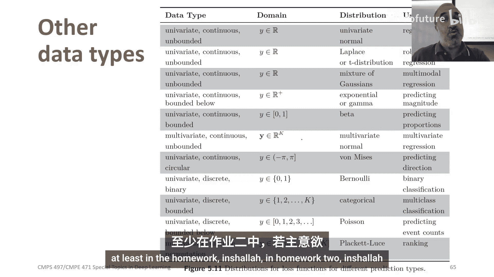
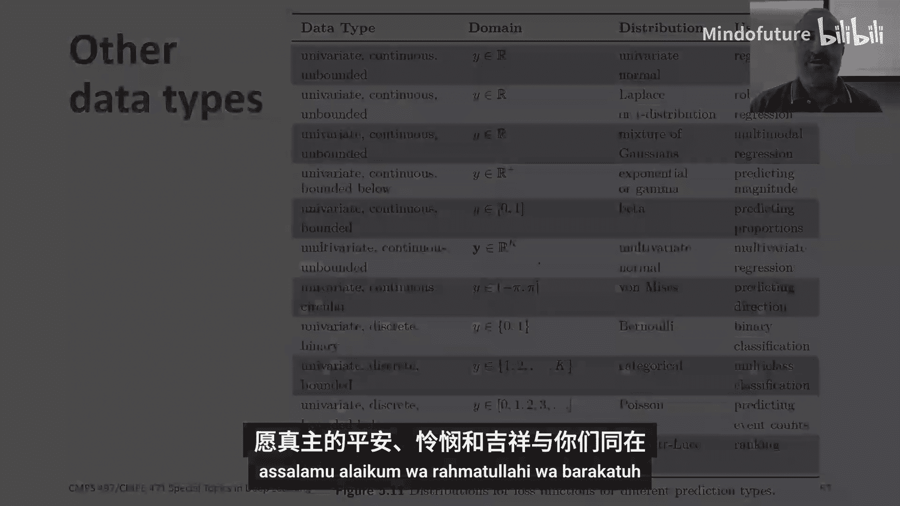

# 深度学习：P09：损失函数 III

在本节课中，我们将继续学习如何为不同类型的问题构建损失函数。我们将通过几个具体例子，深入理解从选择概率分布到最终形成损失函数的完整过程。

上一讲我们介绍了回归问题的损失函数构建，并得到了最小二乘函数。本节中，我们将探讨方差可学习的回归、二分类以及多分类问题，并推导出它们对应的损失函数。

---

## 构建损失函数的步骤回顾

在深入新例子之前，我们先回顾一下构建损失函数的核心步骤。以下是正确的步骤：

1.  为问题选择一个合适的概率分布。
2.  设定模型来预测该概率分布的参数。

请注意，我们**不**是在这一步选择模型架构（如神经网络或线性回归），模型架构是预先确定的。损失函数的目的是**学习模型的参数**，而不是预测给定输入的输出。

---

## 方差可学习的回归问题

上一讲我们处理了回归问题（如预测房价），假设输出是连续的，并选择了正态分布作为概率分布。当时我们假设方差是常数，从而得到了最小二乘损失函数。

**核心概念**：正态分布的概率密度函数为：
$$ p(y | \mu, \sigma^2) = \frac{1}{\sqrt{2\pi\sigma^2}} \exp\left(-\frac{(y - \mu)^2}{2\sigma^2}\right) $$
其中 $\mu$ 是均值，$\sigma^2$ 是方差。

如果我们不仅想预测均值 $\mu$，还想**学习**方差 $\sigma^2$ 的最优值，我们就不能将其视为常数并从损失函数中移除。此时，我们需要保留负对数似然函数的完整形式：

$$ L(\phi, \sigma^2) = -\sum_{i=1}^{N} \log p(y_i | \mu=f(x_i; \phi), \sigma^2) $$

这里，$\phi$ 代表模型（如神经网络）的权重和偏置参数。在训练过程中，我们将 $\sigma^2$ 也视为一个需要优化的参数，与 $\phi$ 一同学习，以最小化上述损失函数。

*   **同方差回归**：假设方差 $\sigma^2$ 是常数，不随输入变化。预测区间宽度均匀。
*   **异方差回归**：方差 $\sigma^2$ 也作为输入的函数被预测。此时模型有两个输出：一个预测均值 $\mu$，另一个预测方差 $\sigma^2$。为确保方差为正，通常将第二个输出取平方作为方差：$\sigma^2 = (f_2(x; \phi))^2$。

异方差回归能让模型表达对不同预测的置信度（方差小表示置信度高）。

---

## 二分类问题

现在，我们来看一个二分类问题的例子，例如判断一条评论是正面还是负面。输出是离散的（两个类别）。

### 步骤一：选择概率分布
对于只有两个输出的离散问题，伯努利分布是合适的选择。它只有一个参数 $\lambda$，表示输出为“正面”（或类别1）的概率。输出为“负面”（或类别0）的概率则为 $1 - \lambda$。
其概率质量函数可以统一写为：
$$ p(y | \lambda) = \lambda^y (1-\lambda)^{1-y} $$
当 $y=1$ 时，结果为 $\lambda$；当 $y=0$ 时，结果为 $1-\lambda$。

### 步骤二：设定模型预测分布参数
我们需要模型输出 $\lambda$，即正面类别的概率。但神经网络原始输出无界，而概率 $\lambda$ 必须在 $[0, 1]$ 区间内。为此，我们使用 **Sigmoid 函数** 将网络输出映射到 $(0, 1)$：
$$ \lambda = \text{sigmoid}(f(x; \phi)) = \frac{1}{1 + e^{-f(x; \phi)}} $$
Sigmoid 函数在此处充当输出层的激活函数。

### 步骤三：构建损失函数
将 $\lambda$ 的表达式代入伯努利分布，并计算负对数似然，得到二分类交叉熵损失函数：
$$ L(\phi) = -\sum_{i=1}^{N} \left[ y_i \log(\lambda_i) + (1 - y_i) \log(1 - \lambda_i) \right] $$
其中 $y_i$ 是第 $i$ 个样本的真实标签（0或1），$\lambda_i$ 是模型预测该样本为正类的概率。

这个损失函数可以简化为：**对于单个样本，损失是模型分配给正确类别的概率的负对数**。即，如果真实标签 $y=1$，损失为 $-\log(\lambda)$；如果 $y=0$，损失为 $-\log(1-\lambda)$。模型对正确类别预测的概率越高，损失值越低。

### 步骤四：推断
训练好模型后，对于新输入 $x$，我们计算 $\lambda = \text{sigmoid}(f(x; \phi))$。如果 $\lambda > 0.5$，则预测为正类；否则预测为负类。

---

## 多分类问题

最后，我们探讨多分类问题，例如图像分类，需要将输入分到 $K$ 个类别中的某一个。

### 步骤一：选择概率分布
对于多个离散类别，我们使用**分类分布**。它有 $K$ 个参数 $\lambda_1, \lambda_2, ..., \lambda_K$，分别代表属于每个类别的概率，满足 $\sum_{k=1}^K \lambda_k = 1$ 且 $\lambda_k \in [0,1]$。

### 步骤二：设定模型预测分布参数
模型需要输出 $K$ 个值，分别对应每个类别的“得分”。为了将这些得分转化为符合概率约束（和为1，每个值在0到1之间）的 $\lambda_k$，我们使用 **Softmax 函数**：
$$ \lambda_k = \text{Softmax}(z)_k = \frac{e^{z_k}}{\sum_{j=1}^{K} e^{z_j}} $$
其中 $z = [z_1, z_2, ..., z_K] = f(x; \phi)$ 是神经网络的原始输出向量。Softmax 函数会放大最大得分值对应的概率，通常作为输出层的激活函数。

### 步骤三：构建损失函数
将 Softmax 输出代入分类分布，计算负对数似然，得到多分类交叉熵损失函数：
$$ L(\phi) = -\sum_{i=1}^{N} \log(\lambda_{i, y_i}) = -\sum_{i=1}^{N} \log\left( \frac{e^{f_{y_i}(x_i; \phi)}}{\sum_{j=1}^{K} e^{f_j(x_i; \phi)}} \right) $$
其中 $y_i$ 是样本 $i$ 的真实类别索引，$\lambda_{i, y_i}$ 是模型预测该样本属于其真实类别的概率。

同样，这个损失函数衡量的是模型分配给**正确类别**的概率的负对数。模型对正确类别的预测概率越接近1，损失越接近0。

### 步骤四：推断
对于新输入，计算 Softmax 输出向量 $[\lambda_1, \lambda_2, ..., \lambda_K]$，然后选择概率最大的类别作为预测结果：$\hat{y} = \arg\max_k \lambda_k$。

---

## 总结

本节课中我们一起学习了为三种典型问题构建损失函数的方法：

1.  **回归问题**：使用正态分布。若方差固定，得到最小二乘损失；若方差可学或作为输入函数预测，则使用完整的负对数似然损失。
2.  **二分类问题**：使用伯努利分布，通过 Sigmoid 函数输出概率，损失函数为二分类交叉熵。
3.  **多分类问题**：使用分类分布，通过 Softmax 函数输出概率分布，损失函数为多分类交叉熵。

核心思想是一致的：**为问题的输出类型选择合适的概率分布，然后让模型预测该分布的参数，最后通过最大化似然（最小化负对数似然）来训练模型**。交叉熵损失是分类任务中负对数似然损失的具体表现形式，被广泛使用。理解这一构建过程有助于我们为更复杂或特殊的问题设计合适的损失函数。