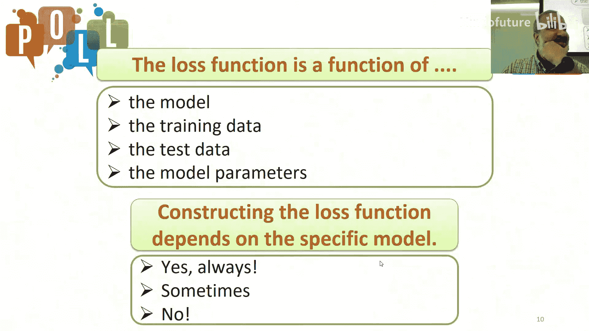
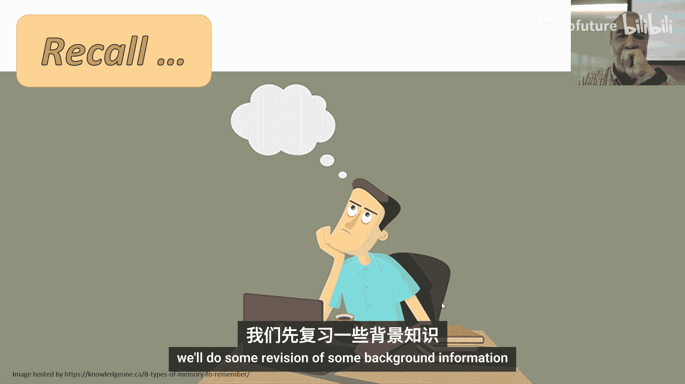
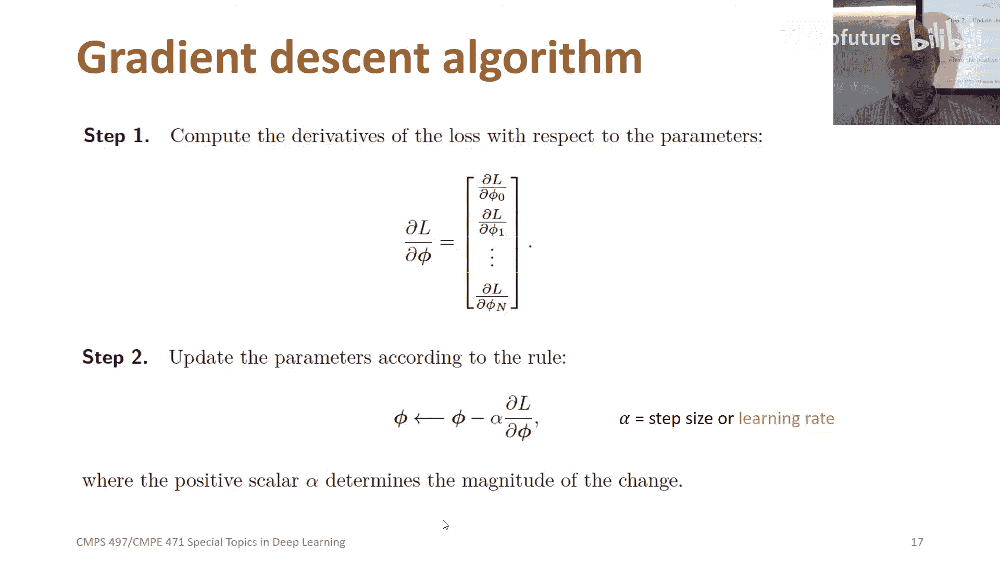
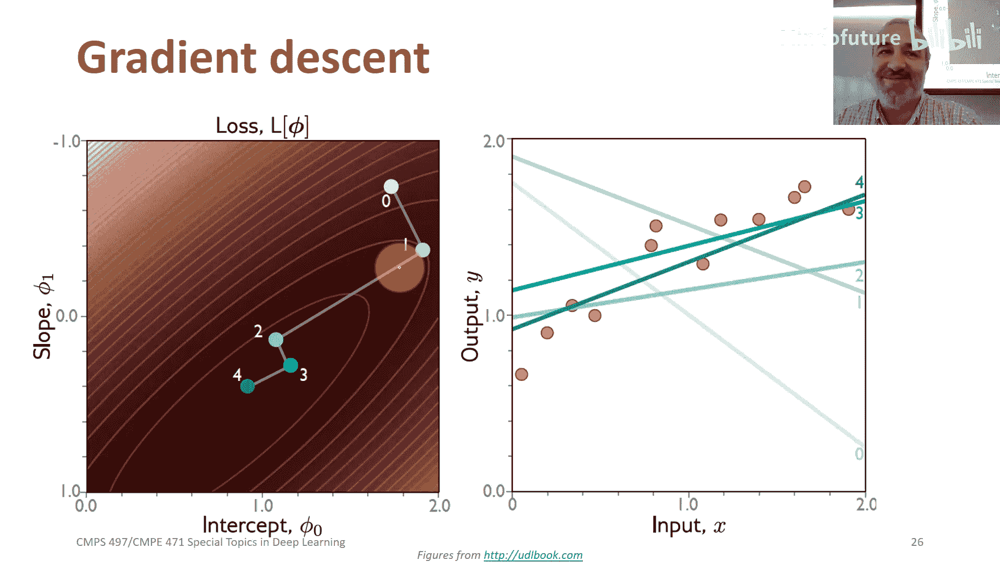
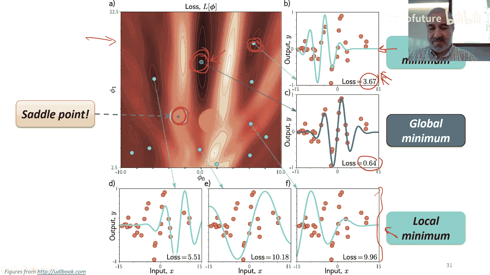
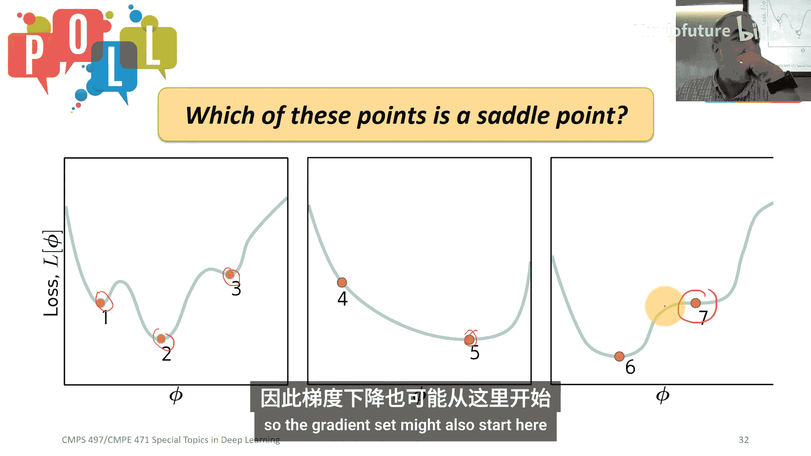
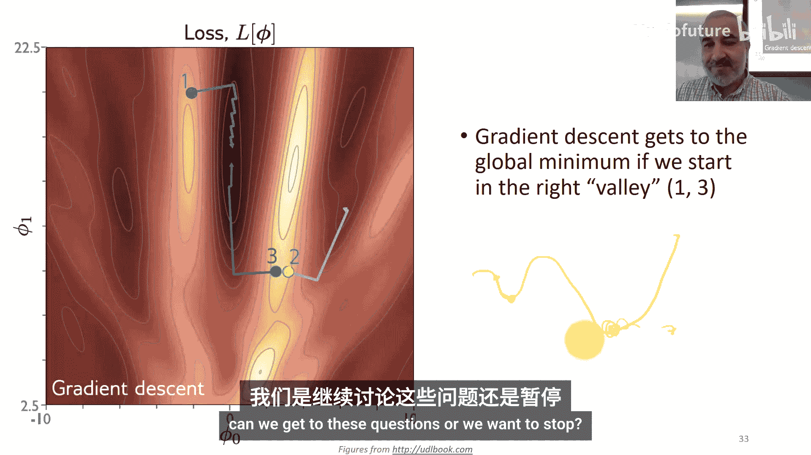

# 【卡塔尔大学】深度学习 CMPS497 ｜ Understanding Deep Learning ｜ Fall 2024 p10 P10_第十讲-模型拟合 I -BV1vQvNz1EeK_p10-

So welcome last time we were about to finish the loss function session。

I think the last part we didn't have time to cover。

 so Joa will start with it and then we will switch to a new session about training。

The last part was about multiple outputs， what if the application that we have has multiple outputs？

Okay， how will that affect the construction of the loss function， So in this example。

 if you remember， we talked about talked about it before。

 we have a chemical structure and we want to predict two things about it。

 We want to predict the freezing point。And we want to predict also the boiling point。Okay。

 type now in the examples that we saw before， the first step is to find a probabilityb distribution for the output right okay assuming that it is just one output now we have two outputs so we have to pick a probabilityb distribution for each of them。

And then we construct the query distribution for the entire output。So to make things easier。

We will just create or assume that each output is independent。

Which means that the probability distribution for the entire output is just the multiplication of the probabilities of each one separately。

 so this is over the number of outputs， so let's say SND is two or three。

 we have two or three outputs， we will just multiply the probability for all of them assuming that they are independent。

Because if they are not independent we cannot do that okay and the function that the overall probability distribution probability identity function will be really complex。

Now if we do that， then the loss function that the negative log likelihood will be as usual minus the submission over the training data of the log of this probability this probability is is the multiplication right so we just substitute this with the multiplication now when we take a look of a multiplication what happens。

It's the sum。 okay， so we will have another sum。 So the first sum here is the original sum over the training data from the negative log likelihood function。

Okay， we are with some over that data。 Now， because we are taking a logo of a product。

 we have another sum now， but over what。Over the number of。Out不s。Or the number of。Okay。😊。

Now the subscript of Y， we used to have it Yi right because they're just one output。

 but now we have multiple outputs， so it would be Yi for the specific number of output， which is d。😡。

Okay， because we have two submissions here， one over I and one for over D I is the presenting the training example and D is presenting the specific output。

Good。😊，Okay。Again， for this specific application， we will have two outputs only and because they are both pneomeric。

Then this is irrigation problem， right， so we can pick for each one。

 we can pick a normal distribution。So。The normal distribution for the overall output function will be the multiplication of the probabilities which are coming from the normal distribution。

Okay， notice here that each one has its own mu， its own mean， right。

 we will have a normal distribution for the first output and a normal distribution for the second output。

😡，And each one will have its own mean here we just assume that we have the same variance。

But if they have different variant， then this will be sigma yours。Okay。😊，Then。

We will make the second if you remember the second step of the construction。

The first step is to pick the query distribution， we did that with a normal distribution for each。

 then we set the model the model output to be therefore parameters of the distribution so here we set the outputs to predict the means。

For that example， we predict the mean for each。Normal distribution right we said that each output will have normal distribution。

 so the parameter for it will be the mean and the variance。

 the variance will assume that it is constant and the mean will be predicted。

 So now the instead of the mean here we will have the specific output of the function of the model which is Fd。

Are you following with me。Any questions about that， so it's the same thing that we did before。

 except that now that probability is a multiplication of multiple probabilities Okay one for each output。

And now the network has two outputs。 each one if you， if we。If we do it。

 let's say that this is the last hidden layer。 and now we have， So we have model here。

 and now we have two outputs。Yeah。Okay， this one will predict mu  one and this one will predict mu 2。

Because we have two outputs， okay？Exly。Okay。And then we will continue as usual。

 the negative log likelihood well take it and as usual the function。

 the only difference is that we will have the double submission。

 one over the training data as usual and one over the outputs because we have multiple outputs here。

In德罗斯网上。Okay。T the last thing to think about because now we have two outputs。or multiple outputs。

 sometimes the scales of these outputs will be different and for example。

 if we are predicting the weight in kilo kilos and the height in meters。

So one will be in kilos alone in tens， right or maybe 1 hundreds。

And the other one is very small if we are talking about meters it would be 2 meters 3 meters， 2。5。

 something like that and that's the scale of heights if we are talking about mass buildings would be 1516 humans around from between one and2 right so the scale of the height in this case will be different than the scale of the weight。

第。That means that one dimension has much bigger numbers than the others type， why is that a problem？

😡，我 can啊。Let们 try一个。什么的怎么。为什么？Yeah， but how is that affecting the loss function， the loss value？

And know we are talking instead about law。The loss value will much depend on the one that has the high scale。

 right？😡，Right， the most of the loss will be about the weight。

But whatever loss in in height will not be will be very small relative to the other。 Okay。

 so the focus of the loss function will be more on the weight。T is that what we want actually no。

 we want both， right， so we have to deal with that。😡，We have to deal with that。

 There are two at least， solutions to that。The first one。Is to do rescaling， before training at all。

 we rescale these values。 S N for the for the width， maybe we divide by 100。

 we divide by once whatever the number that we think will scale it down to be like like the other one Okay。

 And then when we do inference， we have to scale it back。

And you may divide by 100 before turning and then train the model and then whatever the model will give us。

 we will multiply it by 00 back so that we get back to the original scale。😊，That's one solution or。

We also learn the variance for each output。 When we learn the variance now。

 we will get a sense of the scale。and the loss function will depend on the variance and the mean。

 not just the mean。So in this case， we consider the scale of each one。Co the variance， you know。

 the variance determines how the range of the values， right， Okay。

 And if we take it into consideration， then this is this will not make the loss function only depend on or magnifies the values of one over the other。

Type any questions in this， this is the remaining part that we we didn't cover。

 we didn't have time to cover in the previous lecture。Okay。So now what's next？

We learned how to construct a loss function。Okay， we have models with parameters。

 we have loss functions。 What's the next step。Between okay。

 we need to find the values of the parameters that will give us good good model for the data that we have。

So now we'll switch to the new session， which is called fitting models。Fitting models。

 fitting always in the area of machine learning， or deep learning means training。Okay。

 need to fit a model to the given training data。Okay。

 quick poll before we start to make sure that you remember the loss function is a function of。

The model。Training later。Test data， model parameters。嗯。

So the loss function is a function of model parameters。Moern parameters， you are doing。No， why not？嗯。

You。Yeah， but when we compute the loss。Does that depend on the values of the parameters or not？😡，Yes。

 of course， right depends on which model we are we are computing the loss for right so yes。

 it's a function of the model parameters， that's it。😡，And the training date， of course。Okay。

 and the training date， of course。再家我。And the model， okay， what do you mean by the model here。

 by the way， I， what's the difference between the model and the model parameters。我也记的。

These are the parameters model of the neuraler network model。😡，Okay。But what's a model in general？

Models are like the equation， the original equation， like linear regression is a model。😡，Okay。

 neuraler networks is a model of parameters。 Yes， yes， yes。

 But there is a difference between when we say a model。It's the family， okay。

 Mo parameters are the specific values， each model has parameters。😡，Okay。

 so decision threes are models， any learning model， okay model is the family of the equations。😊，Okay。

 of the mathematical representations， Okay， so a neural networks is a model。

 K DNA regression is a model。Of course， they loss function。

The value of the rose function will depend on which model we are using。Right。

So it depends on which model depends on the training data， of course， and depends also on。Demodifier。

You can think of it that way， the model is a function。😡，Okay， and that function has parameters。

 right。Yes， that's it。So the parameters of the neural network model are the weights and the biases。

But neural in general models type when we talked about loss functions last time。😡。

Did we connect it to a specific model？😡，嗯。And he we said， okay。

 this session is about constructing lost functions for neuraler networks， Did we say that？

Did we see anything that actually。Specific， specific to their model。

 Yeah it depends on the value good。 Okay， keep that in mind。The second question。

 constructing the loss function， constructing the loss function depends on the specific model。😊。

Yes always， sometimes no， the steps that we discussed。

Did we say that these steps are specific to some types of models， no， but of course。

 when we compute the loss function， we need to know the model。😡。

But the construction of those for itself。😊，Its not， it's not about a specific model。

 which means that。😡，YouAs you said， you you said that it depends on the problem， right。

 so I can solve the problem with different models， right。😡。

Can we use the same loss function with different models？Yes， yes， of course。 Yes， of course。

Yeah for that problem， okay， for that problem。I can solve it with different models。

 right I can use neural networks， I can use the linear regression， use logistic regression。

 I can use decision3 many models okay。😊，But when I compute the loss， the function itself。

Is not specific about which of them I can use the same loss the same loss function in general。

 the construction。😡，With each one， but what will be different is the F when I compute the loss itself。

 I will use the specific model to compute the output of the model。

 but I can use the same one with different models。😡，No， yeah。

 but this question we are talking about the construction itself， the design of the loss function。

 does it depend on which model we will be using？😡，But let me get back to here。

I don't have it in this， but even in this slide， even in this slide， okay。😊。

This is for multiple outputs。 But this tells you， let's forget about this pi and remove this D。 Okay。

 just for one output。 Okay， this is F， right。What is that， if。It's the model。

 It depends on the model， right type this equation。😡，When we construct it。

 when we say this is the loss function， does it depend on what exactly F will be no？😡。

Now you have a neural network， plug it in for F， you have a linear regression， plug it in for F。

 you have Model X learning Model X， plug it here for F。😡，Okay。

 that's you will need it when you compute the loss value。Okay。

 but I can use this same equation with different models， same sorry。

 same loss function with different models。😡，I hope it's clear now。Okay。ok。So what's the。

 what's the answer here。So。

No， okay。T now we'll start the the that's the the official start of the new session。 Okay。

 we'll do some revision of some。

Background information。デベテです。When we have a function， why？It's a functional fix。Okay。

 let's assume that y is a function of x， it's a function of 1 parameter only， which is x。😊，Oh。

You know dy by dx right， what do we mean by that？不对。Yes， what do you mean by rate of change of oil。

exactlyactly， exactly when we change X。A little bit， by the way， very with very small change。

And usually， we say change it by Dlta when we。😡，Increase x by delta。😮，How much。Why will increase？

Okay， that's what we mean by dy by dx。😡，If we increase a little bit。How that would be。

 what would be the effect on my。Okay， how why will change。はい。When we say dy by the x。

 compute at specific value of x， which is a。What does that mean。So when， so x now is a。 Okay， X now。

 the value of x is a。 If I change it x to be a plus delta。At that point。

 because the rate change will change depending on the value of x， by the way， and at another point。

 maybe the derivative would be different。😡，But at that point specifically。😊。

If I added if I increase x by small value delta， what will be the increase in y？😡，Okay。

Keep that in mind。So。The derivative of why。With respect to x at specific value。

 determines actually two things。First。The direction of x。

Which direction of x will increase the value of y？😡，Okay， let's， let's get back here。

What if I told you。D y by the x is 5。😡，What does that mean。Yeah， at that point， okay at that point。

 d by the x when x is a dy by the x is 5， what does that mean？At that value of x。

 when we compute the derivative and the derivative is 5。

 now the derivative by the way at any point is a number is not an equation and we use the equation to compute the number。

😡，Okay， forget about the equation。Think about the number Now。 Dy by the x is 5。

What does that mean at that point， What does that mean， it means that by definition。

 if I increase x by delta。😡，W will increase by 5 Dlta。 Very good， Not 5。Note 5，5 Dlta。

 five times delta。ok。😊，Okay。😊，But Delta has to be very small so that this will be correct。😡。

And you cannot just say in general， if， if that is any value。

 then why we will increase 5 by that no actually， if you remember the definition of of the derivative。

 its limit when delta tends to0 when it's very， very small。😡，Point1。01。0001， something very small。

 when we increase x by that value， y will increase 5 times that if d y by the x is 5。Type。

 what if it's -5。Why will decrease。Okay， why will decrease。 That means that if it's -5。

If we increase x， y will be。Will decrease。Right， that what if we want to increase why。Decreaseing。

Very good if the derivative is negative。Okay。😊，So you' on the snapnm。

So that means that the derivative actually tells us two things that the election。Of of x。

 of which direction of x increases？😡，In which direction有 should。Change X。To increase why。😮。

If I want to increase y， which should I add to x or should I subtract from X。

 should I increase x or decrease x？😡，That depends on the sign of the derivative。😡。

If the derivative is positive， that means that。😡，To increase y。

 I increase x if the derivative is negative to increase y I decrease x a loss and how much。😊。

And how much？Okay， how much y would increase with increasing or decreasing？Okay。

 any question about that。 So this is Calalculus。1 or one or maybe one，1，0，0。Okay。

 now let's apply that。😡，Let's say that this is a function y of x。

 what will be dy by d x okay so dy by d x is 2 x minus4 right this is easy right let's try to understand that。

For that point， you see this point。😡，What is the value of x？😡，Two。

 what is the value of the derivative at that point？😡，Zal， how did you know。Two times 2 minus-4 is0。

 What does that mean。It's if you increased Y x a little bit。Here。Why will never we not change？

Because that's the that's the minimum point， right the gradient is 0。 that the derivative is 0。

 the is 0 means。Any change in y， of course， with small， any change。

 any smaller change in x will not change y。ok。😊，Very good。 How about the derivative here。

What's the value fix。所以。X is 3， the derivative is to。

 what does that mean means that if I increase x a little bit。😡。

W will increase because it's positive and it will increase by2 delta。😡，Okay。

 assuming that death is very small。阿宝踢。X is4。 So the derivative is。A 4 is more。

 which means that if I increase x a little bit， y will increase even more than the pair and you can see actually from the curve right you can see that the change the increase in y here is higher than the increase of y here and there is no increase here。

😡，Like how about the other side？😡，This is negative right because when x is 1 the derivative is minus2。

 what does that mean it means that if I increased x。😡，By Dlta， y will decrease？😮，By to delta。Okay。

 so y， so increasing x will decrease y。😡，第。😡，Derease how， how can I increase wine。The opposite。

 I think， I take the opposite direction of the gradient of the derivative。Okay。

 you need the direction of the derivative here。😊，Is Nick， is this this direction， right。

 which means that if I want to increase y。啊，说。Make x go into this direction， right。

 which means decreasing x if I want to make y decrease。😡，Can I go to the reverse direction。对。

I would increase X in this case。Okay， so the l here points to the direction of the derivative。

The sign okay with the sign here the derivative is positive， which means that if you increase x。

 if you change x in this direction， y would increase？😡，If you increase x here in this direction。

 Y would increase？😡，Okay， about this。Same right， same here here here x is 0， so the derivative is。-4。

 which means that。If you decrease x a little bit。Why will， will increase all the opposite。

 if you want to decrease why。Go to the reverse direction inqui X。Okay。😊，Is that clear？Any questions？

Nothing new here。But this is extremely important to understand。😡，Okay， now the question is。

 why do we care about that， Why are we talking about this here。Because what。The minimum of what。

Do we have this situation in our context？The loss function， very good。 Okay， this is why we care。

We care because we have a lost function， let me tell you the story， there is storyy。

 we have a lost function。😡，Okay。😊，And this plus function is a function of the mod parameters， right？

It depends on the values of the parameters of the model。Right。😮。

And I want or we want to find a good model parameters。😡。

Which means we want to find good values for the parameters that will solve our problem。对一。

To find these values。We want to change them。😡，So that we minimize the loss function。

I want to see how I can change the values of the parameters so that I make the loss。😡，Decreasing。

Which direction I should change the values of the parameters to make the loss decreasing。😡，Now。

 in the previous slide， we said that if we take the direction of the derivative， what will happen。对以。

The the value， the function will will increase。If I blindly followed the direction of the of the derivative。

😡，The function， the value of the function will increase。Here the direction is this way。

 so if I increase the x y would increase the direction of the of the derivative here is this way。

 if I go this way， which means decreasing x， the value of the function will increase。😡。

Is that what I want？No， so change the parameter values to minimize if we change them in the direction of the。

 forget about the word gradient now， assume that the gradient means the derivative。😡。

If we change the parameters in the direction of the derivative of the loss function。

 what will happen？😡，In the， in the direction of the law the of the derivative， what will happen。So。

 the lowest wind。Increase， that will increase the loss。

Do we want that as we want to decrease the loss。 So what should we do。Go to the reverse direction。

 so we change them in the reverse direction。Right。😊。

And that's what we what we call gradientd descent， and that's why the derivative is very important to understand。

 because that's exactly what we will do in a very famous training algorithm called gradient descent。

Okay， but do you see the connection now？That's the main concept。😡。

If we go through the direction of the derivative， we will make the function increase。

 but we want to make the function decrease。Which is the loss function in our context。

 so we need to go to the reverse direction。Okay， of the of the depth。 Now。

 what is the difference between derivative and gradient。Brilliant。Yeah。

 when the function has more than one parameter。Then we can compute the derivative for each parameter separately。

 we call it the partial derivative， right， take the partial derivative period parameter。

Putting them all in a vector that that's called gradient。Yeah。Whatever。Okay。

 but it's the simple extension。You can think of it always as the derivative。 Okay。

 the gradient is the derivative， but the derivative form multiple。Vals， each one separately。Okay。😊，对。

Now I think we can talk about gradientian descent。Okay。

So what do you expect about the steps in gradient descent， What should we do？

Assuming that we have the lost function。Because we did that in that previous session， right。

 we consulted a loss function。What should we do to find a good model？

We want to always minimize the loss function we want。Always to change the value of the parameters。😡。

To make the loss value decrease。That's that's the objective， right。So we'll do that in two steps。

Okay， so thats this slide is the objective of the entire session， we have a loss function。

 how can we learn the model parameters， that's what we want to do。

And that's the summary of the entire session in one equation。Okay， we have the loss function here。

We want to find the value of the parameters that will make it minimum。😡。

That will minimize it When we do that， then we found。The model that we are searching for。Okay。对喂。

So we have two steps to do that， we do it in two steps。First we need to compute the gradient。

Whi is the partial derivative of the loss function。With respect to every parent。

So if we have n parameters。This vector is the gradient。😮。

The gradient of the loss with respect to the parameters。

 the first element here is the gradient with respect to the first parameter。

 then the gradient the partial derivative with respect to the second parameter and so。😊，Okay。

 this is what we call the gradient。 but it is one value for each。For each parent。Okay， five。

Now let's assume that we computed the derivatives， the partial derivatives。

We're not talking this session on how to do that that's the next session so。

 but let's assume that we managed to compute the derivative we are now we have a specific model。

 we have a specific values for the parameters， we computed the partial derivatives with respect to each of them。

let's see that we have 10 parameters。When we computed the partial derivatives。

 some of them were positive。😮，Some of them have positive derivatives。

 some of them have negative derivatives。What should we do？

Now we said that we would always move to move in the reverse direction of the gradient right so some of them were positive。

 some of them were negative， What should we do？😡，啊。😮，主有翻心。No。Okay， actually， it's very simple。

 These are different parameters， right， When we change， we want to change everyone。😡。

Each of the parameters will change， and it will change depending on its own derivative。😡。

So the ones that have positive derivatives， we should decrease them。

 right should go in the reverse direction。So that we minimize the loss。

 the ones that have negative derivative。We should increase them should go in the reverse direction of their own derivatives。

Okay， so each parameter is different。That's why I don't want you to any worry much about that having multiple parameters。

 each one is has its own derivative， so we will apply the change to each one separately。😡，Okay。

 is that clear。So the second step is to update the parameters according to this rule now phi is the current value of the parameters。

Phi x ray is also a vector， right vector of the values of the parameters， right， Phi0。

5hi1 up to whatever the number of parameters is。So phi will be will change to phi。😮，Minus alpha。😮。

Times the gradient。 Now forget about alpha， okay。😡，Why do we change phi by minus？😮，The gradient。

Because that's the reverse direction right to get the reverse direction you multiply by minus1。

 that's it， so this is the gradient。😡，And minus the gradient means。Diveverse direction。

 So if the gradient is positive， we will actually decrease。The value of the parameter。

 if it's negative， we will increase it。😊，Okay。Yeah。 now we said that。

The definition by of the derivative。Assumes that we have very small changes。😡。

The derivatives can be very bigger there is no limit so we have to have a way somehow to control the magnitude of the change so we multiplly it by a number that that is we call it learning rate or step size this number is all between0 and1 and usually it is very small any 0。

1。01 things like that。😡，Just to control that change。

 because it's not guaranteed if we make a big change。😡，That the function actually will decrease。Okay。

 the definition of the derivative says if the change is very small。😡。

It's not guaranteed if you make big jumps。Okay， so we have to a little bit control the magnitude of the change。

So alpha is positive。And it's always between0 and1。 And usually， it is a small number。Okay。

Any questions？Right。Ex he。Yeah。T， will we do these steps once only and we compute the derivatives and then change the parent that's it colors。

😊，That has to be at， right， We do that many times。Because every time we change the values of the parameters。

 actually we change it's like we we're changing the model now。😡，Okay。

 so we change not the learning model， the actual model， the specific model。

Changing the values of the parameters of the model。

 which means it's like when we are talking about linear addition， we are changing the line。

 we're changing the slope and the intercept of the line。😊，Here it's in general here we not talking。

 by the way， again about Nenetos were talking about any model phi is the parameter of any specific model。

😡，Okay。So when we execute that algorithm inity。😡，We do that in multipleizations， of course。 Okay。

 every time we change。We keep changing。Until some point， we not talk about when to stop now。

 talk about that later， but let's assume that we do that many its， many， many steps。😡，Okay。

 hoping that eventually we will reach good model because every time we are hoping that the loss will decrease。

Because we are going in the reverse direction of the gradient。Okay。😊，Now let's take two examples。

The first one， again， is our favorite toy example， which is the。😊，So basically， when we said that。

Some of them， they have but they think the partially。にでもでもなず。Yes， so。And a solution to that。No。

 it's not the solution， it's by definition， each parameter we will change each parameter。😡，So。

WhenWhen the derivative with respect to that parameter is positive。

That means that we should decrease that parameter。If it's negative。

 then that means that we should increase that priority。 So well make these changes。😡。

For each parameter separate， yes independently， but it's the same function。 Remember。

 the function is function of all of these parameters。😡。

Okay， now we'll start the first first example。Which is assuming that the model is linear regression。

The irr has how many parameters。中。😡，Right， it's a line That has just the intercept and the slope。But。

 remember。嗯。Yeah。Because， of course， linear regression means that it's a regression problem。

 we will use as， as we did very early in the， in the course。 We use the this squares loss function。

Okay， so this is the least squared dose function and we just substituted the model by the line the linear equation。

 so we have phi0 plus 51xi。Okay。😊，With me so far， thats that's the loss function， but we just。

Assume that the model is linear lineareration now on the left。

 you will see that this is the plot for the loss。We saw something like that before right we have phi0 here。

 phi1 here and the shade the shades in that plot represent the value the bright values are high。

 the dark values the bright shades of bright color means high values and dark colors means low value。

Okay。😊，now when we talk about a point on that plot。😡，That means we are starting with a specific line。

Because this point means a value of45hi0 and a value for phi1 right so this is a specific line now。

And the loss of that specific model specific line is not the best。😡，We can compute it， right。

But we can start from this point and then what we want to see now。

 where we should how we should change it。Okay， type to do that。

 we need first we need the two steps right， first we need to compute the derivative with respect to each of the parameters。

😡，Right。What is the derivative of this loss function with respect to5hi0？Okay， before that。

 before that。Before before that， okay before that now we want to get the gradient of the loss with this25 right Okay。

 if we apply to this to this function， this is submission over what。Over the training data， right。

 and LiI is the loss for one specific training example。😡。

When we apply the gradient or the derivative over to submission like that。😊。

This would be the sum of the single derivatives。And this is sum over L。

Taking the derivative of the sum， it will be the sum of the derivatives。😡，Alas。

 now we want the derivative of Li， which is just this。Expression。With respect to five。Now。

 what is the derivative of this。Get me know。What's the derivative of this。With respect to5hi0。Yes。

 okay， very good。 two times this factor， right？Times。1Time 1， very good。

 And what's the derivative with risk to5hi1。2， times this。And then， times。TimeTimes X I。So that's。

 that's the， the the posture derivatives， two times。This， that's the derivative respect 250。

And with this 5251， it's the same times Xon。Okay， now。We want to make the change。😡，In the model。

 we want to change the parameters in the reverse direction of。Of the derivatives， of the gradient。

Right。😊，So we have a specific values for  Phi0 and  phi1 right， and at that point。

 let's assume that we started at that point。At that point。

 we know what's the value of phi0 and we know what's the value of phi 1。 so without compute。

Value that the partial derivative this to5hi0 and the partial derivative with this to5hi1。Okay。

 now let's assume that。This one。You see this one。This is the direction of the partial derivative of the loss with respect 2 phi1。

😡，Yeah。This direction， this is the direction of the diameter。Okay， do you see that。And。对。And sorry。

 and this one。You see this？This is the direction。😊。

Of the partial derivative of the loss with respect to Phi0。咦，第。Looking at。

 looking at these two colors。Yeah。How， how should we change， How should forget about this third Okay。

 forget about this。Now。Okayive me。Now， look at the redarrow here。

 That's the direction of the derivative。Will they speak  to，5hi1。哦。

What does that mean about changing 51， Should we， should we。Increase it or decrease it。😡。

We should go this way， right， so we should go this way， which means。😡，I think it's increasing here。

 right， because this is negative and this is positive。This is positive， this is negative。

 so if we go down。😊，Then this is。This is increasing okay， so we should go in the direction， right。

 so to be to go to try to minimize the loss， we should increase phi 1。😡，Right。😮，Time how about5 zero。

We should go to the right or to the left。To the light， which means increasing fine。Okay。😊，Okay。

 so if I summarize these two red and green changes， these are just the derivatives。

 Okay I would go in the direction of the gray。That's just the derivative itself。

 not the reverse direction， that's the direction of the gradient。😡，Okay。

 because I would increase5hi1 this way。😡，And I increase phi0 this way。

 which means that I will go this way。But to minimize the loss。😮。

We should go in the reverse direction。Okay， did you notice what happens now？

so the direction of the gradient was this direction， we went to the reverse direction。

 and of course this depends on two things， as we said。

 the learning rate and the value itself of the derivatives。Because like get3， think about it。

 like overall。这对。对。This is what we this is applying gradient descent okay so when we apply gradients now going from 0。

0， we update the parameters we go to 01。😡，Now what was the and what was one。

 these are in the right plot。😡，This is。This is 0。And this is line  one。

And it seems that line  one is a little bit better。

 it still it's not very good fitting the training data。

 but it looks a little bit better than the other one。😊，Right。😊，With me。What should we do now next。

Again， compute the gradient again okay， in this case。

 this are this is this is the direction of the gradient。So where should we go。The other days。

So we go to point number two。And it seems like we are going。To the darkest area， right。Okay。

 by following the reverse direction of the gradient。Okay， now number two。

 line number two is this one。 You can You can see that it's getting better。 It's getting better。Okay。

😊，Next， what should we do again。Going to line number 3。 Now， It's a little bit better。

For even better， I think this is really good。Okay， maybe you can get a little bit better。

 but that's that's the steps Okay， we can of course do that many times。😡，Okay。

 did you understand now how gradient thecent actually work？Yeah。Okay。😊，Question。Yeah。而且我今天的话现在。哎会哪里是。

Forget about the contours now， the conours means。You see this point， number one。

If I have another model here， it would have the same lo of value。😡，That's theion。

It has nothing to do with the gradient sense。😡，Okay， that nothing to do with the gradient。Yes。😊。

Right嗯。Would like repeat this。Okay， I will answer this。 I will answer this video。

answerza this the vessel Sta tuned。Any other questions？啊，停。Again， what are these points here。

Each point represents a model。In general， but here it's， the model is annoying。

 but in general any point in the parameter space for that plot is a model and we are changing the model this is training by the way。

 okay if you didn't notice yet， this is the training process。😊，Now， in the training process。

 we are trying to find good model。😡，Based on what， we are following the reverse direction of the derivatives。

 because that's what we hope will give us， will get us to。The minimum of the loss over time。

 of course， we will not do it in one step。😡，It has to take many， many steps。Any questions？

Now to the question that was just posed now。The question was。

 is it guaranteed if we go through this these steps that we will find the minimum？Not your question。

 Okay， I thought that this is your question。Ask。Yeah， so many point it's overtting overfitting。

 I thought that getting to a point that is minimum。 overfitting。 Okay， well， I told you that。

 we didn't talk about when to stop here。 right， We talk about it later。

So we'll not cover that now okay but let's assume that we will repeat that until maybe we get a very small loss or we do that multiple specific fixed number of iteration。

 something like that will stop somewhere， but there are many。

 many many issues in how to stop we'll talk about the later but now to my question。

 is it guaranteed that we'll find a minimum？Okay， I hope to say yes， but it's not。

Okay， it's not。It depends on the shape of the loss function。Now， think about these shapes。

The one that is in the middle here。😡，Does it have a minimum。Yes， of course。

 right has a global minimum， right？So。If you start。If you start the gradientian descent。

 let's assume that this curve。Is the loss function。Okay。😊，And these points are starting points。😡。

If you started at point number four。😡，And you went always through the reverse direction of the gradient。

 would you reach the minimum？Yes， you will always go this way。

 You will continue this way until you reach the minimum。 If you started here。

 you will also go this way until you reach the minimum。😡，Right。

 that's that's a great example a great case， right， great scenario。

These type of functions are called convex functions。Convex functions and convictx。

 it is guaranteed when we have a convicx loss function。

 that gradient descent will get us to the global minimum。对，就这里。

If we follow the reverse direction of the derivative， if we follow the negative gradient。

 then we will reach after some point， of course， we will reach the global minimum。Of the function。

 it is guaranteed if it's convex。But what if we have a function like this？😡，The one on the left。

Exactly， it can if you follow， if you started here somewhere。又来说嘞。Find you， you will stop at 3。Why。

 why would stop battery3？Because the loss， the gradient will be0 more 0 gradient， by the way。

 means what means that will not change。😡，You， the updates are very small， hellas， if not real。

We will not change colors will be done， but that doesn't mean that we reached the global minimum。

These points one and three are called local minima。They are minimum， but locally， okay。

 for that region， it's not the global minimum， the overall minimum。😡，Okay。😊，Okay。

 so gradient descent， if we started here， we'll stuck here if we started here。

We probably stuck at this global local meeting if we start here， then we will hit that global。

 so it's not guaranteed。It's no guarantee。Now this type of function。

 we said that it is convex functions and in convex convex function， if you take any two lines， sorry。

 any two points on that curve。Okay， let's take this point。And that point。

 any two points on the curve， if you connect them with a line。

All the points of the line will be above the curve。😡，Take any points， any two points， this and that。

Con them。All the points will be above the curve within that range。 Okay， if that's the case。

 then this is convex function and with convex functions。😡。

The greater descent would be great because it will reach a global meaning。ok。

But if that's not the case， like my here， if you take these two points。😡，Connect sorry connect them。

You will find that the line is below the function， right， so this is not convictx。

Sometimes it is below like this， but sometimes it's not。So this is not conve， same here。对。Same here。

So this is convicts， these are non convets in non convicts。

Lo functions is not guaranteed that the gradient and thecent algorithm will get us to the global menu。

And that's a big， big challenge， of course， it's not guaranteed yes。No。What we should do？O， so。

We'll have to change the gradient scent a little bit so that we can try to avoid getting stuck at a local meeting and we'll discuss that in show。

😊，Okay， now it's， it's not， it's not easy， especially when we have so many parameters。

 So most of the loss functions actually are non conves。ok。😊，Are nonconfix。

 That's why training is not， not that easy， and it's not easy always to find the best model。

 You might get a model that is not the best， like 3 and one here。Not to。Okay。对。

Now let's switch to and by the way， okay， why we are are talking about this here。

 because when we talk about linear regression。😡，The lowest function that we use for linear regression。

 which is that is squares is convex。😡，But that's a very special case and with linear regression。

 the loss function is convex， which means that whenever we use linear regression。

 we will reach the global meaning。😊，Though that's great。 should Why shouldn't we use all linear？

We're not stuck in local minima。 We always reach the global minimum。 right， that's really nice。我想觉是。

Yeah， who said that line will be the best fit to the， to the， to the data。 Yeah， for example。

 if the data is like that。그。F it back to our line。 Okay， the best line， maybe this is the best line。

Okay， that that's the global minimum of the loss function， but it's not good。😡。

So we we can get to the minimum of the loss function。

 but because the model is not a good model for the data。Eventually， it's bad。Okay， so yes。

 linear regressiongreg is nice for that， but we cannot use it for any problem。😊，Okay。

 now let's switch to another example， which is a little bit more complex。

 We said that linear regression for the linear regression loss function is complex right for this one you will see that it's not。

 So this is called Gable model example。😊，Gable modelGable model。 and it's， it's not linear。

 Of course， it is a pattern like， like what you see here。 Okay， so it's。

 it's a mix between sign signine wave and exponential function， okay and。As you see the pattern here。

The model has two parameters， one that。one that controls where the pattern is。

And the other controls the width of the pattern。Okay。

 so you will see the pattern is centered here now with specific。With here。

 it's shifted a little bit here is shifted and expanded and so on， depending on the two parameterss。

 We don't care much about。The function itself， but we care about how we can navigate the loss the space of the parameters when we do gradient descent in that case。

第。Just to give you an idea， let's assume that this is the training data on the left。😡。

And imagine that we want to fit this model to that。

 So we take the pattern and try to fit it to to this。Set of training data， training examples。

So we want to fit this pattern。😡，To this data。Okay， again。

 we control the center of the pattern and the width of the pattern。嗯。And again。

 this is a regression a problem so we use。😊，The is square here is an example that we use the same loss function。

 but for。Two different models， the and the cable model。Okay， now。This is。Forget about these small。

 these curves。 Fo on this plot。This is the loss function。😡，And again。

 it is the loss with respect to two parameters5hi0 and 51。What do you notice about this？

Compared to the loss that we saw with the linear pressure。 Okay， it's much more complex， right。

 So it seems like there are local mini and of course， there is a global minimum loss。The other one。

 it was going in one direction， it was bright in one in some region and then dark。

 right that was convictx function， buts that's a non convicx function。All the CNN points。

 if I can say that here in the plot are local minima。😊。

So you will see that this one is do and minima， this one。And these three also are local minimum。ok。

And you can see C from the from the plot。 You can see that the are bit dark。😊，Locally。

but globally this is actually the the global minimum and you can see now for these other plots。

 these are the specific models corresponding to these points this this one for example。

 this one is this curve。and you can see that it doesn't fit any any it's okay， it's not bad。

 but it's not the best the the loss value is 3。67。😡，This one。

Is this one and you can see that it fits a little bit better。😡。

The data and the loss here is really less than the other one and so on。Okay。

 so this is an example where。Well， we don't have， we have local minimum。So gradient descent here。

Will be challenged it's not guaranteed that we will， if we do gradient descent。

 we will actually reach this global minimum。Okay， yes。It the。Each what， you mean these plots。

 the white plots。The small growth or the big growth。我装你明天。

That big colored cloth is the loss function。 Each point is a model。你。Exactly that。

all of them are equations。Okay， but each point has specific values for the parameters。😡。

So it's an exact equation， it's not a model， it's not a family of equations， it's the exact equation。

😡，You， okay， let's get back here。 You see this。Yes是。This is the moment， exactly because it has。😡。

The parameters without specific values。 Now each point here。😡，Means a value for 50 and  p1。

 so it's a specific equation。😡，A specific curve。So you see this point is this curve。This point。

Is this curve。When you said a Bridge。Yes， definitely은大。Okay。😊，Now， look at this specific point。

 let me change the。Oh sorry以。系。Okay， let me do it this point， you see this point。at that point。

 the loss also is0， but it's different from the others。😡，It's scored saddle Point。😡。

Saage point where the surface。Multiple points on the surface is 0， gain the derivative is 0。😡，Okay。

 so it's not like the minimum of the maximum。😡，It's。

Actually， you can see it here， okay？Saddle point here。

 can you see saddle point here where the surface actually is straight？😡，Which one？还有。No。

5 is not the set point。 Sa point means。😡，Yeah， the surface is straight and it's not minimum or maximum。

Okay。😊，そ。So only seven here I set the point。Okay， this is， this is actually a global minimum。This is。

Local minimum， its that the service is not flat here。😡，Okay。

 and of course this is global and this is local， okay， and that's a saddle point。😊，Okay。

 with settled point， the loss is that the gradient is 0， so the gradient sent might also stuck here。

Okay， so this is just the last slide。Okay， I know that we are overr Yeah it's just just a couple of minutes。

This is the same loss function that we saw before。 Okay。

 now let's assume that we started the gradient descent at point number one。😡，If we do that。

Then well go， you see the curve here， this is this is the steps that we will do that we will make。😡。

If we apply gradient descent， so we will reach here。Which is actually the global minimum。😡。

So if we started with one， we will reach the global menu。😡，If we started with 3。

 if we started with this point。😮，We will also reach the global minimum。Okay。

 so these are good two good cases， but if we started with point number two， which is this one。😡。

We will go to one of the local minimum。hyWhy is that okay， so let let me explain this clearly。😡，没说。

So it was're not here。If we starting here。Where is the gradient。

 Where is the duration of the gradient。The ratio of the gradient is when the loss increases。Okay。😊。

The brightness increases left or right。No， look。Left。😡，So we go in the rest direction， we go right。😡。

Once we go out Carls， we missed the global minimum and we will go to the local。Okay。

 it's like a small valley here。But it's not the global meaning。Okay， it's like Annie。 we are。

 you are。 okay， we are。Coming here， but the global minimum is still here。 Okay。

 so we are here we will reach this point。But we not be able to reach the global here。Okay。

Can we get to these questions or we want to stop。关定。Type， we can start with this in next time， okay。

 so might contact about it。

