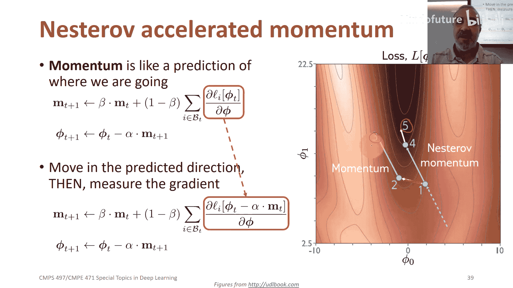
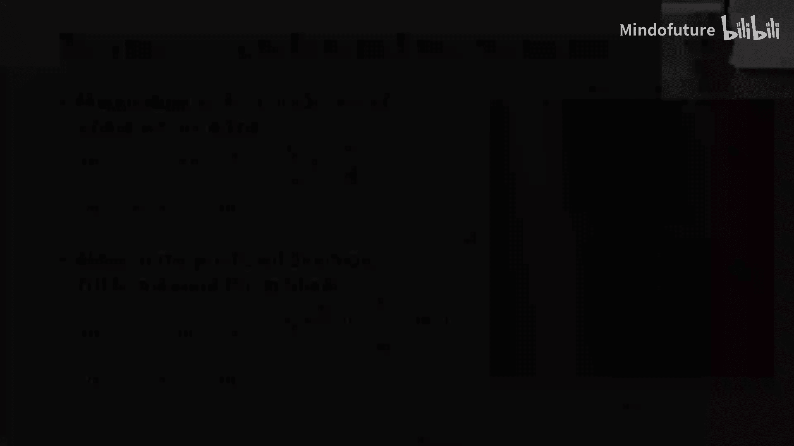

# 【卡塔尔大学】深度学习 CMPS497 ｜ Understanding Deep Learning ｜ Fall 2024 p11 P11_第十一讲-模型拟合 II -BV1vQvNz1EeK_p11-

from him。Today Charah we' continue talking about gradientian descent and its modifications and Charah from next lecture will start to talk about how to compute gradients I think we stopped here last time we were talking about a problem with gradientian descent。

If we started from this point， if you remember the Gable model example。

 okay and that's the loss function that we discussed， if we started from that point。

 the gradient in descent will take the model to the global minimum。If we started from 1。3。

 we will also reach the global minimum， but if we started from 1。2。We will get stuck to a local。Okay。

 so that's a problem with gradientding de syn that we will try to see how we can avoid with other methods。

To some extent， Ta so this is a quick call to make sure that you got the concept so far。

A convex function has only one global minimum， only one local minimum， no local minimum。

 no global minimum。Only one。Global minimum。And no， look at me。And no look at me。

is it guaranteed to find the global minimum of the loss function using gradientian descent？No。

 it's not， it's not guaranteed we can find the global minimum of the loss function using gradient descent。

那正。Never or not guaranteed， or it depends on the starting point。Other last two。

 right it's not guaranteed to find a global minimum and of course， it depends on the starting point。

Now well switch to modifications trying to address this problem Okay， so wasn't the problem。Yeah。

 so not to start in a look at me， right Okay， so there are three methods that Charlotte will try to cover and see what the concepts are。

The first one is called stochastic gradient descent。So what is the main idea of se gradient descent？

😡，The main idea is to add some noise or randomness to the gradient。Okay。

 hoping that doing so will get us out of。The region of a local。ok。😊，what does that mean？

Adding noise here means that in a state of。Computing the loss。Over the entire training data。

We only compute the loss over a small subset of it。 We call it a batch， or mini batch。Okay。

 so let's say that we have thousands or millions of training examples will not compute the gradient over all of them。

😡，When we make the changes of the model， we will only compute the gradient over a very small subset of that。

We call it a mini batch。Okay， let me show you the the difference， this is the gradient descent。Right。

😊，Where is the gradient？This part， right。So this part is the gradient， right， It's taken over all。

Tining examples this submission is over over training examples， right？😡，🤧Right， so that means that。

We are computing the gradient， soI is the loss or the partial derivative of L with with respect to phi is the loss is the gradient of the loss for a specific training example。

😡，OkayAnd we are doing that over all training examples。😡，Okay。😊，That means that for gradient descent。

 we have to compute all of that。😡，We have to compute all of that。

 then we make the change in the model。😡，Okay， we have to do it over all training examples。

 computing the gradient for all of them。😡，And then。Make the change in the model。 That's the original。

Gide and decent al。Now with stochastic gradient descent。We have this one。

 Can you see the difference here。Okay， there is one only difference here， what is the difference？😊。

The difference is here， okay。😊，The difference is here。

 the submission instead of being over the entire training data set。It is only now over a batch。Okay。

 over the batch batch means it's a subset small sample of the entire training date。

 usually it's intense， it's 32， 60 and 64， something like that okay。

Very few a small subset sample of the training data。

And this is what we call stochastic gradient descent。Okay， so you see the difference now。

 and instead of computing the gradient over the entire training data。

 we computed only over one batch。😊，And then of course， we have another batch， compute the gradient。

 So here the iterations will not be over the entire data， entire training data。 Okay。

 every iteration here。iss on one batch， so we compute the gradient over one batch。

 we make the change and then we take another batch， compute the gradient， make the change。

 then take a third batch， compute the gradient， make the change in in the original gradient descent。

 we compute the gradient over all the training data and make a change and then do it again and make a change and then do it the third time。

 make a change okay。So the batch here is， again， it's a random sample。

 usually it is without a placement。😡，Okay， so we take a subset of the training set。

Do the de modificationification， take another subset。

 take a third subset until we take the entire training set。

 we call that an epoch so when we reach when we fully go go through the training data。

 this is called an epoch。😊，Okay， so we can the training data can have maybe thousands of batches after we are done with all batches。

Of the training data， we go through them again。 Okay。

 every one pass over the entire training data is called an app。ok。😊，Any questions， yes？就把。这是的是。

I eventually yes， of course， we will go through all of them eventually。

 but the difference is when to do the change in the model。😡。

Based on the gradient over all of them at once。😡，Or we do that change based on small batches。

And we'll see how that will make a difference， yes。Yes。Oh then we make it like over there， like me。

Several changes， yes， yes。But what it's like， I make a change。

 and then the change that I make on the package that is next makes it worse。 It can happen。

 It can happen。Can happen and we'll see what what will happen。 Okay， but doing that。

The expected gradient， the expected direction of the gradient is the original gradient。Okay。

 but it is taken over different steps we'll see the effect of that。 You still have a question。嗯，关于是。

Without the petition， you， the batches， usually you take the batches to be disjoint。

Any other questions let's see the effect of that on the left side you will see gradient descent this is what we saw in the beginning of the lecture。

😊，Okay， if we start from 0。3 and or 0。1， we'll go to the global minimum and if we start from 0。2。

 we'll go to the local map。Now switching to the right side， this is to casting gradientian descent。

Notice what is happening here。😡，ItThere are lots of the exacts， right， Okay。

 Why is that because because of the noise， where where does the noise come from， by the way。什么呀？Yeah。

 why。Yeah because we are taking instead of taking the actual gradient of the lost function。

 we are taking like an approximated gradient only computed based on small subset of the examples of the fening examples。

😊，Okay， so it's not actually the gradient of the original loss function。Okay。

 so we will see that based on the batch。😡，The gradient sometimes might be this way and then next time would be this way and then third time would be this way and so Okay。

 so well see that。😡，It is as exact like that， but it happened that because of this randomness in this case。

We managed to go to the global minimum。 Okay， we skid the long valley here。

Of course this is possible， but it's not again guaranteed。😡，It's not guaranteed。

 but there is a chance that we will escape the area of the local minimum and go to the global minimum。

😡，Okay， yes。I。没すね。可以可。If we increase the batch size。Yes。

 we'll go back to the original one okay as we as we increase the batch size。

 it's like we are going to the original gradienting descent force。嗯。No。

There will be there will be some more exact right so actually batch size we'll talk about it I think later can be considered as a hyperparmeter so we can tune the batch size。

😊，Okay。😊，But that's the main idea， any other questions？ok。let me show you another view of that okay。

😡，Look at the top left corner here， you see this， this is the original loss function that we saw before。

😡，Okay， and assume that the model that we reach is this point。😡，When we zoom in， it's this point。

Okay， what are these old directions？😡，Remember in stochastic gradient descent？

We take a batch and compute the gradient and go in the reverse direction of that gradient， right？😡。

That's what happens in gradient descent， but how many possibilities we have。

If we take an random batch。So many right because the batch size even is small。

 taking a small subset from a very large subset， we have so many possibilities。

 right each one has a gradient。😡，So it can be in that direction it can be in that direction it can be in that direction right there are so many directions possible directions that the model can take based on different batches right that's exactly what you can see in the other figures。

Okay， I look at now the this figure。The top right figure okay。Forget about this one now， okay。

 still we have the same model at the same point， but the figure is different right？😊。

You notice that this。Figure is different than that。 Okay。

 this is actually the original loss function。This one on the right is the loss function based on the batch that we are taking here。

 which is this three points。Here， the best size is three。Okay， so when we take this batch， actually。

 we are。Using a different loss function。嗯。Okay， the function that is based on only。😡。

These three points。Only these three examples。Okay。😊。

And thus the shape and the look of the loss function， of course will be different。

 but still we will be we will be going in the reverse direction of the gradient of what of which loss function。

Of the bachelor's function。Of the bachelor's function。Okay， so in this case。

 you can see that the gradient is going this way and so the movement would go in the reverse direction。

😊，Okay， so this is based on this specific loss function。😡。

And you can see here the dotted curve is the original model and the solid one is the one after we do the change and you can see that it is getting closer to the point to the three points right because it is minimizing the loss function that is defined over these three points so we are minimizing the error here。

😡，Okay， so it moved towards these three points， same with the other two。If we change it， the batch。

here let's take this one， these are three different points， that's another batch。

We will compute also the gradient， but the gradient of this loss function now and move in the best direction。

Same here。Same here okay， but here the loss function is completely different okay the gradient is this way because increase the increasing of the loss is this way so the movement would be in the reverse direction。

😊，And this one in particular is very interesting。😊，Look at look at the movement。

 the direction that the model will change to here。It is the opposite of。

The direction that should be moved from the original loss function。😡，Okay。

 so actually the textbook says a nice statement it says we go downhill but uphill。😊，Okay。

 we went down him。With respect speak to the loss function of the batch。

So we are minimizing in the space of the loss function of that batch。

 but actually we are going uphill。😡，It seems。Based on the original loss function。

 which is based on the entire training set。Okay， did you get the point here。

 so the point is that based on the batch。😡，We are actually minimizing a different function。Okay。

 so we might go in a good direction with respect to the origin and or a bad direction with with respect to the direction。

 the original direction。 But eventually， eventually because we are doing that over the entire training data。

 eventually the expected direction is the original direction。😡，So we hope that with this randomness。

 with this approximation of the loss function， we might get out of the value of the local minimum。

Okay， and that's what happened actually。Okay question yes。So you said the last function。Yes， you can。

一ち。Usually it's fixed size Yeah， yeah theoretically yes you can change the size。

 but but what I see always is the batch size is fixed。😊，Okay。😊，But。I'm not sure。

 depending on how you will change it that will of course have a negative effect on the computations because fixing the batch size will make it much easier to do the computation actually。

 but theoretically yes you can can I don't see a reason why we cannot change the batch size。

 but I don't know if that will have a good effect or not。No， with any batch。

 the loss function will changed。Whether it is small or big。It is different， different then。

The original one that is defined on all the training set， yes。No。

 the loss function is defined based on any the loss function is function of the input of the of the the examples okay so if I change the batches because the batches here are thisjoin okay so but overall all the expected of course will be the original one。

😡，Yeah。ok。Is that clear？Any questions？Okay， timetoastic gradientcent has so many nice nice properties actually the first one that we just mentioned is that it might escape the local minimum and that's the most important one。

😊，It also， while it adds noise， but still the bit。😮，A logical。

 right because they are based on the training data， we are not using any other data。

 it is part of the training data。So that we still have some meaning， okay， but based on small subset。

😡，And eventually， as I said， it will use the entire data。Okay， and it uses the entire data equally。

 Okay， especially if the the batch size is fixed。 Okay。

 so it uses all the the data equally eventually。 It is this computationally expensive。 Why is that。

The and at before watch。You mean faster。Maybe but actually that's not not the main reason here the main reason is that we are computing the gradient over a small subset of examples and then do the the change the other one we do the we compute the gradient over all of them before we do the change。

We are changing so much， but in every step of making an update to the model， it is much faster。😡，喂。

 and in practice， actually it was found experimentalary that stochastic gradient descent can find models that can generalize better than gradient descent。

T I also usually stochastic gradientding descent is done with what we call learning grade schedule so far we said that the learning grade is fixed right you know remember alpha。

😊，Okay， so far we said that it is fixed， but that's not always the case with stochastic gradienting descent。

😡，Usually we use a dynamically changing learning grid， we start with a large learning grid。😮。

And over time， we， we make it smaller。What is the logic behind that， why we are doing that？Initially。

First first of all， when we have a large learning rate。

 we make large jump large updates or small updates。

 large updates right so in the beginning we want to explore more so we do we increase the learning rate we want the learning rate to be high so that we make big jumps to explore the entire space but then after some time we want to do fine tuning we want to be more precise okay so we want the learning rate to be smaller so that the changes will not be that big。

Okay， so that's the idea here。Okay， so that's it withqueastic gradient scent as is。

Now we will see that we can do two changes to at least two changes， actually， well see three of them。

That will make it sometimes faster， sometimes more precise。The first one is called momentum。😡，Okay。

So what is momentum？With s casting gradient descent。

 if we go back to the equation to casting gradient descent。

That change with every batch depending only on the gradient of that batch， right？😡。

And we compute the gradient of that batch and then we make the change。

 right it doesn't take into consideration any gradients of the other batches。😊。

just start from where we are， we compute the gradient and then remove move the change the model right with momentum。

We change this， well actually take that into consideration not only the currentant。

 the gradient of the current batch， but also the gradient of all previous ones。😡，Okay。😊。

So we don't forget the history。 We take the history of the gradient into consideration。And also。

 we take the gradient of the current page。How is that？😮，It is done by a weighted sum。

So we give a weight to the， to the gradient of the current batch。

And another weight to the gradient that we made in the previous that we each at the previous batch。

Okay， so where is look at the first equation here， M is the。

Gadian that we will actually use in the change。 So in the second equation。

 this is the standard gradientian thecent， right。Okay。

 except that here instead of the actual gradient， we call it mt plus 1 m plus 1 is the actual gradient that will will use for it t plus1 okay now how do we compute m plus  one？

😊，Where is the gradient of the count patch？That's the sum right， that's the sum Okay。

 so that's the current gradient we call it the current gradient for now current gradient means the gradient of the current batch。

😡，Okay。We will multiply it by a factor that is between0 and 1 beta actually is between0 and 1 beta is a parameter here okay and usually it is high value。

 so let's say mass beta is 09。😡，Okay。😊，So we will multiply the current gradient by 0。1。😡，And added 2。

9。😮，Of the gradient that we used with the previous batch。😡，Which is empty。

So this is a weighted thumb。😡，We give some attention。To the gradient of the conbe。

And also on another attention， some actually higher to the previous one。Okay， so that means that we。

Trust the history more， usually。Okay， type is that actually only the gradient of the previous batch？

😡，Notice that I didn't say the gradient the gradient of the previous batchge。

 I said the gradient that we used in the previous with the previous batchge the gradient that we used in the previous step。

Okay， because this is recursive， by the way， if you look at it， it is recursive。😡，Okay， it's。

10% of the current gradient plus 90% of the gradient that we reached in the previous previous step。

 so if we expand it， you will see what what I'm saying here let's try to expand it。Okay。😊。

Let's say that we will start from the first step at before we do the first it。

 we have M0 okay and M0 is 0 that's the beginning right we don't have any gradients。😊。

Then let's compute M1， what is M1？😡，Let's say that beta is。Okay， let's use beta。 Okay。

 we will not not make it a specific number。 Let's use beta。 So M1 is。Beta M0。Plus。😊，1 minus beta。

This is let's call it the gradient at batch 1， G1。ok。With me， Di。 nows let's compute M2。可以给他卓。

Beta M1， is what which is this entire thing， right？😡，So if we multiply beta by this。

 that will be beta square。😡，MZ plus。Beta 1 minus beta g1， right all of that plus。😡，11 beta。G2， right。

Right， let's do it one more time。M3， what is M3。It's beta multiplied by all of that， right。

So it will be beta cube。M0 plus beta squared，1 minus beta。😮，G1。Plus。1 minus beta， oh beta。

1 minus beta G2 plus 1 minus beta。So what's going on here。不。可以。It's actually， we are thinking。

Into consideration all the gradients of the history。Okay， but with different。With different。Withs。

And if you notice the weight as we go back in history， the weight increases or decreases。😡，No。

 it decreases actually beta is less than one。😡，So we are multiplying by a number that is less than one。

😡，Okay， every time。 Okay， so the oldest one is multi by beta Q the the。

The more isn one to it beta beta squared times 19 minus bit Okay， and then beta times 1 minus bit。

 So every time we we multiply the history。Boy， better。And the， the present by  one minus bit。Okay。

 so the the very old one will be multiplied multiple times， right。

 so it will get smaller and smaller， the weight of it will get smaller and smaller okay。😡，Okay。

 so that means that we favor， of course， the gradient of the。Of the recent batches。Okay。😊，Yes。😊，这个。

Thank个。No， you mean the momentumoid of sastic。This is not stochastic。

 this is a modification to the stochastic cadence set。😊，还没。对。Whats。Yeah， so okay。

 so with gradient descent， with the original gradient descent。

 we are computing the gradient over the entire training data allows。😡。

With two casting gradient descent， we are doing the gradient only on one batch。😡，At the time。

So we are doing the gradient with one batch， make the change， gradient to another batch。

 make the change。😡，Now with the momentum， what are we doing？😡，Actually。

 you are taking an infinite weighted sum of all gradient。😡，Of the of the previous batches。

Okay and if we are in iteration number 100， if we are now using batch number 100。😡。

We are using the gradient of all previous batches。😡，Plus， the bag gradient of the current page。おま。

Why is it lowest， we don't know yet， but you will see the effect of doing that。 Okay。

 this is a weighted thumb。😡，Because we are doing that。

 do you think that the changes that will be done will be very different from the previous one？😡，And。

 I'm at the iteration00。That change the direction that I will take now。

Based on what you saw here in this slide would be very different from the direction that I took in iteration 99。

It will be a bit different， but not very different。

Okay so you will see the effect of that in the next slide。

 but let me know do you have any question on this or should I raise it now？I think this is clear。

 right if you do that， of course， more than that。😊，You see how this will go so。对。

So I can say that this is an infinite weighted sum of all previous gradients。😊，Okay。

 from the very first gradient to the gradient of the current edge。Okay。

 now let's see the effect of that。😡，On the left hand side， we don't have any momentum。

We are just using the gradient of one batch with every step which is the current batch and you can see if we started from this point。

 you can see how the path will go through okay both by the way。

 if we start from this or that will go to the global minimum。Okay。

 but look now if we use the momentum， what happens， what do you notice on the right side。

 we are using the momentum for both。😡，啊。😮，It's much。Smoother。 Its much smoother。Okay。

 which means what？Faster， very good。 Yes， faster。 with less number of steps。

 we can go to the global minimum。 Of course， this is again possibly Okay， it's not again guaranteed。

 but at least instead of making very very different changes with every batch。

 we are taking the history into consideration so that we don't divert much from what we learned。

 but the history is taking less weight over time。 the very old gradients are any decaying。

 the weight of them is decaying actually exponentially decaying and we giving higher weight to the recent one。

Yes。我问题他。哎，那准。Okay， first in terms of steps here， if you look at the two figures here。

Which one will take less steps to each the global menu？Yeah。

 the momentum on because it's the path is is is faithful not faithful。 the smoother。

 at least the other one， as you see here， it goes up and then goes down and then up again， right so。

😊，Of course， that's， that's， again， not guaranteed to be like that。 But， but in practice， yeah。

 it is much smoother。 And in that case， it would be faster。 Yes， faster to conge yes。た。等着我们。

It's more round。这我们。It's more likely for us to stay。喂。反了可。It's more likely here with， you mean。

 with with stochastic or with。啊，你个情况。But with more than also， you might get out， yes。Go。

 so it's like我们 makes。The point that we're almost getting back to。Not always， of course， I mean。

 in practice， not always momentum is really better than than the stochastic gradient descent。

 but of course， in both cases。It's more guaranteed that you will get to the global name。Okay， it。

 it's it。I can see your point。 Now you are saying something like we are reducing the randomness now。

Right， to some extent， but reducing the randomness。

 not because we are using the entire data set still there is some randomness。

 but we a little bit controlled that okay so that。😡。

And we can reach the global minimum in a faster in a list number of steps。 Okay， of course。

 these are hopes again， there's nothing guaranteed。

 nothing proved any for sure that we will reach the global， yes。Yes。F。In list number of steps。

The bridge。You mean without momentum or with momentum。没什。Even with momentum， by the way。

 don't forget that we are given。Higher attention to is batches than old batches。Okay。

 so even if we diversge， there is still hope that or there is still possibility that we will get back to where we should。

 Still it is still somewhere in between。 Okay， I， the the the original gradient descent is an kind of an extreme because we are taking into consideration everything。

And the stochastic one is is only on one batch， this is somewhere in between okay its taking it's giving some weight to the current batch。

 but also some weight to the history。😡，I need do I need do okay。And why don't we do。这个大就。Okay。

 good question， why don't we take 50%， 50%？有不识。Actually， actually， this is a hypothemeter。

 you can't tune it。😊，Okay we' will talk about using a hyperparus data， okay， and， I mean。

 you can change it and see which one is good for your problem。😡，Okay。

 so I cannot tell if 50% is bad or not， but usually， usually， if you not change it。

 you you set it to a high value so that you don't make。Big changes。 any more if you。

 if you make it a small value， what happens here。If beta is small， if beta is small， okay。

 then this number is bigger， right？😡，Okay， so you give very high weight to the current batch。

 So you are back to。Sttochastic， okay， you're back to the stochastic one。This on。Yes。

 it depends on the gradient， but I'm saying based on the widths。

 if you give high weight to the current batch， you are kind of back to toast to casting gradient set。

Good。The last one that we will discuss now is a nest of accelerated momentum。

 so this is a change over the momentum idea Okay， what is the idea here？The momentum。

Is like a a direction based on all the history， right， So it's like the prediction。

 And if if now I am at one point in one iteration。The direction that I will take next。

 will it be very different from the history？😡，No， right， it it will be a bit different。

 but not very different from the history。 So I can actually think of the history as a prediction for the next step。

😡，Right。😊，So this curve actually is taking this a step ahead。It says that this is that momentum。

 but now with this accelerated momentum。😡，We change。

Taking the gradient at the current model to taking the gradient at the predicted model。

So look at the difference between this and that， what's the difference？

This is the gradient over one batch。😡，Right， this is over batch tea。Okay。😊。

That's the current gradient， right， the range of the current。😡，Now， look at this。 This is。

 what is this， What is 40。That's the model that we each it。

 the previous ittation right this is this istation t plus 1。

 so5 T is the current model before we change it。😡，Okay， now look at。

The model at which we compute the gradient here。 So here。

 here we compute the gradient at the current model。Okay。

 here we compute the gradient at the predicted model if we take the momentum direction。😊。

So this is 5t minus alpha mt is like this is the new model if we use the gradient descent right。

 so it's like we are computing the gradient at the future point。

 so we are making a look ahead of the future and compute the gradient there。😡。

Let me show you what does that mean exactly？With the momentum， not necessarily of with the momentum。

 okay？Let's say that we are in this。In this position of the model that the model is at that point now。

 Okay， what does that mean the model at that point， That's based on the values of the parameters。

 okay。😡，But with the momentum， we take two things into consideration， right？

The gradient of the current batch， we see， which is the red one here。

 So that's the gradient of the current batch。And the momentum also direction which is the green1 we take both into consideration for simplicity let's say that it's 5050 okay so we take 50 of the gradient step and 50 of the momentum or actually let's assume that we just add them equally so from linear algebra when we add two vectors。

😊，So we are here， right？If we go through this direction plus。😡，This。

 the momentum direction we would reach at this point。Right。That's from linear algebra， right。

Okay going this way and then this direction of the momentum we go to this point。

 that's the momentum Now with this to of what what's the change we are in this point right。

 where is the direction of the momentum the gain one。😡，Okay， so if we take the momentum direction。

 we will reach this point。😡，If we would only。Take the momentum direction which this point。

 What is the gradient at this point。😡，This is this one。This one， that's the direction。

 the gradient at that point。 That's the gradient at the new batch。Okay。😊，Now this is look at this。

 this is different then。😡，Different than this one， right？This one is state， this one is not。😡。

This is the gradient at the current model， this is the gradient at the predicted model if we take the momentum direction。

😡，Okay， so this is like we are looking ahead one step and see what the momentum will will take us and then compute the gradient there。

😡，And take it into consideration when we make the change。 Now we make the change this plus this。This。

Okay， plus this， we will reach this point。Which is different then。This point。听。😊。

So this is called look ahead gradient step， okay it's different than the original and it might also take us to a different solution。

Okay， same here if you look at it at the loss function。

That's the same same idea that we saw in the previous slide。

 but on the loss function that we saw in the beginning of the， okay we are at 01。

 that's the current model and this doted lion is the direction of the momentum。

With momentum only its we will take the addition of the momentum plus the current the current gradient。

 which is this one， so we'll go this way and then this way which。Point number 3。With the momentum。

 we go through the momentum and then take the gradient at that point。

 which is this white one so we do reach point number five so we can reach two different models here。

Okay， with this stove， we reach another model then the one that we can reach with a moment。Okay。

 so this is like。Looking at the future one step and that might be faster to each the do mill。

Any questions on that？Okay， Char will continue with the last one， which is Adam optimization。

 which is the most widely used currently and then Charlotte would switch to how to compute the audience send a。

