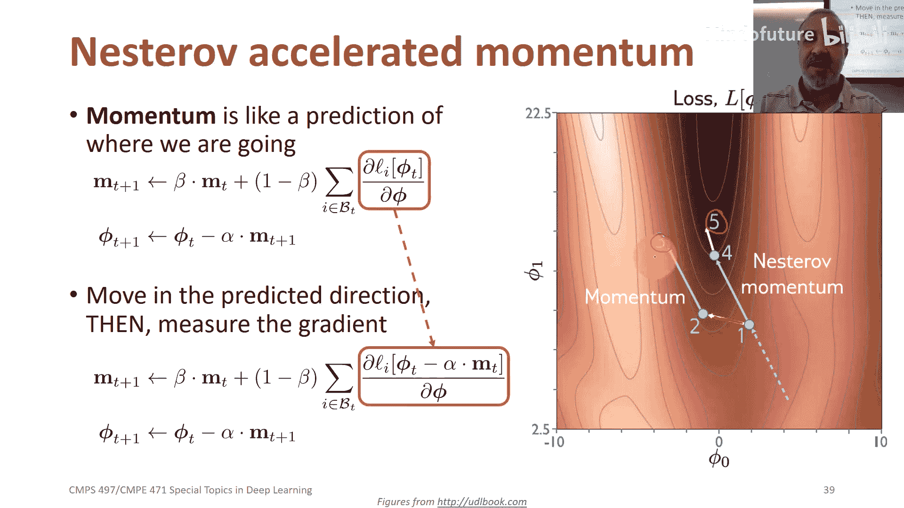

# 深度学习 CMPS497：P11：模型拟合 II

在本节课中，我们将继续学习梯度下降法及其改进版本。我们将探讨标准梯度下降法存在的问题，并介绍三种主要的优化方法：随机梯度下降、带动量的随机梯度下降以及Adam优化器。这些方法旨在帮助模型更好地寻找损失函数的最小值，特别是避免陷入局部最小值。

上一节我们介绍了梯度下降法的基本概念，本节中我们来看看它存在的一个主要问题以及如何改进。

## 梯度下降法的问题

梯度下降法并不保证能找到损失函数的全局最小值。其最终结果依赖于模型的初始参数（起点）。

考虑一个简单的损失函数示例。如果从点 `0.1` 或 `0.3` 开始，梯度下降法会将模型导向全局最小值。然而，如果从点 `0.2` 开始，模型则会陷入一个局部最小值而无法到达全局最优解。

这是一个需要解决的问题。凸函数只有一个全局最小值，没有局部最小值。但对于非凸函数（如神经网络的典型损失函数），使用梯度下降法并不能保证找到全局最小值，结果取决于起始点。

## 随机梯度下降法

为了尝试解决陷入局部最小值的问题，我们引入第一种改进方法：随机梯度下降法。

随机梯度下降法的核心思想是：在计算梯度时引入一些噪声或随机性，希望借此帮助模型跳出局部最小值的区域。

具体实现方式是：不再使用整个训练集来计算梯度，而是每次只使用一个小的子集（称为“小批量”或“批次”）来计算梯度并更新模型参数。

以下是标准梯度下降法与随机梯度下降法的参数更新公式对比：

*   **梯度下降法**：
    `θ = θ - α * (1/m) * Σ(∇L(θ; x_i, y_i))`
    其中，求和 `Σ` 是针对所有 `m` 个训练样本进行的。

*   **随机梯度下降法**：
    `θ = θ - α * (1/|B|) * Σ(∇L(θ; x_i, y_i))`
    其中，求和 `Σ` 仅针对当前小批量 `B` 中的样本进行。

两者的关键区别在于求和的范围。在随机梯度下降中，每次迭代只基于一个批次的数据计算梯度并更新模型，然后处理下一个批次，如此反复。

当模型遍历完整个训练集的所有批次后，就完成了一个“轮次”。训练过程会进行多个轮次。

基于单个批次的梯度只是真实梯度的一个有噪声的估计。这种噪声可能导致更新方向在短期内偏离全局最优方向，甚至看起来是在“上坡”（相对于全局损失函数）。但从长期和期望上看，其平均方向仍然指向正确的下降方向。正是这种随机性，增加了模型逃离局部最小值区域、找到全局最小值的可能性。

随机梯度下降法有几个优点：
1.  可能帮助逃离局部最小值。
2.  每次参数更新计算更快，因为它只处理一小部分数据。
3.  在实践中，它通常能找到泛化能力更好的模型。

此外，随机梯度下降法常与“学习率调度”结合使用。我们通常从一个较大的学习率开始，以便在初期进行大胆探索；随着训练进行，逐渐减小学习率，以便在后期进行精细调优。

## 带动量的随机梯度下降法

随机梯度下降法基于当前批次的梯度进行更新，忽略了历史梯度信息。带动量的随机梯度下降法对此进行了改进。

带动量法的核心思想是：在决定当前更新方向时，不仅考虑当前批次的梯度，还考虑之前所有更新方向的加权平均（即“动量”）。这相当于让优化过程具有“惯性”。

其参数更新步骤如下：

1.  首先计算动量项 `m_t`，它是历史梯度方向的指数加权平均：
    `m_t = β * m_{t-1} + (1 - β) * g_t`
    其中，`g_t` 是当前批次的梯度，`β` 是一个介于0和1之间的超参数（通常接近0.9），`m_{t-1}` 是上一时刻的动量。

2.  然后使用这个动量项来更新参数：
    `θ = θ - α * m_t`

如果展开动量项 `m_t`，会发现它包含了从开始到当前所有梯度的贡献，但越久远的梯度权重越小（按 `β` 的幂次衰减）。这意味着更新方向会更平滑，减少了随机批次带来的振荡。

使用动量的好处是，优化路径通常更加平滑，能够更快地穿过平坦区域或狭窄山谷，从而可能以更少的迭代次数收敛。

## 前瞻性加速动量法

这是对标准动量法的一个改进，称为Nesterov加速梯度法。

其核心思想是：在进行参数更新时，不是计算当前参数点 `θ` 处的梯度，而是先根据当前的动量方向“向前看”一步，计算这个“未来”点 `θ - α * m_{t-1}` 处的梯度，然后用这个前瞻梯度来计算当前的动量项。

其更新步骤如下：

1.  计算临时参数点（向前看一步）：
    `θ_lookahead = θ - α * m_{t-1}`

2.  在 `θ_lookahead` 处计算梯度 `g_t`。

3.  用这个前瞻梯度更新动量：
    `m_t = β * m_{t-1} + (1 - β) * g_t`

4.  用新的动量更新参数：
    `θ = θ - α * m_t`

与标准动量法相比，Nesterov动量法相当于提前校正了更新方向。如果动量方向即将把模型带向一个梯度很大的区域（比如山坡），那么前瞻梯度就会感知到这一点，并提前进行减速或调整方向，从而使优化过程更加稳定和高效。

## Adam优化器

Adam（Adaptive Moment Estimation）是当前最广泛使用的优化算法之一。它结合了动量法和自适应学习率的思想。

Adam的核心思想是：同时计算梯度的一阶矩估计（动量，均值）和二阶矩估计（未中心化的方差），并利用它们来为每个参数自适应地调整学习率。

以下是Adam优化器的更新规则：

1.  计算梯度的一阶矩估计（动量）`m_t` 和二阶矩估计 `v_t`：
    `m_t = β1 * m_{t-1} + (1 - β1) * g_t`
    `v_t = β2 * v_{t-1} + (1 - β2) * g_t^2`
    （`g_t^2` 表示逐元素平方）

2.  由于 `m_t` 和 `v_t` 在初始阶段偏向于0，需要进行偏差校正：
    `m̂_t = m_t / (1 - β1^t)`
    `v̂_t = v_t / (1 - β2^t)`

3.  使用校正后的矩估计来更新参数：
    `θ = θ - α * m̂_t / (sqrt(v̂_t) + ε)`
    其中，`ε` 是一个很小的数（如1e-8），用于防止除以零。

Adam的优点在于：
*   **惯性**：通过 `m_t` 保留了动量，使更新平滑。
*   **自适应学习率**：通过 `v_t` 为每个参数调整学习率。对于历史梯度平方较大的参数（通常更新频繁），其有效学习率会变小；对于更新较少的参数，有效学习率会相对较大。
*   **偏差校正**：确保了训练初期的稳定性和有效性。

由于其良好的性能和较少的超参数调优需求，Adam已成为深度学习训练中的默认优化器之一。

本节课中我们一起学习了梯度下降法的局限性以及四种重要的优化算法。我们首先看到了标准梯度下降法可能陷入局部最小值的问题。接着，我们学习了随机梯度下降法，它通过引入批次噪声来增加逃离局部最优的可能。然后，我们探讨了带动量的随机梯度下降法，它通过累积历史梯度使优化过程更平滑、更快速。最后，我们介绍了结合动量和自适应学习率的Adam优化器，这是目前实践中非常强大且常用的优化方法。理解这些优化器的工作原理，对于有效训练深度学习模型至关重要。