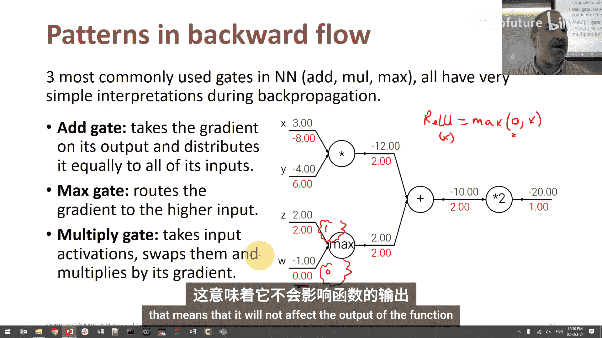
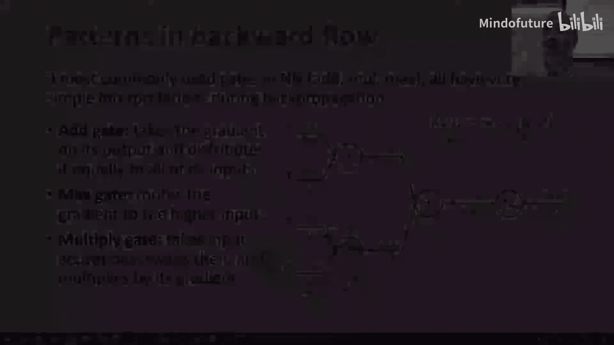

# 【卡塔尔大学】深度学习 CMPS497 ｜ Understanding Deep Learning ｜ Fall 2024 p12 P12_第十二讲-反向传播 I -BV1vQvNz1EeK_p12-

。Cla today will finish the session for fitting models。

 we will Char talk about one of the very commonly used optimization algorithms called Adam。

 which is an extension of the ideas that we we discussed last lecture。

 last lecture we discussed schastic gradient descent where instead of computing the loss over all unique examples we compute the loss over。

Subsets， which are small batches， right， And， and we saw that that adds some randomness of noise to the to the loss values。

 And what's the effect of that。We。Yeah， we might， by this way。

 we might avoid being stuck at the local minimum， right。

 and we also discussed the idea of the momentum。Which takes into consideration not only the gradient of the current batch。

 but also the gradients of the previous batches right we said that we have infinite weight sum where the weight for the very old batches will be much less than the recent ones。

Today we'll extend over that by Adam， let me first give you the intuition behind this algorithm。嗯。

We talked about the learning grade right before and any update is the multi of the learning grade and the gradient value itself right if you remember the gradient the same tool update tool it's the learning grade times the gradient。

😊，If the landing data is fixed， then the update is completely controlled by the value of the gradient。

😊，Right in in each direction， so the directions here are the parameters right directions of the space are the parameters。

 so if the gradient with respect to one parameter is very small，Then， the update。

Of that parameter would be very small if the gradient is very large then the update would be very large how is that a problem。

 let me show you an example， forget about about the points here and look at the loss function okay this plot。

If you think of that plot it has two parameters， right。

 the loss function here is working on a model that has two parameters， phi0 and phi1 right type。

 which direction， which of these two parameters， the gradient of them of it is really high。

And the other one is very small。那就没。No， forget about the points here。 Okay。

 look at this loss function。 Okay， Which direction X or Y， the loss changes a lot。

 The value changes a lot。Which means the direction of the gradient， right？Which。

 which which which direction X or Y。Why， of course， right， Why， of course。Yeah。

 so when we move up or down， the， the value of the loss changes， right。

 from bright to dark or from dark to to bright， right。

So the gradient in the direction or the gradient for phi1 is much higher than 5hi0。

 actually 5hi0 if you look at the horizontal direction， the value of the loss doesn't change a lot。

with changing phi0， but changed a lot with changing。😡，发煌。Okay。

 which means that if I compute the gradient。For each of these parameters。

 the update for Phi z would be much， much smaller。😡。

Then the update for51 and that's actually what we can see in that plot if we start from this point。

 you see the point of U if we start at this point，Then the updates， as you see。

 the change of phi1 is much faster。😮，Then the change will F zero。you see that with phi1。

 we make big jumps actually， but with phi0 its the change the increase of  phi0 is very， very slow。

Right， up to this point， you can see that。Here we didn't reach the global minimum。

 but for the direction of the global minimum， we are moving very， very slow。

Because in that direction， the gradient is very， very small。😡。

So even the points you don't see the difference between the points。

 that means that there are lots of these points okay until we reach in a global minimum so the the updates here will be very。

 very slow because the gradient。The horizontal gradient at the horizontal direction。

 which is y0 here， is very small。This is when the learning grade is very smooth。

 but what if maybe if we increase the learning rate。

 the bit would be higher right and that's what we see on the right side。😊。

When we change the learning grade to be1， which is the maximum we can do。

 so very high the learning grade。Then the jumps will be very large。

 you can see that for51 it is in two steps each here and for50 we are changing also。

 but because the learning that the step is large the gradient is changing sign so we have this oscillation effect。

 so we are not reaching the global minimum we actually keep oscillating between above the global minimum and below the global minimum because the learning rate is really high so any update we are doing we oversot we get we don't get to to to to the global minimum we tend to go even either up or down so we oscillate like that because the learning rate is really high。

So that's a problem when we have。A difference in the gradients with respect to the different parameters。

So the problem came here because the gradient with respect to 50 is very。

 very small relative to the gradient with respect to5hi1。

 so any change we do for phi1 we make fast updates， but for 5hi0 it's very small。

So one of the solutions to that is to do what we call normalized gradient。

So we want to move a fixed distance along each axis， along each direction for each parent。

 And instead of saying。We will be we will make a big update on5hi1 and small update for 50。

 we will make the updates the same in each direction。Okay。

 that's what we call it normalized gradient， we move a fixed distance along each of the each axis is here。

 of course， each parameter right or the x is here are the parameters。😡，Time。

 how can we do that and what will be the effect First， how can we normalize the gradients。

 How can we make the gradients fix it conceptually we can one of the ideas is to just take the sign any。

 we will make all the gradients to be one。 We assume that the R one and we just。

Keep the sign if the sign is positively， then update the gradient would be plus  one。

 if the sign is negative， then the gradient would be minus-1。😡，Okay。😊。

The sign of the gradient itself， the direction， so we'll keep the sign， but the amount。

 the absolute value will make it like  one。😡，Okay， so that's the main concept here。Okay。

 how can we do that， We can do that by keeping two values， this is the gradient。

 this is the original gradient。And this is the square of the gradient。😡。

And we call it point wise because it's for each parameter。😡，We are not squing the vector matrix。

 we just we get another vector but for every element， every derivative。

 it's just the square value of it。😡，And then we divide the gradient by the square root of the square。

Okay， so forget about this epsilon for now， forget about this epsilon for now and think of of this expression。

 this is the gradient。😡，Divided by the square root of the square of the gradient。

So what will we get out of this？😡，Oh。Now， if this， if if V is the square of M， if M is square。

 then what is square root of V。M， M divided by M。Is one。Is one right again， forget about this eom。

 So this is like normalizing to be one， but of course。

 we will keep the sign because we will keep the sign of of the of the value here。 So， for example。

 if this is the original gradient。😡，Okay，3 minus25， and this is the square of it。😡，Okay，9425。

 then if we divide the original gradient by the square root of the square。

 then we will get 1 minus 11。This is what we just mentioned， right？😡。

This is equivalent to taking the sign right we can just say okay sine of the gradient will be one sign of the the gradient will be minus-1 if it's originally negative。

 but we will do it that way for two reasons， one， this is defensiible。

Okay and that will help us in computing the derivatives and also to avoid zero to avoid the case where we don't know what's the sign of0 that here the sign of0 is 0 okay because we were just divide zero by something that is not zero and that's why we are adding a small value here。

Okay， but basically it is like taking the sign。😡，Okay， so it will be just one or minus1。几。😊。

It's not the error， it's more value to avoid dividing by  zero actually。

 so it's a very small value like 0。0001 just to make sure that we are not dividing by zero here if this is zero。

😡，Okay。😊，Okay， did you get that？ So now the gradient。For all parameters， the value。

 the absolute value of the gradient for all parameters will be one。😡，And we will just keep the sign。

 which means that the update for every parameter will be the same like the other parameters。😡，Okay。

 it won't be the case that we saw in the previous slide when the gradient is very small for one parameter are very large for one for the other and we have a problem like what we saw in the previous slide Now what is the effect of that。

You can see here that the update， that the progress that we are making is the same in both directions。

😡，RightThe step are both parameters， the step we are taking in the horizontal axis is exactly the same like the vertical axis。

Right， until we get here， we start to again because of the sign。 The sign changes。 Okay。

 but at least we get here much faster than。The previous case， Okay， you see here， it took。

 it took a lot of time to each this point。 Also here the the way osci still here， we didn't solve。

We didn't solve the problem completely because there is oscillation here。 We will not。

It's exactly the global minimumma， but we are very close from it。So that's the normalized gradient。😊。

Okay， that's still not Adam。So this is the idea of the Normd gradient is that we make progress in own。

Trameters equally。ok。😊，Now， Adamom， which is called adaptive moment estimation。

 which is a short for adaptive moment estimation， takes this idea and adds to it the momentum idea。

so it will measure the gradient and the squared gradient with momentum。

 so instead of saying m is just the gradient now m is the momentum taking into consideration all the previous the previous gradients for previous batches so this equation is the same like the one that we saw in the previous lecture right with the momentum。

😡，Now it's applied here again。Exactly the same， but also for the squared gradient， we do the same。

We also take the momentum with respect to these squared gradients。Okay， so for the gradient。

 we take the momentum for the squared gradient， we also take the momentum and notice here that the coefficients are different。

So these are two different parameters。Beta here。 and gamma here。So this would be considered。

High parameters。Okay， and we'll talk about that later。Okay， now once we do that， then we normalize。

 we use forget about this tilde now。 we use mt plus one， which is the momentum part and Vt plus one。

 which is the momentum of the squared gradient and we divide them。

 This is what we saw in the previous slide， which is the normalization part。

 and this is what we saw in the previous lecture， which is the momentum part。 Okay， now we do both。

We compute the gradient and the squared gradient using the momentum。

 and we divide them just to normalize the values of the gradient。Okay， any question up to this point？

Okay1，1 other small change that we will do。Is because at the beginning。😊，These values are very small。

😡，At the very beginning， I mean that the initial values for them is zero okay that means that the updates that we will do in the beginning will be very。

 very small。😡，And it will take time to increase with the momentum， so to avoid that。

 we will divide by1 minus beta to the power of the number of iterations。So。When t is 0。

 t is 0 means we are at the first it， okay？We will divide the value of the momentum。

 which is the gradient。Buy  one minus bit。Okay， last time we said that beta is close to one。

 that means that we will divide by a large number or small number。

Small number dividing by small number means we will increase it。😡，Okay， now this number over time。

 because we raise it 2 T plus1。😡，The deuminator will get smaller and smaller over time。

And in the beginning， it would be one minus beta， then1 minus beta squared， then11 minus beta cube。

 Okay so beta to the power T plus 1 will get closer to 0 because we are keep multiplying by a number that is less than one。

 So this part will will get smaller and smaller， which means that the denominator will be close to。😡。

No。It's 1 minus0。 Okay， so it will be close to 1。 Okay， so it's like oh after some time。

 we are not increasing anything。 Okay， so in the beginning。

 we will multiply by a big number and then that number will will fall to to be just one。

So this will just this is just a trick to avoid small starting brackets and we do that also with with the squared gradient okay。

 so Adam has these three steps。Of three concepts。The momentum， which is not a new concept。

But it will be applied on both the gradients。😡，And the squared gradients。That's the first concept。

 the second concept is the normalization。😊，Okay， we do this division。😮。

And the third one is just this small trick to avoid small values in the beginning。

Small values of the gradient and squared gradient in the beginning。

 so with this case if we just scale up the values of the gradient and the squared gradients in the beginning。

 but this effect will diminish over time when we have more iterations。

 this scale that we multiply the value with will get to one at the end。Okay， questions。Yes。

I don't understand why。Because initially， usually we initialize them the guidance with0al。数。It will。

 it will be small， very small if we don't do this。Modification。

 the values will be very small at the beginning， which means that the updates that we will do will be very small。

 remember when we said that usually more logically in the beginning we do we need to do more exploration so the updates that we should do will be bigger then later okay so we don't want to start with very very small updates will not do exploration this way so exploration means we do big jumps big updates okay that's why we want to make sure that in the beginning the values will be higher。

 but then the scale will be down over time。 Did I answer a question now。And Adam， by the way。

 is the very widely used optimization algorithm， by the way， all the algorithms that we discussed。

Previous lecture and this one， they are called optimization algorithm。

So Adam is the most widely used one now。kindind of the default optimization algorithm used for training neural networks。

 of course you can change it， but in practice it is one of the best。

And let's see the effect of that now on the problem that we were looking at and instead of this oscillation。

 what happens when we do that smooth when we do that momentum。

 it will be much smoother okay so it will not do that oscillation and eventually for this specific loss function it will reach the global。

Okay。呃や你。And then you mean comparing this and that。It might be a bit more steps， but here by the way。

 we are acceleratingciating we didn't reach even the global minimum。Okay， so here we will do it。

We didn't do wait。Okay， any questions on that？Of course we even cover by the way。

 all optimization algorithms， there are others， but this one is kind of the state of the art now。

Okay， any other questions？pe with that， what are the hyperparmeters that we can add to the hyperparmeters that we discussed earlier？

What are the hyperpares that we discussed before？你这你。Number of hidden days。

A number of the hidden units per layer， right， type。 What are other hyperpares that we can see now。对。

There那。The learning grid， which is alpha， gamma and beta。

 which are the coefficients of atom momentum。What else。How about the optimizational algorithm itself。

 can it be right parameter？😊，对关。Yeah。Can we change it。Yes， we are using it。

 but can we change it and then train the network again and change it and train the network right。

 Can we do that？What do you think。It is used for training right so we can change the optimization algorithm and train the network right and change the algorithm in another network I mean it will be another model that is going right so we can think of it also as a hyperparameter。

😊，喂。you have a question。 Okay， how about the number of epochs。What is an epoch。不。Full。

Foool something。 food what。Yes， full pass over the training date， right， one full pass。

And we can repeat that， right， the number of these repetitions， the number of epos。

 can it be a hyperparameter。Yes， we can change it。F。Okay， how about the batch size。

Is it type parameter？Yeah。Yeah， and because changing the batch size will change of course。

 the updates right， yeah， so it can be hyperparmeters。Right。嗯。During training， what are we changing。

 are we changing the hyperparmeter or the parameters？

The parameters were changing the weights and biases。Okay。

 we are fixing the hyper parameters during thing， you cannot change the batch size。😡，The is。

 but but it's not done。 Okay， you cannot change the optimization algorithm。

 You cannot say us on the first airport。 I didn't see it any。 but with theoretical you can。

 by the way， but I didn't see that okay。So， so yes， we so we can change these things。

 but not during training can during training， the are fixes。

 the number of epos plus it's fixed it to train one model。

 but you can change these values and they train。and that's why they are hyperpar。 So during training。

 we don't change the hyperpar， we change the parameters。Okay， is that clear？

how about the loss function？Is that hyperparmeter。And can we change the loss function and do it？

这个跟什么。Yeah， theoretically yes， if if there are multiple possible loss functions。

 any if there are multiple possible probability distribution for the outputs， yes， yes， we can。😊。

Although I didn't see it in practice a lot， but it happens， okay。

 we can change the loss function and see if that actually will give us better models or not。我心。

But usually you， you give。Very good attention and be careful when you design the loss function first and then use it for。

It depends on the outputs right if you really think that the loss function represents the possibilities of the output。

That you can get in reality， then this is distributed。But now this is the end of that session。

Not the end of the lecture， the end of that session， and next session。

 I think you should now remember that we said that we assume that we know how the gradients are computed。

 right？😊，Okay， so in this session， we will see how the guidance actually are computed and also we see the effect of the initial models。

 initial values of the parameters。We'll see how we should initialize the the terms at the beginning of the week。

So gradient descent and its variant have two challenges the first one is that we need to compute the gradient。

Right， and。Gads with respect to what。对。Gadance of what with respect to what。

The gradient of the loss function。 would they speak to。The parameters。To the parameters type。

 do we have many parameters？Yes， of course， yeah， in neural networks we have now nowadays。

 we have billions of power。Billions of parameters， so that's a lot。

If you think about gradient descent， we are doing that every with every。Caning exam。

So with everything training example。We need to compute the derivative of the loss function with respect to every parameter。

And we do that， every epoch。Okay， so that's a lot。That's a lot， okay？So even though it's just。

 as I said earlier in the course， it just an equation， right， so neural network is just one equation。

But of course it is very complex equation and it will be huge effort to compute the derivative for every parameter。

 for every training example and for every tradition。

So we need an efficient way of doing that and this is what Shala we will will discuss in this The second challenge is the initialization as you saw。

The training will depend a lot on where we start。The model right if we start the model at this point。

 we will not get to the global minimum if we start at 0。3 and1， we get to the global minimum。

 so it depends heavily on the initialization of the model。

So these are the two challenges that we willt law address in the session。

 well start by the first one， which is computing the gradient。Oh。

So we will try to compute the gradient。Using a very famous algorithm called back proagation。

Back propagation。So it's a very old algorithm， and you will see that it makes the computation of the gradients very。

 very straightforward and efficient。嗯。What is the setup of back proagation？We have a function。

 F of x， and by the way， backva is applied or can be applied not only to neural networks can be applied to any function。

Okay， so the setup back proagation is that we have a function f of x。

And we want to compute the gradient of f with respect to x。Type in our context， what does that mean。

 what is F and what is x？F is the loss function yes。

 and x is the parameters very good so F will correspond to the loss function and the x are the parameters well in reality by the way and you will notice that with that coagation x is any input of the function is not just the parameters。

It can be the input examples themselves。😡，And we will see that when we have the examples to the HR。

But in practice， we care only about the parameters of the model。

And keep in mind that our goal the goal of back proagation is to compute the derivatives of the loss function with respect to。

The parameters with every parameter。quick revision of what we mentioned last time about the meaning of gradient。

Remember this definition， the gradient is the limit of the small change when that small change tends to 0 of the change of the function。

And the meaning of it is that we want to know if we change every parameter。

 what would be the effect on on the function okay so it tells us something about the sensitivity of the expression or the sensitivity of the function。

When we change every parameter。Here's an example。😊，If the function of x and y is x times y。😡。

What will be the derivatives？What is the derivative of the function of this speak to x？😡，It's y。

 right， what's the derivative of the function of respect to Y x type what does that mean？

What does that mean。It means that if we change it X。😡，With a little bit， with a small value。

The effect on f will be multiplying this small value with y because the function actually is x times y right if we change x a little bit。

 then the effect will be y and vice versa if we change it y a little bit the effect on the function will be x。

😡，Okay， type， of course， we can compute this value specifically when we have specific values for x and y。

 so if x is4。😡，And y is minus3， then df by the x is minus3。

 which means that if we increase x a little bit。Then F will be will decrease actually by effect of minus 3。

Right。Are you following with me。So if with these values， let's say x is 4 and y is minus 3。😡。

If we change x a little bit。How that will affect F。inus3 times that small value right。

 so it will get smaller because of the value of y and so on also for the derivative with respect to y。

whatever the function is x plus y。그。Yeah， one one， because if we change x a little bit。

Then the effect on f is just that change times 1 right it's the same it's direct theres not it doesn't depend on the other variable in this case。

 same with y the f by dy is 1。😡，Okay， now what if the function is maximum of x and y？是。对微这。Now。

 the derivative should be with respect today the variables right， the variable z are x and y。

 so what is the derivative f with respect to x？😊，Think。

 think of the the meaning of the function maximum。Now， then function， the function maximum。

 What does it do。It takes the maximum of the two values， right，😡，Which means that。

Let's say a now we want to compute the derivative of F with respect to x now with respect to x only。

😡，第。😡，What if x is greater than y。Then the maximum means is what is x。In that case。

 the derivative will be right any change in x will be reflected directly on on the function right the what if f is less than y sorry x is less than y。

If x is less than y， what would be the maximum y type df by dx in that case。

0 because it doesn't depend on x。😡，Okay， it doesn't depend on x。So in that specific case。

 if x is less than y， changing x a little bit。😡，Changing X a little bit will not make any change on F。

Because it still it will be because we are talking about very small changes。

 it will still be than less than y， so it will not make any change on f。

 which means the derivative is 0。😡，So that means that。D F by the X is。

You know the function1 function 1 here means it will be 1 if that condition is 2 and0 otherwise。

 so if x is greater than y， it will be 1。If not， it would be 0， samee with why with respect to why。

Okay， the with respect to y。 if the function is if if y is greater than x。

 then the derivative with respect to y is 1。 Otherwise it is0。Okay， so far nothing new， right。

 this is just cs。F calcu。Okay， now let's make the function more complex。

If the function now is x plus y times z。And still， we want to compute the derivatives。Okay。😊。

One way is to decompose the function into smaller function so that we can compute the derivatives much easier。

So we will assume that x plus y will assign a2 Q。Which means that now f is Q times z。Okay， now。

 if I told you， what is Df by D Q。Z， D F by D Z， Q， D Q by D X。1， D Q by D Y，1。

 can now I use these four quantities to compute D F by D X and D F by D Y and D F by D Z。Yes。

 using what we call the chain rule， the chain rule， Df by the x is df by theq times dq by the x。Okay。

 which means the F by the Q is Q。So they by the Q is D？And the Q by the x is 1， so z times 1 is the。

Okay， same with why。D f by Dy is D f by the Q times the Q by dy， which is C。对。The F by D Z。

 but also that's the same thing。 The FY D Z is Q， which is x plus y。Time to do that systematically。

We will， for any expression， we will do what we call a computational ga。

What do you mean by computational graph？We will do this expression。😮。

To show how this expression actually is computed。We will start from the left with all the inputs。

 what are the inputs for this function， x， Y， and z， and then one operation at a time。

 we will do the operations until we reach the final output。😡，So， this。放生。Can be known as this ga。

We have x， Y， Z， x is added to Y。😡，And then the output of that is multiplied by z。

So we will keep the simple operations like addition， multiplication， power and so on。

 and below the computation graph for the entire expansion。😊，This graph。Is。Stfor。

 we just make very simple operations and it will help us a lot as you will see to compute the derivatives。

Okay， any question on how to build this graph， I think it's straightforward， right？第。Now。

 to compute the derivatives， we will do it in。Three or two steps we can combine the first two。

 but let's say three steps， Okay， the first step we call it the forward pass。

Remember when we compute the derivatives， we need to know the actual values of the inputs right because as you saw the functions。

 the derivatives depends on the values of the inputs right here Z and Q and so on。

 so we need to know that the input through that we can compute we can get the numeric values of the derivatives right？

😊，So we will do what we call the follow test first， given the values of the input。

 we will compute all the intermediate values up to the output。😡，From left to right。

 we call this the forward pass。Okay， so let's assume that the input values here is minus2。

5 and minus-4。So minus2 plus5。3 and three times minus4 minus12 that's the first step and it's very easy right very straightforward。

 we do their computations left to right。Okay， that's what we call the forward pass。

Then the second step in the second step， we will compute what we call the local derivatives。

What do you mean by the local derivatives？First， each operation like this， we call it a gate。Okay。

 get。Now each gate at each gate in that second step， we will compute the local derivative。

 the local derivatives are the derivative of the output of that gate with respect to its input for example。

😊，For that gate， what is the output here？Q， right， Q， And in in the name of the of the output is Q。

And the inputs are X and Y。😡，So the local derivatives will be d cube by dx。😡，And D Q by D。几。Actually。

 do you know how to compute this？😮，Yes， what is D Q by D X here。 This is an addition operation。

 right， Q is， is x plus Y。 Q equal is x plus Y。 So what is D Q by D X 1。And what is d cube by d1。

 so this gate can can compute the local derivatives very easily and even without depending on anything in the remaining graph。

😡，You need to compute the local derivatives of this gate， do we need to know any other gate？😡。

You need to know anything in the graph。Rather than this specific corporation， we don't need anything。

Okay， time， can we do the local derivative for this node for this gate？😡，Yes， what is the F by DQ。

Which is minus4， what is Df by Dz？😡，飞。ok所然。Okay。😊，Which is Q is 3 in this case。

So here is the local derivatives in the dotted squares。Okay， and again。

 it's very important to understand that the local derivatives。😡。

Can be computed independent at each gate， independently of any other gates。😡，And at every gate。

 we can compute the local derivatives without knowing any other values for any other gate。

And that's why these two steps are actually are combined are done together。

 We compute the output values， and then we compute the local derivatives。

 and each gate computes computes its output value and then compute the local derivative at that gate。

😡，And then we move forward。 That's the forward test。 So in the forward test， we do these two things。

We compute the output values with all the intermediate values， and we keep them。😡。

And also at every gate， we compute the local derivative。Okay， any question up to this point？一起考。Yes。

 of course。No， no， no， the other variables， Yes， these are the things that change。Yes。

Any other questions？Okay， the last step。Did we compute actually the the derivatives so far。

 the actual derivatives， what are the objective derivatives here。😡，What are the target derivatives？😡。

The F by D X， D F by D， F by D， we didn't compute this yet right so we would compute that in the third step。

 which we call it the backward path， the local derivatives。い見 didた。Yeah， yeah。

 this is just a special case here because there's no other gate here。

 but in general with the photo test， it's just the output values and the local derivatives。😊。

Now the backward pass， this is the pass where we will compute the data。

And it is backwards because we start from the output。Okay， so from the output。

 we will start to compute backward the actual derivatives。

Tpe we will start by the derivative of the output with respect to the output。😡，With ethnic2 itself。

So Df by Df is what。There's one。Ifs one any change to F would change F， so it is1。😊，Okay。

 so this is the first thing。 So lets let me write it here。 So with with the with the red color。

 we will write the actual derivative。 So this is one。 That's the derivative of if we respect to F。😊。

No。We compute Df by Df， right which is one what is Df by Dq？😡，Dear by theQ is this value times。

This value by the chain world， okay， so it is minus4。😡，Right。So that's minus4， how about DfY Dz。

 it's this value， which is the derivative up to the output of that gate。😮，Time is the look at the。

So one times three， which is。3。Why are we doing that because of the channel？Okay， but。

 now we are at that gift now。Okay。😊，What are the derivatives for that gate。

 We know the derivative of the output of that gate。What is minus-4 by the weight so far。Of。

 of F with respect to Q， Very good。 Now， I want to compute the derivative of。No， we computed already。

 these are the locals we want to compute thef by dx and d f by dy again by the channel okay。

 we got this value we multiplied by。😡，The localan derivative。

 So the derivative of F with respect to x is -4 times1， which is -4。Same with why。

The derivative of F for this with2 y。😮，Is。😮，The derivative of f with respect to Q times the derivative of  Q with respect to y。

 which is minus4 times 1， which is also minus 4。😡，Are we done？Yes。

 because now we have the derivatives for all variables。So， this is。

These are the values that we got in the previous slide。喂。😊，So this is the backward pass。

So in the forward path， we do two things。 we compute the output values and we compute the local derivatives。

 which are independent。 Each gate knows from the operation。

 it knows how to compute the local derivative。And then。In the backward pass。

 we move backward by multiplying the derivatives we reached up to this point with the local derivative。

Until we each。Until we age。对对。The input variables。Okay。

 and notice here that we got the derivative for all the inputs。😊，Actually。

 we got the derivative with every single variable， even the intermediate values， by the way。😡。

And even Q， we got the derivative for it。Okay。😊，But we need it anyway because we want to compute the derivative with respect to the inputs。

Heres another heres the summary of the intuition， here's the summary of the intuition。

The forward pass， every gate gets some inputs and can right away compute two things。

 The first thing is the output value for that gate and the local gradient of the output with respect speak to its inputs。

😊，And we can do that completely independently。And then in the backward pass and the back proagation。

😊，Actually， the whole thing is called black propagation， by the way。

We learn the gradient of the output with respect to every input， this is done by the channel。Okay。😊。

And we can do that backward every we knowing the gradient of its output。

Of the finite output with respect to its output。And now the local gradient。

 so it will multiply that by that and move backward。And this is， by the way。

 like every gate is communicating。😊，To each other。How it can affect the finite output。

And if we get back to this and this is really nice if yeah， so if we can get back to this。

You see here the gradient is negative， right？What does that mean gradient if the derivative is negative？

It means that if we increase that variable， what will happen to the final output？😡，It will decrease。

 And let's see。 why is that。Let's see why is that in this case？This is x， right？😡，Tpe x is -2。

 if we degree， if we。In green X。What will happen to the addition？It will increase， right。

 when when this number increases。Oh sorry when this number increases。😊。

What will happen to the output。It will why。Because it will be multiplied by。😡，-4。Okay。

 so it will decrease。Okay， and vice versa， if x decreased。The output of the addition will decrease。

And thus， the final output would increase because it would be multiized by a negative number。😡，Okay。

 so every gate actually is communicating to the neighboring gates how it will affect the final output。

😊，Okay， that's what it's done in Brov bagsh。Okay， one， one very important。呃Asumption here。

Which we didn't actually say， but it was inherent in our discussion。

Which is that every gate knows its local derivative right。

 which means that it has to be a differentiable function， a function that can be differentiated。😊。

That's a big assumption。Okay， and that's an important assumption。Okay。

 so the gate has to be actually to do that。 The gate has to be the operation that is done at each gate has to be def。

 Otherwise， we will not be able to do that。And the other thing is that also although in this simple example。

 we did to we did the gates， we had the gates at the very low level with very small simple operations。

 we can also compute gates together。 and if we know。

That these three gates are represented by this function。

 and we know the local derivative for that function。

 we don't need to to actually decompose it into smaller ones。 We can group together。

We can group together some of the of the gates， and that's what we would see in showah in the second example。

Now let's do this example together。😡，Okay， this is a function。And the function has。

 if you look at it， how many inputs we have。No。5 W 0， x0， W1， x1， and B。Right。😊。

So I want to compute the derivatives using back propagation。😡，Of this function。

 with respect to every input。What should we do first？No， not the local。In they do。

What should we do first。No。Okay look at rid of what we don't see anything。No， no。

 we don't need to combine。 Let's do it with with a very simple operations。 Okay， in the beginning。

 let's do it with because with very simple operations。

 the local derivatives would be very simple right so we don't need to to do any complex derivatives of derivatives。

 so let's let's go together。 so we have。W 0。Exhael。And W 1， x 1 and B， right， these are the inputs。

Right。😊，Then how do we do the computation graph？We do the operations， right， So W， W0 and X 0。

Multiply。Right。Then， W1 x1。Then。Then we add these to you right， so we add these two first。And then。

We add。This with them。Okay， now what is this output？This is this part， right？But， then。

Very good multiplied by negative， so multiply by minus1。Then。😊，当时他。Then the exponential function。

Then。Then plus one。Then one over。 Okay， so I would say my son one over its。嗯。

So this is like if we use x always as the input of the operator， then this is x plus 1。

 and this is e to the power of x。喂。And this is minus x。系。I'm sorry I can raise。

 so we'll have to live with that for some reason I don't know why I'm not able to get access to that。

4ty。Okay， so this one now what's this output？If。第。Are we done。Done with the computational graph。

 right？Then what should we do next？The forward pass side， Okay。

 so we put all the values here to minus-1 minus-3。-2，-3， right。

These are the values that we are given， and then we do this multi these operations。

 so two more times minus1。😊，-2 and minus3 times -26。 and then this added together is。4，4 plus -3。😮，1。

1 times -1。-1。Now e to the power minus1。Can you compute it。I think it's something like。Point4。t5。

 something， I think， or 0。7 something。Youre婚。037。Okay。Okay， and。And then this is x plus 1， this is 1。

37， right， and then1 over x。This is， there's something wrong you。Is its it correct。

 anyone is following okay， and one over 1。37 is。I think there is something going here。

 I don't think this is these other。Now， there's something wrong。 He's correct。 Okay， very good。

 That's 03。73。Okay， so that's the flow of pass， right。What should we do next？The local is very good。

 So what is the local that I won't change the okay。

Alas I will do it with with maybe circles what are the look derivatives and we will do it forward right Okay。

 so the looks for this for this gate。😊，3对。 I know。 it's one。This is multiplication， right。

 so with multiplication。😡，What no， no， no on the other one， so so with respect to w0。

 what is the value， what is the derivative？😡，Which is -1 is very good，-1。No that way。

 the look and derivative with respect to x is02， Very good。Are you following with me。

 That's the multiplication， right， same here derivative on this one。😡，-2。And here minus 3。Okay。

 and how about this one， Okay， let's， let's do this one， this one。

 what's the derivative with risk to this one。😡，Its addition。The are one， right， So our constant。

 So this is one。 And also， this is。One， and how about this one。王东省。About this one， it's one also。

Okay， T， how about。Now， this operation， this is。This is x times minus1 minus x。

 so what is the derivative of minus x with this to x minus1？😡，嗯。E the powerx， it's into the powerx。

 which is。😡，对。あでる。Which is， you see it， right，0。37。These things。A local。The is。Okay。

 is that here now。How about these ones？Gate， gates。Okay。第。And how about the now the look at the here。

This is x plus1， x1， right。And this is 1 over x minus1 over x way， which is minus1 over。😡，这个问题。No 0。

73， 1。37。X is the input to the gate okay so1 over x， the derivative will be minus1 over x square。

 which is minus1 over 1。37 square， which is， I think0。5 something。54， I think。Okay， this is minus1。

 just to be clear， this minus1 over 1。37 square。 How about this one。This is not a gate。

 So what is the FY D F， the locale of it is one。😡，That's actually not any。It's not a gate。

 So that's actually the first thing to compute in the backward pass。 Okay， now the backward pass。

A we done with with the forward pass now。 Yes， we， we did the computations and we did the local derivatives。

 right， Okay， now let's do the backward pass and， and the goal of the backward pass is。😊。

Is to have more fun， right， It too。😊，Is to get to the actual derivatives of the final output with this speak to every variable。

 Okay， so D F by the F is one。Now， we need to。To say the look at the actual data of。 So this one is。

The final David is， final。Whateverばで。So， this is Df。Buy D something here， okay。T Df by Df is one。

 How about Df by this variable。😡，One times the local derivative， which is。😡，54。Then one step further。

 the derivative here， the derivative here。Is the derivative of the output， which is 0。54 times 1。

 which is also 0。5，4。ok。😊，第 how about。One step， one step backhu。What's the derivative here。0。

54 times。37， which is， I don't know。Z point。我。So point2。Then。Dative here 0。2 times minus1 minus 0。2。

And so on， I think you can do it， right？Okay， until we each。啊。😮，Yes。

 multiplications because that's a chain hold right chain hold says that。😊，いま let's sayま thisす。

This variable。Okay， is Q。 So D F by D Q。Is Df by this variable this variable times the this variable Df D。

 this variable of this variable and so on。 Okay， so that's the channel。😡，Okay， so at the end。

 we will compute the derivatives of。Of the inputs。Forward the impulse。Which is。です。Okay。No， the。No。诶。

Now， the green values are。😮，The the computed values and the red ones are the， the actual derivatives。

 Okay， the F by， the this variable。With respect to this variable。Okay。Any questions？对。

Is that related to neural networks？Yes。Now， this specific example。

 is it related to neuralnaals by any means？Look at this， What is this？Weths and biases， right。

 So this is the weighted sum， this is the weighted sum plus bias， right。Okay。

 now this is called what， the pre activation right。

 usually in neural network that we have the pre activation value， what do we do next？😡，Well。

B I do that。 What is that。 What what， what do we do here。Which is。Did you see that before。

 Did you see this for Sigm， Very good。 Okay， so this part。

Is the weighted sum plus bias and this part is。The sigs an example of an activation function。

 which is the sigm。Okay， so this is like the equation of one node， right， getting the input and。

And applying doing the weighted sum bias and applying the activation function。关。This is one note。

This is one node。 And， of course， we can do that systematically。 This is very systematic process。

 right。😊，Very systematic。Given what， given that we we can compute the local derivatives in each gate。

It can do the look at derivatives。 and as you see， the operations here are very simple。😡。

So we can do that。Forward， we can compute the values and look at derivatives and backwards we can compute the derivatives。

😊，Okay。Type。One more thing， Okay， just last five minutes， okay。Now you can see that。

The sigmoid function， Okay， the sigmoid function。 Where is it in the computational gap。It's this one。

starting from the way that sum ends here。嗯。This is to the lead。That side。

 the left side here is the weighted sunlight plus bias。😡，And from here， this is this s function。

 right？😡，Right， is that clear time？What if here we tap on we decompose the sigmoid function into four operations right multiplly by -1。

 then exponential， then add1， then invert right but if we know the derivative of the sigmoid function right away。

 we don't need to have four gates we can just have one gate。

 we call it sigmoid it and we know how to compute the look derivative for it and that's actually the case。

😡，For the sigmoid function， it's 1 over 1 plus e to the power minus x right it turns out that if you do the derivation that the derivative is 1 minus the sigmoid value times the sigmoid value。

So actually we don't need to have four gates。 it can just be one gate。One gate。

We call it the sigmoid and whatever the input is， the3ma n， the input， which is x can mass n02。Okay。

 then what is the local derivative？😡，It's one minus。2 times。😮，Thanks point to。That will be。

They look and deliver。You don't need to。 Yes， so that the idea is you can group together the gates。

For which you know as a group， the local derivative。Okay， so for each activation function。

 we can have。 we can know the look at derivative。Okay， we can know how to compute the lookative。

 so we don't need to decompose it into smaller ones。By。最后一开。

That's what we are doing in the computational gas right， That's what we are doing。And。

In in neural networks， we have three commonly used gates。

The add gate because we are doing the weighted the sum。

 right the multipplly gate because we are doing the weighting。😊。

And when we are using the value function， the value occupation function。

 this is actually the max date。How is that。没喂的。So the value function actually。Is max so value of x？

Is actually max of 0 and x。Because if x is less than0， it would be0。😡，If x is greater than0。

It would be X。will be whatever the value of x。 Okay， so the value actually is a max gate。

And we said we know how the max works， right， so for example here。😡，Let's say my。

 this is a gate that takes the maximum of z and w， okay？😡，And the value of these2。

 the value of W is -1。So what is the local derivative？With respect respect to Z。哦，那这你呢。

This is the mix， right？Okay， so have we said that the derivative of the x？😡，Depends。

 depending on which value is the maximum right。 So the derivative with the max with respect to the maximum value is one and the derivative with respect to the。

Do the lower value is 0。So z is maximum is higher than W。

 so the local derivative of the max value here is 1。😊，I'm sorry。 It's very small I store here。

 And the look at derivative with this to W。😊，Its zero in this case because it depends on the values。

 okay？😡，So， that's。Okay。Is that clear。 And that's why actually you can see that the local the final derivative for with this with2 w is。

0 and in meaning， why is that Because if you you change W a little bit？😡，The maximum will not change。

 which means that the final output will not change so the derivative is 0。That， that means that。It's。

 it's， it will not。affect the output of the function。

Okay， any questions？

