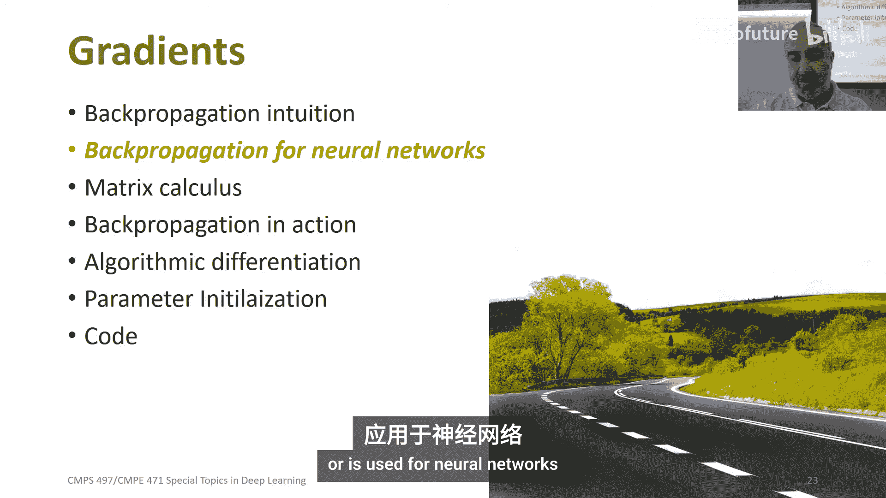
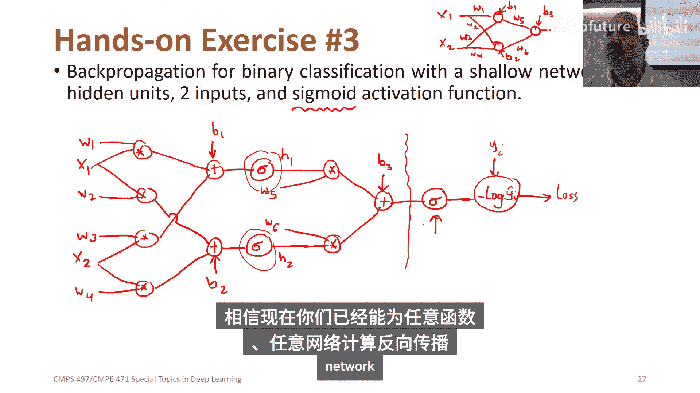
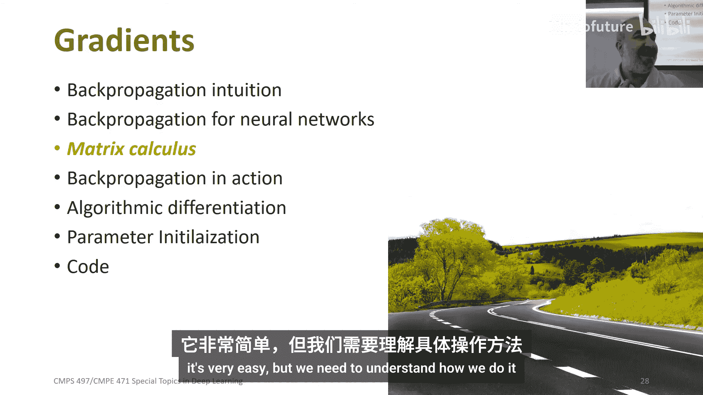
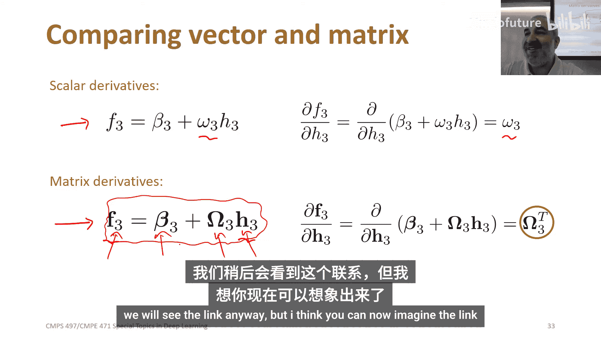
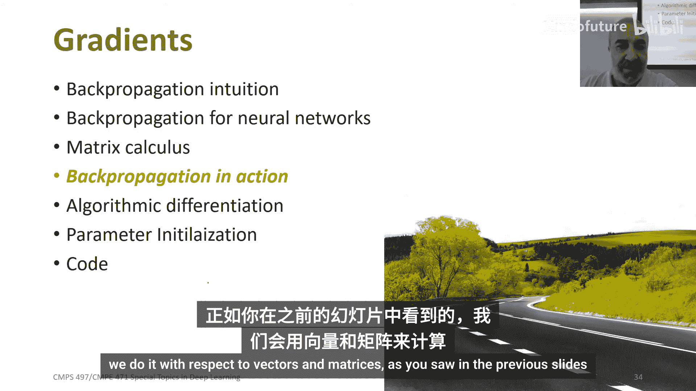
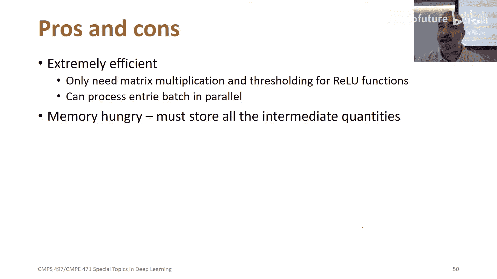
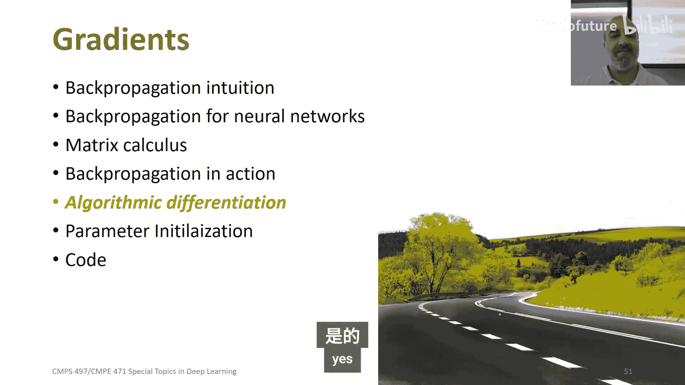
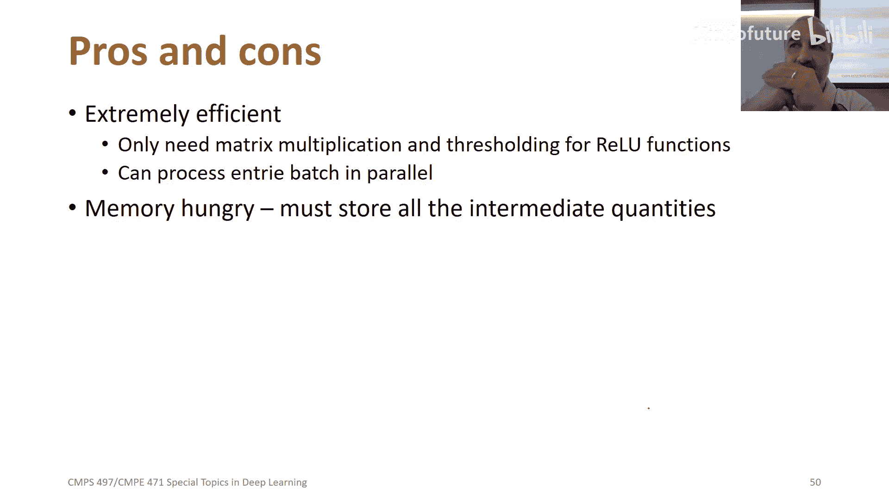
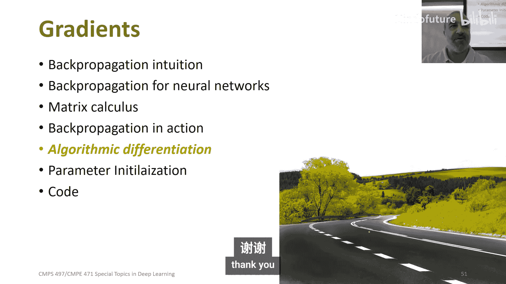

# 【卡塔尔大学】深度学习 CMPS497 ｜ Understanding Deep Learning ｜ Fall 2024 p13 P13_第十三讲-反向传播 II -BV1vQvNz1EeK_p13-

And some similar know him Charlotte today we will continue talking about back proagation。

 we went through the main concepts of how to compute the gradient using back proagation right。

So we saw that on different examples， how we will do the forward pass where we compute the actual values until the output。

 and then in the backward pass， we compute the local derivatives。

 actually we can also do it in the forward pass。And then we we by the channel。

 we can compute the derivatives up to the the inputs and all the parameters。

We did that generally for general functions and at the end of the last lecture we saw a function that looks like a general function。

 but we saw that it is actually the sigmoid function right and that was a starting point to focus on neural networks so today Jola will focus exclusively on how backproagation is done or is used for neural networks。

So recall that training in neural networks has these two components。

 back proag and gradient distancecent。That pro is not actually。Used for training。

 I mean its it's not doing the training， it's just computing the gradients right and as we saw it can compute the gradients for any function。

So the backpro algorithm is not for training， it's not just for computing the derivatives or the gradients。

 but we use that for training in addition to the optimizer。

 which is gradient the center of its variance。We'll continue with two hands on exercises。

The first one， we want to use the back proagation for back proagation algorithm for Cur and2 P loss function of a network of three outputs。

 so we have a neural network that has three outputs F1， F2 and F3。Okay。

 and we want to show how back proagation will be used to compute the derivatives with the risk of the loss function。

With respect to each one of these three out。Okay so forget about the network。

 think that you have3 outputs of the network F1， F1， F3， and from that we want to compute the loss。

And we want using web propagation to compute the derivatives of the loss with respect to each of these three outputs。

I want you now to take a couple of minutes to do it manually yourself。

 and then Charla we will do it together。Okay， so it's a close entry V function。

 we have three outputs， F1， F2 and F3。The first thing to do is to do the computational gap。Okay。

 so I want you now to。Think how we can do a competition best for this。

Starting from the three outputs。Up to computing the loss value。嗯。嗯。

So what is the loss for such network。Now， we have。Three outputs， okay。

 so this is a multi class specific problem。So we we have three outputs。

 so how can we compute the loss？Scros into a peiloid。Okay。So the loss， if you remember， the loss。

Was the minus log。Of Y I okay so we need from the output from the low outputs which which are F1 f2 F3。

 we need to compute the soft max values and then take the log of whatever the correct label is。Okay。

 so how can we start with that， what is the input of that competition graph？F1 is what F2 is3， so F1。

F 2。And F 3。Okay， now next， what should we compute， we should compute the soft max value of each one。

So how can we compute the soft max value of each one？Exponention， okay。

 so the exponential of each one， right？Yes。Yeses。不要的。It's the output of the network。

 but the input of this part of the computational graph。😊，Because we need to compute the loss， okay。

 the loss is computed from the output of the network。So。

 so we need to compute the exponential for each one， right？Is that now the， the。

The soft max value of each。Very good。 So we need to add them on。Right， we need to add them all。

Then after we add them。Yeah， so we need to invert them right so that we can multiply by the one over that sum。

 so we need to invert them。And then， multiply。This value。For this， this will give us。

The soft measuresh of F1， right， so this is soft。Soft Max of F1。And。And。If we take this。Then。

 this is。Softm of。If to。And。The third one。Is。Soft mix of。So this is multiplied by。前で。

He said soft next of5。Right。Any question up to this point？No， okay， then。What is the meaning？

Now we compute the soft max values。😡，Okay， what is the meaning to be computed？嗯。TheThe loss， right。

The loss value， the loss we will steer we we want to get up to the loss okay。

 so the loss is computed by minus log and then what is Y I。😡，Yi is one of these three。😡，No。

 why why is the labeled？The actual， the correct label， okay， so actually the loss。Is。

So let me make it a little bit bigger。嗯。Yeah。So， it's minus lot。A specific value， right。

 depending on Yi。😡，So it will select one of these three based on Yi。😡，It's minus log。Why I。Hat。

 which。 So this is， this is Y1。This is why one hat。This is。Why too hat。This is Y three hat。Okay。😊。

And。All of these three。Will be input to this， in addition to。So we need to have these three values。

And something else to compute the loss。We need the correct neighbor， right， need Y I。😡。

So another input here is why I。So why I tells us？Which one of these。3 output is one for this input。

 for the input X I。What's the correct name？Okay， so Yni， for example， if this is。

 let's say a son this is。😡，Poin4。And this is。Point。5 and this is 0。1 and let's image on Y3， Y I is3。

What are is。Okay， that means that the loss is minus log of what。对。Minus log。Mus log01。

 which is the soft max value of the third output。So we need to know the correct given。

And we need to know the three values。So that we can select one of them based on the correct one and compute minus logo of that value。

Okay， what is the output here。How can we call it？What's up。The lost。Okay， they're lost。Okay。

 is that clear？S music。Because this is the first time to do it okay。

 but this is how it compute it is computed right， we have to compute the soft max values。😡，Right。

 for the three outputs。And then from the soft max values， we compute the loss。Tan。

 we have to get also the correct label。T what it remains now is to compute back propagation that the derivatives is to use back propagation can we compute the derivatives here？

😡，What do we need to compute the derivatives， the theoretical derivatives for each gate， right？😡。

And then by the chain rule we can compute any derivative by。

 so do we know how to compute the local derivative for the exponential？It is exponential 1 over x。

Mulplication。Its swaping addition once， okay， minus log log。 What is the look at the beautiful log。

1 over x， right， it's minus1 over x in this case。Because it's linked here。Right。

So and then multiply it to get the loss。Com on， this is。

This is just the part of the network at the output， starting from the output。😡，Okay， and mean。

 the actual network is where。Is he？Okay， so we can back over to whatever we want to compute the。

That actually we see something like that in second in the next exercise。Okay。

 any question about this exercise， one thing here I want to emphasize。

We can compute the local derivative here， right？But。😊，We can compute the local derivative here。

 right？We can compute the local derivative here， right type what is the local derivative for this now？

Because this is branchesed， right， It has three branches。What will be the derivative here？No。

 actually the sum of them logic， and it is logic。This one， this output。

Affects the loss in three path。RightSo the overall effect is the addition is the sum of all of these effects。

RightNow the derivative is， what is the meaning of the derivative？😊，If it's changing。

 how it will affect the output， right， so it will affect the output so this value here。😡。

Changing it will affect the output in three different path。Okay。

 so the total effect is the sum of them。So any branching， actually， we need to sum the derivatives。

Okay。😊，So the next exercise。😮，Here， we want to。Through that the competition to have for a network。

We have a binary classification model with a shallow network of two hidden units。

 two inputs and sigmoid activation function， so we want now to the the computational graph for the entire network up to the loss from the input to the loss。

Yeah。Okay， so binary classification。2 hidden units。Two inputs and sigmoid activation function。T。

 how can we start with that？Okay for this specifically it's better to start by doing the network itself so that we can understand how can we can do the computation graph so what is the network here we have two inputs right so me write let me go to here we have x1 and x2 right。

And then we have how many two hidden units and how many outputs just one output。So yeah。

 so it will be like that。Okay， and let's， let's， let's let's write the weight here。 So let's。

 this is the what W 1， W 2。Ner 3。那4。And it same， this is W 5。And this is W 6。 What else？

The bias is right。 so let's say this is B1。This is speed2。And that's B 3。Good。

So now now we can do we start to do the competition graph， how can we start？With output， why？With。

 with the inputs。系。し。Not exactly because this is no computational of graph。

 this is the neural network， right？😊，So we need to convert that into computational depth。

So we need the gates now has to be operations。So we have x1。Okay。😊。

So what should how can we start now， So we have the two inputs right。😡，What else。

The weights and biases， right， Okay， so how many， so what is the first level of the computations that we will do。

 What are the first first level of gates。Multipplications， right， Yes。

 so how many multiplications we will have。HHow many multis for， right， for， so we have。Mplication。

Yishan。Okay， the first one， X one with。Wade W1。Then， x1。Will。😮，W2 so w2 here。Then。啊。Okay。To。

X2 is W3 so W3 here。And x 2 with W 4。Okay， then。Then in addition， we will add W1 x1 with。现在你。

W1 x1 plus。Plus。😊，Ex sorry。X 1， W1 plus x 2， W 3。What is X2 W3 is here。嗯。Right。And。And we add V1。每个。

And。X1， W 2。2 W4。Plus。MeMe。Okay。Then。Yeah。Why maximum。re the activation function。

 the activation functions are all here。Sigignmant， okay， so where we should add them。

After the addition， right， So sigmoid it。Sigm it。To light。Why you have to。Yeah。

 because we have two hidden units side。Okay， then， so this is now like H1。And H2。Okay， then。嗯。

Multiply by W 5 and W6 right。 So H one with。这不是说。W。5ve。And。It's two with。It's to win。W 6。Then。Then。

 we sum them。We add B3。 Very good。Then。Then。We need to get up to the the the loss function， right。So。

😊，After we we add them， what's that value， this is the output， right？That's the output value。

 the low value of the output。 What should we do to compute the loss？我那个小40。

It's binary classificationification。 So what do we do with output。

So we apply phase the sigmoid right so we apply the sigoid function so that we get we get appability and then from that we compute the loss so the loss will be。

😊，Again， minus lock。Whatever method that， the correct label is， okay， it's either minus log。

This value or minus to 1 minus this value。Okay， based on。So let's say my' log here。😔，My hat。Okay。

Depending on what is why， why I。Again， the label has to be also an input。Right。그。Okay， is that clear。

And now what is this？The loss。Okay。😊，嗯。Now we can compute of course。

 the forward pass if we know the values of x of the current model and the values of the inputs。

Then we can do the forward pass。And then we can do the backward path， right？So the backward pass。

 do we know all the local derivatives is， we know the local derivatives for each of these gates including the sigoid。

 we know how to compute the local derivative for the sigmoid。😊。

And the addition and the multiplication and everything。Right。嗯。Okay， any question about this？

Is that easy or heart。嗯。系 it's that should。A here。Yes， Hannah here's the network here。😡，Yes。😊，Yes。

Here。Yes， exactly。 But here it was binary。 if it was， if it would be。

 if it would have been multi class， then we have three outputs。😊。

Then we will plug in what we had in the previous exercise here。Okay。对。Any questions？

Was that easier hard。I mean， after you understand what's going on， I think it's very easy。

 right and straightforward forward。😡，It takes time， of course， to compute all of these things。

Mennually。But it is straightforward。 I assume that you already understand how we do that， yes。yes，一样。

What will change here if we have different activation function？Yeah， these kids。No。

Would be different。How about this one。他么调久。No， this one is because we have a sigmoid activation function or because it's binary natural classificationification problem。

😊，Because it's buying。If we have multiclass classificationification here， that wouldn't be sigma。

 wouldn't be sigmoid， it would be softm， and you saw how we implement softM in the previous exercise。

Okay， any questions on that？So that was Annie， I think。

 a closing exercise on the basic principles or concepts of back proation okay I assume now that you can really compute back propation for any function for any network。

Okay， assumingum that you know how to compute the local derivatives。

Okay， now。We need to see how this is actually done implemented in reality。

How back pro will be actually used for neural networks you will see you will see that we don't compute the derivative for every single variable by hand。

Okay， we actually do that automatically as you will see。So if you remember， at one point。

 I think maybe three or four weeks ago， we said that the equations of the neural network can be presented as mates and vectors。

 right？😊，Remember， the weights are in matcees and the biases are in vectors and even the preactivations and the hidden units are just vectors。

😊，even the input and the output are vectors。So to do back proagation over these presentations。

 we need to know how to do derivatives over matric and vectors。😡。

And this is what we call matrix calculus。Okay， matrix skes， it's very easy。

 but we need to understand how we do it。

对。First example of matrix calculus， if we have a function and that function is a function of multiple variables and these multiple variables can be represented as a vector。

😊，So we have a function F， absolutely sorry。Fish。So we have a function F and that function is a function of all of these values。

😊，So we can say that it's a scalar function。Which means that it will return one value。

But it's a function of a vector because it's a function of multiple values。 in that case。

 we can represent the derivative of the function with respect to the vector by a vector。

Each element of it is the derivative with respect to one single element of that vector。

 so we have a1 here we have Df by the A1 and then Df by D A2 and so on so the function is the scalar it's a function of multiple variables it's a vector so the derivative will be also a vector。

This is easier， that's straightforward。Right， die。Now。

 what if the function is not a function of a vector。

 it's a function of multiple variables that are represented in a matrix。😡。

Again it it's the same it's similar to what we saw in the previous slide now the derivative with respect to that matrix will be a matrix where each element is the derivative of the function with respect to the corresponding element in the matrix so Df by D the first element here is a11 you would see that here the first element is Df by D A11。

😡，And then the F by the A12， which is the element here and so so element by element。

 we will do the derivatives。Okay， so nothing new here is just applying the function。

 which is scalealar in our case。In not we apply the function。

 we compute the derivative with respect to every element in a vector or inmatics。

 and the outcome will be presented as a vector as a previous slide or a matrixs in that slide。Okay。

 any questions so far？Any questions？Sure。Okay。已经。fi。Now。What if we have a vector function。

 what do we mean by a vector function， multiple functions？😡。

We have multiple we don't have just one function， we have multiple functions， so we have F1 here。

 F2 and F3， and each one of them is a function of multiple variables。😡。

So each one of these functions is a function of the vector a。嗯。ok。😊，So we have functions。

 multiple functions。And we have each function of them is a function of these four values。

 for example。And now we want to compute the derivative of F， which is a vector。With respect to A。

 which is another gap。So before we see how we compute that， let me tell you any。

 how is that related to what we are doing？😡，Okay。😊，Remember， in the neural network， we have。

Let's say myan， this is a hidden unit。ok。And。The previous unit， previous unit has four。Noons。Okay。

 so。If I want to compute the pre activation value here。😡，It's a function of all of these， right？😊。

Right。It's a function of all of these， so this is F1， it's a function of all of these values， right？

😡，嗯。Waied some， but it's a function。 right， same here。 F2 is a function of all of these four， right。

 F 3 also is a function of all of these four。 right， So this is what we are saying here。

 We have three。嗯， functions。Each one of them is a function of these four values。Now。

 if I want to compute the derivative of f with this speak to a。😡，It would be a matrix。😡，Okay。

 the first column of it。Is the derivatives？😊，Of the first function。

With respect to all the values here。😡，So this is Df1 by D1， thef1 by D2， Df1 by D3 and so on。

 so all the derivatives in the first column are the derivatives of the first function with respect to all the elements。

And the second column。Is the derivative of F2 with respect to all the elements。

 and the third one is F3。OkayAnd this is how we represent this derivative。

So the derivatives now are not just single values。 They are vectors of matrices。 in this case。

 it would be a metics。😡，To capture or to represent all the derivatives that we that we can see。Okay。

 with me so far。 and you know why we are doing that because we have this situation in in in neural networks。

 right， we have functions and these functions are functions of different sorry we don't have this here function of different。

Velables。Okay。😊，第。Now， as a concrete example。😊，Consider this function。If。Is a vector here。

 it has three functions again。A is a vector， it has four elements and F actually and this is the exact function now equals b times a。

😊，Now F， what are the dimensions of F？😡，3 by one，3 by one。Lment of a。4 by one， so what is B then？

Three by3 by four， yes。3 by four， switch ethics。Right。😊，T if I told you， I want to compute Df by D。😡。

From what you know from calculus， if you didn't know that these are mates or vectors。

 what will be the outcome， what will be the derivative？😡，D FY D。B， right， B， that's。

 if everything is sc。Right， nothing new here， except that these are not scales。Okay。

 so now if these are not scalers。Then we need to think what will be the outcome。

 So the output actually will not be just a number。 It will be a matrix。😡，So， if you。

Just expand this notation。 Then each function of this is the multiplication of 10 with with the vector a right so this is3 by 4。

 So we have something like this。Ds。right so this is let's say this is B and this is a right so to compute the first function this is the multiplication of this o with that column right second function。

 this who with that column and so on right so this this is this is the actual functions。Now。

 if I want to compute the derivative as we saw in the previous slide， that will be columns， right。

 each function has a column。😡，Okay， so Df1 by D A 1， Df 2 by a2 and and so on， and that's for F 2。

 and that's for F3。Is that B。So let's see what is Df1 by D1？😡，So F1 is the multiplication of this。😡。

Let's say a an this is B1，1， B1，2， B1，3， B1，4。Okay， so it will be B1， right， Okay。

 so let's let's put it here B1。So this is the value， this value， right？😡，But， how about。This value。

They1 by the2。It will be。B1，2， sorry， this is B11。 Sorry， this is B11， right。 So this one。

 this value will be。Now， this is， okay， this is a 1， A 2， A3， A 4， right， So F 1 equals B1，1。

 A1 plus B 1，2， A2， and so on。 So D F 1 by D， A2。Is。因为我。Be morning。哎我。Okay， again， again。

So what is F1？F1 equals B11， a1 plus B12， a2。Plus， B，3， B1，3。A 3 plus B1，4， a 4， right。

 So D F1 by D1。Is B1，1。Df1 by D2。It B want，2。And then， and then Df1 by DE， B1。Be1，3。

 and then be one4。Okay， and and so on。 What， What's happening here。It's actually the transpo of be。

 So this is the first。That was the first row of B Now it is a column。😡，Okay。

 and then you will see that this column。We'd be here。And so on， so instead of B。

 that would be actually B transpo。O， are you with me。So if these are scals， it will be B。

 but because of this notation matrix vector notation， that will be B transpose。

 so that's not B it's B transpose。Okay， still easy， but you just need to visualize it。😡，Okay。

 any questions so far？Okay， so remember that when we have a metrics like that。To get the derivative。

 it would be the transpose of the metrics， okay。😡，This is just a comparison when we have the scalar values。

😡，F3 equals beta 3 plus w3 H3。 if we take the derivative with respect to H3。

 it will be just W3 right， So that's W3。 but if these are meta Cs。😊，And vectors。

 so beta 3 plus omega 3 H3， when we take the derivative of F3， which is this with respect to H3。

 what would be the outcome？The transpose of omega 3。Okay the trans of oomega。Okay。

 now does this remind you of something？This equation。Did you see it before？Did you see。

 Did you see something like that beforeh？That's the pre activation values right that's the weighted some plus bias so this is these are the biases and these are the weights。

 These are the hidden units of the previous year and thus this is。😊，The preaculation values。Okay。

 so we need to compute the derivative， right， of such operation。Okay。

 so it would be a metrics like that。1。You linked it now what we what we are discussing with what we need。

 actually。 Okay， we will see the link anyway， but I think you can now。Imagine the link。

Okay， okay， now back to what I next。We are ready now to see how backfur is used。In implementation。

Not on paper。But we really needed to do it on paper anyway， right？But you couldn't understand it。

If we didn't do it by hand。So you have to do it by hand to understand how it is computed actually。

 but then in reality we don't do it by hand of course， and we don't do it even with single variables。

 we do it with respect to vectors and mat as you saw in the previous slides。

now let's see how better provocation will be done。So that' let's assume that we have this network。

We have 1，2，3，4。Actually， three hidden layers。And this is the output layer。😊，This is the output。

 and that's the loss。Okay。And we want to apply back proagation on that。

So the first thing is to do the forecast pass。Right。😊，So the equations that you see here。😡。

A the equations that I think you saw we saw three or four weeks ago when we said that we can represent。

All everything in the network， biomechans and vectors。😡。

So this is the pre activation at the first layer， this is the hidden unit vector at the first hidden layer and so on。

Right。😊，Remember remember。So all of them， you can see that there are two。Kind of expressions here。

 The weighted sum， which is this one。Right。😊，The weights sum plus bias and applying the activation function。

 which is。This one。all of them are like that。It's weighted time， apply the activation function。

 weighted time apply the activation function and so so with that we want to know how to compute the derivatives。

 that's what we want to do now。But remember that these are not scales。😡，So the biases are。

Vctors or mat。Bases。Viectctorors。And the omegas， the weights。No， weights Al my disease。

Withs are matrices between two layers， right？Okay。😊，And how about the pre activation functions。

 the pre activation values？Vctors， right， vectors。About the loss。So， the last thing here。Is the love。

The loss is a vector of thematics。It's just one value， okay it's a scr， it's not a vector。

 it's not a matrix， it's just one value。😊，Okay， so it's a function of the last of the output values and the label。

Okay。😊，Type so given that we know the current model。

 we know the current values of the parameters and the input we can compute all of this right。

 we can compute the output value and the loss for for that example。Right。Now， what is remaining？

To do back provocationation， what should we do？The backward pass， right， this is the forward pass。

 We need to do the backward pass the backward pass， we need to compute the derivatives。

Right so the first thing is to compute the derivative the last you see this last equation we will do the derivative step by step right backward so the first thing is to compute the derivative of the loss with respect to the last the output that of course depends on on the actual loss function。

Okay， and we saw an example for the binary classification， we saw example for。

 I mean the close entropy， binary cost entropy and multiclasspo entropy。But。One step。Back。

We will compute。The derivative of the loss with respect to the pre activationivation of the previous hidden layer。

Okay， how can we do that with the chain， so we have the derivative of the loss with respect to F3。

 then df3 by Dh3。And then DH3 by D F2。Okay， backward。Right。😊，And then， once step further。Again。

 this is this part is。This whole thing。By chain， we multiplly by Df2 by DH2 and DH2 by D F1 and so on。

 Okay so we can get back up to the beginning。Now， all of these are just derivatives， right。

 We need just to know how to compute。The single one single derivatives of this， okay。

 the individual derivatives and just then multiply them to get by chain to get the derivatives that we want。

T let's focus on one of them now and we said that this one will depend on the loss function Okay so we will not be able to have a closed form here。

 It depends on the loss function， the exact loss function sorry。Yeah。No， the loss。

 the perfect close is 0。😡，If， if the output is correct。Yeah， but but anyway。

 it will depend on the the exact loss function Okay， so we'll assume that we know that aas。Now。

 let's focus on this one。This is the。Divative of the pre activation。

given the hidden units of the previous day， where is that relation， this is the one。

You see this f3 equals beta 3 plus omega 3 H3。Okay， this is getting from the layer。

 the the the the last layer， the one before the last layer， that's the hidden units of the。

Last the minus1， and f3 is the pre activationivations of the last data。

Are you following with me or not。So this is like， where is it here， You see here， this is the。🤧。

This is the hidden layer actually this is sorry this is the output。

 this is the output f is the output， so f3 is the output here。😡。

Is that is the output at that output layer and each three are the hidden units of this hidden layer。

Okay， what is the relationship， this is the relationship。😊，That's the weighted song。Right。

 are you following with me。Now what is DH3 by DH3？😡，These are not scales， right。Okay。

 these are omega 3 transpos based on what we discussed right， so that's one。

 if you remember that would be omega 3 transpose。Yes。你那个吧。嗯。I get a question about the。Yeah。

You're basically。Like directly。Like a scaler。In regards to that， I think。No， this is still a value。

 this is one way。Okay， no， sorry， sorry。This is a scale。 Yes， this is a scalar function of a vector。

 So that's actually this one is a vector。Okay， this value， this value is one value， okay。

's it's a function it's one it's a scalar function。😡，Now we are applying it on F3， which is a vector。

 so this one actually。😡，Is a vector。It's the loss with respect to each of their output for values。

 the same as an F3 here is two， right。😡，This is can you， can you look at Yeah so these are two here。

 right， So we need to compute the loss that derivative the loss will respect to each one of these。

 So this a vector。Okay。😊，That's the very， the， the first slide in the matrix calculus。

 If you remember， scalar of of of a vector。😊，Okay， did I answer a question now， Okay， now back here。

 the F3 by DH3 is。Mattics or the vector。Thematics， which is W3 omega3 transport。Okay。

 so back here it's omega 3 transpo， so now now we have this， we have that。Let's look at this now。

Okay， what is this？Yeah。Yeah。This is based on this one。 This is the hidden value。

As a function of the pre activation values。So， this is what。Applying， applying what。

Applying the activation function， right， is just applying the activation function on。

On the the pre activation values。This is just applying the fi function。

Now we always have two steps every every hidden layer right weighted sum apply the activation function。

 weight sum apply the So this is the weighted sum halas， and that's the activation function。 Now。

 if you think about let's assume that the activation function is0。

 then what is the derivative we talked about it before， right。The maximum of0 and the input。

 or we can also say that it's the indicator function。😊。

And the get to function means it's one if that condition is 2 and0 otherwise。😡，So， if。

Remember the radio itself is the max， but the derivative of it is either0 or 10 if it's below0。😡。

And one， if it's above 0， because it would be just the value， right here it is z， so Dz by Dz is1。

So the derivative is01。😡，Z， if z is this integral equal to 0 and1 if it's above 0。Okay。对。

Now let's get back here。Now H3 is a vector right。爱爱机啦。It's a vector。 and F2， it is a vector also。

 Remember， if a function we So now we have a vector function。And a vector input any value inputs。

 so each function is a function of all of these input values， so the output should be a matrix。Okay。

 so the output should be a matrix。So it's something like that。 So this is a1， so。Here。

 this is just an example。 Okay， so a is radio of B， both are vectors。😡，So when we compute D A by Db。

 we have this matrix that we saw before remember this is it's like f1， which is a1 here。😡。

And this is for A2， and this is for A3。The evidence。Okay， remember that， we think 1010 minutes ago。

now to compute this。😡，嗯。Values。Let's look at this equation。

 is this is how we compute actually the activation values right， each。

 let's say then we have three nodes。😊，Before the activation value， this is。B， B1， and this is a1。

So a 1 is0 of B1， right， and A 2 is 0 of B2， and A3 is0 of B3。Type if I told you now。

 what is D1 by Db1？😡，对一。Is the indicator is the indicator right so that if I will write it。

 so it would be the indicator of whatever the condition right。Time what is what about D A1 by D B2？😡。

Is a1 actually a function B2？一个人。Azal， why is it zeal。ho's it view， why。等正一。It's not， yeah。

 it's because a1 is just one function of B1， it's not function of B2 or B3。

 so this is 0 and that's 0 also。😡，and that's0 and that's the indicator。And that's 0。

 So you will find that if only the diameter has。Nonze values。Okay， are you following with me on that？

Right。And in general， yes， everyone here can be a function of all of them。

 But for this specific case， and we do it one by one。 Okay。

 there is no weighted sound like it's not a function of all the variables。 No。

 it's a function of one variable only each function is is is a function is is a function of one variable。

 So the derivative would be like that。And what are these indicator values。0，1。So， this matrix is。

0 and ones。Okay， only the ones can appear in the diagonal， actually。Okay。😊。

So either we keep it like that。😮，With all themetric zeros except the diagonal。Or to save memory。

 What should we do。We just keep the diagonal， right， we just keep the diagonal and in that case。

It won't be a matrix， it won't fit with with multiplying with other metrics。

 it will be just a vector that will be multiplied element by element okay so this is okay so let me then there is this。

😡，And that's now the matrix。Or we can just presented by a vector that has these three elements。 Okay。

 and if we do that， then we just multiply element by element point wise with the next。Mtics。Okay。

 so if we go back now。Now we know this right from the loss function， we did this before。

 which is omega transpose， right omega 3 transpose。And now， this is the。The indicator function。Okay。

 any questions so far？Yes。Imagine， so eventually， yes。

 this is exactly the message that I want to deliver here。😊。

Everything would be matrix multiplication and matrix victim multiplication。

We will not do by the single individual derivatives and all of that。 but it came from that。

That's why we need to understand how it came from。And of course。

 this is has now if we know these three， halas， this is the value here。

 we do similarly these two things and then that will be the whole thing here and then we do similar things here and so please so that's backward。

几。😊，But， what remains。If you look at these derivatives actually。

 these derivatives are the ones that we really care about。Look at， look at this。

These values are these these are the directors that we want， actually。

What are the derivatives that we want？😡，Would they speak to。What。😮，The last one， this one。

 Why do we care about this one？第二个是什么？Yeah。Okay。When we， when we compute back when we use back pro。

 okay back pro can be used to compute the derivative everywhere， right but。😡。

Do we actually care about the the values for everywhere or we care about。いてます。The parameters。

We care only about the derivatives with respect to。😮，The parameters。

 the why do we care about theistic 2 every parameter？Why we need to see that they're how sensitive。

To， to change them。 That's the moment。Okay， that's the moment。all of these things are what。

Our intermediate values that we need， of course， they are needed。😡。

We will not be able to compute the derivatives with respect to the parameters unless we compute these。

😡，But this is not the ultimate goal。 That's what that's what I wanted to say。 Okay。

 that's not the target。 The target is to compute the derivatives with respect to the parameters。

 Did we do that here。😡，No， not yet， this is with respect to the intermediate quantities or values。😡。

Then we need to compute with respect to the parameters， what are the parameters？😡。

Bys and and and weights。And the parameters are represented as matrices and vectors Okay。

 so the first one will will start with the easiest one， actually the biases。😊。

The derivative of the loss with respect to the bias is the derivative of the loss with respect to the intermediate output of the preactation value times which is computed in the previous slide already。

Times the derivative， which is the local derivative now of the pre activationivation with respect to the bias。

😡，第。😡，This is like what this is like this equation。😡，If1 equals beta 1 plus omega 1 h1。

If I told you what is the derivative of F1 with respect to beta 1？😡。

It will be one if everything is scaredter。😡，All I the identity metricss， if it's not。😡，Now。

 if you multiply the identity metrics with this。😡，It would be the same thing。

Alas the local derivative view is I。😡，Nothing。😡，T， we don't need actually to multiply anything。ok。

What is meaning now？W the waits。Next slide。No， no， okay。 No。

 that doesn't mean that the derivatives are one。It means that the look at derivative is once。

 so it will be multiplied by the， which is this？😡，Okay， so。OkayOkay。The look at derivative is one。😡。

Okay。Type for the widths， for the widths。For the widths， Okay， now back to this equation。

 If I told you this equation， Okay， F 1 equals beta 1 plus omega 1 H1， D F1 by。The omega 1 is what。

Is it one trans， actually？Okay。😊，So it's Estones pools。Okay。

So it will be multiplied by the previous one。Okay， again， this is a vector。This is a matrix。So again。

 it's vector matrix multiplication。Eventually。And that's it， Halas， we are done。

 we we got all the derivatives that we want， and we found that everything is just vector matrix multiplication。

So in summary。This is the full class。These are the equations that we saw before right that's the the computations that's the forward path Okay what you see here this this graph is not the computational graph it's just。

The the values that show the sequence of the of the computations。 So we we compute， we have from x1。

 we compute a0， then we compute H1。 So that's the sequence of computations。 Okay。

 but these are not the gates。 the circuits here are not the gates。 the circuits here are the values。

Okay， and that's the sequence of computations and in the backward pass。From the loss。

 we compute the loss with respect to the previous pre activationivation and then the hidden unit。

 then the previous de activationation， previous pre activationation and then the hidden node and so on until the input。

That's the top row here， the top part， the bottom part actually are the things that we are interested in which are the derivatives with respect to the weights and devices and as you saw we need to compute this first and then from that we will compute this and that。

And so on for the others。And these are the equations that we saw before。Okay。

 so that's the summary of what will happen in the backward path。

So all of these circles have to be computed。😡，But all of them are just matrix vector matterplication or matrix matrix motor。

ok。Any questions？So here I'm just showing the steps that we need to do any first we will compute this derivative。

 then from that we can compute now the derivatives with respect to the beta 3 and omega 3 and so on backward until we reach the last thing。

Okay。So we need to compute that by hand。We do we need to compute that even automatically。

 but with every single variable。It's in in bed， right。Okay， all the variables。

 this is the derivative with respect respect to all the hidden units with respect respect to all the three activation values with respect to all weights with respect to all biases。

😊，啊呃。Yes， of course， it's many values。But it's systematic process。It is systematic。

 can be easily implemented， right？😡，long as we know how to implement matrixs vector multiplication and matrixs matter multiplication colors。

 with these equations， it's very easy to implement and to get the derivatives。ok。😊。

So what is the advantage of this？The major advantage here of back proagation this way is that it's very efficient。

 it's extremely efficient。Okay， with so many parameters。

If we know how to do the matter spectrumor multiplications efficiently。

 then everything will be efficient and we actually know how to do matter expect multiplication very efficiently and it can be parallellyzed even。

 so it doesn't have to be sequential。😊，Okay， so there is a lot of work for many years on how to make matrix vector multiplication or matrix matrix multiplications very efficient。

ok。Type。How about batch processing DNA now if you remember this whole thing will be done with or should be done with every single cleaning example in the batch right and remember this forward pass it starts with an example right one example we have to do the forward pass and then backward pass to compute the loss to compute the derivatives。

And then we take another example in the batch， we do the same thing， right。

 then take the third example of the batch， do the same thing， right？😡，第。With every example of these。

 are these dependent on each other。😡，You doing it for the first example doesnt does it need the second example or the second example actually doesn't need the first example？

😡，No， actually these processes can be done in parallel。

And that actually is done so within the example itself the matrix the multiplplications of the matrix and vectors are done very efficiently and also within the batch。

😊，Computing the derivatives with each with respect to each example or with respect to the parent for each example can be done in parallel。

So overall， it is extremely efficient。😡，Okay。😊，You understand that now。

 type if it's very efficienthu。Yeah。你说过的。Okay， you said two things， you said two things。

Will it take time and space？给。I， I answered that the first one， which is time。

So if we have the computational power。😮，Everything would be very efficient。

 would be paralyzed and would be very efficient， so it won't take much time。Okay。😊，But of course。

 if I have billions of examples， so if I have a lot of training data， of course it will take time。

 but it is as efficient as possible。Okay， now the disadvantage is the second thought that you mentioned。

 which is the space。 What is what do you mean by space here， memory。

Does it need the idea a lot of memory， why。Yeah， so we need to store first the model itself。

 which might be billions of parameters。And we need to store the intermediate values。

 right all of these intermediate values has to be stored so that we can do the backco values。😊。

And the forward pass， we need all the values in the forward pass has to be stored because they are used in the backward pass。

😡，Okay， so the model has to be fit in memory， has to fit in memory。

 and the intermediate values also has to fit in memory。 If the model is so big。

 then we need a lot of memory。 And that's what we are in nowadays。 If the model is very big。

 you need really big memory。 and nowadays everything is done by GPUs。

 So it depends on how fast the GPU is and the memory of the GPU it should fit。😊。

Whatever needed for one batch。Okay， and then in the other batch we will do it again and again。

You had a question。Okay， any questions on that？So it's extremely efficientient。

 but it's mainly hungry， okay， it needs a lot of memory。

So it must store the intermediate continent and also。It's not just the intermediate values。

 it's the model itself， which is。😡。

大家去吃饭有几点。

Okay， so the weights and biases also have to be。Have to be。Thought， as we mentioned earlier。

Eio in the in the course。The parameters now are， in terms of billions。Okay， any billions parameters。

 each parameter is a floating point number， right， so it needs like four or8 bytes。To store。

That's a lot。Okay， you can compute。 You can see how much memory we will need to to store something like that。

Okay。Any questions？

Okay， so we'll stop here and Shala next next lecture will talk about。

How it's done actually in perimeter so we see we'll see some code okay to see how how that is done and we also talk about Cha parameter initialization okay。

😊，Thank you。 Sam much。

