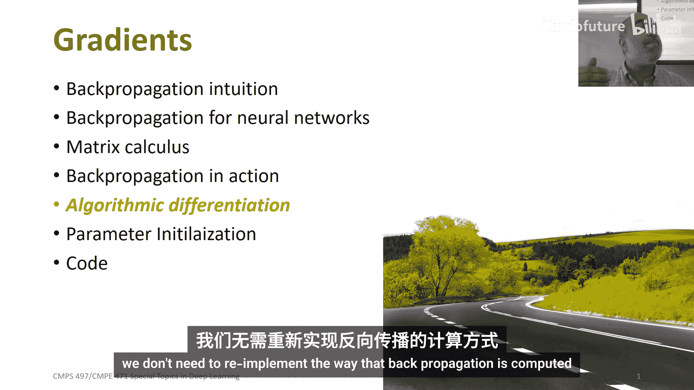
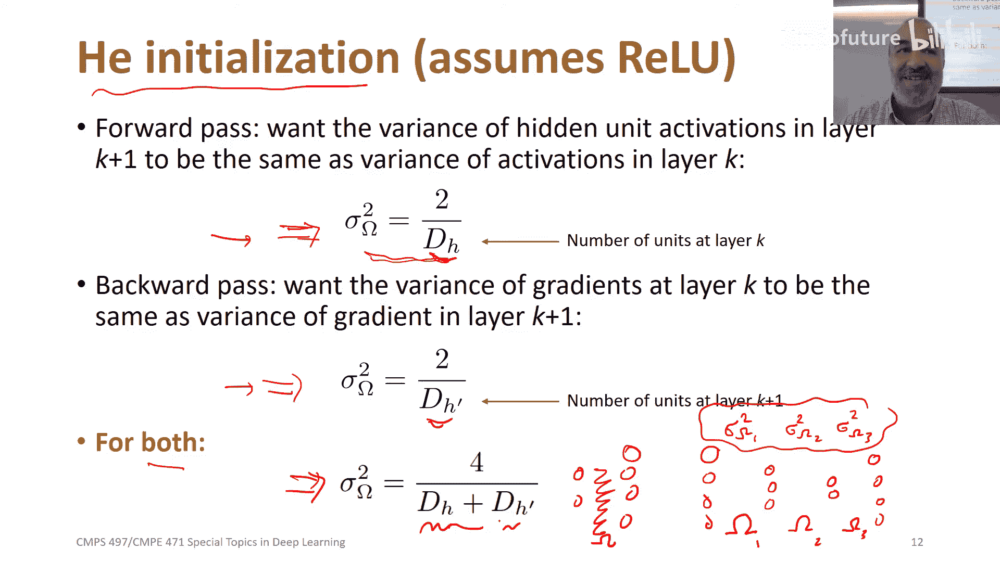
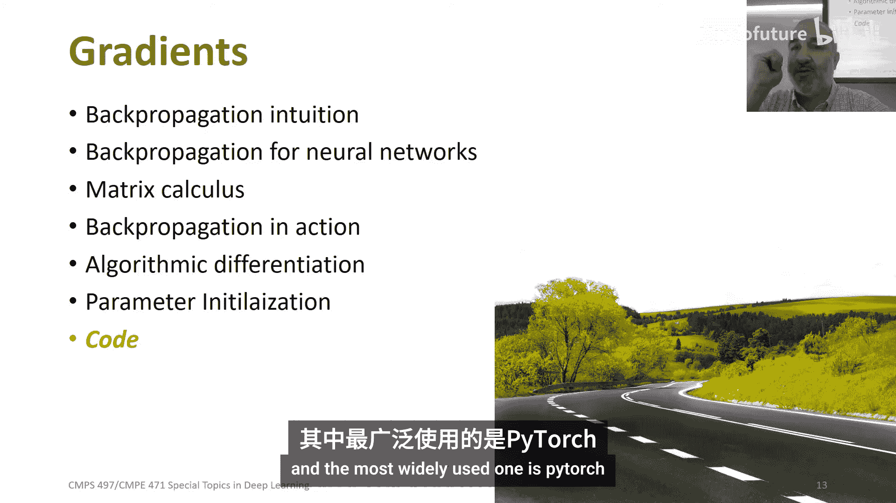
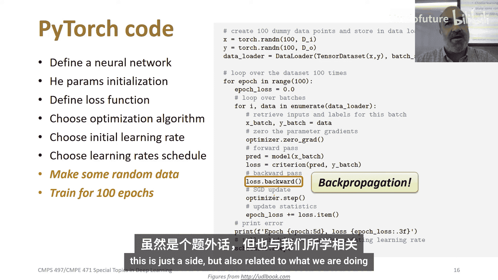
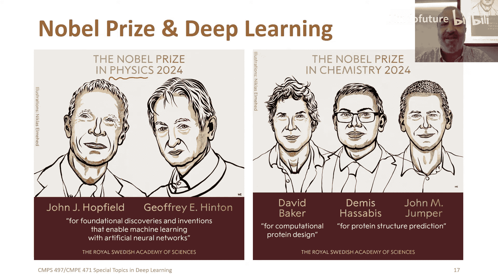
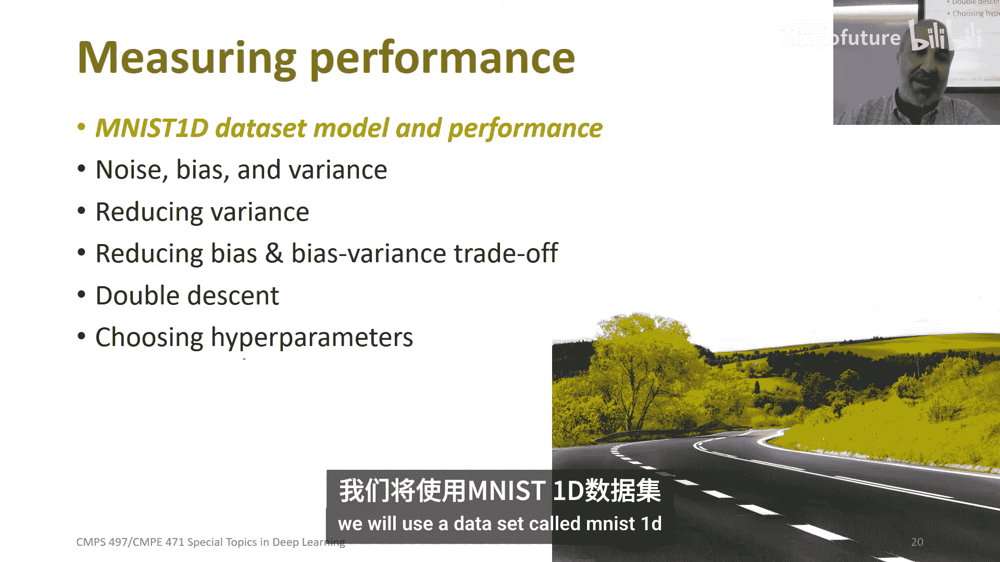
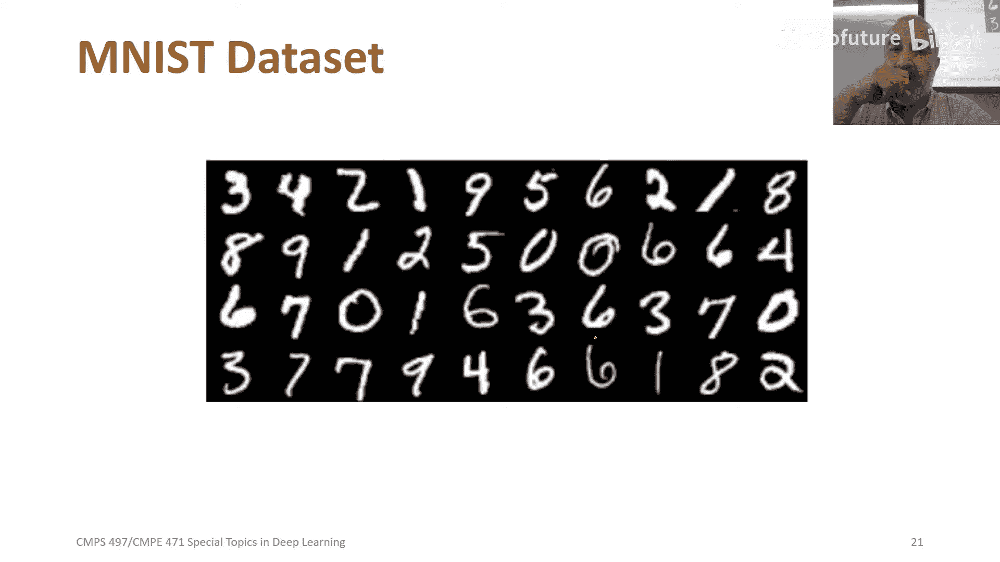
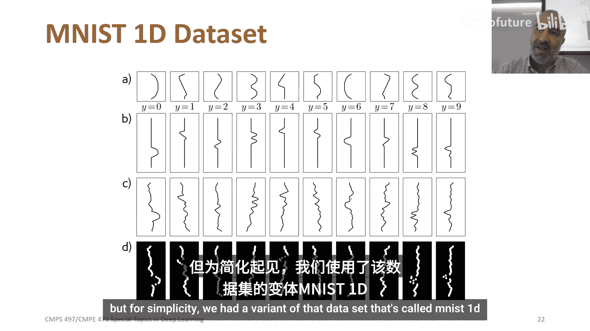
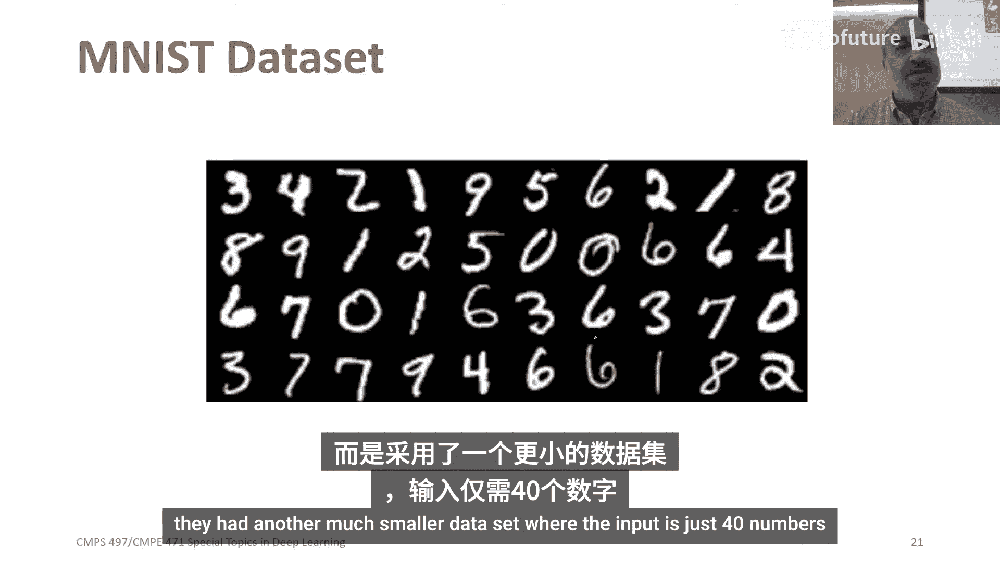
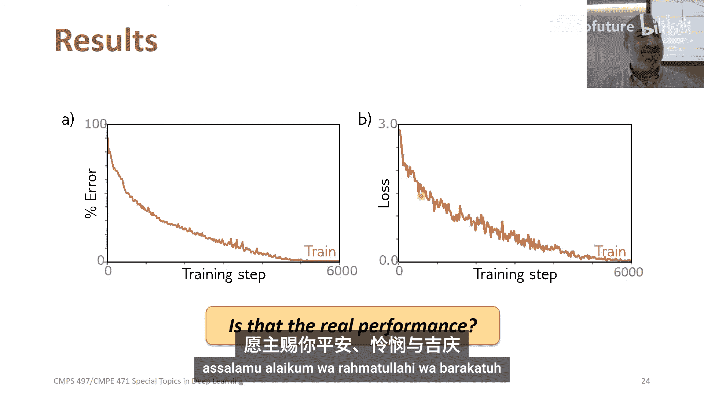

# 【卡塔尔大学】深度学习 CMPS497 ｜ Understanding Deep Learning ｜ Fall 2024 p14 P14_第十四讲-模型初始化 -BV1vQvNz1EeK_p14-

Please my。Are we done with the back convocation。Almost， almost done。 we last time we talked about。

How we we really do our implement vector obligation， right with metaes and vectors right。

 you remember that。And Trala today will continue talking a little bit about that。

 and then we'll talk about an important topic， which is how to initialize the parameters。Okay。

 and then we'll see if we have time to start the new session。

T a very important concept in nowadays frameworks。Is called algorithmic differentiation。

You so that back proagation depends a lot on differentiation， right to get the derivatives gradients。

 right we need to be able to differentiate functions。Right。

Type if we do that for very large networks， which means we have so many parameters。

That will take a lot of time。Right，And we saw last time that it it doesn't take a a lot of time because it ends up to be just multiplication between mat and vectors。

But still how we can get the derivatives， actual the local derivatives。Okay。

 so that we can change these values。And whether we really need to， every time we build a network。

 we really need to implement how we get the derivatives ourselves or not。

 This is what we we call algorithmmic differentiation。 So everything will be。Algothmic。

 which means it will be already implemented for us。

 we don't need to re implement the way that back propagation is computed。

What we actually really need to do is to specify what is the model in terms of the architecture of the model。

 how many parameters， how many hidden units per layer， how many layers。Things like that。

And we also define， of course， the loss function。Once you do these two things。

 once you define the model。And the loss function。 And of course， you set the hyper parameters。

Then back proagation can be done automatically。 You don't need to do any。

 You don't need to define the way。Back pro actually works。How how can we do that。

 that's what we will see in this slide first。We will specify the order of the components。

 what do we mean by the order of the components？We， willll specify how many layers。

 and that's how many hidden units in the first day。

And what is the activation function for the first day。

 then how many units for the second day and what's the activation function for the second day and so on。

We will specify the order of the sequence of the components so every components。Every component。

We know。What the previous component is， how it is linky to the previous component and how it is linknky to the next one。

Right， Tiboy is that important？本是。Not just because it's a network。

 because we are talking about back here。 Why is that important。For back proagation。

Because you are not to play。Because of the chain， right， because of the chain， because for the chain。

 we need to know what is after us and what is before us， right？喂。Type2， and， and if you remember。

 what is the first step to do when we do with manually。

 if we want to compute back proagation manually， If I gave you a function， No。

 if I gave you a function， and I told you， compute the back proagation derivatives。

 compute the derivative is using back proagation。 What is the first thing to do。Do what。

The computational graph， right， If we specify the all of the components。

 it is like drawing the computational graph， right， So this is the computational graph。 Ta。

 of course， it's not drawn in in， in the tool， but it is specified colors。

 Everything knows what is linked to and what is linked form。Yeah。Yes， everything in the network。Yeah。

Okay， now we know we define the computational graphite if we define the sequence of the components now to do back propagation。

We need also to know how to compute。For each component， what do we compute。

 What do we need for each component。The local derivative， right， the local derivative。

 So if each component knows how to compute its own derivative。

 then we know how to compute local derivative。is that the case actually and when we define a layer or when we define an activation function？

It's the local derivative or the way that we compute the local derivative is not new， right？

And if I define a sigmoid function， we know how to how to implement it。

 if we define a radio function， we know how to implement it。

 if we define a linear with the weighted sum， we know how to do the look at derivative right so it can be implemented once and that's it right once we know we say this is sigmoid it is already implemented for us。

Okay， what is the meaning？关于公司。Okay so that's， of course these are examples the radio node the linear function knows the derivative of the output will just to input and derivative the output will just to also parameter。

 then what remains is that we can compute the chain of the derivatives right。And that's， of course。

 because we know the computational graph， we know what's next and what's before。

 we can do the chain of the trip。Okay， that's how we will get the final。

So we don't need to do any computations ourselves。 We just need to define。

How the the components are linked together。And the loss function。

And even if the loss function is predefined。Then we know how to compute the local derivative with for the output values。

Because that's before the loss function so if it is already predefined the derivative is already pre implemented for us。

And that's actually the case。Okay， and that's what we mean by algorithmic differentiation。

Once we define these components。This tool or whether it is Pyto or our potential flow or whatever。

Is doing the differentiation automatically for us。That's the main power of such tools。

That we don't need to do this process ourselves or even re implemented it。ok。😊。

Even if we have branches， by the way， any， sometimes in some networks so far we don't have this because we have fit forward networks。

 but sometimes we might have something like that， we might have， let's say that a layer like that。

And another layer like that， okay。水。No， let's say that we have these weights here。

I can say I will take also the output from these nodes。And。😊，Make it input to another architecture。

Another network。That's what we mean by branching。That can happen because now you know what。

 you know the Lego game。 It's like Lego。 Now you put pieces somewhere together。

 and the back propagation will be done， whatever you add。So you can do these ventures。

As long as there are no cycles， there will be no for it。

 it is straightforward when it gets to cycles， there is a little bit of different handling。

 but other than that。You can do whatever you want。By what。cycles。

 it's like saying that this is the output of this node will go back to be an input to another node。

Behind me。亮啊。Okay， so as long as the graph is acyclic， which means that it doesn't have any cycles。

Then， then everything would be would be straightforward。Okay。

 so did you get the idea of a agreement differentiation？

So the differentiation once these components are pre implemented。

 then we can connect them together in the way that we like。Yeah。Actually。

 also just emphasizing on what you said， we can have two networks like that and their output。Is。

Would be input to another network。As a it's like a Lego now right components and these components are predefined and you can just connect them together of course you have to for a better performance you need to really design by intuition it's not just randomly。

Okay，You must have an intuition on why you want to really do that。Okay。

 now let's switch to another topic， which is within the same， of course。ASsion。

 which is about how to initialize the parameters。How to initialize the parameters。

 Why is that important， why it's important to think about how to initialize the parameters of the network。

没有。Yes did。好的，是的。Did you see any evidence for that？Before。😮，What is the evidence。Yeah。

 so you saw that sometimes when we start from a point， okay。

 we might find the global minimum in another point we might not right so initialization is really critical。

Okay， so we't need to we don't want to initialize， or we hope that we will not start learning the model from a point that is very bad。

Yes。😊，我等我所有的东西。Exactly， yes， of course， yes， of course， not only better， but it can be festivals。

 yes。Type， usually in programming。In general， how do we initialize variables。In most most cases。

 we initialize variables to zeros right type why don't we do that here？That's in Charlotte。

 What are the parameters that we have。Weights and bias， right， Let's in us0 to0， right？

What happens if we do that？Okay。对可以。啊。😮，但那但是当们是一个同一0。在微信。So what happens。

Everything everything would be。 Okay， so the the network would be dead forever。 Okay。

 so you killed the network on the。First， understand。 so of course， we cannot do that。

We cannot do that if we in all the weights and biases to zeros， all the output。

 all the pre activations and activation values would be zeros up to the end of the network。

So we must have something that is better than that。to do that， we will focus on this building block。

😡，So when I， by the way， when I told you about this Lego。

 I meant actually the building blocks of right， So we have now it's like we have building blocks and we we are just connecting them to。

So back here， if we consider this building block that we have the biases and the weights and we have the weighted average or the linear function of them。

 this is the pre activations we saw this many times before， right？And the hidden units， of course。

 is the output of the activation function of the previous layer。

So we saw these equations before now we want to see the effect of initialization on this building block。

 what will happen if we do initialization in some way in some specific way across the network。

So the question here is how do we initialize devices and weights， and this is， as we just mentioned。

 is equivalent to choosing where in the space of the loss function or the space of the model。

 where we start。Which is， as we said critically， to do it in a simple way。

 we will assume that we will set all devices to zeros。But withs， but not withs。Okay。

 so we'll set the to zeros。And the widths， we will set them。Because we don't have。

Specific way to do it。We will set them randomly。Okay randomly。

 but not completely randomly we will set them randomly based on a distribution based on a probability distribution。

 which is a normal distribution， so we would say that we will sample the values of the weights from a normal distribution with means。

And some specific variant。So let's say I， if this variance is is one。

Then we expect that the values would be around0 okay？So around 0。

 because the mean is 0 here and with。Specific。Variance。Okay， so it will be if the variance is one。

 it will be mostly between minus 2 and 2， that's the most most cases。Okay， but they were not bus us。

Some of them would be zero， but most of them will not be zero。ok。得。Now， the question is。

What will happen。As we move through the network， if the variance is very smooth or very large。

 we didn't say how what the value of the variance can be， right？

So I want now to think about the case when the variance is very small。

 what will happen across the network？😮，And the case， when the variance is very large。

 what will happen across on it？Let's think together。Okay。T， I will just do。呃，Some。Okay。

 let's say that。Some on how we have here。The rest of the network。

 we have here the rest of the network。 Let's see that we are setting the width in between these two layers。

 Okay， and let's see that this is。The number of units here is dh and the number of units here is DH prime。

Okay。T when we say the variance is very small， that means that the weights will be very small， right。

Right， so the widths here Now I'm talking about the widths here。between these two layers。Okay。

Because let's assume that we will set the variance。For its weightmatics separately。

In between every two layers， we can set the variance separate。

 but let's assume that in this specific case， the all the variances would be very small。Okayた。No。

The wavess are very small， which means that the weights will be very small。😡，Okay。

 but what will happen to the pre activation values here。And， we have hidden units values here， right。

Let's think about this node specifically。😡，This note gets input from where。From all the notes here。

 right。All the nodes here are connected to this node？But remember that the widths are。Very small。

 So what will happen to the pre activation value， it will be smaller smaller than whatever the pre activation the hidden unit values here。

 right。Could be very small， right。第。How about this one。Same， same， same， right。Dpe。

How about the next layer。To be even smaller， but before the next year we didn't do the activation function。

 right？😡，Okay， what happens with the activation function。 And， now we said that at that point。

 the pre activation will be small。The value would be very small， right。

 let's say that the activation function is radio。 What will happen。😡，说。

It will remove the negative part。And well keep only the positive of the path。😡，Okay， so it's like。

Getting the range of the values into。Have instead of having a negative and positive。

 we just have positive。😡，Okay。So two things are happening。 The pre activation values will be less。😡。

And。After the the activation function， it will be get to have。And the we can measure。

 we can think of the range as the variance of these values， right？Okay， but。

 how about the next layer？It will get smaller， right。嗯。Yeah， no， but here that's in general。

 but here we assume that the variance is very small everywhere。Okay， so with yeah。

 with getting for the next layer， it will be even smaller， right next layer。

Smaller as we move forward。It will get very small， right。Oh what is smaller。The values。

The values of the reactivations。Okay。So。Again。These weights are very small， okay。

The pre activation values of this node。😡，Would be very would be smaller than the hidden units values。

 right， here let's say that this is the hidden units values。and this is the pre activation values。

 the pre activation value here will be smaller than the he unit。

 right because the weights here are very small。And it will be healved because of the the activation function。

 And then again， this process will will continue， so it will get smaller and smaller as we move。

Forward。Right until we get to the output。Alas， so pre activations will likely have smaller magnitude than the input。

 which is the previous hidden units， and then the radio will clip it less than zero so the range of the hidden units will be even half of the pre activations This is what we just discussed。

😊，Okay。第。So the magnitude is getting smaller and smaller as we progress through the network。Hello。

What happens if we have very large variances？嗯。It will be it will get larger， right。

 will get larger with the same logic， it will get larger over time， I mean。

 over layers as we move forward。😡，喂。The activation will will keep about is larger than the previous。

 right， because it's very the weights are。 the variance is very large。 weights are very large。

 so it will get larger。😊，Okay， so that's similar thing， so the radio will have that inch。

 but of course if sigma square is large enough， the magnitude will still get large。Okay。

 now this is the summary。😡，Of what we have discussed， the pre activations can become so small。

All solars。Right， you are agree with me。That they cannot be represented by the finite precision floating point atic any it gets very。

 very small to the extent that it will we will get underflow all very。

 very large to the extent that we will get overflow。That can happen。Right。😊，It'sLike。

 how about the backward path？Yeah it is smaller。Really。Really， okay。

Remember what happened last time and when we go backward， what do we do， we multiplied by the weight？

😡，对。So it will get smaller and smaller and smaller again， so the same logic。😡。

So it gets smaller this in the forward pass and even gets smaller in the backward pass。

 what will get smaller in this case？In the first test， we compute the values right。

 the activation values and the8 units backward we compute the derivatives。

 so the derivative will get smaller， smaller and smaller。😊，Right。😊，Very smooth。And of course。

 in the case with very large variants。It will get。这是。透。Still， we didn't finish， okay。Okay。

 we didn't finish， so same logic applies to the backward pass。Now， the first case， when it gets very。

 very small， this is called the vanishing gradient problem。First of all， why is it。

A problem invention gradient means again， it would be very， very， very small。Right。

 and you know now you， you can see now the logic。 But why is that a problem。我 you。

What is that the problem。It's like the。Yeah， so when the gradienting is zero。

 what does that mean to us？No， it has nothing do with Er。 The gradient。 Where do we use the gradient。

I know of this exactly。Okay， the gradient determines the updates that we do。

 So why is that a problem Because the gradient will be very small。

 which means that there will be no updates in the model。So， we are stuck。

 the model will not will not be updated。And that's a big property。Is that the case。

Did it come to zero because we are reaching the global meaning。Most of， it's not。

Most probably it's not， okay it's because the weights are very small。Okay， but that's a good point。

Yeah， it's 0。 that might mean， but might mean in a normal case， not， not from。

 from what we just discussed。 So this is called the vanishing gradient problem。

 And that's a big problem。 if it happened， then the model is stuck and you cannot in you cannot actually continue。

Tining， you cannot continue training。Okay， the other one is called exploding gradient problem。

Because the gradient will really be very large but why is that a problem？😡。

The model will be unstable and we will make big jumps。 the gradient is very large。

 so we'll make big jumps though the model is kind of going random across the space。

So that would be also bad。So both cases are very bad。

So we we are not worried about which one is better， both are bad。人。Yes， question。exactly， exactly。

 so as you see now， there are two extremes， so there must be somewhere in between that will give us good。

 good performance okay and that's what we will see。Exactly， okay。

 so this is showing it on a specific experiment。Let me explain first what this figure means。嗯。

This x is。Is increasing is indicating the number of layers。Okay， so this is at layer number one。

 this is at layer number two， layer number three and so on until 50。Okay， and on the y axis， we are。

We are we are measuring the variance。Of the hidden units。

Which is like the values of the hidden units。Okay， at each layer。

So you can see with this value of the variance of the widths。😡。

What happens to the values of the8 units， it's increasing。Okay， as we move forward in the network。

 it is increasing， and by the way， if you look at the Y axis it flows scale。😊。

So it's increasing a lot exponentially， actually。And you can think of it that way， right。

 Its's we are multiplying by large numbers， large numbers numbers。

 So it's it's really exponentially increasing。几。And this is also happening with this value。

 So these values are the values of the variance variable that we are talking about。Okay。

 this is the variance that we use when we initialize the weights。Okay， so when the variance is  one。

 we will get this effect， when the variance is 0。1 we get this effect in the other way。

 if the variance is very small like that。😊，You can see that effect， right， so what happens？

The values are getting smaller。Okay， forget about right right the right side figure now。

 Okay we are only talking about the left side， which is the forward test。Alas。

 you understand now what what's going on。 come on if you look at the value point。02。It's like stable。

Is that the magic number would see。Okay。第。What happens in the backward path。

 you can see now the right side， again， the x axis is the layer and the y axis now is the derivative。

😊，In the sigma square of the derivatives。Okay。😊，So you can see the dotted line is the line from the folder press and the straight line is the continuation。

😊，With the backward pass。 And， for example， you see this green one。This one。😊。

That's the forward pass and then when we get back， we will see that we would reach a very high derivative。

Okay， on the other side for the brown one， this one。

That's the forward path and then the backward path we getting we are getting smaller。Okay。

T any question about that， which of these cases are vanishing gradients and which of them are exploding gradients？

こらす。00。001。Vanishing， why， because they are getting very small here， right？

And this one also is vanishing。This one is vanishing course， right？Yeah。Yeah， yeah。

 it's not not that much， but it's still vanishing。 it's still getting smaller over time How about this one。

Exploding and this one is exploding。So we have two cases of exploding here and two cases of vanishing guidance。

That， that shows you that the choice of the variance。

That we use in initializing the weights is very critical。Okay。

 because it gets larger exponentially or it gets smaller exponentially。

 So we have to carefully set the variance。In a specific way that we will discuss， yes。The great。要是。

Why is this that okay？Yeah。You mean what， what is not changing。It's the variance is not changing。

Okay， but the values themselves are different。And the variances of close。

The variance across the layers。Is the same， but of course， the values themselves are different。😡。

That doesn't mean a problem。Okay， yes。Because， as we said。No the R this is， this is dog scale。

 this value is 10 to the power of something5 for so。 this is 10 to the power 00。Okay。

 these values are very large。😊，extremelyly large。对。At some point， very quickly。

 you will not be able to even present these values with the fixed precision that we have yes。对对。

If it's increasing in this case， if it will increase， it will increase exponential。😊。

So you will get very large number。Very large number。 It's not， it's not around the 0。Or around one。

 it's very large， okay， and in the opposite the same thing。第。ok。Now。

You can see now that there are very bad values for the variance， and very。没个。Relatively good right。

 which is this value， specific value。How can we can we set the variance so that we don't have either of these two problems？

Now， if we go back to。To the figure that I started to to do here。What is happening here。

 Let's see that。🤧嗯。We have a specific variance。Okay。😊。

Let's see that we have a specific variance here。停。When we， when we get the weighted sum here。

We get it from all of these neurons， right？Which means that the range of the value will be。

Amplified by the number of these neurons， right， if I add more neurons in the previous layer。

Then the value will get increased， right？喂。Especially if the weights are in in some range and the weights are all in some range。

 then it is like we are。Magnifying the input values here by the number of nodes here。

as this number of nodes increases。They fixed。Will be higher on on each of these nodes of the next day。

 right。if I want to cancel out this effect， what should I do？😡，Ofly， what's the simplest idea to do？

Any， this is like this is like we are multiplying the values by the number of nodes here， right？😡。

If then if to cancel it out， we can just divide by that number。😡，Right。We divide by that number。

Is it， is it that simple。 We'll see。原告方这个。Okay， so if we want to be within the same range。😡。

That's that's the idea here。 If we want to keep the values within the same range。

 then we need to cancel out this multiplication factor。Okay。

 so to cancel out this notification factor。We need to divide by the number of。

The number of units in the previous layer。Okay， type。

 remember that we also with with the radio activation function。

 we make the inch half I want to cancel this out。 What should I do multipplly by two。

Okay multi5 by2 so this is what we call he initialization and he is not Ho Of course it it's a name of a person Okay。

 so in he initialization we want the variance of the hidden unit activations in layer K plus1 to be the same as the variance of the previous layer so to do that we will set the variance of the weights。

To be two over the number of units in the previous day。

So that when we get the values from the number of nodes here。

 it's like we are canceling the effect that we are getting input from many units。😡，Okay。

 so the range should be。Within we should， we should get the the we should get to a range that is within the same range of the input values。

 Okay， Ta about this is a rough idea。 There is a proof for that， by the way， Okay。

 but this is roughly the main idea。Okay， this is in the forward test right。

 but in the backward test there is something that same in the backward pass， it's the opposite。

 right？And if we get back。Here， it's the number of。

It's the number of the units in the next layer that will affect the derivatives right。

 So what should we do we divide by that number。😡，And also， multiplly by two。Okay。

 so in the forward path。Here。The variance should be2 over the number of units in the next layer。我关注。

Because。Because the， the value value。嗯。Yeah。好。可以。It is the same concept。

 but instead of going forward， we are getting backward。

The derivative will be multiplied because it's coming from multiple nodes from the previous layer。😡。

Okay， type now it's like these are two things， two rules。

I want to make the variance of the weights between layer8 layer k and layer K plus 1 to be like that。

 and I also want to be like that。😡，can we do both？嗯。How， if these values are are not the same。

 we cannot do both。 If these values are the same， how we are done。

And if the number of units in layer K is exactly the same like number of units in layer K plus one。

 plus we will save it to2 divided by that number。 if we have 10 here and 10 here， or。

 we will make the variance2 over 10。Right。If they are not。Then， we have to find。A solution。 Okay。

 The simple solution to get the average。Is to assume that the the number that we will divide by is the average of both。

 In that case， it will be。4， divided by。ださ of。Because the averages。Some of them over two。

 then it will be four divided by them。This is of course。

 a heuristic if it happens that the number of units is not the same between two layers。ok。So summary。

 quick summary， what are we doing here？Why are we doing all of that？

To initialize the parameters right and we said that we would set the biases to zeros。

And we will initialize the weights by normal distribution where the mean is0 and the variance。Yeah。

Is what now。Is this。Okay， is this。And it has to be set per layer。

That's that's why I said the variance can be different across layers， right。

 the variance of the weights because it depends on the number of units before and after。Okay。

 the weights are between two layers， right？So so this way。This is， this is the。

 this is what we call he initialization。 Now， let's get back to。This。You now know why it's。It's 0。

02 because in this experiment， the number of hidden units was10s， it was fixed over all layers。Okay。

 so when the the variance is two over 100。Which is 0。02。

Then the variance of the derivatives would be steep。So we not have the vanishing problem。

 vanish gradient problem， and we don't have the exploding gradient problem。

And that's what we have here。Yeah。Okay。Is that clear。 So you know now， how did we get this point or2。

And this is showing it in practice that doing it that way that derivative would be stable。

We not have these that with streams。对。Of course， this is not exact， yes。😡，This one。So for us， it's。

我怎么样。诶我fi。系。Yes。We change and that forward time on。So here we have， remember this is like omega 1。

 omega 2， omega 3， right？Oomega is the matrix of weights。

 right Here we are talking about sigma square of omega 1。

How to set sigma square to  1 Sigma square of omega 2 and sigma squared。Of omega 3， okay。

By the H of the。Is that so like when we're going full？We're going backward。Like the thing the same。

we will be in the same range if we get just the average。

 This is like a heuristic okay because it's like there are two rules that we need we want to to comply to at the same time and the two rules might be contradicting。

 So this is like a middle point。This's a like one。What is the point here。What are we doing。

 We are initializing the widths， Do we initialize the widths once or we do with once in backward and once and forward。

What， what is the meaning of what we are doing。It's once， right， colors。

 Once once we will use it in the forward and we use it in the backwards。

how about the next next iteration， the next step。Will we do another initialization？

Initialization mean。Sitting it in the beginning， okay。

 so the first value of the weights will be controlled by the values of these variances。Has， done。

 Leave it back for training hell。Of course not。 Okay， the ratess will be updated， right。By training。

Finning means updating the moment。Okay， but to update the model， we have to start somewhere。

 this is where。 Okay， so you see now the picture， the whole picture。I have a question。没有。Oh no。

 by by this way， by this way， we don't have to。 it depends on what it depends on the number no of nodezi I。

 for example， for this specific example。😡，The sigma for omega 1 will be。我我。

Will be fall over4 plus three。And this one，4 over 3 plus 2。 and this one4 over 2 plus 4。Okay。

 in in summary， In summary， we use this anyway。Okay， this， this one combines both。来小备车。什么你么。Yeah。

 yeah。 yeah， yeah， yeah， Yeah。 If， if the input is here， Yeah。

 you can think of it as if it'ss a layer。 Yes， it's the same thing。Yeah。

 because there is weight here， right？Yeah， there's a matrix here。嗯。Okay。

Very soon you see that in the code。Yeah。唔司。😀We is one literally， in the next slide。Okay。😊，Okay。

 any questions？

Let's move on and see the code now。And when you see the code here， what I mean is that you will see。

Code that will represent。Everything that we studied in the course so far。 from the very beginning。

How we actually do that using one of the frameworks that that are used nowadays and the most widely used one is Pych。

So we'll see example that shows how to do all of this， to define a network。

 to initialize the parameters， to define the loss function， to choose the optimization algorithm。

 to choose initial learning rate and change it if we want even to make random data and to train for this should be epos。

 I think that should be epos。Okay， and then 400 Air。And this。Pece of the code is doing all of that。

 This is like， I think， if you remove the。The comments。

I probably I think this is like 20 lines of code。That can can do everything。

If we just zoom in for a second。You can look at this part。Can you guess what I we doing here。

We are actually designing the the neural network here。 We are saying this is。The first layer。

With value。Second there with value and then output。

And for each we are just defining by the name what is what it is doing Okay linear means it's the weighted sum。

 just the weighted sum， and then we add the the activation function then weighted sum and then we add the activation function and to define a network with to define a layer。

 we just need to say how many。Neurons in the previous day and how many neurons in that layer。

Okay so D， that's the input。Yeah， the I is the input which is 10 DK is the number of units in the layer which is 40 and then DK decay is 4040 and then 45 for the output。

No， how many hidden layers we have here。2。Why is it for。Okay， we are saying the I the input。

 so input is 10。And then 40。Okay， that's this part。 And then we have another 40。That's this part。

 And then we have just five here。so we have input layer， we have output layer。

 we have two hidden layers。And that's all what we need to do。

 And even we can write it in single line by then， this is just just for illustration。

This is just defining the network and for example this is also this line is just defining。

Or or setting。The lost function。By just one calling a function。 Okay， it's already。

 it's already determined。 Yeah， but， but but now you understand this these things， right， Okay。

 You understand this。And。Can you guess this， What is this？This is back propagation。

That's the three lectures that we spend so far。Is inside this function call behind this function call。

 But now we understand how it works， I hope。instead of just calling a function code backward and you don't know what it is doing。

This function actually is computing the gradients。 This is the backward pass。

So this is a way back provocation is implemented。Or actually is printed and computed。Okay。

So you will see that in Charlotteah very soon in the homework and in the project in。Any questions？

Yeah。Now， I hope that when you use such framework。Instead of just copying and pasting code， as is。

You know you understand every single line what it is doing， and if you need to change something。

 you understand where to change and why you change and how to change。Good。So this is backov。

Any questions。Tpe， this is just a side， but also。

Related to what we are doing。 I don't know if you heard the news or not。

Did you hear the news last week？比如。So for the first time in history， computer scientists。

A when awarded nobel prizezes。Okay， in chemistry and in physics。In physics。

 this guy I remember in the first lecture， I showed you three guys who got the Ting Award award。

And I told you at the time that during award means Nobel Prize in computer science now you actually got he actually got Nobel Prize and he got it in physics that was very surprising and the reason that was stated by the organization is that。

He was inspired by physics， by concepts in physics。In making advancements to deep learning。

Deep learning， in particular。

And on the other side， also these guys got Nobel Pri in chemistry， but for a diverse direction。

 they use deep learning tools to predict， I think， chemical structures or something like to discover chemical structures。

Okay。😊，So both are related to deep learning， which has a very important implication， I think。

That this is a very important topic。And I think I hope that you know that you are learning get in the right moment。

Okay so youll need to really put a lot of effort in understanding it and learning it and maybe some of us will win Nobel Prize now we have a hope at least okay no one can was thinking before that computer scientist there's no field for Nobel Prize called Comp science。

And we thought that tu go out this is the best now we can get no rep proposalals。Okay。

 so you have to follow the news to get these things。So that's something good。

 but at the same time I wanted also to talk about something that's not good。Which is this one。

I called it genocide and deep learning the previous one was Nobel Prize End deep learning， I think。😊。

Yeah， and this one is genocide and deep learning。 I don't know if you followed also the news or not and you saw that in the news what happened in as I think two days ago in in dawn very early morning people were burned alive。

Life。😡，对经。I don't。 I don't know。 I don't know。And。The reason that I， I。

 I titled this slide gen and learning， because I think。We will not be able to stop。These things。

Unless we own our will and part of it is owning our technology。

And the technology nowadays mostly is depending on deep learning。Especially the AI tools。

So that's another motivation for all of us。To make sure that we really understand these things and master them。

 not just understanding for the exam。The exam will not benefit anyone。Even you， by the way。

 not benefit you so much。More than really mastering and understanding it so that we can use them for the benefit of our own。

Okay， maybe we can in the future， we can stop something like that and instead of just watching it live。

Okay？

Okay， now new session。Any questions before we start this new session？Yeah。So。Okay，对。

And now we have like， okay，10 minutes。The new session will be about measuring performance。

Where are we in the in in our course， We just finished talking about training。Right。

 how to compute the gradients and how to initialize the network before training。Right。😊。

Now we want to know how good the model that is trained when we use it in reality。ok。😊，Yes。

So we need to we want to have an idea of how the model will perform。When we did。

we'll start with talking about a data just to understand the concepts we will use a data set called MNist 1D。

 What is Mist 1D， It's a variant of a dataset that's very famous called MNIS dataset MN dataset is a dataset of handwritten digits。

Okay， so every one of these is an example， someone wrote a digit manually。

 and then we want to build a model that can recognize the digit。

So it should recognize that this is three and this is two and this is six and so on。Okay。

 so this data set is for what type of problems。What is the problem。

 What's the type of the problem here。Clasification， is it binary classification？It's multi class。

 Of course， how many classes we have。Then right then。Okay。😊，Tpe the input here is an image。

That shows the visit， written visit。Okay。

But for simplicity， we had a variant of that dataset that's called Mist 1D。

Instead of getting the input to see to be mess and and let's say mess and this is 100 pixels by 200 pixels this is。

2und0 by 200， this is 20，0 values。 instead of having 20，000 inputs。Okay， we， they。

 they had another small， much smaller data set where the input is just 40 numbers。

 So they converted the image into something that's 1 d。 So instead of having a complete digit。

 we have something like that to represent that this is a 0。

 something like that to represent that this is one and so on。 Okay。

 And you don't worry about the details here。 But the idea is。

 and instead of having a complete2 d image， we have just 40 a vector of 40 numbers。

 And from the vector of 40 numbers， we want to。

Discover what the original digit was。No， these are examples， these are training examples。

what are the 40 numbers， the 40 numbers。 you Can you see this one。Can you see the x value？

These are the 040 values， any any meadin， this is let's a this is 0。Gated me change this。

So let's say here， x is0。He access to。Here X is 10。So02 and R， yes， the the y dots。

 the x value of the Y dots。Okay， so these are 40。Okay， again the are manipulated the original point。

 the original images were manipulated somehow so that we can get these 4040 points。Okay。

 so this is called MNS 1D dataset。Now to understand the issues that we will talk about。

 we will assume that we will solve this problem using this specific network。

 we have 40 inputs of course， we have 10 outputs and we have 400 training examples per class。

We have 10 classes。So the training examples would be 400 times 10。 We have 4000 training examples。

Okay， we will have a model that has two hidden layers，100 hidden units each。ok。😊，We will use SD。

 What is SD？对。craastic gradient descent with batch 100 a learning  grade。1。

 and we will do 6000 steps， what does that mean？行我。Actually。

 I want you to tell me how many epochs here。我觉得。Steps on。Itation is over。Over。

Over batches and every tradition is one batch。😡，When we say steps， training steps。

 each step is one batch。Okay， so this is 6000 steps， which means we are going over 6000。Btches。

 but we actually have the batch size is 100。So。不是。So it's like 60 batches。那我。How。

 how can we know over do it。Okay， so the batch size is 100。 The training example is 4000。 So 400。

4000 over 100。 This is the number of batches per。Pill epoch。

 and then you divide 6000 by that number will give you the number of epos。Okay。

 you understand how to do it。Okay。对。Now let's look at the performance。Yeah。So on the left side。Yeah。

Yeah。The x axis is the number of steps。😡，So as we go through more data。

We are measuring the percentage of L。What mean by the percentage of error， What is the error here。

Remember， this is multi class specific， right？😊，So when when the input is 3 and I say4。

 this is an L so percentage of L is the number percentage of how many what percentage of mistakes I'm doing in the classification。

😡，Okay。😊，即。😡，Is that something expected that as we。As we going through more steps， the performance。

 that the number the potential errors is decreasing。Yes， we are training。

 we are we are moving forward in training， right， are we are training more。

 so when we are within more， of course， the model is getting better。Okay， of course。

 there is some fluctuation， of course。 but overall， the trend is that we are getting better。 Okay。

 up to this point， what's happening here。Z， what does that mean。Anyway we are classifying perfectly。

We are testifying all the training examples perfectly。That means that every single step here。

We are measuring。 we are we are doing inference for the network over all the examples so that we can measure them the percentage of there because every point here that means that we have a model now Okay。

 so we can try that model。Over， you can test that model over over the training exam。Okay。😊。

That's the left side。The right side is exactly the same。

 except that the Y axis is now we are not measuring the percentage of error。

 we are measuring the law。😡，What is the difference between the loss and percentage of error？Yeah。

Yeah。然后。Cse entropy the the multi class cross entropy lost function。Okay。😊。

And it depends on what depends on the probability that the model will assign to the correct class。

Right。😊，Okay， type we can also see that the loss is increasing。😡，Over time， right？Sorry。

 the loss is decreasing when we train more。And that's also expecting。Expected， time。Here we have0 L。

But here we don't have zero loss， but we are very close to zero， right Why is that。

 Why is actually the value of the loss is really different from the percentage of l。嗯就是。

This isThis is different。 This is based on the probability， right I we might get the correct label。

But with with not high confidence， and I might assign 0。6 probability to the correct label。

I got that correct because we maximize remember we get the label of the maximum probability。

 but the rate is 06 is not 1， is not close to  one， so there is a loss here。😡。

So the loss is different， of course。Okay。第。Is that the real performance？And is that。

Does that indicate actually the rate performance of the model？Why not。Yeah。

 we have to check it on An indeed。Yes， and that's what we will see in the next lecture。3かただけと。

