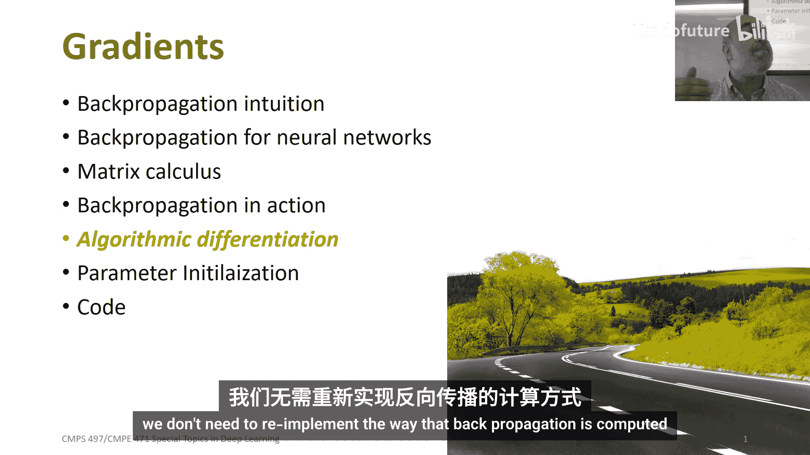
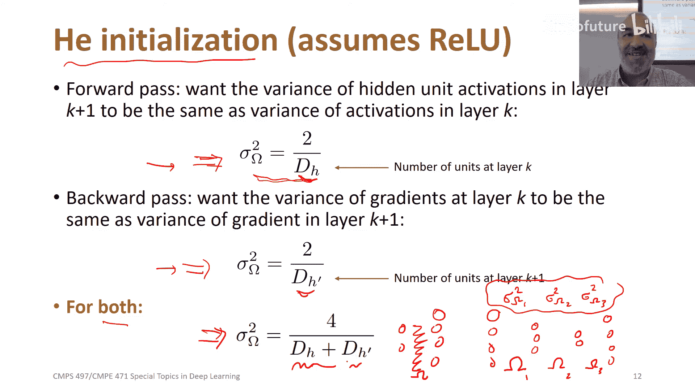
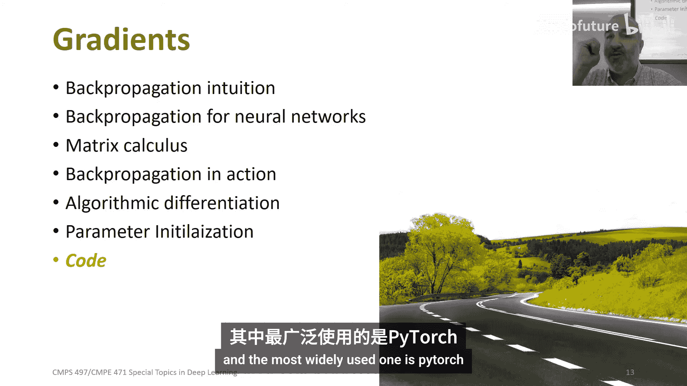
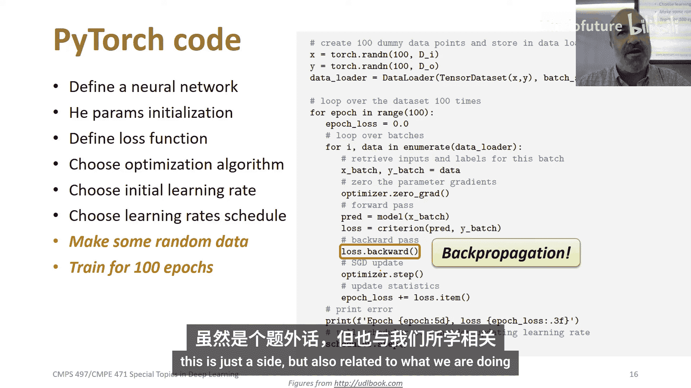
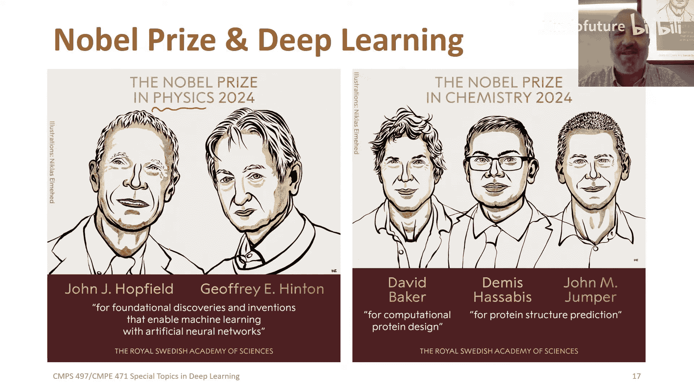
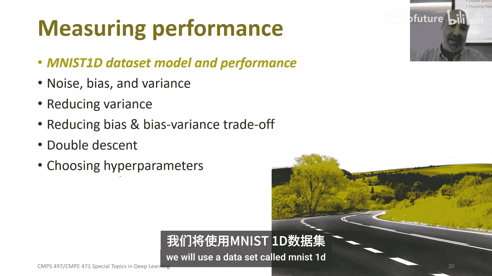
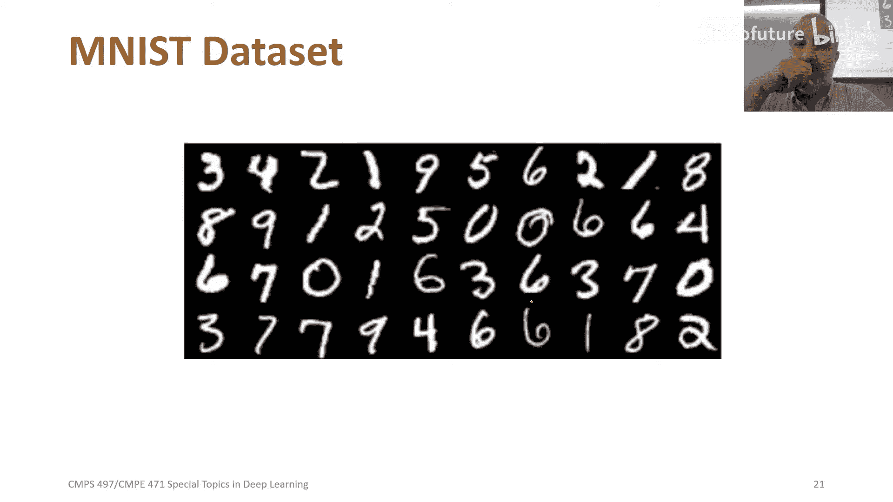
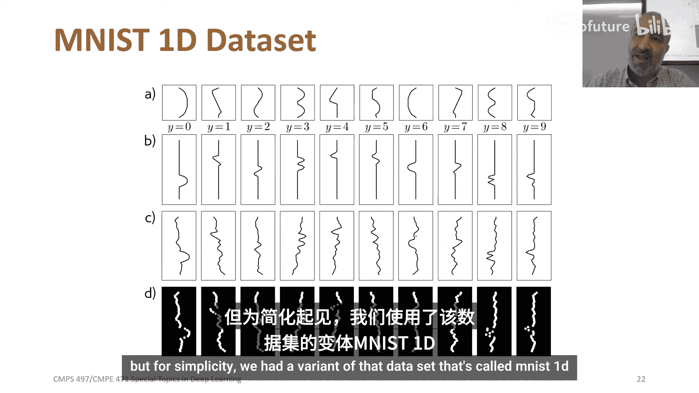
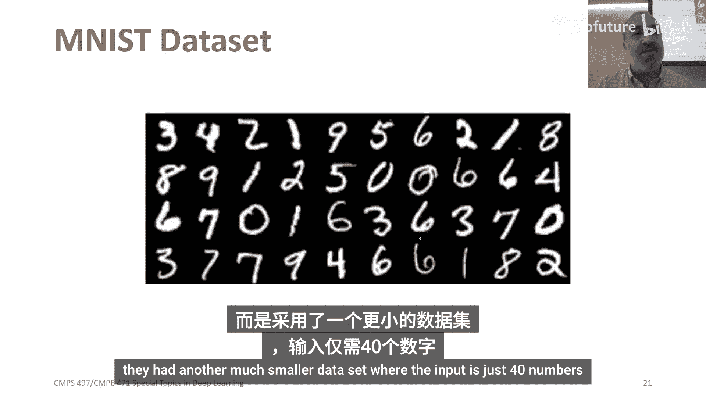
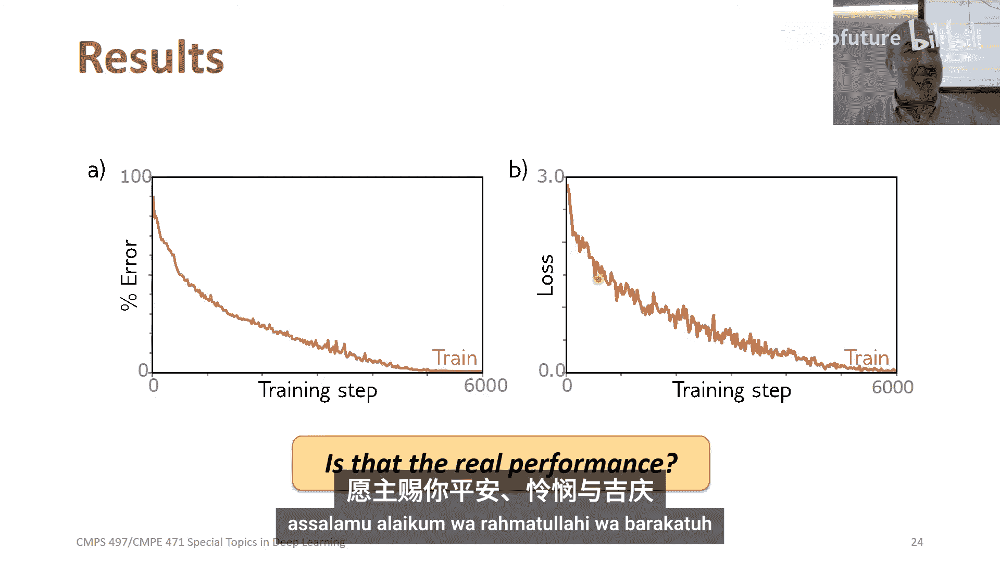

# 深度学习 CMPS497：14：模型初始化与性能评估 🧠



在本节课中，我们将要学习两个核心主题：**算法微分**（Algorithmic Differentiation）以及**模型参数初始化**的重要性。我们还将初步了解如何评估训练后模型的性能。

## 算法微分：自动求导的魔法 🪄

上一节我们介绍了手动实现反向传播。本节中我们来看看现代深度学习框架如何自动完成这一过程，这被称为**算法微分**。

对于大型网络，手动计算所有参数的导数非常耗时。算法微分允许我们只需定义模型架构和损失函数，框架就能自动计算反向传播所需的梯度。

其核心思想是：将网络视为由预定义组件（如线性层、激活函数）组成的计算图。每个组件都知道如何计算其自身的**局部导数**。当我们按顺序连接这些组件时，框架就能根据计算图，通过链式法则自动组合这些局部导数，得到最终梯度。

这意味着我们无需为每个新网络重新实现反向传播。只要正确指定了组件的连接顺序（即定义了计算图），梯度计算就会自动完成。

以下是算法微分的关键点：
*   每个计算组件（如 `Linear`, `Sigmoid`, `ReLU`）都预置了其前向传播和局部导数计算规则。
*   框架根据用户定义的模型结构自动构建计算图。
*   反向传播时，框架沿计算图反向传递梯度，并应用链式法则。

只要计算图是**无环的**（Acyclic），即使网络存在分支（例如多个子网络的输出合并），这种自动微分机制也能正常工作。

## 参数初始化：训练成功的第一步 🎯

现在，让我们转向一个至关重要的话题：**如何初始化模型参数**。初始化决定了训练过程的起点，一个糟糕的起点可能导致训练失败。

为什么不能简单地将所有权重和偏置初始化为0？如果所有权重都是0，那么网络所有层的激活值都会是0，梯度也将为0，网络将完全无法学习。这被称为“死亡网络”。

因此，我们需要一种更好的初始化方法。通常，我们将偏置初始化为0，而权重则从某个概率分布中随机采样。最常用的是**正态分布** `N(0, σ²)`，其中 `σ²` 是需要精心选择的方差。

### 初始化方差的影响

考虑一个简单的网络构建块：前一层的隐藏单元 `h` 通过权重 `W` 和偏置 `b` 进行线性变换，再经过激活函数（如ReLU）得到下一层的隐藏单元。

初始化方差 `σ²` 的大小会带来两种极端问题：

1.  **方差过小**：权重值非常接近0。在前向传播中，激活值会逐层急剧缩小；在反向传播中，梯度也会逐层急剧缩小，最终趋近于0。这被称为**梯度消失**问题，导致模型参数无法更新。
2.  **方差过大**：权重值非常大。在前向和反向传播中，激活值和梯度会逐层急剧放大，最终可能导致数值溢出。这被称为**梯度爆炸**问题，导致模型更新不稳定，训练震荡。

实验表明，随着网络层数增加，激活值的方差会随 `σ²` 的选择呈指数级增长或衰减。

### He初始化：保持方差的稳定

理想情况是，我们希望每一层激活值的方差在前后向传播中都能大致保持稳定。**He初始化**为此提供了一个解决方案。

其核心思想是调整权重初始化的方差，以补偿网络结构带来的缩放效应。对于使用ReLU激活函数的网络，He初始化的公式如下：

**对于第 `l` 层权重 `W^[l]`，我们将其初始化为：**
`W^[l] ~ N(0, σ²)`
其中，方差 `σ²` 的取值为：
`σ² = 2 / n_in`
这里 `n_in` 是第 `l` 层的输入单元数（即第 `l-1` 层的神经元数量）。

这个公式的直观理解是：为了抵消来自前一层 `n_in` 个输入信号的累积效应，我们需要将方差缩小 `n_in` 倍。同时，ReLU函数会“抹去”一半的激活值（负值置零），因此需要乘以2来补偿。

在反向传播中，也需要考虑类似效应，理想方差应为 `2 / n_out`（`n_out` 是第 `l` 层的输出单元数）。当 `n_in` 与 `n_out` 不相等时，一个常见的启发式方法是取两者的调和，使用方差：
`σ² = 4 / (n_in + n_out)`

通过这种方式初始化，可以有效缓解梯度消失和爆炸问题，使训练过程更加稳定。

## 代码实践：一切尽在掌握中 💻

理解了原理后，现代深度学习框架（如PyTorch）让实现变得异常简洁。以下是一个示例代码框架，涵盖了定义网络、初始化、选择损失函数、优化器以及训练循环：



```python
import torch
import torch.nn as nn
import torch.optim as optim



# 1. 定义网络模型（计算图）
class SimpleNN(nn.Module):
    def __init__(self, input_dim=40, hidden_dim=100, output_dim=10):
        super().__init__()
        self.network = nn.Sequential(
            nn.Linear(input_dim, hidden_dim),  # 第一层：线性变换
            nn.ReLU(),                         # 激活函数
            nn.Linear(hidden_dim, hidden_dim), # 第二层：线性变换
            nn.ReLU(),
            nn.Linear(hidden_dim, output_dim)  # 输出层
        )
        # PyTorch默认使用一种类似于He初始化的方法（Kaiming初始化）来初始化Linear层的权重。

    def forward(self, x):
        return self.network(x)

# 2. 实例化模型、损失函数和优化器
model = SimpleNN()
criterion = nn.CrossEntropyLoss()  # 多分类交叉熵损失
optimizer = optim.SGD(model.parameters(), lr=0.1)  # 随机梯度下降，学习率0.1



# 3. 模拟训练循环（此处为示意，无真实数据）
for step in range(6000):
    # 假设我们已有数据加载器 (dataloader)
    # inputs, labels = next(iter(dataloader))

    # 前向传播
    # outputs = model(inputs)
    # loss = criterion(outputs, labels)

    # 反向传播与优化 - 算法微分在此自动发生！
    # optimizer.zero_grad()  # 清零梯度
    # loss.backward()        # 自动计算梯度（反向传播）
    # optimizer.step()       # 更新参数
```



在这短短二十行左右的代码中，`loss.backward()` 这一行便封装了我们之前讨论的整个反向传播与自动微分过程。现在，你不仅知道如何调用它，更理解了其背后运行的原理。

## 性能评估初探：训练误差并非全部 📊


最后，我们开始一个新的主题：如何衡量模型的性能。我们使用一个简化数据集 **MNIST-1D**（将手写数字图像处理为40维向量）进行演示。





假设我们训练了一个具有两个隐藏层（各100个神经元）的网络，使用SGD优化器，批量大小为100，训练了6000步。





观察训练过程中的两个指标：
*   **错误率**：模型预测错误的样本百分比。随着训练进行，错误率下降，最终在训练集上可能达到0%。这表示模型完美记住了训练数据。
*   **损失值**（如交叉熵损失）：衡量模型预测概率分布与真实标签的差异。即使错误率为0，损失值也可能不为0（例如，模型以0.6的概率预测正确类别，虽然结果对，但信心不足）。

**关键问题是：训练集上的完美表现是否意味着模型真的好？** 答案是否定的。这很可能只是模型**过拟合**了训练数据，即记住了训练样本的噪声和细节，而非学到泛化规律。为了了解模型的真实性能，我们必须在一个全新的、训练时未见过的**测试集**上进行评估。这将是下节课的重点。

## 总结与展望 🌟

本节课中我们一起学习了：
1.  **算法微分**：现代框架如何通过构建计算图和预定义组件局部导数，实现反向传播的自动化。
2.  **参数初始化**：其重要性，糟糕初始化（如全零）导致的“死亡网络”问题，以及方差选择不当引发的**梯度消失**和**梯度爆炸**。
3.  **He初始化**：一种针对ReLU激活函数的有效初始化策略，通过设置方差 `σ² = 2 / n_in` 来保持激活值方差的稳定，促进训练。
4.  **性能评估基础**：区分了训练错误率和损失函数，并指出了仅凭训练集性能不足以判断模型优劣，引出了**过拟合**和**测试集评估**的概念。



深度学习不仅是强大的工具，也已成为推动其他科学领域（如物理、化学）发展的引擎，同时其应用也伴随着重大的伦理责任。理解其原理，而不仅仅是调用代码，是我们正确、负责任地使用和发展这项技术的基础。在接下来的课程中，我们将深入探讨模型评估、过拟合与正则化等核心主题。