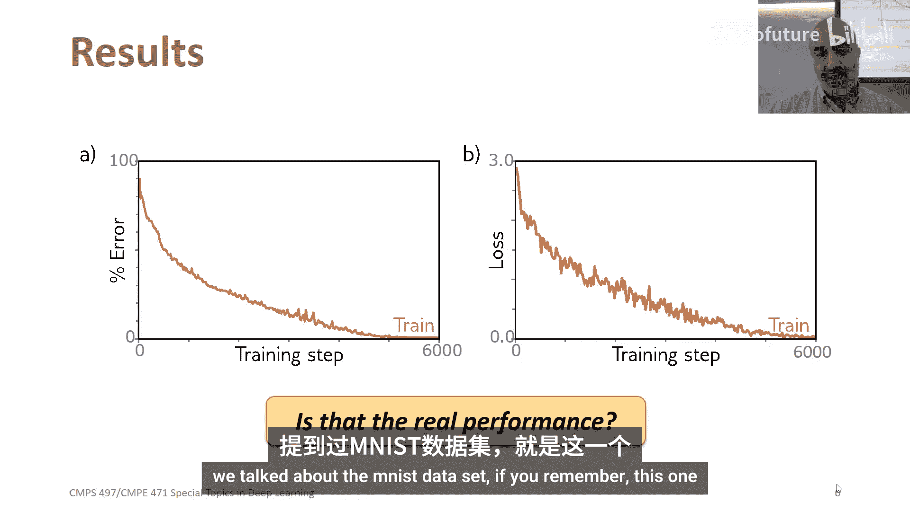
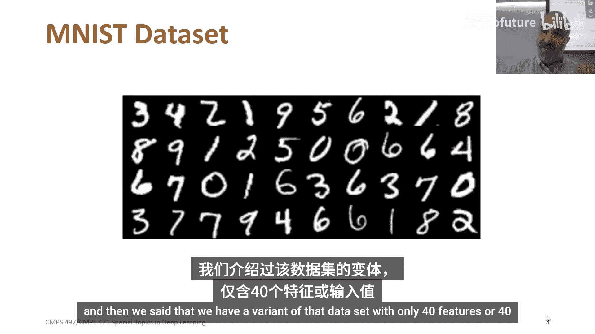
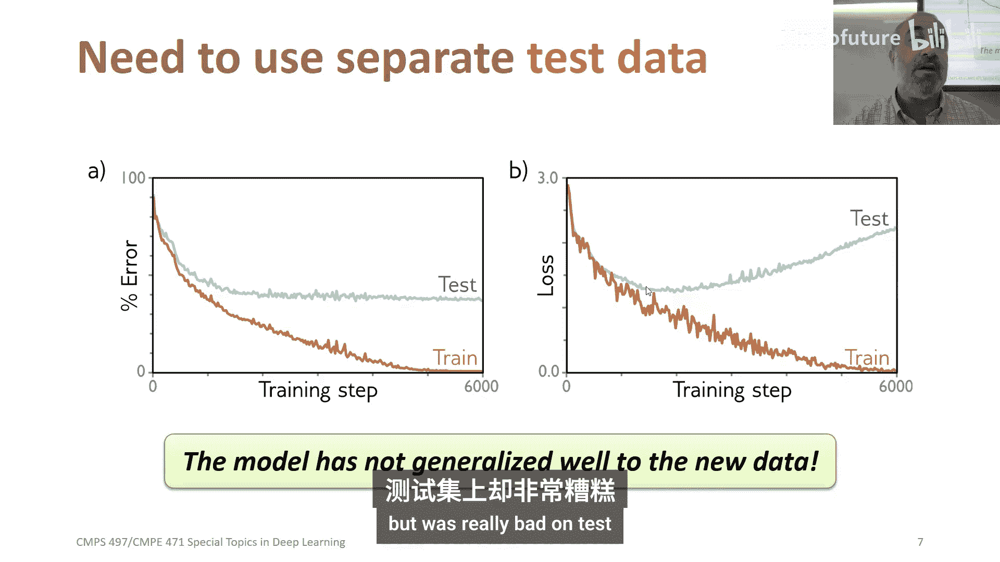
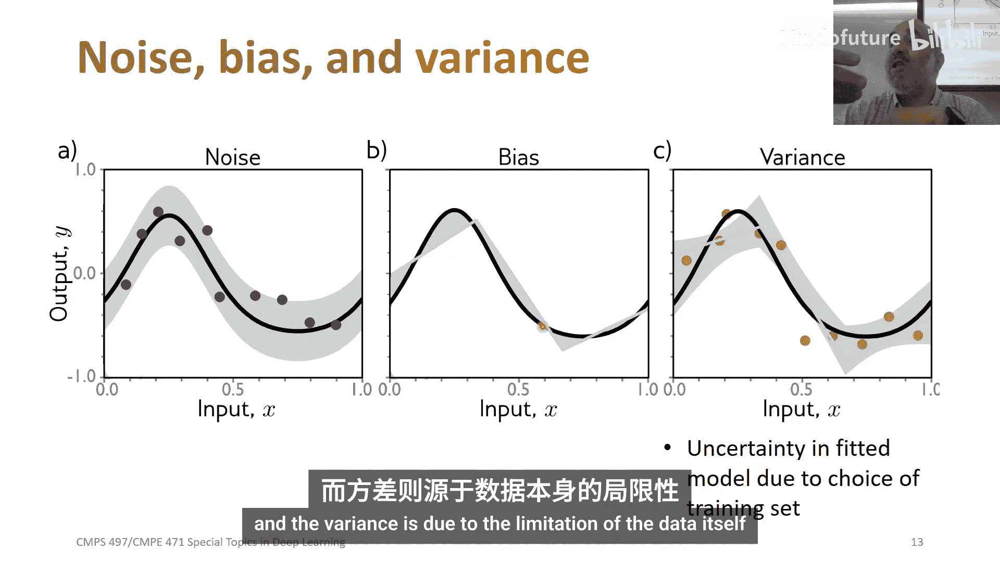
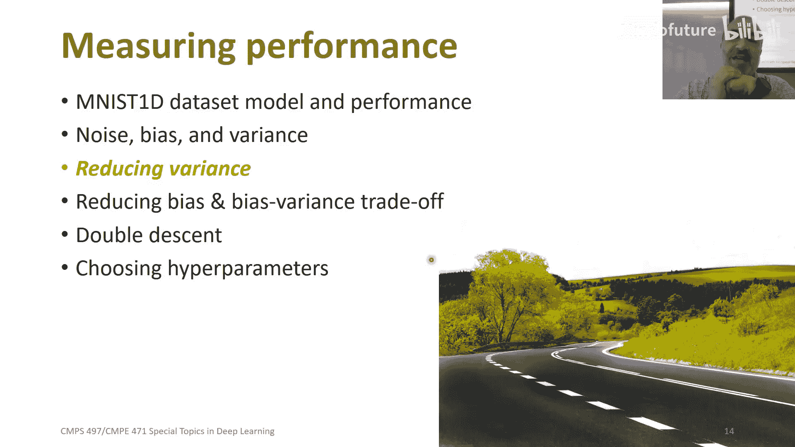
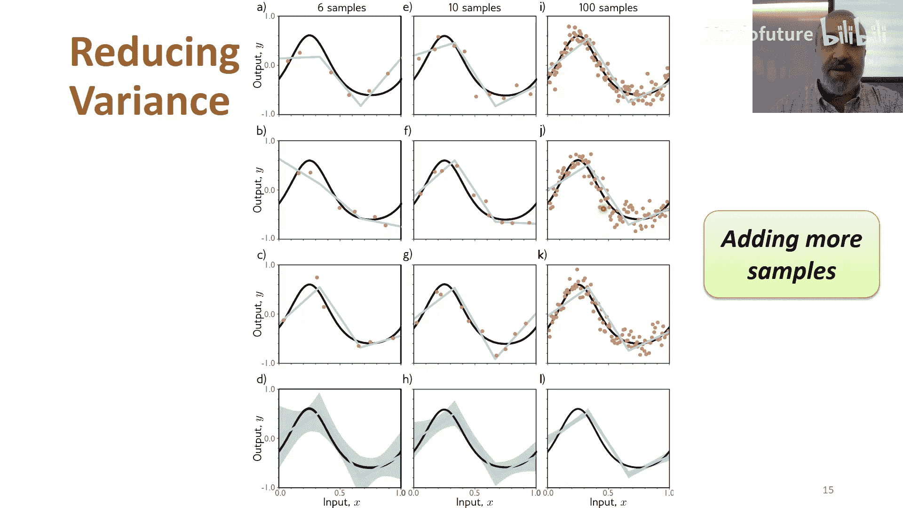
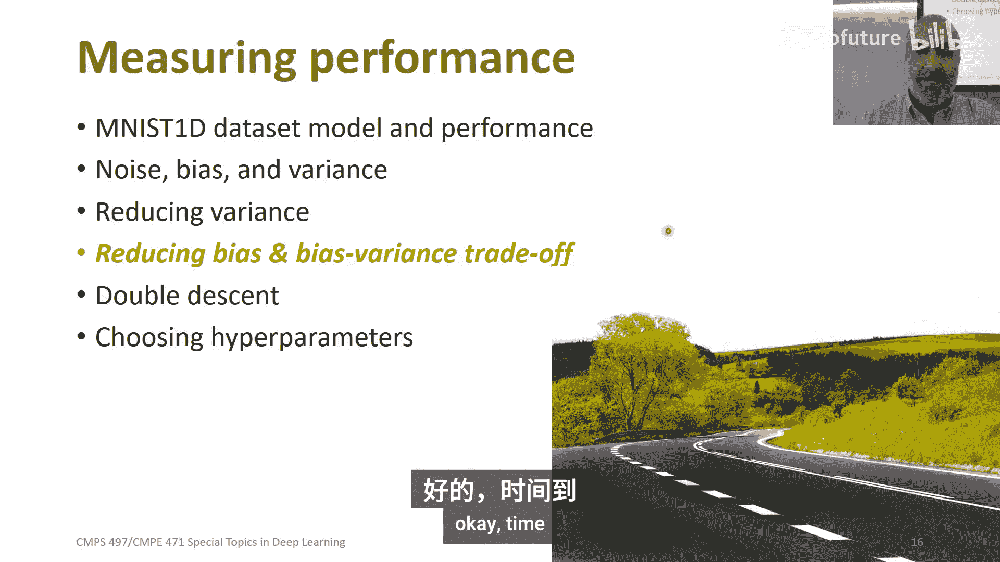
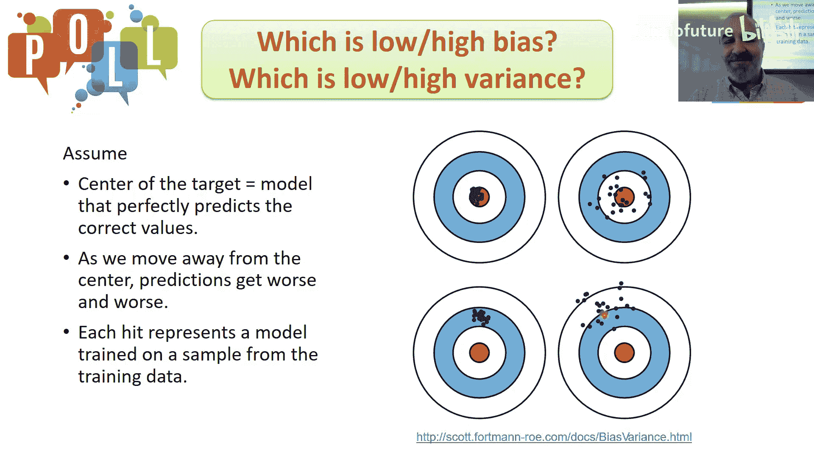
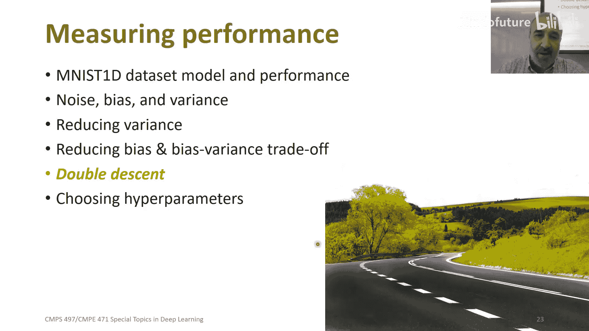
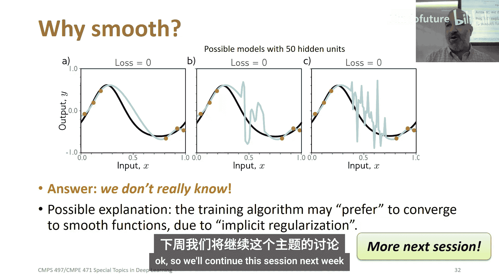

# 【卡塔尔大学】深度学习 CMPS497 ｜ Understanding Deep Learning ｜ Fall 2024 p15 P15_第十五讲-性能测量 I -BV1vQvNz1EeK_p15-

。In the previous lecture， at the end of the previous lecture。

 we started to talk about measuring performance。We talked about the M dataset if you remember this one。

 and then we said that we have a variant of that data set with only 40 features of 40 input values。

And we describe quickly the network that we would use in the experiments that we will see in this chapter。

And then we started to talk about the performance。We looked at the left side figure here， which is。

Ploing the performance of the model when we increase the number of steps。

 So when we go more and more in training， the performance is improving。

Because the A of view is decreasing and that's on the left side， on the right side。

 the loss also is decreasing。And the last question that I asked in the previous lecture was is that the real performance and I think the answer is no。

 because we really need to get the real performance。

 we need to test the model on on scene data and this is scene data right this is the training data so it is possible in many cases to get zero zero loss。

On cleaning。IIf we spend a lot of time trying to find the global minimum， we might find it actually。

 Okay， so that's， that's not hard and it's not hard to get 0。Ontain。

But that's not the measure that we should look at， the measure is to get good performance on unseen data。

So let's see what the performance will be on tested。So the green， the brown one here is on training。

And the green is on test。Okay， and same here。Now， there are multiple observations， first of all。

Do you see any difference between the performance on training and test？The everything is， of course。

 over。So the first thing， the error of the test。It starts to decrease。

But then it's kind of stable or after maybe this point， I don't know this is maybe 2000 steps， okay。

But still， relatively， is it better or worse。Or the the， the， the， the ever own training。

Of course much worse。Okay， much worse standing this is this percentage is really high compared to the percentage that we got here。

 it was almost0 K on training， but it is diet maybe 30% on test。

If we look at the loss on the other side， you will see that it's also getting。

Decreasing over time up to specific points。And then。Increases。On test。 That's on test。On train。

 of course， it was declining。 Okay， I mean， the loss is is decreasing。

 which means that the performance is better on training， but on test it's a different toy。

 It's getting better。Up to some point and then getting worse after that。

This is this is what we can see。 Okay now we need to explain why is that happening。Okay。

 so the rest of the lecture will be on why is this happening？Okay， and of course， with。

 with what we saw in these two slide two figures， we can say that the model has not generalized well to the new data。

 The model was perfect on training， but was really bad on test。

Withcy。嘅冇事。So now we will discuss three types of errors that the model might fall in in the context of learning。

Noise。Bs andvi。Okay， so these are three types of errors that the model can do。

And I want you by the end of this picture and Charah to really understand the differences between these three。

Noise， bias and rightss。After we define them， we will start to think how we can reduce each of them if possible。

So that's the goal right， I want to really reduce the errors as much as we can when we do when we measure the performancesome test。

So we'll start with a toy example just so we will use it to really understand what's the difference between these three types。

This toy example is that we want to fit a model to a s soidal function， sine wave。Okay。But。

So this is the actual function that we want to approximate。😡，But of course。

 you know that we get training data， we don't get the function， we get some samples of that function。

And the samples here are done in this way， we sampled the input between0 and 1。Uniformally。And。

Actually， not so I think it's uniformity。And then the output instead of getting it from the function itself。

😊，We get it from the function， but we add some noise。Okay， so for example， this point。Yeah。

For example， this point。😮，We should have get gotten this value。 and instead， we got this value。Okay。

 so the orange of the brownwood points here are the training examples that we will get。

To try to fit to the， to the actual model。Okay， so don't understand what we are doing here。

So this is the problem that we will be working on just to define the three sources of earth。Okay。

 so the problem here is that we have so this is the regression problem we want to fit to predict the values。

 given the input values here， I want to predict the output values。The original。

 the actual output values are following this sine function。

but the trainingial data that we get has some noise instead of getting the exact either y value is not the exact on on the sine curve。

 it's that value plus or minus some noise。Okay， so you understand the setup now。Okay。只要是。

Noise in the in the data itself here instead with animation and n this okay， this value。Okay。

 belongs to this x value， right， So instead of having it to be mass than n。2， it's 025。对。😊，Yeah。

 we were not 3。2。 We 3。25。企。But still， we want to generalize to the actual function。😡。

We want to try to approximate the actual function。Without， of course， knowing the actual function。

Yes。😊，你W问个是。哦。Well talk about the types of errors。This is this is one type of thing we would see we see。

对。To to solve this problem， we assume that we have a toy model。 that's a very small model。

 It's a shallow network that has k hidden units Okay so something like that。

 but the number of units here is k。And we will assume that the weights here are fixed。

Fix it in a way that remember the weights here represent the lines okay and we selected the weight so that we will have joints that are equally distance with equal distance so it will be distributed equally in the range between0 and1 so do you see here this example the joints here are after the first third。

 second third and then the whole range so we selected these weights particularly to do that。

Okay so that we can see the output we can understand the output much easier。

So by doing that and making these weights free， so we learn these weights。

 we can learn functions like this。😮，Or that。All this right these are the just three examples of the function that we can do all of them have the same position of the joints。

But with different slopes。Okay， so eventually we want to learn one function like that。Not of course。

 with three joints， but with key joints from the key hidden units。Okay， with me so far。对。

Now we will define the three types of errors。The first one is noise， what do you mean by noise？😡。

Noise are errors that are inherent in the data itself。Like in measurements。

 instead of measuring something to be massNn 2。5， we measure it to be 2。52。Yes。😊，No more。

 what do mean by the actual data， it's damaged， it's observed data。

 whatever we observe might have noise。Okay， so this is a im measurements。All air in labels。

 instead of labeling something to be positive， maybe one human can say positive and the other can say negative。

 It's subjective。 Okay， so there is some noise in the data that comes inherent in the data itself。

 We don't control it。Ting， training and test， of course。Okay， and even test。Okay， any observed data。

 any data that you collect might have some noise。Naturally， in it。停。

So this is kind of inherent uncertainty we don't know if this data or how much this data has actually not。

So this type of error that comes naturally from the data is unavoidable。We cannot do anything to it。

We can control it， right。It comes with the data。So that's the first type of errors。Okay。

The second type is called the bias。So actually， let me get back to to the noise here。 You see。

You see the gray area here。Remember， when I told you that when we generated this data。

 we added some noise。We added actually some noise based on the normal distribution。😡。

So this gay area represents the variance， actually。Okay， so I can。Gen a value for this x value。

 And if it's correctly trivial be on that curve。 right， But I can actually， by adding this noise。

 it can be anywhere in that region because of the noise。

 we are doing that artificially on this problem。 But in reality。

 there is noise that we don't control that's coming with any observer data that we have。Okay。

So that's the first source of errors。The second one we call it bias。

Bs is because of the limitation of our model， our model might not be flexible enough。😡，To fit。

The data that we have。For example， this is a sine wave， right？😊。

Can we fit it with three pieces a of lines？Not easy， right。

So whatever you will do with these three pieces。It will never be able to fit it perfectly。

So this is the limitation in the moderate set。😊，In the extreme。

 if I told you that this is just one line。😡，Whatever you would do。It would be really bad， right。

 So that's a type of error that that is inherent in the model itself。Okay， so instead of。

Learning the sine wave， we learned a piecewise linear function。Of course。

 there is an error that is or there is a difference between whatever we will predict based on this piecewise linear function and the actual science story function。

Okay， and this is the gray area here。That indicates that type of f， the biasel。给。你什吗。我。

Each model is limited somehow in terms of flexibility。The power of the motive。Okay。

 how flexibility it is。If the data that that we are trying to fit is really representing a complex function and I'm trying to fit it to very simple model。

Would you be able to do anything。It will be very bad， right， that's what we mean by the bias。😡。

The model is biased。Towards some specific。Types of functions。 but it cannot do with。

 with other functions。Okay，But of course， in advance。

 sometimes we can think of what kind of models are good enough for that problems and sometimes not。

Okay， so this type of L is inherent in the model。iss due to the limitations of the model。

So this one we can control， right？By changing the model somehow， okay we'll see how to work on that。

嗯。Noise we can't， we cannot avoid noise。So that's bias。The third one is called variance。No。Varance。

Is。Due to the fact that the data that we have is limited。Yanni。

 let's say that we have100 training examples。Okay。Handing examples might not be enough to area present。

The function that we want to to fit。 Okay， might be very small。Yeah。If I change that 100 number。

100 points to another 100 points， I might get different model。Right。

This is what we mean by variance if you change it if the training data。😡，Change it。

 the model it really change， there will be a difference in the predictions that we can get。

And that's due to the choice of the training set。Yeah。

And so this is the limitation based on how we collected the data and what。

 what the number of training examples are。即。So that's the difference between these three things。

Noise is inherit in data。We cannot avoid it bias is due to the limitation of the model。

And the variance is due to the limitationmit of the data itself。

Okay。第。Now， let's think how we can control these things。Can we control noise， No。

 we cannot reduce noise， So we will not be able to do anything with noise。

 So let's think about the other two variant and bias。Yes。

So you mean sample more or something like that whatever， whenever we sample， there is inherent noise。

Okay， and more in the real cases， data is not perfect。喂。So whatever you sample。

 it will have some noise。now let's think about reducing variance。

Again， what is variance？Valance is a type of error of uncertainty in the predictions of the models because of the way that we selected the training data if we change the training data。

 we might get different models。Right。对。How can we reduce the variance。Exactly。

 by increasing the the the same the the the training examples， as I increase the training examples。

 I get better representation of the actual function。Okay。

 so if you change it again might not be a huge effect。's let's see how this works。

This is the same problem that we were talking about but。We have only six samples。

 six samples here means six training examples。And the three examples are actually indicated by these orange points。

Again， remember that these these sampless are coming from the way that we talked about with adding noise。

 okay。T on with six samples， that's not enough to really get the actual function。 So in one case。

 when we have these six points， we got this model。 Is that a good model。No。In another。

 if we change these six points。If we got another sample with six points。

 we will learn a completely different model。Okay。😊，If we change this a third time。

 we'll get a third different model。Now the variance is how these models are different from each other。

If we plot the average prediction among all of these three points。

 you will see that they are different with this gray area。

 So this gray area indicates how different the predictions are if we changed the。Exact data points。

 the exact training points， but with the same number。And。

 all of these models are trained over six training examples。But different examples。Okay。

 they are they are coming from the same problem， same any same source， okay， but they are different。

Because they are not。Because they are limited。Okay， and every time we learn a new model。

And these models because this data is very limited。😡，These models are really different。

So you can see the gray area here is really big。 Now， if we increase the number of samples to 10。

You will see that well get now now the samples are 10， but still they are different Okay。

 so here we get this model here we get this model here we get a third model Now are they very different。

They are different field， but not as much as we had in the previous case。

 That's because now we have more training examples。 Okay， so when we have more training examples。

 then we have a better representation of the function that we want to approximate。

So the variance here still is not very small， but it is smaller than this case。Now。

 if we increase the sample 200。Now you can see the0 because they are random samples， right。

 the hundreds are covering pretty much the whole range。😊，So if we change this0 to another00。😮。

We not get a very different model。If we change it the third time， we not get a very different number。

 so the variance here is very small。Okay，Yes。嗯，我。嗯。嗯哼。也是前。好有天。准的准定。对。This one。B嗯。没儿。Well。

 what are you mean by similar？Close to each other， and mean。的微置。we don't visualize。 Usually this is。

 this is because we have just one or 2 d。 actually 1 d problem here。 It's just one input。

 but usually the inputs are huge and we cannot do this visualization。 It's not easy。

 But if you are saying that we can select the examples in some way。

Sometimes the examples are too few to select from and we don't control how they are actually observed。

 sometimes we get the data。 we don't act we are not the ones actually who collected that data and sometimes we don't even know how this data were observed。

So we don't have that control over the selection of the data。Especially if there are very few。

 so you cannot afford missing or removing one of them。I guess。哎你要是是。嗯，嗯没有。我意思。然后就那个。Yes。In each。

Each time that。Is it okay for me。Each the select。Okay， let me answer this。 and the answer is easy。

 What you are saying is not what you are doing in reality。 Okay， actually， in reality。

 you are not doing this multiple times。We are doing this。 We are doing one of these only。

 And in reality， let's say that we only have6 training examples。 Of， we will train with that。

 We have one model。 but the what what I'm trying to show you here is that。

The model depends a lot on the training examples， so if it happened that you change this。

Then the behavior of the model will be different。 type why we care about that if we just have one model。

 We will not have three models。 We just have one model。😡，Because the test set。

 it's like a different sample。We will be uncertainty if the variance is high about the performance of the model on the test set on the unseen date。

Here， the uncertainty is limited。Here dancing is too high。So you might get very good model like that。

 maybe， or you might get very bad models。Okay， but here， it doesn't matter any。 any here we are。

 we have confident。 we are confident enough that it won't make a big difference if we have a different sample of the training examples is。

But did you get my point that we are not in reality。 We don't do that。

 We are doing this experiment to show what happens if we change it， to show you that。

It's really critical The number of training examples are critical and the distribution of the training examples is very critical。

 Okay， so if it change it， if it didn't represent the function well。

 then the model will be like random。😊，Okay， so there will be no confident in measuring the performance of that model。

 I mean， if you measure the performance of that model to be mass and or that model muscle to be 80%。

It' not's not guaranteed that you will get that actual performance on E data。嗯。But here。

 we have more confidence。You have a question。Yes。It in the piece something。还有一个。我常问。嗯。

We trained already， these are different models that are trained。

Okay all of these models are trained and this is after training。

 this is the model after training using this corresponding training examples。😡。

Okay so in one0 in10 here we have six points only， so we trained we got this model because we have very few training examples here the training examples are a bit more so the model is a little bit better here the model is really good because we have so many training examples。

 so the model learned a lot from the training examples。喂。Did I answer a question？嗯。So what。Blue。

 I don't see blue here。Okay， they going in， okay。Sin。我为。Is it。或者。Okay。

 the questions to all of us are these models the best？😡，This is not necessarily， of course。

 this is what we got after training after we stopped the training。😡，Okay， actually if you。Yeah。

 so each model of these models were trained using gradient in descent。

 but using this limited number of training examples。😡，If I have very few tiny examples。

 well how would you perform well？ItYou， you， you have， you have to be weak。 And。

 and there's no chance to really understand the actual function that we， we are trying to model。

 right， I， I think that the good analogy here and and。

And I will use it later also in this lecture is when you study for the exam。If you solve。

One question only before the exam。It's not like solving 20 questions， right？😡。

It's not like solving00 questions。Okay， what would be the variance of now assuming that you would solve only one question。

😡，And you actually have hundred questions that you select only one of them randomly。😡，Okay。

 maybe that the question that you randomly selected was really good。

 so your performance would be good， but if you selected another question。😡，If almost might be bad。

 That's the one column here Okay， using the same training number of training examples。

 but different selections， you might get different results。 But now。

 if I told you select among the100， select 90。Will it really make a difference Which 90 out of the hundred。

😮，90 is good enough。 Whatever the 90， I think I will do well if I， if I understand， of course。

 how to answer them。 So the variance in this case will be really small。

Did I answer your question now。我那。叮叮当。It will be will be good it's not low。

 but it will not it will not be whatever we we will actually measure on the test data。

 it will be close to the performance we be close to what we see in the real world。😡，Because the。

 because the the sample that we got was。Any good enough with width of the size in terms of size that it represents the data that we have。

It's like studying exercises of chemistry for the deep learning course。Okay。

 study there as much as you can， but you will not get anything。Yeah。Okay。

 any other questions so the idea is to add more samples， increase the training data。

And that's how we can reduce variance。Now， how about bias。 So what is bias again。

The limitation of the model。 How can we reduce bias then？Now if we will use the same model。

 how can we how。Talking about neural networks， how can we reduce the bias？

No no data changing the model。Ex more parameters。So increasing the capacity of the model。Okay。

With adding more parameters， with adding more hidden units or more layers。

 we increase the flexibility of the model， right？😊，他个。How this other di， yes。我专你。每个人。

That's what I just mentioned it's an error based on the limitations of the model。

Okay so a model might be very simple， much simpler than the complex function that I'm trying to approximate。

 so that's a bias。Okay， type now， as you said， how can we reduce bias？

We increase the capacity of the model okay， and the capacity usually we indicated by the number of parameters that we have。

天体。

So。This is。When we have three issues only。That's what we can get。 If we have5， it's better， right。

 if we have 10。It's much better。Okay， so now we are increasing the bias。

 we sorry we are decreasing the bias by increasing the capacity of the network。

Of the model in general Okay here we have 10 lesions。

 which means 10 hidden units if we are talking about the shallow network， actually。

 this is the shallow network， as I told you in the area。

 so this is increasing the number of hidden units。Okay。Tpe。Now， so this is increasing the capacity。

 Now， what happens to the variance。Because when I'm increasing the capacity。Maybe the variance will。

 will change。So this is what happens。This is what happens。So this is three regionss。

And this is showing the bias。Here we are showing the variance。 So this。

 this gray area is showing the variance of that model on the number of samples that that we trained on here。

So whatever the number of samples here？We will repeat that to get an indication of the variance。

We will repeat。Sampling。And this is what we get when we repeat training a new model for each new set of training exam。

So this is exactly like what we did before， but we are not showing the different models。

 we are just showing the average the variance of the models。Okay， so this is like repeating this。

 this so many times。😡，Okay， and this is like repeating this model so many times with different samples of the same size。

几。T what do you notice as we add more as we increase the capacity？The variance。In。

So the bias is reduced， right？Because now the model was able to fit well to the data。

 but the variance increases。因为。So the variance will increase。ok，第。So this is， okay， this is cold。

Bed very trade of。Okay， so while we are trying to increase to reduce the bias。

 we are actually increasing re varianceance。That's a trade off。Can we control that， we'll see。Qu。你4分。

第一个。No， no， no no， the okay variance again is variance in predictions if we change it the training examples that we are training the model law。

And just same， we will train on00 examples okay。If I have 100 examples， I will get a model， right？

If I change it the10 examples to another100 examples， I will get another model。

Will they have the same predictions or not？They will be different。

 So the variance is how different they are。Okay， so here the gray area means the predictions are really different as this gray area decrease。

 that means that all the predictions are very similar to each other when we change the training set。

Okay。Yes。呃，你你觉。都不认。Now we as we add training examples and we are not increasing the capacity decay or not。

So while we are increasing the capacity， we are actually increasing the money。

 so let's see why is that happening。Okay， let's see。 why is that happening。

Why does variance increase。Okay， this is。Beear with me until the end of this slide。

Here we have just three issuess， okay。Just three reasons。And we are changing。

 we are using the same number of staying examples， but over the three figures here。

 we are changing the data points themselves， but with the same number and here we have。

 let's say as than 20 here we have another 20 here we have a third20 each time we are doing that。

We have a different model。Okay。😊，对。Now let's increase the capacity of the model。

 which means increasing the number of lesions。Instead of having three pieces， let's make。10 pieces。

Look what happens。But that is。It's fitting the training data very well。perfectly， but to do that。

 it does anything anyway to just fit the data。Okay， exactly memorizing them。Busofed。Exact。ok。

And we can get something like that。Still， this is fitting perfectly attain data， right？And all that。

Or that。So you can see that there are many possibilities to do that when we increase。Their capacity。

 And that's why the variance is increasing。Okay， because now it is more flexible that the the model is more flexible to the extent that it triess after fitting through the training data。

 it fits to the noise in that data。Over everything exactly。That's what we mean by overthink。

 So much of the extra descriptive power。Which the capacity that the model has is devoted now to modeling the noise instead of just modeling the data。

그。Okay， and that that's what we。Defined as overfitting。So the model memorized the training data。

 but it doesn't generalize， of course， to uncecing data。 so。The the the bias will will be used。

As we increase the capacity。Because we can fit the data。But， not that much。

So that we can also fit the noise。Wwhichch happening which happens in this case So when we fit noise like that of course that we not generalize right and we don't expect that this is or this one in particular will be good when we test it when we when we really use it in reality I mean when we test it on once。

Okay， and maybe this is better。But as you see， it depends on。The sentence。Okay。

 which sample we are getting， sometimes we get something reasonable like that。

 sometimes we get something very bad like this or that。Okay。What does the black line represent？

The actual function， there is function。That we would like to get Taman Han， when we train。

 do we see this function， Of course not。对。嗯。对。That means that as I told you。

 there is a bias variance trade of。Okay， buyers buy of。

And this figure captures whole the summary of all of that as we increase the model capacity。😊。

This is the x axis。 Well see the error on the y axis。 So do you see the bias is decreasing。

Because the model than now is more flexible。😡，As the capacity increases， the， the， the bias decrease。

 right， The bias is the brown。The brown curve， Okay， as we increase the capacity。The model。

 their variance increases， of course。The very increases。Now， if we consider both。

There is a sweet spot here when the bias and the variance together are the minimum possible。Okay。

 so it's bad。Getting， getting better over time and then getting was again。 Okay。

 so we hope that we can try to find this sweet sweet spot。😊，Yeah。但哦。But that's not easy。Okay。

对 questions have。你是在。男人球。all the lowest possible together Ma how thearrow。 Yeah， yeah。

 thearrow is is is a mix between these。 And by the way。

 it doesn't It doesn't mean that it is additive。 any， it's not always the sum of them。 Okay。

 it depends on the model。你This one。被害人。Now we need that specific capacity to do what to do well on this set。

 right on unseen data。So that means that it's not always good to increase the capacity of the network。

It's good to increase it to some extent， but not too much。😡，Okay。Because if you include it too much。

 colors you are now the dotted curve be by the way is the sum of them。Okay。

 so we would like to get this somewhere in that curve。 that is minimum as much as we can， okay。ok。😊。

HereHere's a question。This is， I'm trying here to show you the meaning of the bias and variance I hope it's in an easier way。

 You know that game。Imagine that the red circle here is the target and whenever I get the R there。

 this is like I'm having a perfect model。Okay， mother that predicts perfectly。

And when we are out of this circle， we are not getting perfect model。And every dot here。

Is like a model。Okay， it's like when we when we throw the hours。

 we might get it in the circuit or might be outside， okay。

 depending on how good we are right so every so the center is the model that is perfect and as we move away from the center。

 predictions of course get worse so the these dot means worse models。

and each hit represents a model trained on a sample from the training date。helello。😊，Okay。😊。

But now we have four。Yeah。Of this。😡，Life you can think of them as four persons。Okay。

One person did that， one person did that， but every hit is diammod。Okay， in our， in our analogy。

 our context。My question is， which of these is low or high bias？

And which of these is low and high variance。Think about it a little bit。Yeah。You have the answer。

Okay。嗯。Where is lowbi。Low bias is。那我觉我觉那个都B。Close to the red。Okay。

 so which ones are close to the red。This one。Okay， this is low bias， right， and this one。

This one still also no， if you， if you， okay， if you think about it。This guy。

Knows that the target is in the center right， but not it's not very accurate。

 but still it's trying to get to the target right so his bias is not very bad。😡。

So we can't say that this is low bias。😡，And this is do。 But this one。Is high variance。Yes。

 because it is scattered。 but this one。Is no bias， no vs。喂。😊，有。Okay。Good， how about this one now。

 variance low variance。 high。 This is like someone who has show is short sighted。

 There has a vision problem。 Okay， I see and this is mine myself， by the way。

m not there now with with the age I'm not any seeing  hundred0%。

 So I think that the target is a little bit to the to the left。 I really see to the left。

 I don't see it on the right position。😊，Okay， so， but I'm accurate accurate based on what I see。

This is this guy。 Okay， He thinks that this is the center。

So he's very precise based on what he is able to see。Okay， this is like a model。😊。

That is doing its best。Okay， but it does it。 It's not able， to iriate well， because it's。

It has a problem， It has a bias problem。 Okay， the model is not flexible enough to fit the data。😡。

Okay， so this one is。High bias， low variance。 And this one。あめか。This is Jen。 This is the worst， right。

 Hi biasas， he thinks that the the center is somewhere here。 and even it's not accurate。When its。

 it's trying to get it。即。

So， empire。Now we will so you understand， I think now that there is a tradele between the bias and bias。

 right？There is another phenomenon。😊，That is very recent。 It's called double descent。

 Okay so bias variance straight off is really old， but so it's known for a long time。

But this actually concept that we will just study now is， I think very few years ago。

 maybe three or four years。

Okay， now what's double the？This is back to the AmIS 1D dataset set。And we are trying to see again。

 the difference between the training performance and the test performance。

And this is assuming that this data set has no noise at all。😡，The data has no noise。Okay。😊，Now。

 you can see that the training。On， on training data， as we increase， what are we increasing here。这。

The the hidden layer size， which is the number of hidden units， which means we are increasing。

The capacity of the model， okay？As we increase in the capacity of the model。

The training is getting the the the performance of training is getting better。

 So we're getting less error。Up to a point where thearrow is。Here zero。

 which means that we are perfectly predicting the values for the training example。

And it will it stays busy youhalas， okay， the model。Perfectly fits the training examples。

This is on training， on test。😡，It's the， the， thearrow actually is getting。Is decreasing。And it's。

 it kept in decreasing， actually。Okay， it doesn't have this trade off， so it doesn't go up and down。

So， as we are increasing。The capacity of the model。This this is contradicting what we just saw right。

 what we discussed earlier that when we increase the capacity。

 at some point the L will increase because the variance will increase。😡，Right。

Here there is no noise okay that's the point and that's not realisticistic， of course。Okay。

 so in the ideal case， that will not happen。But because there is noise， of course。

 it will it will happen。 Okay， so that's if we don't have any noise。And just one more point。

You see this dotted line。😮，This is the value where the number of parameters。

Is exactly equal to the number of training examples。Okay。Okay， why is that important， you're saying？

This is like an indication that the model has enough capacity to learn from the examples。I mean。

 you can think of it that way roughly that every parameter is taking care of one example。Okay。

 so if I have100 examples，10 parameters， it will be enough to fit fit this data。

 but actually what happens is that even before that。

The the model was able to perfectly fit the traininginium data because there's no noise so it was really clear。

 I didn't need that many examples actually to fit the data perfectly。Okay。Now。

 let's see what happens if we have noise。If we have 15% noise。We start to see this trade off， right。

So， the error is decreasing。And then， increasing。And that's after。

The point where the the parameters is equal to。 And if， if you can see here here， we， we。

 we reach0 L before that point。He will to。Almost at that point。Okay， almost at that point。

So this is showing exactly that the overfitting problem that the model now memorize the data。

 but doesn't generalize。Okay。So the best performance actually of the model up to this point was at something like here。

 Okay， it doesn't have zero loss。It doesn't have zero error on training。

 but it generalizes better than this point。Okay， with me so far。Qu슨。love。M。The high but the。Yes。

 because that's we are。 we are looking at now the test， the performance on the test set。我现在给你念一下。

The energy is very high or what。There is no。嗯。干嘛呢？不是就是。Yes， it's okay。

 so me let me tell you the analogy that's that's easier。You are studying for an exam， okay。

 you have all the answers of quizzes and homeworks。Right you memorize them。

 So if I give you these problems in the exam， you will perfectly answer them， right。

So you have0 on0 L on cleaning it。Right now if I gave you new example。

 new problems in the exam because you didn't understand aslon， you are memorizing。

You would be very bad in the exam， right？Right so you didn't generalize from what you learned it to unseen problems in the exam。

这个。But。Now， if you if you didn't study， if you studied that the problems， well to understand them。😡。

Their problems of the homework and the quizzes。Not maybe to the extent that if I give it if them to you again。

 you will， you will solve them all correct。 You still have some， some problems。

 but you really understand how they are solved。 If now in the exam I gave you unseen problems。

 you would do much better than memorizing the quizzes and homeworkex right problems youre not sent now。

 Okay， so you might have none0。A for training， but better on test because we understand generalizing is like understanding in the context of students。

Good。Okay， what happens after。So now we are going even having capacity that is over。

The number of examples that we have。So it's like we are adding capacity that we might not need us。可以。

What happens is that you will find that the performance actually is getting better。So we had this。B。

Okay， and then the performance is getting better again with adding more capacity。

That's not what we learned in that the bias various state of it， we thought that it's like that。

But it seems like there is two things here， that's why it's called double descent okay it's increasing here and then increasing again。

Okay。This is a phenomena that was not discovered until three or four years。后。What's see。对。对。Let's。

 let's see， let's see， let's do some definitions first， this part。

Before before reaching the point where the capacity is equal to the number of examples。

 we call it classical or under parameterized regime。

Under parameterized means we have parameters less than the number of three examples。

 which means that we have capacity less than what we need kind of。Okay。😊，It's like， you should。

Study for the exam for 10 hours， but I just have two hours。🤧Okay。I will try to do my best。Okay。

 but that might not be enough。And then at that point， we call it criticalology when both are equal。

And when when this phenomena happens that the performance is increasing again and the other part is called modern all over parameterized regime over parameterized regime this is the interesting part this is interestinghu。

Yes， exactly when you have much more time than needed to study for the exam。So does it happen ever。啊。

You have。You have the same content and you have more time。

 maybe youll spend that time on watching the TV so that you can you really forget the concepts that you just studied okay so you are wasting time。

😡，You might be wasting time or spending time on something useful。

Always spending time on something bad。We see。Okay， so this is just， of course， a Fi analogy。Okay。But。

 now。Does that actually happen in other data sets， So maybe this is something。Only for this data。

It actually appeared that it actually happens with other datas。Okay， so this is Ms。

 This is the original data， the M data set and happen even any。Har harder way。 Okay。

 so you see this is the performance。 and then it's going down again。

 And and the more the interesting part here is that even if you look at this。

The point here is we are getting performance even better than this。对。And also here。

 you are getting performance that that's better than this。Okay， and in another data set。😊。

This is without noise， you can see and it happens， but in a very small way and here it is very clear。

With with noise， when when we have noise in the data。

So this is happening not only in one data set in multiple data sets， in multiple occasions。

So the question is。Why。Why， why is that happening？Okay， why is that happening， Let's try to think。

In in after this point。The model really fits the training in data perfectly， right？😡。

Any from this point， actually from this point in this case。😡，That's the noise。

 but we are talking about this case when we have sorry this is without noise。

 when we have noise the model started to have0L at that point right after that point it kept0L that means that it perfectly fits the training data。

 hellos and it's done with the training data hellos right。😡，ok。第。But here， while， while there is。

 while the error is 0 here， the performance here is increasing。It's getting better。

 It's getting better， even though。It's not getting better entertaining。

Andas we are done with the training data， but it is getting better。😊。

That means that whatever is happening。😡，Is not about the training data itself。

 It's not happening at the training data points。It's actually happening between the data points。Okay。

 and I will， I will explain what what I mean by between。

But you can imagine it if I give you some data point， some sample。You can generalize between them。

 right， or you can do whatever you want between them in between。😡。

As long as you are facing all of them are I all of them。And let me， let me show you an example here。

Yeah。If I told you， I want to fit。A curve between these two points。How many possibilities I have。

Infinite right， infinite， I can start by just a line if you can think of a line as a curvia special case or I can do it that way or I can do it that way or even once I can do it that way。

 by the way。😊，Whatever or yeah， or two lines like that。 I can have so many things， right。

 all of them。All of them。Are fitting the data perfectly， right。

 but they are doing something in between。They are interpretpoing。The function in between the way in。

 in some way。Right。So the must be the way that we are behaving。

 I mean we hear the model the way that the model is behaving in between the data points is the thing that is making something like that happening。

That's logical， right？Okay。So the model's behavior between data points is very criticaled。And to。Why。

 I'm predicting this， I'm overfi。So why， why， why is that the model here between the data points is dedicated。

 Let me。Convence you by a concept that is very known called curse of dimensionality。

What do you mean by curse of the dimensionality？If I told you。That， I have just。2 inputs。

That means that I have just two dimensions， right？对。I want to select。

Data points so that I cover this space more， as if if the data。

 if the training data points are covering the whole space。

 that means that it represents the the actual function when so that so that I can。

 I can learn well from from this data。 But if， if I have very few data that doesn't cover the whole space。

 then I have to cover the whole space my my own way。关那个。Okay。I have two inputs。 Okay， X 1 and x 2。

They can have some values within these ranges。Okay， is these are the input features。😡。

In order to learn very well how to map from these two inputs to the output。

 I need training data that covers this 2D space。I mean， some data here， some data here。

 some data here， some data here， some data here， some data here， some data。

 right to cover the entire space， right， so that I can understand how this function actually behaves。

So that I can play in a good model， so that I can play in a good model。 as many as I can。

 that would be better。 Alas， what if all the data are here。Yeah。Do I actually learn。

I can fit all this data， but I have to imagine。Having some data here and behave based on that。

 I have to interpret in the other part， right？对。To give you a concrete example。

And to show you the effect of the curse of dimensionality。好呢。然说。No， no， no。 Actually。

 the best is to spread the data across the whole space。Right。😮。

So that I can understand in each so that I can understand in each area。

 And it maybe maybe be easier to to see that in one D。 Let's see that we have only one。

 only one input。 Okay， and we have one output。 And the function is like that， Me。Okay。

 but I get all the points here。I get old the training data is here。 Okay。

 can I general the this function， Of course not。😊，But if I get some points along all the space。

 then I will learn the better for us。 Now， let me show you that by numbers because numbers here are very important。

你。Okay， let's say that we have be with me， please。 Let's say that we have two。Dimenssions only， okay。

And I can， just disreettize this。Each dimension to five regions。Okay， so 1，2，3，4，5。

 I would do that also for。The other damage。Okay， so I will。Divide this space into。

How many issues now。Five times 5，25 lesions。And I will hope that each issue is represented somehow in the data。

 in the training data， right， that would be the best。哎。😮，So in that case。

 I need some points here and some points here and some points here and some points here and some points here。

 right， so that I can。I can generalize， well。Okay， now imagine band we have 40 dimensions， not two。

Okay。This is and this is very small， by the way， 40 is very small。😡。

If you have an image that is 1000 by 100， you have million dimensions。 Okay。

 but let's imagine for a second that we have only 40 dimensions， okay。T 40 dimensions。

 I will divide each dimension into just 10 bins， only 10。😡，Okay， now how many bins I have。

 how many esians I would have。10 times，10 times 10，40 times right。

 So I will have 10 to the power40 bins。Okay，10 to the power，40 regions to cover。

If I really want good representation of the data。Okay， fine in reality， this data。

 so this is 10 to the power 40， okay， it mirror everything so that。No。

 no just a second this is an argument。Okay， there's an argument。

So 40 dimensions we have 10 to the power 40 bins， okay， bends here means Asians。

Type now this data in particular has just 10000 data points。Can so the means1 to the power4， okay。

That's very small， compared to。Yeah， that means that not even every bin has。One point， it's not。

 actually， how many， how many。How many bins are presented by every point here？No。

10 to the power 40 divided by 10 to the power 4。Right and now we have only 10。

000 if you distribute this 10，000 over this bin， that means that every one single point of this 10。

000。😡，Has actually 10 to the power 36 bins。啊。😮，그。No。嗯。40 minus4 actually。Right。

 so every data point is presenting。T0 to the power 36 regionss in that small space。Of course。

 this is big to us。 Okay， in terms of numbers。 And， but there are much bigger spaces。 So here， what。

 what do you see now， What do you， what do you understand now。That the data points are very， very。

 very， maybe to tomorrow few compared to the space。That we have。

So does it cover thean very little in the space？😡，Okay。

 so we call this curive dimensionality that in high dimensional space。

 the training data are extremely sparse。 Have you heard about the word spae before。

 Sprse means very few。When we say itposs， that means that everything is zero。

 except very few nonze values。So this the data points。

 the training data in in when we have a high dimensional space。

 high dimension space means that we have。Many imp features。Okay。

 so every data point is covering very huge area in that space。So we are not actually。

 it's like if you think about it10000 compared to this number。

 which I cannot actually tell it's 10 to the PowerPo team I cannot name it okay。It's like zeal yet。

It's like not there。He is's not covering anything。 Now， the model needs to。Fit or interpolate。

Between these points。RightBecause the model the model needs to see the over picture right so inside that huge space it only has 10。

000 points so it has to interpo between them。Okay so this is the curse of dimensionality it means that the tendency of high dimensional space to overwhelm the number of bit points。

 that means that the high dimension space is much， much， much bigger。

Then the number of the size of the training examples。对。

That's what what I I I explained that we have 10 to the power 40 bins， but we have 10000 data points。

 So each one of them。And if you divide this by that。😡，That means how many bins。

For each one data point。哎。And imagine this number is 1000， and we have 10 data points。

Every one of these 10 data points， how many bins is it presenting 100， exactly。

 which is this divided by that， right？Yeah， but now it's when you divide 10 to the power 40 by 10 to the power 4。

 it's 10 to the power 36。Which is one with 36 years。对。It's like zeal。

So that's what we mean by cur of dimensionality and as we increase that。

 this is even getting worse right when we have million dimensions。

How many data points were to cover this space？😊，That's very few。

If you have1 to the power 40 data point， that means that each bin is presented by one。Okay。

 even if you each that， but can you imagine 10 to about 40 data points。Of course。

 that's not in real life。 Of course， and even in real life we have spaces of many dimensions。

 that's what I'm saying。Okay， so that's that's that's exactly the problem。 Okay。

 so that's why I think now you understand why the model behavior between the data points is static because it will try to imagine as if the are points between the actual data points it will imagine some coverage of data points has to interpolate between them and they are very spa。

Okay， so it can do so many things in between。So。It might this is an example of sparse data。😡。

That this is the curve， but I got just three points here and just three points here。

 and we imagined that we didn't get anything in between。Now， the movement has to。Innovate， Okay。

 so this is one innovation。 Okay， The model fits the data well。

 but it does something weird in between。 This is another innovation。 Maybe if it looks better。😊，Okay。

 and that's with increasing the capacity， by the way。 So this is 6 hidden units。 This is 7。

 This is 8。So it looks a little bit better， right？And with 10 better with 50， it looks even better。

Yeah， that's what we are saying that that's what we saw that as we increase the capacity。

 the performance is better， right？And it turns out that when we say better， it looks like smooth。

So when the function gets smoother， exactly， we're not doing weird stuff exactly okay。

 so the potential explanation here is that when we increase the capacity。

 there is a tendency of the model to have to be a smooth function。To be a smooth model。

With more hidden units。Okay， so being and being smooth is a reasonable thing to do instead of doing very weird things。

 as you said。Okay， type， but the question is why smooth is a good thing or why smooth aspect and why what encourages the model to be smooth。

 maybe why why not why not having something like this when we have 50 hidden units why why don't we have something like this。

😡，Actually， it can happen。So this is showing you with 58 units。

What are the possible models that we can get， We can get something like this， which looks good。

 right， but we can also get something like that。 And we have back capacity。 By the way。

 that's let's innovate。 Okay， we have capacity。 All we can get even was like this。

 Which one you think will generalize better。The first one， right。

 so it seems like at when we are increasing the capacity， the model is getting smoother and smoother。

😊，Okay， and that's why it generalizes。But still， we didn't answer why it's getting smoother。你接。

Why are we getting smoother。Why， why don't we get something like this， This is possible。😡，Do。

Why not something like this？ How can why why not this。And not this。 Why this， Why not this， but this。

我呢。Okay， the answer is。We don't know。We don't know yet。

 I told you that this is very recent phenomenal， so we don't actually have a concrete answer。

We don't know why the this behavior is is， is， is shown。But there is a potential explanation， okay。

他不是。Yes， it will be smooth。 It will be smooth。 but why we don't have a concrete answer。

 The possible explanation is that。The training algorithm itself will prefer some spaces。 I mean。

 you know that there is a lot of space for the loss function。

It prefers some spaces other than others。Okay， and this is called regularization。

There is something called regularization that we will shall study in the next session。

So that's why I said more next session that will make the model refer some solutions other than others。

 and it seems like the preference with the training algorithms that we are using is for smooth functions rather than nonsth functions。

But still don we are not sure if that's the case。it's a weird phenomenon and because it's very recent。

 maybe one of you will will be able to explain it。😊，好。😮，Anyway， this。

it might not happen for other problems。 we don't do， but at least with three data sets。

 we show that it happens。Okay。Did you get the idea here？Okay。

 so Ta will continue this station Cha next next week。 then we come。

