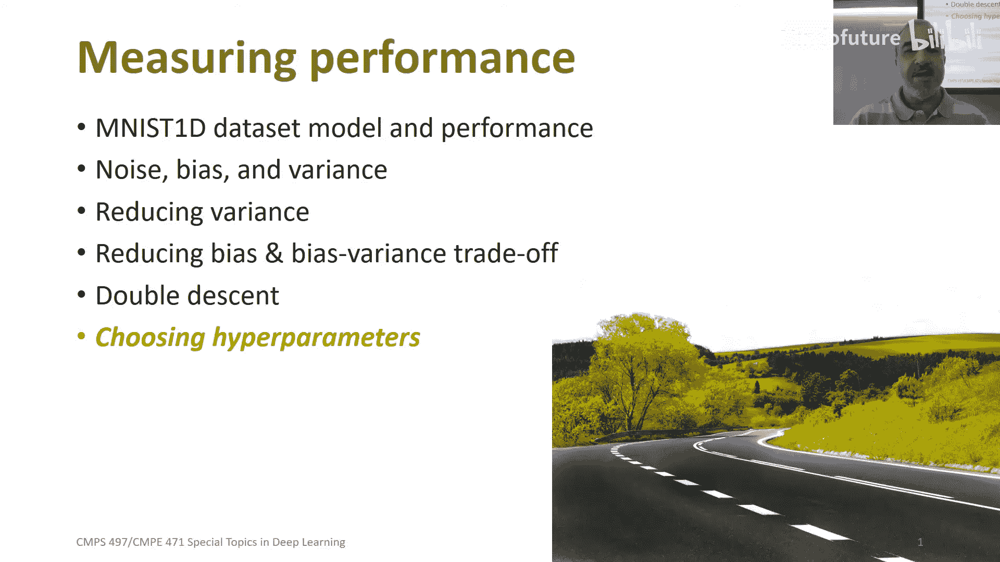
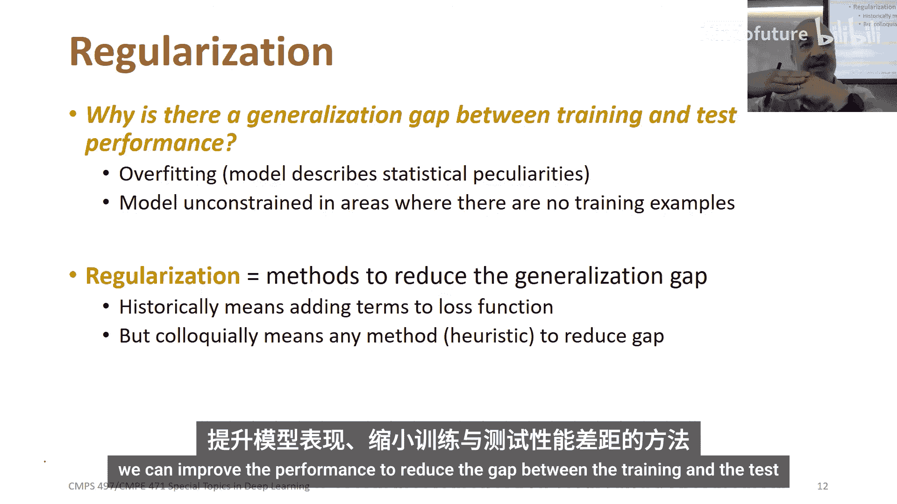
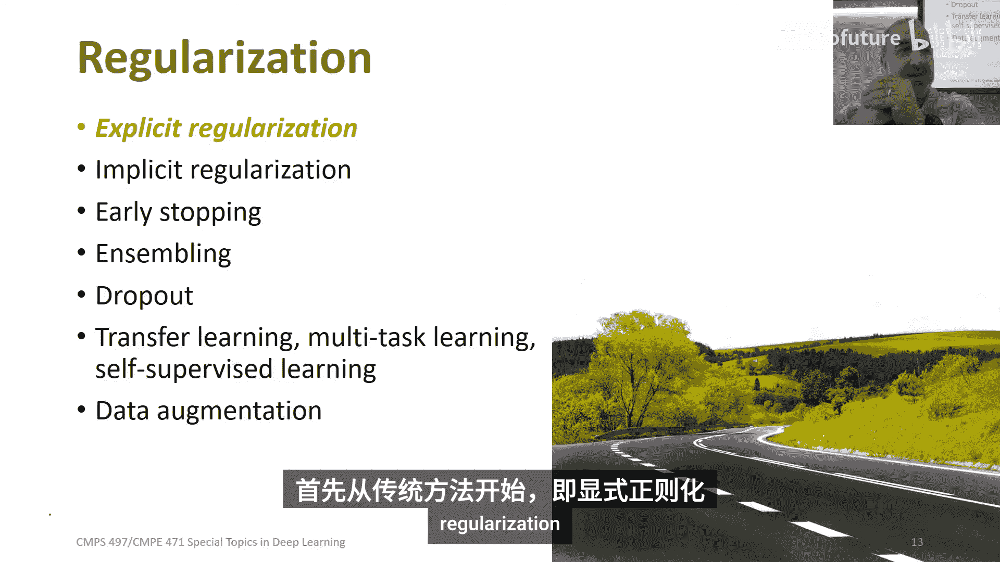
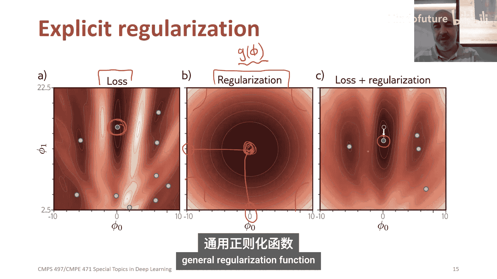
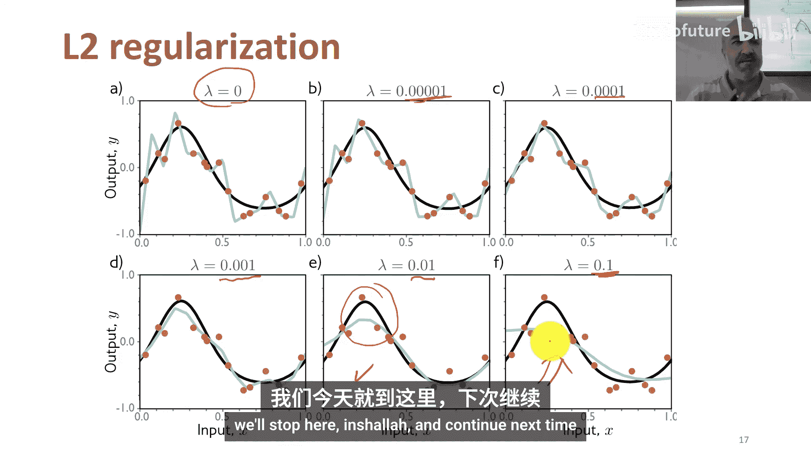

# 【卡塔尔大学】深度学习 CMPS497 ｜ Understanding Deep Learning ｜ Fall 2024 p16 P16_第十六讲-性能测量 II_正则化 I -BV1vQvNz1EeK_p16-

today we will continue talking about measuring performance in the previous lecture we discussed three types of errors that can affect the overall performance of any learning model What are these three sources of。

你咁咩。Yeah。Three types of errors。That can affect the performance。

 We discussed all of the three and the differences between them last time。Yeah， noise。

 buoyance and variants。Right we said that noise is unavoidable bias and variance there is trade off between them we talked about how we can reduce variance。

 but when we reduce bias we increase variance right remember this tradeoff and we also talked about a phenomenon called double descent towards the end of the lecture and Sha today we will discuss how we can choose the hyperparameters。

 how we can tune the hyperparameters that we have and then Sha we switch to a new session called regularization。

T choosing fiber parameters， first of all， what kind of fiberpar do we have？😊，What。😮，Det and width。

 okay of the network， okay， are these the only hyper parent as we have？但纯什不。那个。Distribution of what。

The loss function can be hyperparmeter， but that's not very common the optimization algorithm right that can be a hyperparmeter。

 the parameters of the optimization algorithm has hyperpar。I mean。

 the optimization grid itself has hyper parameters batch size right as an example。

 so we we might have different hyper parameters type do we actually know the bias will variance in advance？

We don't right do we know the capacity that will minimize the bias or variance。

 actually we don't or in advance we we cannot know。

So we need to change the hyperparmeter in a way so that we can see if they will make better performance or not。

And not only the capacity， as we said， the training are good the learning rate。

 so there are so many different type of parameters。Now， if you remember。

 we said that we will have to test the performance of the model on unseen data， right。

 so we will have， let's say that we will have。Creening。splitlit。And we will have。T split。Right。😊。

Let's for simplicity， we assume that we just have one hyper parent。It' famous on the learning grid。

Okay， so。We want to tune the learning grade。 What does that mean。

 we want to find the best way for the learning grade that will give us the best performance。Okay。

 so let's say a we will try alpha。Alpha is the learning rate which alpha with mass than a 0。1。

So we will train on the training set。Right。😊，That will give us a model。

 which assume that this is the model that we will get。Great model 1。

And then we test the performance of that model on the test set。Okay， let's say that we find。

A specific A， which is E1。Okay。😊，第。This is just one value of alpha， right？😡。

Can we change the value of alphapha and between。Yes， okay。 so let's let's try alpha with 02。

 We do the training。 We get another model。And then we get another performance measure。Right。

And then we can repeat that many times， right？😡，Okay。😊，Maybe until alpha equal1 maximum。Okay， and。

And with that。How many models we are training？10 right if we are doing it 01。2 until1， it's 10。

 and then we find that maybe this specific one which which was like 0。7。

 maybe produce the best performance。Okay， so then this is the value that we will choose for the hyperpo。

 right。Is that correct， Can we do that actually。So theoretically， yes， of course。

 we can do that right， so that's not the right question the right question is。😊，Is that correct？

It also。Now， this is well I checking here in the test， right， this is the test set。😡，So， is that。

Is that valid？可以呀。哈。😮，Is that valid。Is to find the best value of the hyperparameter， why not？😡。

Forget about the time for now。 Okay， let's assume that we have time to do all of that。 Okay。

 is that a well thing to do。T let's get back a little bit。

We said that the test set should be unseen completely， right？Did we break this hole here？😮，Yes， how。

Have this model， this model， did it see this model， did it see that this set？😡，No。

 this more the dignity that had this set。all of them did they see the test set？

Did we bake the the wood。Actually， yes。 We did。But。It's not because of we trained these models。

 It's because we chose that value based on the test set。😡，So it's like， it's like cheating now。

 it's like giving you the exam multiple times。You tie the one way of studying and you get the exam。

 you see your performance， and then you try another way of studying， you get the exam。

 you see your performance okay， and then you'll tell me okay I found now the best way of studying。😡。

Because that's the best way， the best performance， it gave me the best performance on the test set。

 This is cheating， righthu。So， so this is。Cheing， this is like we are training on tests。

We are trying to find the best value of the hyperparameter using the test set。😡。

It's like now we are seeing the test set multiple times。😡，Okay。

 so we found the value that gave us the best performance based on the test， we should not do that。

Okay， you understand now why。这个录意になったま。Yes， because we found we， we。

We found the best way of the hyperparmeter based on the test set。😡。

After seeing the performance on the test set multiple times， so what should we do。

 we should have a third set， as you said and the third set we call it validation set or div set。

Development set。Okay， so we'll have to have three splits training。😡，Validation and test。

So we train the models with different hyperparameters on the training set。

 which choose the best hyperparameters on the validation set or using the validation set。

 as we would see very soon， and then we test once once。😊，With the tests set。With this one model。

 eventually， to get。The reliable that the performance of your model on unseen data。Okay。

 so here's the picture。Before we had a training set and test set， right？Now。

 because we want to tune the hyperparmeters， we have to split the training set into two parts。

 training and div。😡，Dining and。And then of course， after we tune the hyper parameters on this。

Then we test on the test set。Good。😊，So in practice。

 we always split examples into three distinct sets。

 the training set is used to learn the parameters of the model。😡。

The development set or validation set， we use it， or sometimes it's even called tuning set。

 we use it to learn or tune the hyperparmeter values。😊。

Li the learning rate and the test set is used to evaluate how we are doing。

 how the model is doing on on scene data。Okay， here's an exam。That's the three splits， training set。

 development set and test set。😊，Now we will try the first hyperparmeteral value。On the training set。

Okay， we train， we get a model。Moel one。Then， we tested on。

On the dataset set to get the performance of that model Now the performance of that model is error 1。

😡，Okay， then we repeat the second value of the hyperparameter。😡，We get a second model。

 We get a second performance measure。A third one and the first one and the fifth one。

 Now let's say that this is all the values that we want to try for the hyperparmeters。😡。

How can we get the best of them？The lowest scale， let's assume that this is the lowest scale。Okay。

 so that's the best performance on the div set。Right， now what should we do？We take this model。😮，And。

在说。Tie it on the test set。With another model。How did you know that's bad， You mean bad here。Halas。

 that's their performance。That's the performance of the best hybrid parameters colors。😡。

That that's the performance that you should report。😡。

If you what if what if now you've tried all of these models on the test set？😡，And get the best。

 That's like the previous slide。 That's the cheating。

That's now cheating because you saw that you tried multiple times on the test set to pick the best one。

 you should not do that。😡，Why， why you shouldn't do that， because now that test state is not unseen。

😡，So it will now generalize to an on scene data。😡，So you should always do that once when or after。😮。

You are done with tuning the hyperthe。Okay，で。Is this considered wise。我给你。We talk about that。 Okay。

 we'll talk about that。So far， any questions？Is it clear， so we use the training set？To do what。

Doだも okay。And the validation said to validator。😊，The revision said， too。

To pick the best values for the hyperparid。And then that this set。我 just one one。To， to actually to。

 to evaluate the performance of the， to measure the performance of the model。

so the training and the development set are to tune the model。

 which means that to find the best values of the fiber parent and the parent， of course。

 accordingly and then you test on the test set。quest。It doesn't generalize like the best。Dンハラスダ。Now。

 this is， okay， now this is the performance on R scene data。

If that's your target and that should be your target， of course， halas， you cannot change it。😡。

You can better another completely different family of models， if you want。

Yeahま want neural networks want else。Okay， maybe decision three years or regulation order or whatever。

Now， I can test its performance on the test set because that's completely different family。 Okay。

 but within the same family， you are the hyperparameters test on unsceeen data because that's now more reliable。

 You the performance that you will get here。😊，Is much more reliable than he， right？Why。

 because this one was chosen。 I mean， this values are chosen based on the best on this set。😡。

So it might not generalize。😡，So that's the best， that's unrealistic。That's unrealistic。

 It's like I'm giving you the exam in advance。And then you will tell me that the performance that you will get on that exam。

Is you actually your real performance， of course not， right。

 you only have to be tested on oneen exam， right oneen test。Okay， any questions？But， now。

You told me that you will take this model and test it here， right？😡，This model is trained on what。😡。

This model is trained on which split。On the training set， right， can I take now these parameters？

And wetrain a new model on the entire training and di set。ok。But now how did we pick？

How did we measure this performance？Because we try it with different type of parameteral values。

We tried different we trained different models， we selected the one that gave us the best performance on the D right。

 and then we tested on the K。That means that this model was trained only on the training set， right？

😮，Which is fine， right now I want。Let me ask you a question first。

 can I now before I test that model？😡，On the test set。Can I re on the entire training and gift set？

Would that break any rule。No， right， because still I' I didn't touch that they set， right？

Why would we do that？ Why would we do that。Because more training data is better， right？

So it's one of different dreams。Now we will add the di set to the training set and return a new model。

😮，But with these hyperparmeter that I already chose。

Because I found that these are the best right now let me use the entire training set。😡。

And test on the test set。 That's valid。That's valid。

 but why would that be better because this is giving the model more， more training data。😡。

So I would get better model。And still， I didn't see that this set。Okay。😊，这头。嗯看下。

Before we were gonna use it for。Sa it again。Alpha 4， yes。我读。怎么说？Okay， fine。

What what are we doing here。We are changing the value of the hyperpar。

 We want to find what is the best values for the hyperparm。😡，Here。

 we are assuming that it's just one， but actually， there are many right， So any line here。

 any one of these might be。A long list of values for different hyper。 Okay。

 we found that Alpha 4 is the best based on。The deficit set。

Right I want now to measure the performance， the actual performance。

 I should measure it on on scene data， right， I should measure it on the test set。

 I one way is to take the model that we end here。That was trained only on training on the training set and tested on the test set。

But why don't I use all also that they've set？😡，To train a model before testing it。

So I would take the same alpha 4 values and re a new model。😡，All the entire training set plus de set。

A different model， but using the parameter， the hyper parametermeter values， that is the best。

And then test it on the。I'm not rechoing the hyperpara values。 I'm done with unit hyperpara values。

 but just before we testing the best of them on the test set， I'll just。

 I you just use the data that is available for me， Okay， which is the training plus the deficit set。

 So can I add the test set there。😡，Of course not， right， otherwise， this is chilly。😊，Iello。😊。

Any question on that？Now。Okay， now I got this performance。Okay， and that should be their performance。

On answercing， right。Now I want to take my model and deploy it in a reality。

 any all of what we have done， this is like an experiment right。

 this is like I want to measure the performance of my model。😡，Okay。

 now when I use the model in a reality belt。Which model I should use。嗯。Model 4。

 model 4 was trained only on the training set。😡，And let's say Model 4 prime or Model 4 star was trained on the training plus if set。

 this is the one that we should use。😡，Okay， we can use this model。Or even better。We。

Ma we are done with measuring the performance for that model。

Why don't we use everything that we have before we deploy the model in reality？😡。

It becomes what it becomes。This should be a better model， we will not test it again， by the way。

 we don't have more data to test unless you have another test set in reality you just train retrain the model on the entire label data that you have before you deploy that why we should do that。

😡，The same reason we extended it in the first place， right， to turn it。

 to give it a chance to be trained on。Or more it。我。好为什么。Okay， how do we get the test set。

 first of all， test set is labeled data or not。😡，It is labeled， of course， right？

So it is part of whatever label set that you have。AndIn reality。

 you will get less than 1000 labeled examples。😡，You will randomly split it in training， give a test。

 usually it is this is usually 20%。😡，And the risk is 80%， you can divide by the risk 70，10。

 something like that。Okay， so this is all of this data come from real world or not。We hope。

That's the best， of course。And from the real wallet， we get these examples。

 we label them so that we can train our model。😡，Not only in our model and。Distance。😡。

More importantly， tested。Because you can tell no colors okay。

 but you need to really have a good indication of how good it will be on unced。😊，Exact。

 so during training and hyperparta tuning。You act as if that this set is hidden。Actually。

 it is hidden， okay， you don't see it。And even when you test your model， of course。

 the labels are unseen， but we use the labels only when we measure the performance to see what are the errors and what's the accuracy of them。

😡，Okay， but now once we do that， once we know now on unseen data。

 the performance is mess and having a 7。5% error。😡，Hello， now we have 1000 examples massn。

 we split it before， now why don't we it in the model on everything but using which hyper parent as well。

😡，And the best that we found， which is in this case， Al4。Okay， yes。What is。好的。Okay。

 we we'll discuss that。 Good question。 We'll discuss that。 But so far， any questions on that。Okay。

 you understand this， this is very critical， by the way。😡，Very quickly okay to understand very well。

 because if you did anything bad here， anything going here。😡，What would happen。

the performance measure that you will will the performance that you will measure is not reliable。

 it' not real and you might you might say okay， this is the performance of my model。😡，2% L。

 that's the best you could do on the death set， right， Is that the performance。No。

 you have to this an uneen data。Okay。Okay， now。This is the algorithm okay。

 written and just in in text， okay， will not go through it。 We already discussed that。Yes。😊，Yeah。水。

Yeah， so this is the L div， this is the L test。Yes， what is the performance measure of fuel model？😡。

Which one is under the this set？I's on the distance。Yes。Okay。Question。Right here。用。呃，都是。We said on。

 yes。How can we， How is that un。why this something that have the same factor of training。

As we said haveOkay， when I tested for deep learning course。

 should I give you problems about chemistry or about deep learning。Okay。

 should I give you questions that you already saw in quizzes and homeworks exactly or something similar but different？

That's exactly what we are doing here。So these examples are from the same field。

 from the same domain。😡，For the same problem， let's say we are classing tweets。😡，Sentiment in tweets。

 whether this is positive negative。 Okay， most of the tweets now are negative but any。 Okay。

 let's say that we want positive negative type I will take real tweets。

 I will not generate artificial tweets。 I will take real tweets because when I deploy the model。

 it will work on real tweets。😊，Okay， so we have to label we'll have to label a good sample of the wes。

 train the perform train the models and。😊，AtThen the modern and how many models we have here。F。

 in this case， five， right？It's not just one。That of course， will take time。

So training is not only about training one model， usually we train many models。😡，Okay， and。

 and eventually， we use。One model， and we generalize that a little bit next session。

 but usually we use just one。😊，Okay， yes quick question。Yes。No， we use this that set。Okay。

 so we did this on this set， right？And we deploy the model。

And here we are not saying what will happen。Next， okay， usually。

 usually to make sure that the performance is really good。

 you take another test set and test the model over time。

 you have to do that over time and maybe you need to re in with more data if you found that the actual performance is not good。

你你看这个呢。你发的。业务关系。啊。Plus， and that will be guaranteed to be the promise， of course no。

 that's just an estimate。What we are doing here is just estimating the performance because still this is limited data。

 right and this data might be biased。😡，有6万种。Okay， but that's the best we could do as an estimate。😡。

Okay， right。Now， what is the disadvantage of this setup？😡，It looks nice， right。But， of course。

 it has a disadvantage。 What is a disadvantage。我一。No， assuming that we got it from their life。

 assuming that we got from their life， yes。T train the first。

So you mean we are training multiple models the。确ing the same model most people看都。Ting。

They didn't get your point。Yes， yes。But that's for deployment。

 Okay Y we are doing this for three different reasons。 Ya first。

 we are only training on training and testing on dev because we want to tune the hyperparmeter right and then we can add the div set to the best to the best hyperparmeter to get a reliable estimate of the performance。

 and then we add the this set to deploy the model， these are three different them that's not at its。

 the main problem here is that maybe the splits， as you mentioned earlier or someone mentioned earlier。

 maybe the splits will not be balance Ya for example， in the sentiment classification problem。

 maybe all of the examples because this is a random splits right maybe all of the examples or maybe 95% of them will be positive in the test set。

Does that reflect the reality， maybe no。新。Yes， the only after and how we split it this way， right？

It can happen that all positive examples。Go to the test set。Must not be representative， right。

 must not be representative。So the random splits here might not be very represented。

 so that's the main disadvantage here okay。And another disadvantage is that we。

 we test only on very small parts。That's also might not be reliable， any。If possible。

 we want also to increase the test set so that we will have better or not better performance。

 but more reliable measure of performance。😡，ok。😊，The solution for that is what we call cross validation。

 cross validation。 so cross validation is the generalization of what we have done。

Let's see what we mean by Cosweish。First of all。Let's assume that we don't have any hyperpar。😡，Okay。

 having no hypopar that also is equivalent to having hyperpar， but parentes。

 but we fix the values for them。 And we are not tune in the hyperpar。 Okay。

 we are giving the values or we don't have any hypopar。 Just we assume that。😡，Okay。😊，第い。

In close validation。In close validation， we divide the data that we have or the data。

 all the data that we have。Into K folds。Case splits。With the same size。Okay。

 usually K is like 5 or 10。 Let's assume that here it's 10。 so we divide all the label data into 10。

Fals。😡，Okay， and then。Now we have don't have any hyper parameters give I not tune again hyper parameters。

😡，Then we train on the first nine of them。😮，With rena model on the first nine of them and then test on the1s。

😡，When we do that， we can get the performance of dec in the model， right？ok。

Then we change the test fault。😮，To be number 9。Andtain on all the others。When we do that。

 we get a different model， we get a different measure， right？😡，And then we repeat that。10 times。

What are we doing here？It's like we are not doing it just once on and one split。

 We are changing the splits because maybe one split will not be representative， right。

 Maybe we'll be lucky。 Maybe well be we we will it would be very hard at this check。

 So why don't we tie on different test splits on different splits。

 Because I think we can agree with me that this split， if we change it。

And if this is this is once right， this is random， if we change the splits。

 if we re split the training， we'll get different performance， right？😡。

So why don't we do it multiple times and get the average performance among these and that average would be more reliable estimate of the actual performance。

😡，Okay， so this is what we are doing here。Whiit。Okay， this is what we are doing here we are。😡。

Building a model with with nine folds and on a1 fold。And we are changing the， the。

 the for that we are testing。Every time， so how many models we are building here we are training。10。

10 models， okay， and we are averaging the performance for them。

 So this is now the average performance for our model。Okay， the where is the hypoparampmeterus？

Now we said that we don't have any hypo or we fix it them。ButWhat if。We have actually happened。

 so this is not realisticistic， of course。RightThis is not realistic。

This is assuming that we already know the hyper parental values。

 but what if we want to tune the hyper parental values， then we will repeat the same thing。

For every combination of the hyperparrameteral values。So for Alpha 1， we will do this。😡。

We get the average performance over the key folds。And then we change the hyperparus to alphapha 2。😡。

We do the same。 we get diverse performance， then we change to alphapha 3。

 get div performance and so on。😡，And then， we select。The one that has the best average performance。

Right。That will make us choose the hyperpar as the corresponding hyperparm。Right。Type with what is。

 what is by the final。Performance。有点钟。The performance of the best， right？Yes， we take the best。

 the best performance， we we take the hypoparus for it right。

 but where is the performance on unseen data？我觉得。Yes。

 we have to to test that then a split or on another split of the test that is on C。

So this is actually doing what we have done before， but instead of doing it once on one split。

 one set of three splits， we do it on 10 sets of splits。😡，So previously， previously。

 we said that we have 10 values for the for the learning gridoid。

 assuming that we have just one hyperplan。😊，Let's say that， let's say that we， instead of 10。

 just to avoid confusion。 Let's say that we have 20 values of the hyperpower。 Okay。

 so in the previous setup， how many models we will get。2问题。In that setup， when we have k equals 10。

How many models we will get？20 times 10。😮，So for every combination of the hyper diametermeters。

 we will train 10 models。And get the average of them。Get the， not average of them。

 the average of their performance。Okay， and based on that average， we select the， the best。

Values of the hyperparmeters， the best combination of the the values of the hyperparmeters。

 and then eventually。😊，We have to have oneen。We cannot just rely on the best set because that's on the entire data Okay。

 so this is like seeing now， so we'll have to test it on a separate test set。Okay。

 so you see the difference between the previous setup， which is train div split。

 a train div test split and this curve validation。It's the same thing。

 but instead of doing it once for every combination of the hyper parameters we do it k times how do we do it K times with the K folds every time we say we test only on one fold that's why if you notice here I call it the di fold。

Because that's actually used for not the test set， it's used for tuning the hyperpower。Okay。

 is that clear？Yes。The the。Thank。在案。Yes， of course。

 the hyperpar will compare the average performance。不知。We don't have to have this loop。 has。

 it's just one equation。Because we have just one value of the hypoparmeterus， we don't tune it。😡。

It's just once we do that once， once means we do just one time of the 10 models。😡，And then test on。

 of course， here， we， we don't have that here。We will not have a comparison because we compare because we want to tune the hyperpars。

 right？😡，So we don't have a comparison here。This station。This stand beautiful。No。

 we will take this as the performance of the of the。Of of the model colors。

 do we have to have a separate test set here？😡，No， it's just one menu。

 this is the performance on the on the whole set， but of course。

 this is not heuristic unless you already fix。The values of the hyperparmeter。 Now。

 no hyperparlammeterus here doesn't mean that we actually know we don't have hyper parameters。

It's either we don't have or we fix them。 Yeah any magic in the morning， you wake up。 you say， okay。

 living grade this 。35。 and the depth is full and okay。😊，Sometimes by the way。

 you are giving these bags。And you are given， you are given that fix these values to this and then tie to train。

 But that's not the heuristic setup。 The setup is that you don't know。

So you need to try multiple times to get the best hypo of parentyal values。And。

 and then choose the best。 and then。You test on oneen data。 Now， if we go here。

Let's say that the value of alpha equals 0。25 was the best。Okay。😊，I want to get the performance。

We can take this average performance。I mean， of course you cannot take this average performance right。

 you have to test on the test set， but before testing the test set， can you which model you will get。

 which model you will test actually？😡，Because you have 10 models here， right。

 and for every combination of the hyperparameter values， you have 10 models。😡。

If you have 10 fourth cause variation。Which model you will test on the test set？你说。

You will need to retain on the entire thing。Now on the ten folds colors with this hyperparal values。

Anyway with alpha equal 25， 0。25， assuming that we only have one hyperpar here。

 we will hell us we will。😊，We to in a model on the whole thing and then test on the test set。

That that will be the performance。Okay， but how did you select。This venue。Based on the cost rate。

Okay， you train the 10 models just for every single gave combination of the hyper parameter。Oh。Okay。

😊，Any questions on that？Okay this。直间的。我一。Okay， the question is in when we test。

Will we test on the whole data set or small subset？What do you think。

You didn't answer the question the question is。😊，Are we testing on the whole data now？😡。

Or we are testing on a small subset that is unseen。 It's a small subset this set。

But to choose the hyperparmeters and instead of relying on just one split。😡，We have 10。Okay。

 so we rely on every one of these 10 splits。😡，Get the average performance。😡。

And then try another hyperparmeter values， get the average performance， try the third one。

 get the and then select among all of these averages， select the one that gave you the best average。

Now you can train on everything before you test if you want。

Actually here you have to do that because you don't have just one model。

 you have 10 models which model you will you will choose if you choose just any one of them this is trained only on part on 90% of the data。

 not 100%， so you better retrain on 100% and then 100% of that training data。

 this data not including of course the this set and then test on this set。

Edutation of what we are doing here。我家的。How many times。

 how many times we are testing on the test set here。No。Once。Okay， this test set。

 this test set is used after we are doing all of that。Tpe， let me， let me show you。

 Let me show you Okay， let me show you this。 This is an algorithm for closed validation。 Okay。

 so this is to choose the best hyper parameters。Okay， you will find that we have two loops here。

 there is outer loop and there is inner loop。The outer loop for all hyper parameter settings。😡。

And the inner loop is over k folds。😊，Right， so these are the two loops that we have here。

This is the outer loop。And this is the inner loop。Right。

 if we have 1000 combinations of the hyper parameters。

 So the outer loop has 1000 itations and the inner loop has。Key its。ok，但。These situations。

 we don't use this test sit at all。😡，We just use the K force。😡，Hello， after these two loops。

Whi is here after this algorithm is done， this algorithm doesn't test actually。

 it just compute selected the best hyperpar。😡，But after calling this。

 after getting the best hyperparmeter， then we retrain or train actually a new model。

On the entire tenfolds。And then test it on the test set。て。😊，Is that clear now？

So how many times have we use that test set？How many model is tested on the test set？😡，1， only。 Why2。

It's just one， one that gave us one with the best hypoalta values。

And it traineded on everything on the k folds。That's not in this slide。

This slide is only choosing the best type of therapist， yes。Have question。 Oh you have two。

 I heard it have。 okay， Marsha lot， its a half questions。 That will be easy。啊。0。我。在公开。I。8。

Which combination of the hyper parent that yes。And then we are retraining on the whole debt。所林的。Yes。

 yes。Just because we want to take no more and this is available us。就因为。We start with which of the 10。

No， you start on scratch。You start from scratch。It's a new computing your model。We don't that don。No。

 because that's now you have more training data， why don't you obtain from scratch？😡，You can do that。

 by the way， but I haven't heard of that。 I don't know why you would do that。

 usually you better train on because now you want to use the entire training examples for the loss。

 right， So you want to minimize the loss for everything。That's an experiment that can do。

That's maybe an idea that you can toy。Yeah。Another thing。But you will。But by the way。

 you will never know if it's good or bad。How， how would you know if it's good or bad。

You can try both Okay， try both means I was waiting for this means you will you will you will。😊。

You will use the test， no， no， no， I both means you will use the test set。😡，Twice。😀No。Okay。

 so never you not be able to do that。ok。有没 training。所以。After you eat in。O。W just together。No。

 no no no no晴ラす no。You cannot。 So， so now you want to test on something that you wait on。No。

When I take the average， I pick the best half of that。And collapse I guess。Yes。

 you test on the test set after it training on everything。Has， Yes， of course。

You don't test and then return with the test before deployment， okay， before deployment。😡，嗯。

Might be a little bit confusing， but I hope that the concept is clear。What are we doing in slide 8。

 This is just an introduction to slide 9。 Okay， when it's simplified version when we don't have the outer loop。

And in this case， we don't need a test set， a separate test set。Because it's just one model， right？

That's the performance on one model。Only， but here we have a separate test set， of course， Okay。

 because we we need to choose the best hyperparmeter value。 so we need that they've set。

Which is the blue fold here， and then we test on the test。Okay。

 so slide 98 actually is not practical。 it's just a simplified version of slide nine。ok。Of course。

 after this， this is what I was telling you that after that is an algorithm。

 we need to use the separateparatist。Any questions on session 8， which is about performance measure。

 Now， new session about regularization。 Okay， what do you mean by regularization and why do we need it。

Regularization is used to try to bridge the gap that we have between the performance on training and performance on test。

The training performance and test performance。And you saw that before right in the previous lecture that usually there is a big gap okay usually the performance on training is much better than the performance on test which we call it the generalization gap right and there are different reasons for that one of them the common reason is the overfitting problem okay I can attain a model very well on。

Or on the training set。Perfectly with0 loss of0 L。But then that will not generalize well on unced。

We said because of the overfitting and because also of the reason that we discussed last time that because of the cursesor of dimensionality。

 that the training examples are very few， so the model has to behave somehow in between the training examples。

Even if it is fitting the training examples very well， but it has to because the space is huge。

 it has to be unconstrained in areas where there are no training examples at all。Okay。

 so it can behave。Andly。So regularization is about methods to reduce the generalization gap。

So additionally， in machine learning， regularization was referring to methods that add something。

 some terms to the loss function， as we will start with。But later on。

 it's referring to any method by which we can improve the performance。

To reduce the gap between the training and the test。

And dis performance。So we will China in this session， we will study multiple ways。

 we will start with the one that is traditional， which is called explicit glization。

What do you mean by explicit regularization？😊，Remember， this is our lovely loss function。

I think you saw it so many times now。What do we do with the loss function is that we want to find the。

Model parameters， the values of the model parameters that will minimize this loss function。

And as you see， it's a function over the training example。Right。Now。

 since we talked about the cross validation and train the test split， now this I capital。

 can you tell me I now is the number of examples in the training or training plus D or what？

In training in training， except when before deployment when or before measuring the performance。

 we can train or more， but while we are tuning the hyperparmeter are here is the number of examples in the training。

This is the loss function that the standard loss function that we saw before when when we use explicit regularization。

 we add something some term to the loss function。什么有。哈。😮，No， no， no， no。

 we add the term and the term here has two factors。Lambda， which is a parameter。

That controls how much we want to add regularization。

 how much the effect of regularization that we want to have。And then another function G。

 which is a function of the model parameters。😊，It's not a function of the training examples。

It's a function of the model parameters。Okayim。T now what does it mean to add something to the loss function and the loss function eventually we want to minimize。

 right？So whenever we add something to the loss function we also want to minimize right。

 so it's like we if that part that we added is function of the parameters。

 it's like we are now penalizing on some values of the parameters。😡。

Because adding it will increase the loss。And also encouraging some values of of the parameters。

You mean， it's like we are adding a constraint somehow on the values of the parameters。

 It's not only about the training examples， it's also about this specific function。Okay， yes。我去。怎么的。

It's a function of the mod parameters， any mod parameters are like what the weights must， okay。

 so it will be a function of the widths。😡，No， no no。

 it's not the model itself of course the model itself is F right in our terminlogy。

 but this is another function of the parameters you will see example okay ya a simple example which is not a simple example just to give you an idea what I mean by a function of the model parameters。

😊，But this specific function is not used， but just a simple example。

 like the sum of all the weights method。Okay。😊，It's a function of the parameters。对个。Okay。

 good question。 The loss function is used to get the best parameters， right， type。

 And now we compute the loss。Value for every training example， right。

 you remember this is this L small L small is the loss for specific。😊，Tining example， right。

 How do we get this value。We use the current model， right， Remember。

 we are using the rose function when we update the model。😊，So at any point， we compute the loss。

 we have a model。😡，Okay， and that's the values of the parameters that we use for at that moment。Okay。

😊，So again， adding something to the loss means that we have some we are favoring some values of the parameters and discouraging。

😡，Or dis liking other values of the film。 That depends on how exactly this function will be。Okay。第。

So。Lambda will be greater than 0。 It controls the strength of the regularization， so。If London is 0。

What will happen。No equalization， right， if London is very large。我。It's， yeah， it's。

 it will do need this part， right， it's， it's like。Don't care about the training examples。

 care about only minimizing this。😡，So of course， it has to be something in somewhere in between so actually。

I'm now announcing a new hyperparameter Okay， so lambda is a new hyperparameter that you need also to tune if you would use the regularization。

 yes。We still didn't give you examples of how this function will be。对。Okay， why？

The main goal is to reduce the is to improve the performance Okay。

 by reducing the gap between the training and test。

 Now your question is how why should doing something like that reduce the gap， right。Right， okay。嗯。

You saw from the previous lecture that。When we have large capacity。

 the model can behave in a very strange way， right because there are so many possible solutions that can still fit the training data。

You saw this is the exacts and so there are many possible solutions， right？Now。

 deregization is going to push for some subset of these solutions。😡，Okay。

 and you will see that it will actually explicitly push for smooth solutions。

 solutions that are smooth。 remember last time when we said that smoothness is a good thing。

Because it will generalize probably better， so this regularization path will push for the model to be as smooth as possible。

And we will see how。T this is the example that you saw before remember the loss function that we used。

 I think for cable model or something like that， we saw that earlier。

And that was the global minimum for that function。And the others will local minimum。

Now this is if we use the original loss function。😡，Now。

 imagine that we added regularization that has this。Better。Okay， what does that mean。

This is this is the term that we will add to the loss function okay by itself now this is organizationization only okay。

😡，Remember， the dark values are small and bright values are high。

So that means that for models that have this specific these specific values。😊。

The the transition will be very low。And models that are。In the corners here。

D regularularization is very high， right， That means that which， which values of the parameters are。

Enccouraged byularization are which values are discouraged of the bioegularization。

Around the center of the ones that are favored， right？

Because they have less value for the regularization。

 remember that eization is added to the loss and we want to minimize the loss。😡。

So less values of the regularization part is good。So if the function， is if this is G of phi。😡。

What is the best value that we minimize this this function by itself only？😡，At the center， right。

 at the center， because at the center， this is the darkest。Value of the function， right。Okay。

 now the case is that we have both。 We have the loss and the regularization。

 It's not just the regularization。 If it's just the regularization。

 then the model would be that value of of alpha 0 and that value of alpha 1， because this is where。

We get the minimum the minimum value of the equalization， right， but it's actually both。

The loss plus the regularization。Okay， so in that case。

 the minimum will not be exactly at the center， but it will actually move from here。😡。

Towards the center。 so we would get this minimum。Okay。😊。

So this is the effect of adding regular regularization。We change the minimum。

 We change the original minimum， but actually， it's not。

Very different from it in terms of the value of the loss。

 but might be different in terms of the function itself。

 as you will see when we chose the regularization in some way， we can get smoother function。

So with the same or very similar loss in training， we might get better generalization on uneen data。

Okay， you didn't see that yet here。But that's the hope。Okay， based on the specific。

Genral regularization function。Okay， now let me any question on this first。

Now， let me show you the one regularization function that is commonly used。

 It's called L2 regulargization。And here is the function。It's the submission of5 G squared。

 What is 5G。The parameters， okay all the parameters， so this is what is the meaning of this？😡。

Assuming that phi is just the widths。Which is actually the one that is used here。

 and usually we don't use the biases。 we just， it's a function of the widths。

What does that mean squaring the weights， summing them what does that mean？😡。

Do we care about the sign of the width？We care about。The magnitude of the weight。

And we won't remember that this is part of the minimization function， right。

 Part of the loss function。 So we want to minimize the sum of the weights。😡。

Which means that the sum of the square of the width。Which means that we want to minimize。

As much as we can， the values or the values of the weights we want。

 we want more this minimizing the square means we will push the actual value， even if bit lower。

 right， So we so this by adding this regularization part， we。

 we push the model to choose values of the weights that are。为什么。

So that the sum of the squares of them is small。Remember， we want to minimize this function， right。

 we want to minimize this whole function。Okay。😊，There are two terms， the actual loans。

 the original loans and the liberalization points。Okay， so that means it favors smaller parameters。

Any question on that？We still didn't say， why should we do that， okay， but this is what we have now。

😡，It's the sum of the squares of the parameters which are usually the weights。

 which means that I want now to find a model。😡，That has very small values of the widths。

Which is also trying to minimize the loss on the training date， only both。😡。

SoBefore it was just the training data that will decide how the model will be。Now。

 it's not only the data， attain data plus this regularization function。Okay， with me so far。对。Yes。

Of lambda。 How， how do we choose the value of lambda。It's a hyperparmeter。Okay， congratulations。

 you have one more hyperparameter now to the set of hyperpara that we learned over the course。Okay。

So this is by the way also called besides being called L2 eizations called theconovegization or radiojuization and when we do that when we use that this can be done or can be used with any learning model by the way not only neuraler networks when we use it with neural networks its usually we just use it for the weights and in that case it's called weight decay because it's pushing for small values of the weights。

😊，Now， the main question is why does it help？Why does that help。

 Why do we want the weight to be small？Why don't we leave it。Unconstraint。

The idea is very it's very easy。Let's say that。This is the one layer。And that's the next layer。 Okay。

 and let's focus on this specific。Hidden unit。This specific ingredient is getting weighted some from the previous day。

 right？Right。😊，Tpe if these weights are all small。And we changed it a little bit the values of the Had units here。

😡，How will that affect the weighted sum here， will it make a big jump or it will be a small effect？对。

Again， again。Again。The input to this node。Again， again。This。

 the hidden unit here is awaited some of these， right？And we said that the weights here are small。

Let's assume that all the weights are really small here。Okay， in that case。

If I change it a little bit， the values of the hidden units here。😡。

Will that make a big change in the value of the hidden unity the weight sum all small change。

Smalest change， right， So with the smallest change here。I would have a smaller change here， right？

Apply that in the previous and the previous previous year until the input。

 if we make if all these weights are small， then smaller change the input will produce smaller change。

😡，In the output， right？Does that mean the function will bit smooth？Yes。

 because smooth means when I make a small change， the function will not make a big jump。 otherwise。

 this is not smooth， right， this is like with this exact， right。😡，But， smooth means。

Making small changes we get small changes in the output。That means that by adding this。😡，Function。

 which will encourage will push the model to have small weights， small values of the weights。

 Now we are pushing the model to be smoother。The boy smooth is good。😡。

Because it will generalize better as you， as we saw before。Right。😊，So this is die。

 so it will encourage smoothness。Between data points。Okay， whenever we change the input a little bit。

There will be a small change in the。There will be no big changes and of course。

 as any other regularization， it will also discourage overfitting okay， because now。

The loss is two parts part based on the training data。And path， based on the regularization。Okay。

 so in general， legalization is。Avoiding is trying to avoid overfitting because now there is another part in the function that I'm trying to satisfy。

It's not only the training data when only the training data I need to satisfy。

 the model will overfit right， it will pass over all the training it will fit perfectly all the training examples。

 but that doesn't mean generalizing on unseen data。😡，If the model is smooth。

 then it has better chance to generalize。ok。停。Questions。Oh， I thought I got。

 I will get many questions here。Okay。You have a half question？Okay， so now we understand。

 why it would be smooth， right？Here is an example。😊，嗯。This is。

 remember this is like this is the data that we had in the previous lecture。

 right the sign signine wave。😊，With some noise， and this is the case when lambda is0， Lada is0 means。

No equalization， right when we have no eization， the function behaves this way。😊。

This is clearly overfitting right， the function is not smooth at all when we tested it probably we will not get a good performance。

Now， here we added。We increased down and numb a little bit。

 so we added a small bit of regularization。It's getting a little bit better。 Okay。

 but still overfitting when we increase it a little bit， getting a bit smoother。Okay。

 when we increasing increasing it more， it's much better now， right， it's smoother， much better。 Now。

 when we increase it even more。😊，It's even smoother， Okay， and giving less attention to。Do the这 data。

Okay so it's moved a little bit this attention to the thing so it doesn't fit these examples very well when we even have higher values。

 it completely ignores the training data and now the function is smooth with very bad even training performance。

 right？😊，So this is bad， of course， right？Yeah， so， of course， that that shows you that you have to。

 to tune this hyper parameter， right， there must be somewhere in between that will give you better。

 better performance。 But it shows you at least that as we increase， Yeah， as we increase numberda。

 we get smoother function， but we don't want it to be very smooth to the extent that。

It doesn't fit the data。 Okay， okay， so this is this。 Yes， that would be like underfitting， yes。😊。

If we had to think which one。こいな。If we， if we need to pick which one is the best out of this。

 what should we do。By looking， by looking， it seems like this one is the best。

 but we should not feel right。This is just because because it's a to example， right， in reality。

 what do we do？On unseen data on the dataset set。on the depth set。

 because this is again union a hyperpar right on death set。😊，If， if， if there is one thing。

That you should get。Out of this course will is the concept that we explained today， which is。

Testing on unseen data and tuning the hyperparameter on deficit sets。This is very important。

 because if you don't do it。Then whatever performance that you will report is not realisticuristic。😡。

Because you are reporting on something that you saw。

Reporting you your understanding of the material on an exam that you saw in advance。嘅。Question。Yes。

说的人。我是他是。is yes， yes， it seems like it's going that way。Yeah， yeah， yeah。 which is good or bad。

 very bad though。Okay， so it's like the performance is bad。

Getting better and then getting better again with more with increasing the value。

 so you have to tune it， of course。Okay， any questions？will allowed continue next time。 from。

