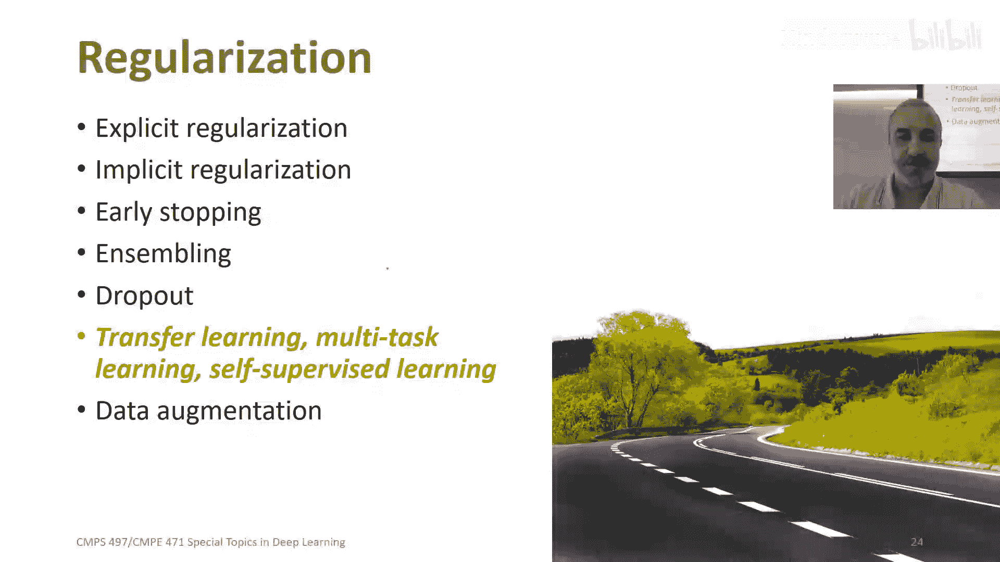
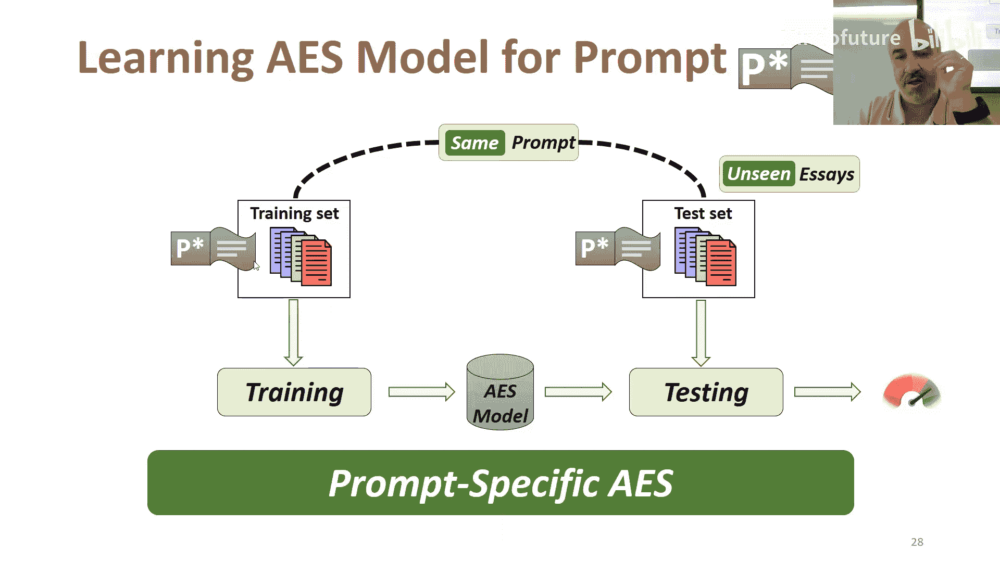
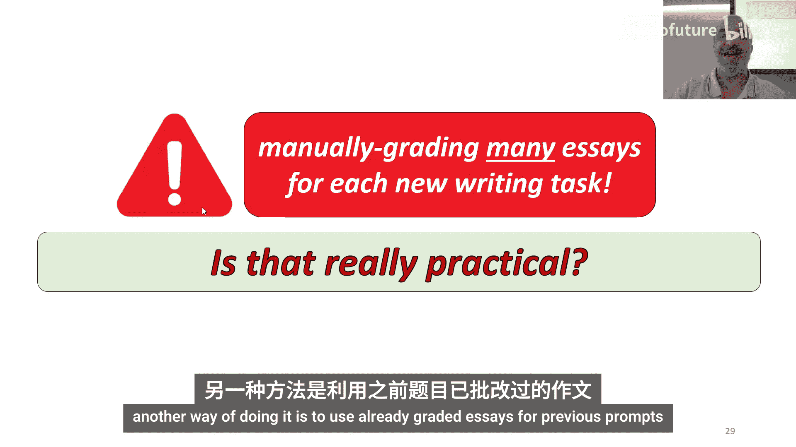
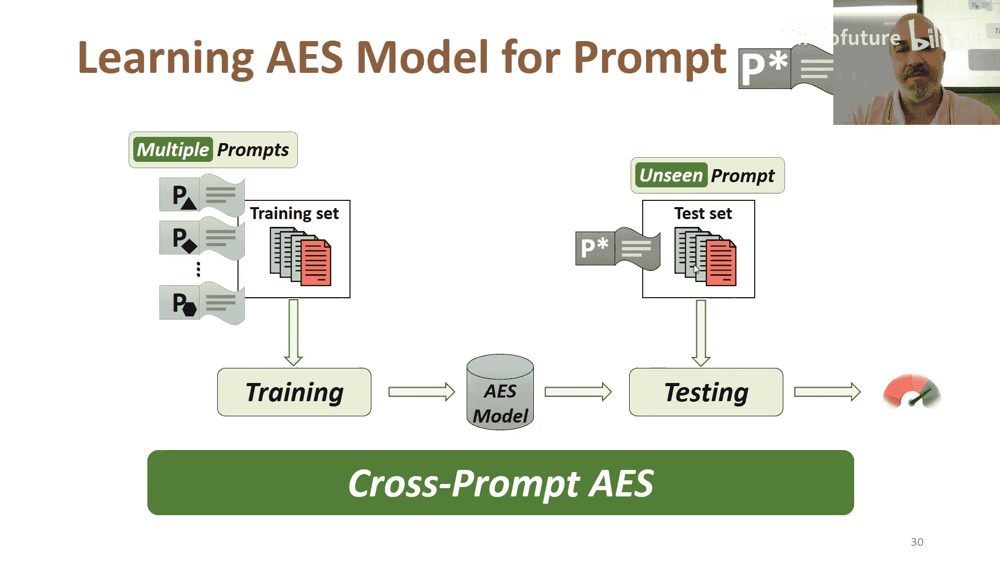

# 【卡塔尔大学】深度学习 CMPS497 ｜ Understanding Deep Learning ｜ Fall 2024 p17 P17_项目介绍 -BV1vQvNz1EeK_p17-

Now let me switch to the project。I will talk about the problem that we will be working on。嗯。

I will not talk about the details of what you will do。

 but I will introduce the problem to you so that you will be familiar with it and you can start to read about it in Charlotte in the break the main idea here is that I will give you a research paper that is very recently published actually it was published I think two months ago。

In the top conference in the natural damage processing field。嗯。

What you will need to do is to implement what they did。

 given some start code that I will share with you so that you don't spend time on things that we actually did in studying。

I mean， that is specific to the problem just to focus on a deep learning part。

But I thought that I need to introduce the problem to you first so that you you will be familiar with it Okay so when you read the paper you it will be much easier for you to understand。

Then reading their phone sketch。对。You I think you are familiar with exams like ACT， toil Is。

 GRE and so on right in such exams you are asked to write an say as part of the exam given what we call a writing front okay writing front tells you the topic。

So you want to write a topic about blah， blah， blah， and then you write the say。Right。

 they submitted。And then what happens after we submit the say？You will get a grade right。

 You will get a grade out of this。 Okay， so this process。I believe most of it， at least。

 will be done automatically。😡，Okay， this is called automated say scoring。😮。

And I think the title is clear， right， we are automatically scoring this。AE S， automated Ci。So嗯。

We can give one score for the says， for the say。😮，We call this holistic score。 So one overall score。

So in this case， the system takes one essay with a prompt of course。

 and it provides a score for that essay。Now， what type of a problem is that？😡。

Remember in the very first couple of lectures， we talked about different types of learning problems。

What type is that？Is that regression， is that classification。

 multiclass classification and binary classification， what is that？😊，Yeah。

The output is continuous or discrete。😊，It's just like continuous right。It's a score， it's a number。

Okay although usually here it's actually discrete， it's 01，2，3 up 10。

 but we can consider that continuous it's a number anyway。

 so we can consider this as a regression model。Eigation problem。 Okay， and that's。

 that's traditionally happening for this problem。 Or we can think of it also as classification problem。

 You want to classify the the say。To， how many classes here。

10 me from one to 10 or actually 11 but0 to 10。From0 to 10。

 so you can either do it that way or that way。For simplicity。

 lets assume that it is a regression because it I think it's more plausible this way。

Type because we give just one score here。 we call this holistic score。Histic squ。

Okay type this is not very beneficial to the student anyway we didn't say you would get a score like three or six but why did I get this score？

😡，OkayIt doesn't tell much that doesn't give much feedback to the students so there is another way of schooling this is by the way this is an example of the prompt Okay right about patients being patient means that you are understanding and blah blah。

 blah okay and do only one of the following writers story about the time and so okay so you take this and write they say。

Now， and instead of giving just one score。In essay scoring， sometimes also they gave multiple scores。

Maybe one score for organization， one score for grammar， one score for sentence fluency。

 one score for coherence， one score for relevance。Of the say to the to the， to the front， Okay。

 multiple scores。In that case， you can， you can see where your weakness is。Okay， if， if it。

 it will give you a score for each of these traits。 We call these traits。Okay。

 have the say is structured the gamma if you have any gamma mistakes， misspellings and so on。

So we call this trade scoring。Tこ。Okay。😊，第。Now， how is that related to us？

How is that related to machine or deep learning？How can we convertverse this into a learning problem？

We have to have a training set， right， we have to have a training set。So one way of doing that。

Is to assume that we have。For a specific prompt。We we have labeled data for it。

 which means we have says that are graded and we have graded some of the says are graded already manually。

😡，So that we can learn from it， right？And then after we train the model。

 we test it on on series sales， but for the same prompt。😊，Okay， you understand this prompt。

 What do you mean by prompt。It's the test， the writing task that we the topic， okay。

 you can think of it as the topic， then instructions to write。Good。

So this is one way of thinking about it。 We have a prompt。

 we have to to get some of the says all labeled for that prompt。😡。

And then we can train a model and use it to grade the rest of the essays。😡，Okay。

 this is called from specific AS because we are now building。😡，A model4 specific prompt。

 type what if we have a different font。嗯。We have to train a new model。

We have to get to create some of the essay for that font and then train the model and enter it。Okay。

 any questions so far？So this is called from specific ASS。Time， is that realistic？Anyny。

 every time we get。And new prompt。We will have to train a new model。

Is that practical and you think about it in the position of those who are in that institution that actually provide the exam？

Okay， every time if I want to build some system to do that， every time I have a new prompt。

 every time I have a new topic。I will have to grade manually some of their sales for that topic and then build a new model。

Okay， if I have a new new plant， another point， I would have to build another model。

 Is that practical。Of course not。 right。 So manually many essay for each new writing task。

That's not， that's not that。Okay， that's not too active type。

Another way way by of doing it is to use already graded assay for previous prompts。😡。

So over time， there are many prompts with graded assay assay already manually。

 Why don't we use them so that we have a model that is general enough to be used for unseen prompts。

😡，In that case， I don't need to train a model every time I have a new prompt。Okay。

 so the training data in this case will come from multiple poems with graded essay for each。

That will be training。 Now， the testing will happen on arm scene prompt。

 a new prompt that I didn't see at all in training。Now I can。

 because I have a model that is trained on multiple of them。

 I can now test it on Aneen font with of course， Ance essays in this case I don't need to grade manually grade essays for any new font。

Is that clear。So this is called cospon A cos prompt because the prompts that I see in training。😡。

Are different than the ones that I see in test。Okay， and that's what you will will be working on。

Yeah。ok。😊，So this is a， very quick summary of the problem of the real problem。Okay。

 I went on to share with you the paper。And I think now when you read the paper。

 it will be much easier for you to understand what the paper means。

 I will tell you exactly what parts of the paper that you really need to focus on and I will share with you over time。

 I don't have the full instructions yet， but I can give you the paper I can give you the details of the project and I will improve them over time。

But I wanted to give you an idea before the break so that you can maybe spend some time on understanding at least a problem。

Okay， and I will also in Charlotte share with you some resources for learning Pwach。

Because bytoch is the one is the framework that we will be using。Okay。

 so I will share with that with you that very soon so that maybe you can spend some time in the week。

你猫。So in， I will share with you the paper， I will share with you the sources for Pytorch。

 and I will start to draft the the project details。

But that only might be during the baking。