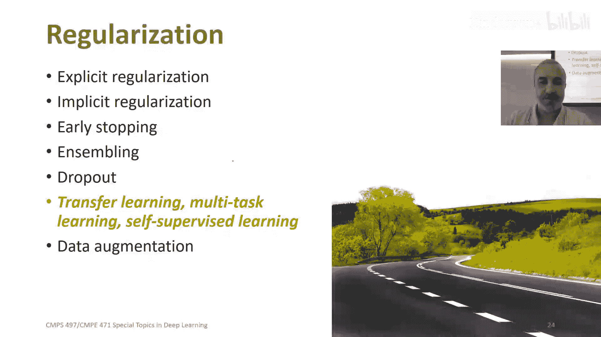
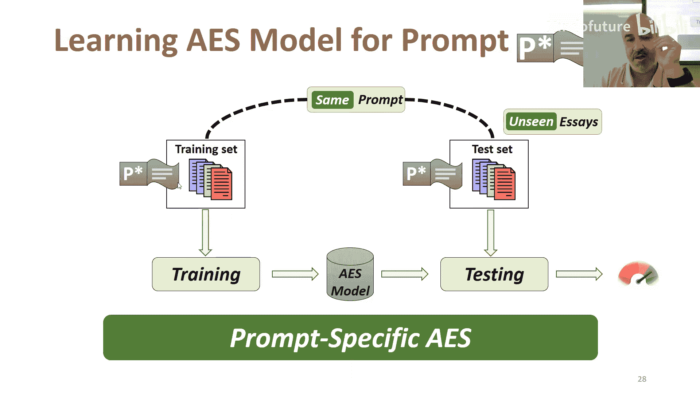
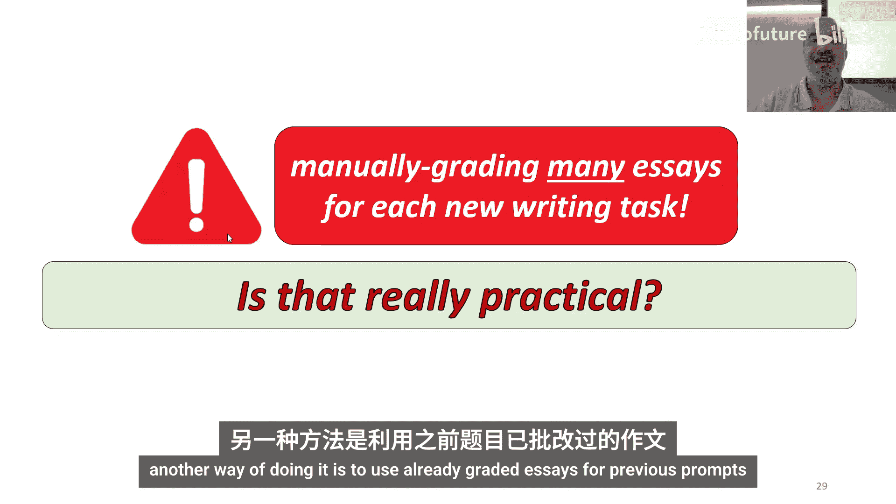
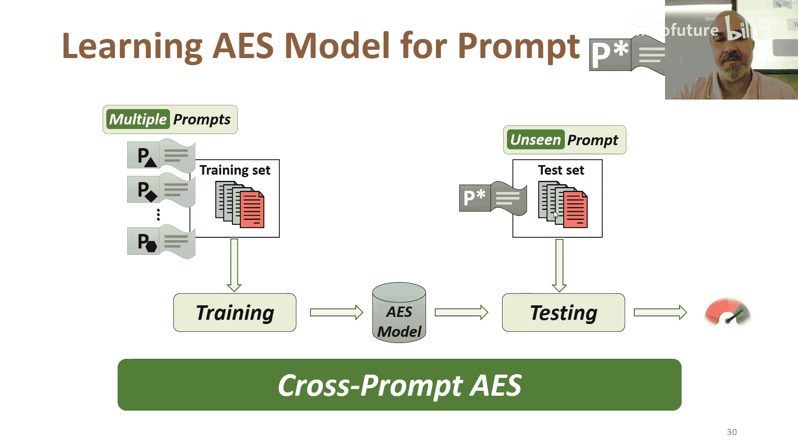

# 深度学习 CMPS497：P17：项目介绍 🎯

在本节课中，我们将介绍本课程的核心项目。我们将探讨一个来自自然语言处理领域前沿研究的具体问题——自动作文评分，并解释你将如何基于一篇近期发表的论文进行实现。

## 项目背景与问题引入

上一节我们介绍了深度学习的基本概念，本节中我们来看看一个具体的应用场景。

现在切换到项目部分。我将讨论我们将要着手解决的问题。我不会详述你们具体需要做什么，但会向你们介绍这个问题，以便你们熟悉它，并可以在假期开始阅读相关资料。

核心思路是，我将提供一篇近期发表的研究论文。这篇论文发表于大约两个月前，属于自然语言处理领域的顶级会议。你们需要做的是，基于我将分享的起始代码，实现论文中的方法。这样你们就不必花费时间在那些我们已经学习过或问题特有的琐碎事务上，可以专注于深度学习部分。

我认为首先需要向你们介绍这个问题，以便你们熟悉它。当你们阅读论文时，理解起来会容易得多。

## 自动作文评分简介

我相信你们都熟悉像ACT、托福、GRE等考试。在这类考试中，通常会要求你根据一个所谓的“写作提示”来撰写一篇短文。写作提示会告诉你主题，然后你围绕这个主题进行写作。提交短文后，你会得到一个分数。这个过程，我相信至少大部分是自动完成的。这被称为**自动作文评分**。

我们可以为短文给出一个总体分数，这被称为**整体评分**。在这种情况下，系统接收一篇短文及其提示，并为该短文提供一个分数。

那么，这属于什么类型的问题呢？记得在最开始的几节课中，我们讨论过不同类型的学习问题。这是回归问题、分类问题、多类分类问题还是二元分类问题？输出是连续的还是离散的？它就像一个连续的数值，是一个分数。尽管通常这里的分数实际上是离散的，例如从0到10，但我们可以将其视为连续的数值。因此，我们可以将其视为一个**回归问题**。传统上，这个问题就是这样处理的。或者，我们也可以将其视为分类问题，将短文分类到0到10共11个类别中。为简单起见，我们假设它是一个回归问题，因为这样考虑似乎更合理。

然而，只给出一个总体分数对学生来说益处不大。我们只是给出了一个像3分或6分这样的分数，但学生并不知道“为什么我得到这个分数？”。这无法为学生提供太多反馈。

因此，还有另一种评分方式。以下是一个提示的例子：“写关于耐心……”。在作文评分中，有时也会给出多个分数，可能包括组织结构分数、语法分数、句子流畅性分数、连贯性分数以及与提示的相关性分数。这样，你就可以看出自己的弱点在哪里。我们称这些为**分项评分**。

## 将问题转化为机器学习任务

那么，这与机器学习或深度学习有何关联？我们如何将其转化为一个学习问题？我们必须有一个训练集。

一种方法是假设我们拥有针对特定提示的已标注数据。这意味着我们有一些已经被人工评分的短文，我们可以从中学习。训练模型后，我们在同一提示下的新短文上进行测试。这被称为**提示特异性自动作文评分**，因为我们正在为特定提示构建模型。

试想，如果我们有一个不同的新提示，就必须训练一个新模型。我们必须为那个新提示获取一些已评分的短文，然后训练模型。这现实吗？每次我们获得一个新提示，都必须训练一个新模型。从提供考试的机构角度来看，这实用吗？当然不实用。为每个新写作任务手动评分许多短文是不可行的。

另一种方法是利用以往提示的已评分短文。随着时间的推移，存在许多带有已评分短文的提示。我们为什么不利用它们，从而训练出一个足够通用的模型，以用于未见过的提示呢？在这种情况下，我不需要每次有新提示时都训练一个新模型。此时的训练数据将来自多个提示，每个提示都有已评分的短文。测试将在未见过的、全新的提示上进行。因为我有一个在多个提示上训练的模型，我现在可以测试它。这样，我不需要为任何新提示手动评分短文。这被称为**跨提示自动作文评分**，因为训练中看到的提示与测试中看到的提示不同。而这正是你们将要研究的内容。

## 项目任务概述

以下是问题的简要总结。我将与你们分享论文。我认为现在当你们阅读论文时，理解论文的含义会容易得多。我会明确告诉你们需要重点关注论文的哪些部分，并会逐步分享更多信息。我目前还没有完整的项目说明，但可以提供论文和项目细节，并会随时间不断完善。我之所以想在假期前给你们一个概念，是希望你们或许可以花些时间至少先理解这个问题。

我还将在课程平台上分享一些学习PyTorch的资源，因为PyTorch是我们将使用的框架。我会尽快分享这些，以便你们或许可以在假期花时间学习。

我将与你们分享论文，分享PyTorch的学习资源，并开始起草项目详情。但这可能要到假期期间才会进行。

## 总结

本节课中，我们一起学习了本课程项目的核心——自动作文评分问题。我们明确了**整体评分**与**分项评分**的区别，并重点介绍了更具挑战性和实用性的**跨提示自动作文评分**任务。你们接下来的工作将是阅读指定论文，并利用PyTorch框架实现其中描述的方法。在后续课程中，我们将获得更详细的项目指南和起始代码。