# 【卡塔尔大学】深度学习 CMPS497 ｜ Understanding Deep Learning ｜ Fall 2024 p18 P18_第十七讲-正则化 II -BV1vQvNz1EeK_p18-

today we will continue talking about regularization， we started。

 I think in the last 20 minutes of the previous lecture， we start talk about the regularization。

 which is a very important step that we can take to reduce the gap between the performance of the training and test。

 and we started last time with one way of doing regularization which is called explicit regularization。

 which is the traditional method for regularization， which is about adding explicit term to the loss。

So just a quick couple of questions before we start。

 regularization aims to improve training performance or test performance or both。冇。

So do we aim actually to improve the training performance also？

So it's a test performance only right test performance only we might have improvement in training performance。

 but that's not the goal， the goal is to improve the test performance。

The second one L2 eization penalizes， so this is very specific to L2 regularization if you remember just to remind you of that method。

 the L2 eization adds a term that is the sum of the squares of the parameters。😊。

The sum of the squares of the parameters。Okay， which are usually the weights。So based on that。

 and as we studied last time， does it penalize large weights or penalize small weights or penalize large networks or penalize smooth models？

Which one you think。你为什么？So it penalizes small weights， so actually it favors small weights。

 so it favors small weights， so it penalizes large weights。

Because we are adding the sum of the squares of the weights to the loss and we want to minimize it。

 which means that we are penalizing the cases where the weights are high how about large networks？

It has nothing do with networks， has nothing to do with the structure of the network okay it works on one network。

 so it doesn't have any effect on on the size of the network about smooth models。

Do we actually penalize smooth models here， actually no we aim to penalize do weights so that we can get small weights so that we can get smooth models。

Okay， exactly。

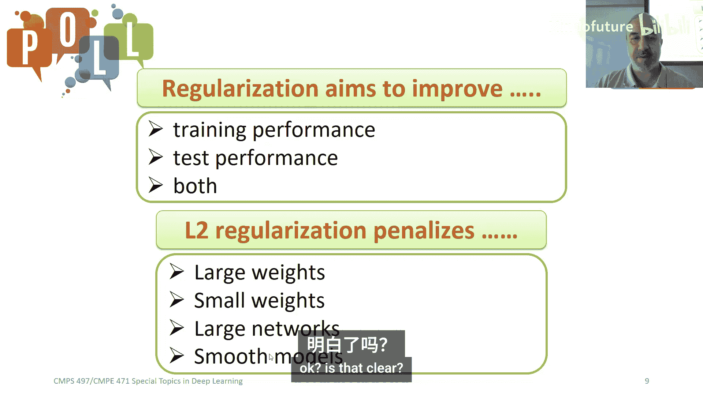

Okay， now China will switch to implicit regularization。

 so what we mean by implicit regularization the previous method was explicit regularization right we add a term explicitly to the loss function。

😊，Here we are not doing that here we will see that gradient descent and sian gradient descent both。😡。

Will have implicit equalization。And by that， we mean that they favor some models。

They favor some models rather than other models and we will see what that means。If you look here。

Let me change。If you look at this continuous curve。

This is the continuous gradient of the loss function。😡。

IfIf we take the gradient continuously on the loss function。

 this is what we will get that the continuous curve here。But in gradient descent we do that in steps。

 we do a discrete， we have discrete gradients， and that's why you will see that the other path here。

Is a different curve than this one， so this is the light green one is the path that we go through by taking steps。

 discrete steps of the gradient instead of the continuous gradient。So of course。

 these two curves are different。Okay， which one we actually do。

 we of course we use gradientian descent， so we don't do this one because this one is is not active not it's not easy to do because we will assume that the step size should be very。

 very extremely small okay it's called infinitefinism step size okay which is very， very small size。

 small step size and we don't do that otherwise we will have an infinite time to do gradientcent。

So what we do actually is the discrete version。😡，Time that means that there is a difference between or there is a deviation between the discrete version and the actual original continuous version。

So what is that difference？We can think of that difference as a regularization tool。

So this is representing the difference between these two values。Okay， in terms of the loss so。

If we think of this as regular regularization， that means that。We favor。Actually。

 we disf or we discourage the values of the models that are in this area。

Because that's here the values are bright， this function that we see in that figure shows that the regularization part will discourage the model。

 the models that are in this area， because we have bright colors here， which means the higher values。

When we have high values in the loss， that means that this is bad， this is discouraged。So。

That means that great and descent by default fourth。😮。

Is favoring some models that are in this in this area and this favors。

Models that are in in this area。If we add both， this is actually the loss that we are minimizing and that's the path that we take when we do gradient descent。

So what's going on here？😡，This is the original loss that we actually don't see。😡。

And that's the loss that we see when we do gradient in descent。

And that's the difference between them。Which means that gay and descent。

Is adding implicitly by default， a kind of regularization。To the original loss function。

what is that in reality？

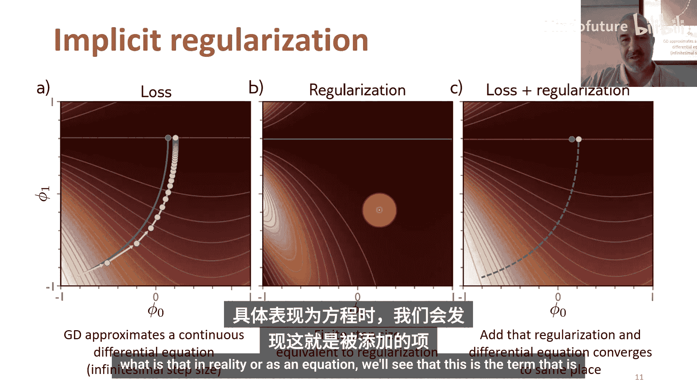

Or as an equation， we'll see that this is the term that is added。Remember。

 in explicit regularization， we had the loss function。😊。

That is the loss value that is computed over the training examples。 And we add。

A new term multiplied with Lada， which is the eization width and then the eization function。

Now this is like this part is like the globalization width。And this part is like the function。 Now。

 if you look at this part， what is this？This is the gradient。😊，Of the loss square。

So we are squing the gradient of the loss， which means that we are penalizing。

When we have large gradient values。ok。😊，Because if we have large value for this。

 that means that the loss will be high， right？Of course， we are minimizing the loss。

 so whenever we have。😡，A model where the gradient is high。This will be penalized。

So that's why here we say this favors areas or models where the gradients are steep。

 you know what we mean by steep steep means lu okay it's like looks like that if we have。

If we assume that。The loss is like1 d function if we have something like that。

Versus something like that。Okay， and let's innocent we are here and we are here which which。

 which gradient is steep。The one to the left right， so this one is large gradient。Okay，'s。

 it's very steep。Compared to this one。So that means that gradient descent by default is favoring models where the gradient。

Of the loss function。With respect to small the parameters is really small。Because if it's large。

 then these values will be large and the loss will be large。

So this is like assuming that we will favor。Areas where。Where the。Where the minimum has。

Like the the loss function is kind of flat so that the gradient is not that large。Okay。

 so assuming that the global minimum will actually be in an area like that and instead of things like very steep like that。

 okay so we assume that whenever the function will be flat。

 this is probably best for us is this will generate better and this is probably the global minimum。

Okay， did you understand that， So this is， this is now done automatically for us when we use。

When we use the gradient descent。Because it inherently adds this term to the loss function。Okay。

 type do we actually use gradient in descent？No， we used to castig in。

So when we do stochastic gradient descent。😊，It turned out that we have something similar to what we saw here。

 Okay， so this is the original。This is this is the loss function that that we have here。

 so it has the same additional term plus a new term。

Which is the sum of the squares of the difference between the gradient of the batch。

Which is this one and the gradient of the original loss。And to minimize this。Some。

Then the gradient of these batches should be similar and small。So that this sum can be minimized。

When the gradient of the batches。Our mode， what does that mean。

 You remember when in stochastic gradient and we we move towards the gradient that we compute right if the gradients of the different batches are very different。

What would happen。Every time we move to a different direction。Right。And with different steps。

 so it will be it won't be smooth。But if the gradient of the batches。A very similar。And and small。

 then the model will be smooth。Then the path， not sorry， not the model。

 the path that we take in the updates of the model will be smooth。And when the。

 the best of the model is smooth。That will that means that we might reach the global minimum faster。

Okay， so this is done implicitly with stochastic gradient descent。😡。

T now if you so this this is the additional terminal with the original one from gradient descent and the new one that is special for to casting gradient descent。

Now， also， if you look at。The factor that is multiplied in both cases。

 you will see that it's a function of alpha。Remember， in explicit legalization， we had Lambda。

And it was multiplied by thegization function。 Now， alpha over 4 is something like now lambmbda。Okay。

 now we don't have explicit。ucleization width， but the width is a function of the learning grid。

Tpe what is the job of the gra weight？It enables or disables the regularization。

 If we want to disable the regularization completely， then we set lambda to 0。So that will be zero。

 then everything will be zero。On the regularization side， if we set Lada。

 if we increase Lada that means that we pay more attention to the regularization part。

 we pay more attention to the models to the regularization function which was in L2 was the square of the widths and here it's different based on whether we are doing gradient descent or to casting gradient descent。

So to give more attention to the utilization， we increased the learning rate。

Of course to some extent， so that's why here the implicit acquisition depends on the learning rate because of that multiplication that we see here。

 and perhaps this is why larger learning grades， which means larger attention or larger weight for the acquisition will generalize better。

😊。

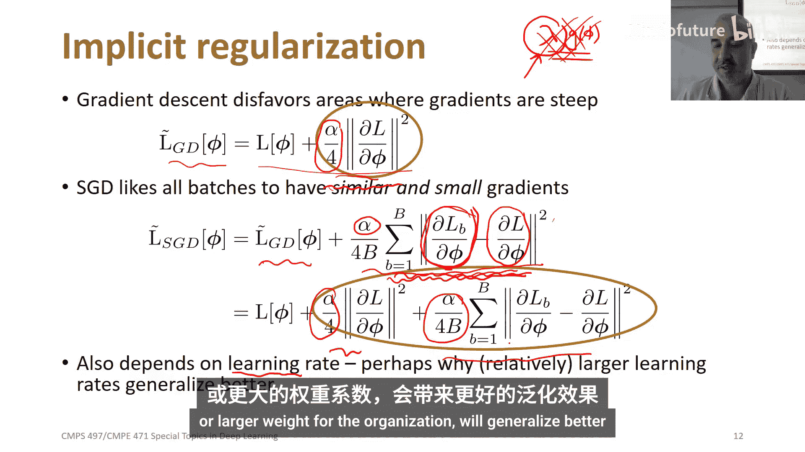

We can see the effect of the implicit regularization here。This is the original loss function。And。

This is the meaning of the global minimum。Now this is the。What we can say。

 this is the implicit popularization。This is where。

If you remember from last time from the last last slide， the previous slide。

 that the regularization will penalize large gradient。

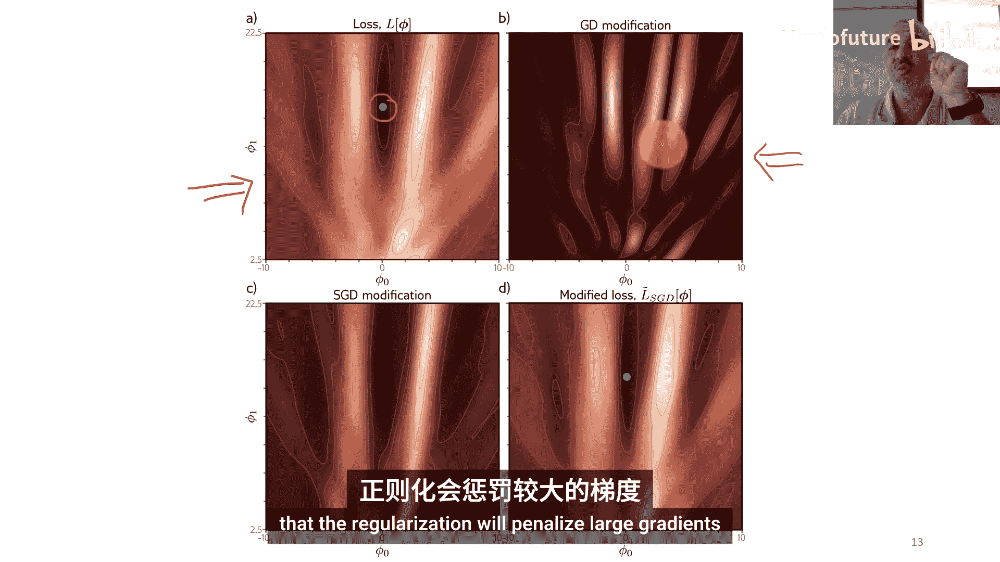

Because here we have the square of the gradient side now where in this loss function。

 the gradient is large。

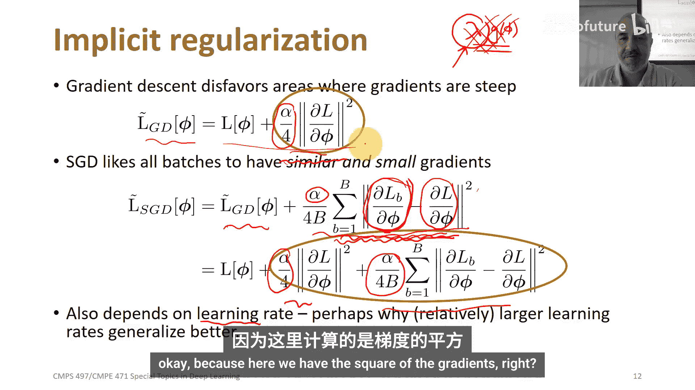

What do you mean by large gradient here？Large gradient means big change right in the function value。

😡，Right。What are the areas that we have big change here， Now I mentioned this area。

 do we have big change。Yes， its bright and dark right。

 a big change in small area right so we expect that the gradient here is high。

 we expect also the gradient here is high。Right， in in this area。

We expect that the gradient here is high。We expect that the gradient here is high。

And that's what we see here in these four things。 because they are bright。

 that means that the gradientdi is high。几。😊，Because this is the sum of the square of the gradient of the loss function。

So this is kind of the regularization that is implicitly added to gradient descent and that's the term that is specific about the stochastic gradient descent and that's the total of them。

Now you can see that this point is different than this point。But they are very similar in the loss。

 but they are different models。So this is the one that we have could have reached with the original loss function and this is the one that we can reach with the stochastic gradient S。

 they are not different in terms of the loss， but they are different in terms of the values of the parameters。

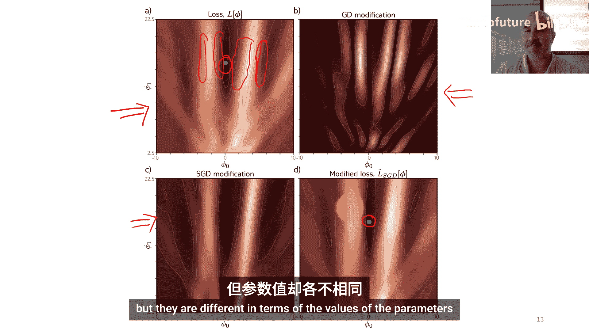

Okay。😊，Now， let's see the the effect of the implicit。

The effect of changing the learning grade and changing the batch size。On the Mist。1D dataset set。

You can see here that when we increase the size of the hat layer。On training。

 of course the performance is better because the air is decreasing now on test。

You can see that we have three curves here right two of them are almost on top of each other。

 the orange and the light green are almost the same and then the dark green is lower。

 of course lower here is better so this dark green curve is when we have the largest learning grade here。

Okay， so when we increase the learningig rate a little bit。

Mean that when increase the learning grade here， the。The performance。Is better。Right。

So that's when we use the full batch which means we have gradient descent now this is not what we use really do we use stochastic gradient descent and when we do stochastic gradient descent when we fix the learning grid。

 learning grid is the same but we are changing the batch size you can see that the best performance is achieved when the batch size is the smallest。

 so this is when the batch size is 10 this is with 00， this is with 4000。

So you can see that the batch size here is the smallest batch size gave us the best performance。

 so overall， we can say roughly that when we increase the learning rate to some extent， of course。

 because if we increase it a lot，Then then we will get very noisy modern。So to some extent。

 increasing the lowering rate will be good and having smaller batches will be also good。Okay。

 and that's what we can。 we can see here。Any questions on this？Okay， now you'll notice here that we。

We are testing the perform。 We are plotting the performance on the test set。

If you remember from the previous lecture， if you remember， we said that。We should。

Tuneune the hyperparmeter using the validation set。Not that this set。Right。嗯。So。

I'm not sure if this is actually， because this is， of course。

 a research study that is published in a paper， I didn't read the details of the paper to just check if this is really the test set or not。

But。Whatever， this should be the validation set or the development set。So it shouldn't be of course。

 the test set， the unseen test set， maybe this is called test。

 but it is actually meaning development set or the validation set and same here of course。Okay。

 so we cannot actually tune the hyperparameter on the test set。

 as we discussed in the previous picture。Okay。Now we will switch to another regularization technique。

 which is called early stopping。Now， from the name。What could that mean。Early stopping。

 early stopping of what。Itstain。Tining， right， so early stopping in training。

 so we should stop training early。Okay， what does that mean？

Let me show you first plot and then we'll talk about it more。

Let's say that we are plotting the performance。Okay， with increasing number of epochs。

You remember the epochs。So epo epochs means a full pass over the entire training examples。

 full pass over old batches。Okay。And on the Y axis。

We will plot the performance of of whatever model without training。So let's say that this is else。嗯。

As we train on more epochs。We are taking more time to go through the training data。

Do you expect that the performance on training。On the training data will get better or worse over time。

And we are training on more data， more and more and more。

 okay we are going through the training data more times。The performance will get better or worse。

The performance should be should get better over time， right。

 And with increasing the number of epochs， the performance should get better。 Okay。

 so the error should be。Should decrease okay， so we typically we should get something like that。Okay。

😊，And sometimes you can reach0。A sometimes nott。 it depends on the problem and the training set。

But roughly， should thearrow should decrease， which means the performance is improving。that's on。

On which set。On the training set， right so that's on the training set。第。Now。If we。At these points。

 when while we are training on the epochs， I mean， while we are going into iterations over the training data。

We can also measure the performance on the validation set。😡，Right。😊，Which is unseen to us。

To each to each at each point Okay so this is the variation set is the set of examples that are not used for training。

 right？So this is like an unseen data for us so we can we can see what what the performance will be。

 So on validation set， do you expect that the performance will be better or。

Or or worse than the training。Yeah， worse， right。 So generally， it should be worse。

 So we should get a curve that is higher than this curve。So we get something like that。

 usually we get something like that。Okay， and so it will it will be。

 it will it will increase at some point。It will。It will increase back。哈。Yeah。

 well this is one validation set。😡，Yeah。Okay， so it will improve。But at some point。レ'すすいません this is。

This is point。A， this is point B。 That's number of epos。 Maybe this is C。 This is D。 So at point B。

Their performance。We'll start do two decrease。The error will increase。ok。😊，T what does that mean。

 what happens， what happens here？嗯，好对。我继续一下。Now why， why， why we， why we。

 why the performance is improving until at one point， the performance is is getting worse。The。

So what do you mean by our number of Facebookbook， we are increasing the number of abook here。Okay。

 why we are， why， while we are in this， in this region， the performance is improving。

But then after that， the performance is getting worse if degrading。

So what happens here is something that we discussed before is called overfitting， of course。

So the model starts to actually memorize the training data so that it's not generalizing well on unsceeen data。

So that means that if we are training the model。We should actually stop here， right。

 because that's the best model we could get。😡，And at that at that number of epochs。

This is the best model， right？😡，Is it， is it the best model actually or not？No， why not。

Where is the best mode of time？嗯。你个嗯。So， the one at D。But that's what meaning， right？

When we train a model， we。Aim to get a good performance on answercing data， not on。On the training。

 because we might get0 error on training， but badarrow on unseen data。

 Why is that because of the overfitting。because the model starts to memorize actually the examples doesn't generalize well。

And we will get bad performance on the red set。Okay。

 so early stopping here means that we will stop at at that point， we will stop。

 we will get the model at point B here。We probably do it do the training over more time， of course。

 so that we know where we stop， but then we will capture the model， we will store the model。

 we will use the model。😡，That we got at that point。That's what we mean by early stopping。Okay， we。

 we will train over multiple epos。But we will also watch or examine the performance on the development set。

 on the validation set when we have something like that that means that this is the best model we should stop training here。

And we should get the model that we got here。That means that we need to store multiple versions of the model。

 maybe we store at a and then B and then C， and then we select one of them based on this validation performance。

😡，Okay， is that clear。Okay。So that's what we mean by early topic。

It can be said in a different way if we stop training early weight， don't have time to overfit。😡。

Okay you can think of it that way。Or it will not have time to get large and as we said last time。

 we favor the models that have small weights over large weights because that will give us smoother models。

 which will generalize better。So that's the idea of early stopping and this is of course now is introducing a new hyperparameter。

 which is the number of steps of epochs， so it's like we want to know what is the number of epos we should stop at。

so this is right now another hyperparameter but and of course it will be tuned on the validation set as we saw in the previous slide and the nice thing is that we don't have to eat3 any last time when we talked about tuning hyperparameters。

 every single value of the hyperparameter we need to if we change it。

 we need to et the model foam sketch。So like like most on the number of layers。

 if we change the number of layers， of course we have to retain the model。

 but now here to tune this this hyperparton， which is the number of epos。

We will just need to continue training and and store the model at different points in in time or different points of the。

 of the number of apples。 Okay， and usually， this is called checkpoint。 And when you。

 when you store the model。Here， this is one checkpoint， that's another checkpoint。

 that's a third checkpoint， that's a fourth checkpoint， and then you select one of these checkpoints。

One of these models that were trained at these points to be actually the model that we will use in reality。

the one that we will measure the performance full on the test。Okay。Any question up to this point？

You have a question？No。So this is an example。😊，嗯。So this is over a different number of iterations here。

 so initially we have a very bad model that doesn't fit at all the training data。

And then after 1000 iterations， we have a better model。After 5000， we have。Looks like even better。

After 10，000。We have another model that doesn't make a big change from here， but might be better。

 but now after that。When we have 50，00 iterations。It looks like the model now is doing very weird behavior and it's getting too overfitting。

Right。😊，So where should we stop here， which model we should take？Now this is dark now。

 and you can think of this as the point， the checkpoints， B C， D， E， F。

 which which model we should stop at。吓。E why。This is is you think this is the best model now。😡。

How did you know that this is the best？This。How do we know we actually and to me with what I see here。

 I cannot judge。😡，If you remember from the previous slide。

 we have to get the performance on the di set。This is on training， so this loss values。

 it looks like we are it is decreasing， right？The loss values are decreasing。

 which means that these loss values are measured on the training set。

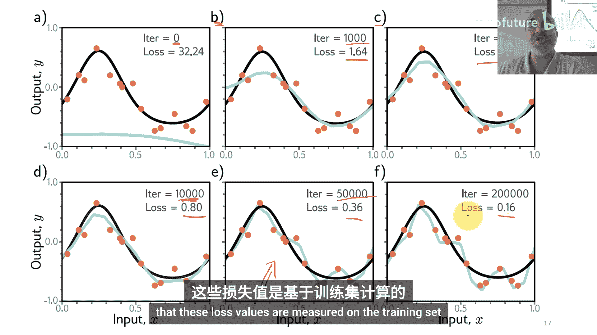

This is which curve here。This one。Okay but that's not what we want， and we want this performance。

 this curve。Okay， so this is the one that we actually need to to measure。

On the performance on the validation sets。

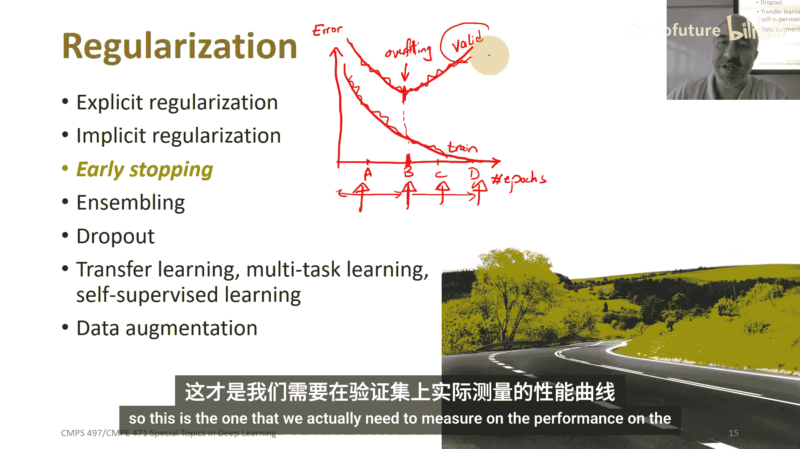

Which is not on on this figure。 so we cannot judge probably this is this is the one that's the best to me。

 and it looks like the best， but we cannot for sure judge unless we know the loss or the performance on the validation set。

对。Definitely not not these two because this it looks like the function now is getting any。诶。

Big zig x。So I don't think this this is all， but anyway。

 we cannot judge unless we have the performance on the validation。Okay， is that clear。

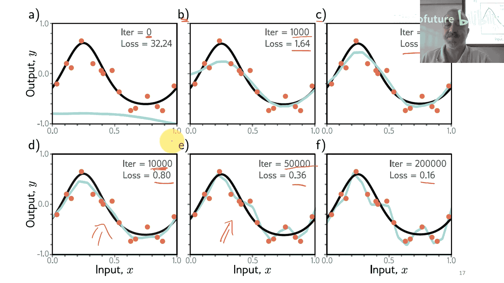

Now we switch to another uization technique， which is called ensembling。

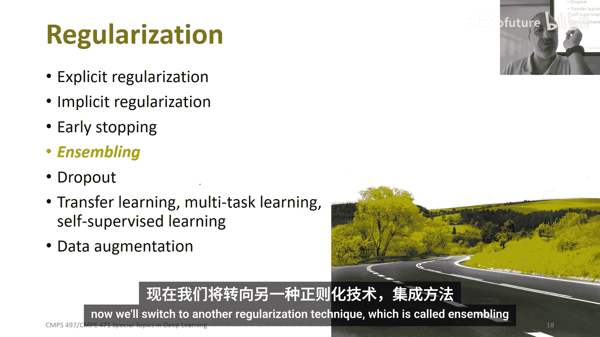

W me by ensembling。Have you heard this word before I think it's a French word。On some means。What。

Yeah， ensble means here having several models using several models。 So so far， we。

 we only use one model for prediction。We stay in a model， we use it。😡，Or which you and use it。

 one model。But nothing prevents us from moving multiple models for prediction so we can train multiple models。

😡，And then use them for prediction。 time。 If I have one model。

I can just use that model for infantite and I can my model for predicting the house price。Okay。

 I can give the features， the input and it can give me output the house price side。

 like what if I have five models like that？我出嚟了。Which one I should use。Here we are using all of them。

What does it mean to use all of them？😡，It means that we need to combine。

 we will use all of them to give predictions， but then instead of one prediction now we have five predictions right so we need to combine these predictions somehow。

😡，Even get take the average。 Take the mean。If it's a classification problem。

 then we can get the most frequent class。Like majority voting。 Like。

 you can think of this like the models are giving votes。 Okay， so we can。

We can take the most frequent vote。So it depends on the nature of the models。

 but when we use and font， then we need to have a mechanism for combining the outcome of these models。

Now how can we get alon down some， how can we get multiple models？啊 changinging the hyperpar。Okay。

 if we change the hyperpar， we get different model， right。So， that's one way。What else。2。

 I think on three weeks of lectures， we talked about model initialization， right。

 how we how we can initialize the weights and the biases of the model if we。initialize the model。

And retrain it， we can get a different model。Because we are starting from a different point in the space。

So there are most of ways。Even you can train models of different families。

Like you contain a new model and you contain arigation， meadline irrigation model。

 you contain a support vector machine model， different machine learning models。

 okay and use them all。😊，So there are many ways to get different modes， so different initialization。

 different hyper， parameters， different families of mountains。Even different training sets。😊。

So we can train the model on different subsets of the training set。 This is actually called begging。

We can get different subsets of the data reasseampled with replacement。

And I have less than 1000 cleaning example， I will sample from it 1000 but with the replacement。

 So some of the examples that I will get might be repeated。OkayAnd with every full set。

 I will train a different model， so now I will have multiple models。Okay， did you get that。

 This is called bakinggging。 So I have。Let's say as I have。s exactly the same thing。

 but with different training data。 So I have。 this is the original training data。

 I can sample some of them。Okay。😊，And when I sample some of them with a replacement。

 some of them might even repeat in the same sample。 Okay。

 so I might get this point more than other points。Okay， now I can。

 I can train a model and can I have a new sample， I train another model， a third sample。

 I train a third model。 This is called backing。And from that， I can get mono modes。Right。

 what's the downside of that？And instead of training one model， now we are training multiple models。

Is there anything any disadvantage for that。Time， right， time， we need more time。More time。

 Taiwan more time and more computing capacity， right， we need computing more computing sources。

Computing resources， right。嗯。即系。How about so this is in training right type in inferences when we use these models。

Will will that also need more time。Because we need to get the prediction from each model right。

 so that will also take more time and that's more critical even from painting because painting is done offline。

But influence is done online with users。 Okay， when the user is asking for something。

 I want to run the model to get an answer， and that will take more time。

 it depends on the complexity of the model， maybe the models are lightweight， it will not take time。

 but generally this is for sure it will take more time than just one model。

This is an example of bagging， this is the model that is trained if we have the original data and for BCcGE。

😊，Model 1， model 2， Model 3 model 4， we are using beging。

 so we will we are sampling from the original training data with the replacement。

 So for example Mea at this point， it's bigger because this is just an indication that it was sampled multiple times so we have multiple copies of this of this model in the training data So every time we will get a different model as you see here that's model 1 that's model2。

 that's model 3 that's model 4， and then we get the ens sampleble of them。Okay。

 so we get the average of the predictions when we get the average of the prediction。

 we get this model。 which is kind of a little bit smoother than the original model actually。

C we expect that this will generalize better than televisionism。ok。😊，Any questions on that？

So this is there on some one more technique。This technique is is a very nice。

 and it looks like crazy idea。 This is called dropout method。 What do we， What do we do in dropout。😊。

You know we a network right， and when we train the network， we update the weights over time。

 right the gradient of based on whatever optimization technique we are using。With dropout。

 we will assume that with every batch， next assume that we are talking about sastic gradient sent here with every batch。

 we will remove some of the nodes from the network。A percentage of the notes。With some probability。

 and for every node， we say it will be the and and with 50% probability。Which means that， overall。

About half of the nodes will be removed every step。Okay， so for example。

 here these nodes will be removed。😡，Here， these nodes will be removed。Here。

 these notess will be removed and so on。Okay， so every step， every batch。

 we select some of the nodes。Andomly。And dis them。Disabled them means what。Means that。

There are no connections here。Means that the output of that node will be 0。

 and which means that it will not affect any of the output of the next layer。 Okay。

 so it's like removing the node。Okay。😊，Exactly。ok。W， why are we doing that？😡。

It looks like a crazy idea right you why would we remove some of the nodes from the network。

 but turned out that the idea is the rationale is really simple。

 we want the network not to rely on any of the nodes。Which means that。

It shouldn't be affected with any single note。😡，It should be more robust。

 should be more independent or less dependent on any single or group of nodes。😡。

So when it is trained with the absence of some nodes。

 it will be stronger because it doesn't it will be less dependent on small on specific nodes。😡。

And sometimes these specific nodes may lead to weird behavior， weird mapping in the final model。

So that should lead to smoother and better models。 So let me show you an example here。

This is an example where。If you remember， I think in two or three lectures。

 we said that when we train the model。In between the training examples， it can be any behavior。

 so it can be smooth。Or it can be something like that。😡，Okay。😊，Both are possible。So if that happens。

 and by the way， that doesn't change the loss on training because as you see here。

 whether it is smooth like that or like that。The function。

 the loss is the same because the the the function now or the model now is passing through almost all the all the。

Or the training example。 So the loss on training will not change。

And that is probably because of some。Nots， if if those nodes are disabled。

 then the function at some immediately will be will be something like that。 But then after some time。

 it will go and and be smooth。Because of the removal of the of the group of nodes that。

Produced that weird behavior。Okay， so。Overall， we will get， we will favor smoother function。

 smoother models。And smoother models mean， again， mean better generalization performance。

Better performance on unced。Okay。😊，Is that clear。Any question on that？

So that's the effect of dropout。So the idea is that by some percentage， by some weight。

We dis some of the nodes， every single batch。With every single step。Okay， and of course。

 with one batch， we might turn off or disable some nodes in the next one。

 It will be probably different nodes and so on。 Okay， overall。

 the network or the model will not depend on single node。 It should reach a model that is good。

Whether the nodes are there or not。Okay， so it will discourage any。

Any weird behavior of some groups of nodes over time。Like， like what we see here。

Type now what should we do in inference when we use the model？Now， the model was trained on。

 let's say， Im 50%， always in every batch， like 50% of the nodes are disabled。

 which means that the network。The model is to end on 50% on the nodes。Now。

 what should we do when we do infants， when we test。

 should we disable some of the nodezz or we should use the entire network？We shouldn't， of course。

 remove any nodes。 Now we have the entire model， right？

Why wouldn't have the the the model in the first place with with with with the full set of nodes。

 So well use the full set of nodes。 But because the network。

 the the model was trained on half of them。And then we will use the full model。

 the full network in testing， this is not what was seen in training。So， we'll have to。

Compensate for that in interest test。So instead of in training。

 we said that we will have a probability of dropping， let's say as it is 25%。

To compensate for that in infants， we multiply the weights by one minus that probability。Okay。

 so that will compensate for what happened in today。Otherwise。

 the model that we are using will not will not represent。😡，What is seen in training。

So we have to adjust the weights that way when we do the inferences。Okay。😊。

So that we can get to something that is similar to what similar to how the model was actually trained。

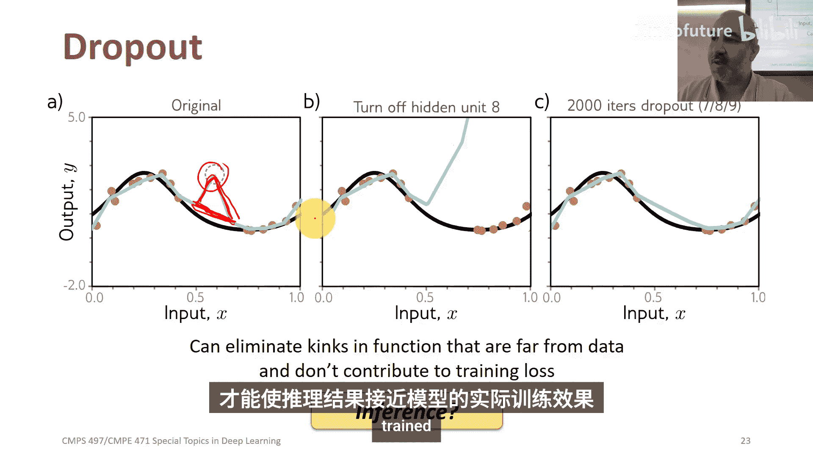

Okay。😊，I hope that is clear enough in trouble。In Chala， the next lecture。

 we will talk about very hot topics and very recent。

 I think in maybe the last four or five years maximum and unfortunately we don't have time to cover them now。

 but in Shaa we will cover them in the next lecture。

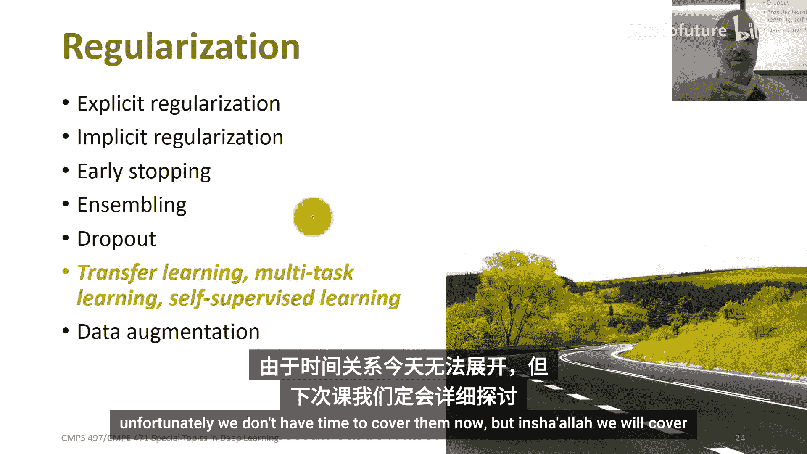