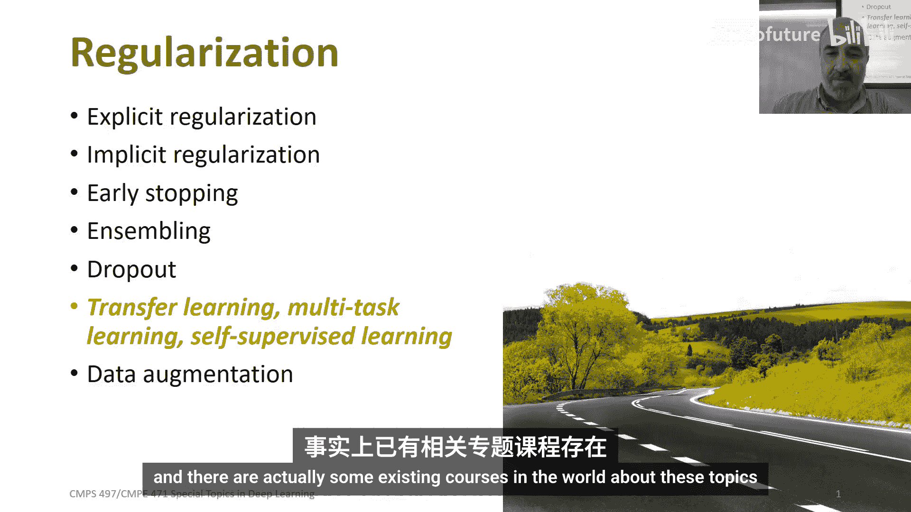
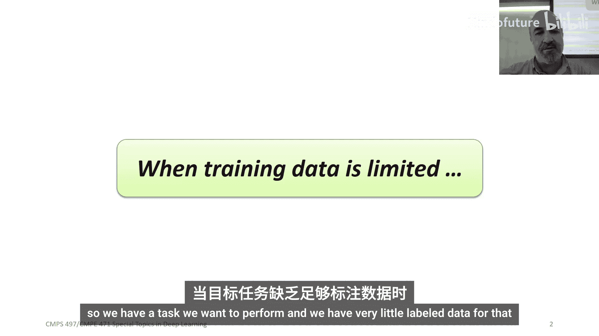
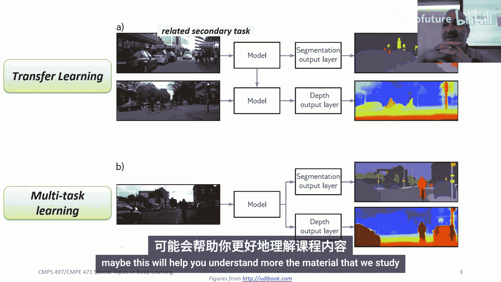
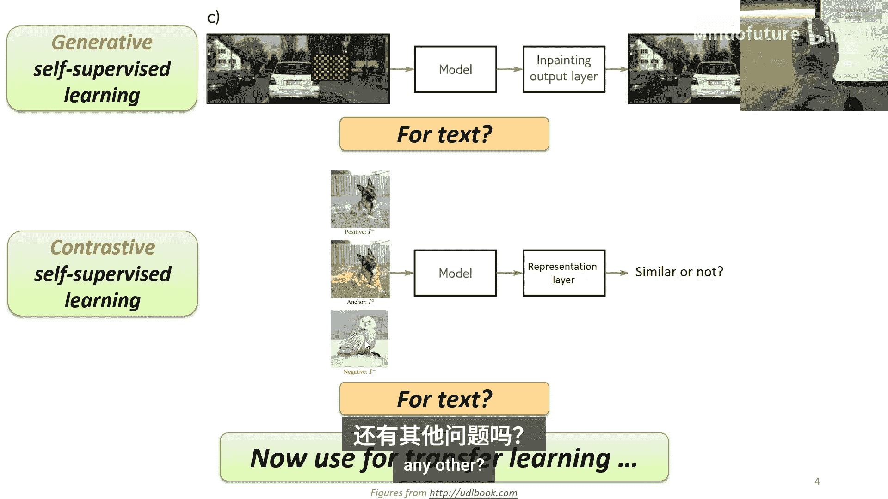
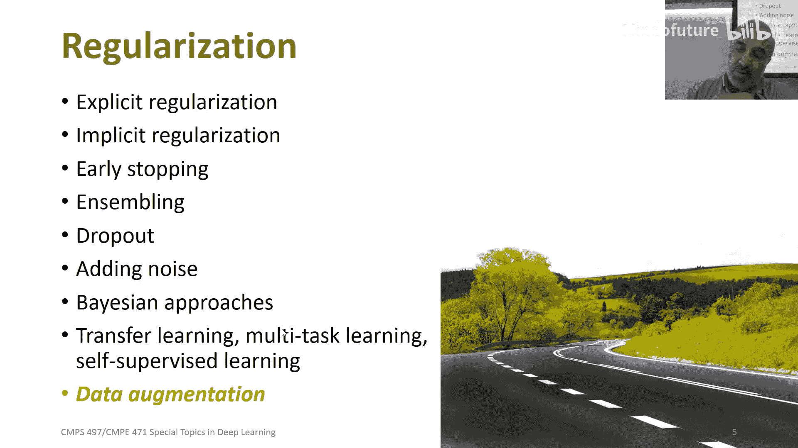

# 【卡塔尔大学】深度学习 CMPS497 ｜ Understanding Deep Learning ｜ Fall 2024 p19 P19_第十八讲(a)-正则化 III -BV1vQvNz1EeK_p19-

today we will continue talking aboutization for some time we still have few techniques to cover and then we will start a very important session about transformer control。

嗯。呃。Now we will talk about three different techniques。Transfer learning。

 multitask learning and self supervised learning。All of them are nowadays very hot research areas。

 there is a lot of work on these techniques， unfortunately we don't have time to cover details。

 we will just introduce them， give quick definitions about the main ideas behind them。

But actually each one of these might be a course by itself and there are actually some existing courses in。

In the world about these topics。So mainly these topics of these techniques we use。

 especially when we have very little training data。

So we have a task we want to perform， and we have very little labeled data for that task。

What we can do is。Different ways， the first one is called transfer learning。In terms learning。

 we assume that we have another task that is related to the task that we are performing。

And for that other test that we call secondary task， we have so much labeled data already。

So for example， let's say that the primary task， the task that we are concerned with is detecting the depth。

In， in an image。So for each pixel in an image， we want to know how far it is from the camera man。

Yeah。Which is the task here。And we assuming you that we have very little labeled data for that task。

 but we have so much data for another task， which is the segmentation task segmentation task means that given an image we want to classify each pixel to which object it belongs so all pixels that belong to the same object will be the same will have the same value of the same same class。

T is the secondary task here really related to the primary task。Yes。

 if we have a model that understand that understands how to segment objects。

 probably will it will help。Doing the task of predicting the depth。For example。

 the pixels that are all belong to the same object might be very similar in depth。Than others。

So what we do is that because we have so much label data for the secondary task。

 we built a model from for the secondary task。And that model， of course。

 has an output layer for the segmentation task， right after we build that model。

For which we have lots of data， lots of labor data。We use the same model。

 but we will continue the training on the primary task。😮，For which we have very little。I labeled it。

So we will get rid of the segmentation output layer and we plug in another output layer for the depths。

Task or what for the， whatever the primary test is。And continue training the model。

 So this model here that is trained already for the secondary task。Will be used。In training。

For the second task。Okay。Ty， what's the benefit that we we did any E。

 Why don't we just train a model from sketch？Why do we need to train a model for a primary secondary task and then continue training for a primary task？

Why don't we do it from scratch from the beginning。Because like。The进风。You know。Will take。

 Will we try first the first one。We know the parents。We know just。

But we don't have the label data for the depth for the first model。

 The first model is to end on the segmentation task。So this model is trained for the sation task。

 we will take it and continue training it， but for the depth task。

 they are related so it should benefit from the knowledge that the model got from the first task that's why it's called transfer learning。

 So it's like now we are transferring the knowledge from the task for which we have lots of data。

 lots of label data to the task that we we have fewer label data。Okay。

 and that should be much better than started from scratch。

 because if we start from scratch and we have few label data here， the model will suffer from。

The limited amount of data， right and remember variance will be very very bad right because we have very limited training data for that task。

ok ，你了嘢带啲戏啊。So we will train in a model first on the task for which we have lots of data。

 and then we continue training on the primary task。That's transfer learning。

The second one is called multitaask learning。Here we don't do it in two steps like that。

 we do it actually in one step， we train the model on more than one task simultaneously。

And that can happen only if for the same examples we have labels for different tasks。

 so for example here this image we have labels for segmentation and we have labels for the depth。😊。

So we can train the same model now。 Okay， for both them。

So we might have here of course there are multiple architectures。

 we might have separate output layer for each for each task。

 or we have one output layer with different nodes for the tasks and this is what you will see in the project it's very simple multipletask learning that you will do in the project where the output layer actually will provide multiple will learn multiple tasks together。

T what is the difference between transfer learning and multitask learning？Yeah。

 this is for one step okay this is one step and these are two steps here we assume that we have lots of data for that task and few for that for here but here we do it together what's the intuition I what's the benefit if if we have few data。

 few labeled data for the first one and few labeled data for the second one because we are talking about the same examples here right and in the in transfer learning the examples might be completely different the images might be completely different here we have to have the same image same set of images but labeled for the different tasks that what's the intuition any why we should learn two things。

At the same time。Well how could that benefit both actually？You will only end up with one of。

We only end up with one model， but that one model is able to predict for both tasks yeah so what's the intuition here？

Can you give me something from real life that when we learn two things。

We might learn them better than learning each individually。This。The patient is miignant or。

Yeah so so you mean predicting a disease for a patients might help predicting another disease for the same patient right so if even if these two diseases are different but predicting one might help or learning how to predict one might help predicting the other one yes okay and we do that all the time by the way。

Okay， maybe learning studying two courses that are related at the same time might help you like calculus。

 if you， if you learn calculus entitled to this course， maybe this。

 this will would help you understand more the material that we study。 Okay。

 so this is multitask learning。

The third one is called self supervised learning。Okay， self supervised learning。嗯。

We talked about supervised learning earlier， right in the course， right？So with supervised learning。

 we have labeled data and we learn from this labeled data。In self supervised learning。

 it's still supervised learning。😡，Still we need to have label data to learn from。

 but the idea here is that we can generate these label data automatically。

 we don't need humans to go and label this data。Okay， for example， I have these images。

I can mask part of the image。And three a model to predict the pot。

Do I need humans to label this data for me。No， I can automatically。

Bckout part of the of mask parts of the image。 And I know that part， right。

 because I have the original image and then test the model train the model to predict that part。

And of course， now I can test， of course， and evaluate the model because I know which part I know。

Right， so I can generate this way， lots of。Automaically label data。Entering the model on it。

Right this is called self supervised then Why is it self supervised。Labeling， yeah， it's， yes。

 It's not by the， it's。it's by definition， we can automatically generate the label okay we't need even we don't need to to build the model to generate this。

 it's just that we have the data， we must part of it and ask the model to predict that part。😡。

So we can actually generate lots of data this way， if we have images， we have millions of images。

 each image actually we can generate maybe tens or hundreds of versions of it to predict parts of that image。

😊，Right。S O。哎等下。不。Yeah， exactly， exactly and that's called generative self supervised learning why because the model now is trained to generate what is missing。

😊，Now it's something that is completing the example that is given。Okay， why would we do that？

What's the benefit of， of having such model。Okay， so， yes， we can generate images， but。

Regardless of this specific task， can we use that for something else？😡，Yeah。Yeah， when you。

Why would such tasks it's similar to this， right？ Why would such tasks useful？

For something else and it generate whole。Okay， forget about this specific task now， Okay the idea。

 the idea of selfsupvised learning okay， to automatically generate training data and train a model on that generated data Okay。

 we have a model now， Okay， yes， this model can do a prediction for this yes。

 but can we use it for something else。Okay， in the previous slide。

 we talked about transfer learning guide， can we use that more than now for transfer learning？😊，Yes。

 of course okay but now the difference is that in the previous slide we said we have to have lots of labeled data right for the secondary task now we can generate we have lots of automatically generated automatically labeled data okay and we can use that trans for other tasks。

😊，Okay， now that model at least learns。How to understand images。

 how to represent and and understand the structure of images。Right。

So we can make use of that model and maybe further training it for another test。Okay。

 so that's a kind of self supervised， theyre any code generative self supervised。Now for text。

 how can we apply the same idea， you said something about that？对的。Yeah。

 so we can mask the last word in a sentence。Okay and ask the model to predict it We know it right as a label we know which which a word is that or generally we can mask any word within a sentence or any set of words。

 not just one word and ask the model to predict which what are the words that we masked。对。对。

Another type of self supervised learning is called contrastive self supervised learning here we don't autogene the label data by masking。

We generate auto label data by contrastive learning。 In contrast learning， we show the model。

Examples of similar objects。And examples of different objects。And we can do that automatically。

 for example， you see this image of the dog。I can generate a version of this。😮，By different ways。

 one of them is to change the colors。Still， this is an image about a dog right？

And we can say that these two images are similar。Right。😮，And I， so we call this positive pair。😡。

I can generate a negative pair that shows two different things by taking the same dog image and pairing it with a random image。

😊，Okay any randomm image， most probably it would be different than this image。

So now I can train if I have a list of， I have a large amount of images。Images data。

Then I can generate these similar and and different pairs。

 and I can train the model to predict if that pair is similar or not。Okay。

 so that model now learns a little bit about。About similarity between objects and can also help in other related tests。

Okay， so same idea here， we can use this for transfer learning for another primary task。for text。

 how can we do something like that？In do the dark。The structure of。

What do you mean by the structure of sentences。 Remember here， we need to have pairs of similar。

 any positive pair and negative pair。Po the pill means two things that are similar and。Okay， so yes。

 So ifrasing a sentence。Would be similar to the same sentence， right。

 that's a positive pair about negative pair。Okay。哈。😮，Yeah。

 taking a random sentence right taking the sentence with a random sentence okay。

 or taking for positive pay， taking a sentence and the next following sentence。😊。

This is called next sentence prediction。Okay， these will be similar， of course， not different。 Okay。

 that's a positive tail and negative again， we can we can use random sentences。Now for all of these。

 especially the self supervised learning techniques， we might have an autogene table that is owned。

And for example， maybe I will get randomly。An image of another dog。Okay， it can happen。

 but what's the trends。's considered some noise noise in the data， but with the large amount。

 this noise should not be very problematic。Exactly。Again。

 now we can use these models fourth transfer。Yes， it's not a word it would be a sentence。Yeah。

 what about the same sentence， but。Yeah。But you need to know to do it automatically in the right position。

Okay， remember， all of that is self supervised。 So you have to be careful generating generating good data automatically。

 Okay， you don't throw not anywhere and say these are different。😊，Yes。😊，你那的。Any questions？

ok 诶。The last idea that we talk about in this session is data augmentation before we get into data augmentation。

How is transfer learning， multit learning and self supervised learning related to regularization？

It's part of regulargization session right。How is that related to aization？😊，嗯。수。

We wouldn't pay attention too much。没有。What is the goal of vization。So to improve the performance。

 to improve the generalization performance， right， right， and these techniques actually。

Aim to to do that。 Okay， by training on more data on related tasks， we can we can be。

 we can have better generalization for the for the members。Also。

 data augmentation is doing something like that by again automatically generating data that is good for three。

诶。For example， if I have labeled images。Maybe in this case， if the image。

Or what is the object in the image okay object maybe recognition， so that image， for example。

 division originalal image has a built right I can from that image。

 I can generate multiple images that also will be labeled similarly having a built。Like， for example。

 flipping the image， rot rottating and coping the image。

 scaling the image up or down by changing the color of the image。Bluing the image。 And。

 and so So there are many ways by which I can transform the image somehow while keeping the same。I。

Same label。 same label。Okay， the same limit。And now adding these automatically generated label data to the training data。

 hopefully that will improve the training of the motor。Okay。

 so that's the idea of data augment is to add automatically。

New labeled data to the training data so that we have more data than before。对。

And that hopefully will improve the generalization of the model。他们那个。好。嗯。Good， good question。

Can you give me example of task？Because it depends on the task。Yeah， for example， sentiment analysis。

 Okay， that's usually the easiest example。If I have reviews already。Okay， that that that are labeled。

I can from each of you， I can generate it。Some reviews， by may be paraphrasing。Okay。

 with keeping the same， hopefully that hoping that the polyphphaasing will not change the the sentiment of the the the of the text。

 right， in that case， I can't paraphse multiple times。 I can add that to the data。 another。

 another idea called back translation。You take the text， translate it into another language。Okay。

 I must the text is in English。 Okay， I will translate it to French。Okay。

 auto translated to 10 to French， of course， and then auto translated back to English。

When we do these two ways， we will get to， most probably we will get different text。Okay。

 they would be different， but they should have the same same sentiment in that case。 Okay。

 so this is an example from this。Is that clear。要的。Very good With that， we are done with the uization。

Asession。😊。