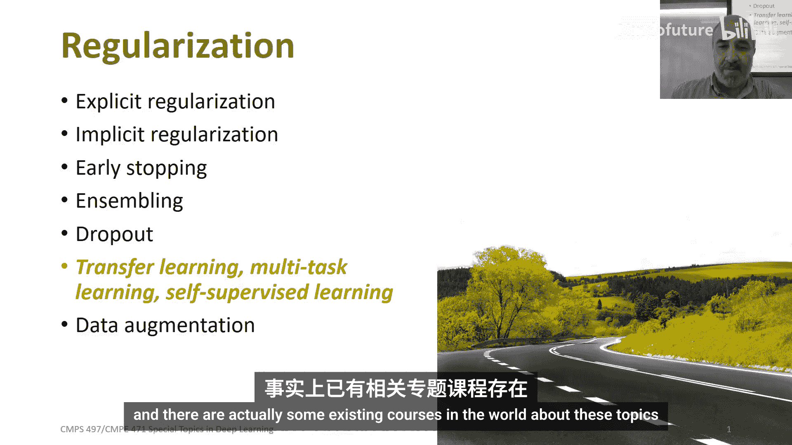
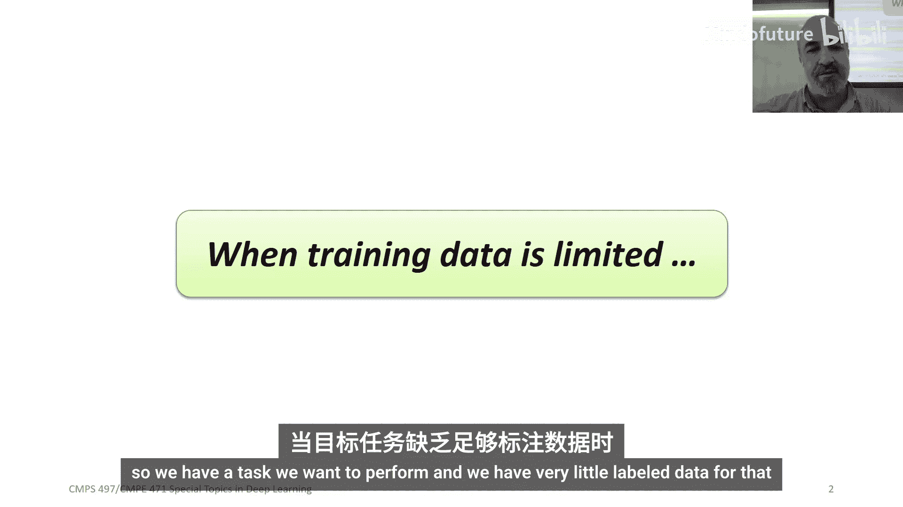
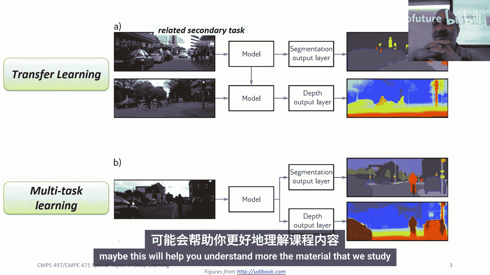
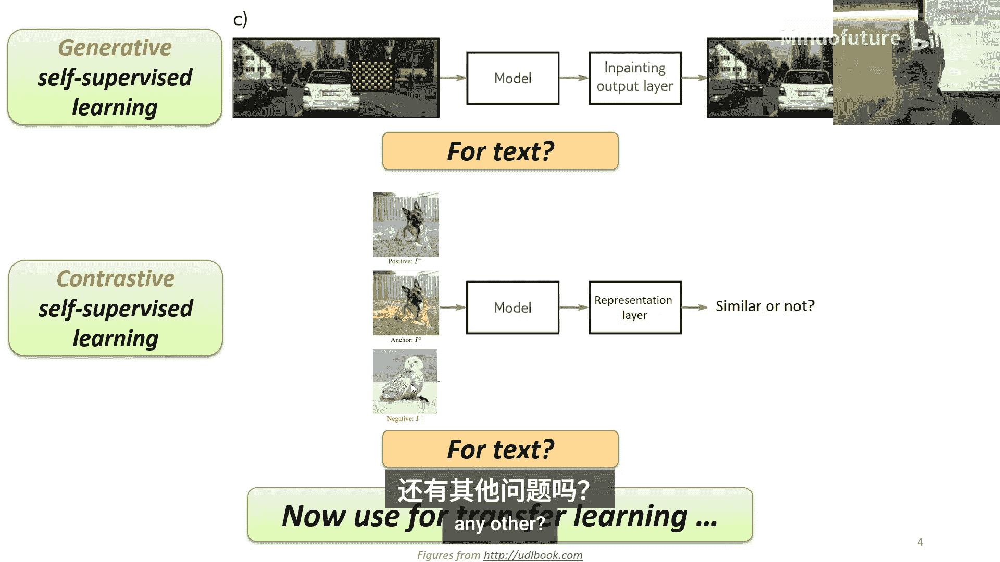
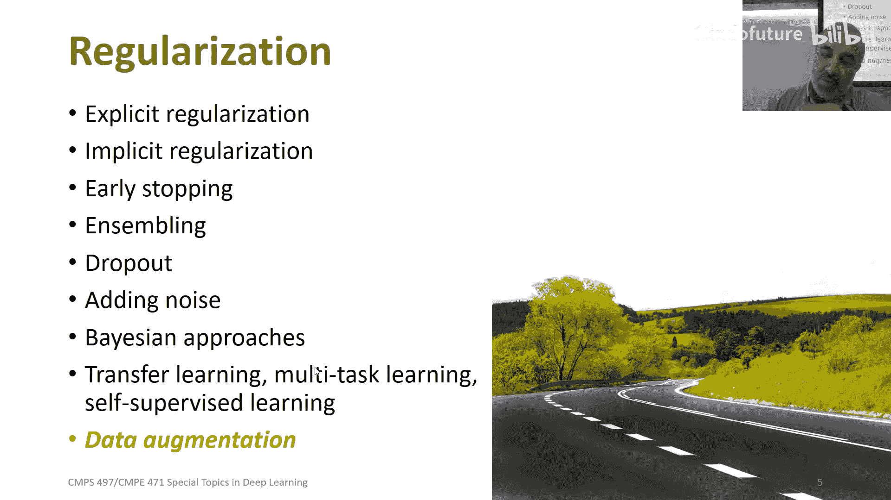

# 深度学习：19：正则化 III



在本节课中，我们将继续探讨正则化技术，介绍几种重要的方法，然后开启关于Transformer模型的重要章节。



上一节我们讨论了多种正则化方法，本节中我们将介绍另外三种技术：**迁移学习**、**多任务学习**和**自监督学习**。这些是当前非常热门的研究领域，虽然我们无法深入细节，但会介绍其核心思想。这些技术尤其适用于**训练数据非常有限**的场景。

---

## 迁移学习 🧠

当我们的**主要任务**（Primary Task）只有很少的标注数据时，迁移学习提供了一种解决方案。其核心思想是：利用一个**相关的、拥有大量标注数据的次要任务**（Secondary Task）来辅助主要任务的学习。

以下是迁移学习的步骤：
1.  首先，使用大量标注数据训练一个模型来完成次要任务。
2.  然后，移除该模型为次要任务设计的输出层。
3.  接着，为我们的主要任务设计一个新的输出层，并连接到之前训练好的模型上。
4.  最后，使用主要任务有限的标注数据，继续训练这个模型（通常只微调部分层）。

**为什么有效？**
如果直接从零开始训练主要任务模型，由于数据量少，模型容易过拟合，方差会很高。而迁移学习让模型先从数据丰富的次要任务中学习通用的特征和知识（例如，理解图像中的物体结构），然后将这些知识“迁移”到数据匮乏的主要任务上，从而获得更好的起点和泛化能力。

**举例说明：**
*   **主要任务**：图像深度估计（预测每个像素距离相机的深度）。
*   **次要任务**：图像语义分割（预测每个像素属于哪个物体）。
*   **流程**：先用大量分割标注数据训练一个分割模型，然后将其特征提取部分用于深度估计任务，并替换输出层进行微调。

---

## 多任务学习 🤹

与迁移学习分两步进行不同，多任务学习是在**单一步骤**中同时训练一个模型完成多个相关任务。

这种方法要求我们拥有**同一批样本**，且每个样本都具备多个任务的标注。模型通常会有多个输出层（或一个具有多组节点的输出层），分别对应不同的任务。

**为什么有效？**
同时学习多个相关任务，可以让模型发现不同任务之间共享的潜在模式和特征。这相当于一种隐式的正则化，迫使模型学习更通用、更鲁棒的表示，从而可能提升每个单独任务的性能。



**举例说明：**
*   同一张医学影像，同时标注了疾病A和疾病B。
*   模型同时学习预测这两种疾病。学习预测疾病A的知识可能有助于预测疾病B，反之亦然。

---

## 自监督学习 🧩

自监督学习本质上仍是一种监督学习，但其巧妙之处在于能够**自动生成标注数据**，而无需人工标注。

其核心思想是：从原始数据中构造一个“ pretext task ”（前置任务），利用数据本身的部分信息作为“标签”来训练模型。这样，我们就能利用海量的无标注数据。

以下是两种常见的自监督学习类型：

### 1. 生成式自监督学习
通过**遮盖部分数据**，让模型预测被遮盖的部分。
*   **图像**：随机遮盖图像的一部分像素块，让模型重建被遮盖的部分。
*   **文本**：随机遮盖句子中的一个或几个词（如 `[MASK]`），让模型预测被遮盖的词是什么。

**代码示例（文本任务思想）：**
```python
# 原始句子: “今天天气很好，我们一起去公园。”
# 构造训练样本:
输入: “今天天气[MASK]，我们一起去公园。”
标签: “很好”
```

### 2. 对比式自监督学习
通过构造**相似（正）样本对**和**不相似（负）样本对**，让模型学习区分它们。
*   **图像**：对同一张图片进行色彩变换、裁剪等得到正样本对；将一张图片与随机另一张图片配对作为负样本对。训练模型判断两张图片是否相似。
*   **文本**：将同一句话进行复述作为正样本对；将一句话与随机另一句话配对作为负样本对。或者，将连续的两句话作为正样本（下一句预测任务）。

**自监督学习的用途：**
训练好的自监督模型已经学会了数据的底层结构和表示（例如，理解了图像构成或语言语法）。这个模型可以作为强大的特征提取器，通过**迁移学习**应用到下游的具体任务（如图像分类、情感分析）中，尤其是在这些任务标注数据不足时。

---

## 数据增强 🌈

数据增强是正则化中直接且有效的方法，其核心思想是：通过对训练样本进行一系列**保持标签不变**的变换，来**自动生成新的训练数据**，从而扩大训练集规模。



以下是常见的数据增强方式：
*   **图像**：翻转、旋转、缩放、裁剪、调整亮度/对比度、添加噪声、模糊等。
*   **文本**：同义词替换、回译（翻译成另一种语言再译回）、随机插入/删除词语等。

**为什么有效？**
更多的数据意味着模型能见到更多样的样本变体，这有助于模型学习更本质的特征，而不是记住训练集中的特定细节，从而提升模型的泛化能力和鲁棒性。



**举例说明（文本情感分析）：**
*   **原始评论**：“这部电影真是太精彩了！”（标签：正面）
*   **增强后的评论（通过回译）**：“This film is absolutely brilliant!” -> “这部电影绝对是出色的！”（标签仍为：正面）

---

## 总结 📚

本节课我们一起学习了正则化相关的几种高级技术：
1.  **迁移学习**：利用数据丰富的相关任务模型，初始化数据匮乏的主要任务模型。
2.  **多任务学习**：同时训练单个模型完成多个任务，共享表征以提高泛化。
3.  **自监督学习**：通过设计前置任务自动生成标签，从无标注数据中学习通用表示，为下游任务提供预训练模型。
4.  **数据增强**：通过对现有数据施加保持标签不变的变换，人工扩展训练数据集。

这些方法的共同目标是**提升模型在未见数据上的泛化性能**。它们通过利用更多数据（无论是来自其他任务、自动生成还是数据增强）或让模型学习更通用的表示来实现这一目标。接下来，我们将进入Transformer模型这一深度学习重要架构的学习。