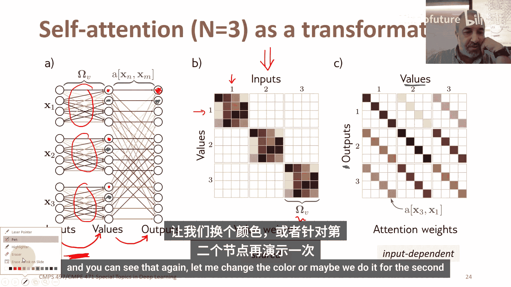
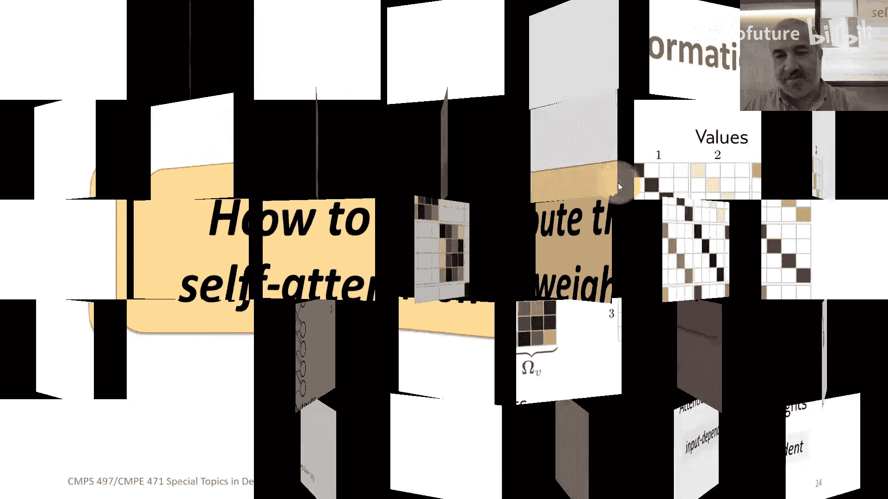
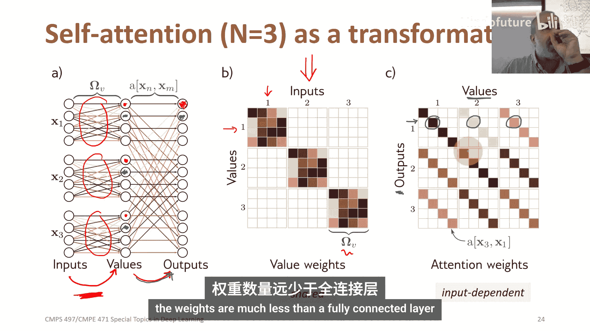
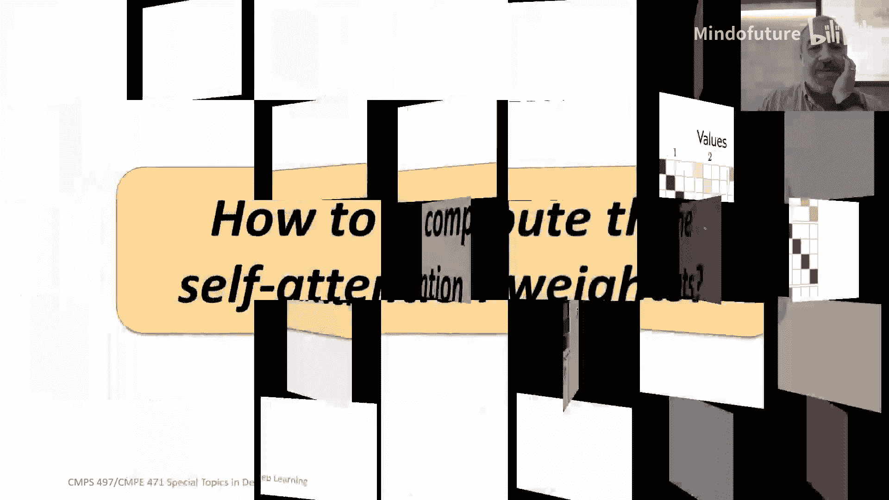
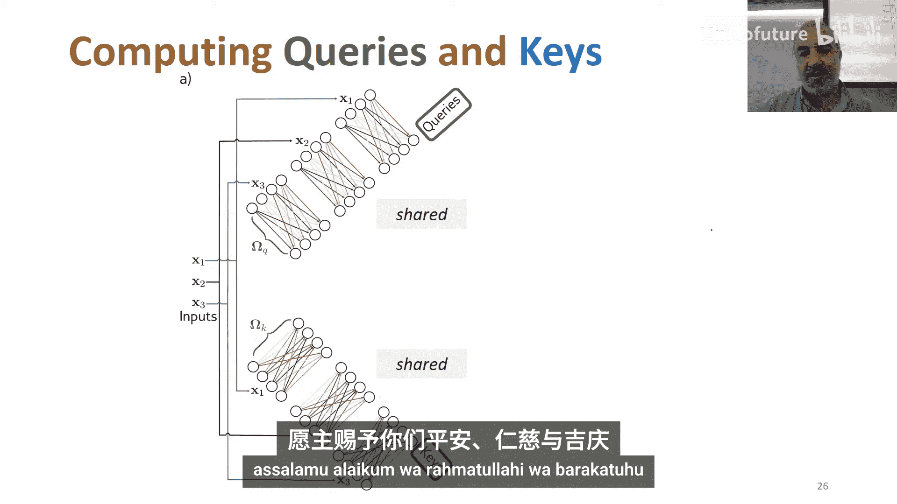

# 【卡塔尔大学】深度学习 CMPS497 ｜ Understanding Deep Learning ｜ Fall 2024 p20 P20_第十八讲(b)-Transformer I (自注意力机制第1_2部分) -BV1vQvNz1EeK_p20-

We will right away start a new session， which I think is the most important session in this course about transformers。

And the reason why this is the most important is that transformers is。

Of the architectures that are built on top of the transformers or based on the transformers are now behind the revolution that we see in AI and in deep。

So I hope that you will get a good idea of how transformers actually work with this decision chart。

Transformers started to exist。In the area of natural language processing。

Natural length processing is about processing and analyzing， understanding the natural text。

 the text that is used that is written by humans。To to do many tasks， okay， like translation。

 like question answering， summarization， spelling correction， gamma correction。

It sayss scoring that you will see in the project。 so many NLP tasks that we actually see in our real life and。

The research in in this area is not new。 it's more than maybe 50 or 60 years back。

 but the breakthrough that we go to recently。Was mainly one of the major factors behind it is the transformers ares。

So let's see how transformers actually work。And this is all started with a research paper as a very nice。

 I think one of the nicest titles that I have ever seen in research。Called attention is all you need。

This paper started the idea of the attention that we will talk about today。And。

It introduced the concepts of transformers。Okay， so in this session。

 Chao will start with motivation why we need a specific architecture to handle text。

And then we will talk about Charla the core idea of core technology behind transformers。

 which is called dot product selfatten， we will get Charla into details there。

 we will mention some extensions to it， and then we'll talk about how to put pieces together into what we call a transformer layer。

That's Charla I hope maybe today as much as we can。

 and then next time Shala will talk about NLP pipeline。

 we talk about more architectures that are part of the transformers family。And finally。

 we'll talk about large language models that we see nowadays。Motivation。嗯。

If we are given a piece of text， like what you see here。And we want to design， let's say。

 this is I think a review and we want again to do sentiment analysis。

 we want to see if this review is positive or negative。Okay。

All of what we learned so far in the course is。what。好。Is about what。Ne networks， right。

 so think with me， how can we process such text？Using neuraler networks。Yeah。Yeah。不微相。For anything。

Can we provide the text to the network？In neural networks， if you remember， it takes what？

It takes what， what is the input to the neural network， always。他量那么。Numbers。Okay。

 can it be something other than numbers？If you remember in the first week。

 I told you everything is an equation， how can you provide the words in an equation？😊，Okay。

 so how done will not be able to use the neural networks to to process text。If we use the text。

 if we use it as words。So we have to deal with that somehow， okay， neural networks use numbers。

 so the solution is convert text into numbers right easy right so every word like the word food here。

Should be represented as a vector of numbers。Okay， of course it shouldn't be just one number right that we cannot represent a word by just one number。

 but maybe we can represent it by a list of numbers， maybe1 hundred of numbers。Okay， so colors here。

Wepresent different numbers。So for example， we can have a vector like that。

each entry in the vector is a number， doesn't have to be between0 and 1， by the way。

 it can be any number， it can be positive， can be negative， can be anything。But a list of numbers。

Okay。😊，This is called an embedding vector。An embedding vector。

 So an embedding vector is a presentation。Of a word。 or generally， we will， we will see that we call。

 we call them tokens， not words。 We talk about that later gentlemen。 But for now。

 think of it as each word will be represented by a vector of numbers。

 And this vector is called an embedding or embedding vector。Okay。

Ex clear now we can use it for the neural network， right？If we have a passage like that。

 then we can stitch together all the vectors for all the words。😡，But， if I have。For each word。

 I have a vector of length D。And I have n words， then I can have a very long vector that represent the entire text and the length of that vector will be。

😊，N times D right？I have a vector for each word if I put， if I concatennate them all。

 then we will have n by the。呃呃 victor。And that can be an input now to the neural network， right？

他那是 done。It's if we manage it to get such representation。And if that representation is really good。😊。

Then we can feed the entire long vector of embedding vectors。To the neural network as an input。

Breakctor。And we can buildt the network to do whatever we want。Right。😊，Now， before we do that。

I said a word， now。About having a presentation。 That is good。What do you mean by that？

What we really mean by that is that。If I represent two words that are actually related。

The representation of them should be。Similar。So， for example。Two words like queen and King。第。

These are。Somehow， related words。So when we represent them each by an embedding vector。

They shouldn't have the same embedding vector， but the embedding vectors of them should be close enough。

😡，Okay， because they are similar words。But two words， give me two random words。给你。啊。😮，Rent and chair。

 Okay， although there are some relationship， because whatever you rent， maybe have chairs。Led okay。

 okay， red does a color。 Yeah， red and chair， okay。They are not very similar， right。

 They are really different words。 So the representation of them in the vector space。

 because now we have a space where we present these vectors， right， in that vector space。

 the the vectors should be。Far from each John。Because they are not related。 That's what we hope。

 That's what a good presentation will be， right， yes。我们。我问大家说。

You mean how we will do this representation？对。嗯。No， no， no okay， okay， no， no， no。

 that doesn't mean that this is each number here represents one letter。 No， no， no， okay。

 let's present the entire the entire word。 Okay， no it's not it's not based on the specific letters。

 usually it's based on the entire word Okay， and let's assume that we have a good representation。

 We didn't say how we will get how we got this representation yet。 Okay。

 let's assume that we have this representation。And we will move forward from that， okay。Yes。

Different language or different sentence or different document。😊。

That's a very good question if we have one representation for multiple languages。

Two words that have the same meaning should have。Similar representation。No。If。

 if they are actually exactly the same word with all different senses of the word。

 then they should have the same representation， but。

Do we even have two that 100% exactly the same one， maybe？Not always by way。

 because there is a chair of a committee。RightSo， so yeah we got the idea， right。

 So if they are really similar， then they should be similar。 if they are in different languages。

 but I would expect to also a question about being in different sentences。

 because being in different sentences might have different meanings Okay still。

 they might be similar， but not very， very similar。 Okay， or in that case。

 we might have what we call a contextualized presentation。

 The word has a presentation in that sentence。😊，That might be different from the presentation of the same word in another sentence on another another document。

 we'll talk about that later。 But for now， let's assume that each word has an embedding vector。

 and we learned that that that embedding vector somehow okay。

Now let's try our favorite fully connected neural network Okay that's all what we learned so far。😊。

So let's assume that we will have the input vector here。😊，And me change one now this。m sorry。

So we have the input vectors here。😡，And we have the output vector here， and this is just one layer。😡。

Okay，One fully connected layer as as we we are used to right and I think you are used to this equation right。

 what is the meaning of this equation you saw it I think hundred0 times before。嗯。Yeah。

 the buy is plus。The weight the weight matters times the input and then this is the activation function Okay so this is the standard fully connected layer that we used before。

Tpe now assume that this is the input vector， which is which will be what。😡。

Will be the yeah the number， the embedding vectors concatened of all the words in the sentence。

T what's the problem with that， maybe you can feed the network all of that and then build whatever layers that we want and train the network。

What could be a problem here。Yeah。How many connections we have here， by the way？

And if we have just one word here， let's assume that we havehu。😡，水。i don't tell you。Oh。

 36 connections， yes of course， yes， because we have six inputs and six hidden units。

 so its if we have d inputs here， then it will be d squared。😡，Right， time。 now。

 let's assume that we have just 10 words。Each word is presented by 100 emdding vector of length 100。

 So how many input values we have。10 words times。100 is。1000， okay，100 by 100。

That's  one million in one layer colors and then this is10 10 words right10 word， this is very long。

😊，很no。😊，Of course no， thats a short sentence， right， if we have a paragraph or a document。

 and this is just one layer。😊，Maybe there's a shallow network now Okay。

 and we didn't it's half actually its not we didn't go to the output part even So that's too much。

 right。😊，It's too much。That really is that practical to have something like that？

Just medium parameter， at least for a sentence of 10 words something and even by the way。

 I'm billion now are much more than that， much longer than that Okay， so that's imp。😊。

So that's the first part。So the first problem is that we have very large parameters in this way。

And very large parameters means what。Means so many things means more time of training means might have overfitting so many problems。

 right？对。Even if we cope with that， we cannot cope with that text with different length。

 right because if as we increase the length of the text， we will have to increase。The the network。

 right or that increase the number of parameters。The number of hunters now will explode even more。

So these are really big problems， which means that we need a model where parameters or the number of parameters is not a function of the size of the input。

Okay，Because if it's a function of the size of the input。

 that means that the number of parametersers will get bigger and bigger as we have longer input text。

So we need a model where parameters don't increase with input， okay？

This means that we need to share parameters。 We need to share parameters across words。

So there shouldn't be some parameters that are concerned with with words in specific positions。

 the parameters should work or should use to analyze the whole text。

Regardless of where the world are。Okay， we call this parameter sharing。

We call this concept parameter sharing that the parameters should not the number of parameters should not increase with the length of the input。

 so we will share parameters across different parts of the input。And when we see how very soon。

So that's the first concept that we need to achieve。Pmeter share。If we don't have parameters sharing。

 then we will have so many parameters with very short input text。

The second one is motivated with the two examples that you will see on this slide。

Look at this sentence， the animal didn't cross the street because it was too tired。

Did you understand this？If I told you， it here refers to what。😡，The animal。

 right everyone would agree on that right so that means that in this sentence。

We want it to really refer to animal， which means that it should be related to the word animal。

 or in other words， the representation of it here。Should be close to the representation of the word animal。

Right。How about this sentence， the animal didn't cross the street because it was too crowded Now it's very clear that it refers to the street。

Right， so in that。Sentence， we want it to be related to the street。

 We want the representation of it to be similar to the representation of。

We call this concept self attention。Self attention。

Each word should attend to some other words in the sentence that are related to it。

Doesn't have to be one， by the way。But there must be some relationships between the world that we should capture in the representation of the world。

Okay， so a representation of that word might be influenced by the representation of these other words because they are related in this sentence。

😊，And as you see the same word it it refers to different things in different sentences， right。

 so the representation of it should be different。And that can。To some extent。

Lead us to kind of understanding what the sentence is about and the relationships between the words in the sentence。

Here is the example of the restaurant again， and if you read the review here。😊。

You will find that the world there here。Actually， fails also to the to store。 And you can see even。

That they are indifferent。Sentences， they are not even in the same sentence。

So the relationship might be really far， it might be。

The distance between them between the two related words might be very far。ok。😊，So in this case。

 the word there must attend to the word eto in other words。

It must pay attention to the world as well。Okay， is that clear。

So the conclusion from this is that there must be connections between the words。

And the strength of the connections will depend on the words themselves。

And given one sentence on one paragraph。A word can be related to other words。

With different standardss。Because it might be very related to one word。

 less related to another word and so on， and this is happening in the same。Context， in the same text。

Okay， again， this is called self attention and self attention is a very important concept behind transformers。

That's why the paper was called attentionten is all you need。爱的。That's also humans， by the way。Okay。

😊，Any questions so far？😊，Yeah。Okay， very good， let me then ask what is the length of the embedding vector of an input sequence of 10 tokens and 500 dimension token embeddings。

You can think of a token as a word。嗯对。Which is。Five South。Okay。

 self attention in transformers is about。Finding relationships between words。😮，The two of us。So。

 it's about finding relationships between words。Each word is related to only one other word。

No doesn't have to some words are getting more attention than others。I let know。What one word with。

More attention than the other。It has another word。Yeah， so the attention is between pair of words。

 It's not about individual words。 So we cannot say my these two words in the sense are very important。

 No， that's not about that's not self attention。 Self attention is a relationship between words。Okay。

 so if in that case， if I said some words are getting more attention than others for a specific word。

Yes， this is now true， but in an abstract way like that for individual words， no。

 that's not what we mean here。The last one， the presentation of a world is influenced by the presentation of other words。

😊，Nothing in general。对。And general， it can be。Why not？ doesn't have any。Then it has no influence。

Still， it's kind of。人是都是不这的。The representation of a world is influenced by the representation of other wordss。

😊，Maybe this means it can be， can be influenced by other words。 Yeah， some some words might not be。

 but you will see that in self attention， actually。It has to be influenced by。Words in the sentence。

Even if it is the same word。Which means here is that it is not influenced by others。😡。

Any a word might attend to itself only。Okay， but it has to attend to somewhere as you will see in in the in the。

In the details， it has to attend。To some， some other words。Yes， of course。

 to optimize for the way the attentions that we will see now， yes。

 the model has to kind of understand the context of the text。Okay。😊，Any question about that， clear。

Okay， now I think we are ready to start talking about do product self attention。😡，🤧Self attention。

We can think of it as a block or a processing block where there is an input and there is an output。

The input is the input sequence， the sequence of embedding of embedding vectors。Okay。

 and here we will have presented it as a matrix。😊，Where the columns are the embedding vectors for words。

 and those are the individual values in the vectors。Okay， so here we assume that we have n words。😡。

Each word is presented by one vector。Of length D。 So this is one input in bedding vector。

For one word。Okay， and we have n words， so we will represent it as a matrixs。Okay。

 so it's a sequence of d dimension vectors of embedding vector。How about the output。

 the output is exactly the same structure。😡，Exactly the same structure。

 So we will also have a sequence of。And embedding vectors。what did we get the animal。

What will we do here。If that's the case。Actually， what we will do is that the embedding vectors here will be much better than the embedding vector here。

😊，Or should be or hopefully will be Okay， so the presentation that we will have here for the words。

After we do this， self attention should be much better than the presentation that we started with。

Before the safe attention process。水。好对。Yeah， they are the same sizes， same size。

Same length of the embedding vector。 Yes， so basically， what we will change here is the numbers。

 the values。Okay， so that the words that are related。嗯，可。Have similar representations。

 similar vectors than the words that are not related。Okay。 now I think we should get deeper。

In or dig deeper into self attention。Okay。😊，对。So again。

 it takes n inputs of size d by  one and returns n outputs of size d by one。

now you will see that self attention will take it any。嗯。Over different levels of details。 Okay。

 so we'll start with a level of detail where we will say， okay， self attention is just two steps。One。

 step one， step two and then you will see that step two has a lot of stuff。

 so well take step two and then we'll get into it。So the first step of the self attention。

 you can call it layer， by the way， or sublayer。Is to compute what we call values。😡，Values。

 so we have inputs， input vectors。And we will get values vectors。Still of the same size。😡。

But that's not the output vectors， so you can consider values are intermediate output okay something intermediate that we will need to produce the final output of the self attention there。

😡，How we will get the values， I think this is very familiar to you， right？😊，Again。

 we would have a weight matrix。And。Bses biases， vector biases。 and by doing this operation over one。

Input vector， we will get one value vector。Okay， so here in represents a number of specific words。

 you can think of it that way。So for specific， xl xn is the embedded vector for the world number n。

Okay， so we will multiply it by a weight matrix。Add biases。And that will be the value vector。

This is similar to what。This is exactly similar to what we do in one fully connected layer。

Without the activation very good。That's just， just the linear part。Okay， just the linear path。

 so there is no activation， no idea or no activation function here。Okay， notice something。Also。

 different。Which is the subscript of the weight metrics and the biases look at the weight metrics whats the what's the subscript here V。

 it's not in。几。😊，So if I change in here。This still will be the same。Mtics。

 which means that the weights and biases here。啊。😮，Shit。A shared among the words。Same weights。

 same biases will be used to convert any word。😮，Any input in be vector to any value vector。Okay？

Thatly。不定。就是。Okay， for now， assume， okay， for now， assume that we learned these things。

 We will not talk about training today。 Okay， assume that we have these things。

 We need to understand how they they how save attention will will work with that。

 And then Shaah will see how to train them。Okay，But these are parameters， of course。

 weights and vicees， of course， as usual， the are parameters。Okay， with me so far。

 So that's the first step is to get a compute N values from N。Iput vector。Okay， what is N。

The number of wordss。And capital is the number of foods。And small is a specific word。Okay。😊，Okay。

The second step。Is to get from values to the output data。I've said that it's just two steps， right。

 very easy。From input to values and then from values to output vectors。😡，Now。

 from input to values linear as we saw in the first step。From values to outputs。

Here we have what we call。The self attention weights。Now。Read pay attention here with this equation。

😊，This is the output vector for the word number n。😊，Okay， so self attention of Xn。

 which is the output vector of。For that word。This is a submission from one to n capital。

 which means it's submission over all worlds。😡，Okay， always。

 didn't we say that any words should be should be attending with different weights。

 with different percentages to different words。So the output will be awaited some of all the value vectors。

😮，VM is the vector for the word number M。 And we are doing the sum the sum over。M from one to n。ok。😊。

So if forget about， forget about this， this term。 Okay， assume that this term is not there。 Okay。

 so that means that it's the sum over all vectors， right， It's like summing all the value vectors。

 What are the value vectors。The the ones that we got from here from step one。Okay。

 the ones that we go from one， 다만 it's not just the sum of them。 it's a weighted sum of them。😡，So。

 if one word。Is very related to， let's say understand the word number 3 is very related to the word number one。

 So the weight。That is multiplied by the vector， the value vector of the word number one should be high。

And the weight for other words should be low。So it's await weighted sum over the value vectors。😡。

So A here， don't be confused here with A because we used to use it as an activation function right。

 this is not an activation function here， this is what we call the self attention weight。

For each pair of words。N and the N， there is one scalar value。 So wait it's a number。Okay。

 that weights， that is high if the relation between these two words are。

Strong or is strong and low if the rotation is not。If a word is attending to another word。

 then this tradition is strong， of course， so the weight should be high。嗯。Okay。

 we will have a visualization for that。 So I hope that the understanding will be much better next slide。

 But these are the two tool steps。 So the first one is about sharing。

And the second one is the actual self attention because now word number n is attending to every other word。

 but with different。😊，With different widths。And these wordss can be 0， by the way。

 and some of them can be 0， which means that it doesn't actually attend to these words。

But some others， the weight will be more than higher than0。Okay。

let's see this in a more visualized way， of course weights depend on the input themselves here。

 you can see that the weights here are function of the words pairs of words in the input。

Let's visualize this。😡，This is an example where we have a sentence of three words onlys。

To have a simple simple example， so we have three words x1。

 x2 x3 x1 is represented by an embedded vector of length。4。 so D here is4。Okay， and how about N。

And capital， C， we have just three words。Okay。😊，对。What you see here is the two steps actually。

 the first step is getting from input inputs to values。😡，How we do that by。The linear layer， right。

 So it's just like a fully connected layer。Yeah。That is that takes the input vector and produce an output vector。

 but here we call it a value vector。😡，Kim。And remember that these connections are exactly like。

These connections are exactly like these connections。These are not different connections。

 they are no different weights， they are exactly the same weights。Okay， and of course。

 they are learned。 So these are parameters。So we convert x1 to v1， x2 to v2， x3 to v3。

 but using the same weight matrix， the same bias vector。Okay， that's step one getting from inputs to。

That is。😡，Now， getting from values to outputs。😡，This is a way so here we are getting the output for the first。

W。😡，Sa attention of x1。 It's a way that some。Of all the value vectors。It's 0。1 times v1。😡，Plus。

3 times V2。😮，Plus 06 times V 3。Which means that this word word number one attends much higher to to word number 3 than。

Word number two， then word number one， then itself， actually。Just an exempt。What。It might happen。

 It might happen。好。And either word it meanine here， Why should it it attends to itself。

 it should attend to others。it can happen。Okay， but the idea is。

The the self attention vector output vector is awaited some of all。

The inmb vectorctorors or the value vector。The valueu vectorators。The value vector。Okay。

 what do you mean by weight sum？And know when we have。Yeah。WhenWhen we say that if a。Of x1 equals。

Point1。Of V1， V1 is a vector， right。It has four values here， right？Good。It's 0。1 times this。Plus。

So this is what this is V1， right？Plus 03。Times。What。😡，V do。For百就听。Plus 。6 times。😮，33。So actually。

 this is a vectorta， right？now when we say wait a something like that， that means that this value。😡。

Is computed。How。This value is 0。1 times this value。😡，Plus 0。3 times this value plus 0。

6 times this value， right？Right so this value depends only on these three values。

 How about the second one。Same， it depends on these three values。And so。Okay。

 so that's the weighted sum。 So eventually it would be this vector。

 This whole vector is a weighted sum of these three vector。Okay， right， notice two things here。

 The values are positive。 I mean， not the values， the weights。

The value of their self attention weights are positive。😊，And。三途 one。Okay， which is intuitive， right。

 We want to get。嗯。Like a mix of all the words， Okay， and that makes true through that all。

K so that the values don't don't explode。Okay。Exs that clear。 This is for。For the first output。

 about the second one。The second one will be will have also awaited sum。

 but it doesn't have to be directed first right， so the weighted sum here is 050。2。3。😡，Yeah。

This world that attends to the other words this way。

That third one will have another set of self attention weights。Okay。Ex clear。So that's。

 that's that's the two steps that we discussed。 The first one is converting the input vectors to value vectors。

 and then from value vectors to。Self attention vectors or the output， the final output。

 This is actually the final output。 This one， this one， this one， final output of what。

Of the self attention part， okay。Forget about the transformer we'll talk about transformer later。

 but this is part of the core part actually of the transformer。😊，对。

Let me show you this in terms of relationship。So。Again， from inputs to values。As you see here。

 it's very similar to a neural network right， it's one layer of neural network， right。

You can see fully connected layer right for x1 separate from x2 separate from x3。

 but if you look at the colors here， the colors here mean indicate the values the actual values okay you can see that this set of weights。

A exactly like this or exactly like this， which means。The weights are。St。The width are shared。

Shes among。The input words， the input vector。Okay。😊，So， if I want to represent。Just this part， this。

Conversion from input to values。 biometrics， I can look at here。Okay。

 this full matrix represents the relationship between the inputs and the values。懂。

Valum number v1 only depends on x1 v2 depends on x2， v3 depends on x3。Right。😊，Okay。Right。

 it's a linear transformation for each word separately。

And you can see that the colors here are repeated， right。

 which means the values are actually repeated， which means that this is one matrix actually。😊。

Or one subtics， which is。呃呃欧米ga here。It's shared among all of them。

And this empty cells means star Xs units， there is no relationship。Okay。Do you understand this。

 this matrix， this big metrics。now let's look at the other step。

 which is the getting output from values。Remember when we saw the linear the weighted sum of the vectors。

We said that the first one， this one。Depends on what。Yeah。This is the first value。

Of the first value of each of the value vectors， right， you can see that the connections。😡。

Are coming from。This one。This one。And this one。Right。

It's like now we want to see it as a neural network， but its not it's no longer fully connected。

It is actually a neural network， by the way， but it's not fully connected。😊。

And sometimes even the way the connections are shared。Okay。And if you can see， no if I will be。

If you can see this。This one。It takes， it gets connections from where from the second one everywhere from this one。

 second one in the value vectors from this one。This one and this one， right？

Tight if you compare the colors of the connections going to the the red one and going to the to the green one。

These are the weights， they are exactly the same。😡。

Because it's the same weight remember here when we when we did it like that， it's 0。

1 is multiplied everywhere here， 0。3 multiplied everywhere here。0。6 multiied everywhere here。 Okay。

 so when when I compute this one it's 0。1 times this plus 03 on this plus 0。6 times this。 So 0。

1 and 03 and 0。6 are shared。 So the values here the values of the connections that are coming to the first one is exactly the same like the second。

 exactly the same like all of them。Okay， because it's the same weights。Okay。

 so this is this visualization is just showing you that this can be presented as a neural network。

 but it's no longer fully connected。There are connections that are missing。Okay。

 and we saw this here because of all of these empty cells and also here。This is， by the way。

 transforming from values to outputs。And you can see that。Again。

 it may change the color or maybe we do it for the second one。 So oh， sorry。

They want to show you this。嗯。So for let's look at this row。

 okay this row represents the second value， the second element of the first output vector。

This one depends on the second。Element of V1， the second element of V2， the second element of V3。

Right， all the other connections are。Azes are living。 They are not there。ok。😊，やので。

If this would be fully connected。😡，That would be four times 3，12 times 12，144。Vues， right？

 How many values we have here。嗯。How many connections， much less？Okay。

 and the different the different values are just three， you mean， they are repeated。

 it just three values that are repeated。😊，Right。We know that we said 0。1。3。6 right。

 they are repeated okay， but but the the connections are three connections are going to each of the output output nodes。

Okay， so this is just showing you that。It's still a neural network。

 but with so many missing connections， which means that it is it has less or more parameters。

Let's put up the normal or0 D this no weights here。 Okay。

 the weights that are much the weights are much less than a fully connected layer。

Now the main question is how to compute the self attention rates。

 and now we didn't say how how we get。

These weights， just 0。3。1。6。 How did we get these weights？Okay。😊，In one minute。

I will just tell you the first few steps of doing that engine and then Sha will continue next the first step of computing the weights is that we generate from the inputs。

😊，What we call queries and keys， remember that we generated values from the inputs。😡。

We will also generate queries。😡，And weate keys。In very similar way， using a weight matrix。

 but a weight matrix that is specific to the queries。😡。

And a third with matrix that is specific to the keys。😊。

So it's like we are starting from the input vectors。

 Well get three for each input vector well get three different intermediate。Vors。Values， queries。

 and keys。The query M keys， we will use them to compute the way the self attention weights。

And then we apply these self attention weights to the values。😡，To get the final output。Okay。

 this is the story that Tshalawi will discuss nextly。Okay。3 come だけ。

