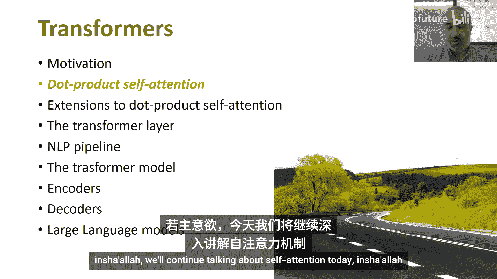
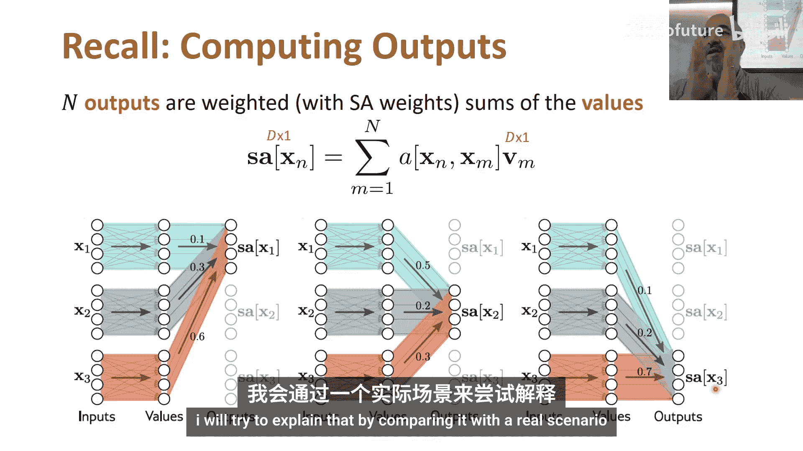
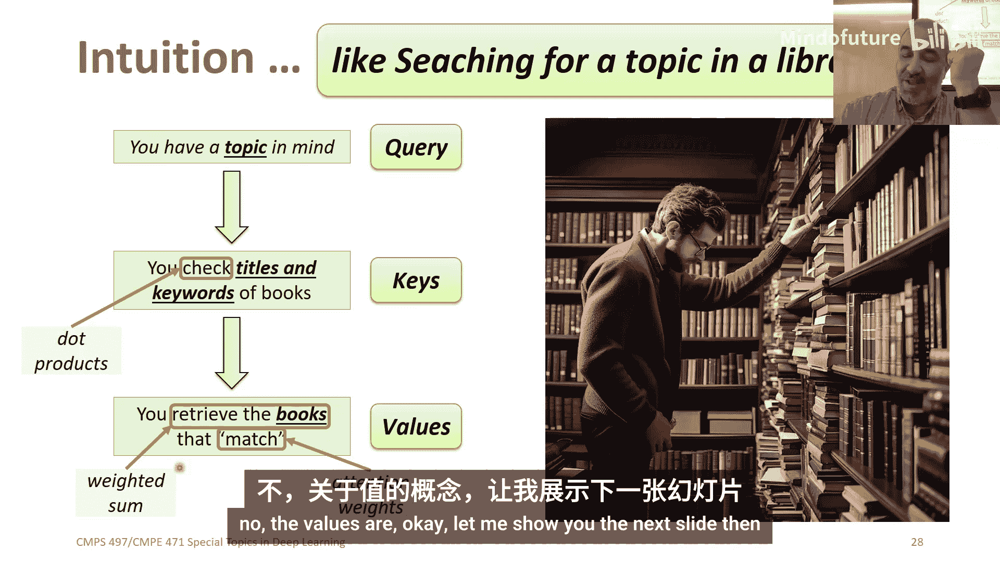
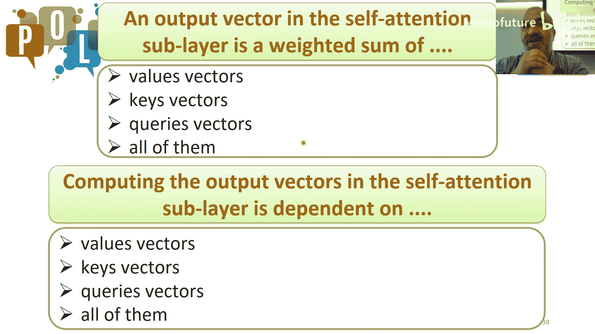

# 【卡塔尔大学】深度学习 CMPS497 ｜ Understanding Deep Learning ｜ Fall 2024 p21 P21_第十九讲-Transformer II (自注意力机制第2_2部分) -BV1vQvNz1EeK_p21-

will continue talking about the transformers， we gave some motivation and some introduction on the process that we do within the transformer within the selfat sublayer。

 Char will continue talking about selfat today in。

Just a recap of what we have gone through so that you can remember what we we covered。

 we talked about self attention and selfat is a process that takes in embedding vectors for the input sequence and produces。

Same structure as an output sequence Okay， so n embedding vector is also each vector is representing one token or one word。

Either in the input or output the difference between the input and the output is that we we should have a better representation for the output than what we started with Okay so this is the process of the self attention last time we mentioned that it has two steps first we compute what we call value vectors。

And then we compute the alpha vectors。Okay， and to compute the output vectors。

 we need what we call the self attention weights and this is where we stopped， I think。

 last time where we were talking about how the first step in computing the self attention weights。

Yes。😊，そか。It's a sub layer。 It's a sub layer in the transformer。

OkayBut it is the main and the core idea in the transform。

 so we need to pay a lot of attention to it。So the two steps that we mentioned last time。

 we compute the values first， given the input vectors。

 and this is done by a linear transmission with the weight metrics and biases without any activation function。

 and we mentioned that this is shared the metrics and the weight metrics and the biases are shared across all the words。

And then the output vectors will be awaited some of these values。Okay。

 so we compute the values and then we take a weighted sum of these values as the output and the weighted sum is computed by the self attention weights。

Okay， so a here is the self attention weights。And we mentioned that the self attention weights are scaleals。

So just numbers， we also mentioned that they are positive and they are they sum to one for each input vector。

And we I think we we saw that last time this is representing the weighted sum from the values to the outputs。

 so we first compute the values from the input vectors。And we mentioned that these are the weights。

 okay， the weights that convert from input to values and as you see here。

Usually what we covered so far in the course that we have fully connected layers right so the connections between the nodes from nodes in one layer and the nodes in the next layer are complete are full okay that's what we saw before but that's not always the case。

 of course here the connections are not fully are not full So we have connections between the embedding vector of x1 and the value vector of x1 separate from x2 the input vector of x2 and the value vector of x2 and so on。

 and these weights we mentioned also that these weights are the same。

it's not only that we have connections only within the same word， but these connections。

 which are the weights， are actually shared， so they are the same across the different words。

And then the 0。1。3。6 here are the self attention weights okay and this is how we compute the output values by a linear combination or await weighted sum of the value vectors。

Okay， so we mentioned all of that last time， and this is another example for the second word and that's for the third word。

嗯。And we also saw these representations that show that this is not fully connected。

 so this is the metrics that represents that transformation from the inputs to the values and this is the metrics that represent that transformation from values to outputs and if the network is fully connected。

 you would see that all elements here are colored。Okay， but because they are connected。

 they are not fully connected， there are many missing connections， these cells are empty。

 which means that the weights are zero。In this matrix， we also saw this last time。

 and I think we stopped exactly here when we started to talk about how to compute the self engine。

Okay， any question on that， that's just a brief summary of what we covered last time。Okay。

 now how we can compute the self attention weights。To compute the self attention weights。

 we need first to compute。Two other sets of vectors， called queries and keys。

So so far we created from inputs， we created value vectors， right values。😡。

We will also create or generate queries and keys vectors okay and it will be in the same way we did the values except that the weights will be different so there are weights for queries。

😊，And there are different weights for the cases。But again， they are shared。So the weights。

 the weight metrics for the queries are shared among old worlds and the weight metrics for keys are shared among old wordss。

 exactly like what we saw in the values。Except that these are three different。Computs。Okay。

 so that means that from the input vectors， we will create three vectors and each input vector will produce three vectors。

Value vector。Query vector and key vector。Okay。😊，With me so far。Okay。

 and these are all with different math， but they are shared among the different words。Okay。Yes。

 so so this is okay so this is omega Q， this is the metrics of weights。

 it's shared among all the input vectors here to compute the queries。

 so same metrics will be used to create the queries vectors okay same metrics will be used for to create the keys vectors。

😊，Okay， now let's assume that we have now the queries and keys。😡。

And in a few minutes we we will talk about the meaning of this。

 the intuition behind even the naming okay， but let's assume that now we generated the values。

 we generated the keys and we generated the quis now to compute the self attention widths。

We will compute what we call the dot product。😡，Between each query vector。And all the keys， vectors。

First of all， what do you mean by aduct product？😡，I。

It's multily two vectors right okay so it it's a multiplplication between two vectors each element is multiplied by the corresponding element and then we sum them。

😡，ok。This is what we call a do product。So the dot product is just a scalar， it's just a number。

 given two vectors， we the dot product of them is just one number。😡， so for example。

 we'll take the query vector of x3， which is this。We compute the dot product between this query vector and the key of the first word。

 which is K1。Okay， so Q thing in here。With K1。 and that will be on that number。我觉我们可时。No。

 every query vector。With every key vector。Okay so， for example， this o， this the first2。😡，Okay。😊，Is。

It has three numbers。😡，Each number is the dot product between the first query vector Q1 with every key for the entire words。

 for the entire sentence or text。😡，Okay， so this is。This is the dot product of。Q1， and。M K1， Q1。

 and K2。Q1 and K3， and so。Okay， now what is the size if this is a matrix。

 what's the size of that matrix？😡，对申。Now it's three I thing， okay about in general， if I have。

If I have n words。😡，N by N， right， N by N， because every word。We will have a value vector。

 well have a key vector， we'll have a query vector。Okay。

 every query will be the product with with the keys。 Okay， so that means an n square n by n。Okay。😊。

And that makes sense， right because we want to get attention between every every word and the other。

 right？😡，Okay， so we will have a weight at the end these are still not the self attention weights。

 by the way， there's just an intermediateittted values。😡。

We will see in a second how we will compute the attention width from them。

 but the number of values here。We present what we want to get at the end。

 we want to get attention between every word and every other word。

 even itself in the text that we are processing。😡，Okay， with me so far。Okay。So。

This first rule represent the similarity between x1 and old words。 Now。

 when we talked about attention， what do you mean by the attention。

What's the goal of computing that attention。Between two words or between one word and all the words。

The relationship right to see how this word is related to the other world。

one way of doing that is to compute the similarity between these words。😡。

Represented by their vectors。Okay， so we can say that the first row here is the similarity between x1。

 the first word and all world。😡，Similarly， the second rule is the similarity values between x1。

 x2 and all world and so on。Okay， time， youll notice that we are used words similarity， right。

 why is doctor that considered the similarity？Actually， if you remember from linear algebra。

The dot product。Is it equal to the length of the two vectors multiplied times the cosine of the angle between them？

So。If the two vectors are close to each other， which means that the angle between them is very small。

😡，Then the cosine will be。Close to one and the do product will be high。😡。

So if they are close to each other， that means that they are very similar， right in in values， right。

 So in that case， the do product would be really a large number。Okay， if the angle is。90 degrees。

They are orthogonal， that means that they are almost they are independent。

So that no product in this case would be zero。Okay， because the cosine is0。

If they are reversed like like in this case。😮，Then the cosine will be close to minus1 negative。

 so that the third that could be negative。Okay， so we can think of the do product as a measure of similarity between the vectors if they are close to each other。

 then we will have a positive high number。😊，If they are reverse。

Then we have a negative number and if they are independent， then we have almost zero similarity。

 almostmost0 dot product， so the dot product can be seen as a similarity。Okay， but question，嗯是那个。啊。

Very good question。嗯。They are also not similar。And in in in our context， in in linear algebra。

 the are the are in opposite directions， but I cannot， I cannot easily see it in words。 What's the。

 what's the meaning of it to be completely。Oh no， no， no， no， no， no， no， opposites。

You mean opposite in meaning。😡，I don't think so if they are opposite in meaning then the vectors should be opposite because if they are opposite in meaning there are still there is some relationship between them right but I don't think it's negative in inner algebra we can see that negative negative values but in texts I don't see it easy to think of two words that have reverse direction in vectors but。

😊，Overall， when the similarity is getting higher。Positive， then， I mean。

 if the do product is getting higher， then that means that they are more similar。Okay。嗯。No。

You remember that we talked， we said that earlier that the self attention weights are all positive。

And some to one。The do products， as we， as we compute them， they are not like that。

 They could be negative， Okay， and they could be high high values， right， large values。

 So there's no way， we expect them to be positive all and some to one。

 but we can force them to be positive and sum to one。By way that we already saw in the course before。

Any ideas？By the softm， okay， by the softax function。

 So what we will do actually is to take each row here。

Which represent the similarity between one word and all the words and apply it to and apply the softmax function to it。

😡，Which means that we will convertverse all values。

Two positive values because we will raise them to the exponential and then we will normalize them all by the sum。

 which means that you will all sum to one。Okay， so we compute dot products and then we apply the soft Max on every。

😊，Independently， of course， each show separately and if we do that。

 then the three values here will be positive and sum to one。

And that's why if you remember in the example before， it was 0。6。3。1， right， positive and sum to one。

 because we will do softms to force them anyway way to be like that。

That's not guaranteed from the dot products， but now if we apply the soft Max function。

 then we will get them all to be positive and some。Okay。

 now we can call them the self attention weights now these are the self attention weights that we will use to compute the output vectors。

Okay， so you can think of this as like the 06 0。3。1 now we can use these width。Combined with， I mean。

 applying them to the value vectors。To get the final output vectors。

So these are the attention weights for x1 and this is the whole matrix that we saw before。

 but it's like reflecting these individual selfattention width in the entire matrix you can see that this weight is repeated here and this weight is repeated here this weight is repeated here if you want to think of it as a transformation matrix between the。

The values to the output vectors。Okay， any questions on that？嗯那嗯我觉个。呃这。Yes， sure。咦。😊，Mmh。我们吃。やります。

'm negative domain maybe， maybe。对。Not 00% guaranteed， but yeah， you can think of it that way maybe。

 but you can also think that whenever it is large number， including positive of course。

 then there is a high relationship with high similarity and otherwise it would be a low similarity。

Okay，And when it gets。And in an absolute sense， larger in the negative direction， it's less similar。

Okay。Okay。And of course， if we look at one value of this matrix， then this is how much any this。

 for example， which is this value。It's representing how much the third word attends to the first word。

 What does that mean。And if this number is 0。8 or 0。9， what does that mean？Yeah。Yeah。

 that means that this word should a attend march to that world。

 which means that this word should influence that word， okay it's very related to that word。Okay。😊。

And that's in a metrics form， we have now a metrics for the quez。And biases。

 weight metrics and biases， another weight metrics and biases for the keys， okay。

 we generate the queries and keys and then。We compute the similarity between every query and all the keys。

Okay， and this is the softm function。 So eventually， we will have one number for every pair of words。

 Okay， And remember that we compute the do products between the queries。Enbiities。Okay。不。

And the similarity here is done by computing the do products。

And just to complete the picture after we compute the self attention weights， what do we do？

Yeah we do that weighted some us， okay， so this is like the 0。6。3。

1 we computed them already now we multiply 0。1 by that vector。😡，03 by that vector， 0。

6 by that vector， and sum them to get the output vector for x1。Okay， same for x2， but of course。

 with different widths。Okay， and same for X with different weights。Okay， now just a quick question。

 where can we find these three numbers in the matrix that we saw in the previous slide here？对。

Which we are in that matrix， so we have this matrix， right？The three numbers， the three numbers here。

int1。2。7。 Where are these in。Thismatics。The three numbers， the three numbers where what。

 where the self attention width。Between。H。Not， not each world。Between， it's get back。

Let's get back here。These three numbers are the tension weight between x3 and old words， right？😡。

Where is that in thematics？The last。那拉度。Okay。😊，Is that clear。ok。系。

Now what's the intuition behind that Okay I hope that you understand now how the computations are done right why do we call them queries and Ts and values is what's that what's the meaning of that okay I will try to to explain that by comparing it with a real scenario。

Okay， what's the scenario Imagine that you are in a library。

 I don't know if you went to a library ever nowadays。

 but let's assume that we we we went to a library and we are searching for a specific topic in the library I'm searching for。

Books that are relevant to that topic。Okay， so I will start with having that topic in my mind。😊。

Right， and。And now I have the books in the library。 What should I do。東と？That was the。Okay。

 so let's say that there's no such。Ses， Okay， so Id have to look at every book， right。

I have have to look at every book。 Should I eat the entire book。No， what should I do read the title。

 maybe some part of the introduction， maybe the key words。

 right so I will do that second next so I would check the titles and the keyword of the books Okay then。

为什么时？It's not just one book。 I'm looking for a topic， right， So it can be part of that book。

 It can be one chapter of that book。 It can be multiple chapters in that book。

 can be one page in that book， right， And then I will。Get together， or retrieve these books。 Okay。

 and read that。 right， so that's the third step is to retrieve the books that match the topic that you have。

😊，So you understand this process， right？Okay， how is that compared to what we did？

Where are the queries， Where are the keys， Where are the values。Which is。

when when we talk about that the topic is the query， right， the query that I'm looking for。 Okay。

 so that's that's why we are we call it the query Que is the thing that I'm looking for right when you when you type something on Google search books。

 This is the query right when you when you want to receive something from a database。

 what you write is the query right So the topic that I have in mind is the query。😡。

Okay now I compare that query with what with the keys okay with the keys。

 not with other queries right okay with the keys which represent the main information in the items that I am searching in okay。

 so these are the keys。😡，Right， now after I match this case。

 I found that key12 and key27 are the most similar。 What should I do。

Should I just read the the title again， And， and that's it。 Or get the book itself。

Of the two books themselves， right， so the books here are the values。Okay， are the values。

 so we compare the query with all the keys。 we compare the topic with all the books。😡，Okay。😊。

With not all the books entirely， but with the main information of the books， which are in this case。

 the titles and and the keywords。 once we find that there is a match。

Then we retrieve the book itself， which which are the values。 Okay， but we also retrieve it with。

Maybe like we like what I said， it's a page from here， chapter from here， multiple chapters。

 what are these？😡，In our。Now， in hours in， in hours in the transform， what is this？

When I say this is just one page from here。Couple couple chapters from here。

 maybe half the book from here， these are the attention weights， right。

 these are the attention weights。Okay， very something that that's very small from that book。

 much bigger from that。 a lot from that。 And so。 Okay， and then I combined them。

 I retrieve the book itself， and then I I read it。Okay。

 so when when we say we check the titles and the keywords， we match the query with the keys， okay。

 and checking here is like the do that that we do。And and then when we say the books that match。

 that means that we are talking about the attention weights here and when we leave the book。

 it's like we now we wait we sum the w， we have the weighted sum of the things that match。Okay。

 did you get it now and that's why actually they are called queries and keys and values Okay the naming here is adopted from my own special research area。

 which is informationative was queries。😊，And kids do to search for for the things that we we yes。No。

 the values are。Okay， let me let me show you the next slide then to give you any textual meaning of each okay the ques are the things that we are searching for。

😊。

Okay， so the query of a token， this is what the token is seeking， what the information it needs。

 Okay， the keys are the information the token holds。😡。

Which means how relevant it is to the other quez。 So that's the main information that as a token， I。

 I， I provide。Okay， but the values is the entire content the actual content。😡，Of the of the wood。

The whole representation of the word that I will actually use。😡。

Okay that's why at the end we have awaited some of the values。😡，Okay。

 it's not the way to some of the keys。😡，Okay so of course this is an intuition that's how the design was chosen。

 okay based on these intuitions that we have queries。And this  query is like。

Seearing or matching with the kids。And once we match with the key。

 we find that we get the actual value of that key Okay remember in databases， we have index right。

 the index is just by part of something that identifies the records， right。😡。

Did you study databases or not。 So when we， when we index， we have like if if I index students。

 I index students and buy Is。 Okay， so I search in the Ids。 But when I use the information。

 I get the entire record now， right， I don't， I don't use just the I right for the students。

 I want the address and G and all the information about the students。 Okay。

 so I use the value of the students。not just the企業ですよ。我觉得一。No， the keys， the okay， the the yes。

 generated generated from the input。 So I start by the input。vectorctor， I generated three things。

 I generated the quiz。Which represents what this token is seeking。😡，Entirely， exactly。 Yes， he。

Querries and values。 I use the keys and queries to compute。To compute。The rope orders。

 which are the self attention weights。and then after I compute the server attention weights。

 I apply by them to the values。😊，Toge， to get what I want。Yes。

 the input just there to generate from it to three things。That's the values， we get， we get that。

Are from the input and the self protection， no。No。Okay， T， let me show you。

 let me show you first this attention and then I will go through an example， okay。😡。

So this is an example of the selfatten， remember this this sentence we started with last time the animal didn't cross the street because it was too tired okay now this is just an example to show you how attention actually is useful the word it here if you look at the attention when after of course training that that model。

Its。At1s so these connections first are the self attention weights if they are strong any stronger that means that the weight is higher。

😊，Okay， so that means that it attends much more to the animal than the other words。😡。

And that's exactly what we want。 We want things like that。

 We want relationships between the words that will。We represent the meaning of the entire text input。

ok。So this is an example of self attention and now just to give you the whole picture。

 we started with with the goal of designing a model to encode and process text and we eventually we got a model that has。

😊，Pmeters。That don't increase with the input lens。And also， show or or。Geneneer8。

 connections between the words。And the strength of these connections depend on the words themselves。

 so we have connections between all attention， weights between every word and all the words in the text。

And what are the parameters of that model？When we say parameters， these are the learned parameters。

 right the are parameters that we will learn。That we when we train the model。

 this is what we we will get。 Okay， what are the parameters that we have here。The widths and biases。

 right， just one weight matrix and one bias vector，3。For values， for queries， for keys。Okay。

 and these are the parameters。Okay。😊，But， now。To see it more in a matrix form。

We start with the input。😡，We'll start with the input。😮，Okay。😊，We saw that before， right。

 it's every column here is。Is what。Is an emvadding vector4 for one word。 Okay， we generate。

 as you see now in parallel queries， keys and values from thatmatics using the weights and biases for each。

😡，For each side。Okay， so in parallel， we can compute all of these。😡，Then we use thequeries and keys。

😡，To get the self attention wave。Okay， and then use the self attention waves。😡。

Apply it to the values to get。The al is。 the all protectors。Okay。😊。

It looks like a complicated process， but I hope that now we understand the steps and you understand the intuition behind them。

 yes。要的啊。I read for it。Yes， you see that you see this structure is exactly like this， right。

 So we started with a vector for each word of length D。😊。

We would end up with a vector for each word with density。

 but of course it's different after getting through the attention。Each output vector， yes。

 it's a column here， by the way， not。嗯。Like this， it's a representation of the word。

 but it includes its relation to that exactlyact That's why it should be better now。Okay。

 better than what we started with。😡，ok。And this is in in equations。 Okay， see again， values， queries。

 keys， applying the weight metrics and bias。 And notice here， there is no。No。Noow what。

No activation function， it's just linear。几拎哋啊。And and then we we apply the soft max between the keys and ques and un multiplly by the values is this slide shows you that we don't need to do it one by one again we don't compute the do products one by one it just matrix multi again Okay all of these are matrix multiplications。

Okay， eventually well get a matrix that has all the output vectorors for all the words。说。This one。

是问你在从那。Yes， yes， but represented each word is represented by a vector of course。So what。Okay。

 where is it here。It's one column in this matrixs。我要是是。Its if it's the third column here。

 then its output vector is the third column here。😡，After computing the okay， we do ated sum right。

 when we do a some， it would be a vector again。😡，But it's away to victim of the other vis。😡。

Of the values vectors。好你。Any what is it first to I mean we keep。Okay， okay， okay， I got， I got。

 I think I got your your question。 If we get back to this， you are saying， youre saying。

 where are these。Okay， where are these？That that's the question to you now。Okay， let's get back。

 let's get back here now。 where is where are these connections in this slide？😡，they send the the。

Where is it is it in that time？Can you point to where in in that slide are these connections？Yeah。

We this one。Type Annie let me be more explicit。Let's assume that this connection to the animal is 0。

7。Lis， okay。Where is 0。7 here？嗯。Where in that matrix， do we see it in that matrix？

Do we see it in that matrix？啊Where。Let's assume that it it is the third word。😊，And sorry， sorry。

 sorry。 no， no， no， Okay， It is the fourth word and animal is the second word，Tny。Fourth column。

Second， no， first room。F through second column， so it's here， exactly。Okay， so that would be now 。7。

And that's what is。嗯。Pictured in the figure。That's illustrate in the figure，Oh。

 of course here in that figure， we are showing the attention ws。Okay。

 so these are the tension weights， of course， after compute the attention weights。

 what will happen because applied by these weights to the vectors。

 to the value vectors of those words。😡，And compute by the alpha vector of that， which is way by Hena。

Which will be the fourth because we said that it's the fourth word right。

 so it will be the fourth column here。😊，That's the output vector of it。Of the word it。 No。

 it will be as is， but that's weight thumb of the other vectors。No。

 there is no here in that output vector to there is no meaning of， I mean。

 there is no indication of high values and no values， this is just a representation of numbers。😡。

嗯能呃再安。有没业我真的不对但实际是觉是不高。Okay， okay， good question。 So， so the question is， Jan。

 what will we do with that okay， so we completed all of that what should do we do。😊，嗯， any。

 any answer。So we computed the attention widths， right， And from the attention which， we computed。

The output vectors， okay， then one。Yes。Yes， we are not done yet。

 This is a sub layer within one transformer layer， which is one layer within the transformer。 Okay。

 so we are not done yet。😊，Okay， so stay tuned。But at least you understand now that that representation should be better than what we started with。

😡，Because it considers the attention to other words。So so far。

 we are focusing on starting with some representation and getting at the end a representation that is better。

😡，Okay。Okay， now let me show you an example。Just to make sure that you really understand what's going on。

Let's assume that we started with a sentence that has two words only and don't worry about the meaning okay。

 two words， x1 and x2。ok。😊，So we started with two input vectors， right？

These are the two input vectors。😡，And from these two input vectors， we compute。

 we generate that  query is vectors， right using this matrix。😡，And we generate the keys vectors。

Using this matrix。😡，And we generate。The various vectors using this matrix。😡，Okay，对。Now。

I want to compute。I want to compute。The attention weights of x1。😡，What should do they do。

What mean it， Give me， Tell me the name of the vector。 or the vectors have names here。 Q1。

 We get the dot product between Q1 and。K one。And Q1 and Q and K2， this will be two numbers。😡，Right。

 the are products then。Some them softm， soft mask， apply softm to get。The attention weight。

Tpe after we get， we get the attention weights。Apped， apply to there to V1 and V2。Okay。

 and that's that that are the steps now。 So step number two， compute the dot products， Q1， K1， Q 1。

 K2。Okay， then。We forget about this。 we didn't talk about it yet。

Just ignore this and then we apply the soft max on these two values。😡，Okay。

 now before we apply the softm， when I tell you that the values are 1，12 and 96。😡。

Do we get any meaning of that？The the relation between Q1 not Q1。

 the relation between x1 and x2 and x1 itself is higher than the relation between x1 and x2。Okay。

 so we expect that the attention with。For x1 will be higher than x2， of course。啊。😮，Re between next。

Not always， we saw it in it， right， it is attending to another word than itself。Okay。

 so it's going to happen。Yeah。Okay， so from that we compute the softmax values。

 now softm values is 0。88 and 0。12。What do we do next， we take this 088， multiply it by。😡，V one。

And 012 multiplied by V2 and sum them to get the output vector for x1。 So that's what we do here。

 So this is softm times the value。this is2 max times the value you can see that this is stronger than this。

 right， because that was a higher number。And sum these two to get the output vector。4。The first word。

If I want to get it for the second word， same thing， right， but now I compute the products between。😡。

Q2， and。N K1， and N， K2， and and so。Okay。😊，Questions。Before I ask， because I have questions。嗯。

Ready for the questions？ok。当然。An output vector in the self attention sublayer is a weighted sum of。

Values vectors， keys， vectors， que is vectors， all of them。都能。嗯。Yeah。Yes， what do you think。Okay and。

关系。嗯。The output vector is a weighted sum of。Withai did some of。So value is only。

 It's a way sum of values only， right， What did what did we do， What did we do here。It's the width。

 These are the widths。So the output is awaited sum of these two vectors， right？😊，那的は。

It's straightforward， right，s we some of what of the value vectors， right？这是班的。对 next one。

Computing the output vectors in the self attention sub layer is dependent on。😊，还有个。What do you think。

哎，我这边。Is it all of them or various is vectors？😊，All of them。 Why is it all of them？哎妈。processces。Yes。

 so it's a weighted sum of the of the values。 but this weighted sum the way it's come from。

The kidss and quees。 Okay， so it depends on all of them。Okay， and I think we will stop here。

 Do you have any questions。Okay， see you in China next time。

