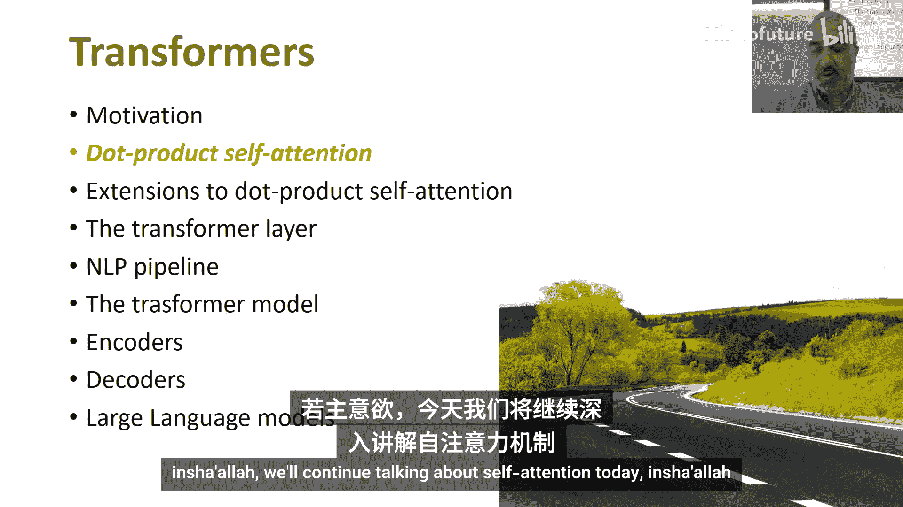
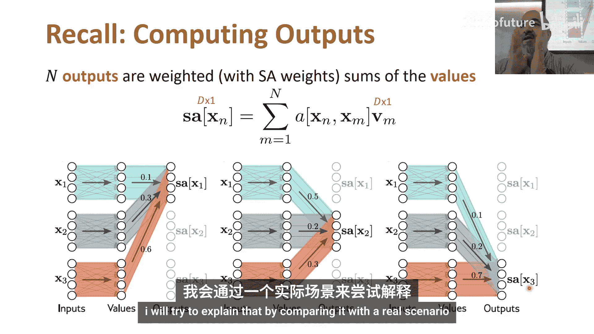
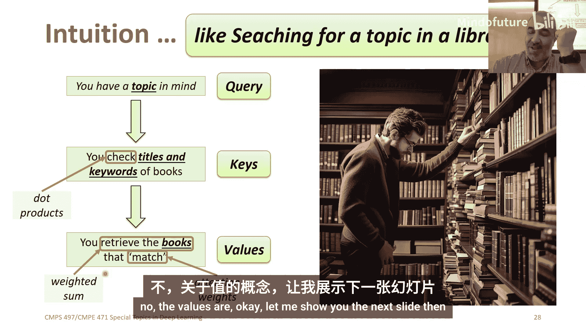
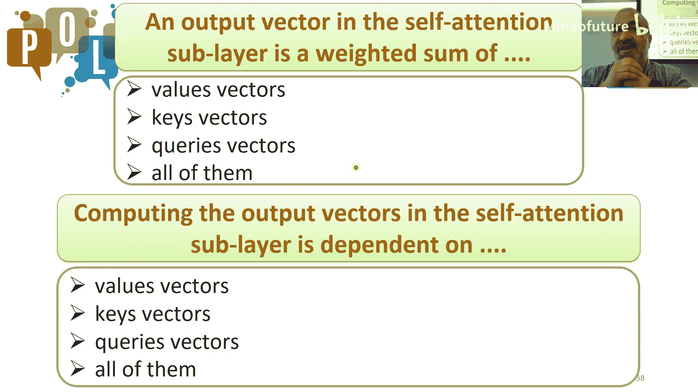

# 深度学习 CMPS497：19：Transformer II (自注意力机制第二部分)

在本节课中，我们将继续深入探讨Transformer模型的核心——自注意力机制。我们将详细讲解如何计算自注意力权重，并理解其背后的直观含义。

上一节我们介绍了自注意力机制的基本流程和概念，本节中我们来看看如何具体计算自注意力权重，并探讨其设计灵感。

## 自注意力机制回顾

自注意力是一个处理序列数据的过程。它接收输入序列的嵌入向量，并输出一个结构相同的序列。每个向量代表一个词元。输出序列的向量表示应比输入向量包含更丰富的信息。

自注意力过程包含两个主要步骤：
1.  计算**值向量**。
2.  计算**输出向量**（即对值向量进行加权求和）。

输出向量是值向量的加权和，权重即**自注意力权重**。这些权重是标量，对于每个输入词元，其对应的所有权重均为正数且和为1。

值向量通过一个线性变换从输入向量得到，该变换的权重矩阵和偏置在所有词元间是共享的。从输入到值向量的连接并非全连接，而是每个输入词元仅连接到其对应的值向量，且这些连接的权重是共享的。

## 计算自注意力权重

为了计算自注意力权重，我们首先需要生成另外两组向量：**查询向量**和**键向量**。

与生成值向量的方式类似，我们从输入向量出发，使用不同的（但同样是共享的）权重矩阵和偏置，分别生成查询向量和键向量。因此，每个输入词元会对应三个向量：值向量、查询向量和键向量。

以下是生成这些向量的公式表示：
*   **查询向量**：`Q = X * W_Q + b_Q`
*   **键向量**：`K = X * W_K + b_K`
*   **值向量**：`V = X * W_V + b_V`
其中，`X`是输入向量矩阵，`W_Q`， `W_K`， `W_V` 和 `b_Q`， `b_K`， `b_V` 是可学习的参数。

现在我们有了查询和键向量。接下来，我们通过计算**点积**来计算每对词元之间的相似度。

点积是衡量两个向量相似度的一种方法。对于两个向量，其点积等于向量模长的乘积乘以它们之间夹角的余弦值。若向量方向相近（夹角小），则点积值大（相似度高）；若向量正交（夹角90度），则点积接近0（相似度低）；若方向相反，则点积为负值。

具体操作是：计算**每个查询向量与所有键向量**的点积。对于一个包含n个词元的序列，这将产生一个n×n的矩阵，其中每个元素代表了两个词元之间的相似度。

然而，直接计算出的点积值可能为负，且不一定和为1。为了得到符合要求的自注意力权重（正数且和为1），我们需要对每个查询对应的所有相似度（即矩阵的每一行）应用 **Softmax函数**。

应用Softmax后，每一行的值被转换为正数且和为1，这些值就是我们最终需要的**自注意力权重**。然后，我们用这些权重对值向量进行加权求和，从而得到每个词元的输出向量。

## 查询、键、值的直观理解

自注意力中“查询”、“键”、“值”的命名来源于信息检索系统，可以通过一个图书馆找书的类比来理解：

1.  **查询**：相当于你想要查找的**主题**。它代表了一个词元正在“寻找”的信息。
2.  **键**：相当于图书馆中每本书的**标题和关键词**。它代表了一个词元所“持有”的、可用于被匹配的核心信息。
3.  **值**：相当于**书籍的完整内容**。它代表了一个词元的全部信息表示。

过程如下：你用查询（主题）去匹配所有键（书名/关键词）。通过计算相似度（点积），找到最相关的几本书（键）。但你不是直接拿走这些书，而是根据匹配程度（注意力权重）决定从每本书中汲取多少内容（值），最后将这些汲取的内容（加权和后的值）组合起来，形成你最终获得的知识（输出向量）。

在数据库中，这类似于通过索引（键）快速定位记录，但最终使用的是记录的完整数据（值）。

## 自注意力流程总结与示例

现在，让我们将整个流程串联起来，并通过一个简单示例加深理解。

整个自注意力子层的计算可以高效地通过矩阵运算完成：
1.  输入序列的嵌入向量矩阵 `X`。
2.  并行计算查询矩阵 `Q`、键矩阵 `K`、值矩阵 `V`。
3.  计算自注意力权重：`Attention Weights = Softmax( (Q * K^T) / sqrt(d_k) )`（注：实际中常对点积结果除以键向量维度的平方根以稳定梯度，此处为简化先略过）。
4.  计算输出矩阵：`Output = Attention Weights * V`。

假设一个只有两个词元 `x1` 和 `x2` 的句子：
*   输入是它们的嵌入向量。
*   通过线性变换得到 `q1`， `q2`； `k1`， `k2`； `v1`， `v2`。
*   为计算 `x1` 的输出，先计算 `q1` 与 `k1`、`k2` 的点积，得到两个相似度分数（例如12和96）。
*   对这两个分数应用Softmax，得到注意力权重（例如0.88和0.12）。这表明在当前上下文中，`x1` 与 `x2` 的关联度(0.88)高于与自身的关联度(0.12)。
*   最终，`x1` 的输出向量是 `0.88 * v1 + 0.12 * v2`。

## 本节要点回顾

本节课中我们一起学习了Transformer自注意力机制的计算细节与直观原理。

核心要点包括：
1.  自注意力权重通过查询向量和键向量的点积计算相似度，再经Softmax归一化得到。
2.  输出向量是**值向量的加权和**，权重即为自注意力权重。
3.  “查询-键-值”框架类比于信息检索，便于理解其设计意图：根据需求（查询）筛选信息（键），并整合完整内容（值）。
4.  整个过程参数是固定的（`W_Q`， `W_K`， `W_V` 及其偏置），不随输入序列长度变化，且能动态建模词元间依赖关系。

自注意力子层是Transformer的一层，其输出是融合了上下文信息的更好向量表示，这些表示将被送入后续的网络层进行进一步处理。