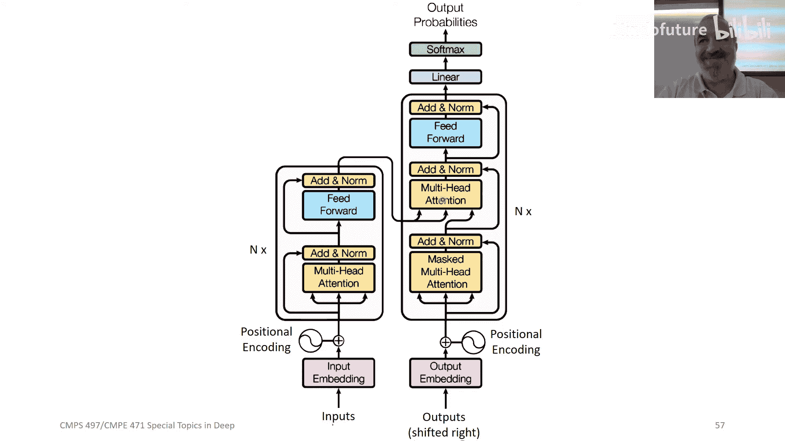

# 【卡塔尔大学】深度学习 CMPS497 ｜ Understanding Deep Learning ｜ Fall 2024 p22 P22_第二十讲-Transformer III (Transformer 层) -BV1vQvNz1EeK_p22-

N continue talking about transformers for the third time。What did we cover so far。Sve attention。

So we compute the products between。Querries and keys， as you see this in this figure。

We saw this figure before， right？So we do the dot products between queries and keys。

To get the self attention widths after， of course， doing the softm right and then with after we get the softm values。

 after we get the safe attention widths， we we multiply that with。

With the values to get the output better。Right。Okay， so we call this the self attention sublayer。

And we also saw I think last time these in equations。

 that's the same process and we went through this example right that was towards the end of the lecture。

 right？To compute the self attention weights for a specific word。

 I think we went through that and we also went through these two questions， right。

 That was the last thing I think we we covered All， Any questions before we start。

So what will we do today。Is to talk about some details in the self attention sublayer。

And then we will extend， we do some extensions also to that。

 and then we will see how the self attention sublay exists within what we call the transformal layer。

And then how the transformer layer exists within the transformer。Okay。

 and I think this is what Angelshaa we will cover today。

The first thing that we will study today is considered one of the extensions to the do for self attention。

Which is the scaling that we do。So what we have done so far is that we do the do products between the keys and queries。

 as you see here。And as you saw last time， this do product is not bounded， it can be any number。

 it can be very large。By what's the consequence of that。

 if one of the values that we that we had before we apply the Somax is very large。

This will actually dominate the whole values in the soft Max。

 and most of the other values will be zeros。😡，Because we even raise these values to the exponential。

 so the largest number always dominate a lot of the other values。So。

That means that most of the values after we do the soft Max will be zero。

Which means that we will have very small gradients。 remember back back proagation。

 okay if back proagation is multiplication of values。 if these values are very small。

 then the gradients will be very small， which will make the trainingning。Vase slow。

So one way of mitigating this is to scale down these values by dividing by a number okay and the number here is the square root of the dimension of the embeddings。

Okay， remember， each embedding vector has a length， which is D in what we studied so far。

 So the square root of D is used to divide all the values before we do the softm By what the the effect of that。

 the effect of that is this that the dot products will be。Re used。😡，Okay。

 so no one will dominate the softm， so we will not get。

As many zeros as we would if we didn't do this scale。Okay， so this is a more technical detail。

 but it was proved experimentally that it makes the training much faster。Okay。

 so that's the first one。And I think did you see this last lecture。

I don't remember if we went through it， this is showing you the the entire process in one figure。

 so we start by generating the queries and keys and values。

The qui is we do mathes multiplication to do what？Why do we matters multiply Q by a by K or K or by K by Q to get that？

No， not yet to get。Nettle products。Okay， we scale those products。And then forget about this mask。

 we'll talk about it next lecture， and then we do the soft masks。😊，Right。😊，After we do the soft Max。

 now we get。The set retention widths， and then we methods multiply what we get here with the values to get the output。

Right， so this is the this is the process。Okay， quick question。 You have question， yes。What's that。

Oh， yes， that's what we said just in the previous lecture in the previous slide。

 we scale before we apply the soft Max yes。😊，Okay， quick questions in self attention。

 a product is computed between。嗯。Which of these？有专业的。So which， which one。The third one。

 a query vector and a key vector。Okay， that's what we said last time， right。

 between every query vector and every key vector type any other， any other answer。No。

 it's just between a key query vector and the key vector。Okay， which of these are learned parameters？

Is it values， weights， keys weights， queries weights， self attention weights， all of them？

Slf attention weights only are。How about the others， The others are not learned。All of them。

The various weights only。All of them， okay。Time， let's get back to this。Very个。

Which of these are learned？Now， these are the four matric， right？And in in this green block。

 we have four me right。Right。😊，This is the ques weights， this is keys weights。

 these are values weights， and these are the save attention weights， which of these are learning。

Okay， so how about the well， the queries and keys and the values。 Are these learned or not。

These weights， of course that they are learned， I think， right。

 So all we all we all agree that these three matter Cs are learned， right？The the metrics。

 the weights for the queries， the weights for the keys， the widths for the values are all learned。

 right， these are learning parameters type。😊，How about the self attention weights？Are they learned。

No， why not？I不 have。Yes， they are computed from these two mates， right they are not learned。

 they are not parameterss。😊，Okay， don't be fool by the word weights， not every weights are learned。

Okay， so yes， so the all save attention ratess are not learned of course。

 they are computed from the learned parameterss， which are the weights for queries key and values。😊。

Okay， so what's the right answer here。嗯。No。Oh， not this one。This one。Values， weights， keys， weights。

 quiz weights， but not self attention weights。Exly。Okay。Okay。

 how many parameters are in a self attention sublayer for a sequence of 00 tokens？😊。

Of 1024 dimension embeddings。So we are talking about the self attention sub layer now that we studied so far。

 we have a sequence of hundred0 tokens。😊，Hundd words， okay， each token or word is represented by 124。

Evadding vector。investor of length 124。How many parameters does we have？The生。Why。

What are the parameters to count them， we need to know the parameters， right？What are the parameters？

The key is widths。 the values weights， and the。The que is weights plus also the biases right type all of these are similar in sizes。

 right？😊，They are all similar in size， so let's count for one only for one metric and one by。

But one matrix。One method convert from。One embedding vector。图瓦纳的。Yeah to the value vector。

 right these vectors are the same size， right， What is the size of each of these。😡，1，1024。1024。

 that's the size of the embedding vector。😡，Okay， each now the matrix is applied。For each word shared。

 it's shared okay， so it's applied for each word。 now the size of the embedding vector is 124。

 so the matrix size is and the output is 124。 so what would be the size of the matrix。😡，124 squares。

Okay。How about the size of the bias vector？People。124 only by one tab， right， it's a vector bias。

Okay， okay。So the matrix 124 by 124， right， the bias is just one vector。 it's 124。

Because we convert from 124 to 124， right remember， remember， remember this。

matrix let me show you this this one right Okay， we are converting each vector to another vector of the same size right。

 this is the matrix right this is the weight matrixs， What's the size of this in this case。

4 by4 right。Okay， so it's 124 times 1，24， and the bias is 1，24 by one。That's for one of them。Then。

Then， multiply by。We have how many of these we have3。For keys for ques for values， right same thing。

 so multiply by 3。 that's the number of。やぱなみで。Right。😊，我发你们。Yes， yes。我全都这。O， okay， so what is10。

We didn't。 We didn't use it right。 We didn't use the right。 We didn't use this under， right。Yeah。

 because they are。 that's the that's remember， in the beginning。

 we said that there is a motivation that that parameters should not increase。

With the size of the input。Okay， so the hundred0 tokens here are not don We don't care if that0 was 1000 was 1 million。

The same number of parameters we will have because they are shared。

That's one of the reasons actually I gave you this question to show you that it doesn't depend on the number of tokens。

Okay。😊，Any questions on that？Moaapte。ok嘅。Now let's continue with some extensions through the dot product self attention。

 we will talk about two extensions。The first one is both are actually important。

 but this one is really important。It's very important positionally including。

 what does that mean so far， when we compute the self attention weights。

Does it depend on the order of the words？😡，And when we compute the widths。

Does it depend on the order of the words？No， if I change it the all of the words。

 I will get the same weights， right， right？对。Remember， why are we doing this as a whole？

Is to prove is process， right。Right in text， the order of the words or matters or of course， right。

 you look at these two sentences， the men ate the fish， the fish ate the man。

 they have the same tokens。😊，But of course， the meaning is completely different。😊，So。

We have to reserve the order somehow。So far， the order doesn't matter。

But we have to inject something that indicates that this is the first word and this is the word that comes after the first and that's the word that comes after second and so on right this is what we call positional encoding。

😊，How we， how do we do that， We do that by adding。Another vector to the embedding to the input embedding vector called positional encoding vector okay and。

You can think of one， you can think of this as a matrix。

 One column of that matrix is one positionally including vector for one。Position。Okay。

 so the word at that position。😮，Willll have this vector。

As a position including vector and if you think about it， if you look at it。

 you will see that every column of this matrix。😊，Is unique， is different than the other。 Of course。

 colors here are indicating numbers。Okay so every column here is different than the others。

 which means that they are unique they are unique across the world and relatively similar to the neighborhood I the first one the second one is a little bit of modification over the previous one and the third is a bit of modification of the second。

 so there is an order between them somehow but they are different and that's what we want we want to give to add something to the input tokens that will indicate positions how this matrix is is is generated。

We call it using a kind of time signal function。 It's a mix of signine waves with different periods。

 Okay， to give this different patterns。 Okay， and the patterns are somehow。

Reserving their relative positions， Okay， over time。 Of course， it's the world here is like time。Yes。

😊，嗯 so I。Each the column。Yes。Indicating the position of the word。因为 each one。Yeah， yeah。

 so here we assume that we have 80 words。Okay， and the embedding vector that d parameter is 64 here。

 so every positional vector is 64 numbers。Okay， and that's added to the actual embedding vector。

 So this is the input embedding。 Well talk about it in like five or 10 minutes。

 but that's the the input to what we studied so far。We add to it the positional encoding vector。

Before going through the process that we started。So what is the input actually to the self attention sub layerer is。

😡，Is the input embedding plus the positional ending。Thank you Thank you。That we started with。Okay。

 we assume that it's there， we didn't talk about how we get it yet。

 we'll talk about it in like 10 minutes。But let's assume that it is there。

 there is an em vector for each word。😊，That has nothing to do with the position。

 and then we add something to indicate the position and that sum is the input to the transformer architecture as a whole。

But the input that is really。No， we assume that it is there， the input。

 we didn't say how we got the input。😡，Vctors we were talking。The。

Before we assume that there is an input， okay， so let me show you。No， no， no， no no。Okay。

 I'm talking about this now。😡，DidDid I tell you， did we study how we got this。

 we assume that it's there。😡，This is the input now， now before we get this。

 it's this plus the position ending the。😡，Before we do all of it。Yes okay。嗯，我那个是。Yeah， yeah。

 step by step， but now you the picture is is I hope it's improving， it's extended。

 but it's improving now yeah。OK。Yeah also add the that to this input we Yes， before this process。

 Yes， it affects of course， of course， yeah。C。For like， it's always in the beginning。

Beforet we didn't have any indication of the order。 Okay， it doesn't matter。

 The order doesn't matter， okay。ok。So。Okay， so you understood this， okay。

 so the position en quoting is the first one， the second one is called multi head self attention。😊。

You saw this before， right？He。😊，In multi head self attention， we do that multiple times in parallel。

😡，Okay， same block。Of course with different mat， of course。

 with different diameter is done multiple times in the original paper the the number of heads is 8。

 so this is done eight times in parallel。😡，From one input。

We go through the self attention supplier eight times。Okay。😊，What's the intuition behind that。

 we'll talk about it， but let's see the process first。So the same input will go through this。

 whether that we saw before， we get one input， one output。😡。

And it's done in parallel multiple times to get multiple outputs。😡。

And then these outputs are concatenated together to produce the final output。😡，Okay。😊，Actually。

After concateation， the are multiplied by another matrix before we get the final output。😊，Okay。😊。

So there is another learned weights， which is the concatenation weights， omega C。

 which is also and of course there is a bias。 So you can think of this as a linear layer that is added after the at the end of the multi head self attention to get the final output Now there is one small detail。

Earlier we said that the size of the input matrix is the same like the size of the output matrix right that's if we only have one head。

 but when we have multiple heads，😊，And instead of increasing of scaling the size of the output。

 if we do it multiple times， we actually have the size of each head divided by the number of heads so that when we concatenate them。

 we'll get back the same size of the input。😡，So for example， if that dimension here is hundreds。

And we have four heads。Then the output of each head。😡。

The embedding vector of the output of each head will be 25。😡，Okay we're 25 from the first， 25。

 the second and so on， and then when we concate them， it will be back 100。😊。

And we have the linear transformation to get the final output。Okay。

 that's why you can see here that it's d divided by H。 so all the weight the weight matter C。😡，A D。

 are D divided by H， not， not D now。 and the output is de divided by h。

That's the length of each embedding vector。Okay。😊，对。Okay， so first， why you mean why we。

 why we have much ahead or why we divide the lens。We'll talk about that in the next slide okay but let's make sure that we understand what's going on first now why we divide by the head is to make the size the same so we don't need more memory when we do that and that can be done also entirely parallel so it's very efficient。

Because all of these blocks are completely independent。😡，You just have the same input。

 but then all of these mat are different。😡，Okay， now one question before we do this concatenation。

The number of parameters， is it the same like before all increased。

It's the same because we divide by the number of heads and then we can contain it so all the is here。

If you concate the matrixtic Cs， okay， it will be the same like the matrix。

 the size of the matrix with one head。😡，Okay， so we didn't increase any parameter here。

 How about here？😡，Yes， that's a new matrix Okay so the increase the number of parameters that increase is only because of this linear transformation。

 not because of the multi head attention。Okay。Yes。😊，Okay， so very each。

Are they different and how is they different， Well， Yes。

 they are different because the parameters that are learned here are different。These mat。

 so the  queryries， keys， values， weights here are different from here， of course。

 otherwise they would be the same。😡，And the number of pets that we like。It's a hyperparmeter。

 yeah yeah， but it's fixed， of course。For one transformer， it fix。Okay。

 and this is a schematic diagram that shows the process， so from the input。😊。

Lar by linear transformation， we get the values， vectors， the keys vectors and the query vectors。

And these go through multiple heads imp paralleled。 can see this like they are imp paralleled， right。

And then， these are concateated。Which is here。And then another linear layer。

 which is the concateation width matrix。Okay。Do you see how this is mapped to the process on the left？

Yeah。Okay， any question about how this works？Yeses。呃 the conation。我准备。

It's not the content of the heads， the content of the output of the heads。嗯When you come加。电能班。

We have to。They will be because we divide this matters is the size of them。 Remember earlier。

 it was D by N。 Now it's D divided by H by N。So。So the output already will be like that。

 And we just won't connect them。 When we connect them， we get back the same size of the input。Okay。😊。

And then we do another transformation together okay after we concatenate。

 well do another transformation which is of course learned metrics。T， why are we doing that？

What the what's the benefit， What's the intuition。There are two possible intuitions here。First one。

Is that having multiple multiple heads？Will provide a possibility to attend to different。

Parts of the， of the text。Okay so for example， one head might do this coefficientherence resolution that we discussed before。

 the pronouns which which words that each pronoun is referringing to which is the typical way of the intuition of the attention。

 another one might look at the head noun of the sentence。

Another can look at the main verb of the sentence。 Okay， so getting different ways of relationships。

instead of just one and remember that because these are completely independent。

 it's like we are doing it doing this attention in different presentation spaces。

 different spaces we learn different relationships between the world。Okay， so for example。

 this is the example that we saw last time， right， remember， it refers more to the animal。

 That's one head。 another head might do it this way it。Which is the green here。 Okay。

 it will refer to tired。That's the verb instead of the noun。Okay。😊。

So different ways of attention that can help the final output embedding vector。Okay。

 so that's the first intuition。The second one is that this will avoid bad initialization。

 If we do it just once， we might be stuck in in one bad attention presentation。Okay。

 so do we get multiple times。 We will give more chance to avoid this bad initialization。 Remember。

 all of this is initialized randomly， right all the weight。 So if。

 if it's initialized in a bad region in the space， we might not get what we want。 Okay。

 so giving it more chance to avoid such initialurization problems。Okay， yes。你拿。Yes。Yeah。喂。

By training， over training， of course。Now we didn't talk about training yet， okay。

 but this is not by chance， it's by training， we it will see so many input sentences and text and documents so that it can learn these things。

对个那个。告方我出有。No， not always。做我。No， no， no， every head will learn something different。

If it is initialized with different weights， of course。

 if it's initialized with the same weight that we learn the same thing。

 that's why we have multiple of them and they are running independently。Okay， yes。I要 but。You。

To learn more about the context of the input。Yes， yes。

 to make different or more meaningful connections between the words。系啊。But they are not presets。

 And we don't know in advance what will happen。 This is This is by training over training。

 It should learn something useful。Okay， and let me let me tell you also if， you， sometimes you might。

 we might look at this self attention rates and we might not。😡，Understand what does what it means。

 It can happen。 But this is what was learned through their training examples。 Okay， and of course。

 I'm showing you here。Good examples right that can be understood by us。When said that wouldnt make。

will the process be faster here。It will be slowed down a bit just because of this concateation。

 because all of this are done entirely。😡，All of that is done in parallel， so if I have the power。

 if I have the parallel processing architecture that can allow me to do that。

 then it won't make more time， it won't need more time except that this computation and this is nothing。

If we had the same input。😡，我就是哪啊 different parameters。Different weights。Okay。

 these are different ways， so each one we learn something different。No， are they fixed withs？

We learn them， of course， after training， they'll fix it。Okay， but we learn them。算我认。

It's like learning yeah learning to learning their tensions from different perspectives， Okay， T。

 is that did I answer your question okay？😊，诶。Okay， any questions so far。

So are you ready to see where is the self attention in the transformer layer。

We talked about self attention as a sublayer， but it's not the only thing that is done in the transformer layer yes。

😡，ok。Okay， so when we have different。对。The first between having。With like adding more head。

Like all the， the ones that we added were actually a very bad。

It depends on learning we will train this model。With， with very large。

Number of sentences and and very large documents。I mean， it will be chunket， of course。

 but there any。Millions of billionions of words， at least， books with pages， says。

 whatever you can think of that is accessible。To whoever is drain this model。系。Okay。

 any other questions？This is massive， and it uses a lot of data so that it can learn that number of parameters that we really would see。

Actually in the question that was about the number of parameterss if you notice。

 we said that it's 124 by 124 right that's one matter， what is 124 by 124？😊，It's million know。

It's many， just one matrixs。This matrix only is million kilometers。Okay， if， of course。

 if the dimension is 124。Yeah， yeah， yeah。 yeah。 But this is just one sublay within one layer within the Okay。

 so we are extending now。That's not everything that's just the self attention now where is self attention in that transformal data here it is。

Where is it。It's just the orange part。Okay but of course it is the core component Okay you can you will see that the other components are already straightforward。

 they are not not that complicated。T let's see what is going on here。

 we have this input as usual right， this is the inputdding embeddings for the sequence for the input sequence。

It will go through the multi head cell attention。 So all of what we studied so far in transformformers is。

Inside this box。Right。😊，Right this is the Marta head set attention。

 That's the two lectures before and today's lecture then。Then the output of this。😡，Is added to again。

 the input。😡，For some reason， we'll talk about it， but this is the process。

 okay we call this residual connection。😡，So the zero connection means that we add the input again to the output。

😡，So now the input to this part。Is the output of the self attention plus。The input of this second。

Good。Then this input goes through what we call a layer normalization。😡，It's a normalization process。

 we'll talk about it。😊，Then， it goes through。Fully connected a neural network。

This is the list of the course that we started。Okay， this is before transformers。😊。

this is the fully connected layer， fully fully connected network。

 we'll talk about what it means exactly okay， but this is the standard neural networks that we started。

😊，Then this output is added again to the output of this。

 going through another layer of normalization， and that will provide defined output。

 This is one layer of the transformer。ok。now let's talk about each one。

 let me talk about each one and then we'll take your question。Quekly。These connections， as you see。

 it's just adding the input back to the output， right？😡，What's the intuition here。

 what's the point here？Remember that this is just one layer in stack of layers。

 you will see that the transformer actually has a stack of layers。

When we have deep networks like that。Remember back propagation， the gradients go back backward。

 right？If we have very deep networks like that， as we move from one layer to the other。😡，Proally。

 the gradient would get smaller and smaller。 Okay， so it will not reach a lot to the parameters that are early in the network。

To try to overcome that we do this skipping connections okay。

 so skipping connections allow that the gradient don't be only from that path。

 but also can be from that path。So the gradients go back to the whatever the parameters here before that so that it will make the training faster。

It's only for the objective of making the gradients flowing back。Faster to the parameters。

 when we have any stack of layers。Okay。It's skipping because it's kind of skipping this part。😡。

It's not skipping overall yeah， buts kind it's called generated skipping connection because it's skipping this。

 whatever it's like bypassing part of the network。那个6。And what do。No， no， no， no。

 in the backward we use all of them， but the gradient will be from this and that instead of this only。

😡，Okay， so it won't be that small。 will it will bypass。😡，More components， so it won't get that small。

😡，Okay。😊，You got that。Okay and same here， same idea here。Okay。

Type now this normalization is also done experimentally。

 it was shown that by this normalization also that training will be faster。😡，Okay。

 we'll talk about exactly what the normalization that is done here。

 but normalization means you get some numbers， you normalize them。

 you convert them by some transformation to another numbers within some range or with some properties。

Okay， and that's done here after the self attention sublayer and done here after the fully connected network components。

And。One important thing about the network here， about this network here is that you can see them like they are going in parallel。

 right？Actually， this is one network。😡，That is applied to all the vectors shared exactly with the same concept like the matrices that we saw in the self attention。

Okay， so it's one network， one small network， one actually， not very small。

 but one shallow network actuallyray at as you see that is applied。

 samee network applied to multiple vectors。To every vector， every output vector。Okay。

 and that's why they are， they can be done't impacted， there's no dependency between them。Okay。

 so that's one network that is shared among all the output vector here。Okay。

T this is just showing you the process in equations， so x is the input here。Plus。

 what is this must head save attention of x？And this is back to xo that x now is this。Okay。

 and then going through。They are known， which is the second equation here。😊，Then each vector。

 that's why it's x small now n， which is one a vector for one word。

Is going through MLP is multi multi layerer percept。

 This is another name of fully connected network okay。So that's a fully connected network。😊。

With input with with the input only the vector of one word。And again， this is video。

 so it would be added back。Okay， so so just a second， so this this is the process here。Okay。

 and then the output of this is going through the layer normalization， which is this。

 So we'll get the output home here。Okay， yes。You had a question before。I had。 now I have to。Okay。

Okay， the first one is。Psal me， it's not。Where is the position emdding here， It's not shown here。

Where is the positional embedding？This is the output or after the position。 Yeah。

 the position meeting is somewhere here。It's not part of the no， no， it's it's not part of the layer。

 it's done once。😡，is it learning。Okay， very good question。There are two implementations。😡。

One that is fixed static， and another is learned， so it can be learned those ways。嗯。真你。Your effort。

 Yeah， Yeah， what's the point of that。嗯。Whathy is it parallelative you mean？That's the same okay。

 right。 and I can I can， I can answer this parallel of the thing because we want the， again。

 we want the parameters to be。Sd。Okay， so we don't want the parameters here to increase as the sequence increases。

😡，RightLike what we did in the selfat， okay so we want this to be parameters that are shared among all and that will also make it efficient because we can if that's the case。

 then we can run it in palative。And that's a kind of transformation from whatever we have here before we get the final output。

It's another， another set of parameters that that can， can help training。But正看。

It's another transformation， it's like any neural that we studied before。

 right it transforms from one space to another。😡，Okay， it's， it will be learned in the in the。

In the training process， but I don't have a。A clear intuition about why is that and why this is this is taking me before I take your question。

 thiss taking me to a point here。That how did we get this design， how those people got this design？

Its just by revelation that， okay， here is the transformer layer。

 It starts with a intervention and then then this and then this and then this， of course。

 by experiments。Okay， maybe started with self attention only。

 Even the self attention was experimented to get all of these details。 And then by adding this。

 they showed that that performance improved。 Okay， why don't we add it again and why don't we add a fully connected and so on。

 So these things are step by step about incremental。 They don't come just anybody relation like that。

😊，Yeah， it looks now complicated， but it was simple at some point。And it will be more。

 but you can see that now there are blocks， any。Imagine that the whole course now is in that block。

 right before transformers， right， Okay， and I don't have to say what is this now， right， So that's。

 that's the whole course。 The last two lectures are now a block like that。 So when I。

 when I tell you now that this layer is repeated eight times。 you not tell me， what is that。 okay。

 you know that that this is one way it's repeated just eight times。 So so it will be， yeah。

 that if you look at the the final product， you can think of it as very complicated。 But it is。

 it is。It's a collection of small things。We' see that， okay， we didn't talk about that yet。

 we'll see it。You still have a question or them。 No's not a question，There your next。Actually。

 you mentioned。This show。Yes。😊，It's just one hidden layer。 No， no， forget about this name。

 This name is historical。 Okay， the fully connected network is called multi layer preceptor in general。

Forget about that。 It's just historical name。Because every node every neural node is called perceptor again similar to what we just mentioned neural networks when it was introduced。

 it was introduced by one node only which was called perceptor and it was a big throw okay one node and then we have layers and then we have multi layer preceptor so that's how the name came but it's a shallow network as in our terminology。

😊，Okay， so this is this is a very important point that these are shared parameters。😊，Okay。

Now how the normalization is done very quickly。😊，嗯。And。We get the。Input here。 Okay。

 it's embedding vectors for all the tokens， okay we。

Compute the mean of them and the standard deviation and apply this to the values。

The goal is that after we do this normalization， after we do this step。

 all the values will have a mean of0 and standard division of law。😡，Okay， so any， any outliers。

Of any extreme values will be a little bit bounded。 Okay， so after this。

The value minus the mean over over the standard division。

 then the values all will have means0 and standard division 1。

 that's a statistical operation that is value in known。

And then each value will be scaled and shifted if each single value will be multiplied by a parameter and added to another parameter。

😡，Okay， so these are two attainable scalar parameters bare every unit。

 every value of the output vector。Okay， so。From here， we started with a matrix， right？😡。

Here we have another matrix， right， with the same size。We will get the mean value of that matrix。

 the standard division of that matrix， we do this transformation。

 and we get back another matrix that is normalized now。

And this normalization was shown experimentally to produce faster training。Okay。

So this is what we call layer normalization， any question about that？So this is adding parameters。😡。

Okay， so there's two parameters for each。Of the。Of the output values， not vectors。Values。

 single values。ok。😊，So that's the layer normalization and then the fully connected network， I think。

😊，You are very familiar with that， this is just one hidden layer as I told you it's shallow network。

😊，What is this？What's the input here in our context。这个问题还。So what does that represent。In our context。

 yeah yeah， whatever， the output of the previous process。Yeah。

 but is that for everything or for one word？对。So。For one word。Okay， let's get back to the to here。

What are thesearrow。These are vectors for different words。😮。

So every vector of one word is going through the network。😡，No， no， no。

 this is the same network repeated multiple times。It's shared like thematics。

 we multiply weight that values mes by every word， right by every vector of the words。Okay。

 that's the same thing here。Every embedding vector of one word。😡。

The em bit vector of one word is going through this network。

 The second one is going through through the same network。😡，And the third is the same answer。Okay。

It's one network， it's shared， that's why we said it's shared parameters， yeah。

So here this is the embedding vector of one word。Going through the hidden layer and then back to the same size。

 right？😡，Back to the same size， so this is D。This is another dimension， usually， it's bigger。

And then then the output back to the same lens。Okay， and。I think you can understand this now。

 right what is this？Let's say that the input is x。😡，It's multiplied by W1， what is w1？😡，I understand。

 Where is it in in the figure。This part right， this is w1 and v1 what is b1 bias4 the hidden layer right and what is what is this max 0。

D radio function the radio function apply to the output of the neurons and what is w2？😊。

This second weight matrix B2 are the biases of the output Okay。

 so that's the fully fit forward network FFN means fit forward network。

And we can also see it that way， we have linear transformation， which is this。Followed by activation。

The audio and then another linear transformation， which is for the second part of the network。Good。

Yes。哦，好的，拍了。Yeah， it's this network applied。 Yeah we are changing the input。 It's the same network。

 changing the input。Of that。Network the number of words exactly number fours in the sequence Yeah。

 but but they are no different it's the same it's shield。And initialization。

Of the of the位 of the parameters of each。Yeah。It's one network。It's one network。

But it's going to be get trained now， it's， it's one trained network already。 Any already。

 it will be trained， but it's one。It's's like remember the values metrics。It's onematic side。

But it is applied to。All the vectors same here。 Now， this is also metrics， by the way。

 but multiple methods and network Okay， this set of parameters are shared among old worlds。

 so this same network。😊，Is learned， but it's just one network that will be applied to all the vectors of the words。

😡，It's learned what mean by previously， What you saying。We didn't talk about the yet， but。

That's the architecture， right， We will clean it at some point。

We are talking about the architecture now， right It's like telling you that this is the previous event we have multiple hidden layers and each hidden layer thats we are specifying the architecture now。

 but all these parameters will be learned。Right now， we're talking aboutYes is。

But it's stuff that is alreadyient there。We didn't talk about any the data that we use for training it how the data be will be structured。

 but yes， we are talking about architecture， Just assume for now that these things are clean。😡。

Everything。Motain。 Yeah， this is how it would work。 But that's the architecture architecture。嗯。

W training this， this。Ne this model， yeah。Does each process before affect the other one Okay。

 we'll talk about it when we talk about the transformer。 Yeah， yeah， yeah， of course。

We'll talk about that， okay， type。诶你个上诉房。Transformer layer now， right。 now。

 you know what the layer has。tell you， let me ask you one quick question。

 is what is the input and what's the output now？😡，And。嗯，那个。We didn't talk about layers yet。 Okay。

 it's one layer。 What's the input to the layer and what's the output to the layer of the layer。

 The input is the embedding vectors， What's the output。😡，It's another representation， emdding。

Of course， the positions is done before that。 Okay， it's done before that。 Okay。

 so you can see the size of this is the same size of this side。 Okay。

 so it's just that it has better representation now。😊，Okay， by。Okay。

 and in the beginning of this transformal station， I told you that it was designed to force the text。

 right？And it is very motivated by natural language processing。

 So let me talk about this a little bit because it has the initial， the beginning part of。

 of how we process the text and to get it as an input to the to the transformer。 So how that is done。

 Okay First thing， we are giving text， right。But I told you that these are words of tokens。

 How do we get these tokens， Okay， we get them by a process called tokenization。😡，Okay。

 organization means splitting the text into small units。These mod units are called tokens。Okay。😊。

T there are by many issues of that which tokens what what what is the unit that we should use there are so many issues in in this here are few of them for example。

 these words should be the same token or different tokens walk walks walked walking。

this should be the same token when we split the text should should have should be the one token or different tokens remember that the are rate right。

 so should we present each as separate token or the same token。

It's not clear how to deal with puntus， should they be separate or they should be part of the world。

How about words that don't appear in training like names， new names？😡，Okay。

If we train by specific tokens and then we see a token that a new name or a new word that was not seen in training。

 what should we do with it so there are many many issues with that Okay it's a big topic in natural processing。

One very common solution to that is called sub word tokenization。

 So instead of getting of taking complete words。We will get parts of the world。

 Sometimes it will be the full world。 Sometimes it will be part of the world。

 We call this algorithm sub word tokenization。 quickly how subward tokenization works。

Let's say that this is the text that we have。Okay， of course。

 this will be done on very large amount of text。😡，Lots of text。

Okay but let's assume that that lots of text is this。 It's like a song I here。

So it starts their and starts by。Representing each letter as a token。

And counting how many times each letter appeared in that text。

 we call this the frequency of the token so you can see that that table this row is the tokens and this row are the frequencies。

 so for example， the letter A appeared 12 times in this text。Good。😊。

And then it will combine together。😡，Two tokens that are that appear adjacent。😡，In the text。The most。

You， the two tokens， two adjacent tokens that appear the most among all adjacent pair of the current tokens。

😡，Okay， so if we do that on that text， we find that the most pair is C is S。Okay。

 so SE actually appeared 13 times。😡，So we will combine S with E。

 but of course S and E doesn't always come together， right so 13 times they come together。😡。

But the rest of the times they don't， so we will add the new token。

 which is Se now to the list of tokens， but still we can keep the others because they they don't appear always together。

 So if you see here E appears 28 times， right。😡，It appeared with S 13 and without S without E without S 15 times and so on。

Okay， so we， we will add new token and then reduce。

Some of the use some number from the frequencies of the combined tokens。Of course。

 within this process， one token might disappear completely because its always appear with the other one。

 so the frequency of it alone might die。😡，Okay， but in in the beginning。

 we will add tokens and that will repeat by overvariitations。 So a will combine one。

2 tokens into one。Okay， so after some in the second step， you will see that we combine E and space。

 the underscore here is a space。Okay， so in the space was the most common you will add。And so on。

 every edition will combine two adjacent。诶。Tokens what is the intuition of that。

 We are trying to see what are the most frequent。😡，Part of the words。

So we are trying to capture the main patterns in the text。So if we do that more times。

You would see that we started to see to get complete words like could， like had。😡，Okay。

 if we do it extremely， we get just the words。😡，嗯。Okay， so when we start。

That is the number of iterations that that's the number of tokens。

 you would see that the number of tokens is increasing at some point it will decrease again because the individual the smaller tokens will have very small frequencies up0 to0 and when they come to zero they will be removed。

😊，Type which tokens we will get at the end， it depends depending on how many tokens we want to keep。

Okay， so。If I have a specific number of tokens that I want to keep。

 then I will stop when I get that number of tokens。😡，So for example。

 let's say Meana we want to get that number that's I think in thousands， maybe I don't know， 25000。

 I can stop here。Or here。Okay， so to get， so this now will be the tokens that the system will understand。

 we see， well use。Okay， so that's the tokenization part。 Any question about that， yes。这 go。Yes。

 the number of。Yeah。that's a hard question。 We don't know。

 but we we at least we know how many topics we want to keep。 So once we age that number， tell us。

And I want the vocabulary， is this is called the vocabulary that that the model will understand okay。

 of course， as I increase the vocabulary。😡，The the parameters will you will see that the parameters will increase a little bit okay。

 so it's like a budget I have a budget for 20000 tokens colors I will stop at 20000 if of course more will be more flexible but not that not that much。

😊，So it's there's no answer to this。 There's no one gold answer on what number is good。 Okay。

 it depends on， it depends on the domain。 Yeah maybe the domain。

 I'm only attending this model for the Medicare domain。 method， I have。

And knowledge apply to knowledge that the vocabulary in that domain is around 100。

Araic might be different， English might be different okay if I if I am training that because this is di training guide。

 I'm training a toizer if I'm training that on multiple languages。😊，And you can see now CgBT。

 for example， is multilingual， right， How does it understand different languages。

 because it was the end on data that is multilingual right so the tokens that it can understand comes from different languages。

 I can put now documents of different languages and learn the tokens together。

 So I can now my multi vocabulary will cover multiple languages In this case。

 I think the vocabulary size should be increasing right so it depends on on the domain that you have。

ok。Now we understand this tokenization thing。 Okay， now let's say that now we will。

 will understand how the input em beddings will will come to to L。Okay。

 because we assume that we have input in meetings right， okay， so how do we get that？😡。

We have a sentence like that， we will tokenize it。Using the tokenizer that we learned would be in the previous slide right so which tokens we will get assume that here that the tokens are the full words just for simplicity。

Okay。😊，So here we have how many tokens。fi。😡，So what we will do first。😮。

Is we know we have now the list of vocabulary tokens， right。

 Let's say that we have 30000 tokens said the vocaby size is 3000。

 which means that we have 30000 different tokens possibly in the language that we will handle okay。

Each of the tokens， we will give it a unique number from 1 to 30 so。😡，Just an index。Okay。

 animals and then the word N is 8。 The word8 is 17，100， whatever。 Okay， each。

 each word has just a unique。Id okay， and initially we will represent each of these tokens by a vector。

 we call it one hot encoding vector。😡，One horse encoding means that the vector will be all zeros。😮。

Except one，1 in the position of the idea of the talk。Okay， so， for example， this is。

 this is 5 because we have 5 here right。 So the word n， let's assume that it has an index 1，2，3，4，5。

6，7，8。So the vector for n is all zeros except 1 in the position 8。😡。

And you can see that even here because n appeared twice here Okay。

 so the second the other n also has the same representation。 This is called one hot encoding。Okay。

 everything is 0， except just one。So this is their very initial embedding， by the way， which has no。

 which is meaningless， right， doesn't capture any relationships。😡，Right， it just。

Landom I D for each word。Hello。😊，With me so far。So what is the size of this matrix？😡，The number of。

Of the size of each column is the number of the vocabularies， the vocabulary size， number of tokens。

 which is 30，000 in our example， okay。😡，And the number of columns is the number of tokens that we have in the sentence now。

In this sentence。Okay， next， we will multiply this by what we call an embedding matrixs in an embedding matrix。

 these are the real embeddings。😡，Okay。😊，In this matrix。

 each column is the embedding vector for one token。😡，In general。

 so the number of columns here again is the number of the vocabulary size is the 30 out。😡。

and the size of the column is the dimension that d that we used before， the parameter D。

 which is the dimension the dimension of the embedding vector。Okay。

 which is whatever about 512 of 1024， whatever， okay。Type when we multiply this matrix by this。

 it's like we are indexing for the right words。 And here this is n right。

 When we multiply this column with this matrix， we will get the corresponding。Edding middle of n。

 which is。Number 8 here， this one。Okay， and for the second one， because this is just one1，1 here。

 all of them is zeros， so it will cancel all the others except one okay and the second will will will get the one。

 the vector 4 art work I think this is an an name Okay art work is this one。😡，Okay， and so on。

 So if we multiply these two together， we will get just the embeddings for。

The tokens of this sentence。And if you look at the colors here。

 you will see that this is exactly the five columns corresponding to the five embedding vectors of these five tokens。

😡，Now， this is。Ex。We will add that positional encoding to it and then it moves forward okay。Now。

How do we get this？We call this the embidding matters， right， And this is now the embedding。

The the actual emittdding input that will go to the to the to the transformer。 But how do we go。

 how do we get this， This is just the revelation that this world has this emdding vector。

 This world has then this emdding vector。How do we do that。真的那个专身。No， it's just， it's just learned。

 This is， these are a new set of parameters。 Congratulations。

 we are adding more parameters to the model。This matrixs is learned parameters。

 all of these values are learned。😡，A wind。Yeah。On all the word。

On with all the examples that we will apply to the network in training。Okay。

Bs of examples we will use so that we can get embedding vectors that are good to be used。Okay。

 so this will be done even before the layer that we talked about， right。

 because with the input to the to the transformer layer is the embedding vectors， which is this。😡。

And this comes from the10 encoding， which is the very simple naive embedding。😊，Okay， very naive cab。

 it's just one one。😡，And it is just it's like selecting which embedding vectors from that matrix and that matrix is actually of the part of the model now。

Okay， so you can think of this as a layer embedding layer。 Actually， Actually。

 it is called the embedding layer here right there。 I think if you go through here。😊，诶。

Inputing bidding。 That's a leader。Okay， now from that we have the embedding vector for this sentence。

😮，And we add the position encoding， and then now this is X。Okay， and that part is learned。

 It's a layer in the in the in the whole architecture that is learned。Okay。Now， what is the model？😡。

Okay so we saw the layer。 We saw the layer。Okay， what is the model？

The model actually is a stack of these layers。 This is from the original paper。It looks very nice。

It has two parts， forget about the right part now， let's let's only focus on the left side Okay what do you see in the left side。

你有啊。But it's it's vertical instead of， horizontal， right。

 it's exactly the same thing that things that we studied， except that it's now vertical。😊。

Instead of being horizontal。Okay， so that's one transformer layer。 And we have。N of them。

 N here is not the input sequence。 N is the number of layers here。So in that transformal layer。

 they started with eight layers。So we have a stack of eight transformer layers on that side。😡。

Forget about the right side。 we will talk about the initial our next lecture， Okay。

 but for the left side， it's a stack of eight layers type， What does that mean？

When we have layers like that， the output of one layer。

Is the input of the of the second of the next day。So the output of the first layer input to the second output of the second input to the third output of the third。

Input to the fourth and so on until we get to the last one。ok。😊，So， that's the stake。

We call this encoder， we'll talk about that in next time。Okay， so that's the Ta very similar。

 also the right side， also very similar， except that we have one more component on the right side。

 Okay， we'll talk about it next time Okay， but it's very looks very similar。

So it's a stack of layers。And the。Output to one layer is the input to the next。 Now。

 if you look at the eight layers。Or whatever the number of layers？What are we doing。

 what's the input and what's the output of this？😡，应该。The input is the sequence of text。😡。

Within embeddings like what we saw in the previous slide and the output。Is also em beddings。 Okay。

 is's also embeddings。 Okay， We didn't do anything yet。 We didn't do any application。

 We didn't do any specific test。 It's just another representation。

 but it's much better because it's going through this attention。Multle times。At multiple levels。Okay。

 so this is called presentation learning， by the way。We are learning presentations here。

 We are not doing any specific learning task， We are just learning better presentations。Of text。

 in this case。ok。到。Is that enough for you today？

I think so， okay， so ina will continue next time then my bucket。

