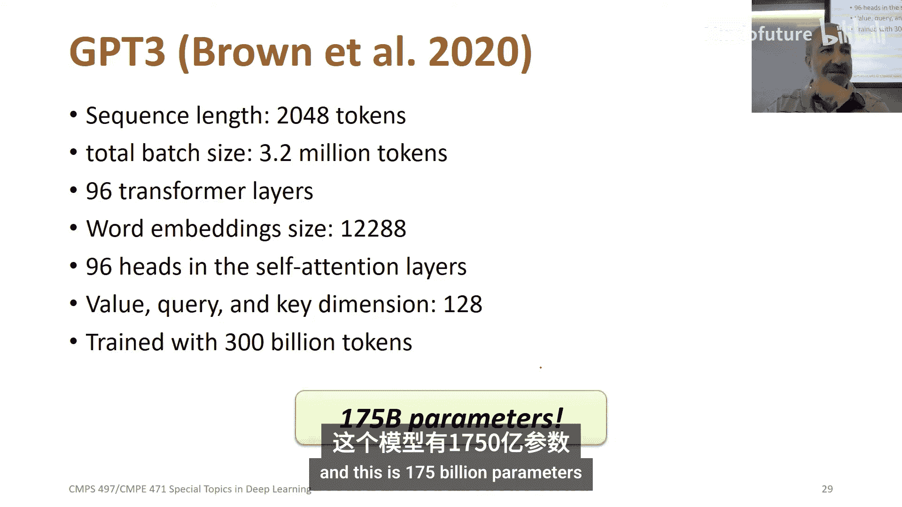
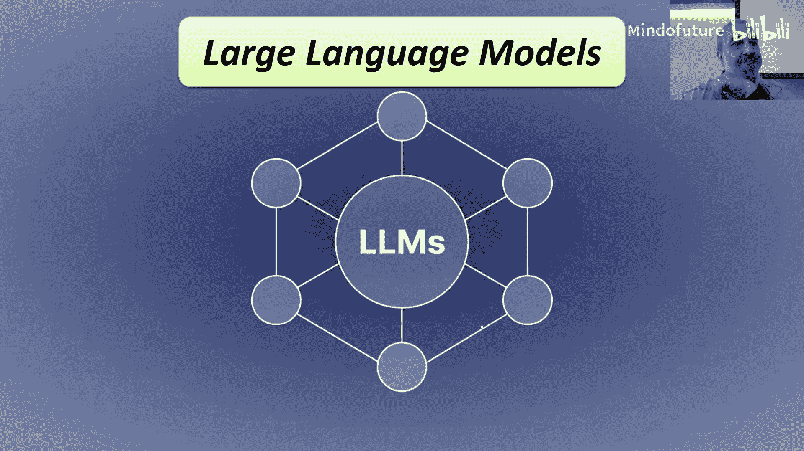

# 【卡塔尔大学】深度学习 CMPS497 ｜ Understanding Deep Learning ｜ Fall 2024 p23 P23_第二十一讲-Transformer IV (仅编码器和仅解码器模型) -BV1vQvNz1EeK_p23-

This I'm and will continue talking about transformers。

 I think this is for the third or fourth lecture， I hope that we will be done today or maybe we will take any part of the next lecture on Tra。

I think you saw this last time the full architecture of the transformer。

 as you can see that we have two sides， the left side is called the encoder。

And the right side is called the decoder and we will talk about both enchar in more detail today。

 but as you can see from the figure here， they are very similar if you look at the one layer。

 of course this is n layers now I mean are there's a stack of encodeder layers and theres also a stack of decoder layers if you look at one from the encodeder and one from the decoder you can see that they are very。

 very similar except that there is one more attention sublay that we will talk about in Char later。

But other than that， they are very， very similar in the architecture。U。

Before we get into the different models that are transformer based。

 let me ask you a couple of questions first a self attention sublayer of eight heads remember we talked about Mon had the attention last lecture。

 a self attention sub layerer of eight heads。Compared to a sub of one head。😡。

What is the difference in parameters， Do they have the same number of parameters？

If I have eight layer eight heads and one single head。

 do they have the same number of parameters or we have an extra D by D weights matrix？

🤧In the eight heads version， or we have eight times the parameters of the single head。

All eight times plus the extra weight matrixs。What do you think。Now， kind of answered this last time。

你开始。Because we in each hand， we。Okay， but we don't have any extra weight metrics。

Dean we say that after concatenation we also apply transformation right so the subplayer the heads themselves。

 the total of them is the same right but with multiple heads we have an extra weight matrix that we would use for their final transformation so which answer here is correct。

对。No。The second one， the last one says eight times the parameters plus the weight matrix。

 so we don't have the eight times we don't have eight times the parameters it's the same number of parameters plus an extra。

We metrics， which we call it concatenation weight metrics。Okay。what if we have 16 heads？嗯。现在。

No same same answer Okay， it doesn't matter the number of heads because we divide the metricric for values。

 queries and keys are smaller getting smaller when we have multiple more heads Okay。

 so we have the same number of parameters plus the weight metrics at the end Okay。

 another question in the transformal model。😊，Each layer has the same number of parameters。😡。

All the parameters now we are comparing across layers。

 okay each layer has the same number of parameters， all of the parameters are shared across layers。

 some parameters are shared across layers， output of layer K is input to layer K plus one。😊。

Which of these are correct。Like， yes， we are talking about complete layers now。因为我一直。

Each layer has the same number of parameters， so the first one is correct。What do you think。

And they have the same thing we said that it's a stack of layers right。

 so exactly the same architecture is repeated， which means that it has exactly the same number of parameters。

Right，But do they have the same parameterra values？No， of course。

 the parameters themselves are different， but the number of the parameters is the same。

 So the first one is。Is correct， right， How about the second one， All the panel are sharedd。

 Of course， no， they are different。 Some panel are sharedd， no。

Output to flare key is input to layer key plus1。😡，呃，Yeses， yes yes。 yes位。No， I'm talking here。

 we are talking about the output itself。 So the output from one layer is the input to the next one。😡。

Right up up to the end。 Yes， I thought that you know yes， it's not the same。No， they're different。

 so the parameters are completely different。In each layer。 But they have the same architecture。

Which means we have the same exact number of parameters。Yes。AndThey。Itsy。Yes。

 the input to the layer K plus 1 depends on the output of layer K， of course。It is the same。

 The output of layer 5 is input to layer  6 and， and so on。Okay。😊，といこと。

T now in China today I think this is one of the very important lectures we will talk about the different types of transformer based models。

 we have three types actually encode coder only。Decoder only and encoder decoder models and we will talk a little bit of detail about one example for each。

Okay we'll talk about B for encoder only GPT3 for decoder and machine translation for the encoder decoder models。

This is a quick summary of the history of the transformer based models。

 of course these are just example of models， you can see that the encoder only models have this color。

 the decoder only have different color， the encoder decoder models have a third color and you can see that everything starts when。

😊，这个。In 2000。Actually 17， the transformer is here when the attention was introduced。

 the self attention in particular， by the way， the concept of the attention was introduced before。

But it was done in a different way than the self attention would talk about it a child a later。

So everything started with the transformer in 2017 and then we started to see back the different models the some models are encoded only some are decoders only and some are encoded and decod these are of course just examples。

And you can see that the Cs， the GP Cs are。De codes only okay。

 and we'll talk about that in a a lot today。Okay， encoders on。

The goal of the encoder only model is to build that presentation of the text。

 And that's what we studied so far。And imagine the concepts that we studied so far。

 were just building models or using models to produce representations of text。

 to produce embeddings of input text。Now， the representation by itself。In isolation。

Is not doing a specific application， is' not doing a specific task。Okay。

 so the goal actually is to use this to build that presentation model so that we can use it for specific tasks。

😊，And that's the goal of the encoders。So the encoder only models produce embeddings。

 better representation than the input。Of the text。 And then that representation can be fine tuned。

These models can be fine tuned and we'll talk about what we mean by fine tuning to solve specific NLP tasks。

The model that we will talk about in a bit more detail is code B。

And that mode actually was at the time， I think 201 2019。

 actually did a bigthrough in different related fields。

Bt stands for bidirectional encoder representations from transformers。对。Whatth is birth， Simply。

 it's a language representation model。It takes input sequence in terms of embeddings as we saw before and produces a better representation for each talk。

Okay， and that can be used for specific tests。So it is a trained encoder stack。In B we have 24。

 we said that in the original transformer was  it here we in B we have 24 actually layers。

 it's a stack of 24 encoder layers。Now， in numbers。It has a vocabulary of 30，000 tokens。

What does that mean？Did we talk about that before， No， not the input on the user。😡。

It's the possible different tokens that it can understand。😡，As 30 sound type。 How did we get that。

 Did we study that。Before yeah last lecture right we talked about the subward tokenization okay so the algorithm of the subward tokenization stops at specific number。

 so here it stops at 300 so we have 30000 tokens that the model can understand。😊。

And we have 16 self attention heads。We have 24 layers as we said。

 the dimension for each embedding vector is 1024。😊，And we have 4 4096 hidden units， what is that？I。

With。Yeah， that's the shadow network right in each layer， this is for each layer。

 by the way and this number is for each layer。so that's the size of the hidden layer in the shallow network that we have in each transformly。

That sorry。It's， it's not considered like transforming。What do you mean。

 This belt is a stack of layers。对次呢。What you mean by you do modification to the array itself。

 it's just the number of things。But it's the same structure。原你。ok。

T all of these numbers amounts to only 300 million parameters。Only。300 million parameters， okay，3，0。

0 and then six， six more zeros。 Okay， that's the number of parameters。 Now the question is。

 is that large。嗯，对。Okay， of course that's too many and at the time it was too large。

 it was very large now that that's a really small model。😊，That is really a small model。

 when we talk about numbers， data， I think， next picture or today， but that's。

With the numbers that we see today， that's very small。Although it looks only 300 million parameters。

Okay， how do we train， but we train it using transfer learning。

 we talked about transfer learning before that。In transfer learning。

 we have a primary task for which we don't have so much labeled data， so we have another task。

 we call it a secondary task。We can use self supervision to train for that task。

 we have lots of data and we don't have to have human label data because we can generate this label data。

And then after we do this training for the secondary test， which we call it pretrain。

We actually clean。For the testing， the specific test that we want， we call this fine tu。Okay。

 so we have two stages。 we'll talk about each stage in detail now。 So the first stage pretrain。

 we train the model on lots of data。With self supervision， we don't need human label data。

 we can generate this data。That's why you have lots of them。

And then we find tune for a specific task， we will talk about these two first two tasks as examples。

 tasks as examples， but actually it can be used for any or for many NLRP tasks。

The first stage is pretrainning。Here， the task that we use to portray birth is called maskt language modeling。

What do you mean by that。We have lots of text data on the web， for example。

 and books and blogs and so many textual data， right？We can take any sentence。

And mask randomly a percentage of the tokens or the words in that sentence。 So， for example。

 you have this sentence the。I think train ball pulled into the station。 Okay。

 randomly select a percentage of the of the words， we mask them。

And then we trained the model to predict the words。😊，Yeah。

This is self supervision right because we have the text we have with the original words， right。

 but we just hide them in training。😡，And train the model to predict those maskt words。Okay， how。

Now this will be the input and the mask here is a spatial token。

 spatial token that is among the vocabulary， of course。😡，Okay。😊，Now， as we discussed before。

 for each input。Tokiken， we have an input embedding vector right。And also at the output， we have。😮。

And output put in building vector， right？😡，Right， okay。Now， from that output embedding vector。

 we want to predict。For the cases of domestic tokens， we want to predict this world。

If you think about this， this problem， this is a prediction of a word among how many possible words。

😡，30000 actually， yes among 30，000， which is a vocabulary size right so this is what kind of problem is that。

😊，Clsification， multiclass classification， right， multiclass classification type to do that using neural networks。

 what should be the number of output number of output nodes。😊，The number of no， number of classes。

 of course， right？You mean the layer it's。The number of nodes in the output layer should be the number of classes。

 right， one node for each class。😡，One not for each class， right， so what we will do is that。😡。

And we do that here。 if， let's say that this is。This is the masket， the embedding for the masket。

For the word， okay？So， that's the mask。Ebedding， that's the input and we go through all the layers for the transformer。

 right？And then at the end， we will have one embedding for the mask token， right？😮。

what's the size of this， this is 1024 in B。And we have one like this for each token。

 but we are interested in only the tokens Okay， so well take this and we will add a linear layer output layer。

😡，That has how many nodes。😮，As you said， yeah， 30，0， 30 keynots。So there will be a linear layer。

 so this will be fully connected。Okay， and then to get the probabilities， what should we do。

We use soft Max。Okay， so softm after that。Will produce。ThisThis is now 30K。Sorry，3。Key probabilities。

Okay， so for Da world。We have。All the probabilities。 Now we can pick the top one。And based on that。

 we do the training。Okay， same for the others， so we did that for this mask。

We will do that also for this mask talkingken。Okay， so we'll see for each， so for each mask token。

 we will add a linear plus soft max layer。Which is this。And with the softm。

 we would produce the probabilities for all the tokens and based on that we can do the training。Now。

These are the mask words， one small detail also。Is that we also have what we call the CS token at the beginning。

So that starting talkingken， we call it the classification talkingken。 So this。

Token will produce at the end。An embedding vector that will be considered as an embedding for the entire input。

It will not used for the training， but as you will see， it will be used for the fine tune。Okay。

 so with me so far question， no， okay。Any question， so it's clear right。

 so for each token we would add a linear plus soft max layer。

And that would produce their probabilities。Now， what would be the loss function。没。Yeah。

 it's a multi classical entropy for each。For each masks output， right。

 so it will be like multiple outputs。Right， so it will be。

The thematic class course interviewpy for all domestic wars。Okay， yes。Okay， so I get the。

 the process that you do for each month。不。That the。Are they concateated when。No， no， no， no。

 each of of these has its own layer。They are not concatenated because you want to predict from each token right Yeah。

 for so the token at the end it will have its own output layer。

 each token actually will have its own output part。

 which will produce eventually the probabilityability vector。And then， of course。

 we will train in based on these probabilities。Okay。T now how many。

 how many sentences we need to train this this model。嗯。嗯。Sentences。

 how many examples we should use for training a lot， a lot as much as we can， right。

 as much as we can so that the model can learn these representations。The output of presentations。

 in a way， of course we have one for each。In a way that it can predict the make word。

now understanding this。This process。What is learned here。What's the benefit of what we are doing。

And after training this model on billions of or millions of sentences or billions of sentences from different sources。

What does it learn。Yeah， okay， okay， predicting the mask word。 But when it predicts the mask word。

 what does that mean。你没先。So以。😊，Yeah。No， no， this is not gene still。

 okay you are talking about the encoder only。What what does it learn， if I asked you， if I gave you。

 if I gave you a sentence and I masked two or three words in that sentence。

 asked you to predict this and how would you predict the Das tokens based on that other way。

 based on the context side， So that's what what's here。

It learns to represent tokens so that it can understand the context from the other ones。Okay。

 actually， it learns the syntax of the language。 it also learns from relationships between words。

 Yeah， for example， if the previous word is read。And then， a ma world。こ dadささ。

Never appeared in the training can be it call。😊，Probably。It can be a carpet。Yes， okay。

 how does it learn that It learn from training， Okay， from so many sentences。Yes。The mask。

 the number of masks。It'ss any it's preset with a percentage of。

 of course you cannot the percentage cannot be very high。

 otherwise you will not be able to predict as a human even。

 so it has to be like less than a 20% 25% or 50% maximum。It's randomly， randomly chosen tokens， yes。

 within within a context length。Yeah。No， but's the number。啊。

What do you mean by a number of them there is a maximum length， of course。

 I don't remember for but I think it's 512，512 tokens maximum。

So we produce because we have text right， so we have like a sliding window over the text。

 we provide 512 tokens。And percentage of that， maybe 20%， 25% of the tokens are masks。

That's in training。Okay。What do mean buy another layer？Because for each for each mass doph， Yeah， we。

 we haven a name yet。Okay， so this is for that example， but of course。

 when when you are training there is an output for each token。But here we ignore， Okay。

 that's a good question here， any， this this is that exists for all for every token。

 but for that example， we ignore everything except。The output for Da tokens。But of course。

 in the architecture， there is an al for each token， of course， because for many for other sentences。

 this will be the ones that we look at。😡，D masks tokens are， of course， different。

 across different sentences。Okay， is that clear？😊，Okay。

 make sure that you understand this process putting an output layer because we will do that multiple times this lecture and I think next lecture。

Similar things。Okay， any question before we go to the second stage？😊，Okay， now out of this stage。

 we have a what we call a pretrain model。This model is specific for a specific task。😊。

For specifically E task， this is not a E task， right the mask language modeling is not the one。

 it's not a user application， right？😊，Unless you want this for any small kids you need to pay to test them。

 but。But actually this is not a user application right so the second stage will provide a model for specific tasks out of the pre traineded model。

Now we assume that we have the Pthn model， let's say that we will do that for two we do this fine tu for two examples。

 the first example is text classification， let's say that now I want to train that model。

To find you own that model。For the task of sentiment analysis， which is an classification given that。

 let's say that this is a review。I want to clarify whether this review is positive or negative。

This is not the task that the pretrained model was trained for right but we have a pretrained model that was trained on lots of sentences so it understands the structure of language now I want to find unit what do you mean by fine unit？

Adjust to the model itself。Adjust the model。 What do you mean by adjust the model？Yeah。

 change the parameters of the model。Okay， so well change the parameter of the model， the model。

 the prethian model。😡，Specifically for that task。So how will we do that。

 we'll take the between in model。😮，As we got it from at the end of the pre training stage。And then。

 we start to train it。Using label data for the task that we have。This task is text classification。

 so we will input a sentence。And at the end， we want to get an output that says whether it's possible or negative。

 what type of problem is that？😡，Bary classification right。

 so we should have just one output node at the end， right Okay。

 so because this test is about the entire sentence。Remember that we train something called CLS token。

 we get an emdding for it， this is what we would get as an output。😊，Okay， so we take the output。

Ebedding vi of the CS token and pass it through a network。

 It can be just one layer can be two layers， whatever you want。 But at the end of that network。

 there will be one node。Okay， and we'll do a sigmoid。

 we'll take a sigmoid so that we get a probability again as we did before with binary classification。

Okay， so this can be one，1 layer can be more。Okay， fully connected network as we started before。

At the end with one output node with sigmoid to get the probability。Okay。

That will do the the classification。 Now， what would be the loss function here。場イナセピー。Okay。

 nothing new here。 binary close。Okay， yes。This the last the last thing you said。

We take the embedding vector that is corresponding to the CS so that's the one that is here。Okay。

Yeah。Yeah。Okay。And do we take this from the last layer or the first layer or what？

Because remember we have multiple layers here， right？The last day， of course。

 that's the final output of the transformer。Okay， any yes。And then yes， yes。Yes， of of that task。Yes。

 for that case using the label data。Okay， so here it's very important to understand that we are starting from the pre3 model。

😡，We are not starting from scratch。So this whole network is already pretrained。

On the mask language modeling task。Okay。For a long time， of course， with lots of data， okay。And。

 and GPU。Because it's a massive process to build that， so actually individuals don't pretrain models。

Unless you have the capacity to do that， but usually any large organizations。

 companies that has the capacity to pretrain models， and then some of them， of course， not all。

 share the models themselves so that you can fine tune in them。What都明白 sharing都矛盾。还有。

Sharing the values of the parameterism。If we share the values of the parameters， that's the model。

 right， And then we can find tune therefore for a specific task。 So that that was the first example。

😊，The second example is what we call name the entity recognition。

 what do you mean by name the entity recognition it's a very well known natural next processing task for this task we want to identify given a sentence we want to identify。

😊，The human names or personal names。Names of locations and names of organizations。😊，So， for example。

 given this input sentence。Katty works at Apple in bath。

So we want to point you in the model so that it can say that Katy is。A personal name。Workals。

Is none of them。Right， at。None of them， Apple。An organization name。Organization name in。

None and Beth。Lookage。Okay。😊，Okay， so that that is called token classification。

Or token based classification。 The previous one was sentence classification。

 We want to classify the whole sentence， the whole review right here。

 we want to classify every single token。Right， how many classes we have here？对。No。

Classes for each token。No。Why is it 30，000 do we know， do you want to predict one out of 30。

000 classes， location， organization？Names and none。 Very good。 So we have four。

not every token is one of the three， so we actually have four。

 that's why for each token we have a linear layer。Plus softm and full output nodes。Okay。

 so we have four probabilities at the end， okay， because we have four possible classes。

That's for each token。Okay， for each token。I hear you。 it means like we don't think just。Yeah。

 we don't actually in this problem， you don't need the CS token yeah。O， but。AndYeah。But before that。

 is that clear。So the training here is clear。 So this is called again， fine tuning。 Okay。

 that's not pretraining。 We are not usually pretraining is for a very broad task。

 It's for language understanding。 Okay， but fine tuning is for a very specific task。

And that's what you will do in approach C in the project， by the way。Something similar to that。Okay。

 questions。呃This。Whatever you think I out。榜单。And。Whatever create。

Yeah it's like considered another layer that you yes， yes。

 so actually that's a good question actually if you remember for retaining we said that we will add an output layer here right？

So that's like a kind of output layer for each node。

 What do we do with this when we do the fine tuning？😡，We remove it。

So the pretrain model that we use for fine tuning ends at the output of the layers。😡。

Will remove this output layer。And then we put another output layer for the or another layers。

 whatever you want， for fine tuning for the task， for the specific task that we want。Okay。

 is that clear。Same with task， of course， yes。But whenever we find tune， we ignore the output。

 actually the pretrain model that you get， you don't get the weights for the output because that was a task that was just done for the pretrain。

 you get the model out up to the last layer。😡，The last transform。

You don't get the weights after that because you now you for fine tuning a specific task。

 you add that your own。Layers， after that。对。What based on， based on your space， Oh， simultaneously。

 you mean。Yes。So I think the question is， if you have。Two tasks。How would you do fine tu。Yes。

 you mean fine tuning。Yeah。Okay， so usually we find tune for one task only。Okay， so in that case。

 let's， let's assume this case。 we have two tasks， and we want to fine tune。

To get models for these two tasks。We will start with a pretrain model， right。

 we fine tune for the first task now we have a fine tune model。😡。

T should we use that model or should we start with that model。😡。

For fine tuning before the second task， we start again from the P model。为仔大嘅。Right， I was writing。

Again， okay， we have two tasks。We want to find tune for two tasks， okay。Should we。

Have a pretained mode， this is the pretained model， okay？😡，We find unit。4 task 1。Okay。

 now I want to fine tune also a model for task2。😡，Should I start with now we have， okay。

 then let me change this。😡，So。So after function2， we have another model。Right。

 so let's say that this is。Their fine tune model。Okay， for desk one。Alas， now I want for task2。

 what should I do Should I take this model and continue fine tuning？😡。

F tune for this is fine tune for task 1， this is fine tune for task 2 to get a new model。哦。😮。

Take this model。Yeah。And fine。Tunenet for task2 to get a new model。 which of these two path。Yeah。

 very good。 If task  one is related to task 2 and find uniform task 2 might benefit for task 1， Yes。

 you can do that。 Of course， you have to， again， remove the output layers。

 You the new layers and add your own。😊，🤧Like， or if。The two tests are completely independent。

 What should you do， You start from the fine tune model。Every time， and this is usually the case。

Okay。Or there is a third option， which I think you hinted about in your question， which is multit。😊。

Again， this is valid if they are。😡，Velated。So you can， of course。

 do multi multitask learning and have one model fine tuned simultaneously for the two tasks and we'll talk about that later earlier。

Any questions on that， you got this？Yes。Oh no， no， no， we start this specific layer。

 we start from scratch with random weights like like what we did before， right but the other part。

We'll start from the weights that we have in the free training right type will we change these weights？

Of course， we can， by the way， we can freeze them。We can。And we can also update them。

Usually you update them at this part of them， that's another topic， okay。Okay， any questions？

So this is very important to understand because this is what is done currently。😡，And we are， I think。

 very close to 2024 now。Building one model between thin model is very costly。

 so you have to tune the hyperparmeter a little bit。😡。

And on smaller models so that before you start pre training， it's very costly。And this there。

 you have the time and money， do whatever you want。Okay。😊，Okay。

What's the loss function here did we answer this？Yeah。What's the loss function for this？Yeah。

 multi class course en for all but for all。Okay， now we'll talk about decoders， so decoders only。

The goal of the decoder only model is to generate the next token in a sequence remember the goal of the encodeder only。

😊，It was what。Representation， okay to learn presentations。For the code is only the only goal。😮。

Is to predict。Or generate the next token in a sequence， given an input sequence。

 what should be the next token？ok。😊，对。So we will assume that we will have the same structure。

 same architecture， multiple transformer layers， stack of them。

And we will train the model on sentences also like the encoders only。

 but the only difference or big the measure difference is that at the end of the stack of layers。

 we want to predict the next word， so we want to get probabilities of what could be the next token。

Again， how many probabil we should get here。😊，嗯。嗯。嗯。Based on the vocabulary size， right。

 Whatever about the vocabulary size is for the decoder， if it's 30000 then again， it's that's 30000。

 So we'll do that in a similar way to what we did before。 So we'll have a layer。Okay， for the last。

Starting from the last embedding vector， the embedding vector of the last token here。

 and we apply a linear and softm layer to get the probabilityba。ok。

This is the idea of predicting next token， this task predicting next token。We can repeat right， any。

 given an input， I can predict the next word。Tpe， I want to predict the second next word。

 What should I do， Are you add， I add the first generated word。To the input and repeat that again。

 right？To get the next one and then add the second， then predict the third， add the third。

 predict the fourth and so on， this is called O2 aggressive language model。😊。

Autoaggressive language model， Autoagive language modeling means we generate at one token at a time。

Conditioned on the previously generated tokens plus the original input， of course。Okay。

 so I have input。I。Predict the next one based on the input， right， the first one， based on the input。

 And then I predict the second one based on the input plus the first one。

 Then I predict the third one based on the input plus the first two generated token and so on。😡。

And that actually comes from probaities if I have this sentence and I want to compute the probability of getting this sentence。

😡，Then it is the probability of the first word times the pur of the second word。

 given the first word， times the probability of the third word， given the first two words and so。😡。

That is called autoaggresssive language model。Okay。

 I generate the next token based on the previous de generated token。Plus， the input， of course。Okay。

😊，第。Now let's talk a little bit more in detail about training。I want to train a model。😡。

To predict the next word。I will。Input many sentences， as we did in good。

Notice that we have here a special talking called start because we want to indicate the start of the sentence。

And instead of just checking the output from the very last token。😮。

Why don't we we do that for all tokens， and， for example。

 I will train the model to predict the next word of the first word。😡。

Wwhich would be the first year start so I want the model to predict for a start to predict that for there to predict fish for fish to predict live and so on instead of just this is for efficiency reasons for one sentence of 10 tokens I can like it's like 10 examples for whatever input I want to predict the next one for each token I want to predict the next one。

Okay， so I can do that actually all predicting all next token simultaneously， right？

Instead of just looking at the final output。T this is problematic。What is the problem here？

Think about， think about what we just said。 We will input the entire sentence。😡，And then I want。

 for example， I want the model for the word fish to predict that the next one is lived。😡。

And for the word lived to predict that the next one is in， what is the problem here fine。

 that's fine， each one depends on the previous ones that's exactly what we want。

But predicting the one before。It dependspens on the one right before it。 So you cannot。Now given。

 okay， now this one means what， for example， this one。😡，This is predicting the next word。

 given that we have start the fish。😮，And this world will be predicted given that we have start the fish lived。

No， we can because the output is done simultaneously right in parallel although all of these outputs are done together so we can compute the loss on all of them。

 Now what we doing by training simultaneously here instead of computing the loss on only the last one。

😡，We can compute also on all of them so that it can always for every token。

 it will always predict the next one。😡，Okay， so I can now make the training much more efficient。Okay。

 but this is very problematic， Why is it problematic？我觉看。20个。No， it sees their fish。But about。Okay。

 remember the application here is generation， okay。

I don't generate the second before I generate the first， right， so to generate the first。

 I would depend on everything that was before。😡，And then when to generate the second。

 it depends on all the previous。Right。😊，And all the previous is here already， right？😡，I mean。

 for this word， all the previous words are already here。Alread the input。

 So it will learn that when I have this input and the word lift then in will be the next。

 That's what I want the network to learn。 And for fish， it will learn that the next one is deep。

 And so what's the problem here， yes。And then training would never stabilize。 Why。

 Because each one of them。嗯。A lost in thatha。 Yeah， it might change the world， but。No。

 we wont hear here because we are given this sentence。

 we we will penalize next if the predict word is not lifted。😡，We will do that for so many sentences。

 but for this sentence， it has to be lived。😡，For fish and for live， it has to be in。

 and for in has to be there and so on。Okay， think about what we are doing， Is that logical or not。😡。

第イ。When we predict full fish。WhatWhat is the right word？😡，No， no， no， for fish。

 any their fish lived right， lived the right word， but lived actually is part of the input here。😡。

So it can predict that the right word is my next one。😡，Because all of them are given， right？

We are given the whole sentence。We are given， we are giving the whole sentence。 so the net。

 if we turn in a model like that， it would be very easy。

Because the word that I won't predict is always the next one to me。

 so it will not learn the structure of the language。

 it will actually then learn that the one that I need to predict is actually the next one in the input okay。

 and that's not what we want the last one is the last one is， but all of the others。😡。

The problem is that they see the future。あります。Then we need to mask the future。Time， let me ask you。

Where in the transformer model architecture that we discussed。

 there is an interaction between the tokens。In the save attention layer， right。

 in the save attention sub layer。And the set attentions are real。

 every word interacts or every token interacts with。😊，Every other token， including itself。 right。

 So to avoid this。We will mask the attention。Interaction here is that tension， right。

 So to avoid this problem， we will mask the attention to。Their future words。

It will only attend to itself and the previous words。😡，This is called mask self attention。

Mask itself attention。 and that's the major change between the decoder and the encoder。ok。😊。

So if you look at this orange or brown block here， you can see this， this word。This word attends to。

This one and this one and this one， you see this three connection。

They are going to itself and the previous ones only this one is to itself and the previous ones。

And so on。 this is called mask itself attention。 So we will force that tension in this case。

 to the future tokens to be。The attention waits to the future tokens to beze。Okay。

 so that's an implementation detail here we'll force the attention weights from the word to any of the right context。

 what do we mean by direct context， the future tokens okay so all the attentions to direct context will be zero。

In in that case， there is no cheating previously there was cheating because each word can cheat the predicted the needed word from the input right it's the next one now it cannot cheat because the next words are mask。

嗯。Okay。Is that clear。ok。第。So this is now the actual training。😊，With the mask attention。Again。

 it's very similar to what we saw before， we have now the sentence and for each one you will see that this is the mask itself attention。

Okay and for each token now we want we will add a linear plus of max layer to get the probabilities over the entire set of vocabularies right because we want to predict for each token we want to predict the next one right so it will be an output layer part of the output layer for each token。

Like what we did before， but here it would be all the the loss will be computed for all tokens instead of just domestic ones。

😡，Okay。Thatly。不。Again， what will be the loss function。嗯。Monticlass course and entrepreneur。

And it's for all of them， it's multiple options。Okay。

 now why are we doing that or what will be the model at the end？😡，Given any input。

I generate the next word， right， that what if I want to generate0 words， what should I do。

CanCan I use that model to generate 100 words instead of just one word？没有。侬。No，我待会给你发题问。Actually。

 did I say pretend traininging here。It's training。 It is kind of freetrain， of course。

 but there's no fine tuning。 If I want to use the model。As is， I can actually use the model as is。😡。

This is generative， right， so I can actually， of course it can generate one。One word right。

 but if I want to generate 100 words， I will add that one generated word to the input and run it again。

😡，哼。Okay， run again， through the entire network。Of course there are some efficiency implementation issues here。

 Yai we don't need to recomp the outputbedding token output in embedding vectors for all tokens because they are repeated okay we not talk about that but assume that we will learn the entire input again through the entire network。

At least part of it for the new world for the new token and then generate the second one， right。

 then take these two， take the generated one， add it to the input and run it again to generate the third one。

Add to them， do we see this somewhere？This is this is what ShaGBT is doing。

 of course after other training phases， but that's the main thing using a decoder model it generates one token and based on that token generates the second and based on these two generates the field and so on。

😊，Okay， so it can actually generate multiple tokens。Okay。

 so this is the this is a figure for the process if I want to generate text from a decoder。

 I give it a sentence like that， the fish lived in。

 I go through all the network or the decoder model。😊，Okay。

 the decota model will give me probabilities at the end。Of the next word， Okay， this one bear when。

 when we actually use the model， do we get it from all the words or just the last one。😡，哦。

for using the decoder now in a reality not entertaining training for inference。

Do we get the prediction from the last token only or from old tokens？Only the last one， right。

 because we want to get prediction for the last one only。Okay。

 only the last one because we want to predict for the， I want to get the next one。

 next word after that。😡，So I will only get probaities for the Rtoken。

in contextBut learning learning happened for us。 Okay， learning happened in training。

 This is not in training。Okay。Okay。So we'll get probabilities like that that what do we do with these probabilities？

😮，We can take the highest。 This is the greed method。 Okay， we can take the highest。

And all we can sample based on these possibilities。아。Not uniformly， not completely randomy。

 any randomy， but based on these possibilitiesities， of course。😡。

So that it will with high probability will get sea or blue or river or something like that。 Okay。

 in this case， let's say that we got blue， which is the second one here。When we get blue。

 we added to。To the inputs。Tn it again through the decoder， on when we use Jesuity。

 we don't see that， right？😊，We see the words coming， but they are coming。A little bit slow， right。

Because it turns over the layers。And then we get the new probabilities okay。

 you sample from them this time you sample see and。Okay。😊，This is called generative models。

You hear generative AI。And that's， that's the base of it。

It can generate text now because it learned how to how to predict just the simple task， right。

 how to predict the next token。If I do it， that's like a building block now I can't it。

Whatever I want。 there was a small detail here， which is which word we can pick we mentioned that we can be greedy right take always the first。

😊，TheThe top one， right， If we do that， whenever we give the same input we will get。

The same output right when when you prompt Cha GT， do we get the same output every time。

 even if the input is the same？Sometimes， but generally no， right？

It's probabilistic right actually when if you use it in code in programming using the API。

 can you can control that there is a peral core temperature。😊，Okay， if you set it， I think to 0。

 then the output would be consistent。 always with with the same input， you will get the same output。

 It's like the gradient here。 If I， if I select always the top probability， probability word。

 I will get the same output every time， right， But to be innovative and because。

This generation doesn't have to be just by one way。

 right I can generate multiple sentences and they are still plausible。 They are still coherent。

 right， So for the model to be really innovative。 it has to be probabilistic somehow。 Okay。

 so doesn't use always the the the top probable world。Actually。

 we will study two strategies to do that。To generate coherent output。

The first one is called beam search， beam search。So let's assume that the model。

 I want to use the model to generate text from nothing。😡，Just generate text。Okay。😊，So， initially。

The idea is that in every time， every time I will generate a word。I will keep。

 instead of just keeping one word， I will keep K words。😡，And move with them。嗯。

I have remember I have this probability table， right？Okay。

 so I can keep the top three probable words。😡，And then move with them to get to expand each one of them。

😡，Let me show you。So we'll start with empty string， let's say that the top three next。😡。

Words are apsilon， A and B。Okay。Now I will not say my well take epson because this is the top problem。

 no， I will keep the three。😡，Come on， I will not generally。

 I will not present to the user anything yet。😡，Okay， I will present。At some point， okay。

 but I will keep。Three of them or K of them。 K is is a parameter。 K is here is 3。

So Ill keep Eppsilon A and B， and then I will take the first one Epilom， and expand it。

To get the top three that are most probable after epsilon。In this case。

 there are another epsilon or A or B。And we'll do that also for A and B。 So overall。

 we will have instead of starting with three here cases， I have how many here，9， three for each。😡。

So this is now nine sequences， by the way， mean epsilon epsilon， epsilon A epsilon B and A epsilon。

 A， A， A B， B， epsilon， B， A， B B， okay， then I will take the top three probable among them。😡。

How can I get the probability for each of these line？

I actually have the probabilities for each one right。

 more the probability of getting A B is the probability of a。😡。

Given times the probability will be given in， which we have already when we do deation。

 remember the probability table， that is the conditional probability table。😡，Okay。

 so I can compute the probability for each sequence so far， So among these9。😡，Yeah。

I will select the top three based on their propertiesities， which are this one。😡，This one。

And this one。And this is what I will start in the next iteration with。

 so I will start with Epsilon A。A， Epilon。Which is this one？And A B。嗯。

For the next and then get the the third token。Okay， and so on。

 let me show you a concrete example here。They say that we will start with them。ok。😊。

We' find there are many possibilities for the next word after theirlight， their dog， theirs。

 their car， their boat and so on。 we take the top three out of them， which are the dog dens the car。

Then we expand each one with one more words。So the dog can be expanded to the dog and the dog runss the dog has。

The nice can be expanded to the nice woman， the nice house， the nice guy。

 the car will be expanded to the car has， the car drives， the car moves。Now， among these nine cases。

 which are here。We will sort them by probability。Because we have the probability design right。

We can compute the ability to get each of these sequences。 We take the top three of them。

 which will be the dog end， the nice woman， the dog guns， and continue。

Eventually we'll have to select one of these three， we can randomly select one of these。

 can we can select the top of them at the end we'll have to choose one of them。Now， each's time。

You can the the the model can generate new。Nextex。Because it's probabilistic， right？Okay。

 this is beams。There's another one which is simpler called top key sampling。And instead of。

Keeping multiple sequences over all time because this is not very efficient， by the way， I。

 this is less efficient than just taking the greedy method of selecting just sampling just one word at a time。

We have to keep key sequences over time。Here we， we sample only from the top key。Yan。

 for at every it， we get the top K。 Let's game and same as than K is 5。 the top。

5 probable and sample from them。1 and move on randomly based on the pro， of course。It's not uniform。

It's based on the probabilities， but we select one of them tab Y we are getting the top from the top K because I don't want to select randomly one that is very less probable that will will make the coherence very bad。

Okay I don't want to to select words from the very long tail this is 30000 or more talking if I completely select randomly。

 it might happen that I select I start with very bad words if I start with very very bad words。

 it's very hard to recover。Okay， sometimes it happens， okay。

 but we want to minimize the probability for that， so we get only the top k select among them。

 and then we continue。Okay。Any questions on these two beam search and top K sampling。

 Did you understand the difference。Chahardyputy is doing something。Around these lines。Yes。嗯。你你个。So。

怎要看。It will， you can。 you can actually， it will be nice to try it online。我果这可以看音。

Very good in the API， there is a parameter called maximum input lens and maximum output lens。

 you can say don't generate more than 100 tokens。You can limit that。Actually。

 also in the application， you can stop it at any time。 now。

 I think you can before it it was not was not possible。 I think now you can stop。De generation。

They is a default fourth value， of course。This is a default， no， it will not go any infinitely。😊。

Because that's cost。That's cost。 and you can see the coast now， right everything you're talking。

It's it's a loop， right it fit back to the model and generating the next one because this is what do we call this process？

😡，Outto aggressive language modeling， auto aggressivegress means that every step depends on the previous steps。

😊，Okay， did I answer your question？Okay， other questions。Okay， so this is。

A subset of the of the generative language models that G sees。 Okay， so this is G 1。

 It was 117 million， then G2，1。5 billion parameters。Then， G 3。Which is 175。

And you can see the relative size right these are the relative size actually in terms of the number of five minutes and G 4。

 we don't know actually。😊，ItIt must be much more than that， I guess， kind of t。嗯。Tren parameters。

Yeah。Okay。And thats that's GPT3 actually， it has 2048 tokens lens。

 the batch size that they used in training。Its3。2 million tokens，96 transformer layers。

We said birth was 24， right this is 96 the embedding size is。12l，288。96 heads。

And the dimensions for the value of the query and the key is 128 to end with 300 billion tokens。

These are just some numbers come on and you don't don't meize these numbers it just just to give you an idea of you have to have a sense of。

How large are these numbers And this is 175 billion parameters。

And that's actually。What we already call now large language models。

When we get beyond the I a billion parameter now it's 7，7 and 8 billions now are small。

when we talk about 7，8 billion models， these are small the ones that that we call it large now and that can of course change over time。

 it's hundreds of billions of and so next time we will talk about large language models in detail。

ok。😊，Okay， see you next time， Cha cinema。

