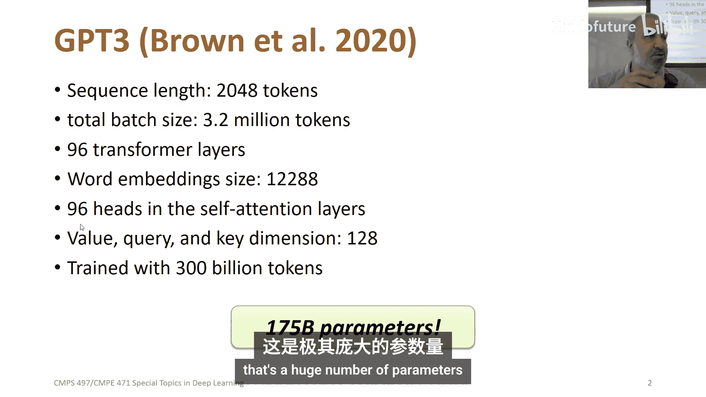
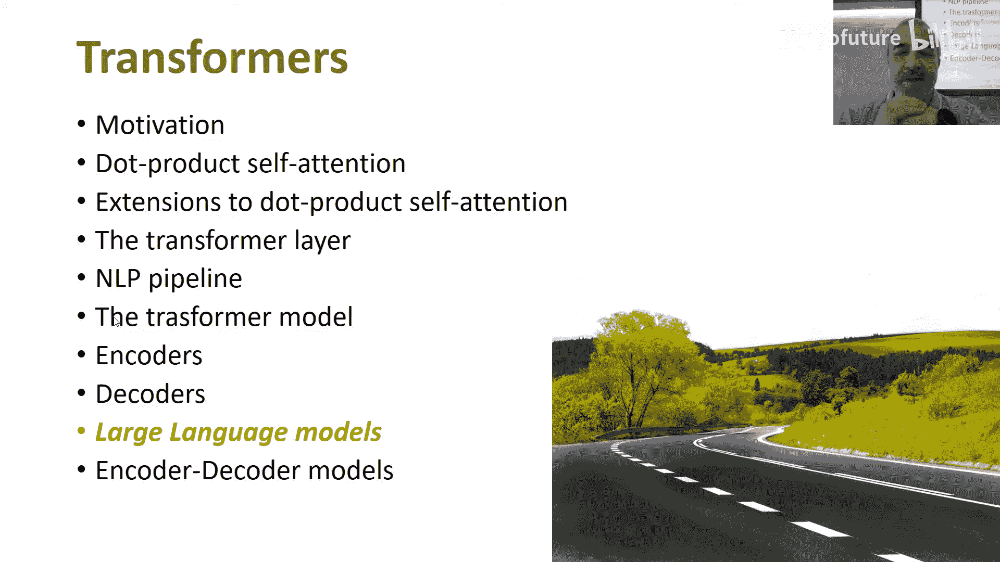
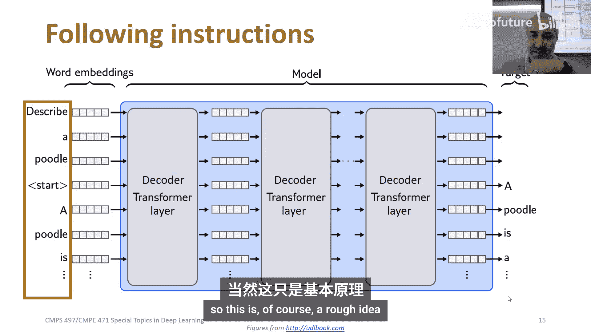
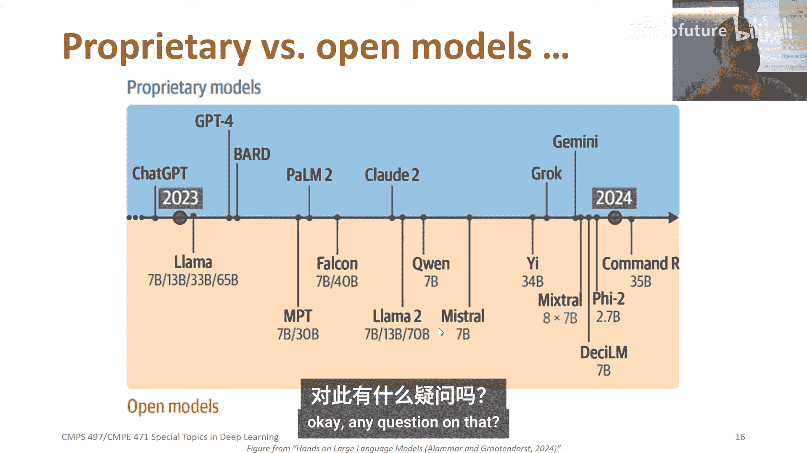
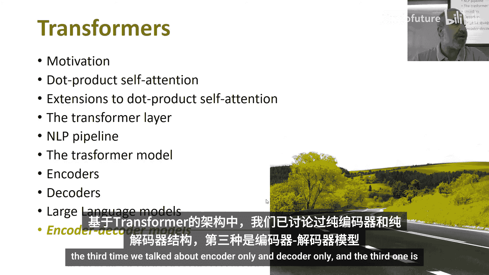
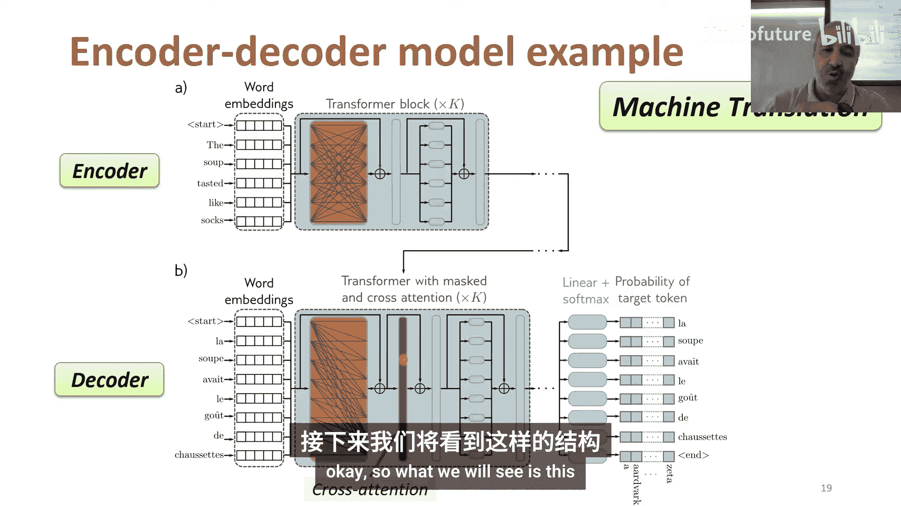
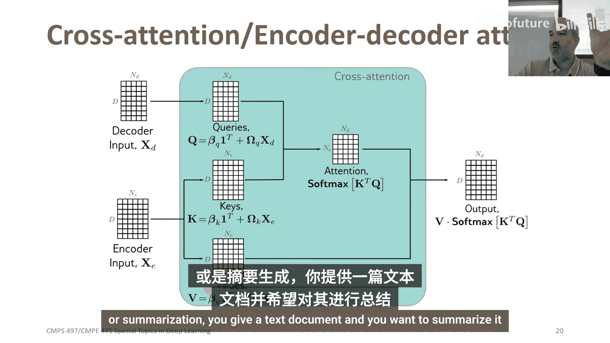
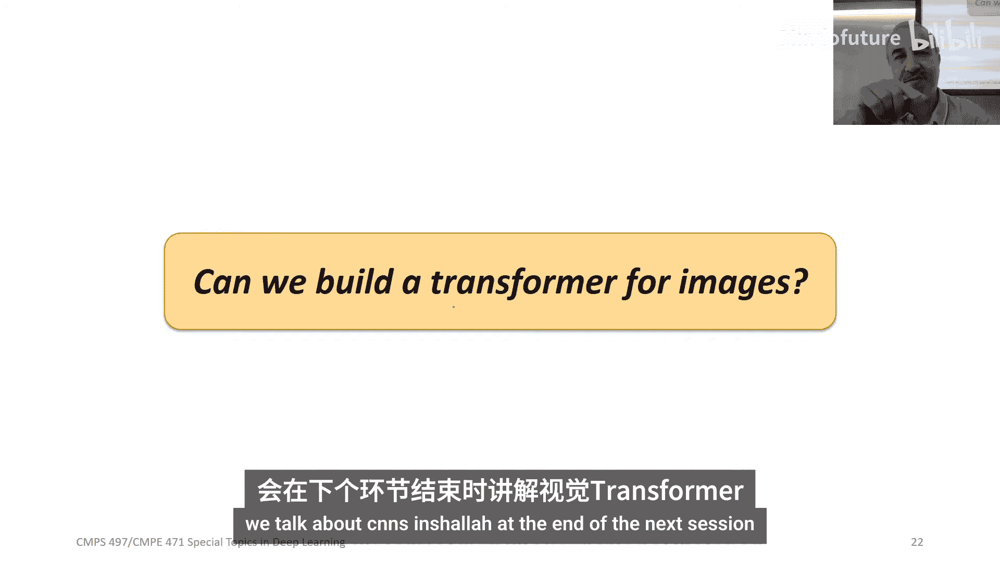

# 【卡塔尔大学】深度学习 CMPS497 ｜ Understanding Deep Learning ｜ Fall 2024 p24 P24_第二十二讲(a)-Transformer V (LLMs 编码器-解码器模型) -BV1vQvNz1EeK_p24-

S이 and him。Chart today will be the last lecture in transformformers and we'll start in Charlotte new session。

What did we cover last time？In only， like。Like that。 And the quota only like。

Like the ones that you see in the slide here， so this is the series of that GP models started with GP1 and as you see here it was just 117 million and at that time of course that was a big number。

 but then GPT2 is 1。5 billion。And then GBbT3 is 175 billion， and then GBbT4。

 we don't know okay it's expected to be much bigger than that。😊，Maybe like 10 times this， this size。

诶。And just to give you an idea of how GPT3 was structured。First of all， it was released in 2020。

 some numbers， the sequence length was 2048 tokens。

 that's the number of tokens that can be fed into the architecture。The total batch size is 3。

2 million tokens， the number of tokens within the examples。

 so we use pering batch of examples that cover 3。2 million tokens in one batch in every batch。Okay。

 that's the one a lot。The number of layers in the transformer architecture is 96。

The word embedding size is 12288， What is this？That's the length of the embedding vector right for each token is 12。

288。We have 96 heads。And where is that？In the self attention layer right in each self attention layer。

 the number of heads was 96。And the value query and key dimension is 128 the length of any value or key query vector when we have one head is the same length of the input height of the input embedding vector for each input token which should be 12288 right but here because we have 96 heads。

 remember that the weight meta C will be shorter， we divide the dimension of the matrix by the number of heads。

 so actually this number is this number divided by that number。

By 996 heads so that eventually it will get the same size of the input dimensions。

The total size of the training data was 300 billion tokens， thats massive amount of text。

 and that will amount to 175 billion parameters。Okay， that's the huge number of parameters。

Okay， and that of course introduces the term large language models。

 models language models that are really very large scale。

Now we'll give a very quick introduction to large language models。

 then we'll talk about the third type of transform transformer based models。

 which is encodeta decota model and then shall allow switch to a new session large language models。

What you mean by large Taman， it depends on the source of that saying large is。

Chang in global time and what was large a few years ago is not large anymore now。

Depending on that source， small models are the models that are less than 100 billion parameters。诶。

More than 100 billion pan is considered large by that source GT3 here is the base of CGBT。

 we'll talk a little bit about CGBT。And。And as you can see， there are actually larger models。

Even beyond that， came G4， as I said， its， it was not disclosed。What does this。Model learn actually。

 as we said last time， it learns the syntax of the language。

 seeing so many examples from text from textual sources like Wikipedia， all the web books。

 whatever text that is available online。It， of course， understands the syntax。

 but in addition to that， it also understands some general knowledge。 It has some general knowledge。

About what makes sense in reality and when I say a train pulled into the。

 you can understand that this this probably something like a station。not not theホ。Okay， not straight。

So， there is some。Sensible information or information that are general knowledge that these models acquired through training on massive amount of text。

Including some facts。So when you ask that question like what is the capital of Qatta。

 it would not be hard to say it'sha， not because of thinking。

 but because it was traineded on so much text that has a lot of general knowledge。

This is when we talk about what does it learn in in the training phase that is where the task is predicting just the next word。

 remember here that when we talk about large language models。

Mainly what we mean are the generative models that encode the only models。

Although some actually think of others as also large language models。

 but usually large language models。Are we failing to decoder only models or geneative models？

Like like GT and other CSs。So the main when it was to end on the next next token prediction。

 the main task of course， could be the text completion if I gave it a sentence it can complete after that sentence right so this is an example from the book it says it gave this orange part orange line to the model and then。

I think that was JGPT and the model generated the rest of the text that you see on the slide。

Understanding deep learning which is the name of the book of course。

 is a new textbook from MIT Press by Simon Princez that and then the model actually completed and if you look at it much of it is actually factual is correct。

 but part of it is just fake。It's talking about things that are actually not in the textbook。And。

The fact that it was trained on massive amount of of data。

It gave us byproduct a good performance on some tasks without even fine tuning remember last time we talked about fine tuning。

 right， what do you mean by fine tuning。😡，It's specializing the model to specific task okay。

 because the model was trained on general task。😡，General linguistic task。

 Now we needed to do some specific tasks， so we find unit， we update the weights。

 update with it the model using label data。So these large language models because。It is very large。

 learned a lot， learned over very large amount of training text。

 it can actually perform many tests without even point you。By just giving examples in the input。😡。

And we call that fu short learning or in context learning。 So for example here。

If you just gave few examples on a task。The model can actually perform that task。 So here we gave。

Examples of poor English and good English sentences。And then we ask the model。

't We didn't ask the model， but we asked the model to complete after poor English input and then good English output。

 Then the model actually will look and produce。An output that is a modification of the pool input。

Okay， given the few shots， the few examples that we we provided in the in the prompt itself。

 in the input itself， So there is no fine tuning here we are not changing the model。Okay。

 we are not changing the model。 we are just giving some examples within the input itself。

 so that's a major difference between this and the supervised learning right in supervised learning we change actually the model。

We change the weights of the model， but here because the model was trained on large amount of data。

And it's really a large mode it's big in terms of the number of parameters。

It can perform very well on tasks without even finite without changing the model itself。

 just by giving some examples， sometimes even without any example we call this zero shot prompt or zero shot tasks or zero shot learning here we we give sometimes for some tasks we just give few examples and the performance will be really good。

What we are talking about here。😡，Is that it can。Perform some tasks without point on it。By just， it。

 it's just byproduct of that pre traininging phase because it was preed on large amount of data。

 So it can also do some tasks without any， any changes。 Okay。

 sometimes with zero short learning with just asking to do the task。

And other in other times or for other tasks， you might give some examples within the input itself as we do here。

 and all the orange draw bound text here is the input， by the way。Okay。

 so we are showing in the input examples， input was and output。 you see here， input output。

 input output。 These are like 1，2，3。3 examples。Only within the prompt， within the input itself。

 and now it can complete based on that。Okay， I performed them。我们ち。这是 number。嗯，我听要。At the same time。

 no， of course。If you give feedback， if you give feedback。

 of course it can capture the input that you are providing。

And if you give feedback that this output is good， yes， it can be provided as a training。

 but not instantaneously， of course。And later be can be trained on these things。

 but not instantaneously， but this one isn't instantaneous。This one is instantaneous。

 but this is not training。😡，Any， I want you to understand that there is a big difference from this and supervised learning in supervised learning。

 we are actually changing the model here we are not changing the model。

It is pre already here and we are using the pre model here。系。So if we talk about C GPT in particular。

 it is based on GPT 3。5。😊，We by the way， we call the pretrained models foundation models you can you will hear this term foundation model means the pretrained model。

 it's not fine tuned for anything， you can fine tune it， but it is the pre model itself。

And that the main task， of course， of any retrained geneative model is to predict the next word on the next talk。

 Okay， now chargegT is not only that。 it was kind of fine tuned。For two things， first。

 to follow instructions。And it was trained on examples of different kind of inputs and types of questions to understand how to。

Answer this， these types of questions。 Okay， and this is。Kind of a supervised learning。

 because it was。Labeled by humans， any to train or to fine tune that model。

 we had to provide examples。Of input by humans， of course， and output by humans。And train the model。

 fine tune the model on these examples。Okay， and this is done by an algorithm called the reinforcement learning with human feedback。

That's a very famous algorithm that was used to train ChGBT to follow instructions。Okay。

 and in addition to that， it was also trained to provide honest and harmless answers as much as it can。

 of course。so it's not just to provide any answers。

 but it was trained to be aligned with within some attributes okay， to reduce， of course。

 harmful generations and also fake information that it can provide。

 although it still of course provide some of this， but it was trained to reduce that。嗯。😊。

So that's mainly about ChGBT。 here is an example of the label data that was used to train ChGBT。

And these data are given by humans， so this is different from pre training pretrain was done using self supervision。

 right？From text， we don't need label data for pretrain guide we know the next word from the text that we have but here to follow instructions we have to give examples of instruction of instructions and then what could be the answer what should be the answer for these instructions Okay so for example these two prompt were provided by humans and the output also was provided by humans and then this was was used in training。

Just to give you examples and these are my own examples。

And these are examples of following instructions any it understands what mean by describe something okay so here I ask and describe what a research university can be and it gave a plausible answer based on the because it was to follow instructions this is kind of instructions。

 describe is when we say described we are expecting some form of answer it's not general answer。

Another example here suggests three or four good universities in the Middle East to study PhD and CSS。

It gave actually plausible answers also to some extent， Cat， American University of Beirut。

 and guess what is the third？QU as the third and the fourth is a university in UE。

So that's also following instructions right suggestions of recommendations this is kind of offering instructions the third one I think I showed to you in the beginning of the course right if I don't know if you remember I'm a CS student how can I succeed in a deep learning course maybe it's too late now。

But it's never been， you can still think about it， so that's another example of following instructions。

😊，And how it was trained， this is kind of a very rough idea of how the data was fed so we can feed the question or the instruction like describe something called a poodle。

 and then you also feed the answer。With with， of course， special character in between。

And then train the model to predict the answer。It's special token here not sorry I said special character。

 no no， it's， I mean special token， okay， special token。😊，In， in between the instructions and the。

And the and the answer and then clean the model to predict the answer。 Okay。

 similar to what we did before with predicting the next word。So this is of course。

 rough idea there are lots of details here。

And these are examples of closed models versus open models。

 closed models we call it proprietary models models that are actually trained within institutions and are not released to the public。

 but some of them are。嗯。Available to be used by the public through API。

 which are the ones that at the top here and there are other models that are open open here means what do you have any idea what what mean by open here？

When we say open model。Thank个。The model itself and the structure and everything is all。Okay。Okay。

 the model。 so open model means that it's， you know how the structure is or， yeah。些话这就O。It's similar。

 but here we are seeing open model。 What does that mean。It's not open source。 It's open model。

The parameters， right， the values of the parameters， okay， the values of the parameters， very good。

 Okay， and you saw that in the project， I think， right， you are uploading the models themselves。

 which means that you are uploading the parameters。😊。

So open models means that the parameters themselves are shared， or provided。

 the values of the parameter so that you can add of course the architecture architecture。

 okay and also sometimes the code that that was used to train okay。

 but this is this is the source code， not not the model itself。T what， what。

 what is the benefit of having an open model。Oh， we can't find doing it。Otherwise。

 how can you find you in a model that is not open that you don't have the parameters for？Good。

So open models， if you can afford downloading the model and running it and fine tuning it then then you can so you can have a full control on the model if it's open type how about the closed model can we fine tune them？

If you are inside the institution， yes， of course， it's not that for the public， no， you cannot。

 so you can just communicate to it with with API。 Sometimes some actually companies now provide API to find you。

But you you cannot get the model， the model is there and you can find tune and get a version that is fine tuned。

 of course everything will will be paid in this case so the use of the model。

 the fine tuning will all be paid yes。I think for G yeah。

 I think they are providing an API to find you I thing。Yeah I think yeah。ok。

Any question on that。Okay， now what remains out of the。

The architectures that are based on the transformer is the third time we talked about encodeder only and decoder only and the third one is encodeder decoder models why do we need something like that。

 Why do we need a model that has encodeder and decoder usually we do we use kind of this kind of models for what we call sequence to sequence tasks。

Like the common example here is machine translation when you want to translate from an language to another。

 you have an input sequence let's say in English and you want to have the translation in French so the input is a sequence of tokenzo words and the output is a sequence of tokenzo。

So in this case， you would have both。The encodeder and the decoder and connected in some way that we will discuss。

Remember the original figure that shows that the architecture of the transformer that is the colorful ones that has the two sides。

 usually on its left hand and right side here because of the orientation of all the figures is horizontal so you'll see that the encoder is in the top on the top and then it's linked somehow that we will talk about to the decoder。

The idea here is that the encoder will provide something that will be a representation of the input and that representation somehow will be passed to the decoder to provide the output Okay。

 so here we need both remember the encoder only is good for making good presentations right so that that's the main the main ideas learning its。

It's good for learning representations and the decoder is good for generation right for text generation。

 so we present the input from using the encoder and then we generate the output using the decoder。

Now， same idea here that we have stack of。Tranformal layers for the encoder and stack of the transformer layers for the decoder。

 except that here， as you see， there is one extra sub layer in the transformer layer for the decoder。

Earlier， we said that we have。What is this？What， what do we call this。Yeah。

 the self attention got masked。 Yeah， we talked about it last time。

We said that the self attention layer in the decoder is messed。

 right because we don't want the decoder to cheat from the future tokens。

So that's the mask self attention。And usually in in what we studied so far in the decoder and also in the encoder。

 the next sublayer is what remember the normalization layer， okay， and then what is this？

That that's parallel neural networks and then another sub for normalization Here we have an extra sublay。

 we call it close attention。Cros attention。's let's try to understand the concept here。

We want somehow to link the output of the encoder。To the， right？Right。

 because the encoder will encode。The input。Provide a representation of the input。

 and that should be fed somehow to the de。Now。Remember the self attention concept。

The words in the sentence， each word or each token is attending to the other tokens or words， right？

第。Here we have two sequences， not just one， we have the input sequence and we have the generated output sequence。

😡，For the generated output sequence， there will be， of course for the for the input sequence。

 there will be self attention as usual， right that's the one that's in the encoder。😊。

For the generated output。😊，There will be also self attention， right。

 because between the words that are generated。😡，Right， are you familiar with me。Okay。

 let me change this to the result。So there is still potential here。In the encoder， right。As usual。

 these are computing attention weights between the tokens of the input right in this case。

 if we are transing from English to French between the English tokens， right。Okay。

 how about this one。This is the tension between。The French tokens that are generated so far。

 right because it's mask。😡，Okay type don't you think that there should be also a tension between the English and the French tokens because the French tokens are translations right so one French token might attend to two because thats it should be a translation that is relateded to two English words right from the input right so there must be also what we call cross attention。

It's actually also called encodeder decoder attention。

It's tension between the input sequence and the output sequence。😡，How is that done， How is that done？

Remember in the attention， what is involved in computing the attention weights， we have keys。

 queries and values， right？T in the close attention， the quiz， remember that we want' here。

 we want actually every token in the generated output to attend to the input sequence。Okay。

 so the queries will come from the generated output。😡。

And the keys and values will come from the input sequence。喂。

Because we want to compute the relation between the output。😡，Represented by the queries。😮。

And the input are presented by their keys and of course， the values at the end。Okay。

 so what we will see is this。😡。

Remember， this is this is very similar to what we discussed earlier， right？😡。

We have queries keys and values， but all of them came from the input in the in the previous。

In the previous lectures， right， we have the input and from the input。

 we generate the three things right Now we have input to the encoder。And input to the deco。

The input to the encoder will generate the keys and values。

 so we'll take the keys and values from the last layer of the encoder。😡。

So keys and values of the last layer because this is the last output of the encoder stack。

 this is the last representation that was learned by the encoder for the given input。😡。

So we take the keys and values from the output from the last layer in the in the encoder and feed it into every layer in the。

リコ的。For one layer here we are talking about one layer only well get the  keys and values from the encoder and get the queries from the decoder at that respective layer and then compute the attention between the queries of the decoder。

😡，And the keys of the encoder。So now the tension is between queries。Of the new generated output。

And the key of the。Of the of the input sequence。Wheres the cost。C means it's between some two。

 two entities right， The two entities here are the encodeder and decoder。

 the tokens from the encodeder and the tokens from the decoder。Okay。

 so usually the queries and Ts here are representing the same tokens， right？😡。

But now the keys are representing the tokens in there。😮，Original input in English the English tokens。

😡，And the  query is from the f， so we are computing attention weights between these two， yes。那是关司。

You mean the attention。The tension is usually computed between the quiers and keys。😡，Okay， and then。

Yes， it's taking the keys from the encodeder and the quis from the decoder。And then this is the。

 this is the cost attention weights。 Okay， these are the cost attention weights and。

Is attending to actually the opposite each French word。Is attending to some of the English words。

Actually， all of them， but with different weights。ok。😊，And then with this attention weight。

 we apply to the values of the input to get the actual values from the input representation。

It relates a lot to the intuition that we discussed， I think two lectures ago。

 what is the meaning of the keys and what's the meaning of the queries right the queries are the things that we are searching for so the French token is searching for which English tokens should be used in the translation in the next one so each French word should attend to some of the English words。

😊，Okay， so the quis would confirm the French。And the keys come from。The English okay， and of course。

 apply to the values of the English at the end。哎。好清楚。In any sequence to sequence test。

 so other tests like sometimes in question answering。

 there is a question and you want to answer the question or sumization。

 you give a text document and you want to summarize it so it's input sequence to output sequence。

So again， this connection comes from。So what should be on that connection？The the keys and values。

 the keys and values。 So if I。Change this。So， that should be。Ks。And。

Values from the last layer of last。嚟啊。And that's fed to every single layer in the decoder。

we know that the decota also has a stack right every layer will get the keys for for the cost attention will get the keys and values from the last layer of the decota so it's fed to every layer so that it will affect the presentation at every layer。

😊，对。Any question on that？So this is called also， as I told you。

 it's called also encodeder decoder At， okay。😡，Okay， and that's。

 that's the description of what we we said。 Okay， any questions before we。Before we end this。

 actually， this is the end of the transformers not the transformers lectures。Okay， it's， of course。

 a very recent。pic and very hot topic and it made a evolution in what we in AI now。

 it's behind actually the evolution， the generative AI evolution that we see with lots of models。

I have before we switch to a new session， I have a question for you。

Can we build the transformer for images？Or it's only in principle。Meant for text。Yes。

 as long as you present the input as embeddings for each， but what would be the talkingken here？

Maybe pixels。So it's as you saw， it's based on numbers， right， the embedding are numbers。

 once you you represent whatever input is in embeddings。

 then you can in principle you can you can you can train transformer for that specific domain and you will see that in China。

 we talk about what is called vision transformers。After we are talking。

 after we talk about CNNs and so at the end of the next。

