# 【卡塔尔大学】深度学习 CMPS497 ｜ Understanding Deep Learning ｜ Fall 2024 p25 P25_第二十二讲(b)-CNNs I -BV1vQvNz1EeK_p25-

So we'll switch now to a new session about what we call convolution and neural networks。

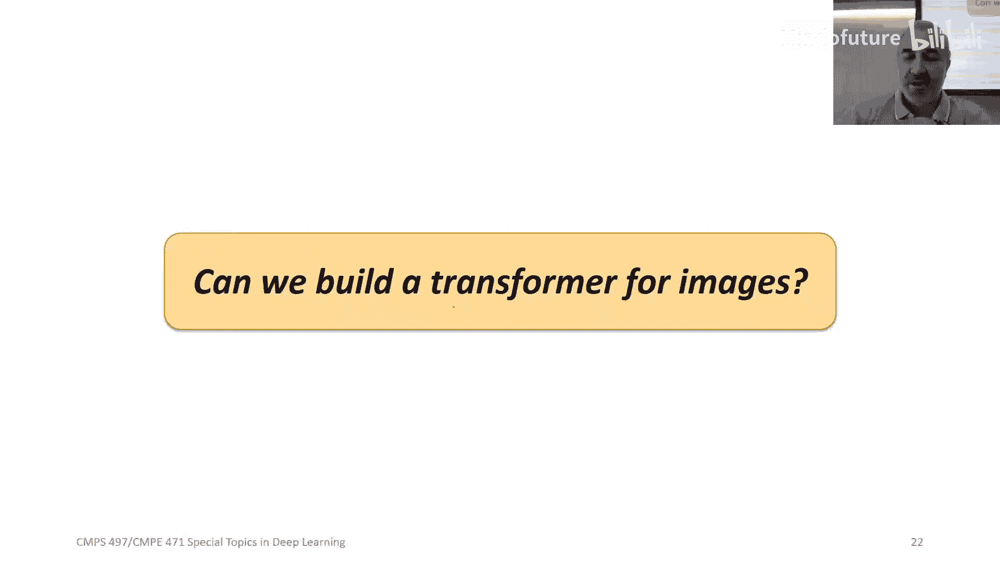

Okay。😊，So what is conversion neural networks what is the。The objective。

 the objective is to have specialized neural networks to process images。

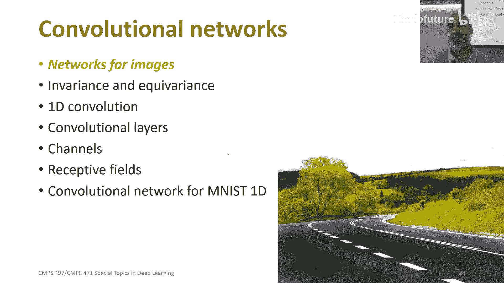

ok。系。What are the tests for which we process images the are many tests right one of them is image classification we want to know。

What is in we want to classify that image here to be a bicycle。

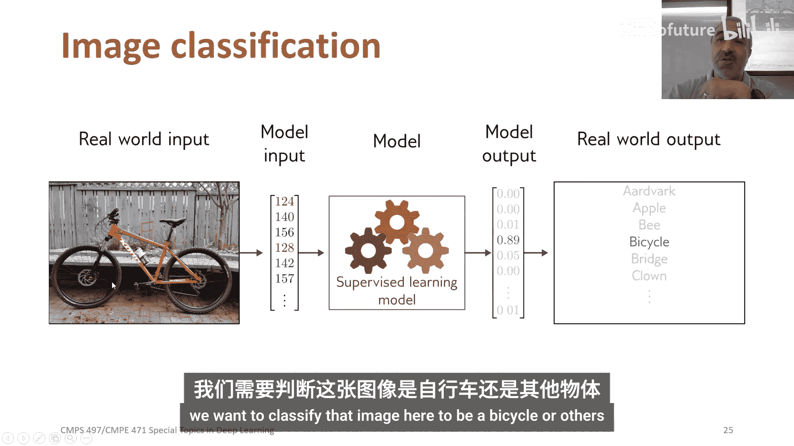

Or others？Another task is object detection， we want to detect the objects within the images。

 so here we have two persons and the horse and so on。

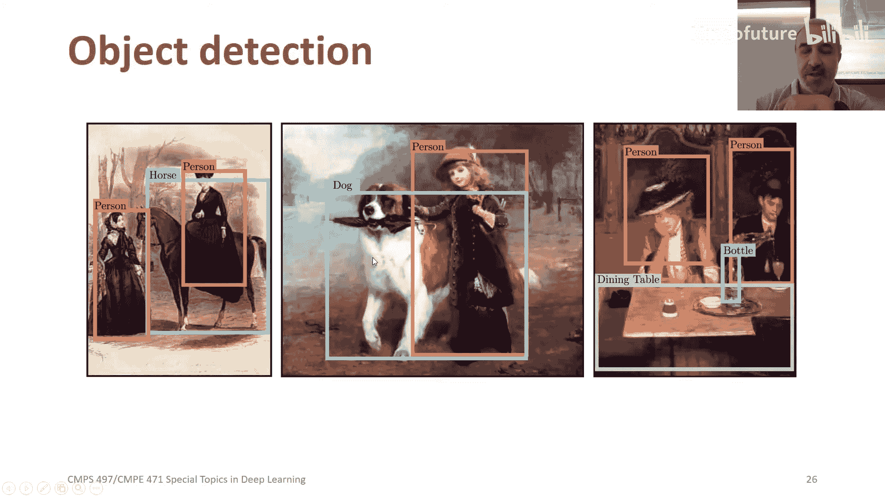

A third is image segmentation and we saw an example like that before。

 we want to know for each pixel whether it belongs to the background or the foreground。

And so many examples where the input isnt。

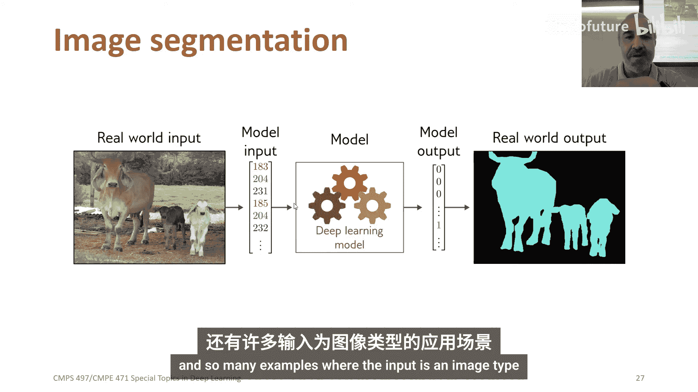

Tpe the question。I think the simple question is why do we need a specialized network for images。

 why don't we use fully connected networks， the networks that we already studied before。

What's the problem anymore， Why do we need specialized models？Especially for images。

Why don't we just？Get a vector of pixel values Okay， so transform all the pixels。

 all the values of the pixels in the image into one vector， maybe long vector。

 but it's one vector and then feed it as feature vector to the neural network right and use neural networks。

当这个。Because there are dependencies， of course， there are some properties about injuries。

 but even before that， if we if we just ignore this。The size is a big issue。

The size of the natural could be education， and let me give you an example。

If we process only small images like 224 by 224， this is very small images。😡，ok。😊。

This is by itself if we make it， if we make one vector out of this is and of course we have three for each pixel we have three colors。

 right， red， green and blue。We will get 150，000 dimensions and the size of the input vector is 150。

000 values。 Okay， that's just the input size。 Now， if you provide hidden layers with the same size。

 just one hidden layer。The weights between the hidden layer and the input vector。

 the input values will be。The square of this， right？So 150 times 150， which is by itself。

 is 22 billion。😡，パ라 입니다。In one layer。Just one day。Forman， this is too much， this is not practical。😡。

Because this is just one hidden there， if you add more， then you have more parameters and this is。

For processing even small images。If you have larger images， that would be， that would be even bigger。

 So that's not practical。Another thing that you just mentioned that pixeles are。

Related pixels that are close to each other in the same neighborhood of each other。 They are related。

 Okay， so there is if with with the fully connected networks。

 there is no notion a notion of of relatedness between the input features the neural network in general doesn't doesn't relate。

Or doesn't give any attention to the fact that pixels that are close to each other are related。

 They are not very different。诶。And you can， you can think of。

Think of that by thinking about any object that can appear in the in an image。 And， for example。

 an image that has a chair。Okay， in one position。If you。

Change the position of the chair to another position。

The network has to understand or has to learn the patterns in every position of the image to detect that this is a chair。

😡，Although it's the same thing。RightIt's the same chair in everywhere。

If you change the orientational damage or if you translated a little bit。

 then the network has to really understand that these are things that are different， I mean。

 getting it in different input training examples so that it can learn that these things are the same。

Because it doesn't have any notion of how images are actually structured。So that's a problem。

 that's why we really need something that is specialized。

So as I said that we need something that is table under geometric transformations if we did some transformations to the image。

 then we don't need to train a new network。So we really need specialized networks for。

Prossescessing images。The one that we will study in this station are called convolutional networks。

Convolution networks have two main attributes。 The first one is that it look really to the neighborhood。

 Okay， so it only look at local patches of the image。So， it makes sense of。

Local neighborhood within the image。Not the whole thing。And apply that everywhere in the image。😡。

So if it has a pattern that detects that this is a chair。

 it doesn't matter where in the image the chair is， it will detect the chair。

 or it will learn that this is a chair。Okay， and we will see how this is， this is done。

 But this is very important， Okay， because other otherwise， we need lots of。

Tining examples to show different orientation of the image so that that network learn from that。

And another attribute which iserd is that we need to share parameters across the whole image if we learned that this part of the image。

As a chair， we don't need to learn it somewhere else。

 it's the same thing that can be shared and applied on the entire image。

So sharing parameters is very important， and we saw that in transformers。

And looking locally in neighborhoods is also very important。Questions。嗯。My question is， like。So。

 the competition。An idea they're used to recognize。No， no， no。

 it can be thin to do any task on images。But but these are general features any in any image。

 right any images， what I wanted to say here is that。😡，Images。

 depict pixels in images are not random。The are structure somehow。

 So we want a model that understand this that that assumes that this is an image。

 It really understand what an image is to some extent and use that to re it。Okay。

 it applies that neighborhood yeah， you see how。 We didn't talk about how yet。No， no， no， no， no， no。

 no， no， do see how we do that。Okay， any other questions？

now we will now start to talk about two properties。

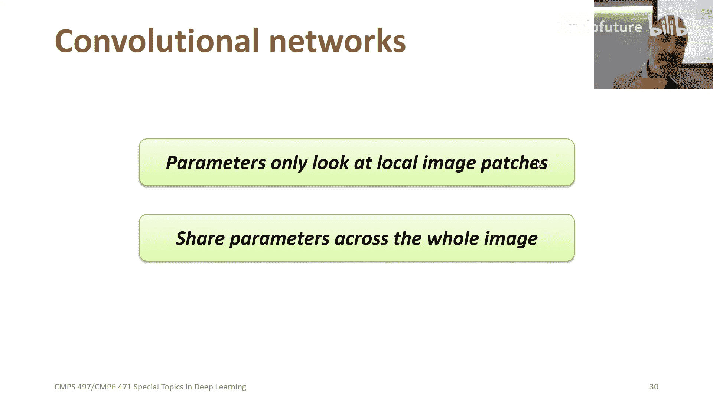

That we would like the model to have。 at least one of them will talk about about that property and then we'll talk about how we actually how actually conversion networks work。

So the two purposes are called in variance and equivari， what do we mean by that？😊。

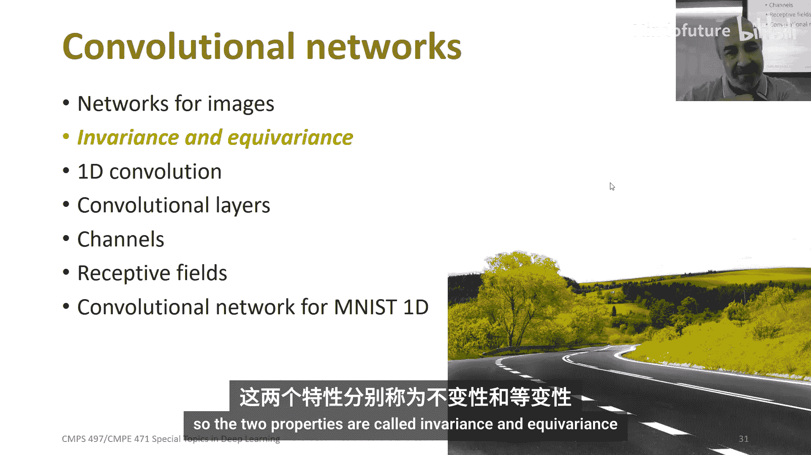

Invariance means that if I do a transformation to an input。😡，The model。Output should not change。

That's that mean that this property。Is called invariance。Okay。

 so a function is invariant to a transformation if。The output of the function。

 given the input is the same。If we actually do that transformation today， what does that mean。

 let me show you an example。This image has a mountain right， so if we are doing image classification。

 this is a mountain。😊，if I shifted， if I did translation to that image a little bit to the left。😡。

It's the mountain， right？St mountain， So I want the model that I will train for image classification to be invariant to translation。

Whatever transition you will do。Then the output should be the same， should not change。

 So the image has been translated， but we want our classifier in this case， to give the same result。

 This is called invariance。Okay， so the model is invariant to the transformation that we did to the input。

That's for the image classification in particular， Yes， okay， but in another task。

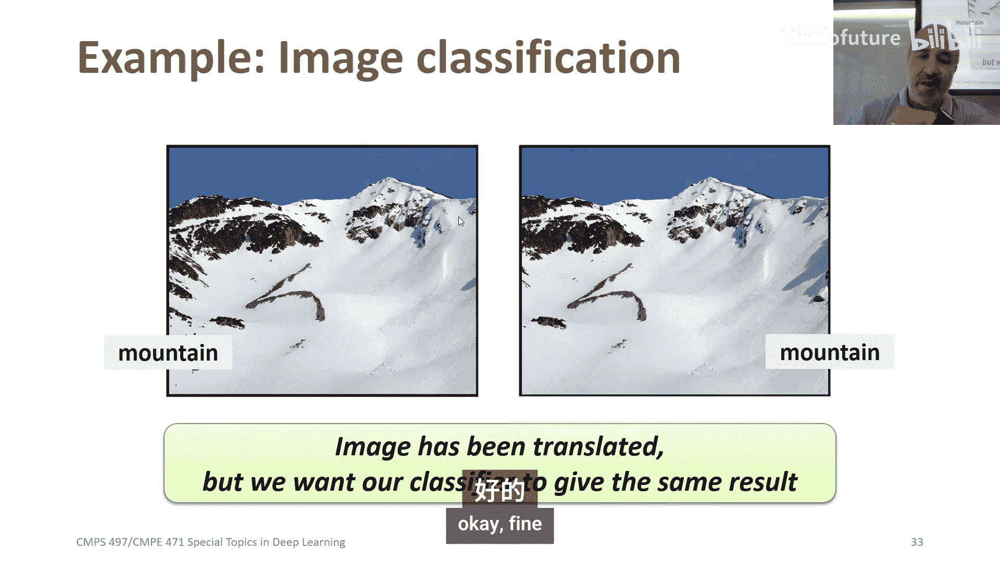

We might want the model to be equivalant。😡，What we were equivalentvalant。

If I did the translation to the input。😡，The output should not be the same。

 The output should be translated， also。And if I did transformation to the input。

The output should be also transformed。So if I apply the transformation to the to the input。

 the output of that。Model should be the same like if I applied it to the。

The original input and then do the transformation。let me show you an example。You look， this is。

 this is image segmentation task。 imageage segmentation means that for each pixel。

 I want to give it a class。 Okay， whether it belongs to that object or not。 So images。

 pixels of the same object would have the same。Glass or same color。Okay。

 if you look carefully to these two images， you will see that this image is a translation of this to the leftor。

So the bottom one is just shifting the top one to the left。Okay， if we are doing segmentation。

This is what we will do， what we will get。😡，This is theign of the original image， right？😡。

The segmentation for the second image should be exactly the same like the first the any big pixel by big pixel should be the same color。

 no， but should be。😊，Translated， okay， like the transition that happened in the original image。Yeah。

Okay， so this is called equivariance。This is not in variance because the output will change。😡，Okay。

 but it will change in the same way the image changes it。😡，Yes。This。

But that's not a classification problem。This is image segmentation problem。And我。

They classify the model here is doing image segmentation tasks。So for image segmentation task。

 we want the model to be equivalent。😡，Not invariant because if it's invariant。

 you will see that it applies the same colors here to here exact pixel by pixel， and that's wrong。😡。

Okay， that's long。 In this case， In image classification， we wanted to be in。Okay。

 so models can be invariant， can be equivariant based on the tasks okay。

And you will see that we want the model， the network that that we will build soon to be equivalent to the translator。

😡，Whatever translation happening in the in the input。

It should should be automatically happen to the output。Okay。

 so image here has been translated and we want segmentation to translate with it。

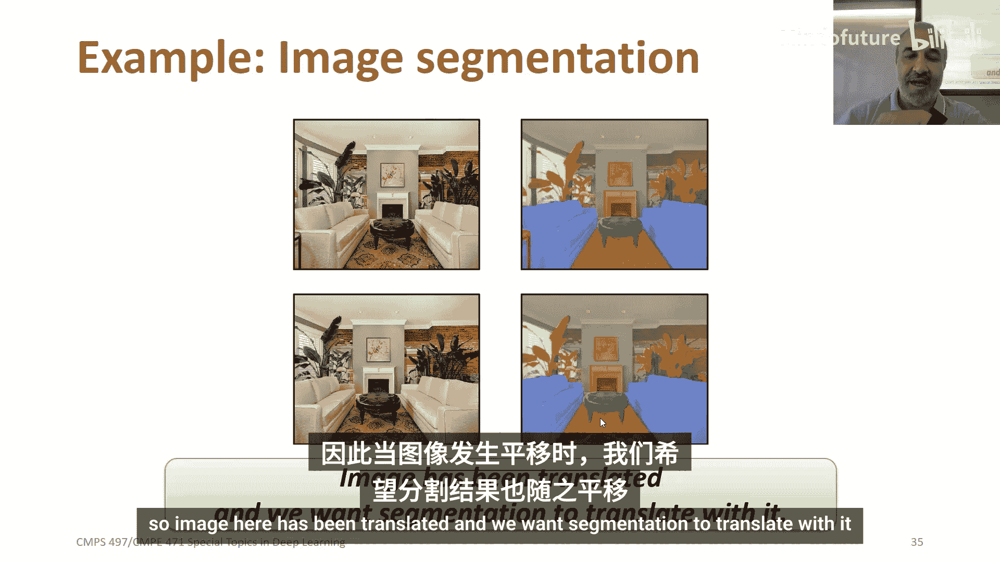

ok。Now we will start talking about commvolutional networks。Okay， so convolution networks。

All special type of neural networks。Okay。😊，It also consists of series of layers。

 but we call the layers here convolutional layers。Okay。

 so Compvol network is series of convolution this。Each layer， as you will see。

 is equivalent to translation， so any transformation。

 any translation transformation that you do to the image。😊，The output will be translated。

Automatically by default by by structure， as， as you will see。Right now each layer。

 each convolutional layer。Is based on what we call a convolution。オペイト。Okay convolution operator。

 so network con network is series of convolutional layers。

 and each layer is based on convolutional operators。

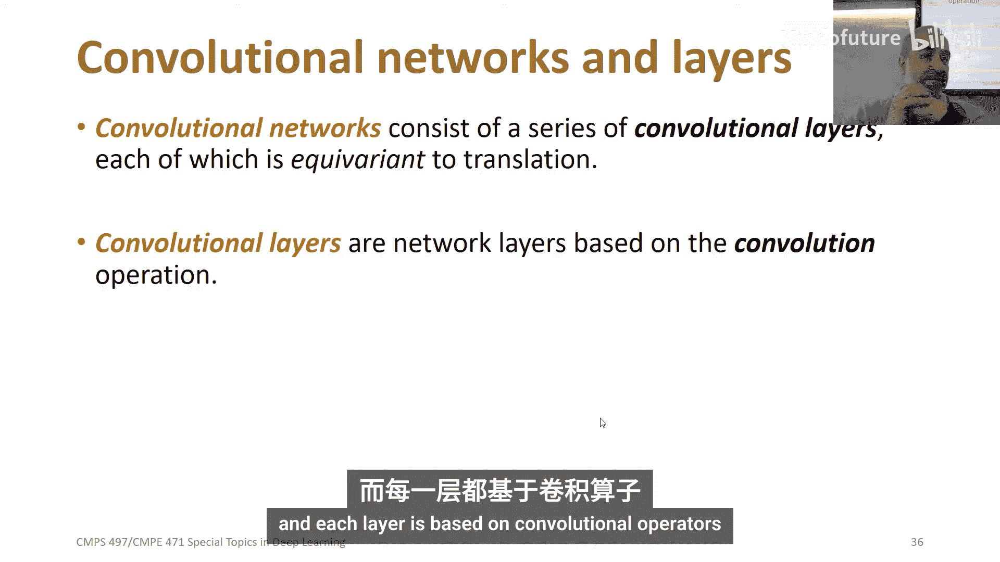

So what do we mean by convol operator， we will start with the simplest one okay but it has all the concepts that we can extend to the other ones we'll start with what we call 1 dcomvolution。

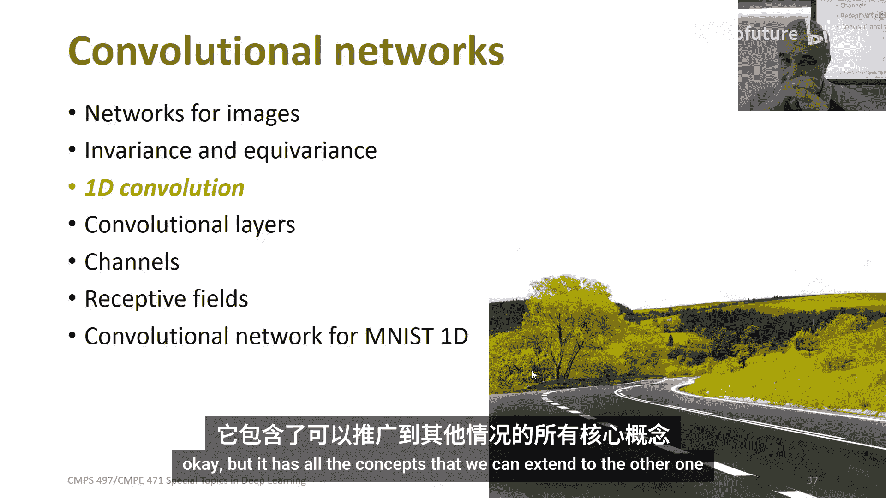

Okay， what is one decomp？Now。Oh。For for now， forget about images okay of course the context is images and we will see okay。

 but for simplicity just think about a sequence of input that is an input vector。😊，X1， x2 up to X I。

And we want to do what we call convolution to that sequence。😡，To do the con to that sequence。

 we use what we call convolutional kernel or filter。Okay。

 that filter is defined by a sequence of weight。A sequence of weights in what you see here。

 the example is that we have just three weights。So we call this a kernel of size 3 or filter of size 3。

 So the size of the kernel or the size of the filter is the number of weights in that in that filter。

 Okay， and in our case here， the filter is just a vector of weights。Okay， with me so far。

So in convolutional operator， we have input sequence。And we apply to that sequence。

 We apply a kernel oil effect。We didn't say have yet。 Okay， but that's the kernel of the filter。

 And the size of it is 3。 Now we will apply。This kernel of filter。

To every neighborhood of that science。😡，Of in a region a specific region， not exactly of that size。

 but in a specific region， so every in the image， we will apply that filter to it in a way that we will specify in the next。

😊，第。Actually， in a way that we specify here。What the filter means or how the filter is applied is that we will get awayed sum of neighbors from the input sequence。

If we apply this filter。Cented at the element number I in the sequence。

 then that means that we will multiply W1 with the previous value w2。

With the value that we are centered at now and W3 to the next one， let me show you an example。

This is the input sequence。😊，Let me change this。This is the input sequence， okay。

 let's assume that the input sequence is x1 up to x6。😊，Okay。😊，And we have a kernel of size 3。

 so we have three weights， W 1， W 2， W 3。 Now this kernel of filter is centered around x2。

So that means that w1 will be multiplied by x1。😡，W2 will be multiplied by x 2。

 W 3 will be multiplied by x 3 by x3， and then the the or sum together to provide one value of the output。

开个烧水嗯。Because the filter has to be applied in the sequence， so this vector is of size 3。😡，Okay。

 so it will be applied to every region， as you will see， this is just one step。 Okay， so wait。

 wait a second and you will understand。😡，So， this。Kil applied centered at K2 and at X2 will provide Z2。

In the next step， it will be applied syned at x3。And will provide Z3 and then apply synt x4 will provide Z4 and so on。

 So applying it， applying it。In a sequence like that， we provide a sequence of output values。Okay。

 and you understand now how each of these values are computed。 It's way the thumb of the region。

At which the filter of the kernel is applied。不。Okay， you can because this is 1D。

 so it's not 100% mapped to the image， but if you think that the pixeles are in 1D， yes。

 these are the values of the pixeles for now。Okay。No， no， no， the output is values。

 we are processing it in some way， so the output will be just numeric values。😡，Okay， yes。Very good。

 very good question。 What about the first of， How can we apply the kernel center that X1。

 right to get Z1。 There are many ways。 Okay， One way is called0 padding。

So we assume that the missing values are zeros。😡，Okay， and in this case。In this case。

 we so it's like this is not used W1 in this case it would not use and it will be x1 w2， x2 plus x2。

 w3。 this is called0peddding， so we read the positions that are beyond the end of the input as U same for z6 right？

Sa for these6， we assume that there is a zero here。Thank。Yes， not by by W3 in this case。ok。

This is one method， another method。😡，Is to only apply at the valid positions。So。

It will be applied centered at X2 that will be provided Z1 now。

 and then Z2 and then Z3 and then Z4 and will not be applied syn。

This is called valid convolutions because it's only applied at the valid positions。

And as you notice in this case， what will happen to the output？It will be reduced， Yes。

 so zeropadding will will provide the same size of the input。😡。

The output will have the number of output values， the same like the number of input values。

 but valid convolutions will reduce the output size。Okay。Yes。😊，O。嗯。啊对。嗯。will increase the size of。

Does that mean we increase the number。人家都是。那你是。嗯。Re like the the relation of them。 Yes， yes。

 we want to relate more more。 Yes， that yes， you can。 But this can also be done over layers。

 as we will discuss later。ok。Because these filters will be done in series of layers。Okay。

 so you what idea here， of course the filter doesn't have to be of size3。

 this is just an example it can be of any size， usually it's odd。😊。

Yeah oh yeah oh's that's exactly what I just mentioned。

 yeah its it's odd so that it can be centered at one pixel at one input。😊。

The note here is that this operation by the way， if you think about it。

 it is equi to translation right， because now if you think about it， if I change the input。

 if I translate the input a little bit one value down the output would be one value down。

 if I set it up would be up so this is equivariance here。😡，Okay， by definition， by structure。Good。

Nice。Okay。Type now there are more details on that Okay， more hyperpowers， by the way。

 the widths here are learned， you will talk about that later， but the widths here are the parameters。

Okay， the wait here are the pan。Yes。I mean I guess everything works。Okay。29。Yes， of course。

 they are genetic， yeah。Yeah， but you came back in and we didn't see the whole picture yet。

 but with the whole picture it will be a network， you can turn it that or whatever task you want for。

😊，like this feature of theYeah， it's for any image。Still， we didn't apply to 2D， by the way。

 it's just 1D so that it would be simple， but you will see it in 2Ds。啊。Like。

Taskks that if you transitioned it。We it's not the same啊。Then as any model。

 it won't solve all the problems right， maybe it will not be good for that task。😡。

It doesn't have to be good in everything， right？But you can train it for that task。Okay。

 let's move on and then we can think about this later。Okay， now， as I told you。

 there are more details on that， so there is something called the slide。

Which is how we shift actually the kernel， the filter right in the previous night。

 we only shift the kernel one position， right， but that can be a parameter。😊。

The parameteral code is that slide， the number of positions we shift when we shift the filter。Okay。

 and as we increase that side， the output will shrink。

Because we are like we are now we are getting less number of output values。

 Okay we'll see example for that。Yeah， for the example that we saw in the previous slide was the slide was one because we。

 we slide the filter by one。Value at a time， right， but this one can be2 can be3。

 and that will affect the size of the output。And the kernel size， of course。

 we talked about it and keep in mind that the kernel size is the number of weights that we use。Okay。

 that's， that's the。That's the kind size and so the inner size of five。

 that means that we have five weights， that means that we have five parameters。

The third one is called the dilation dilation means that we we might skip values any in between in between applying the weights。

 we can also skip values。In the previous slide， the di was 0。 We are not skipping any value。

 but we can apply di of one de of two。 That means that we apply the weight to that value and then skip one and then apply the second weight to the next one。

 and so Okay， so we see example in the。In the next slide and that， of course。

 can combine information from larger area。Instead of over the pixel。

 we can extend the focus on larger area of the input。Examples。This one。

The size of the kernelal is three， right because we have three weights。Right， die。

 How about the slide。我。as you see here， the output is Z 1， Z4 only right。

 So it seems like this applied to。To these three， this apply to these three。 So the slide is。2 here。

 not one。Otherwise， we will have a value here and a value here and the value here， right。Okay。

 you see that。H。ok。Then if the side is one， that means that we have one output value almost for every。

 especially with zero padding， we have one output value for every input value okay here we have one we have one and missing one。

 one and missing one right so it's like we are applying the filter but shifting shifting it two positions every time。

😡，Okay。这个。You want in the next website。Yeah。So to get this one。

It will be applied to x2 x3 x4 right and that that's what we have here Okay so yes。

 so Z2 is applying is go by applying。😊，The filter。Cented at X3。嗯。Okay， Z 3。S thatx5。

So it's like we are shifting that the filter is shifted by two positions every time we slide the filter with two positions。

 not one position。Okay， roughly when increasing the tide。The output output will shrink， yes。Okay。

 type y the direction is 0 here。😡，这是F36。YeahBecause we are not skipping any and when we apply the filter。

 we're not skipping any values， any input values in between。😡，Okay， for this one。

The size of the filter is。F because we have five weights， right？

And here we have one output for each input， so the slide is one。ok。With me。O，对 for this one。

What's the size。你啲。re why。Because because we have to do its， Okay。

 don't be fool by the size of the input that we are applying at。 Okay， it's the number of weights。

 That's the size of the filter。 And how about the side。One。

 because we have looks like we are applying it at every single input。

And the dilationary is one because we are skipping one in between every every two weights。

 so we are here， it's like we are multiplying this by zero。I must like this by0。

still the kernel sizes for me， but now it's applied to a larger area， it's applied to five pixels。😡。

Okay， instead of two。

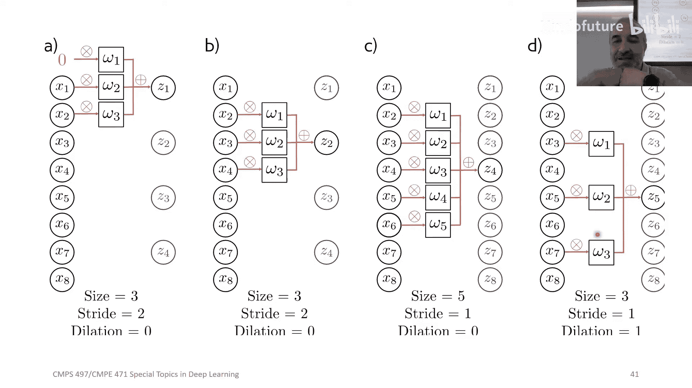

Okay， any question on that？So I think we are ready to now understand what we mean by convolutional layer。

😡，It is based on the convol and the the that the operators that we just discussed。

 but this will be the beginning of the next lecture same can。

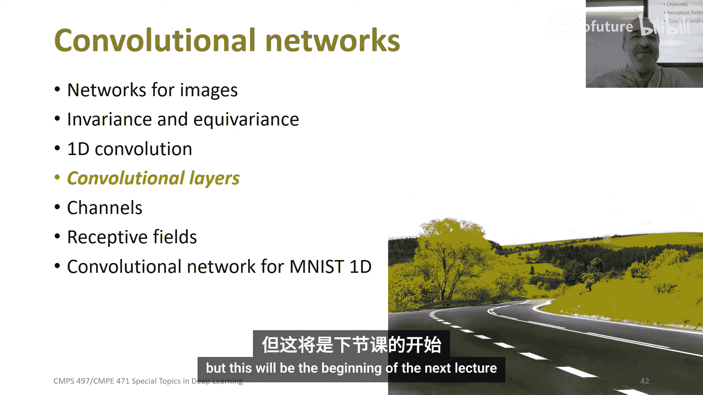