# 深度学习 CMPS497：P25：卷积神经网络 I 🧠

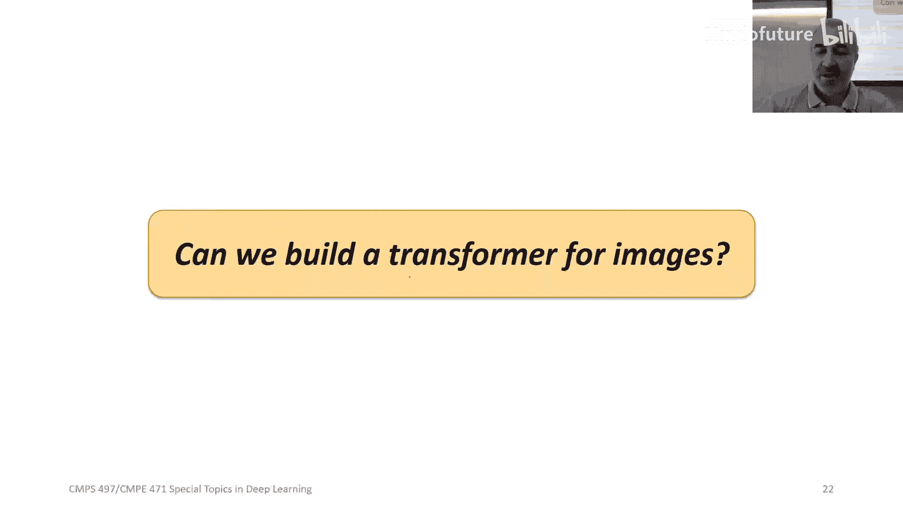

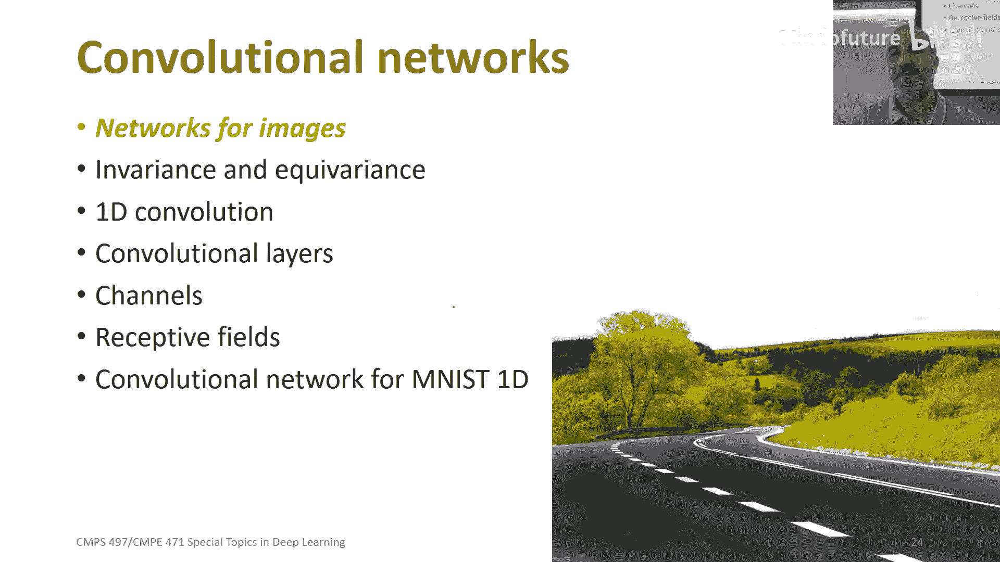

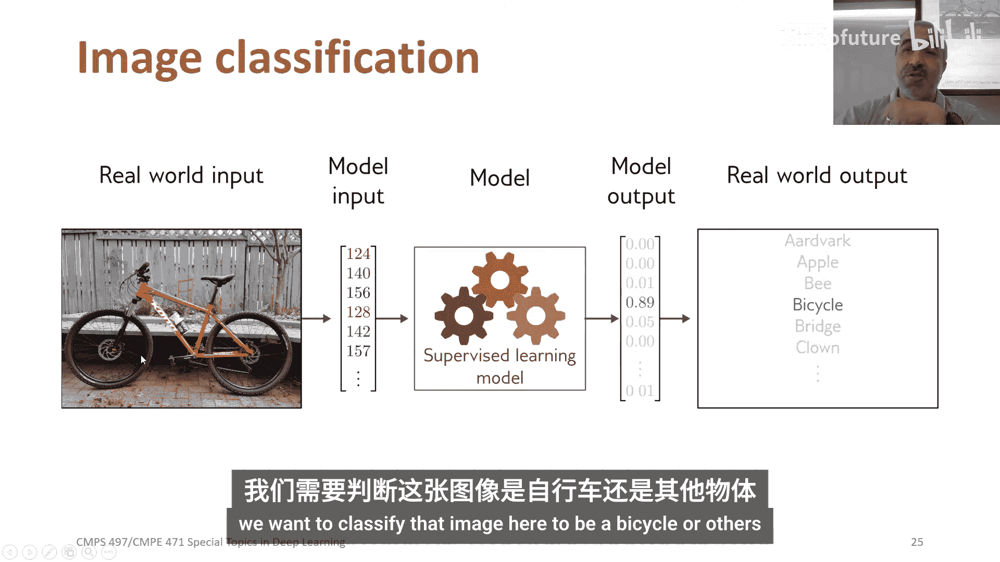

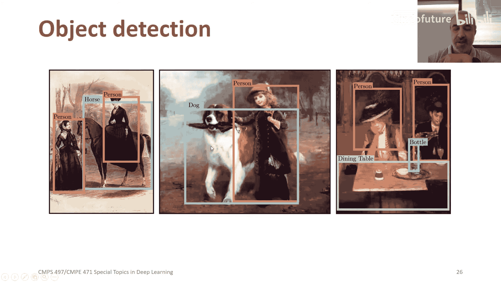

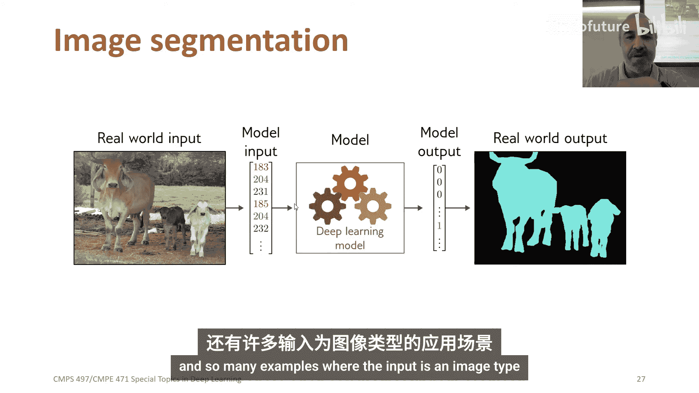

在本节课中，我们将学习卷积神经网络（CNNs）的基本概念。我们将探讨为什么需要为图像处理设计专门的神经网络，并介绍卷积操作的核心思想及其关键属性。

---

## 为什么需要专门的图像网络？🤔

上一节我们介绍了深度学习的基础。本节中我们来看看为什么处理图像需要专门的神经网络，而不是使用之前学过的全连接网络。

全连接网络在处理图像时面临两个主要问题：

1.  **参数数量巨大**：即使处理很小的图像（例如224x224像素，3个颜色通道），输入向量维度也高达150,528。若隐藏层大小与之相同，仅一层网络的权重参数就超过220亿个。这在实际应用中是不可行的。
2.  **忽略图像结构**：全连接网络没有考虑像素之间的空间关系。相邻的像素通常是相关的，但全连接网络将所有输入特征平等对待。此外，图像中的物体可能出现在不同位置，全连接网络需要大量不同位置的训练样本来学习同一个物体，因为它不具备**平移不变性**。

因此，我们需要一种能理解图像空间结构、并高效处理数据的专用网络。

---

## 卷积网络的核心属性 🎯

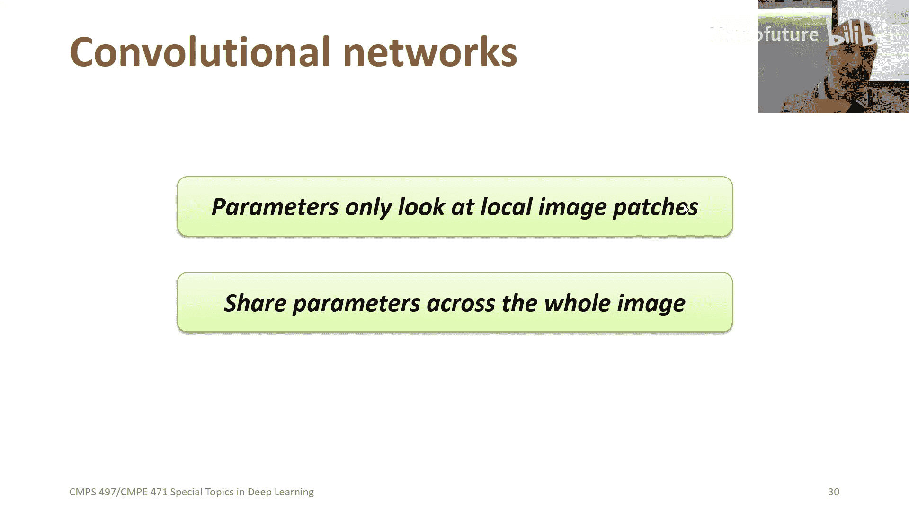

基于上述问题，卷积神经网络应运而生。它具备两个关键设计思想：

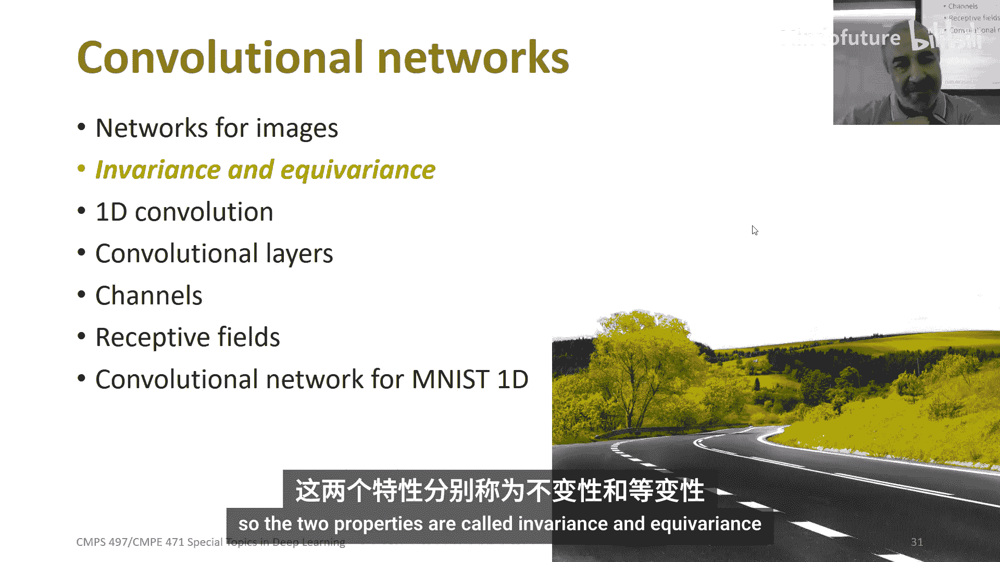

1.  **局部连接**：网络只关注图像的局部区域（小块），而非整个图像。这使得网络能够捕捉局部模式（如边缘、纹理）。
2.  **参数共享**：在图像的不同位置，使用相同的滤波器（或称为卷积核）来检测相同的模式。这极大地减少了参数量，并且让网络能够识别出现在图像任何位置的物体。

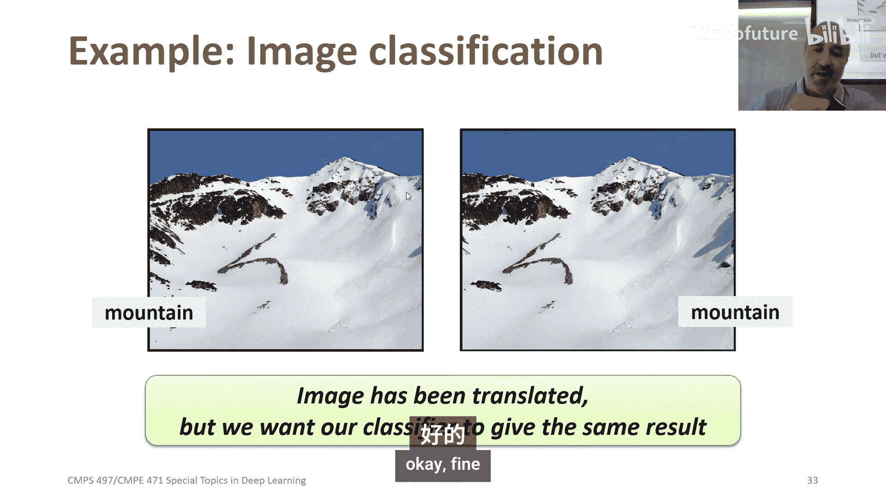

这两种特性使得CNN天然地更擅长处理图像数据。

---

## 不变性与等变性 🔄

在深入卷积细节前，我们需要理解模型应对图像变换的两种理想属性，具体取决于任务类型。

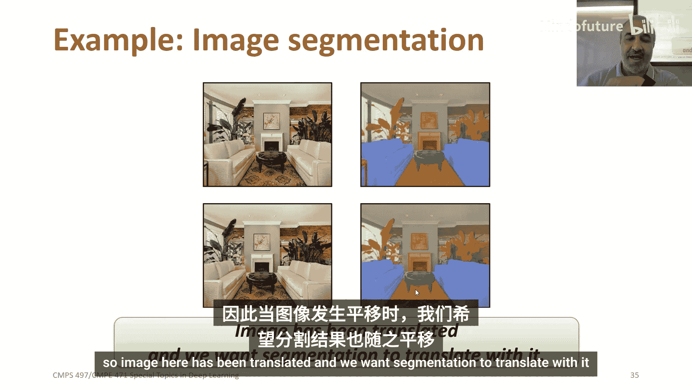

*   **不变性**：对输入进行某种变换（如平移）后，模型的输出**保持不变**。这在图像分类任务中至关重要。例如，无论一张“山”的图片在画面中如何平移，分类器都应输出“山”这个类别。
    *   **公式描述**：对于变换 *T* 和模型函数 *f*，若 *f(T(x)) = f(x)*，则 *f* 对 *T* 具有**不变性**。

*   **等变性**：对输入进行某种变换后，模型的输出**进行同样的变换**。这在图像分割等任务中非常重要。例如，如果输入图像向右平移，那么分割结果（每个像素的类别标签图）也应该相应地向右平移。
    *   **公式描述**：若 *f(T(x)) = T(f(x))*，则 *f* 对 *T* 具有**等变性**。

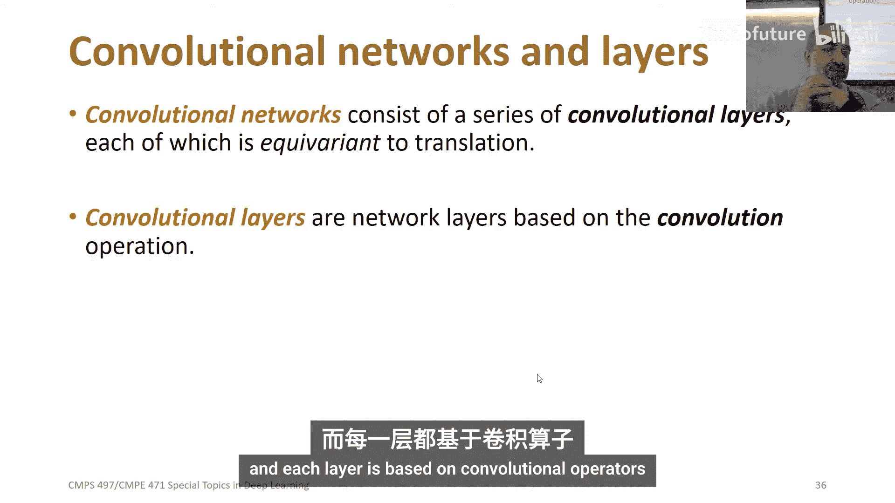

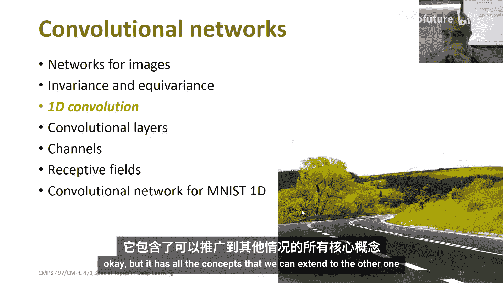

卷积神经网络的结构设计使其天然具有**平移等变性**，这是其强大功能的基础之一。

---

## 一维卷积操作 ⚙️

现在，我们开始学习卷积神经网络的核心构件——卷积操作。为了简化，我们先从一维卷积开始理解。

假设我们有一个输入序列：`X = [x1, x2, x3, ..., xn]`。
我们还有一个**滤波器**（或**卷积核**），它是一组权重：`W = [w1, w2, w3]`。这里滤波器的大小为3。

卷积操作的过程如下：将滤波器在输入序列上滑动。在每个位置，计算滤波器权重与对应局部输入值的加权和，得到一个输出值。

**操作示例**：
假设输入 `X = [x1, x2, x3, x4, x5, x6]`，滤波器 `W = [w1, w2, w3]`。
*   将滤波器中心对准 `x2`：输出 `z2 = w1*x1 + w2*x2 + w3*x3`
*   将滤波器向右滑动一步（步长为1），中心对准 `x3`：输出 `z3 = w1*x2 + w2*x3 + w3*x4`
*   依此类推，得到输出序列 `Z = [z2, z3, z4, ...]`

**边界处理**：
当滤波器滑动到序列边界时（如中心对准 `x1`），会遇到数据不足的情况。常见的处理方法有：
*   **零填充**：假设边界外的值为0。例如，`z1 = w1*0 + w2*x1 + w3*x2`。这能使输出序列与输入序列长度相同。
*   **有效卷积**：只在滤波器完全位于输入序列内的位置进行计算。这会使输出序列变短。

一维卷积操作本身具有平移等变性：如果输入序列平移，输出序列也会发生相应的平移。

---

## 卷积的超参数 ⚙️🔧

一维卷积操作可以通过几个超参数进行控制，这些概念同样适用于后续要讲的二维图像卷积。

以下是控制卷积操作的三个主要超参数：

1.  **卷积核大小**：指滤波器中权重的数量。它决定了每次查看输入区域的“视野”大小。通常使用奇数大小（如3、5、7），以便有明确的中心点。
2.  **步长**：指每次滑动滤波器时移动的步数。步长为1是常见选择。增大步长会减少输出序列的长度，类似于下采样。
3.  **膨胀率**：指滤波器权重在应用时，对应输入值之间的间隔。膨胀率为0或1表示处理连续的输入值。增大膨胀率可以让滤波器在不增加参数数量的情况下，覆盖更广的输入区域，从而捕捉更大范围的上下文信息。

**代码描述**（概念示意）：
```python
# 伪代码示意一维卷积操作
def conv1d(input_sequence, kernel, stride=1, dilation=0, padding='zero'):
    # kernel: 卷积核权重列表，如 [w1, w2, w3]
    # stride: 步长
    # dilation: 膨胀率
    # padding: 边界填充方式
    output_sequence = []
    # ... 根据参数实现滑动、加权求和 ...
    return output_sequence
```

---

## 本节总结 📝

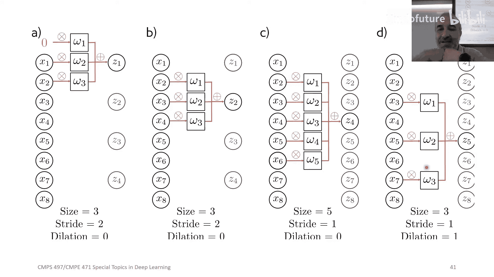

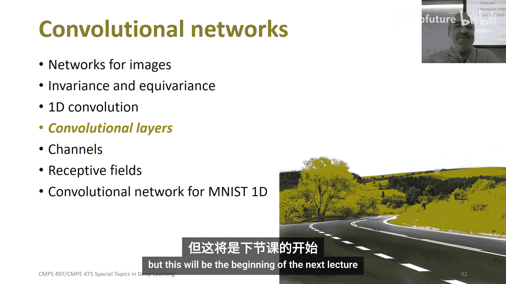

本节课我们一起学习了卷积神经网络的入门知识。我们首先探讨了为图像设计专用网络（CNN）的必要性，它解决了全连接网络参数过多和忽略空间结构的问题。接着，我们介绍了CNN的两个核心思想：**局部连接**和**参数共享**。然后，我们区分了模型应对图像变换的两种理想属性：**不变性**（用于分类）和**等变性**（用于分割）。最后，我们深入讲解了**一维卷积操作**的基本原理及其关键超参数（核大小、步长、膨胀率），这是理解后续二维图像卷积的基础。在下一讲中，我们将把这些概念扩展到二维图像，并构建完整的卷积层。