# 【卡塔尔大学】深度学习 CMPS497 ｜ Understanding Deep Learning ｜ Fall 2024 p26 P26_第二十三讲-CNNs II -BV1vQvNz1EeK_p26-

S last time we started to talk about convolution neural networks， we talked about 1D convolution。

And with the parameters that we have with it， which are the slide， the kernel size and the dilation。

 and I think we stopped at that slide with these examples so we me。

We talked aboutvol D convolution and kernel， which is a vector of weights and these weights are applied to a specific region of the input。

We computed the weight weighted average of the values of the input。

 and that will be a value one value on the output， and that kernel is shifted by the value of the side over the 1D input。

And we also mentioned that at the corners， there are special cases when when the coon is。

 for example， when the co is centered at that point。Then we have two options， one is to add zeros。

Which we call it zero padding。Or we can strict the application of the kernel to only valid convolutions。

In that case we will not produce we will not apply the kernel centered at x1。

 but we will start applying the kernel centered at x2 and so on。

 so we will not have ones at the corner。And。We talked about the stride and the kernel size and the dilation and if you remember the examples here。

 this is a kernel of size 3 applied to the regions of the input this is the same kernel and in applying this kernel we have a slide of 2 because we have here values that are not computed so we actually shifted the kernel here by a value of 2 so the slide here is 2 and then for the next for the next step so initially we centered it at x1 here it is centered at x3 because the slide is still2。

For that example， we have a kernel of size 5， so we have five weights。

 it is applied at a region of five values。And the slide here is one。Right。

 how can we tell if the slide is one or2 here？Thank。The shift。

 so you see that the output values are almost the same in terms of number。

 like the values in the input， so that means that the kernel is shifted by one。In the last example。

We can see that the kernel is applied at additional five values in the input。

But we have only three weights， so the kernel size is3 here。

 but the dilation is one because there is we are skipping one value in between each pair of weights and I think this is exactly where we stopped last time。

Now， after we discussed what we mean by 1D convolutional kernel。

 let's now talk about convolutional layers。

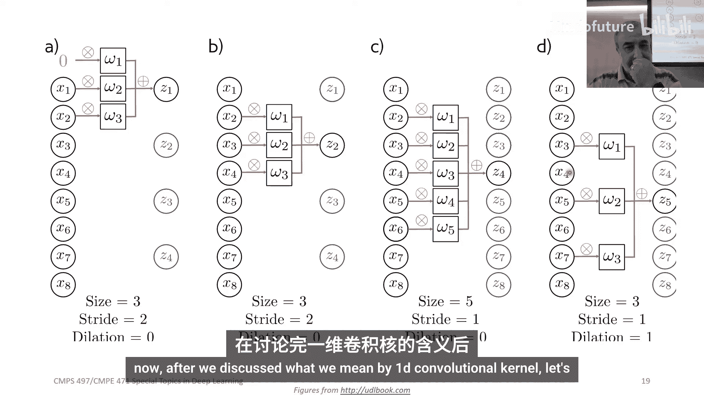

Okay， how can we have a layer out of the kernels？

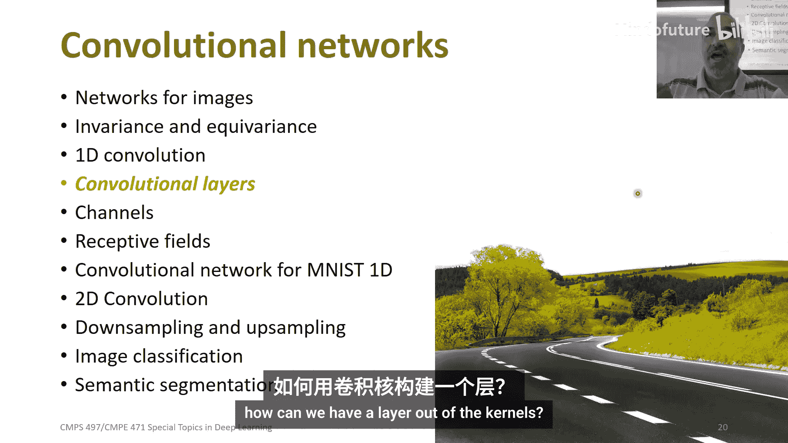

The idea is very simple and we are very familiar with it。😊，We will apply the kernel to the input。

To the origin， to the original of the input， we add a bias。😡。

Applying the kernel means what means the weighted sum， right， we will compute the weighted sum。

 apply add the bias and then apply the activation function。

 So exactly like what we do in standard neural networks。Right。😊，So we will do the weighted sum。

 add a bias， and then apply an activation function。And we do that。Over every region in the input。

So in equations， you can see that this is the weighted average。😊。

Applying the kernelial center that Xi。Then we add the bias， Then we apply the activation function。

 which is also commonly the radio function or any activation function。Okay。

 so that that's now a layer。That will produce one complete column of hidden units。Okay。

 now we can call them hidden units because they are very similar to the hidden units we talked about before one。

T this can be seen first before we compare it with the fully connected network。😊。

You can notice here that the。The computation of the hidden unit number I。

We apply the kernel with W1 W2， W3， and then this is here have nothing to do with I。

 which means that the same kernel as we did as we saw before。

 the same kernel would be applied to produce different hidden units。Okay。

 so it's the same set of parameters， same kernel will be shared across the entire input。And also。

 the bias is。IIs independent of the you。 So it's just one bias。

 So out of this operation or this layer， we only have3 weights and one bias。If we have just one good。

Okay， so the entire data just just has four parameters， three weights and one bys， of course。

 if the kernel size is3。Compare that to a fully connected network。

 you can see that it is a very special case of a fully connected network。

In fully connected network we have for each hidden layer， we have this equation。

 right you saw it I mean so many times before right the weighted sum plus the bias applying it to the activation function。

 but here the weights are different for every hidden unit。😊，Okay， remember。

 the hidden unit has incoming weights and these weights are not shareded across the different hidden units。

 So that's a big difference。 So for for one layer in a fully connected network， if we have the。Wes。

 the inputs and， and。D hiddenating units。Then we will have these square widths between the input and the first hidden layer。

 if we have D here and D here， then the number of widths is d square。Right。

Compare that with what we have in a convolutional layer。

It doesn't actually depend on the number of inputs。It just depends on the size of the kernel。

So the number of parameters here is much less than the number of parameters in a fully connected network。

Right。😊，Okay， now let me show you an example。This is。If fully connected。咩啊。Okay， so we have an input。

6，6 inputs。And we have a hidden layer of six units。The number of units。

 the number of weights between。These two layers is what。6ix times6， right？6ix times6。

 which is presented by thematics down here。Okay， so this matrix。

 the colors here indicate the widths than the different widths， so we have 36 different widths。

For one， fully connected layer。Right， now。This is an example of a convolutional layer。

Applying a kernel of size。Can you tell the size here from that figure， Can you tell the kernel size？

From that figure。So let's take this unit。😡，This unit is a weighted sum from x 2 x3， x4， right。

 And you can see H4 still also await weighted sum of3 node and so on。 So the kernel size here is 3。

Okay， how about this slide。It's one because we are shifting having the same size of the input okay。

 so let's try this one about diition。Zal， because you can see that we are not skipping any anything within within the kernel。

 Okay， now this can be。Represented in the matrix here。So， for example， H3。Is awaitted sum of x 2。

 x 3， x 4。 So H3， H3 is awaited sum of x 2， x 3 and x 4。Okay， h4 is a sum of x3， x3， x4 x5。

And notice that the colors here are exactly the same across rows， right， Why is that。

Because it's the same kernel。It's the same kernel， okay， so over all of these matrix。

 we only have three different weights。😡，But the earth repeated because we are applying the kernel to every region。

While in the fully connected layer， all of these weights can be different。So we have six square here。

 we have just three weights here， come one plus the。

so you can clearly see that the convolutional layer is a special case of the fully connected network right。

 so you can think of it as a fully connected network， but most of the weights are0。😊，And actually。

 the widths also are similar across different hidden units。听 a。So it's a very special case， yes。嗯。嗯怎。

哎，早班。there。对。这个呢。Who was did before like in for some Olympic。Yeah。

 so here we are applying zero heading， right。 How can we tell that。你都是。

Because you can see that these are only two right although that's the kernel size is three and you can see that also from thematics okay it has only two weights and the third one is not there so the third one is seal。

There are methods that rotate， rotate the the input， yes。It's hyperplanmeter。

 can there's no any single rule for that。So you can tie0ped， you can tie valid combvols。

 this is rotated combvols。一间吓。Okay， here's another example。Where。What's the size here of the kernel？

Why is it too。Three， right look at the majority because don't look at the corners the corners are they might be spatial cases。

 right okay， so don't look at the corners when you want to determine the kernel of science。😡，Okay。

 look at Haden unitss that are not at the corner。 So that's 3。 Okay， so it's the kind size is 3。

Are we do we have any dilation here？Are we skipping， No， we are not skipping about this thread？

We are not skipping within applying when we apply the kernel。

 we we apply it to a or the values in the region right we are not skipping between the widths Okay。

 how about the slide here。😡，One because we shift two actually we shift2。

 so this one is center that x1， this one is center that x3 okay and this one is a center that x1 and how about patting do you have zero patting here。

Yes， we have zero fdding。 How did you know。Because this has， two values only here。

 and you can see that also here。This one has two only。

 which means that there is a zero here for the non existing elements。Okay。这。

The site is two is2 actually， oh， it's it in one， no it's2。Okay。Yeah。Any question about that？Again。

 this is a special case of a fully connected networker。😊，So a fully connected network in this case。

 how many weights we should have？And if we have input like that and hidden units like that。

 how many widths we would have？How many weights in between these two layers。

 six times3 right it's fully connected， so we have widths between all the nodes right so we would have six times 3。

 which is 18 here。 we have how many weights。Just three because the kind the size is three。对。Com on。

 we have only one bias here okay in fully connected network， how many biases we will have。Three。

 because we have three hidden unit side。The。

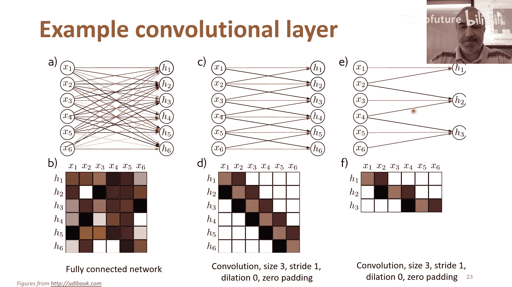

Exactly。ok。But let me now ask。For this。What is the kernel of size？What's the slide。

What's the dilution。Do we have zero padding or valid computations？The3。Size is。5， right。

 because we have five incoming。Weights here and you can also tell from the from the matrix side from the matrix it's clear size is5 type how about the slide？

😊，If you look at the matters， can you tell what the threat is？Yes， hell。We do。

Because we are shifting you， we can look at the weights here。

 they are shifted with every we are shifted by one right， so the side here is one。Right， okay。

 and you can tell it also from the figure， right？放在那种开哦。

Look at look at the exact widths so h3 here is centered at x3， H4 is centered at x4 and so on， right。

But how about So we talked about diation。 Oh， no， how about diation。Are we skipping any。你这。

We are not right。 We are not skipping between the weights。

 We are not skip any elements of the input right so the addition is。0。

How about the zero padding versus very very comm which one we are using here？0。

 because the first one。The first one has only three， right， So the remaining two are zeros。Same here。

 for for this padding or value conversions， look at the corners， right。

So the corner cases here we have only three weights instead of five， right？

So the other ones are zeros。Yes， yes， because it is that the size is is 5 right。

 so it has to to add also0 now these are considered now con cases also。Yeah。

Here we have here we have four here here we have the。Zero pa think。Yeah， because in this case。

 we will produce the same number of input units。OkayIf you want to keep the same size。

 then zero patting is the solution。Special cases， you have to handle them somehow。

Because if you do the value combs， what will happen to the size of the output。

 it will be reduced a little bit。ok。How about this？Think before you answer。The size is。3， okay。

 straight。那我。王络猪。The side is about shifting the filter right the kernel right it's it's one here right you can tell from here you can also tell even easier from here。

 right。😊，How can how you can tell that story from here。

You can can see that this is like the kernel right。

 these are the widths of the kernel you can see to compute H4。

 we shifted the kernel1 element right one position。Okay， so。So the slide here is one。

How about dilation。来点信。Here， we are not skipping， right？So if you look at this， it is x3， x4 x5。

 right， that's the division， so we are not skipping any of there。Of the values。

 are we doing valid the convols or zero padding？How did you think。两个。Re。Yeah。

 so so you can see that every everyone here has three weights， right？So three ways。

 it's only applied on valid inputs， we are not patting with zero here。Okay， any questions？About this。

Can the size is。谁又翻。The is is5。Because they have yeah， but the widths are 3。 All right。

 The widths are 3。So the size is 3， straight。我。One， because we are shifting by one dilation。😮，One。

 and you can tell it very easy here， right， these white cells are zeros。😊，Okay。

 so there are there are missing missing elements here right so the di is one and are we doing zero padding or value convols？

0opdding。 Why it's0dding because。You can see that this is3 on the earth。

 it's applied on region of 3 and its05。Okay， any questions。Okay。

 now let's extend the idea a little bit to what we call channels we are still in the convolution layer。

 by the way， okay， but what we have covered so far will produce one channel in the layer。

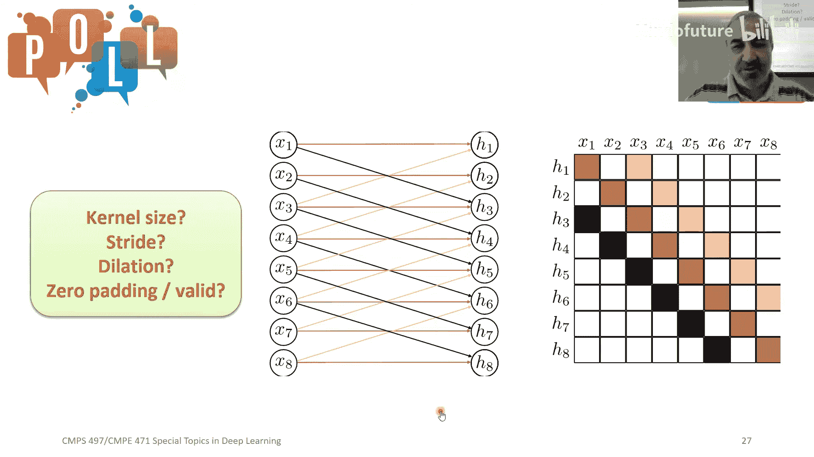

What do you mean by that？

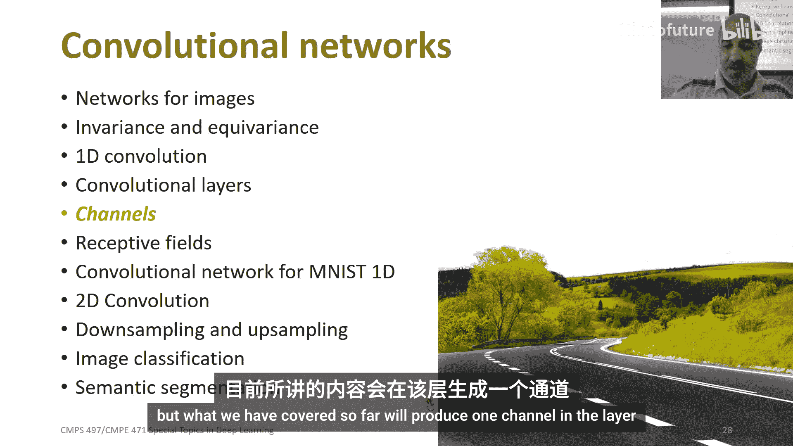

Or why do we need actual channels？Channels， as you will see， will be produced by multiple kernels。

 each kernel will produce one channel in the layer。Okay， why do we need to apply multiple kernels？😡。

Apply one can and only will make us lose some information。OkayWe are applying it to the same input。

 but it is just a very small number of weights that we learn one pattern。

 What if we want to learn multiple patterns from the same input okay。

 so well have to apply multiple kernels to the same input so that we can learn different patterns。对。

We'll do that with applying similar convolutions in parallel。Each convol。

 each kernel will produce one channel in the layer。

Does that remind you of something we discussed in transformers？Interformers。

Do we apply something multiple times in Til。Yes， but， but， but。More importantly。The heads。

 multiple heads， yeah， the multi head attention， right。

 multi head attention Okay because we want to to get attention in different ways。

 different representations of attentions by applying multiple heads。 Okay， this is a similar idea。

 actually this idea precedes the idea of transformers in CNNs there before even transformers。Okay。😊。

So we will see now that we will apply multiple kernels in parallel and stack them in channels。

 we call them also future maps， let's see how this is done。This is one kernel right。

 applied to the input， and that will produce a column of hidden units。 Now we call this a channel。

Okay， by applying one kernel to the input， we will produce one channel。Okay， applying another kernel。

To the same input。😮，We produce another column of hidden units。 We call that another channel。

So now in the layer， this is in the same layer we have two channels。 this is channel number one。

This is channel number two。Okay， so these are two channels within the same layer。

So every kernelal will produce its own channel。Notice that this kernel。😮，Is different from that。 Why。

 why I'm saying they are different。Because we have different weights。W1 w2 w3 here， w 4 w5 w6。

 of course this is applied to the whole input right to the all agents in the in the input so this one would produce channel1。

 which is this。And this one will produce another channel in the layer。Okay， with me so far。

So this is one layer with two channels。T what if we apply the third kernel？We have a third channel。

In thelay。So one layer can have multiple channels。好这。

How do you know how many units in one hidden layer before？Yeah。Okay， you got the idea now， right。

 It's a hypothet。Okay， we can change it。in terms of parameters。How many pounds we will have now。

They'd say that we have two channels in the output。How many pounds does we will have。And two yeah。

 it's， it's number of parameters of one kernel。Times。The number of kernels， the number of channels。

 if we have two， then we will just multiply by two because each kernel now。

 if if we have the size of three， each kernel will have three weights， one bias。Okay。

 the second kernel will have three wayss， one bias， right， so it would have double yes。We have。No。

 because channels of different sizes might that will will not be consistent you will any will have to have the channels of the same size okay it will make processing much easier if not then then it will be very hard。

Did they answer your question，The number of channels。Is。A hyperparameter。The this。

The size of the channel。The size of the channel is determined by the parameters we talked about the can size。

 the padding， the slide， the dilation。That will determine the size of that。

But the number of hidden units in each channel has to be the same。😡，Okay。Right。Yeah。

 so we can change。No。You theoretically yes， but but but changing the slide might lead to different sizes of the channels。

 right， And we said that the channel size will be the same。

 So they have to have all the same same canon size， same slide， same same everything。

 but different parameters， different weights and biases。I did there。 I meant to ask。Yes。

 should be the same。Yes。Yeah， but now if we do that theoretically yes， you can do that。

 but if you do that， then the meaning of the how each kernel is computed would be different okay so that's not done。

But theoretically UK as you can。对。The simple name。Not very sure， to be honest。 Okay。

 what I always see is that the， the kernel structure is the same across different channels。嘅。

Question。So again， the number of kernels。Is the number of channels in the leaf？It's like this is。

To create different output channels that can we have different of multiple input channels， yes。

Because remember it's a neural network right and you only do this stack of layers right。

 so this can be an this we can stack another layer after this layer。😊。

Which means that this layer now is an input to the upcoming layer。

 so the incoming layer can have multiple channels also。Let me show you an example。Here， the input。

Layer， the incoming layer has two channels。Okay， now。To apply a kernel。

It has to be applied to the same region， across。The input channels。Okay。

 so before we had just one input channel， right？😡，So we apply the kernel just to one region to one channel。

Now， when we have multiple input channels。😡，The colonel。

Will be applied to this region and that region， the same region across。😡。

They are different import channels。 It's like the depths for their kind。Okay， but of course。

 with different widths， so now the number of widths will increase。So now this。

Knel is still of size 3， by the way， because for each channel， we have three weights。

But now we have three weights for this channel and three other weights for that channel。

 and all of them be will produce just one hidden unit。Same with it song。And then one bias。

 and then the activation function。Okay， so before we had just one of these， right。

 we had just three weekss。😡，Now we would have six weekss because we'll apply3。

To the first channel and three to the second channel at the same positions。

 but across different channels。Okay， so basically we will multiply W1 prime by h2 plus w2 prime。😡。

By h3 plus w3 prime by h 4 plus w 4 prime times h 8 W5 prime times h9， W6 prime times h 10。Plus。

 the bias。And then we apply the activation function that all will produce one hidden unit。Okay。

 and of course， moving that kernel。We produce。对，没有。Not hidden there now， it's。

One channel in the layer。Because if we have another kernel， we' have another chart in the same layer。

😡，Okay， so the layer now has channels。That's the convolution layer。ok。😊。

So we can have multiple input channels and we can have also multiple output channels。

And they are different。 I mean， the processing， you have to understand that the processing is different。

When we have multiple output channels， that means that we have multiple。aiNo， goodness。

When we have multiple output channels， that means that we have multiple kernels。

 each output channel is produced by one kernel。😡，Okay。

 now this kernel will be applied to all input channels。To one region across all channels。Okay。

 one region across all channels。 So even if we have three channels here。

 we will have three nine widths，3 for the first， three three for the second。

 three for the third channel input channel， So it has like a depth。

The kernel now has a depth because we have multiple input channels。Okay。😊，Quion。Okay， yes。嗯。question。

OK微信真的8。Yes， of course， multiple layers now。Is it。Like， does it depend on your。I确认。对就是。That the last。

Out。Channels。just one like one channel the very， very left。Yeah。

 it depends on the test that you are doing， we'll see an example， we'll see an example today。

 okay yes。But you can， sorry， but you can see now that we can stack layers， right。Like before， right。

 but now the layers are convolal and you can see even that we can stack even fully connected layers we would see that shortly of today yes。

😡，不是。What are。我在说。Sa it again。Yes。These are hidden units。In one layer。Okay。

 so here because we have two kernels， we have two channels。In the same layer， this is one layer。

So this is one layer with two channels。オ可啦瞓你看啦。これょ。Yes。

 each each kernel will work in parallel will process the input in parallel。

 Each one will produce one one column of hidden units。 we call it a channel。他那个。When你。Okay， okay。

 got your point。 No it's also channel because we will move it also this will will move。

 this is a kernelon kernelon will always move across the entire input。 you forgot that Okay。

 so in this specific moment it is applied to this region。😡，So it will produce this unit， this value。

 but to produce this， what will happen。😡，Yeah， we've shifted。Good。Yes。😊，嗯好。对的。哦， yeah。

IfIf this is everything。If this is everything， then this is we have one output layer。

 one output channel。😡，Only which which is produced， of course， by one can， yeah。Yes， of course。

 as we change。The hidden units in the layers in the neural network right。

 We can say listen this hidden unit has 10 nodes。 the next one is 20。 Third one is 5， right。

 So that's also the number of channels here， yeah。这是一个。Yes。Yes。

 that's why you have two output channels。 I know that it might be confusing， but I'm trying to。

 to and explain it。Ting to be as simple as I can。 Okay。

 so each kernel produce one one complete output channel。ok。😊。

And don't be fooled by the old output here。 I mean， one output channel within the layer。

 it's not the very output。 Okay， the very last output is just one channel in the layer Okay。

 and each kernel will produce one input channel only all of them。

Well so you will process each kernel will process one input channel。

 only or all of the input channels。😡，All of them。All of them， each kernel we process all of them。Yes。

😊，你要。Yes has， 12 input values structured into channels。Yes。😊，咁你咧。He generally， please。

When we have two output channels。😮，Yes， as we increase the number of output channels。😡。

The parameters will increase or decrease。As we increase the number of output channels。

The parameters will increase or not will increase， right， will increase。Yeah。我也。我就我我。不下。还有。Okay。

 just a second。 you are confused。Okay， when。If if we fix everything。

 except that we added or we have more input channels。😡，Okay。😊。

Are we changing the number of parameters， Are we increasing。

 are we reducing the number of parameters， which one of these？Again， we have， let's say。

 two output channels， okay。😡，And two cases of the input layer。😡。

One input one channel only and two channels。😡，Okay。😊，The number of parameters。Of these two layers。

Is the same or different。It's different， right， so it will increase when we have more input channels。

 right because of the depth。😡，Because of the depth。第。If we increase the number of output channels。

Oh sorry。It will increase， but because we are adding more kernels。😡，Okay。

 so the reason is different okay for the input with the input we're increasing the number of input channels。

 we are increasing the depth， so we have to add more weights to cover the depth。😊。

When we are increasing the output channels， we are adding more turns。Complete goodness， so。

With the weights and voice。Good。But when we are adding more input channels。

 I should have followed questions for all of that but didn't have time to pay but online questions now。

When we add input channels。Are we increasing the bias or they are the same？I thinkNo。

So we are not adding more biases， right， We are just adding weights， but it will be the same biases。

Because we have the same。Kurness， we we didn't add kernelness， yes。Like does the the。他们的。

Say it again。Yes， of course， yes， it is the same the depth the depth of the kernel is the same of the number is the number of input channels。

 of course， so if we have if we add a third the input channel here。

 well have a third column of weight here。😡，Okay， so it will be9， nine widths。

If we have three channels。If the current size is three。

If we increase their kernel size then it has to increase across all trans Okay。

 I hope it's not confusing now with all of this or with all of that discussion。😊，Okay。

 so one kernel processes inputs from all channels at same positions just depth。

And this is one kernelon of size 3。Now， how many parameters in general if we have CI input channels？

And again the size of K。So。How many parameterss for that kernel？So we're talking about one kilo here。

We have CI input channels and the kernel size K。How many pounds does we have？See I multi by K， okay。

 how many biases？one。One， it's just one continent here。Yeah， it's 1，1 output。 right，1，1。

1 bias because we have one kernel， one kernel。Okay， so we have C times k， that's the matrix。

 the width matrix and one bys only type if we have C input channels and see out see oh C note output channels。

How many weights we will have？我单我要请那个。Yeah， so all of that not have died bio fuel。

Because we have multipleccs。So how many candidates we would have in this case？CO okay。

 so we will multiply this by CO multiply this by CO。 So we have C by CO by K。

 That's the weight matrix would be 3D in this case。And the biases。Will be seal。Whats the。No。

 of course you can plus knowing that it's a size of K。Okay， any questions about that？😊，Is that clear。

Everything is clear， okay。

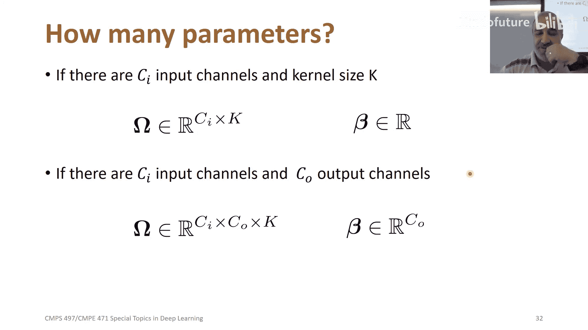

But now。🤧Another step or another concept。 Actually， it's not an extension of the of the convols。

 but it's another concept， which is very important called the receptive field， Receptive field。

 What do you mean by receptive field。

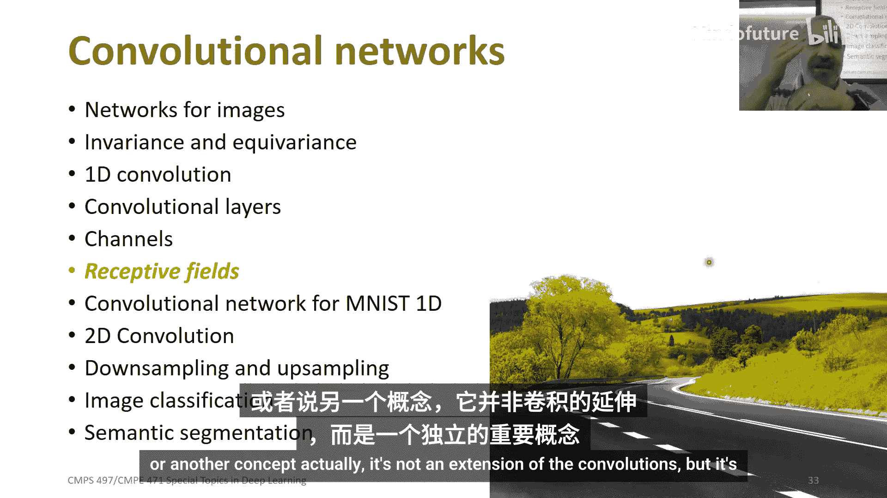

Very simple， theceptive field of any hiddenhen unit。What do you mean hitting on it first。Okay拜。

One hidden unit is like one hidden unit like what we discussed before right in the whole semester is just one unit in the hidden in the layer right so a receptive field of a hidden unit。

Is the region of the original input that feeds into it。😡。

What do you mean by feeds into it that affects the computation of that hidden unit。😡，Okay。

 so for example。First， before we talk about the safety field here。😡，Can we tell。

Why we have these numbers， can we tell the meaning of these numbers？1 input channel。

3 output channels。TheAnd the size of the chemistry， right， Why do we have。Why do we have。C全。

Because there are three kernels， right， because there are three kernels， Okay， very good。

 Now to compute the value of this unit， this specific unit， not all of the three Okay， this one。

This one。If we know that it's a current size of  three right， so it will be applied to these3。😊。

Vues from the input。 So the receptive field。The re field， the field of sight， of that。

Hden unit is these three values。Okay， which means only these three values。Affect。

The value of this unit。ok。Type， how about this one？Same， why is this the same？我不。Why。

Because they are the same。Different kernel is different kernel， but applied at the same region。Okay。

😊，Different kernel， but it's applied at the same age and the same， of course， for this。Okay。第。Now。

 let's add another layer。No。How do you interfaceith these numbers， How many channels do we have here。

4， how many channels we have here，3。 So three by four by3。 What is that three。The kernel size。

 so this is the weight matrix。😡，Okay， so the weight it matters。😊，Has all the weights， okay。

 so this is the kernelal size。But now。What's that。Yeah， but this is Kma。 It's 3 by3。Okay。

 it's 3 by 3 because of the。Number of input channels。 So that's that's a three by three。 No， no， no。

 in the terminology we call we we say it's going to start the three。 It has to be square。

We don't say the kernel size is3 by three， three by three is different， no no。

 it's it's the kind size here is three， but it's applied to multiple channels。😡，They are different。

 but when we say the size of the kernelon， we mean the size of the lesion in each channel。

In one channel， which is three， so the kernel size here is three。ok。Ha。Okay， okay。Okay， so， so， okay。

 so let me。The the kernel okay its。3 you wait。Okay， for this channel and then three other weights。啊。

😮，For the second channel and three other weights。No， okay that immunology is it it's the immunology。

 that immunology is the size is the size of the lesion for one channel Okay， it's applied to。😡。

Mar channels， so we have 12， we have nine weights here。

 but the size of the current is3 that's by definition， that's just a definition okay。😡，关系。So。工作日。

Why is it what Why you have four output channels。😮，we have we have focus。

 So this journey name is producing this channel。This channel。

 this other channel is produced by the second kernel。😡，That's by the third。

 That's by the fourth okay。查一首。Yeah。这个来的。Oh no， no。

 size is three because we have three input channels。 No， no， even if we have。

 even if we have 10 input channels here， still the size of the kernelon is  three。

 but now the number of weights would be see times1。Okay。

 let me raisese all of that because we don't need it now。Okay， now。So you understand now the numbers。

 right， How about the receptive field？😡，The set the field， let's take this unit。😡。

This unit is computed over which values in the previous layer。😡，The are9 validity， right。

 because it's applied on all of them， right type these9。

Ill compute it over which region in the original input。

 So the reive field is about the original input。 The very first input。 What is the reive field now。

You would see that these three are now I think it's better to use the pen。😊，These three。This three。

Yes。A affected by these， these three。Are affected by？This， these three。I'll compute it over。This， so。

So。This one。Is computed over all of these S5。Okay， so the safety field of this one is all of this five。

😊，Can you got it now， the brown ones。That's exactly what we have here。Okay。

 is exactly clear now type， what do you notice now with adding more layers what happens to the safety field？

😡，Increases that makes sense， right， because we are now conuting regions that were processing。😡。

Smaller reasons。In the， in the input。 So it's like we are integrating。Information。Acros layers。

 right。 So first， we got information from smaller regionss。

Then these smaller regions are combined into the second layer。

 then larger regionss will be combined for for the next one， so theceptive field。

 if we add one layer now more， youll see that theceptive field increases。Okay。

 now each of these units。😡，Is computed over。The that region in the hidden the second hidden layer。

 which are computed over that region of the first hidden layer。

 which are computed over that region over the the dial input。

 So where is the receptive field of of these。This。Okay， in the original input。

 the brown ones in the original input， that's the accepted field。Okay，As we add more layers。

 the receptive field， the light， the receptive site okay of the nodes in in the hidden layers will increase right。

 because they are computed over now larger regions Okay and that that means that the information is integrated Okay first。

 the information was about very small regions in the not the image yet in the input。😊。

Then the R combined， so the safety field decrease a little bit。

 then the R combined the safety field decreases and increases it and until at some point it might cover。

😊，The entire input， as you can see here。Okay。😊，So that means that here in that specific case。

All of these units now are process are computed， or are have covered。Or have seen the entire input。

Okay。😊，And。The intuition here is that。The first layer because it's applied on a very small receptive field。

 so it will try to learn patterns on small lesions like Me。

 if we are talking about images for a second， like ages in their image。😊。

And then the second layer will combine these ages into maybe a frame figure okay and then into an object and then into a complete scene and so on okay so every layer has a higher semantic role as we add more layers。

Okay， is that clear？

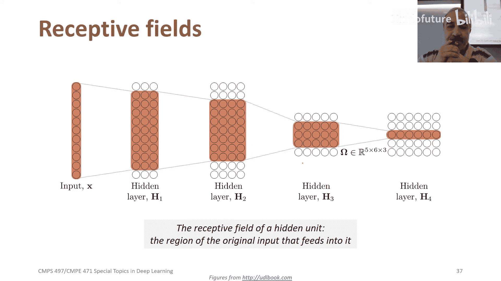

Okay。对。Now let's see an example， a example of a computer network。

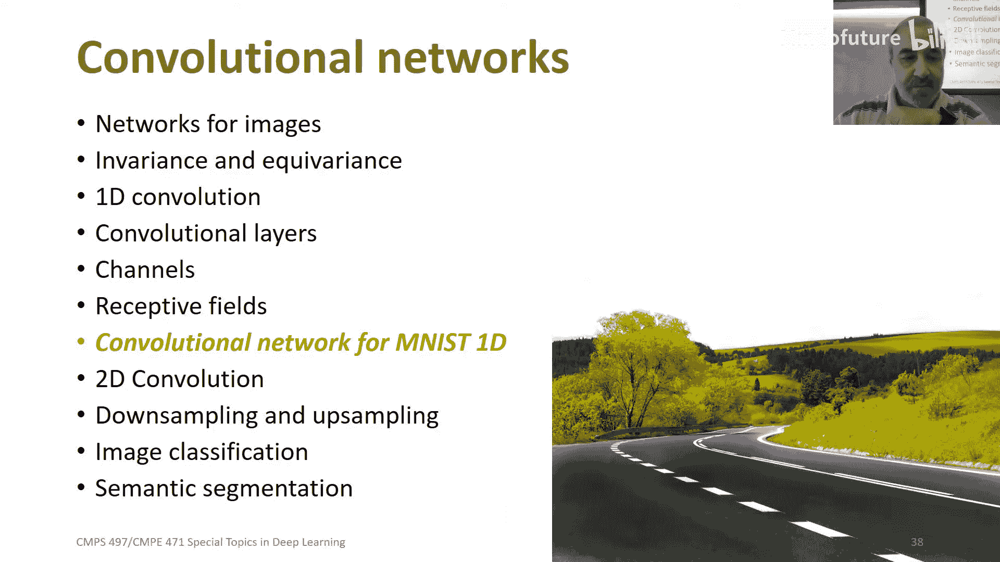

You saw this dataset set before right the dataset set of the digits and remember that we converted these originally images。

 but we converted them into 1D， it's just 40 feature values。

 it's like  one vector of 40 values okay so now we can process it by 1 d convol by what we studied already。

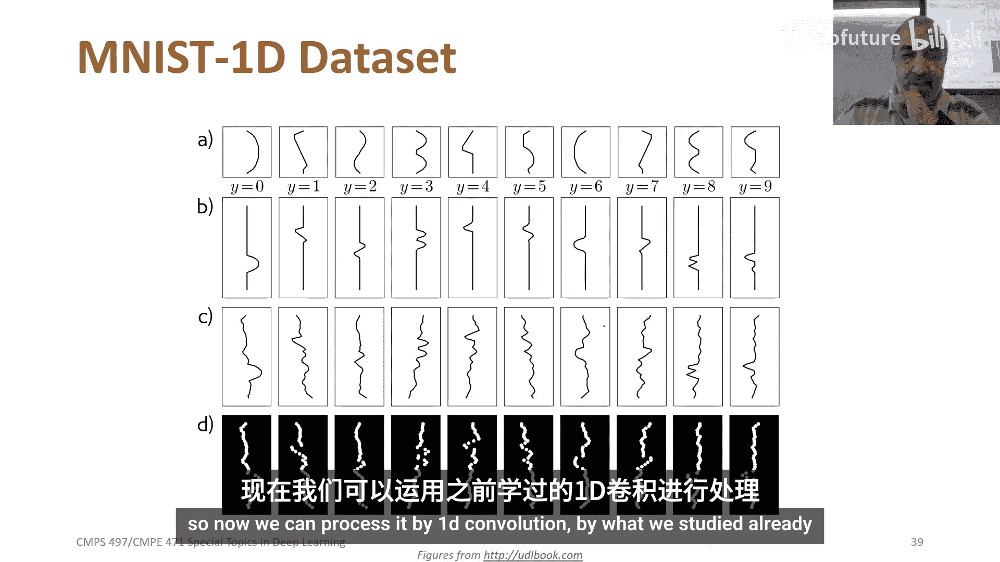

第。there is an experiment on that that has been done using convolutional network here's the description of the network。

 we have of course 40D input because we have 40 features we have 10D output if you remember what was the task here。

😊。

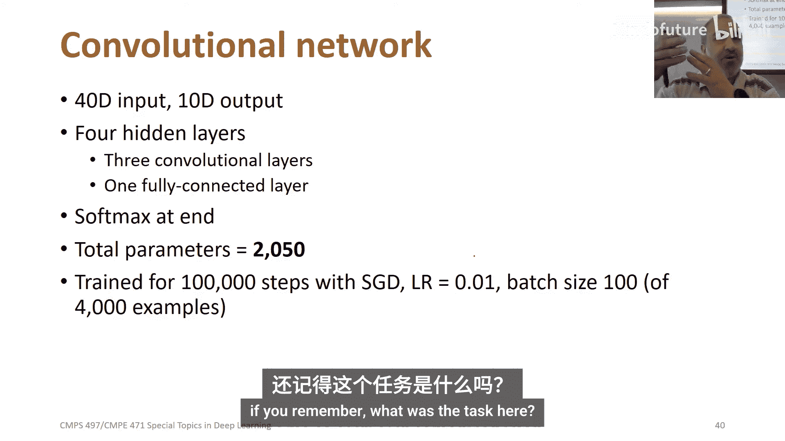

2。Its recognize the original digit， right from zero to 9， so we have 10 possible digits。😡。

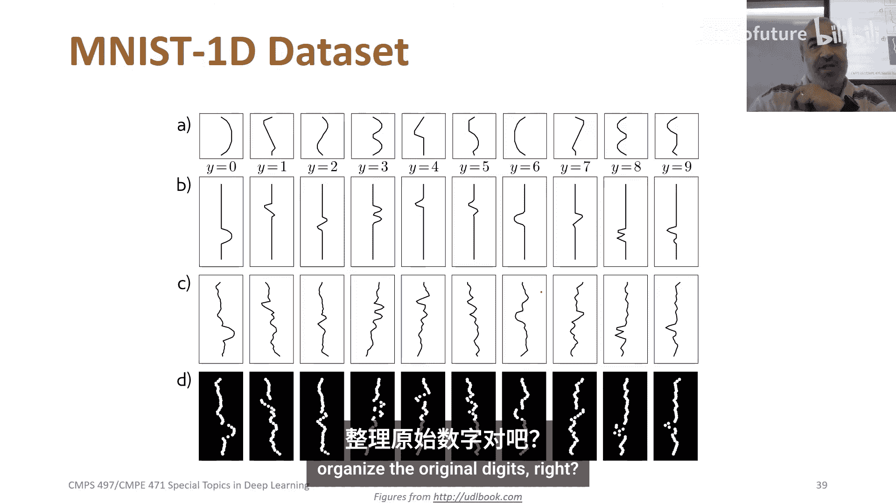

So the output eventually is 10。Okay， so that's the event。

 the output layer of the network or whatever network we design now has to be 10。

 because if you remember multiclass classification， we have to have 10， and then we have。

Soft Max to get the poets you'll see that so there will be a soft Max at the end。

The structure of the network has four hidden layers， three of them are con layers。😊。

And the fourth is fully connected light。Can we do that， Yes， of course， you can。

It's just the mathematical functions right。Can stack whatever layers you want。

You will see how the structure will look like now。The total number of parameters for this network is 2050。

And that network was trained for 100，000 steps with SGD， what is SGD？tochastic gradient descent。

 what is Lr learning date and the batch size of 100 and the total number of training examples in this case was out。

😊，Let's look at the network。This is the network。Okay， let's try to understand。

Everything on that on that figure。First of all， the input。😡，诶 layer。How many node we have here。

In the input layer。40 because we have 40 features， right， so that's 40。Okay。

 then we have a convolution layer no don't look at the numbers and the text， look at this figure。

 so this is like the hidden units。😡，InIn the layer， this is a convolutional layer。

And it structure out that way so that we know how many channels so how many output how many how many output channels in this layer。

 the number of columns here， right， which is 15。And the number of those here is 19， which means what？

Which means that from the size of 40， it's linked to 19， which means that we are doing。

A convolution width with a type that is not0， that's not one， right， it's  probably2。😡。

Stride of two will will will actually have will' get the half of the size。 Okay。

 so we will see that slide is two here。The number of channels is 15。We said that。

And the size of the network of the kernel tree， can we actually tell the size of the kernel from this？

对对对对。No， no， the size of the kernel， not the number of channels。

Can we from that from the number of hidden units here， can we tell the kernel signs？If we know this。

From。Even if you know that's right。No， we cannot。 We cannot tell， okay， so。It's。

 it's the size size is three here。 So we cannot tell actually from that from that figure only Okay。

 but the size here is3。 Okay， so that that explains these numbers， right， one is。One input channel。

15 output channel。 And that's the size of the curve。 Okay， and the number of voices is。15。

 because we have。Because we have。15。And we have 15 output channels because we have 15 kernels。

 Very good。 Okay， now that so that's the first layer。 Second layer， Similarlyly。

 we have 9 we have 15 channels。😊，9。Hitden units in each channel。

 which means that we again we have a slide of two we have 19 now it's  nine， almost half okay。

 so we have a slide of two。😡，And again， the size is three。Okay， that's a second layer， third layer。

15 channel again，4， which means again， we have a slide of two。And the size is。Okay。

 now how many hidden units we have overall here。Which is。

60 60 now that the fourth hidden layer is a fully connected hidden layer。

Like the ones that we discussed the earlier。A fully connected layer has to have the input to be 1 D。

 doesn't understand the channels and all of that， right， It's just 1 D。

 So we have to convert this 60 units into a vector。 Just represent them into a vector。Okay。

 that' the presentation we didn't we will not change the values， we just stack them in one vector。

 okay， so that would be 60。😡，And the hidden。Actually。

 it's not data there but the output layer will have how many nodes we sent。😮，No the output。10， okay。

 So between the output that is 10 and the last conclusion there that is 60， will have。

F fully connected layer。 Okay， So we have 600 weights。

Between just for this one fully connected layer and then the softm。

That's why you have 10 times 60 here， right， 10 is the output。Notes，60 is。

The input node of that to your connected there。Okay。

 so I think you understand every single number on this slide now， right yes？26。The input is。

Iput to that layer is 60 because we said that we would represent this in one vector。😡。

It's not the original。 originaligin is 40。It's the output now， yes， it's just one。

 we added one output there。😡，Yeah。You can consider hidden if you think of softftm as another day。

 but actually softmax is just。Just an activation function output Yeah。

 so you can consider that as the output layer。Yeah。

So if I ask you to compute the number of total number of parameters。

 I think you can do right for this， so you have to do that exercise and make sure that you will get。

That number。Okay， not now， of course。Okay， now we will compare that with a fully connected network。

Of the same size of the convolutional layers so this this is this has 19 times 15 hidden units right so we will have a hidden layer with that size。

 another hidden layer or that size， of course any 1 d and another hidden layer for that size。😡，Okay。

😊，And the total will be 59，000 parameters。Versus 2000。Okay， so huge reduction in parameters。

 of course， because they are shared， right？Because they are shit。

Now we will compare that performance。Between theal layer。

 the combal network and the fully connected network。

 which one you think be will produce better performance。What， the fully you connected， why？

Because it has no payment， does it？It's。没。没事。So the information sharing is is a good thing， right？

So you mean， so your convolution would be better or the fully connected one would be better。I think。

Okay， let's， let's see。LetLet's see。 let's see。Okay， so on the left。

 this is the conal network 2050 parameters on the right， the fully connected network， the 59。

000 parameters， and what do you see？😊，这地方。Which one is better。This is ill。Okay。

 so the the performance measure here is an L is L。 so low values are better。Okay。😊。

Conversion fascinating training， but in test。I mean， this converged faster in training， but in test。

 the error was really high。Okay， what happened with the commission network。The air is， is less。 Okay。

 so it has a much better。 actually， I think maybe。And the error is like 50% of that error， I think。

 something like that。Okay， so we reduced the error extensively significant。But why is that？

because they。在那会儿。对。In the figure that， for example， in Dallas， like in the vector。Each。

 each number depends。WednesdaySo the weights sharing the weights and also the fact that we are producing local lesions。

this is coming from an image although it's 1 d but it's coming from an image its conversion or transformation from an image。

 so the local processing is very important and for the4 network to learn the patterns that we will learn from the kernels it has to be learned over all the parameters with different regions from different regions but for each regions separately actually。

😊，But， but the confusion network， because it has what we call the inductive bias。

 that each position should be each each region in the image should be possessed in the same way。

It was able to find solutions that are much better。

So the intuition here is that we have a better inductive bias。The inductive bias。

 which is about the structure and the design and the assumption of the comb network。

 forces the network to process each location similarly。

 share the information and the search across varies much smaller parameter space and if you think about it。

 the number of parameters here 2000 versus 59，000， the number of solutions。

In fully connected network is huge okay， so search within that very large search space much harder to find good solutions than searching within much smaller space。

Okay。对 yes。good， probably what happened here is overfitting because we have very large number of parameters。

But it didn't generalize。Only， this is the case。But it didn't happen here。It happened but very。

 very late。After many， many。Training steps。But happened much faster here because of the number of parameters。

 well， we have lots of parameters。Yeah。So the generalization for the conversion network was much better。

Was much， much better， which means that the， if you remember the discussion of the。Double descent。

The interpo between the data points is much better in the case of the condition network。

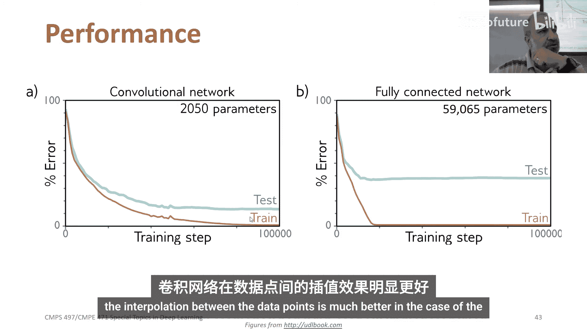

。Okay， now we will extend what we have discussed from 1 d to 2 d。

 just one quick comment before we extend it to do D2 d and you will see that it is really simple。😡。

One comment with 1 D。😡，Without extending extending it to 2D， do you think it is useful。

 Can we process actually input with 1 D convolutions。

1 D conversion means that the input is 1 D is just one。 each channel is 1 D， okay。Can that be useful。

Anyway saw an example and it was useful， but that was from images originally。

 can we post something that's not image and by CNNs？You good。 I have an idea。Can we process text？王勇。

If each of the hidden unit you expand it to an embedding vector and you put them all in one vector。

 that's textite and even the idea of processing small regions makes sense also in textite world that are close to each other they have relationships。

What。😮，Probably the idea of attention in transformers is better。

 but this came before that and CNN is actually used for processing text in reality。

Audio can be processed also because it's 1D signal， right。

So audio also can can and any any 1D sequence of input can be processed with 1D CNnnNs。

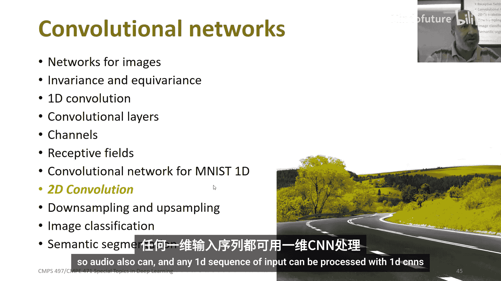

Now to 2D convols。The idea is。Now， the kernelel itself will be a 2D object。So in 1 Dcom。

 the candidate was 1D， but applied in depth。😡，Okay。😊，Now， the kernel in itself。

Because the input channel will be 2D， the kernel itself will be 2 d。😡，No it wasn't， it wasn't。

 it was 1 d but head has a depth over the different channels we if we have one input channel only it will be just one vector。

😡，吓。😮，Let's look， let's see so this is we would see it in the next slide， okay。

 but so far it was just 1 D yes it's one vector but has a depth。Okay。

 now because the input was 1 d the one channel and all the channels that we saw before。

 the info channels were 1 d right， even the offer channel was 1 d。😡。

Now the input channels themselves each will be a 2D channel。😡，2D values。 their values will be in 2D。

Okay。😊，It will be a matrix and now the kernel， instead of moving in one dimension。

 it will move in two dimensions horizontally and vertically。Okay。

the equation is very similar instead of applying it to one dimension。

 it will have double sums because we have。😡，Do dimensions， right。horizontalizontal and vertical。

And again， adding one bias and applying the activation function so similar。

 let's see an example here。This is one channel， one input channel。But it's 2 D now， right？

How is that different， the only difference is that the kernel itself will be 2D， that's it。😮，1。Okay。

 weighted sum again， it's weighted sum over a 2D division。😡。

And then it will be shifted across the entire region。Now， instead of producing a channel that is 1 d。

 now the channel will be the alpha channel will be 2 d， thats the output channel。😡。

Because we are moving the kernel into 2 d。so for processing this vision。

 this kernel would produce this value， let me change to the laser pointers。

So processing this region with this kernel would produce just one value， which is this one。😡。

If we shift it。To the right and down， this is another region we produce another hidden unit。Okay。

Doing it over the entire input channel will produce one output channel。Yes。Would see same similar。

 similar cost though。 What do you expect if we have， if we have two input tenants。

 what will be the difference， the depth。The depth， Okay， same thing， but it will have a depth now。

 Okay， so it would be 3 by3 by the number of。Iput channels。诶。😊。

That's a third step Now we will also have zero padding or whatever what we will do with the corner cases Okay。

 so here we have zero padding here also we have zero padding right same thing like what we did in 1 D。

 but now it's in 2 d okay time。Any questions so far， so this is the same。Same concept。

 except that the kernel now is 2D。If you understand very well what happened in 1D。

 very easy to be extended here with 2D。😡，what if we have we want to have multiple output channels？😡。

对。Mar。Multiple elementss and all of the colorss will， of， of course， will be 2D。喂。

So we'll have multiple opportunities。

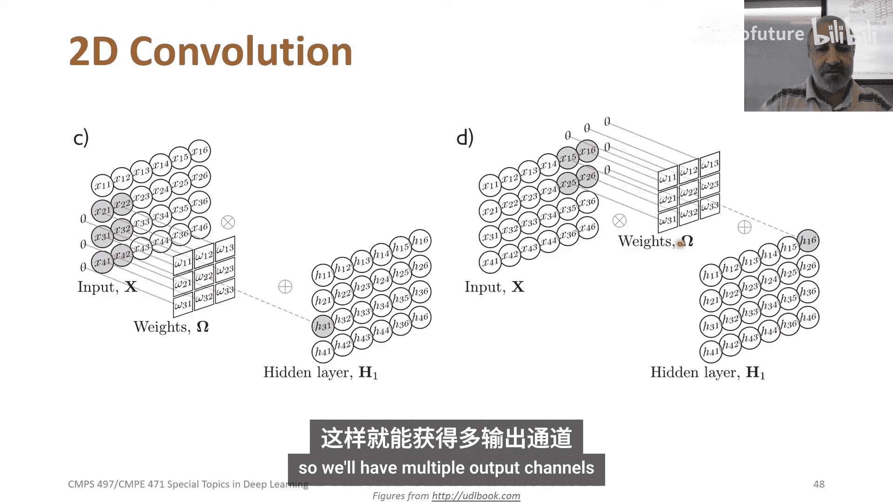

Now this is the real application， now the input is an image。😡，And the image by structure。

 by definition has RGP right channels， each of this red channel， green channel， blue channel。

So the input you someone asking me about what if the input has multiple channels， that's the case。

 so the input itself， so this image actually has three channels。The red， green and blue channels。Now。

 applying this kernel。Why， why do you have now that the current hand now is C by C， Okay。

 so why do you have all of these width？😡，For the kernelal， because it's it's3 by3。With the depth3。

 because we have three input channels。😡，Okay， so the current now has how many widths。

3 by 3 because it's a 2D and because we have three input channels， it's yeah， nine times the E27。

And all of that will be applied to that region， so this is this is like taking a part of the image okay。

 so this is that part across the three input channels。😡。

These weights will be multi employed by these values。Producing one。

18 unit in one specific output channel。Can we have multiple alpha channels， yes。

 different kernel same concept。Okay， now you see it as for images。

 Now you start to see it for images， yes。And。Chahans also， but maybe different， different meanings。

More Chinese。No， no， no。The number of channels of the output we controlled it。😡。

Because we design or we set the number of kernels。😡，But then the input channels。

They come from the input depends on the input。

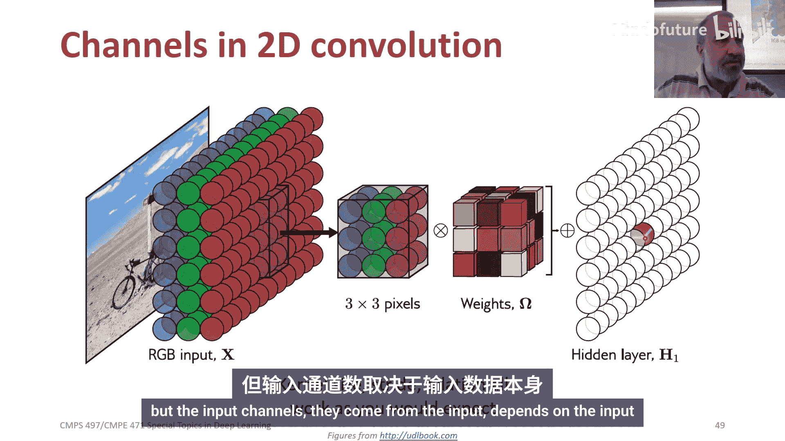

对。Okay。

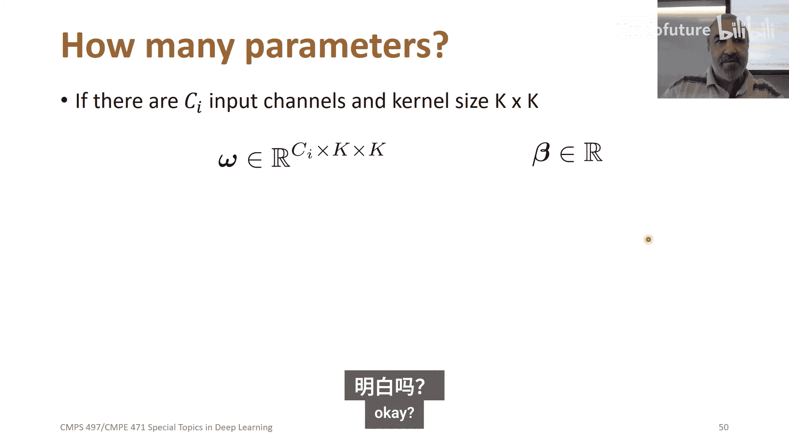

One more slide though， that's it。好的。That one more slide one more slide。

 how many parameters I think it's easy how many parameters if we have C input channels and the kernel size K by k now the size is K by k K is not k K by can now we understand y the size is K by K then the weight will be K by k times C right because we have the depth。

😡。

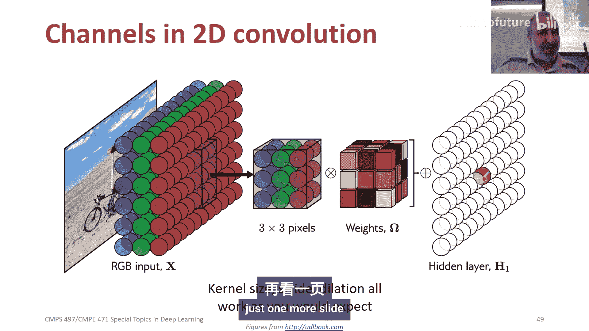

Okay， and the number that the bias is for one kernelil is one， this is for one kernelal， by the way。

Okay。Like if3 by three， like the9 would have the。One bias。1 by weighted some plus by。 Okay。

 now if we have C I input channels and C out。Upo channel Time out。 Okay， so C， I by。

C I by K by K times。See out and the number of biases are see out why。嗯。一个是。No， the number of kernels。

 the number of kernels are sea out because each kernel reproduce one output challenge。Nice。Okay。

 so Ill continue next time， so nowm I can it。

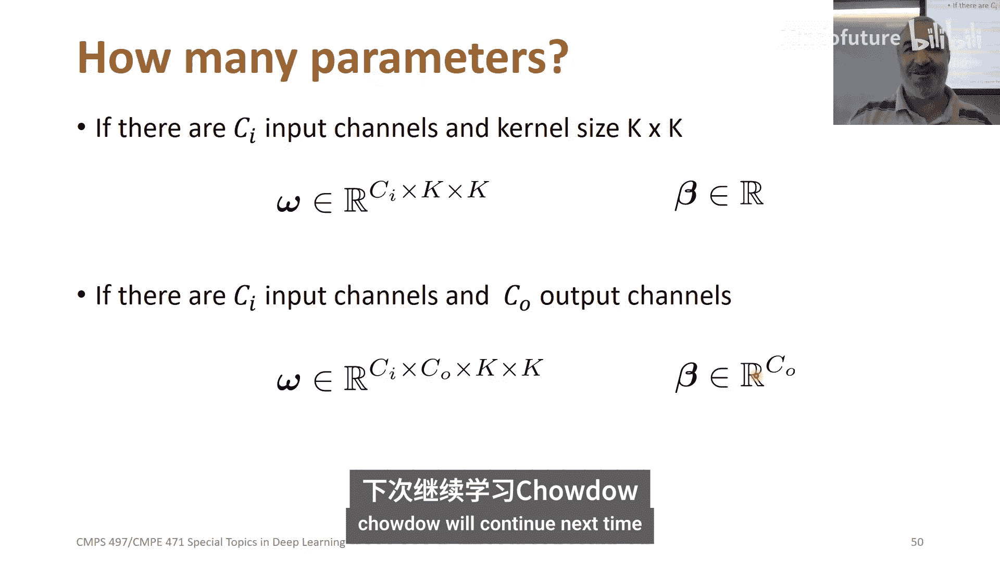