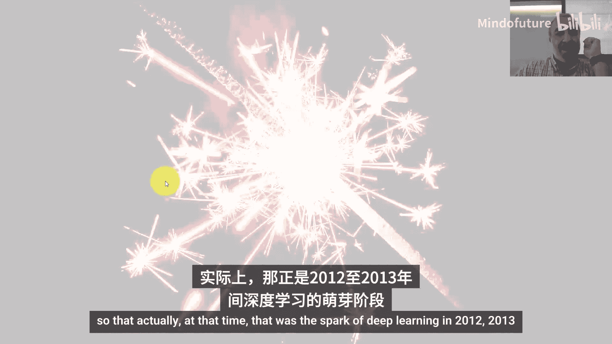
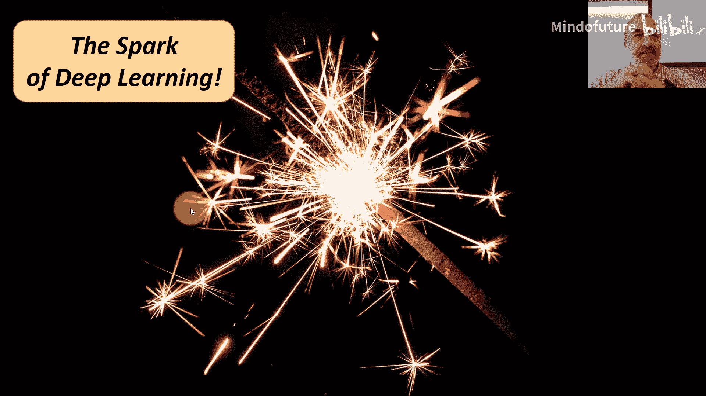
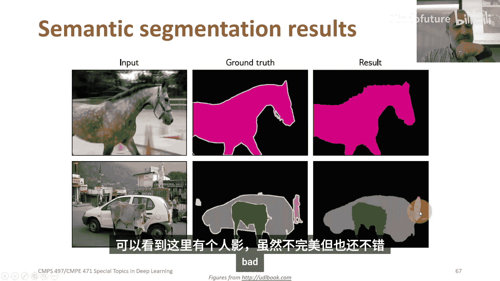

# 【卡塔尔大学】深度学习 CMPS497 ｜ Understanding Deep Learning ｜ Fall 2024 p27 P27_第二十四讲-CNNs III -BV1vQvNz1EeK_p27-

Shim， Charles I would continue talking about conversion neural networks。嗯。

Where did we stop last time or did we cover last time？To Dcomvolution。

 and before that one decomvolution， right， what's the difference？Yes。

 so the kernel is in 2D right So instead of just 1 d of weights。

 we have 2 d of weights like a matrix of weights type， what if we have multiple input channels。

Would that make a3 D。No， okay， so the number of channels we process doesn't change the dimension of the kernel is does add more weights。

 so it would be a 2D weights for each channel。Right。嗯。So as you see here in the slide。

We have a 2D kernel， right and it is。Applied to 2D channel。So we have 2D kernel apply to 2D channel。

Right， and producing one value。From the convolution of this。Reion by these weights。

 case with the average weighted average across this region plus the bias and with with the activation function。

 if I have multiple input channels。Then what will change in the kernelal？

Let's say we have four input channels。How that would change the continent。啊。😮，Yeah。

 so I mean in terms of number of widths， so we will have this for four layers。

 right like like four layers of of this 2 d matrix。Okay。

 so the number of weights in this case would be nine times4。

Right because it has a depth of fault we have four input channels and we discussed that last time now you can see the metrics on the this is the weight matrix on the right side of the slide。

 the weight metrics that shows the the relationship or the computation to compute every single output value hidden value so H 23 here is a weighted average of all of the colored。

Values， right， these are the weights and multiied by the corresponding input values。Okay。

 and you can see that we have nine weights here， right？Right can I ask you why we have these gaps。

 why we have a gap here and the gap here？这个是。嗯。That's right。Because of that slide。

 we have a slide here。Side what is the side value here。Okay你。2。How can we tell。Okay。

 how can we tell that the right value。If the side is more than one， what will happen？😡，昨天之间。Okay。

 and what will happen in terms of the output values， the hidden units。They will decrease okay。

 so that you can see here that thats a same number right it doesn't decrease so the slide is。😊。

Is one is one。Time， why do we have gaps here， So why do we have these gaps。

 Why do we have these gaps。We leave that to you。 Okay， think about it。Okay。对。

We saw also this does time， right， And this is the real application when we have an image。

For the image， we have three input channels。 Why do we have three input channels？Red， red。

 green and blue， right， red， green and blue。 So if we apply the 2D convolution。

It will will be applied in for three channels right so that's the depth of the incoming layer and that's the part of the incoming layer that will be processed。

 it has this region， it has red， green and blue。Okay。

 so it will be the width here will be multiplied by。

The hidden the values of the input channels to produce just one output value here。Okay， is exactly。

 I think we went through that last time， so that's not that's not you。And what is this curve here？

What's that Si curve yeah。You see way I point？Yeah， that's the activation function right。

 remember that every confusion has after it had we have to add after the confusion is the weighted time。

 we add the bias and then we apply the activation function to get the hidden unit value。😊，Okay。

 any questions so far？ok。Also we went through， I think this to compute the number of parameters we said that it depends on for the kernel。

 it depends on the input channels， if we want to compute all of them it will depend on both the input channels and the output channels I think we went through that last time also。

Today in Ch La， we will focus on two important operations we do down sampling and up sampling。

And we will in talk about two applications， image classification and semantic segmentation。

So start with down sampling and of sampling。 Do you have any idea what do we mean by down sampling and of sampling？

刚拜拜。Let's say， for images。What mean by down samplingampling and up samplingamp？

What do we do with number pixel？Please。So down sampling means reducinguc the size of the image。Okay。

 or size of the incoming values and down and up sampling is the。 Okay。

 so getting a smaller sized image is down sampling ups sampling is from a small size image or a small size input。

 We get larger size type why。No， that's different here In this context is different。 It is sampling。

 but from the。Pixes or the incoming the input values， okay。Rightい。So yeah， you can think of that yes。

 down sampling， it will it will decrease the resolution， of course。

 of the of the image type since you said that， why do you think it's this is any needed。

 Why do you need to down sampling and up up。嗯。Okay。

 so we down samples so that we can process maybe faster right so it will it will it will reduce the memory that is needed okay。

 that's one thing。😊，The operation will be faster if we do it on smaller images or smaller lesions。

 okay？What else？Think of the con when， when we process， when we use。

The size of the input to smaller size， what happens to the receptive field？Now， I am， I am。Yeah。

Procesing。WhenWhen it forces a smaller version， its like it's mapped to a larger lesion from the input。

😡，Okay， we'll see why is that very soon？So， let's start with down sampling。Commonly to images。

 we will talk about down sampling to have and up sampling to double okay because that's the common operation that that we will see。

There are different approaches to down samplingling and up sampling。For down sampling。

 well discuss three approaches， the first one is to sample every other position。

 What does that mean you see the the original values here。Okay， for each two by two block。

 we will take one and skip the other。Okay， so this is just temp。So we sample every other position。

 what will be the outcome， we will get one from here，5 from here，4 from here and one from here。 Okay。

 so we'll have smaller version of the。Of the input。

 whatever it is or the image if the input is an image。Okay， why the safety field here will be larger。

Will it de on now any this point。Has a larger reive field than any point here。我 not。Yes， of course。

 yes， because it is computed out of this four or it is sampled out of this four。 Okay， I。

 it will be more clear with the other approaches。 Okay。

 but thinking that this value is a function of this four， whatever the function is。

 It means that the receptive field of this is the union of the reive field of this four。😊，Okay。

 so when we do that now， when we process the model version。

 we are processing kind of processing larger regions of the original input。Okay， so that's sampling。

 yes。The numberumber they minutes。These values， the values in the input。

It can be pixel values if we are talking about the first layer， but it can be done to later layers。

What do you mean by same numbers we are sampling from the values？

And this one sampled out of this here the sampling is regular， so is consistent。

 so we take one and skip the other， take one and skip the other。Here we take one and skip the other。

 take one and skip the other， Okay， so every two by two block we take one of them。Consistently。

 so this is not random simply it's just down sampling the image in a consistent way。

 This is one approach sorry to the next area， yeah yeah。

 so this is now now the input to the next processing block， yes。In the next one。

 which is called max pooling， this is one of the very common down sampling techniques。

 you will see it everywhere。😊，In this case， we are taking the maximum。So every two by two block。

 we take the maximum value among the four values， so here here we have one， three， two， six。

 we take six。😡，530，8， we take eight and4。when we decrease the size of the input。

 theceptive field will increase， it will be more efficient to process and sometimes even you want to because when when you increase theceptive field what does it mean now it's like you are looking at higher level of detail from the image okay and instead of looking at lower level detail you are looking at the image it's like zooming out from the image or from the original input and making decisions based on larger regions。

Good。at the beginning of the network， you need to process very low level detail of the image。

 but then later you need to combine these details into larger regions so that you can make bigger decisions。

😡，Okay and I like you want to classify the image， whether it has a flower or not。😡，Okay。

 can you do that by looking at。Very small number of pixels。

Can you can you independently take a look at the two by two pixel and decide whether the image has a flower or not。

 of course not right but you can start with that and then over time you combine information until you have at some point a representation of the entire image so that you can make a decision whether it has a flower or not。

Okay， you would see applications for that。Okay， okay， go ahead。But isn't that what we were doing。

电费通嘅信用我哋。等下。Yeah， this is not okay， so yes this is combined with what we did before。

 we would see that we are doing this sometimes in between layers。😡，Okay， to， to process。

to focus on smaller number of nodes， but smaller number of I mean， smaller number of values。

 but these values come from larger areas。😡，Okay，So it's like zooming out from the incoming image。

So this is maxpoing and we say here partial invariance to translation station we talked about invariance before。

 you remember what does it mean to have a？A function that is invariant to the translation。Yes。

 so invariant means the if we do the translation or if we do the transformation。

 the output will not change here we are saying this is the max pooling is partial invariance to translation what does that mean if we move these values a little bit right to or left or up or down the maximum most probably will not change or will not change much okay so that's why it's partial invariance to translation。

😡，Okay， this process。Type the third one is direct max pooling， but instead of taking the max。

 we average。By the way， you can apply this on an image and see what what you will see。

 you will see a lower resolution image， but still have some of the information gathered from the original image。

 but with a smaller scale。😡，Okay， so these are different ways of downsampling。

So we don't do them all together。We do this or this or this。At one point。Okay。

 so that's down sampling。And if we do that for multiple channels。

 this will be done separately to each channel。😡，Okay， so if we have multiple incoming channels。

 then this has to be done on every channel separately。So the max pointing would done on one channel。

 another channel and third channel and so on yes。Like in different layers。 Can you apply Yes， yes。

 yes。Sure。Okay， now next is up sampling。Up samplingling， up samplingling means。

You have smaller representation， and you want to make a bigger representation。

 But why would we we need that。会员M。嗯哼那你 want都都。嗯。Okay， let me。

 let me change this a little bit and say that sometimes。Will start to buy an image。😡。

We do some processing。And then we want to generate another image。😡。

So we have from the representation that you came up with。

 you have to come up again with a size of the original image。

 and we'll see another an application for that today in general。😡，Good。

But here the idea is from smaller view， we want to make it larger， want to make larger structure。

 larger value larger number of values so that we can get the output that we want at the end。

 which is an image as in some applications。Okay， how can we do that The multiple approaches also one of them is to duplicate the values so we have each value here will be duplicated in a block of two by two so that we can double in each direction in each dimension Okay。

 so we have2 by two twos here， two by two fours and so on Okay based on the original values this is duplicating。

Another one is good max up sampling or max up pooling。Okay。😊，What does that mean？

It's max up sampling for max on pullinging。 Okay， its the same two names for the same thing。

 What are we doing here， Remember max pooling， what what what did we do with max pooling。

For each block2 by2 block or get a maximumon， right， this is max on sampling， which means。

We will retain this value and pad the remaining two by two block with zeros。Okay。

 type where exactly we should that value， we should put that value。

 we should put it in the original position of it。 Usually this is done meed with max pooling at some point。

So we did max puing， we know this value came from where exactly。😡，Then when we do max outputing。

 we put it back to the position where it came from。

So we know that originally this tool was in that position and this four was in that position and so。

 but the list will be zeros。Okay， so this is one way of upsembling。

 Now we increase the number of the the size of the of the。

The size of the output now is double in each dimension， the size of the。Okay。😊，T the third one。

Is instead of padding with zeros， we will do interpretation。😡，So here we have two and four。

 we will insert one that is in the inter between these two， so it will be three。Okay。

 between two and4， another three type four here， we assume that at the corner well add zero so that we can interpret between 4 and0 to get2。

And so on， so this is called bilinear interpo。So instead of addingzes。

We will add values that are the interpretation between the neighborval values。Okay。Yes。

 how the masks arely。ItOkay。I would not you are talking about this in particular or assembling in general okay this one usually it will be zero in the beginning anymore this is and then it will it will it will be different right because of the learning depending on what what application you are learning here but that's the beginning that cannot be the end of your of your model you have to add more layers so that these zeros will be converted to meaningful values。

对。the fourth method for up sampling is qua trans convolutions。Now look at the figures here， A and B。

 what are we doing here， this is normal convolution that we did before。😡，Okay。

 so this is a kernel with size 3。And slide to。So that we have from eight values。

 we have four values in the output right we saw that before and that's the matrix。

 the width matrix for that convol that kernel right we did that last time。对。Now。

Note that we started from8。Values and we come up with full values。

 right type what happens if I reverse it the direction of thearrows here？啊。

That will be our sampling from four values to。Do it。Okay， so if we reverse that direction like that。

 we will get a weight matrix that is the transpose of this matrix。😊。

That's why it S trans the conclusion。So， from。Four values， we get eight values with these weights。

But notice that here the widths are transposed。😡，They are not no longer some most of them will be some of them will be two。

 some of them will be one， depending on the that slide， the original slide。Okay。

 so it's not exactly a convolution like what we we saw before， but it is using these this structure。

 which is a transpose structure of the original。Convolution， it's called to trans convolution。

So now from these four values。😊，We get eight values using these weights。But okay。

 I was expecting this question and I was about to answer it without the question。

 but these weights are different， these are learned weights。Okay， these are learnedoids。Okay。

Is that clear， so it looks like it is the transpose in structure of the original convolution。

 but these are different ways。😊，Okay， is that clear。So how many methods now we talked about？3，4。

 three，4 down sampling。And four for upsely。Okay。😊，对。Now。

 sometimes also you would like to change the number of channels in between layers。

So we have we start with a layer that has。H channels。And you want to convert it to H prime channels。

One way to do that is to use what we call one by one convolution。

If I told you current little one by one， how many weights in that？1， right。

 and the depth will be the number of input channels， right。

 So this is one by one convolution for this。Incoming layer。Okay， so this。Cural will process。

Each position in the incoming layer with the depth with the number of channels。So， we are not doing。

A con over that region here。That's a very special case of kernels。Okay， we are processing one。

 if you think about as an image or in general， a layer with with multiple channels。

 we are processing。😡，1 position。Independent for many others。Okay。

 over over the depth over the number of channels。Okay， time。 Now。

 if we do that over the entire input， what will we get。One opportunity only right。

 this is one kernel。😡，This is one kernel type Han we said that we want h prime output layers。😡。

How can we get that。We kernels， yes， H prime kernels， Okay。

 so we'll have to repeat that with different kernels to get whatever number of channels that we want。

Okay， so this is a common way of。呃。Keeping the same dimension of each channel。

 but with different number of channels。 So we are changing the number of channels here。

 but we are not changing the size of each channel。So the size of each unit is still the same。

But the number of channels will change。Okay。With， with one by one contribution。这不这个单在一分钟也。Okay， okay。

 so if we do， if we use Methann3 by three kernelants。😡，We will have something like that also， right。

 But what's the difference。Yeah， yeah yeah slide one will get the same same size and whatever by the number of cans will be the number of output channelss。

 then why do we need one by one？What's the difference？那是在清楚的。

Yeah one by one is for each position if you want to process one position only。

 you don't want here to process lesions。That's not the goal okay。

 so the goal for this is just to change the number of channels why。

 because sometimes you need to concatenate that output with something that is coming out of different network。

😡，So you want to align the number of channels， so that's one way。Okay。

 but you don't want to process regions of the input。

That's the only difference otherwise you could do that with any kernels with the number of kernels that you want。

 but other than one by one， you are processing， you are convoluting regionss of the incoming layer。

Okay。Okay， any questions so far。Like now I think。Through the probably to the end of the lecture。

 we'll talk about two applications， we will see complete models that are designed to do two different applications。

 image classification and semantic segmentation。第。What do you mean by image classification？I没。

Justifying images。Yeah， so giving a label to each image based on whatever the image is。

 so for example， as the example that I told you， if the image has a flower or not。

 how many classes we have here。😊，Two only right， but of course this would be easy if if you if you want to really have something that is that can distinguish between so many classes。

Then then yeah that then it would be that would be even bigger so the data benchmark that is usually used for image classification is called image net database。

Imagery database is huge database of images。It has 1000 classes， not just two， not the flower or not。

 This is 1000 classes， and it is classifying the image based on the main object in that image。

 So each image is label by one object。That that it includes。Okay。

All the image in this data set has the same size to 224 by 224。😊。

And we have so many labeled examples here， we have about 1。3 million training examples。50。

000 validation examples and 00，000 test examples。What do mean by validation here。

So have a parent tuning， okay validation set。Okay， come on。

 the 1000 classes are very diverse and the properties that they have are different and you see here and some examples of the classes。

Okay。Yes。Has one label only。Yes， each image has one table。This。This that's not the task here。

 it will be how that task， yes， of course， if it has more than one object。

It will be related to maybe the next next application okay， but for this application。

 we assume that each image has just one object。Which of course， is not very realistic。

 but you will see how hard it is。Okay。😊，系。Now we will talk about a very famous model came in 2012。

Called Alexnet。Alexnet。Let's get deeper into the structure of this model。From the beginning。

 what is the input？😡，An image， right， type， what is the size of the image？😡，224 by 224， right？

And what's that free。大GB。Okay， so that's the input a allows Now we have a series of layers。

How many hidden layers we have here。1，2，3，4，5 convolutional layers。And1，2。Fully connected layers。

And the third here is the output。T let's look at the output， What do we see in the output？😡。

It's like this is a fully connected layer of 1000。1000。100 nodes， right，10 values。

 Why do you have1000 values in the output layer。Because we have 1000 classes。

 right there is a soft max after it， why？😊，关闭。Okay get the。For each of the output。

 so we convert to the 1000 values2。Which are which are considered as probabilities。

 yes probabilities， so these are the proba for each class。Okay， so that at the end， we can。

We can predict the press， right。Okay， so that's the output clear， that's not new。

 So the output here will be through a fully connected layer that has 1000 nodes。Like。😊，O。

Let's get back from the beginning， so we have an image。😡，And at the end。

 so start with an image at the end we want to say the probability that it has a flower is like that create is that a chair is like that pretty that human is like that now the first hidden layer is a convolutional layer。

😊，How did we get this conversion layer， it says here con 11 by 11， what's that？😊，了。The kernel okay。

 so the size of the kernel is 11 by 11。😡，Okay， with stride。4our type。

 what do we expect now when we apply a kilo of 11 by 11 with straight4 what happens？Yeah， it's。

 it's kind of down samplingampling This， Okay， so it will be like the fourth。

Of the size of each dimension， right， because we are shifting a before。So from 224 by 224。

 what did we get？55 by 55。Okay，55 by 55。Is that clear the birth is this 96？😊，Chinas。

Channels in the output within the input。And apple， which means how many kernels we have。嗯。96，96。

 So to get this data， that's the first。Convolutional layer， right， We have 96 kernels。

Each is 11 by 11， and we have a slide4。Type what is that number， 55 by 55 by 96？对那么。Yes。

 number of8 units in that layer。Because we have 55 by 55 in each channel。And we have 96 channels。

 output channels。T， if I ask you how many weights we have。to99，6， only。Wais， waits， not kernels。

The number of crs is 96， right？To compute the number of widths。

 let's compute the number of widths for each for one kernel and then multiply by 96 sign。

What is the number of which for each kind？Metime。Yeah。行。

So what would be the number of weights in each candidate？11 by 11， that's it。times times。1分钟。

Tpe each kernel， each kernel is processing is it processing the output or processing the input。

 the input right type， it's processing all the channels in the input right。We know that， right。

 It's kernelel。Processes all the channels from the input， but it processes region from each channel。

 right？😡，So the issue is 11 by 11。And how many channels in the incoming layer here three， only LGB。

 right？So the number of weights for this layer。Is what。11 by 11 times 3。

Times 96 because we have 96 kernels。Okay。😊，停。😊，What it burn up。s2D its now this is 2D yes， yes， yes。

 yes， yes， the weight will not change this， it's one kernel， it's chair widths。You can think。

 by the way， and I think I told you this this last time。

 each kernel is like has a responsibility of detecting some one pattern。😊。

One pattern from the whole image。😡，It tries you to detect this pattern everywhere。😡。

 and different cans will detect different patterns。喂。Because they have different。嗯，现开。No。

 different ways。Each continent has different weightsside。YesYes。

 so it might happen that during training， two kernels。En up having the same weights， and detecting。

It can happen maybe this pattern is very is more important than others， I don't know。嗯。

Which means that it would be preserved in different channels in this case， right。

 because every kernel has a channel so。Okay， you said that it will change over layers。Right， so。

Do you mean that the same weights are used across the years？Is that the case。Okay， okay。

 just I wanted to make sure that you got it now， okay。

 because different layers has different kernels。😊，Right。Ss so much， of course。You will see how many。

 You will see how many parameterss we have here。Very on， Okay， now you are。

 we are done with the first day， right， We still have it。 We are， are。

 we are on the on the on the way。 Okay， so that's the first one。 Now then we have max pooling。

 Max pool。 So what do we do with max pool。 What will happen。😊，Nextax polling of each two by2 block。

 right， what will be the consequence？😡，Half so we have 55 by 55， it will be。27 by 27。Okay。

 but this is before applying the convol there， so this is not a layer。

 so max pooling is done usually in between okay so max pooling there is no parameters here we dont we are not learning anything we are just applying an operation。

😡，Which is maxputing。 So from this。Each channel here has 55 by 55 right。If we apply max pullinging。😡。

On one channel that would be 27 by 27。 and we said that when we do max poing。

 we do that separate for each。Generally。So out of maxpoing， what will we get？😡，We will get。25。Sorry。

 27， so here we will have 27 by 27。Boy what， how many， how many channels we will have。96。

Before applying this layer， we didn't apply this layer yet， we didn't apply the conclusion here。

 so just max pooling the output of max pooling will be the same like this。😡，But， smaller。

It preserves the number of channels， but it have each dimension。 So it would have 27 by 27 by 96。

 Okay， now let's apply the next one， which is convolutional。诶 layer five by five。What does that mean。

When we when we don't mention the stride， then the default value is1。😡，So。

 so that means the size will be reduced or the same same， So that's why we have here。27 by 27， right。

 it's the same like this， right？😊，what is this now？😡，这样。Number of clears in this layer。

Which is the number of turnss here， Al channelss。Okay。So what are we doing here。

We are shrinking the signs。Right， over layers and over layers also what what what happens。

Look at the other numbers， look at the number of channels， what is happening。Increasing。

 this is usually in CNNs。😊，Why is that with decreasing the science。

 we are increasing theceptive field， right with increasing the channels， what are we doing？😊。

We have more， we are learning more from the input。 We are detecting more patterns， right？😡。

So that will help in making final decisions。Okay， with me so far。

Ty what will happen with this Max boot now？😡，还有其他。Let me do this and then take the question， Max Boy。

Have this。 So we'll get。13 by 13 times。256 because it will be the same number of channels。😡，Then。

Then con 3 by3 will get 13 by 13 with this number of kernels。And that will repeat。

 We have another layer with convol 3 by3， but with different number of。So both both here。

 both here are 384， and then we have the third 256。ok。Is that clear。Then。

Then so we are done with now the five convolutional layers。 What happens after that？😡。

We have Maxpo and。😮，What is F。Fully connected。F you connected layer。Okay。

 T bother that mean max pool， we are now having 13 by 13 by 256。😡，Max poolol。

 what will happen with Max poolol？😡，Yes， so it will be half like six by six by。😮，By 256。

 can you compute this number？6 by 6 by。956。那可能。Okay，9000。200， what， 16， okay。Okay。

 so that's that's after max pullinging。No。To to apply that to a fully connected network。

 we have to vectorize it。 We have to make it at one vector，1 D vector。😡。

So we will have now one e vector of that number of values。😡。

Then apply a fully connected layer that has 4096。Hden units。

How many weights we will have for this layer？不是个。Yeah， this is 9000。200 times the fourth sound。

Tpe so the number of weights will be in the first layer 9000 times40 okay。

 then we have another layer fully connected layer， which is this。

With the same number of hidden units。So the number of weekss here will be。嗯。40 times 40， right。

Then the output layer which has 1000 units， so the number of weights will be 4000 times 1000 and then the soft Max。

I think we explained every number here on the slide， right？Everything is clear。Any questions on this？

Okay， do you think this is a big model or a small model。Big more than。

 How many how many parameters do you expect。不定。Millions， okay。You don't know， Okay。

 so it's about 60 million parameters， but most of them actually。All in the fully connected there。

 so all in that part。Most of them。But if the others who are much fewer than those。

 will not do a good job。In the beginning of processing the image in the con layers。

 then the outcome will not be good。😊，Okay， so the parameters of the col layers， of course。

 are very important。Although they are much fewer than the parameters in the fully connected layer type。

 whats the point of having the fully connected fully connected layers here？😊，我该 the。

But having multiple layers here like that multiple fully connected layers。

 any fully connected layer will。What will be the preceptive field for the fully connected layers？😊。

In this case， when they are at the end like that。Everything， the whole thing。 Okay。

 so now we are processinging the whole input。And we' are doing that over different layers。To。

But did you understand now that model？It's a huge model at the time。😡，Very huge at the time。

60 million diameter， whether it can be put on your mobile phone。

 it depends on the resources that you have。But that's， that's 12 years ago。 Now we are at 2012。

12 years ago。这。系。Some details here， we still didn't say everything， but some details about training。

Here for Alex N。😊，They use data augmentation of a factor of。2048， what does that mean。

What do you mean by data augmentation， creating more data generated， autogene from the images？😡。

When we say a factor of theme asana， what does that mean。Yeah， it' each image。

We had three versions of it， maybe rotated， the different colors and so on。

 Here they use the factor of 2048。Okay。And what was the number of training examples， originally， 1。

3 million， 1。3 million times now 2048？Okay， so that's a huge number of training examples。

Dpeout was applied， of course， hopefully you understand what Dout means， what is this？

Toastic gradient in the end with momentum， I hope that you remember momentum batch size of 128。😊。

And L2 equalization。Okay， the terminology here is clear。对。Now let's talk about。

 I think performance or not yet。 Oh yeah， this is one one very important detail。

Because they use data augmentation， huge number of training。😡，One idea of of labeling the image。

Is to take the test image。And。Do some five multiple transformations so generate on that image。

 multiple versions。😡，And then ask the model to label each one。😡，They are all coming from there。

The same image。And。You will then average the output from these five。

Images to classify the original image。This is what average of the poor is， you can average per is。

 for example all。😡，Or take maybe a majority voting， but here， we are averaging the output。

The output of the model， which are the probabilities。Okay。

 so this is like increasing the confidence of the of the classification because you are the network itself was traineded on different transformations of the of if each image。

 Okay， so they they try to to do something similar in test turn on this will take time if we are not doing it in parallel。

 but。Tobably， it will give us better performance。Because now we are looking at the image in five different ways。

ok。Like what's the performance？At the time in 2012。The state of the art。

 which means that the best model best performing model at the time had about 25% top five e rate。

 what does that mean？Top five is8 means what here we have how many classes？😡，1000 okay。

 so in that task。The， the system doesn't just give one label。 It gives the top 5 probable classes。

 So Ill say as And N， the top one is a call。 And then the second is a bike。 Third is， I don't know。

 Okay， called。Okay， so I will give five classes instead of form。Bannkked， case， this is。

 these are the top five。And then to evaluate if the correct class is anywhere among the five。

Then this is correct。Then this is correct labeling。😊，Yeah， this is lenient。

 It's a lenient evaluation here。And even though we have among the top five， the A of rate was 25%。

What does that mean？It means that，25%。Of the test examples。

 the model will not able to find the correct class among the top five。哎而且问哎呀你感觉。这他关照。

is it is only 25% to put the credit class among the top five， even Y， not the first one。

 the top five。it's not very bad， it's not very bad， it's not very bad but is it useful。

 not true depending on of the real life application。Okay。

 but that was the time that was before Alex Ne。😡，Okay， let's see what Alex Ne did。Alex Ned Gt。16。

4 top 5 before that before that， this is top 5 L rate， Okay， type。 if I， if I compute top1。

 not top 5， it will be washed， of course， right， and if we are taking about talking about 5 top 5。

 and it's 25%， what do you expect mass if we took only one the top one probably it will be much more than that。

 right， maybe 40 mass or 50。That's really bad by any 50%， I think it would not be 50% it on。

If I ask if for just one label， it's 50%， not very bad， not to hand them because we have 1000 class。

 right？😡，Oneson crisis is lot。So it's not number but it's not， it's not very bad。

Type let's see by what what the performance is for top five， it's 16。4%。

 which is huge improvement over 25 by the way。😡，And usually， the improvements are 1。1。5 point。

Things like that， that's a huge improvement and the top1 error was 38。Let's look at the history。

This is showing you on the x axis time。😡，And I axis the performance top 1 error。😡。

And each node in this figure。Is a model that was produced， that was proposed at that time。The what。

Now， no， these are different models， different networks， different solutions。Okay。

 different models that are learned for this task。So where are we now， we are in 2012， right， in 2012。

😡，And if you look at the nodes here， you can see that the green curve。Is what。Overtime。Is the lowest。

 right， which is the best because we are we are computing error here。 So the lowest。

 the lower is the the lower the best。 Okay， so the green curve here。

 the green points here are the best are the state of the art at that time。

The state of last performance at that time。Okay， so that means that before 2012。😡。

It was not true but where okay， what what was the the performance of the model， but then Alex N came。

 we got around。😊，38%， that' this is top one。Okay， anyway mean， it was for at least this is。

And that's not 38， I think says's 31。It's 38。Oh that's 40， yeah， so it was about 40。

 it was at least 45 or so。😡，Okay。😊，That's Alex N and if you can look in the future we will talk about some of these。

 by the way， but if you can have a look around the future。

 you can see that the state of that performance， there is no big any improvements are really small over time。

And that's usually。When the improvement is like this or like this。😮，That's big， that's very big。

 That's a breakthrough。Okay， anyway， we are now at a different level of performance。

It's not very small improvements。So that actually， at that time， that was the spark of deep learning。

In 2012， 2030。You see now that the network is kind of deep that9 layers including five convolution and eight layers。

 including five con and 3 fully connected， so that was really the beginning of the air of deep learning。

 the beginning of the air of the modern AI revolution in 2012 or 2013。

Okay。But what happened after that？VG G，2015。What's happening here？More layers， more layers。

 So look at look at this part。 Is that similar to something。Okay。嗯。

Something that we just discussed 10 minutes ago， Alexnet， right， it's very similar to Alexnet。

 but now we are increasing more。Layers， okay， it's deeper。

I don't think now we need to explain everyone right， I think we have done it in AlexNe already。

 so very similar okay， and now it has more hidden layers。In fact。

 I think it has 19 hidden layers now the number of parameters kind of at least double。

 it's 144 million parameters。Same output layers， we have  fully connected layers and 1000。

 and then the softm that's very similar to AlexNe。But with more layers。So关。Performance improved。

 Did we see that yet？😮，Here it is， yes， it is， it increased， so we each it 6。8% top five。And 23。

7% top1， if you look again the to the history， you will see that that's a big， big difference okay。

 and as you hinted， this was evidence that depth is important in your。So time。

But if you can see where we were in 110 years and where we are now， actually， that's not now even it。

2，2 years，2 years ago。Not all of them， some of them。Some of them。

 So VG G is the one that we are talking about now。 Okay， and next lecture Char。

 we talk about image GT， vision transformer and Sw。This is， this is the era of CNNNs。

 It's still used， by the way， of course， but since 2020， now these are models。

Based on the transformers。And that's what we trouble studying next year。Yes， of course。

 because it's not only in text。😡，It made big improvements， but also in images。

 and we'll see that John next time。Okay， done with the VGG。

 I think it's very clear the message is very clear， right？😡，Not this one。嗯。This one。

 right Okay it's more deep， more parameters。Maybe more of the processing power now we get better performance。

 okay？That's evidence that depth is important。Okay。

 let's talk about quickly about the other application， which is semantic se。

 what do you mean by semantic segmentation？😊，We have an image that might have multiple objects。

 and we want to。Label each pixel in the image。To which object it belongs to。

So all pixel that belong to the same object should have the same color or value。Okay， so designing。

And a model network to do this。What do you see now。Even deeper right。

 but here that the problem is a bit different。😊，Think about it。 What should be the output。

Because we need we need to have a value for each pixel right when you need to label a value for each pixel。

😡，Right， so what would be the output， the output should be in the same size。😡，Of the input okay。

 and the depths here will be the number of possible classes。😡。

The possible possible classes here for this specific task was 20 20 objects。

 maximum in the in the image plus one that says that this pixel doesn't belong to any because the pixel might not belong to any of the objects。

 So we have 20521 possible。Objects or possible values for each pixel。

Okay so the output here is 2024 by 2024， which is the size of the input。😡。

But we have 25 values for each pixel that's why the depth so the depth here is not LGB or anything。

 it's the depth because we have a vector of probabilities for each pixel。😡。

We find every pixel in here。So every pixel can have one of 21 possible values。😡，嗯。Yes， in general。

 but， but at the end， we will provide。For one pixel， we employ one class。

 that's usual right when we have multi class， we have to choose one at the end， right。😊，Okay。

 but here we produce the wait for everyone。And then we after that。

 we can select the class for each pixel。So let's quickly look at the network。

 what you see on the left side。这。Down sampling， very good down sampling。

 and this is similar to the two networks that we saw before。

 right down sampling with increasing the number of channels， that's the same idea， right。Okay。

 so after here， I think this is very similar to Alex Ne and DGG and at that point we have a presentation that is for 096。

😊，呃呃呃 length。Okay， then we have that to start。Preparing to have an image at the end， right？

 So we'll see that the kind of a mirror。So， this part。😮，Especially after this， after this layer。

All of these layers are male。😮，Of these layers， but on in diverse order。So that you can at the end。

 construct the same structure of the image that we started with。And when you do max pool here。

 you will see there is max on pool here。😡，Remember when I told you that Max amport。

 we have to reserve the position， there is't a position， that's because of this mill。

Every max on pulled here。Has a corresponding max pool here。 So when we do max pool。

 we will reserve the positions of the of the values so that when we do max un pool。

 we get back this value。The maximum values to the original positions。Okay。

 plus the maximum pool there is something called deconvolution。

 devolution means transpoposed convolution。😊，The way that we discussed。

 but here without our sampling， so it's the number of inputs is the same that the number of outputs okay。

 but it is transposed。So it seemed like what we did before without the upsembling。

 so we will eventually we will get the size that we want。

So this part is doing down sampling and increasing the number of channels this part is。Up sampling。

 decreasing the number of channels until we get to the final output。

And the final output here will be the size 224 by 224 times 21。😊，What is this 21。

 that's the number of possible values for each pixel。Okay you can think of this network as two sides。

 the first slide is called an encoder because it it's giving us a representation of the image and then the decoder from that representation we decode another image。

Over the same size。Or sometimes so this is called encodeder decoder network。

 or sometimes also it's called our glass network， if you flip this model， if they flip this network。

 it will look like hour glass。😊，And so it's an hourglass network。嗯。

Then with these 21 values for each pixel， we do some post processing bar to cluster the points that have the same color together because sometimes you might have points that belong to different classes within a neighborhood of another class。

 so we have to make homogeneous objects of colors here at the end after so that's post processinging of this output。

Let me show you some of the examples here， this is an input， that's the go to。

 that's the correct labeling of each pixel and that's the result of that our class network。

Which is not they， not very different from。The correct one。And that's another example here。

 So that's an animal that's a cow I think this is a cow。

That's the correct one and that's the one that is。That is generated。 Okay。

 and you can see here this is there' is a man here， a man here kind of not not 100% perfect。

 but that's not bad。

