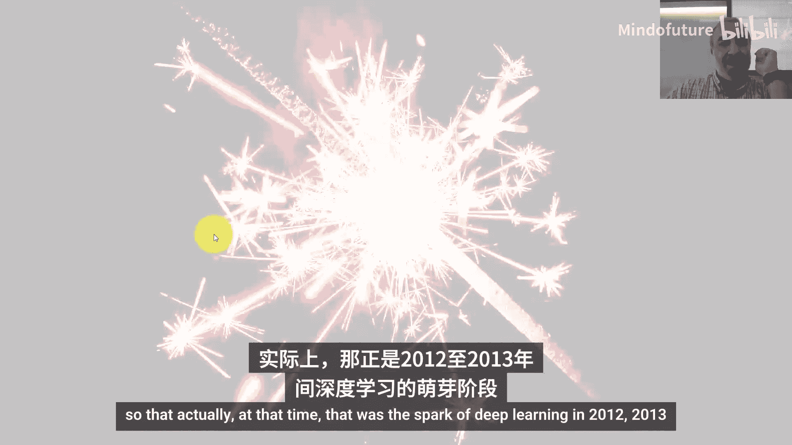
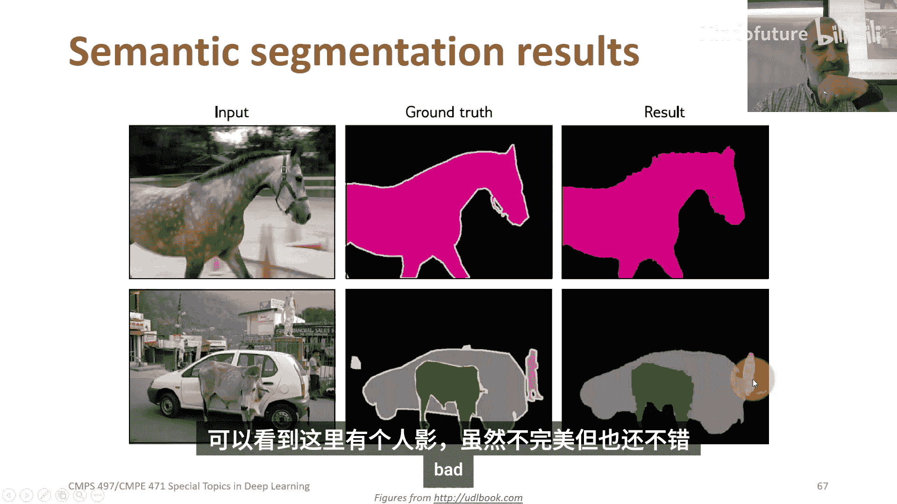

# 深度学习：第二十四讲：CNN III

在本节课中，我们将继续学习卷积神经网络。我们将重点介绍两种重要的操作：下采样和上采样，并探讨它们在图像分类和语义分割这两个具体应用中的实现。

## 下采样与上采样

上一节我们介绍了卷积操作的基本原理。本节中，我们来看看如何改变特征图的空间尺寸，即下采样和上采样。

### 下采样

下采样旨在减少输入数据的空间尺寸（例如，图像的分辨率）。这样做可以降低计算和内存需求，同时扩大后续层的感受野，使其能够处理输入中更广泛的区域。

以下是三种常见的下采样方法：

1.  **间隔采样**：从每个2x2的块中，规律性地选取一个值（例如，左上角的值），并跳过其他三个值。这直接减小了尺寸。
    *   输入块：`[[1, 3], [2, 6]]`
    *   输出值：`1`
2.  **最大池化**：这是最常用的方法之一。对每个2x2的块，取其中数值最大的一个。
    *   输入块：`[[1, 3], [2, 6]]`
    *   输出值：`6`
3.  **平均池化**：对每个2x2的块，计算其中所有数值的平均值。
    *   输入块：`[[1, 3], [2, 6]]`
    *   输出值：`(1+3+2+6)/4 = 3`

对于多通道输入，上述操作会独立地应用于每个通道。

### 上采样

上采样旨在增加数据的空间尺寸。这在需要生成与输入同尺寸输出的任务中非常有用，例如图像生成或语义分割。

以下是四种常见的上采样方法：

1.  **值复制**：将输入中的每个值复制到一个2x2的块中，从而使每个维度尺寸翻倍。
    *   输入值：`2`
    *   输出块：`[[2, 2], [2, 2]]`
2.  **最大反池化**：与最大池化操作对应。记录下采样时最大值在原图中的位置，在上采样时将该值放回原位，其余位置补零。
3.  **双线性插值**：根据相邻像素的值，通过插值计算来填充新位置的值，从而生成更平滑的放大图像。
4.  **转置卷积**：这是可学习参数的上采样方法。可以将其视为普通卷积的“逆向”过程，使用转置后的权重矩阵从少量输入值生成更多输出值。其权重在训练中学习得到。

## 1x1 卷积

有时我们需要在不改变空间尺寸的情况下，改变特征图的通道数。这时可以使用 **1x1 卷积**。

*   一个1x1卷积核的尺寸是 `1 x 1 x C_in`，其中 `C_in` 是输入通道数。
*   它独立处理每个空间位置，但混合所有通道的信息。
*   使用 `C_out` 个这样的卷积核，就可以将通道数从 `C_in` 变为 `C_out`。

公式表示：对于输入位置 `(i, j)` 的向量 `x`（维度为 `C_in`），1x1卷积的输出 `y`（维度为 `C_out`）为：
`y = W * x + b`
其中 `W` 是 `C_out x C_in` 的权重矩阵，`b` 是偏置向量。

## 应用一：图像分类

了解了基本组件后，我们来看一个经典应用：图像分类。其目标是为整张图像分配一个单一的类别标签。

### ImageNet 数据集

一个著名的基准数据集是 **ImageNet**，它包含：
*   **尺寸**：224x224 像素的 RGB 图像。
*   **类别**：1000个不同的物体类别。
*   **数据量**：约130万张训练图像，5万张验证图像，10万张测试图像。

### AlexNet (2012)

AlexNet 是深度学习复兴的标志性模型，它在2012年ImageNet竞赛中取得了突破性成绩。

以下是其网络结构详解：

1.  **输入**：224x224x3 的图像。
2.  **卷积层1**：使用96个11x11的卷积核，步长为4。输出尺寸为55x55x96。
    *   参数量计算：`11*11*3 * 96 = 34,848`个权重 + 96个偏置。
3.  **最大池化1**：3x3窗口，步长2。输出尺寸为27x27x96。
4.  **卷积层2**：使用256个5x5的卷积核，填充使尺寸不变。输出为27x27x256。
5.  **最大池化2**：3x3窗口，步长2。输出为13x13x256。
6.  **卷积层3**：384个3x3卷积核。输出13x13x384。
7.  **卷积层4**：384个3x3卷积核。输出13x13x384。
8.  **卷积层5**：256个3x3卷积核。输出13x13x256。
9.  **最大池化3**：3x3窗口，步长2。输出为6x6x256。
10. **展平**：将6x6x256的特征图展平为长度为9216的向量。
11. **全连接层1**：4096个神经元。
    *   参数量：`9216 * 4096`个权重 + 4096个偏置。
12. **全连接层2**：4096个神经元。
13. **输出层**：1000个神经元（对应1000个类别），后接Softmax函数产生类别概率。

AlexNet 总共约有6000万参数，其中大部分位于最后的全连接层。它通过使用ReLU激活函数、Dropout和数据增强等技术，将Top-5错误率从之前的约25%大幅降低到16.4%，证明了深度网络的有效性。

### VGGNet (2014)

VGGNet 的核心思想是**增加网络深度**。它主要使用堆叠的3x3小卷积核来代替大的卷积核（如11x11或5x5）。

*   **更深的结构**：例如VGG-16有16层权重层（13层卷积+3层全连接）。
*   **更多参数**：约1.44亿参数。
*   **更好性能**：将ImageNet的Top-5错误率进一步降至约6.8%，验证了深度是提升模型性能的关键因素。

从AlexNet到VGGNet的发展，标志着CNN在图像分类任务上日趋成熟。

## 应用二：语义分割

现在，我们来看一个更复杂的任务：语义分割。它的目标是为图像中的**每一个像素**分配一个类别标签，从而区分出不同的物体区域。

### 网络结构：编码器-解码器（U-Net 风格）

语义分割网络通常采用对称的“编码器-解码器”结构，形似沙漏或U型。

1.  **编码器（下采样路径）**：
    *   与图像分类网络（如VGG）类似，由多个卷积层和池化层组成。
    *   作用：逐步提取高层次、抽象的特征，同时缩小特征图尺寸，扩大感受野。
    *   输出：一个高度抽象但尺寸较小的特征表示。

2.  **解码器（上采样路径）**：
    *   与编码器大致对称，由多个上采样层（如转置卷积）和卷积层组成。
    *   作用：逐步将小尺寸的特征图上采样回原始图像的尺寸，同时恢复细节信息。
    *   关键技巧：**跳跃连接**——将编码器中间层的特征图与解码器对应层的特征图进行拼接，帮助解码器更好地定位和恢复细节。

3.  **输出层**：
    *   最终输出一个与输入图像同尺寸（如224x224）的特征图。
    *   其**通道数等于类别数**（例如，PASCAL VOC数据集有21类：20个物体+1个背景）。
    *   每个像素位置对应一个长度为21的向量，经过Softmax后，表示该像素属于各类别的概率。

### 工作流程示例

输入一张224x224x3的图像，网络最终输出一个224x224x21的张量。通过对每个像素的21维向量取argmax，就得到了该像素的预测类别，从而生成一张分割结果图。

## 总结

本节课中我们一起学习了卷积神经网络的两个核心操作和两个重要应用。

*   **下采样**（如池化）用于压缩数据、扩大感受野。
*   **上采样**（如转置卷积）用于恢复尺寸，用于像素级预测任务。
*   **1x1卷积**是灵活改变通道数的工具。
*   在**图像分类**中，我们看到了从AlexNet到VGGNet如何通过增加深度来提升性能。
*   在**语义分割**中，我们认识了编码器-解码器结构，它通过先压缩再扩展的方式，实现了对图像每个像素的精细分类。

这些概念和模型架构构成了现代计算机视觉深度学习的基石。