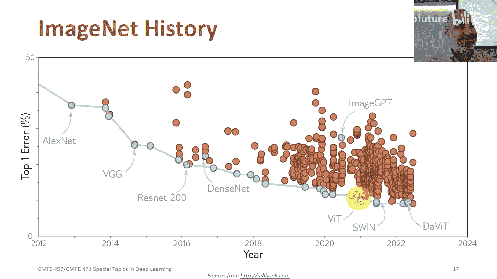
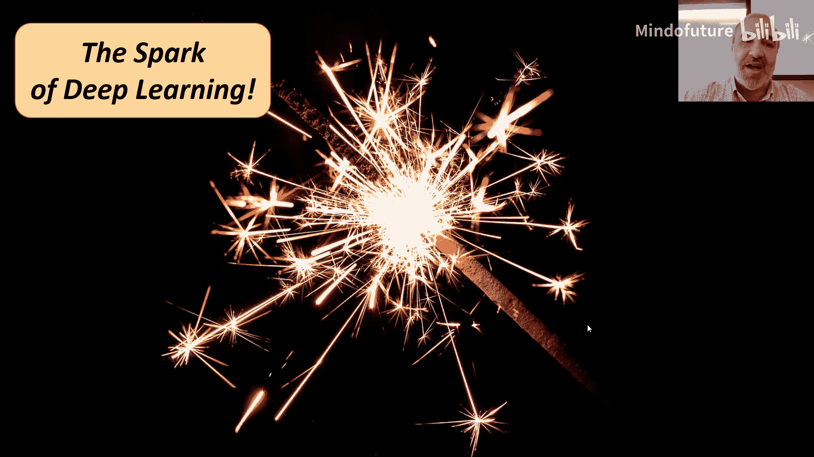
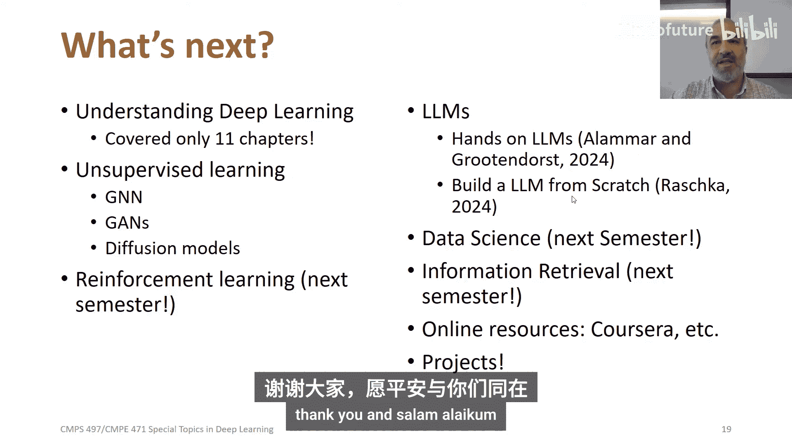

# 【卡塔尔大学】深度学习 CMPS497 ｜ Understanding Deep Learning ｜ Fall 2024 p28 P28_第二十五讲-用于图像的Transformer -BV1vQvNz1EeK_p28-

S this is in Charlotteh the last session of the course in the last two sessions we talked about transformers。

 then CNNs and at the end of the Transer session we mentioned that there was some work on processing images using transformers and this is the short session Charh that we will cover today。

 Transers for images。嗯。The idea is that we can， in principle。Pros images as if they are text。

 if they are represented by embeddings， then we can process images as text。嗯。

It looks like a nice idea in the beginning， but it is not obviously a promising idea for two reasons first。

😊，Images are much larger than text， especially if we talk about pixels。

 so we can the first idea to to to think about is to to eat each pixel as a token。Right。

 and present each vector by an embedding vector。If we do that。

 then the complexity of the self attention layer will be huge because the number of pixel is in millions。

And you know that the self attention is computed between every token， right？

Between pairs of tokens the computations of the self attention widths would be a bottleneck in this case Another thing is that CNNs have really good inductive bias they are if you remember the convolutional layers are equivalent to any translation if I made any translation to the image then the output of the layers will be also translated。

But that's not the case in in transformers by definition of body structure transformers are not meant for 2D structure of the image。

 they are not by default doing this special translation， so we have to learn that。

Using the training data。But， nevertheless。With the scale of the model of the scale of transformer models and the scale of the data that is available and that that you will see in Shala very soon。

 we can。Achieve good performance with relative to the performance of CNNs we' see。

We will discuss three models that are transformer based for images， first image GPT。

 and then vision transformer and then a vision of vision transformer called multi scale vision transformers。

From the name image GT。😡，What do you expect。Okay， so GP is a decoder based model， right。

 it generates what。In the original structure of GT generate tokens。

 right Gene next token right predicts next token， so the idea here is that it will predict the next。

6ix it。The next pixel okay that that's the idea， so it is a transformer based decoder。

 the autoregressive property is that it will now predict the next pixel given whatever generated from the pixels it will generate the next pixel。

😊，1。😊，The model that was introduced at the time has 6。8 billion parameters， it operates。

 although it is really large， but it operates on very small scaled images。

 64 by 64 otherwise the model will be much larger。And if you think about it each pixel。

Has RGB values， right， and the RGB values。呃。Representing the color and usually it is like 32 bit or 64 bit or whatever。

 but but it was quantized here to be 9 bits only so that it can be really processed using the transformer models。

If that's the case then each pixel is just one it has one value out of512512 values because we have nine bits to represent each pixel remember in the transformer we had vocabulary size right can recognize some tokens。

Right， he the tokens are pixels。And if we assume that each pixel has nine bits。

 then the possible values of the tokens here are just 512。Okay， did you get that？

So that that is actually the vocabulary that we have。 So in processing text。

 we have to find we have to to get the vocabulary set using the tokenizer here。

 we don't we don't need any tokenization because we know that the tokens are pixels and in that specific case。

 the pixels have values。has one value， each pixel has one value out of 512 values only。嗯。

The image GT has or any any any any transformer based model that is used for images。

 it has to learn its own positional encoding at each pixel。 Remember for CNNs。

 we by default by structure we we know that each pixel has neighbors right and that's how we we design kernels to to to process。

Erision， right， but that kind of 2D region is not。Known by default by the transformers。

 transformers process 1 d did not2 d， so they can understand that yes。

 this token is the next to the the to the other token， but there is no relation between rows。

 there is no concept of rows in transformers， so even if there is a pixel that has a pixel at the top of it。

They are not neighbors in the transformer when the transformer processes it。

 so the position en codinging gear has to be learned。From scratch。These are。

 I will show you two examples of using image GPT。你明白。

GPT it is predicting the next pixel okay so the first the first application is is kind of an extreme application。

😊，The M GPPT model was given only one pixel。😡，Wwhich is the top left corner here。

 so just one pixel it each image here started with just one pixel that is given to the image GPT model and then the model generates the rest。

Okay， just from one pixelie。because it was trained to predict the next pixel okay。

 so it is auto aggressive， so it predicts the first pixel and then predicts the second based on the first and so on。

😊，Okay， do you have any observations on the images here？Do they look， they look normal。Yeah。

Did you like them。😀ふ。😊，They have some strange things。 they are they are not random。 Of course。

 this is this is an image of a dog， right It's very， very clear。 This is a cab。

 people in in a garden or something。 but even with that。

 there are if you look at the details of the image you will find that there are some things that are。

Strange， very strange， right， And you can compare this technology at the time。

 This is like four years ago or five years ago with the technology that we have now。

With the image with the models， the applications that generate images。

 I think they look much better than this， but that was the very first attempt in generating images。

You can even look at some images and you can you can see clearly that。These are not normal images。

 things that that are very strange。 But remember that these images were genetic by given just one pixel。

Okay so having an image that looks any， something that is familiar is good by itself。

So this is called image generation task， that's an extreme and the other task is called image completion task in this task we are given the model half of the image。

😊，So the first row here is what the model is given for each image。

 and then the model generates the rest of the image。What do you think about this。

Compared to the other。They're much better at that， why。他们都。😔，Yeah， so the context right。

 the context it is given a context here that is much larger than one pixel here。 Okay。

 so half the image was was good enough to generate different different images。

 Why do we have by the way， different images for the same input。Yes。

 so but because because the the generation is probabilistic， right， one of them is is a beam search。

 of course， so it can generate given the same input can generate different outputs。嗯。

Based on the province。Some details， remember this is still GPT， so we will transformer。

 so we will have an embedding for each pixel。In the input and at the output player， of course。

 we also have beddings。 So if it's you， it will be used for image classification。

 then we have to have a classification head， so we have to。

Either use CLS but there's no CLS in that model， in that model they average the embeddings at the last layer and then add a linear layer and softm to do the classification。

 and it was preed on a very large corpus or collection of images。And then find tune on imageNe。

And for imageNe， they were sized the images very size to even smaller。Scale。

 which is 48 by 48 pixels。And with that， the model achieved a 27。4% top1 error rate。

Still much lower than or much higher than CNNNs at the time。

 but impressive given that the image size was very small and imagine here the image size is 48 by 48。

 the original images in in imageNe where 200 I think 256 we mentioned that last time。

 something like that 256 by 256， this is much smaller。Yeah， okay， 228 by 20228 st。

 this is much smaller and to get any that number that that was impressive given that it was the first step。

Remember the imageNe history， this is image GPT here。And you can see that it is。

Not the state of the art right at the time， but it was the first attempt to use transformer based models for image processing。

ok。😊，then we will talk about another family， which is called vision Transformer。

What is what are the differences here， Vis transformformer is an encoder model。

 it's not a decoder model， it is an encoder model。😊。

One major difference is that the encoder model here doesn't take each pixel as a token。

 it takes patches of pixels as tokens。And patches are 16 by 16 patches 16 by 16 pixels。

So that's one difference。The embeddings at the beginning。

 each batch was converted into an embeddings via a linear layer before it is input to the transformal and position indings also are learned。

Here is an overview of the model and I think you can see it is very familiar。

 similar to the encoder models， except that now we have an image and the image is divided into patches as you see and each patch now is transform or is represented by an embedding vector and before that we use an linear layer to convert into an embedding vector。

But other than that， this is a transformer block as usual。😊。

Whi is the encoder stack and then I think here the CLS token was used for classification。Okay。

 so it's very similar of picture， except the beginning。

 we have patches and we have a linear layer before the embedding layer。Okay。

So that's not very different so far from any encoder based model except the patches。

 but then the main difference is that if you remember the transformers in the encoder transformer like Bt。

 how was it pretrained？What was the task？什么间觉得。Yeah。Yes。

 mask language model right and was that self supervision or supervised learning self supervision right。

 self supervision here the main difference is that we have pretraining with supervised learning。

With labeled data， so they have a very large database of images， 300 million images labeled for 18。

000 classes。And that's a big difference between vision transformer and the previous versions like image GT so it was pretrained on label data。

 the CS was used for classification and these two two changes that dealing with patches and instead of pixels and the pretraining on large label data made a big difference in performance if you remember image GPT reached I think 27。

5 this one reached 11。5。Big difference in performance and it is now on bar with CNNs， but of course。

 without this supervised pre training， it wouldn't be that good。It would have been worse than CNNs。

 So vision transformer is。Very close to be the state of God at that time。

you see the difference between image GPT and vision transformformer。

 image GT was a decoder model and vision transformformer was an encoder lots of labeled data for preing and also processing patches of images within the image instead of pixels。

The third version or the third family that we will talk about very briefly is a version of a vision transformer called multi scale vision transformers。

If you notice in the previous two models。We use the image as is， I mean with there's no scaling。

 you saw in CNNs that usually we do down sampling and that will increase their field。

 but so far in these two versions of these two families of models we didn't do that in multiscale vision transformers we started to see something like that。

So we process multi scale visions of almost must process the images at different scales。

We start with very high resolution attaches and then gradually decrease the resolution and increase the number of channels。

 so let me explain that on this figure this is the original image。

The first thing is to process the image is to divide it into patches， small patches， maybe 16 by 16。

 and then define what we call a window。And the window will be four by four patches。

 so as you can see here this is one window， that's another window， that's a third window and so on。

 so we divide the image into small patches and then each four by four patches will be one window。

Okay， now if you remember in transformers， when we do the attention。

 do we do the attention over all input tokens or part of them， is the original idea of transformers。

 Was it on all tokens。They save attention。Yes， okay so self attention is completely over ortho tokens here we do the selfat on stages so at that stage which are layers here any the images that you see here are processed by different layers so the first layer here will compute self attention within the window only。

So each window， we will compute the self attention within the patches inside one window。Okay。

 so there is no self attention that is computed between patches from different windows okay at that layer。

Then in the second layer we will shift the window boundaries so as you can see here this row of batches and this row of batches they are in different windows right so we will not be there will be no self- attention widths between them。

 but then when we shift the window。Now they will be inside the same window and the selfat widths will be computed among them。

 so with every when we move forward the windows will shift and when the windows will shift patches that were in different windows now they will be in the same window and we will compute will start to compute self attention widths。

Okay。😊，So gradually， you will see that self attention rates will be computed among。

Any larger lesions？Then the next step is to combine or concatenate patches together。

 So every two by two。Btches within the window they will be one patch。

 so they would be concatenated and they would be one batch and then the window now will be larger because the window is defined to be4 by four or two by two whatever。

 but now the batch as you can see in this in this part are larger than the patches before。Okay。

 so we are doing iterations over three steps first。We defined the window over patches。

 then we shifteded the windows。Then we concatenate more batches together and then we repeat this cycle again and again okay if we do that multiple times。

 we will end up at the end with just one window because we are having over time we have smaller number of batches。

So at the end， we will have just one window， which means that we will compute the tension over everything。

At the end。So these are layers this is a stack of layers okay so you can see that each layer is processing the image in a bit different way and let me emphasize here is that the input to each layer is not an image but this is just the structure of the image of course we are processing we are computing values over different layers so the input is not the original image but the output of processing the image from the previous layer。

So that's kind of the main concept of shifted window or swing transformer。

 so it divides the image into patches and the windows are shifted and the scale is reduced over time。

 nor CLS token was used， the averages of the embeddings at the end is used。

And the performance here was a little bit better than than the vision transformer。 So it was that。

 I think 11。5 here， it is less than 10。 And you can see that there is some improvement over the transformer here。

 we reach almost reach。The state of the art。And these are three models that are completely based on transformers。

 they are not CNNNs at all， but they showed performance that is on bar with CNNs。

 although they were not originally designed to process images。Okay。

 so these are three examples quickly， Three examples of。Of processing images using transformers。

Any questions。I know that we didn't any。Dig deep in the details。

 but this is just a quick introduction for you to such models using transformers for image processing。

嗯。我相。

Okay， with that， I think we are done with the course and I hope that this course was really any spark of deep learning in your in your career。

 I hope that you will learn much more than what we covered so let me in the next slide which is the last slide really show you where you you can go from here So what's next after this。

What we covered is just 11 chapters。From the book。We intended to cover much more than that I intended to cover much more than that but the time was really tight so we didn't cover unfortunately unsupervised learning there are multiple chapters in the book if you want to continue I would recommend special these three chapters GN are special kind of neural networks that are meant to process graphs and there are lots of real real worlded data that are graphs。

So this is， I think you should read and two examples of models that are image generators。

 if you are excited about how these things are done， GNS and diffusion models。

 these are two things that I would recommend for you if you want to read about generated models for image generation。

There is also reinforcement learning that we need't cover， but it will be covered next semester。

 There is a course。Complete course on reinforcement learning and not teaching it。

 but I would recommend if you really want to continue on this path to take this course or at least auditance。

There is also now since you were introduced to a good level of detail to large language models。

 I would do recommend more readings on that on that very hot topic。

 there are two books that I recommend that are very recent the first is called handson La language models and the second build a large language models from scratcht and both are by the way available freely through the QU library。

So they are available and I checked them and I got them away。Okay， and they are very easy to read。

 especially that now you have good， I think， foundation on the basic concepts。

Theres also a course about data science next semester that I'm teaching in Sha。

's not very it's not on deep learning， but I think it will make your statistical background。

 I think much， much better for deep learning and forward machine learning in general。

There is also another course that I might teach next semester which is so the data science is an undergud course。

 information Aver is a guide course and you are welcome to attend information A is about building search engines and I think this is now very of course it is important always because we use search engines a lot in our lives for a long day for long time but also especially now it is important because it's very well connected to large models。

There are lots of online resources for deep learning I'm sure that you are familiar with Cosair。

 there are several specializations I think you are in a very good position now if you want to finish any of them。

And finally， you need to have hands on projects Okay， of course。

 after you have finished you finished our course project。

 but you should you should always try new ideas and implement them in projects because that's the main。

The main way you are sure that you really understand the material。对。Oh。Okay， I think this is it。

 I hope that you really enjoyed the cost I personally enjoyed that at the cost very much。

 I hope that you did also。Thank you and somebody can。

