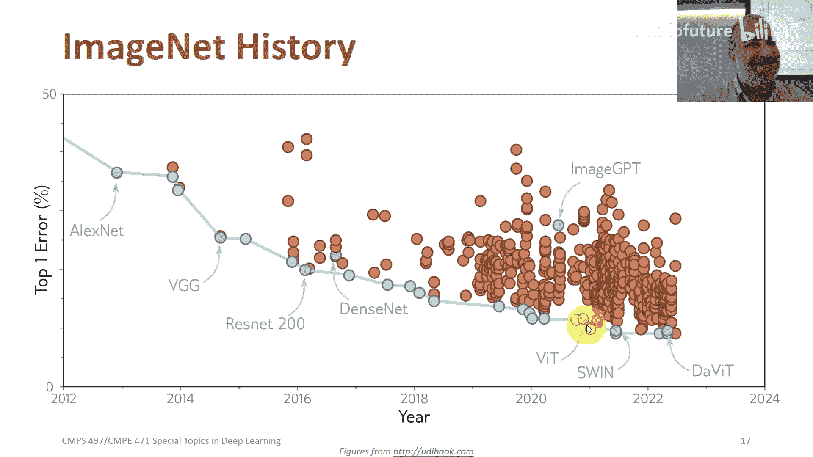
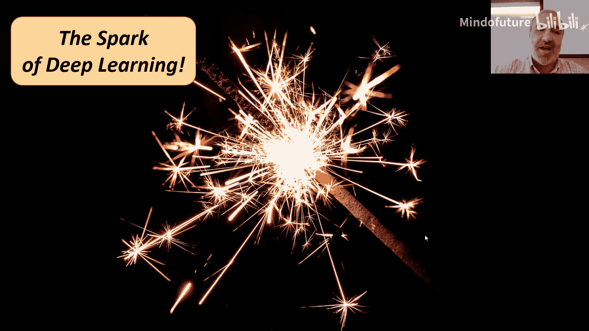
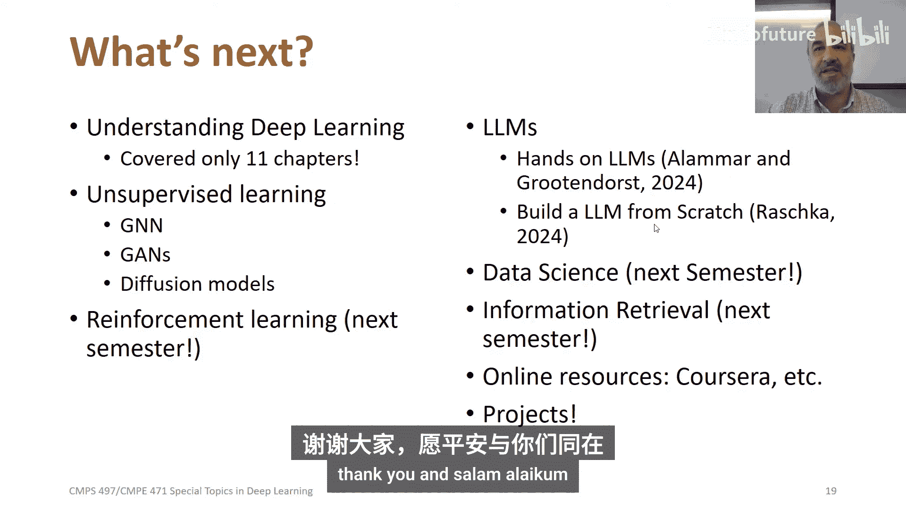

# 深度学习：第25讲：用于图像的Transformer 🖼️

在本节课中，我们将学习如何将原本用于处理文本的Transformer模型，应用于图像处理任务。我们将探讨其背后的核心思想、面临的挑战，并介绍三个基于Transformer的图像处理模型。

---

## 概述

上一节我们介绍了Transformer和CNN。在Transformer部分的结尾，我们提到了一些使用Transformer处理图像的研究工作。本节我们将简要介绍“用于图像的Transformer”。

其核心思想是，原则上我们可以将图像视为文本来处理。如果图像被表示为嵌入向量，我们就可以像处理文本一样处理图像。这个想法最初看起来不错，但显然并非一帆风顺，主要有两个原因。

首先，图像比文本大得多，尤其是以像素为单位。第一个想法是将每个像素视为一个词元，并用一个嵌入向量表示。如果这样做，自注意力层的计算复杂度将非常高，因为像素数量高达数百万。自注意力是在每对词元之间计算的，这将成为性能瓶颈。

其次，CNN具有良好的归纳偏置。卷积层具有平移等变性：如果图像发生平移，卷积层的输出也会相应平移。但Transformer的结构并非为图像的二维结构设计，默认不具备这种空间平移特性，因此必须通过训练数据来学习。

尽管如此，随着Transformer模型规模和可用数据量的扩大，我们可以在图像任务上取得与CNN相媲美的性能。接下来，我们将讨论三个基于Transformer的图像模型。

---

## 图像GPT (iGPT) 🤖

图像GPT，顾名思义，是一个基于解码器的模型。原始的GPT生成下一个词元，而图像GPT则预测下一个像素。这是一个基于Transformer的自回归解码器模型，根据已生成的像素来预测下一个像素。

当时提出的模型拥有68亿参数。尽管模型很大，但它只能处理非常小的图像（64x64像素），否则模型会过于庞大。每个像素有RGB值，通常用32位或64位表示，但在此模型中被量化为9位，以便Transformer处理。

在这种情况下，每个像素只是一个值，取自512个可能值（因为9位可以表示2^9=512种可能）。在Transformer中，我们有一个词汇表。在处理文本时，我们需要通过分词器获取词汇表；在这里，我们不需要分词，因为词元就是像素。在这个特定情况下，每个像素的值只是512个值中的一个。

图像GPT（以及任何用于图像的基于Transformer的模型）必须学习自己的位置编码。对于CNN，我们通过设计卷积核来默认理解像素的邻域关系。但Transformer处理一维序列，默认没有“行”的概念。即使一个像素上方有另一个像素，在Transformer处理时，它们也不是“邻居”。因此，这里的位置编码必须从头开始学习。

以下是使用图像GPT的两个示例。

第一个是图像生成任务，这是一个极端的应用。模型只给定一个像素（左上角的像素），然后生成图像的其余部分。因为它是被训练来预测下一个像素的，所以它是自回归的：预测第一个像素，然后基于第一个预测第二个，依此类推。

观察这些生成的图像，它们看起来正常吗？它们看起来有些奇怪，但并不随机。这显然是一只狗的图片，或者花园里的人物。但仔细观察细节，会发现一些非常奇怪的东西。与我们现在拥有的图像生成模型相比，这些图像质量较差，但这是生成图像的最初尝试。请记住，这些图像仅从一个像素生成。

第二个任务是图像补全任务。在这个任务中，模型被给定图像的一半（第一行），然后生成图像的其余部分。与上一个任务相比，这些结果要好得多。为什么？因为上下文更丰富了。模型获得了比一个像素大得多的上下文。当然，由于生成是概率性的（例如使用束搜索），相同的输入可以产生不同的输出。

如果用于图像分类，我们需要一个分类头。该模型没有使用CLS标记，而是在最后一层对嵌入向量取平均，然后添加一个线性层和Softmax函数进行分类。它在非常大的图像集合上进行了预训练，然后在ImageNet上进行了微调。

对于ImageNet，图像被调整到更小的尺寸（48x48像素）。在这种情况下，模型达到了27.4%的Top-1错误率。虽然这仍然远高于当时CNN的水平，但考虑到图像尺寸非常小，这个结果令人印象深刻。ImageNet的原始图像尺寸约为256x256，而这里是48x48。作为使用Transformer进行图像处理的第一步，取得这样的成绩是令人瞩目的。

回顾ImageNet的历史，图像GPT在当时并非最先进的技术，但它是使用基于Transformer的模型进行图像处理的首次尝试。

---

## 视觉Transformer (ViT) 👁️

接下来我们讨论另一个系列，称为视觉Transformer。

视觉Transformer是一个编码器模型，而不是解码器模型。一个主要区别是，这里的编码器模型不将每个像素视为一个词元，而是将像素块视为词元。这些块是16x16像素的补丁。

在开始时，每个补丁通过一个线性层转换为嵌入向量，然后再输入到Transformer中。位置编码也是学习得到的。

以下是该模型的概述，看起来非常熟悉，与编码器模型类似。不同之处在于，现在输入是图像，图像被划分为补丁。每个补丁由一个嵌入向量表示，在此之前，我们使用一个线性层将其转换为嵌入向量。除此之外，这就是一个常规的Transformer块，即编码器堆栈。这里使用了CLS标记进行分类。

到目前为止，除了补丁处理外，这与任何基于编码器的模型没有太大不同。但主要区别在于预训练方式。还记得像BERT这样的编码器Transformer是如何预训练的吗？任务是掩码语言建模，这是一种自监督学习。而视觉Transformer的主要区别在于，它使用有监督学习进行预训练，使用了带标签的数据。它在一个非常大的图像数据库（3亿张图像，18000个类别）上进行了预训练。

这是视觉Transformer与之前版本（如图像GPT）的一个重大区别。它使用带标签数据进行预训练，CLS标记用于分类。这两个变化——处理补丁而非像素，以及在大量带标签数据上进行预训练——使得性能有了巨大差异。图像GPT的错误率约为27.5%，而视觉Transformer达到了11.5%，这是一个巨大的性能提升，使其与CNN性能相当。当然，如果没有这种有监督的预训练，它的表现会比CNN差。

视觉Transformer在当时已接近最先进水平。可以看到图像GPT和视觉Transformer之间的区别：图像GPT是解码器模型，而视觉Transformer是编码器模型；使用了大量带标签数据进行预训练；并且处理的是图像内的补丁，而不是单个像素。

---

## 多尺度视觉Transformer (MViT) 🔍

我们将简要讨论的第三个系列是多尺度视觉Transformer，它是视觉Transformer的一个变体。

在前两个模型中，我们直接使用图像，没有进行缩放。在CNN中，我们通常会进行下采样以增加感受野。但在这两个系列的模型中，我们没有这样做。在多尺度视觉Transformer中，我们开始看到类似的做法：我们以不同的尺度处理图像。

我们从高分辨率的补丁开始，然后逐渐降低分辨率并增加通道数。让我通过这个图来解释。

首先，将图像划分为小补丁（例如16x16），然后定义一个“窗口”。窗口由4x4个补丁组成。如图所示，这是一个窗口，那是另一个窗口，等等。我们将图像划分为小补丁，然后每4x4个补丁组成一个窗口。

在Transformer中，当我们计算注意力时，是在所有输入词元上计算，还是部分词元上计算？原始Transformer的自注意力是在所有词元上计算的。但在这里，我们在不同阶段（层）计算自注意力。第一层将仅在窗口内计算自注意力。因此，每个窗口内，我们只计算该窗口内补丁之间的自注意力。在那一层，不同窗口的补丁之间不计算自注意力。

然后在第二层，我们将移动窗口边界。如图所示，这一行补丁和那一行补丁原本在不同的窗口中，它们之间没有自注意力。但当窗口移动后，它们现在处于同一个窗口内，我们将开始计算它们之间的自注意力。

因此，逐渐地，自注意力将在更大的区域上计算。下一步是将补丁组合或连接起来。窗口内的每2x2个补丁将合并为一个补丁。然后，由于窗口被定义为4x4（或其他尺寸），现在补丁比之前的更大。因此，我们重复这个循环：定义窗口、移动窗口、合并补丁。如果我们多次重复，最终将只剩下一个窗口，因为随着时间的推移，补丁数量减少。最终，我们将在所有内容上计算注意力。

这些是层，这是一个层堆栈。每一层都以略有不同的方式处理图像。需要强调的是，每一层的输入不是原始图像，而是前一层处理图像后的输出。

这就是移位窗口或Swin Transformer的主要概念：它将图像划分为补丁，窗口随时间移动，尺度随时间减小。这里没有使用CLS标记，而是使用了最终嵌入向量的平均值。

这里的性能比视觉Transformer稍好一些。视觉Transformer的错误率是11.5，而这里低于10。可以看到，相对于Transformer，这里有了一些改进，几乎达到了最先进水平。

这三个模型完全基于Transformer，完全不包含CNN，但它们在图像处理上表现出了与CNN相当的性能，尽管它们最初并非为处理图像而设计。以上是使用Transformer处理图像的三个简要示例。

---

## 总结

本节课我们一起学习了将Transformer模型应用于图像处理领域。我们首先了解了其基本思想与面临的挑战，即处理高维像素带来的计算复杂度以及缺乏CNN固有的空间归纳偏置。接着，我们介绍了三个重要的模型：

1.  **图像GPT (iGPT)**：一个自回归的解码器模型，将每个像素视为词元，通过预测下一个像素来生成或补全图像。
2.  **视觉Transformer (ViT)**：一个编码器模型，将图像划分为补丁作为词元，并通过在大规模有标签数据集上进行预训练，取得了与CNN相媲美的性能。
3.  **多尺度视觉Transformer (MViT)**：ViT的变体，引入了移位窗口机制和多尺度处理，逐步在更大范围内计算注意力，进一步提升了模型性能。

这些工作表明，通过足够的模型规模和数据，Transformer架构能够有效处理图像任务，为计算机视觉领域开辟了新的方向。