# 【OpenCL编程 RayiYanuTara】 p01 p0 OpenCL 1.2： High-Level Overview -BV1X2BRYyEeM_p1-

Welcome to my YouTube video。 I will be describing the Open Seattle 1。2 high level。

View of the specification。Provide you a little bit of background about myself， First of all。

 I'm a parallel programming guru。I have extensive experience in training with C++ Open CL and Linux。

I'm primarily concerned with real life software， which means I have a slightly different take than many of my counterparts who are discussing Open Seattle。

I'm an Opense middleware developer。This talk will partially motivate the role of Opense middleware。

 suffice to say my primary interest is in providing you with tools so that your OpenC development is much easier than it would be without those tools being available to you。

I've been doing high performance computing for a long time。

 right now there's a big push into big data technologies。

High performance computing in many ways is still more complicated than these technologies。

 and I just wanted to point out that I've been considering these issues which have prompted the development of OpenCL long before the existence of OpenCL or before the recent trend into technologies such as Hadoop or MaRuce。

I'm available for consulting， I certainly would love to help you ensure that your applications are achieving their top performance and delivering value to your customers。

 you can see my blog and information about myself at my website， www。jon。

com and you're welcome to send me an email at any time I also support pgP if you want to talk in a confidential medium。

So I'm going to provide a quick outline of my discussion today。

The first thing I'm going to do is motivate open Se。

 I assume that you already know what Open Se is about， and you already are curious about it。

 You just want to see how it all fits into a pitch， and。

How you are going to use it in your application， My goal here is not to convince you that you should use OpenC。

 I assume you're already interested。 My goal is to give you the complete background you need so that you can really start to use OpenC。

I'm going to discuss the underlying models of OpenCL。

 there are several models which are behind the scenes in OpenC and they're very important。

If you just read the specification directly， you may miss these important concepts。

 so I will be discussing the device， memory and execution models。

This is going to provide you with very important。Motivation for many of the things you were going to learn。

In future regarding Open Se， essentially， the most important part of this talk is to really provide you with everything you need to understand how opense fits together。

 what makes it tick， how it's been created so that more and more advanced topics can be introduced。

 This is Open C 101。 everything that you are ever going to learn about Open Se is going to draw upon the concepts you learn in this talk。

 If you understand this material very well。 future discussions will be very easy to follow。

If you don't understand this material， feel free to send me an email or ask where know tell me where I went wrong in this discussion in terms of perhaps it did not motivate something in the way that makes some most sense and I may issue an amending video later on。

 We're going to discuss how the execution model maps to the device model。

 you're going to see how everything fits together how we have this abstract notion of execution and we map it to a physical device in such a way that we can achieve our goal of heterogeneous computing。

I'll also discuss the host API and you're going to see how the host sees OpenCL。

 You're going to see how we get devices to actually do the work that we're asking them to do。

 I will note that you're not going to see much code if any in this talk。

 The reason for that is that I am trying to give you all of the high levell ideas and background that you need so that you can read the specification yourself so that you can start understanding the big picture ideas that you might lose if you are just looking at how to actually do software design with OpenCL further talks will give more information and will show you more code。

 This particular concept this particular talks sorry is to give you an idea as to what the concepts are。

 how everything fits。

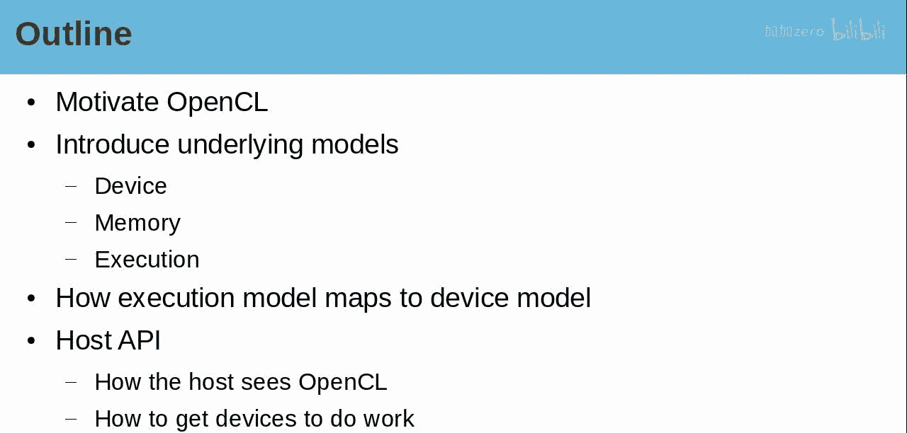

So the first question is what is openZ？

At a high level， we have a host which is dispatching commands to a device。

These devices are part of a heterogeneous system this means that。

We are asking a device to do something on our behalf as a host。

 and that device is programmed in some way that we may not understand or know， for example。

 the device may be a GPU from NviIDdia， the device may be another GPU from AMD that is a device may be a Zon Phi。

The key point here is that we have a device that does something interesting and we want to communicate with it and tell it to do work this is a key point of OpenC The first main actor at OpenC is the host itself。

Now the host， its sole purpose is to tell devices what to do。

 you are actually going to write programs that tell the device how to operate。

And this is the OpenCLC API， it can be confusing because we also have openCLC。

 but the host is what is calling the OpenCLC API which links to Lib OpenCL。

 this is something you've installed which allows you to talk to the device。

We also have devices which actually execute work for the host。

 this is where all of the important work is actually being performed。On the behalf。

 the device is performing work， as asked by the host and providing results back when it is asked to do so。

 The role of the host is to offset loads to the devices and tell them to do something interesting for the purpose of a large application。

There are several models to consider an openC， and this is the main thrust of this particular talk is to make sure that you understand these models completely because they influence everything that you will do。

The first model to understand is the device model， what do devices look like inside。

How do we program these devices， What is the common layer？

What is a common concept that is provided to us？The next thing to consider is the execution model。

 how do we actually run work on these devices？And finally。We have to discuss。The memory model。

 how do devices and the host both see data。And finally， finally， we have the host API。

 which is how the host actually controls the device and I want to give you a few use cases。

 we're going to discuss each of these models in detail。

 this is essentially the entire talk today is to discuss every one of these models but I want to provide you with some motivation as to why you might want to do this and the type of things that OpenC can help you with so consider that we're doing fast permutations。

 so we have data that's not in an order that we want。A permutation could be a sort。

 A permutation could be some sort of hashing。 A permutation is just some sort of shuffling of memory。

 Now， if the device that is attached to us can move memory faster than the host。

 it may make more sense to copy a large piece of data to the device。

 habit permute the data and copy it back。 This is a potentially interesting use case。

Another use case which is slightly related to permutations is data translation。

 if we have to translate data from one format to another。

 and if devices have good properties or the translations involve a lot of bookkeeping or a lot of memory movement。

 we may find it is easier to do the translation on an external device such as a GPU。

Then to do it on the host itself。Finally， numerical software is a very important use case and is probably one of the main reason that the pioneers of GPGU software are coming from fields such as numerical analysis and engineering。

If devices can execute instructions fast enough， you might want to use them to actually do your modeling or do your simulation Now I want to point out these other two use cases of furfa permutations and data translation to show you that OpenCL is not strictly a numerical software standard。

 the point of OpenCL is that you're controlling a device and you can use these devices in interesting ways according to what they're capable of doing。

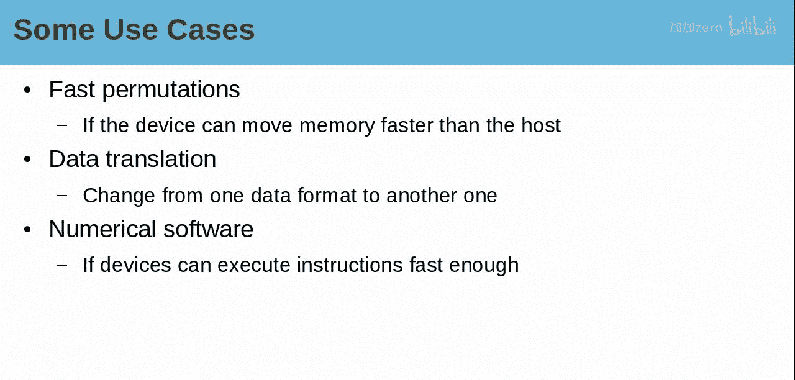

I want to discuss the OpenC standard itself， there's a brief history here， OpenC 1。

0 was released as a specification in December of 2008。

In this year， July 2013， the Open C 2。0 provisional specification was released， and in between。

 we've seen several iterations of the standard being released， which have added new features。

 The Open C 2。0 specification add significant new。Features and it does adjust the。

Philosophy and model that we are discussing today， however。

 because it is a provisional specification and because these other open C versions are still going to be around。

 this talk is very relevant。 Everything you learn here is going to help you understand how open C 2。

0 refines these concepts。Now there are several parts to the OpenC specification itself。

The first part is a course specification。 This means that if something implements open C that。诶。

You have， this is something that you can assume that every you know for OpenCL 1。2。

 say the Co specification dictates that every conformant implementation supports something。

 so if image support which is something that is just there's hardware support for doing image and manipulation。

 if it is part of the core specification for example。

 it means that any device that says that it can do openCL 1。2。It supported this is the main concept。

 of course the core specification， there's an embedded profile。Which relaxes the core specification。

 provides a subset of functionality， the intention of the embedded profile is to target handheld devices。

We have extensions which also provide additions to the specification。

 they might become part of the core specification later。

And we also have to consider the fact that even though it is one specification。

 there are many facets to it， so for example， if you're coming from a CR orC++ background。

 these are very foreign concepts that there are degrees of freedom provide it or permit it。

To vendors in terms of how much they can really support OpenCL。

Perhaps they can't fully implement the core specification。

 We allow them to relax what they can support and call themselves an embedded profile。

 This is a slightly。Complicated notion if you're coming from a background， as I say in CRC++。

 where if you implement it， you implement pretty much everything unless you're doing something very specialized at which point you can call it CRC++。

There are several components to open C。The first thing is that we have the Chost API I alluded to this already。

 this is what you call from the host and this directs devices， it tells them what to do。

 This is the main part that an application programmer is going to use who is basically saying what devices do I want to use。

What do I want them to do， what functions I want to call， where should memory be。

 this is the point of view of the host。The device uses OpenclLC。This is a language based on C99。

 which has many built in functions， and this is also within the standard you will see roughly half of the standard is dedicated to open CLC。

UnderUnderneath。The standard it's not necessarily directly addressed。

There is a memory and execution model。 There is a preamble in the specification which provides some details of this model。

 but in my experience， you have to look through the specification to really understand what these models are and how they relate。

 That's the primary value of this talk is that I've already done the work of scouring the specification and completely understanding how things fit and conveying it to you in a manner that should make it easier for you to access the specification。

If we look at the big picture。On the left， you see that the host API is responsible for the operation of the host。

 the host is going to call the host API to manage devices which you see on the right。

Devices are programmed using openclLC， this will be the topic of the second talk that is a subsequent video to this one and underneath all of this are these models these models are here to guide everything they're not necessarily directly addressed but they underlie everything and if you understand these models understanding openCLC understanding memory management。

 everything becomes much simpler because you understand how the models work so let's start discussing the models we're going to discuss them one by one let's start with the device。

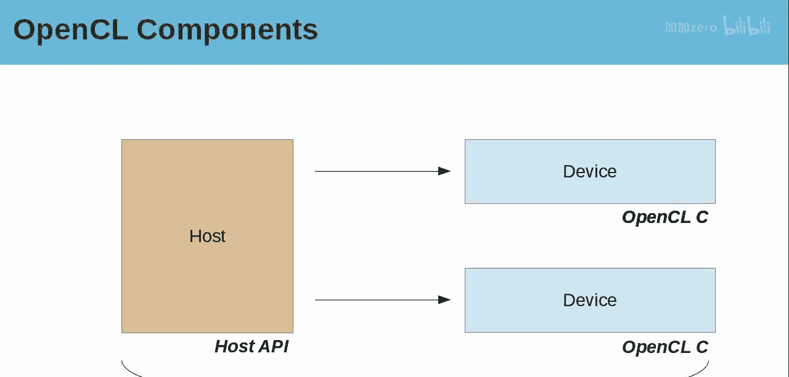

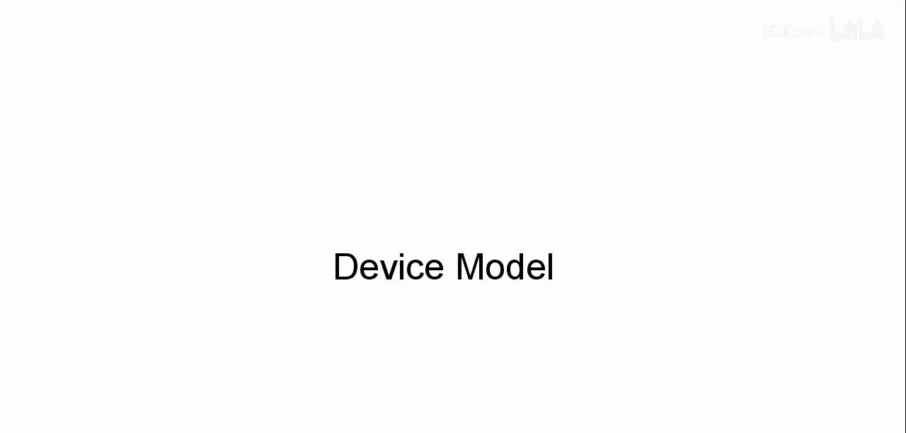

As I pointed out to you before， the device is external to the host this line here does not have to represent a physical pins or anything like that。

 it could be that we're accessing a device over the network。

 it could be anything the point is just that the host has some way of seeing a device so let's take a look inside of it。

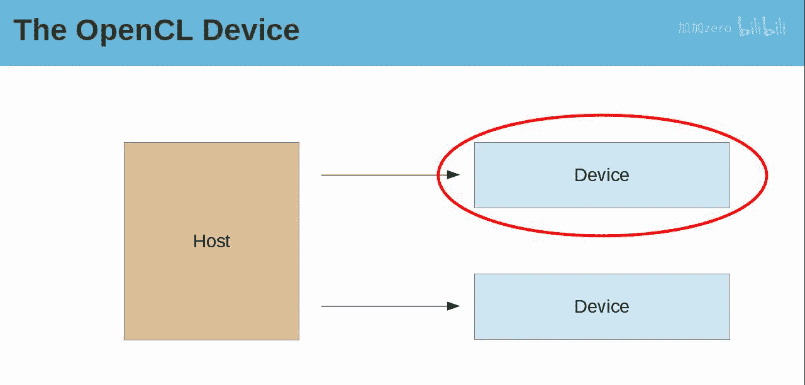

This is the device model。And we're going to look at this piece by piece。

 you can see these rectangles inside of here， inside of the box。

You see that we have something called global memory， constant memory。

 we're going to discuss every piece， but I want to keep descending into the model so the device is broken down into further pieces。

 for example this is a compute unit as you can see here we have 15 compute units and let's descend into the compute unit so that we can understand it。

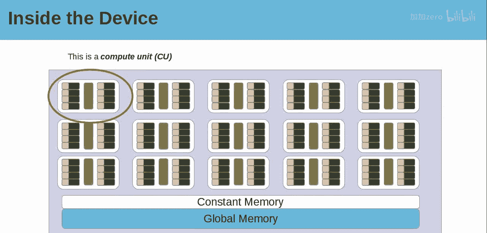

Inside of the compute unit， we see。Eight of these smaller blocks with a label PE and with something called private memory。

 PE stands for Process El。Now we're going to recurse again and let's take apart one of these blocks of the PE here and private memory and see what that's about。

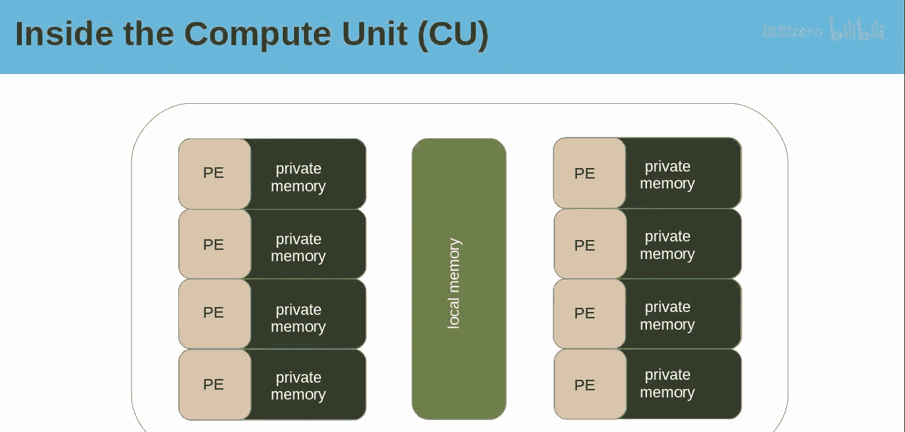

So as I've mentioned， the PE is a processing element。

And the best way to think of this is to think of the processing element as a very simple processor in particular。

 all instructions are executed on the processing element。

 this means that everything that you are going to do in terms of actually making devices do work。

The PE is going to be responsible for all of that。

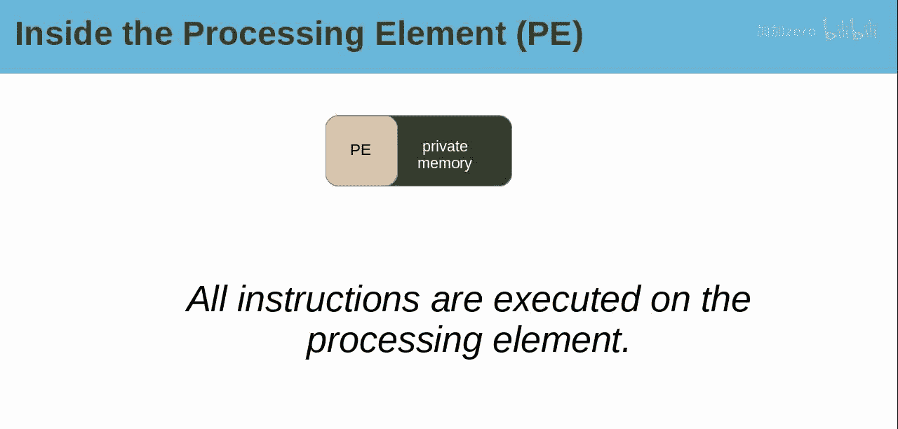

So let's zoom out again。And look at this particular fictitious device and this fictitious device。

 we see that we have 15 compute units， which I use as a shorthand C。

 we have eight processing elements per C。P E is the shorthand for processing elements。

 and someone one might claim that we have 120 processors。

 I first want to address why this is not a good way to think of things。

 It comes up over and over again。 and you really don't want to think of a processing element as a normal processor。

 There is quite a bit of marketing height。 You will see people who say I have 30000 processors on my particular device。

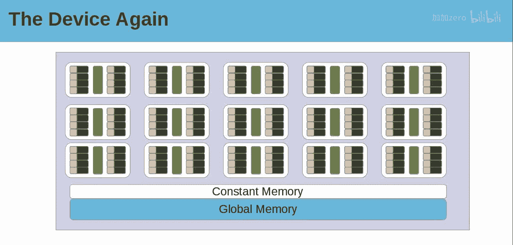

Don't think of it that way， this is misleading and will confuse you as you attempt to do programming and design algorithms to best fit the models you're learning today。

What is important is to realize that processing elements are contained inside of compute units。

A compute unit cannot do anything， all that a compute unit is is a container for processing elements。

 that's the best way to think of this。And don't think that I have 120 processing elements。

 don't substitute processors with processing elements。

 you want to think of the grouping this is very important。

Think of I have 15 compute units and each has eight processing elements within it。

This is really the best way to think about。The device that we have seen and I want you to really start to think this way Now there's another part of this I only discussed so far we've only seen what can do execution in the device we need to look now at the memory model I am not discussing the memory model in terms of how the host of use memory I'm discussing still the device。

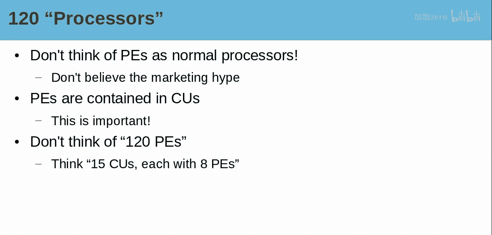

The big picture here is that we have several memory regions if you have a background and see you're used to having really two memory regions。

 you have one physical space of memory which may actually have virtual memory provided。

 but that's an operating system of abstract from the point of view of the process you have one region of memory。

 you have a stack and you have a heap that's your view memory is roughly equivalent in terms of what it can do。

 the only thing you take into account is say cache coherency and cache effects Now this is not the case with openC you have several memory regions。

These memory regions have different properties， have different capabilities。

 this is one of the most significant differences from openC。

As compared to what you probably have seen before， so the first thing to look at is this global memory。

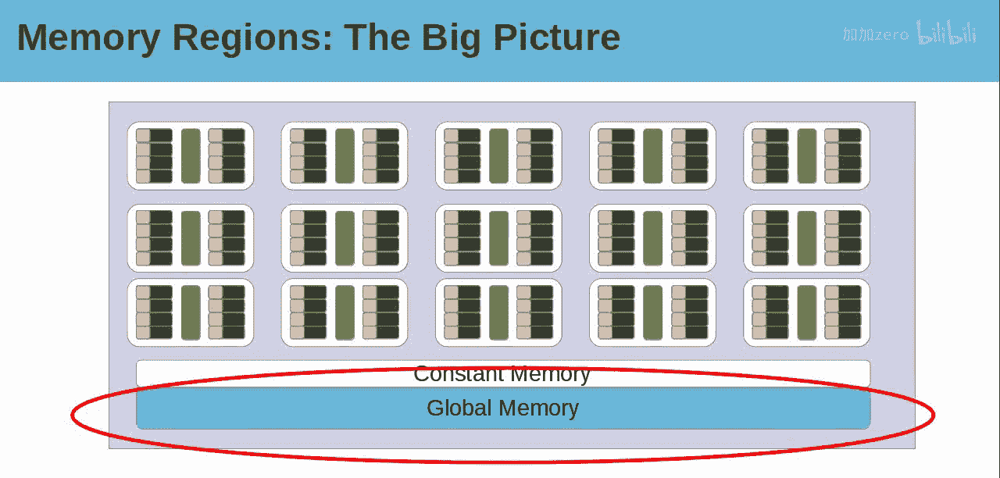

Global memory is shared with all processing elements。

 that means that every so called processor can access this memory。

The host can also access this memory。 It can map it。 It can copy data to and from this memory。

 It is persistent storage。 It is not persistent in the concept of a hard disk。

 is persistent in that the execution will not will affect this memory。

 but the memory will remain across subsequent executions。

 We will discuss this in more detail as we discuss the execution model and it will become clear。

 The other memory regions you are going to see are scratch space。

 So global memory is where you load data， and then you are going to run functions and is going to manipulate the global data。

But pretty much after you run something， if it's going to come from global memory and it's going to stay in global memory。

 this is what I mean by persistence。

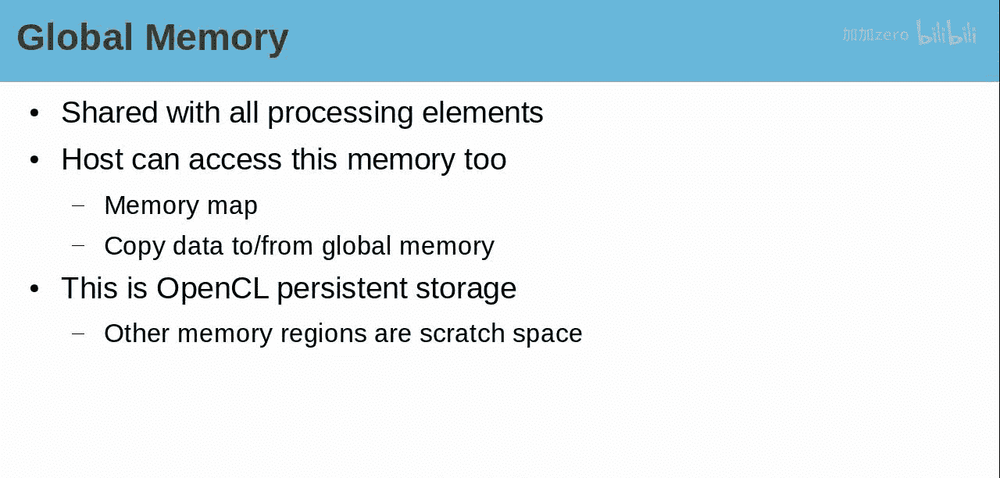

Let's look at constant memory here。

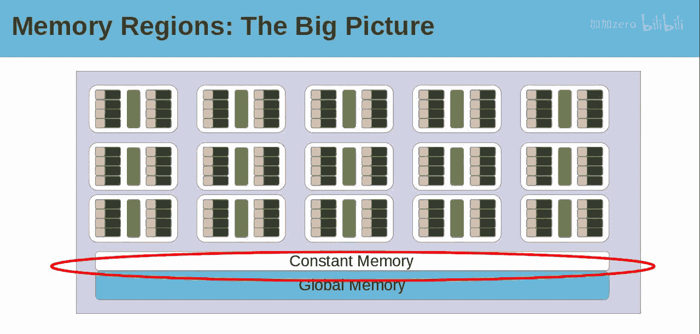

Constant memory is rather unique in that it again is shared with all processing elements。

 but it's read only memory if you've written C programs or you've written a constant int x equals 3 or a constant float pi equals 3。

14。You know that there's an opportunity to have variables that you really aren't going to change。

 it's a logical mistake to change these variables。Inside of the device model open C。

You actually can go ahead and just stuff variables into it only memory。

 and it is physically guaranteed it's not going to be affected。

 The reason you do this is not because you want to protect that memory。

 It's because the hardware has very efficient ways to share data with all device processing elements。

 This is a special memory in that it may be rather small in terms of what you can put inside of it。

 but it is very efficient for every。Processing element to access this memory。It is not persistent；

 this is something that's going to change over time， but we'll get into the details about this later。

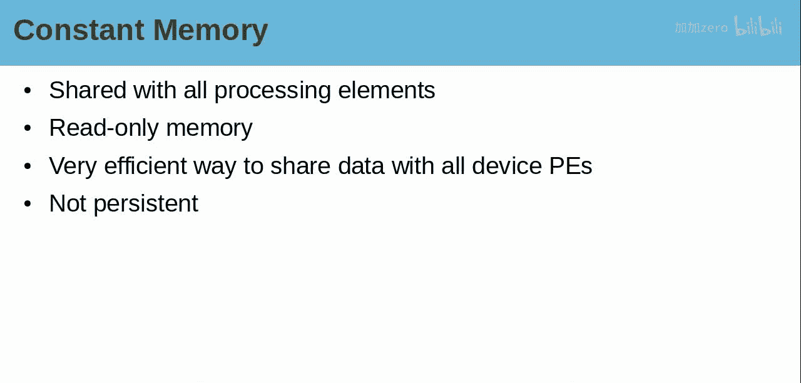

This is what we showed as the compute unit， as you recall in the previous slide I showed you。

That you had 15 compute units， each have eight processing elements per compute unit。

I did not mention explicitly that we have local memory。

What you see here is a memory region that is within the compute unit。

 each compute unit has its own area of local memory。In particular。

 you will see in the device I showed you that you have， say 15 compute units。

 this means that you have 15 local memory units， one per compute unit。

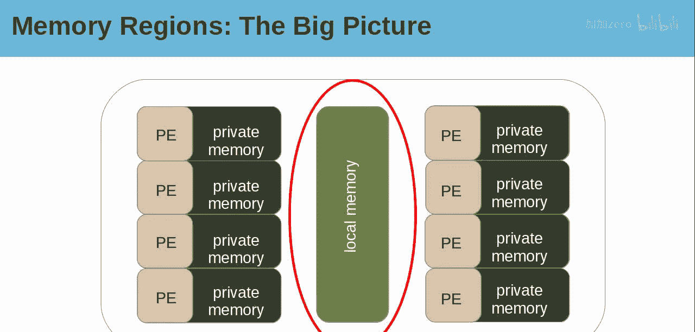

Local memory is unique and is that it is shared with all processing elements in a compute unit。

It's a very efficient way to share data。With all of the processing elements inside of a compute unit。

 they can actually cooperate in some way with a local scratch space。

It cannot be accessed by other compute units， so if compute unit1 has some local memory。

 compute unit2 cannot access it， it's not possible to do you have to use global memory for this purpose。

This memory is again， not persistent， and I will clarify later what that means。

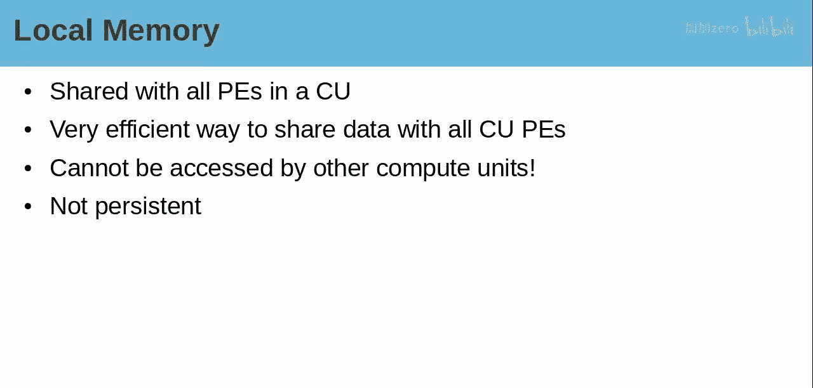

If we descend into a processing element。It has private memory attached。

This is memory that can only be accessed。

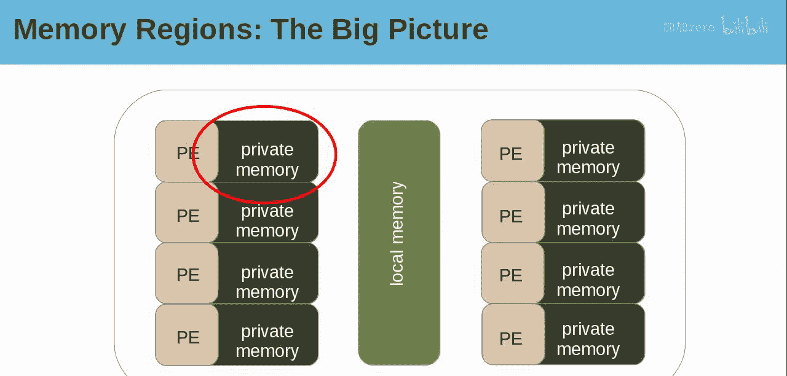

By a single processing element。No other processing element can directly access this memory and again。

 it is not persistent， is's going to change in a way that I will explain If we zoom back out。

 you can see that we have several memory systems。 we have global memory， constant memory。

 local memory and private memory and the configuration of these memories is important and you will use this when you are designing high performing applications。

 you will rely upon these properties to actually achieve the performance that is promised by open seaout。

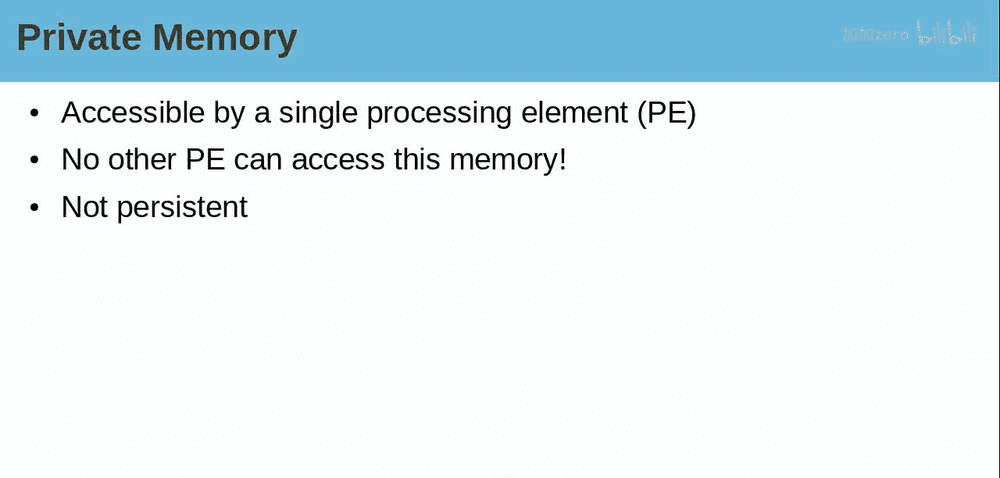

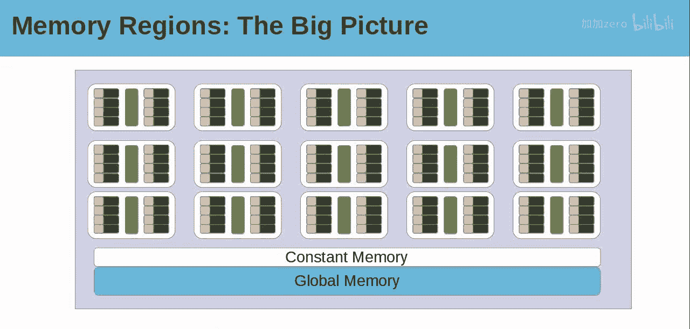

I want to ask you a question I'll answer it in a second， what kind of device did I actually show you。

 what are you looking at， are you looking at Aion Phi， are you looking at a GPU。

 are you looking at a compute cluster， what is it？The answer is I didn't show you any device at all。

 it's simply a model， I want you to understand that the model is something that is how you should reason about things。

 but how the model is translated。To various。Physical hardware is dependent upon your vendors。

But you should understand the model because this is the common terminology。

 this is the common level that everyone is discussing， and as programmers。

 we mostly are going to be programming the model anyways。

 the job of the implementation is to take the model and efficiently compile it to something else。

 but we'll get into this in other talks。Now we're going to discuss the execution model。

This is probably the most confusing aspect of OpenCL if you have any questions。

 don't hesitate to post a question to the YouTube comment section or to go ahead and send me an email and I will。

Poposed to follow up that tries to better explain it if something's unclear。

 I hope that this is at least as clear as what is in the specification。

 And what I would suggest is that if it's unclear here。

 wait a dare or to read what the specification says and then go ahead and ask your question。

So let's try to get into what the execution model is all about First。

 OpenCL executes kernel functions on the device。Now the name kernel is a little bit unfortunate。

 this rely， this does not indicate some sort of kernel space in the operating system sense a kernel is just a special name for function。

 which I believe is a remnant from graphics。Now。The function that you're executing is just an ordinary function with a special signature。

My talk on OpenCLC will get into details about what that signature is and what a function looks like。

 however， I want you to understand a few things about it so that we can actually understand at least the model of execution。

Curlonel calls have two parts to them， there's the ordinary function argument given list。

And there's some external execution parameters that control the parallelism。

 openCL does provide direct support for parallel computing in a very unique way。

 and you need to understand that you have your ordinary function that you are calling。

 but you also have some parameters that are controlling that execution。

 which are outside of the ordinary function call。So let's look at it。This simple function。

This is an ordinary C function call。 We have an integer being returned by the function called add。

That takes two integers as arguments。 The argument list is， in this case， int X int y。 As I said。

 there's two parts， so what's missing。These extra execution parameters。

 which I will begin to describe momentarily。Are bundled with the function call with the arguments provided。

 And we call this an open C kernel call。 What this means is that。

Execution of functions is not what youre used to from C or C++。There when you just call a foot。

 you can call a function。As soon as you provide the parameters in contrast in open CL。

 you have to call a function and provide extra parameters that control its execution and then tell it go。

We're going to get into detail and I hope that this is all going to make sense。

So what's the role of the host in kernel execution Cols are executing on the device。

 These are functions that the host is calling to execute on the device。

 and so the host is really coordinating the execution。 It's telling the device call this function。

 Here are the arguments。 go ahead call this thing。 and it also is going to provide the parameters to launch the kernel。

 This means that the main role of the host is to tell the device what to do and to provided arguments。

This is fundamentally what kernel execution is all about now there are a few ways in OpenCL 1。

2 to call kernels。I'm only going to discuss the most useful and general version and trust me。

 this is really the only version you need to know unless you're doing something specialized。

We're going to talk about the Nd range。The key concept here is that the same kernel function will be invoked many times。

 and the argument list is going to be identical for every invocation by an invocation。

 I don't mean a call per se， I mean that the function is actually being run many times。Now。

The basic strategy of the Nd range is to call the same function over and over and over again。

 and the number of times we make this call is going to be dictated by the execution parameters。

 so the execution parameters are really telling us for this function。

How many times should I execute it， what should I do a little bit more complicated than that。

 but we're going to see a lot more detail very soon。

The host is going to set extra execution parameters prior to it actually launching。

 so this is another role of the host that is going to say here's the parameters and go ahead and run we've seen this ands there are particular parameters you have to set for an ND range that we're going to see。

So let's show graphically a little example of this。On the host side is going to say launch F 1，2。

3 and run it 10 times on the device。 This is all the host is going to do， is not going to run， it。

 It's not going to do anything itself， it's just going to tell the device to do it。The device。

 for its part， is going to execute these functions 10 times as it was told to do。

This is somewhat natural， you probably will think of this as a for loop。

Now it's a good way to think of things as a for loop。

 but I'm going to show you something called an index space。

Whi is a much better way of thinking of things， but I want you to understand the concept from several different directions so that you completely understand the ND range。

Now one of the first problems we have here is that we don't know which call we're in。

 so how does a kernel function that's executing， know what to work on if I'm being called the argument list sorry is identical。

 so in the previous slide I showed you launchchF123。Now， Fu 1，2，3 has been called several times， but。

How do I know what I actually am， how do I know what work I should be performing。

 what if I'm supposed to be moving data around， what is my data to copy？

The key insight here is that the execution parameters I keep mentioning but have not directly discussed yet provide an index space。

And each function in vocation knows its index in that space， so for example， in the launch of P123。

 I know that I'm called3 of 10。This is how you're basically going to write algorithms in that you are going to。

Understand what index you have in this space and you're going to have to formulate your function in this way。

 and I' will show you why this is fairly efficient from a hardware point of view。

 I'll point out that the index space is n dimensionsional you can think of this geometrically。

 you can also think of it as a number of elements inside of a tuple inside of a set。

 I will get into this in detail because I want you to completely understand the Nd range if you get nothing out of else from this talk understanding the Nd range is absolutely critical to unlocking performance and to achieving all of the goals that open C。

All of your goals with openCO。 So I mentioned the ND range as maybe a for loop。

 and is this a good way to think of things so。We can certainly think of it this way as a first approximation。

 so you're going to provide this function， the outside component of the for loop。Saying， you know。

 size T I equals 0， I less size increment I。 This is all being done by those parameters for you behind the scenes。

 What you supply is the function。 the name of the function with the parameters and the structure of the outside for loop。

 If you want to think of it that way will be provided for you now。If you think of it this way。

 we have what OpenCL calls the global work size， this is the number of iterations we are going to complete。

And I in this case is the global ID， so what we actually are going to wind up happening having is that F is able to actually know which eye it is and the full size。

 so it has some understanding of where it is inside of the for loop。

Now we can do another thing with four loops。And we can have a work offset。

 So if we iterate from an offset as the base and we keep incrementing J until we hit that the size plus the offset。

The J is becomes larger than that value。 this is a fairly natural way to think of what a work offset is OpenCL provides this。

 it calls it a global work offset， So now we have two concepts here。 We have the global work guide D。

And we have a global work size。Along with this global work offset。

 which by providing these three values， we can get different four loops out and this is one way to think of the Nd range is that the structure is going to be provided to you Now if we want to do multiple loops here we're iterating simultaneously over X Y and Z。

Then。We can go ahead and just say the number of iterations is the work dimension。 Now。

 you'll notice that the function fo in all of these cases has not depended upon x， Y or Z directly。

 That's because we assume there are functions within it that are going to allow it to determine which x。

 Y and Z it actually is。 So you really don't want to directly provide the iteration to the function you're calling。

 And the reason for that is that， as I said， the argument list is fixed across all invocations。Now。

Another way to think of an Nd range， and this is probably the best way to think of it。

 but I wanted to motivate you what this really is in terms of four loops。

 which is something that I assume you're familiar with。

Is as a you know we want to think of an index space as a set of indices that we're pulling from so really don't think of four loops per se。

 the reason for that is that four loops are really sequential。

 you have to execute one thing before you can do the other thing inside of libraries such as threading building blocks and other things or are parallel4 is and this is a little bit like what you have with openCL。

 although the way that the openCL parallel4 works is a little bit specialized there is no such thing called parallel4 that's what Nd range is all about。

So I want you to think of a set of indices， that's how you should think of the index space。

 and each element is an L element tuple。And this is really what you've already seen。Now。

Each invocation。 So each function when it runs， is going to pull a random index from the set。

 It is not random。Precisely， but it is best when you are doing design to consider it to be random。

 otherwise you will find yourself hitting problems you did not consider because you think thought through something sequentially on a piece of paper rather than randomly。

Now what's going to happen is that the set that makes up this index space is going to be populated before kernel execution。

What's going to happen is it as a colonel runs。The functions are going to pull out an index and it's going to run on the hardware。

It's going to stop。When the index set is empty。So this is a way of visually imagining this we have a set here called index on sorry index space on the left。

We're going to pull out tus。One by one。And we're going to pass those tus as some sort of parameters that can be accessed in a way that's。

Different from the argument list， so you need to use functions to access that。

 the openCLC talk will discuss this。And this the function list。

 you know the argument list has been fixed in place for these calls to food so really we're just pulling things out as you can see here it's very random and as we pull things out。

 the index space is going to shrink。Until is empty， until there's nothing left to do。 at this point。

 the kernel terminates。 and this is at its heart when an Ny range is all about。

 I'm going to provide you with a few definitions that are within a specification。

The work item is what you should think of as an invocation of the kernel for a particular index。

 So in the very first example， I said for I equals 0 to 10。 I is the work item now。

If I is equal to three， then your work item has a global ID， you see it in the next thing。

 but let me just say for a moment that your work item is equal to three now what's going to happen is that you complete your work upon the I equals  three and then you're finished。

 you don't do anything else， you're done， the work item's dead。

Now thiss a very interesting way to think of a for loop， it should become natural to you over time。

 I understand if it's not natural right now， this is probably one of the most intimidating parts of openC is understanding these concepts。

 Now we have what's also called a global I， which is a globally unique ID for a work item。

 you can think of this as basically you know your index that you're。

You're using in your iteration space。And we have a global work size。

 which is the total number of work items now this is per dimension as I said you can have multiple dimensions and the work dimension is naturally defined as the dimension of the index space。

 you can either think of this as the number of four loops， so dimension one is one loop。

 dimension2 is a loop inside of a loop and dimension3 is a loop inside of a loop inside of a loop or you can think of it in terms of indices that you have one element within the tuole two elements or three elements within the tuole either way has either equivalent it's up to you how you like to think of I personally I prefer to think of index in terms of index spaces now when I began using openCL I thought in terms of four loops。

So I encourage you to think in terms of index spaces， but ultimately it doesn't matter。Unfortunately。

Something is missing from the execution model， but we haven't really motivated it。

What's missing Everything I've said is accurate， but it's not the incomplete picture。

 and I want you to understand。Why it's bad that we're missing this and we're going to have to discuss how we map the execution model to device model in order to properly motivate what's different。

The first thing to consider is how do devices actually do their work is a very important question。

When we look at our execution model， we have tus being pulled from an index space and being passed to identical functions。

 the source for these functions is identical。 the invocation sorry the argument list is identical it's fixed they'll have the same parameters so this is how we've seen executions done on the other side we have this device model where we have all of these processing elements and we kind of know that the work items are going to have to be mapped at the processing elements in some ways because I told you that they're the only things that actually can run instructions so。

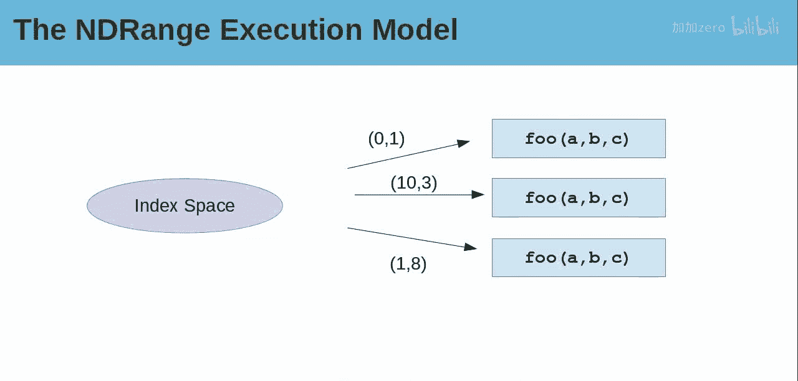

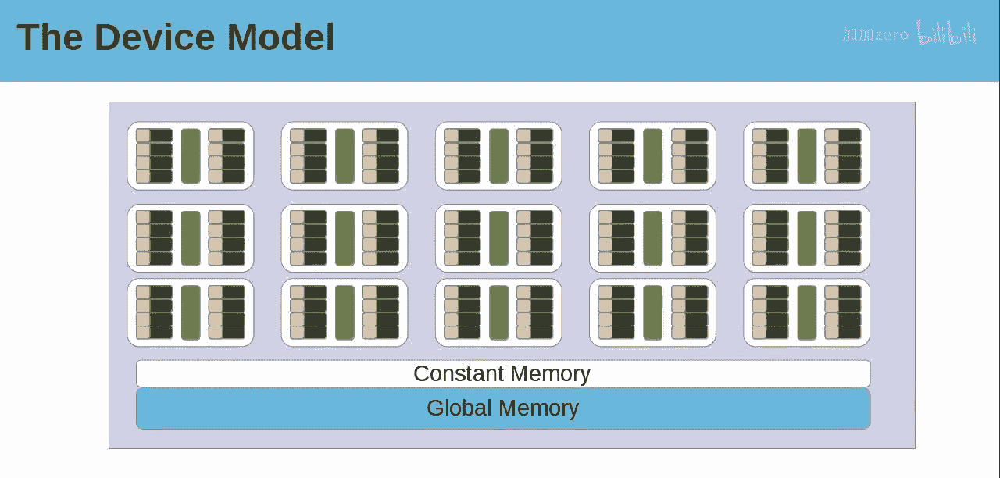

Immediately remember， the processing element runs the instructions。

 so work items should run on the processing elements。

 that's a natural way to think of it and what's going to happen is that we're going to assign multiple work items。

Now let's just pause here and think about it for a second， As I said。

 work items are particular in vocations of the function， you can think of them as indices。

 so I equals 1， I equals 2， I equals3。Those particular invocations are going to be assigned to a processing element。

So in order to map the concept of the execution to the device。

 we're going to take the work items and map them to processing elements。

 and we're going to have to handle the case that we have more work than processing elements。

This is a really good approach， but something's missing。We're still missing something here。

 so I'll give you a second to think about what it is before I just tell you what it is。Yeah。

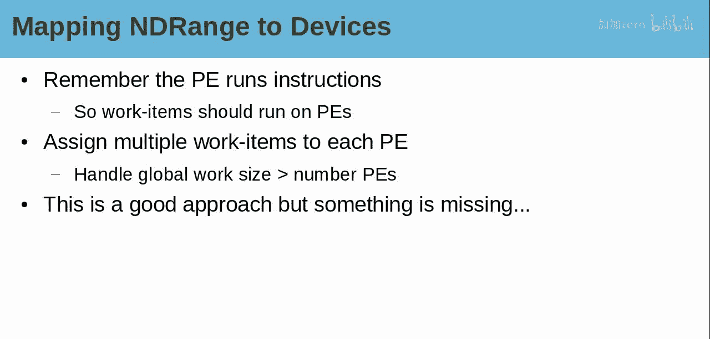

What we're missing is an ability to use local memory Local memory is there because it provides great benefits in performance。

 but the model I've shown you cannot use local memory at all Now we're going to make a slight adjustment to our execution model。

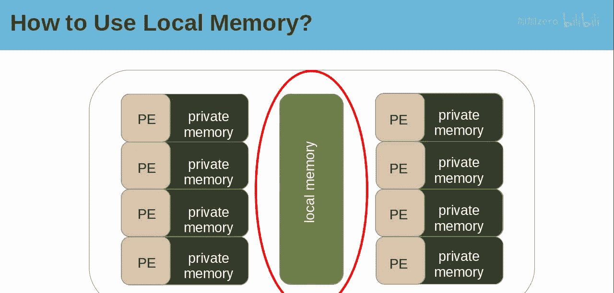

We're going to add a concept called a work group。And now I promise you there is nothing else I' have withheld for you。

 this is the complete concept， but I wanted to motivate why it's important。

So the work group partitions the global work size into smaller pieces。

 and each partition is going to be called a work group。

Now the work groups are what execute on compute units。

 so work groups execute to compute units and work items inside of the work group are mapped to compute unit processing elements。

 so the work group is a natural way of scheduling work on a device in OpenCL。

The work groups are scheduled to compute units Comp units share local memory work items in the work group are then mapped the processing elements within that compute unit Now all of the work items inside of that work group they share local memory this is now the full concept。

The work group size has a physical meaning， so how large should your work group be？

The work group I showed you before that I had， let's say eight processing elements per compute unit。

Now， perhaps the driver will tell you， oh， I can do 1024 work items。Itll work group。

This has a particular physical meeting。And it's a device specific meaning。

We're not going to get into that and we'll get into this into talks when we're talking about performance because we' use this fact and take it into account。

But I want you to understand that how you size your work group。

 even for problems that are seemingly independent or each work item has an independent thing to do。

 like it just adding two numbers in array in each work item and each global ID is a particular element within that array。

 the work group still has an impact there， and we'll see this when we talk about another video on performance。

Work items are able to find out what work group they are in。

Now we talked about memory and I want to show you another perspective now that we've completely motivated it。

From the perspective of a work item， it has private memory attached to it。

Constant memory attached to it， and it has the ability to access global memory。

Now if we extend this to a work item in a work group， we now have local memory in the picture。

 so you have many work items。That are executing within this container of a compute unit。

 each work item has some private memory that it can access。

 and all of the work items within the work group or compute unit are able to share the local memory of that unit。

Every work item on the device， as I mentioned earlier， is able to access constant memory。

 that's because of processing elements can access constant memory， and likewise。

 every work item can access global memory。Now I'll mention again the work group size。

 the maximum work group size is a device characteristic。

You don't want to calculate it from say just the number of processing elements per work group。

 sorry per compute unit there's a size that's going to be given to you。

 there's a maximum that the device can do and there is a meaning to it which will be discussed in future discussions。

The way to figure out the maximum size is determined the value by querying the device and just asking at what it can do。

 For example， you may see on a CPU that it tells you that it can execute 1024 work items。

Within a work group。You may see on a GPU that this has a maximum work group size is 256 work items。

The maximum workgroup size is actually an integer， and we have to handle the fact that as I've mentioned。

 we can have ndisional workgroups so we can size our workgroup to be in multiple dimensions and we have to have a way of bringing this back down to a single scalar integer。

As I've mentioned a few times now， I want to make sure it's completely clear。

We haven't motivated how to determine the best work group size and others presentation will discusses for now。

 if you'd like， you can just choose the maximum that the device supports and work without the intuition for exercises or to get a familiarity with OpenCL。

 but we'll come back to this later to figure out what the best selection actually is。So。

This is a duplicate slide。In some sense。My apologies this is slightly similar to something you just saw。

Basically what we have happening here， what's new is that。

I've shown you that you can have at the bottom here。

 work items can find out a few things about themselves， they can find out their work group ID。

 the size of the work groups， which is the same for all work groups。

 they almost have the identical size， they can find out the global ID and they can find out their global work size。

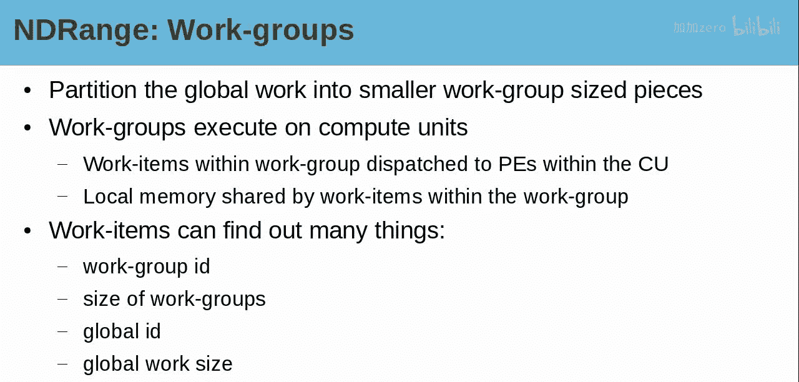

Now， conceptually， I want to show you what's happening so that you can see sample source code。

That you can see what it what this execution kind of looks like。 again。

 the only thing you're providing is parameters that kind of create all of this。

Boiler platelate for you， you can't directly do this。

 all you can provide is the function you're going to call in a set of execution parameters as I mentioned before。

 so let's see what it would kind of look like to do work group launching。

You see here that we have the work group size。This is just a parameter that says how many elements are how many work items are put in a work group。

 this is the global work size， so what's the total space we're working with and what's the offset？

Now， to actually launch work groups。This is again not what happens， this is just a conceptual method。

 but what's going to happen is that we're going to launch the elements or work items。

 group groups at a time， so for every group we're going to go ahead and for group zero say we're going to locate some local memory this is actually physically on the hardware so this doesn't really happen and then we're going to iterate over a local identifier so that we actually we launch the work group and then we go in and we launch all of the work items within that group。

We calculate the global ID as the offset。Plus， the work group ID plus the work group size。Sorry。

 multiply by workgroup size plus local I。 So really what's happening is that this is what the function。

That's executing all of this boilerplate is kind of done for you in a way。

 and all I wanted to do in this slide is make it clear to you that it is the work groups that are scheduled and the work items are broken apart within the compute unit itself sharing the local memory resources。

 that's something that you may miss when you read the specification yourself。

So how do we handle indial work groups， what do we do？Well， work groups can have multiple dimensions。

 you can think of this geometrically， which you'll see soon and you can think of this as pulling ndial tuples from a set which you've already seen。

But as I've mentioned， your maximum work group size is a scalar。

Your work groups can be undisional sized， for example。

 if your maximum work group is their size is 32 and you're launching with dimensions 8，2， and 1。嗯。

How do we translate to make sure that we're not going over the maximum size Well from the perspective of the device。

 the workgroup size is really one dimensional， the two。

 three dimensional stuff is just an abstraction for your convenience。

What's going to happen is you give these K work group sizes。

 so W1 to W2 all the way to W subK and just multiply them out so long as it's less than equal to the maximum work group size you can use it if it's larger you're going to hit a error from the host API it won't launch and this is just something to be aware of。

Now let's think about this geometrically I've given you an approach where you can think of this in terms of index spaces。

 I want to give you another approach where you can think of work items geometrically because you may find that this helps you。

Suppose that I have a global work size of 32 here。嗯。

I'll note that this slide slightly in error that it shows an index of 23， but let's ignore that。

 so we have a global work size of 32， we have a work group size。Wait。And we have this space。

One way to think of this space is that we're going to have the open C itself break this into work groups for us such that contiguous work items are within the same workgroup。

And this is all done automatically for you what OpenCL will then do okay so the only thing we've specified is the work group size and the global work size everything you're seeing now is automatic is going to break everything into workgroup and then it's going to take those workgroup and give a work group to a compute unit so each compute unit is going to get its own workgroup。

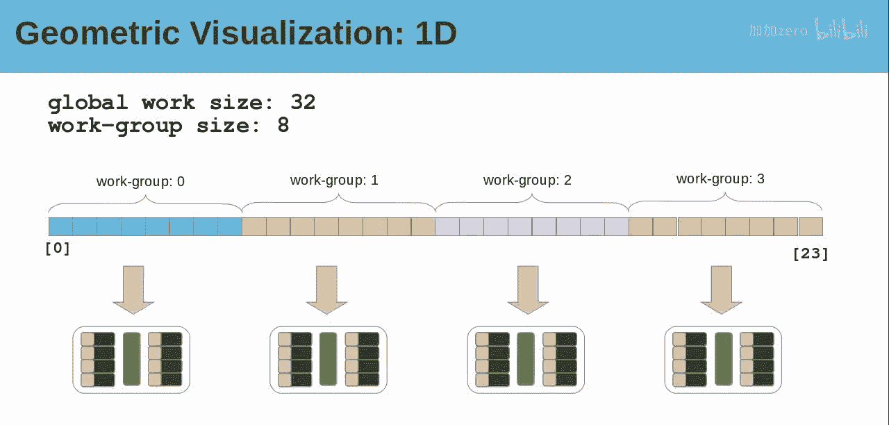

Now。What's going to happen is that the work group will be broken apart when it's actually given to a compute unit and each work item will be given to a single processing element。

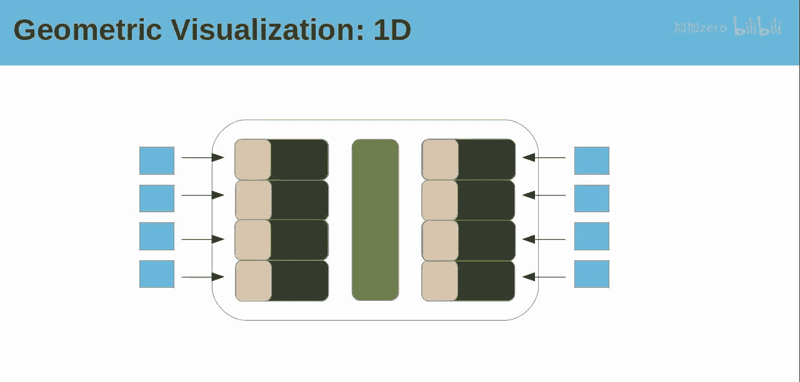

Now what happens if we only have one compute unit， well。

 very simply what it' going to do is just go ahead and run those work groups one by one on the single compute unit。

And it's going to be the normal case likely that you have more work groups than you have compute units。

 The hardware is optimized to handle this case。 So in terms of having a single compute unit doing everything。

 you now are going to see processing elements are going to be given multiple work items to do at a time。

 This is again， the normal This is normal procedure。 This is not abnormal。

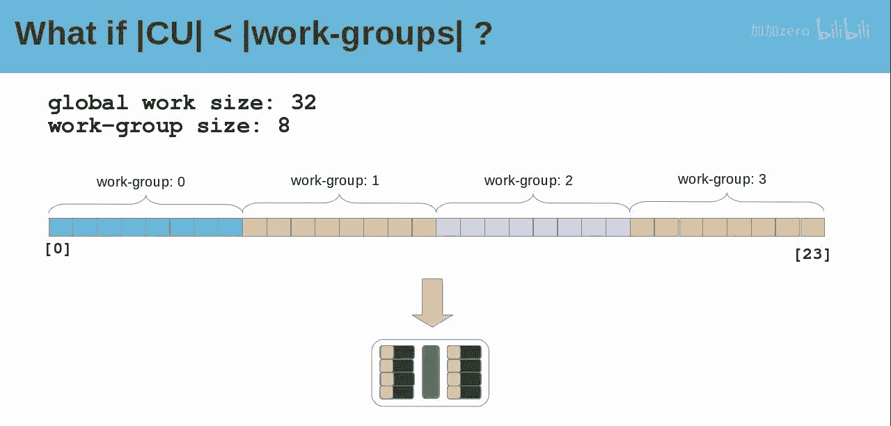

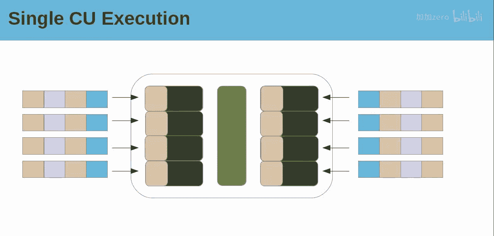

Let's consider this geometrically Now we have a global work size of 8 by 4 and we can think of this as a 2D array or a rectangle。

 however you like to think of it I just want to show you a geometric interpretation and we're going to specify a work group size of two and4 again things will be broken down with going to get four work groups and this is a 2D partitioning this might be useful if you're doing some sort of 2 D grid problem just because it helps you think things through it makes the indices a little bit easier than doing everything by hand in one dimension。

Now， if we have a three dimensional problem。Then again。

 we can go ahead and provide a three dimensional work size and a three dimensional work group size。

 and everything will be broken down for us accordingly。

I'm going to make a few last points about the Colonel Col。

The host provides execution dimensions to the device， it's going to create the index space。

And the parameters of the functions can either be values or as I have not mentioned before。

 they can actually be global memory objects when you learn about open CLC， you'll see those。

NowG memory is persistent between calls， but as I mentioned earlier。

 constant local and private memory is just scratch space and each kernel call is going to result in those memories being completely reset。

The main idea here is that if you actually care about a particular value。

 you should just go ahead and leave it in global memory。

The OpenC implementation is considerable flexibility， these are models。

 so the implementation can decide how to best map work items to processing elements and how to actually schedule the work。

 you will see some very big differences between say how a GPU will schedule work groups versus say a CPUU。

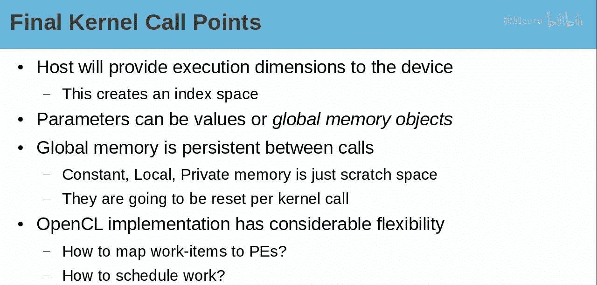

I hope that this last section。made sense if you are saying to yourself this is completely trivial and I don't know why he made such a big deal out of that。

 then I have done a very good job in teaching you this concept I found these concepts to be quite challenging myself when I first started to get exposed to them and I hope that Ive broken them down into such a way that you find them now a natural way to think。

So let's talk about the host API。The host API is the other part of the standard that's telling。

Is providing opportunities for the hosts to do what it needs to do。 So we have here a platform。

 context and program。 These are the main things I'm going to discuss。

 as well as how the device does as synchronous device calls。

 There's more to it in the standard again， my purpose in this talk is to give you an opportunity to get into the standard and not be intimidated by it and to have enough background so that you understand what you're reading when you go through and actually write your applications referencing the standard。

 So let's discuss the platform。 What's this all about Well the platform you can really think of it as an implementation of opense。

 And platforms are kind of like device drivers。 They're just exposing what device are available to you。

 So for example， if you have a system with two GPs and a zon P。

And let's say that one GPU is from AMD， one GPU is from NviIDdia and the Xon Ps or Mintel。

 so in this particular system， OpenCL will see several platforms。

It'll see a platform from AMD for one of the GPs and just because AMD supports CPU and CPUs and then implementation。

 it's also going to see the CPU and expose it to you if you have a platform from Intel it's going to show you the Z on Phi and if you have a platform from Nvio。

It's going to show you the other GPU， so the platform is just a way of discovering what's available to you。

The platform is what discovers devices， it makes sense if you think of it as something like a device driver。

Now the context。You create a context for a particular platform and you cannot have multiple platforms in a context。

 this means that when you create a context that you can't create one for both let's say a Zon Phi from Intel and an NviIdia GPU can't do it so what is a context why are' discussing it Well context is essentially a container it contains devices and it contains memory and you are creating this container and is going to help openC manage itself。

Most operations are related to a context either implicit or explicitly。

 so creating a context is a first thing you do when you write an open sale program what you're going to do is discover the platform。

 get a context now you can start locating memory now you can start controlling devices so when you read the specification you will see the platform model you will see the context model now you know what these things are I will note that the platform is what discovers devices and the devices through the platform model will tell you。

What they're capable of doing。Now let's discuss programs。

We have for fast forwarding through the specification a little bit here so programs are simply collections of kernels you've already seen this so you've already seen kernels we're just now saying that we can assemble groups of them and call it a program and we have to extract kernels from your program to actually call it so one of the things you're going to do is you're going to create a platform you're going to create a context you know after you' found a device and then you're going to go ahead and load a program which is a collection of kernels which are these special function calls now。

OpenpenCL applications have to actually load these kernels and the way it can do it is it can either compile OpenCLC source code so we can load it by doing a compilation which will be done as your application will have to stall out and wait for it to be completed or it's going to load some sort of binary representation I will note that programs or device specific you're going to probably want to compile openCLC with OpenCL2 we have SPIR which will eliminate a little bit of this issue。

Now。We will discuss asynchronous calls the host is managing devices asynchronously。

 as you know you have multiple devices within your host or attached to your host I should say。

 so you may have in our previous example ison Phi and A D GP and Nvidia GPU and potentially you can use a CPU as another device Now what's going to happen is that you're trying to manage all of these devices asynchronously for best performance so。

OpenCL has an asynchronous interface that you should become familiar with。

 and I'm going to provide you some motivation for it as well as a general idea of what's going on behind the scenes so that when you read the calls and prototypes they make sense。

At a high level。What happens in OpenCL's inynchronous device management is that we're going to issue a command to the device。

 we're going to tell it to do something。And。What's going to do happen is that devices are going to take the commands and do whatever they say to do。

The host is going to wait for the command to complete Now it doesn't have to sit there and busy wait。

 it can incu quite a bit of work， but the host won't know that the command's finished until it kind of waits for it。

 it's no different than a join or anything like this。Now。

Commands can be dependent upon other commands， this is a little bit unique to OpenCL and this raises some complexities in terms of asynchronous programming and OpenCL。

Open C commands are issued by the functions you see in the standard called CL in Q calls。

 So if you look at the standard， anything that says C in Q is issuing a command now。

An open C sorry a CL event object is returned by any of these inqueuing calls and you're going to use it for dependencies。

 So let's look at a sample call。 I will note， first of all。

 that this is not the actual structure of open CL calls。

This is what I'm showing you is a simplification just so that I can teach you the concept if you look at the code。

 it is different how this is done okay so permit me a little bit of flexibility to teach you the idea and then you can get into the nitty gritty details when you actually read the specification so this command CL and QF。

Is going to incu the command fo to run on a particular device。 So when we give a command。

 we're giving it to one device， we're telling it to do something。 Now。

 the command is going to return to us a handle to represent when it's completed。

We don't once we in cu something it's not going to execute right away。

 we're just getting a handle to tell us okay， when it's finished we'll let you know and here's a handle you can use to query that。

Commands also take a list of dependencies。These are previously issued commands that have to finish before this one can be done。

 this provides an opportunity for the driver to better schedule itself。

Let's take a look at a sample execution。So I have here。

Two commands I'm going to run calledF and one command bar。Let's trace it。

I'm going to get an event called E1 because I'm going to say， I want to incue the food command。

I want to in cue the second Fo command。 They have no dependencies because the dependent set is empty in both of these cases。

 So I see something visually like the on the right hand side。 Now。

 I'm going to in cue the last event。 And you see now a dependency。 So the function bar。 Sorry。

 the command bar cannot be completed until these two previous calls to foo have been finished。

 Whatever these things are doing Foo might， in real life。

 be doing memory copies and bar might be a kernel。 The point is it we're providing a structure to our programs in a way that is not necessarily。

 this makes the host API difficult。 So is not necessarily intuitive。

And things are going to be dispatched the devices So where are these commands actually going。

 I'm saying that we're in queuing things， but I haven't really said where they go or what they do。

 so openC has command cues and this is where these commands are going to be placed A command queuee is attached to a single device。

 you can't attach it to multiple， but you can create as many command queuees as you want。

Whether or not you want to is something that you have to look at your vendor documentation and it is specific to implementations over and see how how this has been interpreted。

Now CL and Q commands， I haven't shown it to you， but they all have a command Q parameter。

 so you're going to tell it I've been queuing this command to this command Q。

 that command Q also depends upon a device when the command Q was created。

So the complete picture here is that we have the host。

And the host is going to call a command like CL in QF is going to generate。

And place that command into a command queue。 So this little。

Cved rectangle is really some sort of command that's been encapsulated and has been placed inside of a queue。

 but this all happens in one step。 You can't separate it out。

 you in queue the command at the same time is created。 everythings done in one step。

 I just broke it down so that it makes more sense conceptually。 So let's let time pass。

 and let's go ahead and see what happens now that fos at the head of the queue。

 just inqueing command doesn't mean that it's completed yet。

 just means that it's sitting there waiting and may have further dependencies。

 So when the command is run on the device。 the device is going to do something in response to that。

 maybe it's loating memory maybe is doing something else。 I will clarify that these fo commands。

 you don't get to create these commands。 You have to choose from a set of commands that are provided by the opencl standard。

 but this concept that I'm showing is applicable to all commands。 Finally。

 what's going to happen is that the host can find out the command has completed。

 And this is the nature of as synchronous programming and open seal。

So I want to give you a quick summary of the host API。Now。

 what's happening at a high level is that the host API is controlling the device。

 The device can't do anything itself。 You have to tell it what to do。

 And the way that you tell it is the host API。 There's an asynchronous execution model。

 which is critical for speed。 and it's a little bit different from traditionally synchronous APIs that you've seen because of a dependency model and because of the command Q system and everything else involved。

 and I've certainly not covered everything there is to know about the host API。 However。

 at this point， you have everything you need to start learning a lot more about Opencl。

 but you won't be able to start understanding the OpenclC part until you watch the next video。

 So in conclusion。You now understand one part of OpenCL。

 the next part to learn is openCLC and that's the next video that follows up with this one。

My goal in doing this has been to teach you the key ideas。

 you should really read the specification yourself， but armed with the ideas that have given you。

 you should find it very easy to approach the specification。

It's going to take you some time to learn open C， you're not going to learn it overnight。

 it's going to take you a little bit of time and if anything is unclear。

 you should really comment on this video。Let me know if I didn't explain anything well。

 I'm not going to rerecord this video if I stumbled somewhere and had to correct myself verbally but I will make amendments to this video and issue new videos to clarify anything that is fundamentally unclear。

 hopefully everything seems really simple and if I've done that I've done my job really well I'd like you to subscribe to my blog you'll see it on the last slide and it's in the notes of this video and I'd like to tell you that I'm available as a consultant one of the things I can do for you is help you get top performance from your code I can write algorithms that are efficient to OpenC I can help you figure out how you can leverage openCL in your application and how you can deal with the heterogeneous computing world but the other thing I can do for you is help you do by doing training that's specific to your company where maybe I'm teaching you what you need to know to achieve your objectives with OpenC So if you like my style of instruction you haven't seen any exercises here butm。

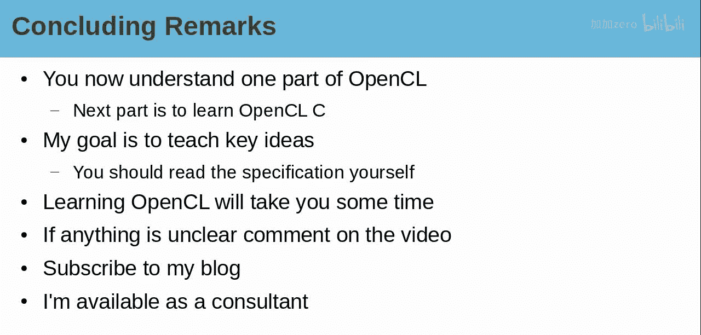

Certainly available to help you set up something for your firm。

This is the address of my blog and this is my email address。

 feel free to give me a message and I hope that you have enjoyed learning about OpenCL。

