# 【OpenCL编程 RayiYanuTara】 p02 p1 OpenCL 1.2： OpenCL C -BV1X2BRYyEeM_p2-

Hello and welcome to my next installment of my YouTube video that is providing you with tons of information about OpenCL and really teaching you how to approach the standard and how to get work done with OpenC So I'm going to review a little bit about myself just in case it's been some time since you've seen my first video。

Basically I'm a parallel program guru， I'm very familiar with C+ OpenCL and Linux。

 and I'm concerned with real life software， my interest is in applying OpenCL to really interesting in neat applications rather than just doing research code or just seeing that we can adjust OpenCL in some way or another。

 I'm really interested in doing something kind of neat and applicable to everyday life。

I have an OpenCL middleware developer， you probably can appreciate after seeing from the first video that OpenCL can be a little bit complicated to manage。

 and you're going to see eventually that the work I do really makes OpenCL easy to use without compromising efficiency。

 but more on that when I release that technology。I've been doing high performance computing for a long time。

 it's the cool thing to do now with big data analysis and analytics。

 I've been doing it long before that and I'm available for consulting so I'd love to help you out with whatever problems you have whether it's algorithm design or just evaluating whether or not OpenCL is a good fit for your type of application go ahead and check out my blog it's also in the comment section of this video or the about section of this video and send me an me mail I'll introduce to yourself take me over for a coffee you know and we'll discuss what your needs are with OpenCL or high performance computing。

So this talk is on OpenclLC and let's have a little bit of an introduction first。

 the first thing to say is that openclLC。

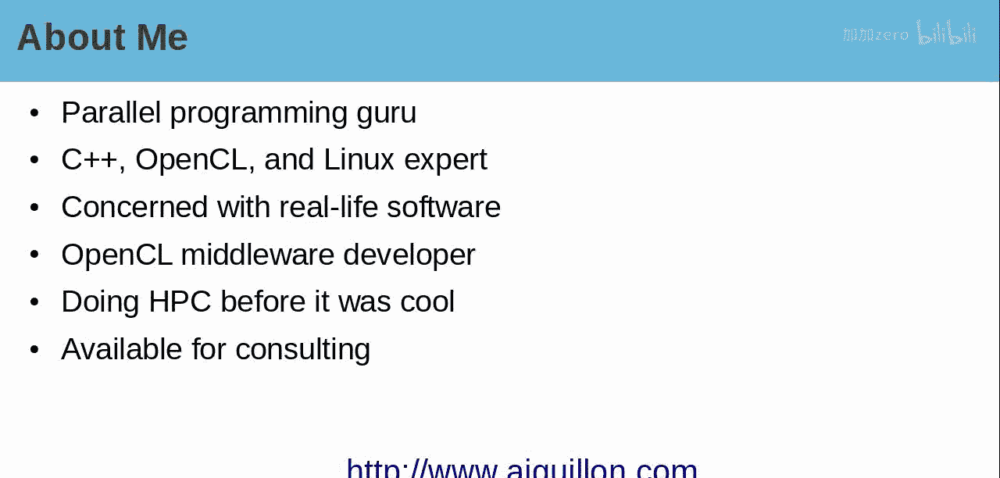

Is not your traditional C99， there are changes， for example。

 there are no function pointers in open CLC。There is no recursion。

Function calls might actually be in line， so your functions may actually disappear in some sense OpenC is not a subset of C。

OpenCLC has features that are not in C， so that this means it's not exactly a subset， it's close。

 but it's not quite。The specification outlines the full set of differences。

 I will draw your attention to the fact that if you don't have function pointers in you。

You might inline things， it makes doing something like object or programming or you might have polymorphism really hard。

 actually you can't do it。And you may have problems that you love solving recursively。

 you really can't do them in open CLC， so it's a very restricted language。

 the reason for that is the devices which it is targeting， however。

 I claim that it's really not it can be annoying to work with at times。

 but it is you know better than writing at a lower level language， so what is openC， sorry， Open CLC。

 what's it all about。

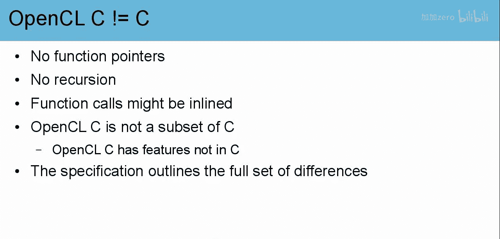

First thing。It's an openCL device programming language in the previous talk which you should have watched before you watched this one。

 I outlined that OpenCL has the abstraction of a device and we're going to openCLC as a modification of the C programming language to actually target these devices。

It's the main actor at OpenCL programming， you're going to spend most of your time working with OpenCLC for better or for worse。

Open C C is like C 99， and despite a few differences， it's the same flavor of language。

 you'll be quite at home if you like C programming here。

 It's also the other major part of the Open C specification。

 The first half covered the first video I apologize covered models of execution， the device model。

 how everything maps really the specification itself only covers what I spent an hour discussing in two or three pages。

The bulk of the specification is really dedicated to open CLC and you aren't going to learn everything in detail because you really don't have to。

 I'm going to show you that it's a lot like what you know and you can just use a specification for reference。

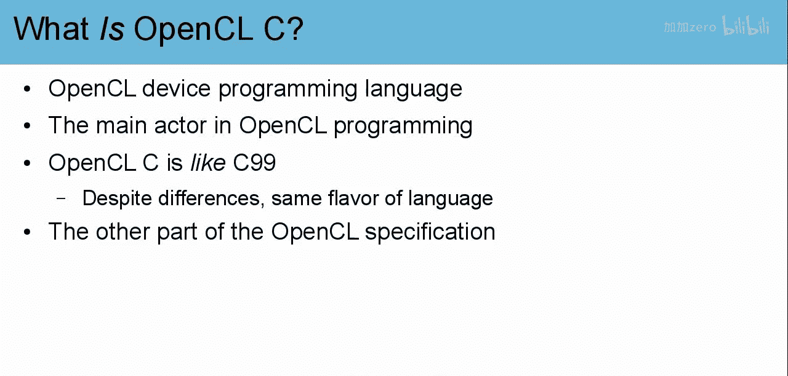

So what are we going to discuss in this video we're going to discuss types。

 the boring thing that everyone does in every programming course， memory regions， vector operations。

 structures， functions， kernels and a few quick topics that deserve a single slide to discuss rather than going into detail because my goal here is to give you enough of a background that you can go ahead and start tackling OpenCL right away。

 learn the specification and if you need to do exercises and stuff like that。

 we can do that somewhere else that in this talk which is attempting to rapidly give you a background into what OpenC is all about so。

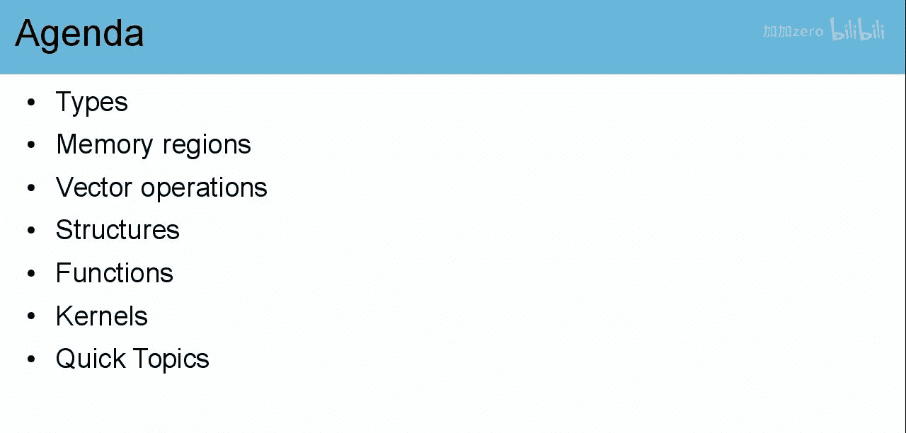

Let's start with types。 This should be completely familiar。 I do assume that you know of C。

 maybe not all of the dark corners of C， but you do know C before you do this talk。

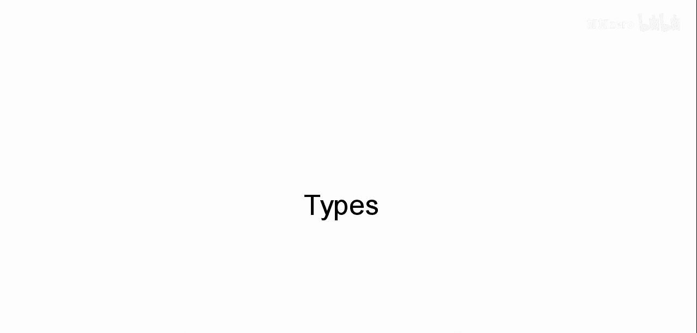

This shouldn't take that much time to really cover。

 So let's see what is difference between open CLC and C。 First。

 Open CC provides a concrete representation。 C does not provide this In particular。

 if you think about signed integers in open CC， which is executing on the device。 Remember。

 signed integers are represented with twos complement。 C does not specify this。 Open CC。

 the types have f fixed sizes with C。 This is not the case。

OpenCLC provides vector types and operations， not the case in C。

 and actually not even elegantly done in CQL+。Open C C provides image types。

 This is an example of an opaque type。 An opaque type is something that you don't have direct access to its memory representation。

 Use other functions to extract information from it。

 imagesages are the only example of this in Open C， although opaque types are interesting。

 and I imagine we'll see more of them introduced in future version of the specifications。

OpenCLC types are mostly C types， so let's just quickly run through them。

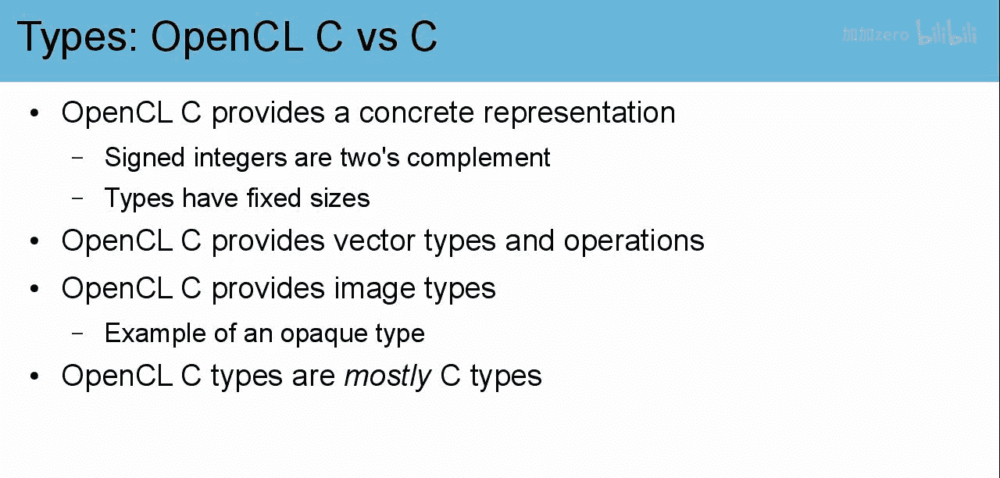

The integral types here， char， short， int long。 you're familiar with all of these。

 but open C strictly defines their sizes。 As I recall an open C， sorry。

 in the C programming language， a char is simply defined to be。Size of you know。

 size of chars defined if people want， what does that mean well？You know。

 the number of bits you have to use， I believe， is called char N bit to determine the number of bits per char in C open CLC strictly defines these representations。

 Okay， so a char is an 8 bit integer， as short as a 16 bit integer。

 an int is a 32 bit integer along as a 64 bit integer。 So they really have a size meaning。

 Each of these have unsigned versions， very natural， something you're very familiar with。

And sine integers are represented with du complement。

 this is not strictly outlined in the C specification， you can't assume that in general C。

 despite the fact that most compilers in hardware may do that， you can't assume it in specification。

 whereas an open CLC it is inside of the spec， this is the way it is。

I would like to show you something that's a helpful tip。

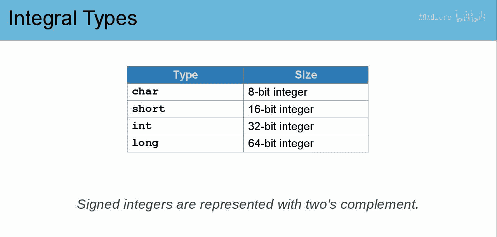

It will save you some time， I suggested that you create these type defs and have them around when you actually do open CLC programming this will save you a lot of time because it will ensure that you have some compatibility between your host and device and you'll see why this is important later on。

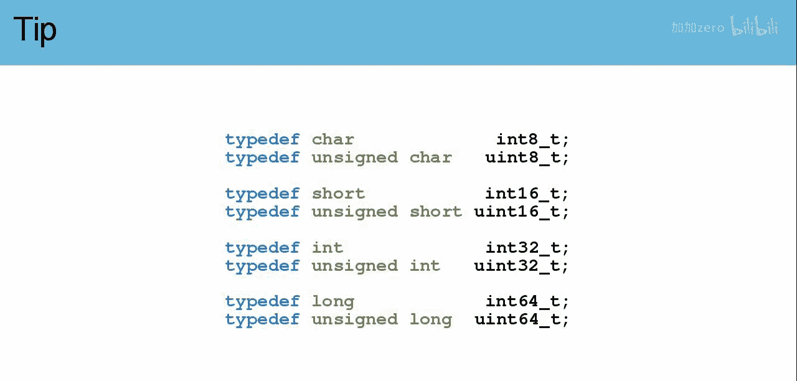

There's also floating point types with an open CLC。You have the float。

 which is single precision you're used to this 32 Bs。

 This is standardized with the I AEE 754 specification。 We also have the double type。

 double precision。 we're used to that。 the half precision。

 something that you might not have seen before。 It's not you know nearly as precise as the other ones that may be useful in graphics。

 I will point out that half in double types might not actually be supported。

 So you do need to be aware that not all types that are seemingly available to you really are。

 Sometimes you have to check to see whether or not your device has capability to do what you actually want to do。

 for instance， that it supports doubles or that supports half。

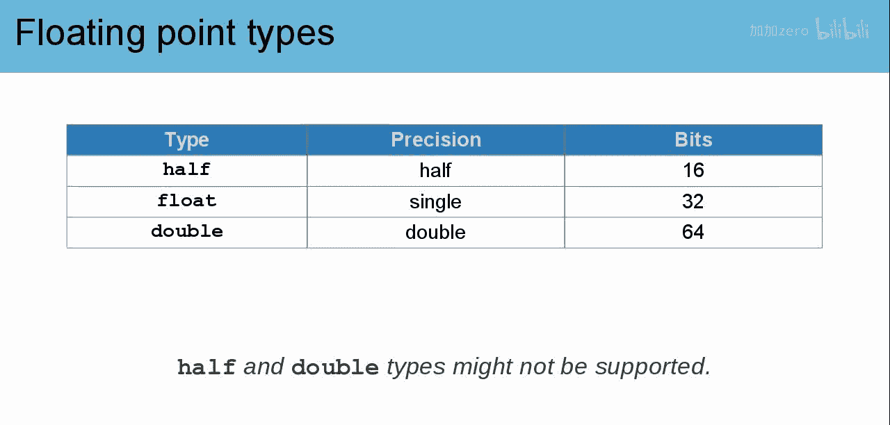

But I want to point out something right away， which is that beware of host and device types when I'm talking about open CLC integers。

 I'm talking about something that is running on the device and there's a standard representation for that。

 so let's look at an example here。

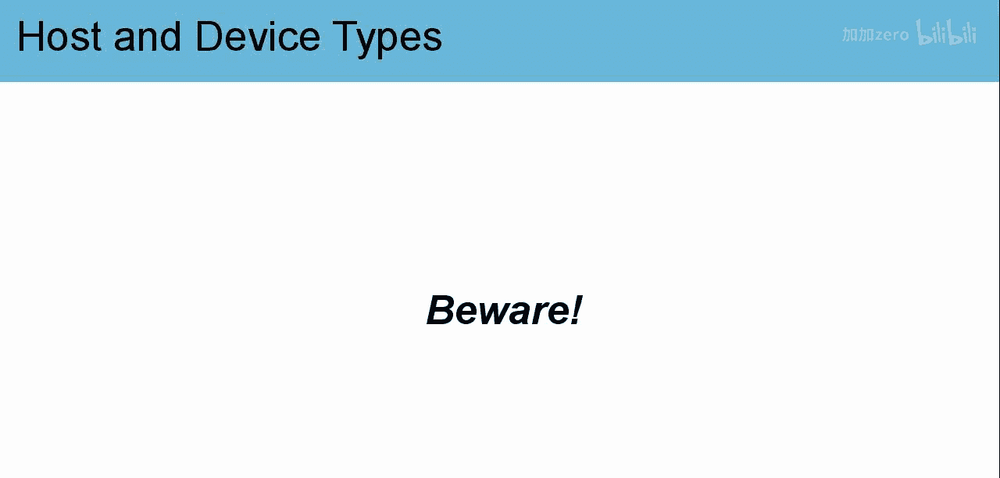

Let's assume that I have some host program where I declare。

 let's say it's in C 99 int X on the device I say in Y and open C， L C。

 Can we copy the value of X into Y， What do you think。

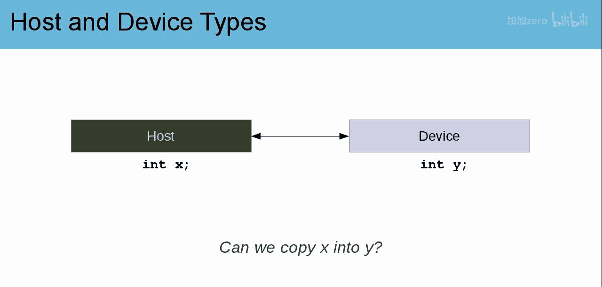

The answer is definitely not， and be very careful of this on the device we represent。

Integers with twos complement and 32 bits of the host， we don't know the representations。

We don't even know the bit size， so be careful when you do host and device exchanges。

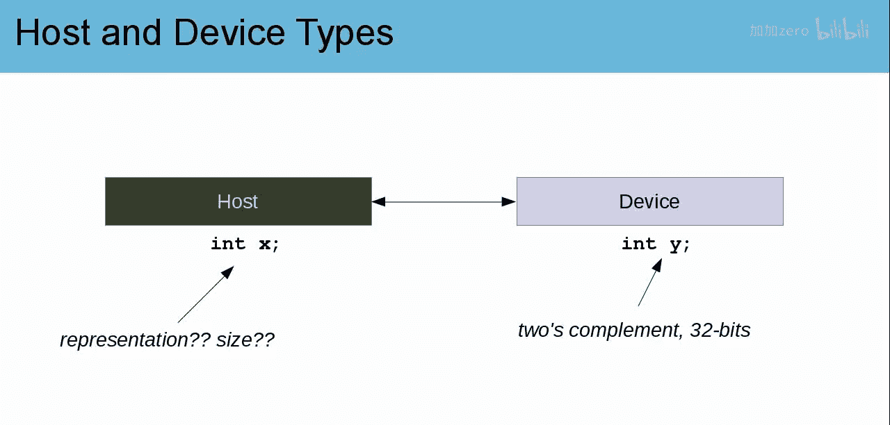

Now this not necessarily all doom and gloom， there are type defs you'll see things in the host that are called for instance C underscore flow to C underscore int these are messy in the standard headers this is an example of where middleware or libraries should be there to help you ensure that everything is being transferred correctly。

 so here's an example of where middleware will really help you out。

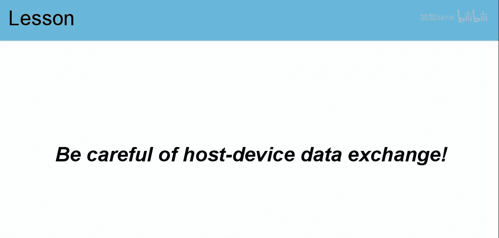

Now， there's other types that are restricted to the device。

 What this means is that you can't copy them from the host over to the device。

 If you recall my previous talk， I mentioned that， for instance。

 kernel arguments that we can specify values。 These are all types that you。

 you cannot communicate between。The host to the device at all so a bo type size T pointer different types。

 these all have purposes according to the C specification I'm not going to go into them。

 the important thing to note is that you can't transfer them between the host and the device。

So I assume that you you followed and completely understood my previous talk。

 One of the things I discussed there was a memory model。

 and we just showed memory regions that the processing element has access to a memory space called private。

 constant and local and global memories。 Now， the keywords here with these underscores。 really。

 it's kind of what you would expect in a sea language is that we have keywords that say what memory regions we mean。

 Do we mean the global region， local region， private region or constant region。

 these are concepts that should be completely familiar to now。

 you may not know how to apply them yet。 but you've seen that the device model has these memory regions within them。

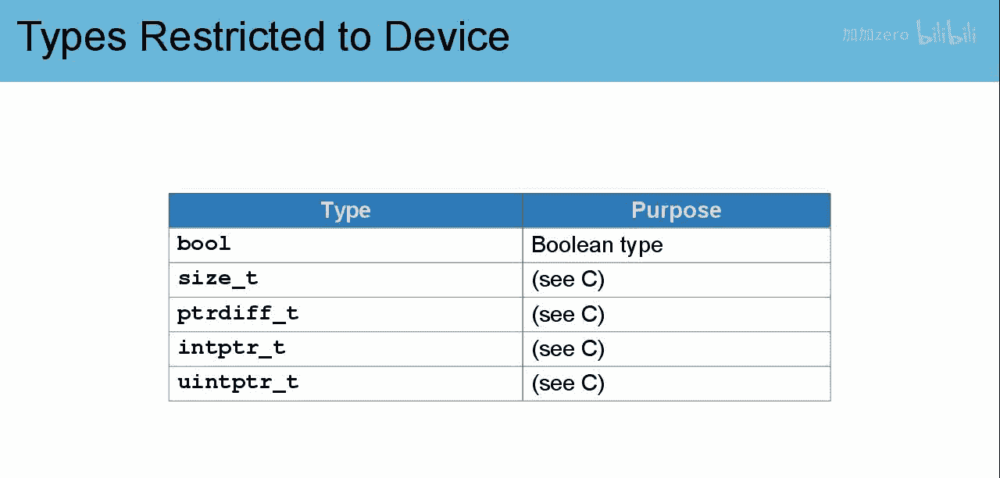

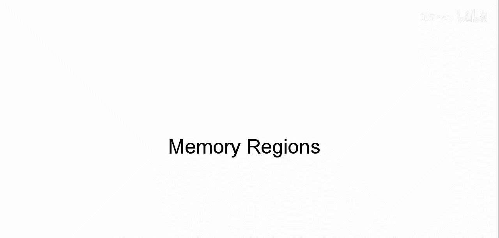

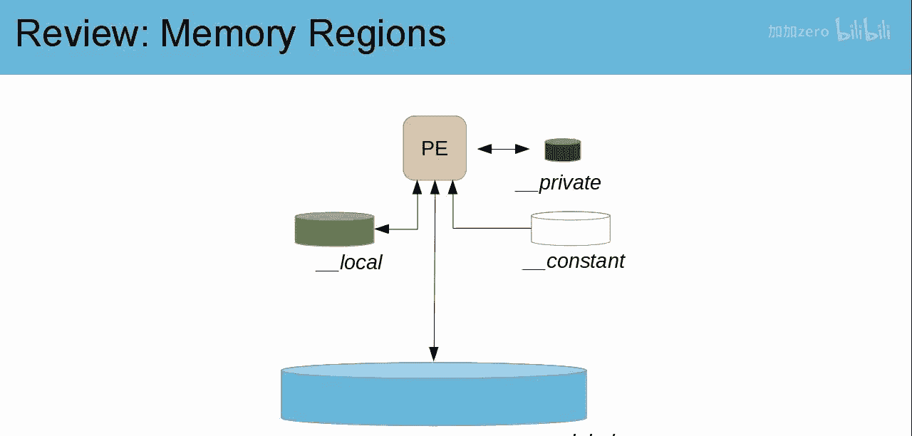

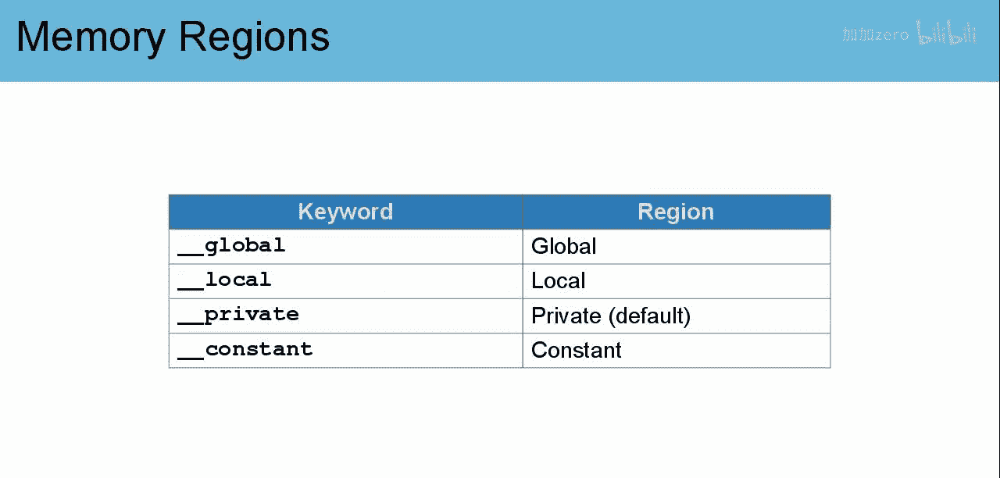

Now。Let's look at an example declaration， you have just seen your first piece of openCLC and I'm sorry that it is so disappointing。

 so we have global integer star and or let's call it pointer to integer global okay。

So the first thing to recognize is that this keyword is specifying the memory region。

 where do we want to point to， and the pointer you should really consider it as one piece。

 global int we pointing to a integer in the global memory region。

This is something that shouldn't take that much time to get used to。

 but you want to be familiar with it you want to start thinking when I have memory。

 where is that memory relo sorry， where is that memory located？

This is going to seem a little bit unnatural coming from a CRC++ background。

 but with open CLC you should get used to it because most of your time is going to be spent thinking about where memory is or where it should be So here's an example。

We have two pointers， x and Y， these pointers are pointing to some integer in global memory space。

 can we go ahead and do the assignment？Yes we can， we can point。

We can take the X pointer and point it。To whatever Y is currently pointing to standard C， nothing。

 sorry， it's almost standard C， if not for those keywords。 know。

 if I was to take these global spaces。Sorry for that。

If I was to take these global values and to just kind of hide them。

 So let's just imagine they're not there。 this is ordinary C。 This is completely what you're used to。

 but they do add a little bit of complication。 So let's consider now that I have this global pointer。

An integer to something in global and integer or something point private。

 We can't actually assign the pointer to points to somewhere else because it's two different memory regions。

 So it's not just a pointer to integer。 It's a pointer to a integer in the global space。

 This should start to feel natural very quickly。 but I want to point out that we should recognize that we're dealing with many different memory spaces。

 It's a very important concept in openC。 However， we can still copy by values。 This is fine。

 what this is doing is something really kind of physically。

 it's a physical effect on your device as we are taking something from the private memory and issuing a copy into the global memory space。

 This is not a simple statement anymore。 This is having an effect。 there is a cost to this。

 There's a potentially high cost to this。 for this particular example。

 we'll get into details much later to the actual relative cost of these types of operations。

 but I want you to be clear that we actually are thinking。In terms of multiple memory spaces。

 you really should get in that habit。Completely okay to copy from private to global memory。

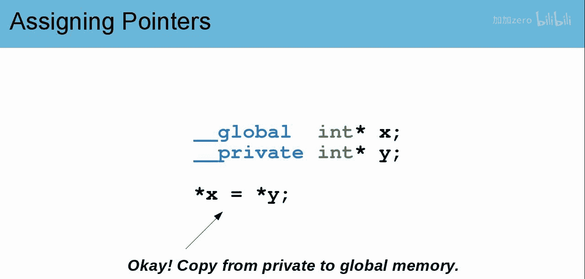

Okay we're copying between memories we're not reassigning where the pointer is。

 so that's all there is to say about types。Should be pretty natural。 Let's talk about vectors。

 One of the most important things that has really come up when we have vector operations。

 not in terms of mathematical vectors， linear algebra vector spaces。

 all of these types of interesting things， but let's talk about vectors in terms of the operations are happening within the processor when we have vector operations so how do we actually get good vectorized code。

 this is a complicated issue。 There are several approaches。

 and I will note that this slide is based on something from the software optimization cookbook from Intel press。

One approach is to just use libraries， and the problem here is that we're shifting the problem to somebody who isn't you Now it's someone else's problem。

 so I'm just going to call this function and it's up to them to vectorize it。

 It's fair in certain cases， but it is if you're trying to write those libraries。

What are you going to do， So now you've shipped with the problem。 You've told me you write a library。

 O， well， how do I do it。One option is to let the compiler do it。

 if you have a vectorizing compiler an optimizing compiler。

 it can look at certain structures of your code and extract vector operations out。

So that's one option Another option is to use C++ classes， you can overload your operators。

 make something that looks kind of nice， but the problem is it's not going to be terribly efficient。

 C++ is a great language for a lot of things but it's not really going to work well when you're trying to vectorize something You can also use intrinsics you'll see these Intel has some intrinsics provided it gets very messy。

I've looked at doing this several times， I've never actually done it myself by hand it gets。

Too messy to play with。 even worse。 Who wants to do assembly language。

 But I'm trying to point out there's very few ways to actually get vectorization out and one of the nice things with open C。

 is that open CC vectorization is a very natural thing to do。 It's very easy to do。

 This is one of the reasons why I tell people， in fact。

 as a little side note that open CC actually has a lot to offer， even if you aren't using a GPU。

 If all you're doing is writing code to run on a CPU and it has a it has a capability to run vector instructions。

 which I'm sure it will in a modern CPU。Open seal is great。

 It does a really good job of vectorizing your code in comparison to what you would do by hand using any other approach。

 So let's look at these vector types。 These are， these are first class citizens。 Now。

 I'll note on the left side that you see this capital N。😊。

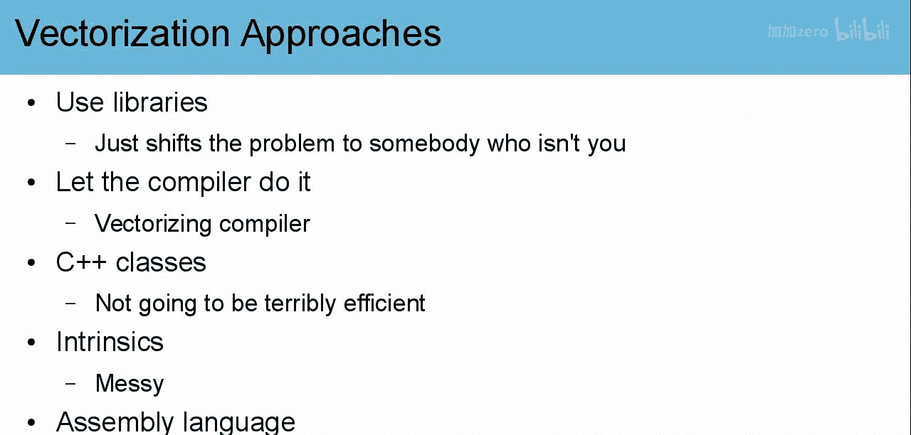

This is substituting for a number， so let's just look here at the bottom of the slide。

 we have n equals to 2， 3，4，8 or 16。What this means is for instance， cha n。We can get rid of that。

 So， you know， we already saw that we have a char type， but we have a char 2。

 which is going to be two chas。 We have a char 3， which is three chas， a char 4， which is four chas。

 a char 8， which is 8 chas and a char 16， which is 16 chas。 Now。

 these are types that are right directly。Accessible to us。

We can do signed types or unsigned types there is no unsigned chart2。You have to do UA。

 something like this。

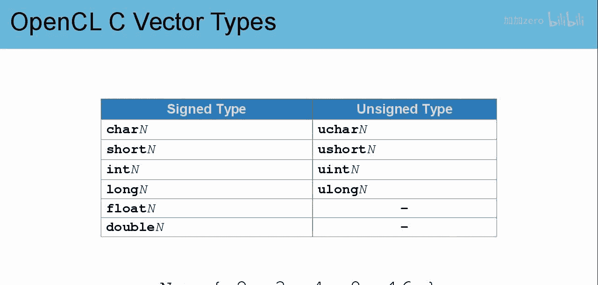

So it doesn't look too bad so far， so let's take a look。What happens when you do vector operations？

 So if we have two scrs here， X and y， our both scalers just float single float 32 bit floats。

 and we're assigning to a Z。Well， this is the same as traditional see that you haven't learned anything here。

 this is not a big deal at all。But what happens when you do operations on two vectors we have？

4 width the vectors。 We have x， Y and Z。 X is float4， Y is float4 is z's float 4。

 What happens when we do the addition？ Well， we're just going to go ahead and do component Y's addition。

And let's just imagine some sort of general operator here。

 so let's say that we have x and let's call this cross， just for some term x cross y okay。诶。

What happens when you do the operation。 Well， if these are vectors。

 what's going to happen is that the result， Z 1， for example， is going to be equal to x1 cross Y 1。

 And this operation is going to proceed component Y， all the way to Z K。

 which is going to be equal to X， K cross Y K。Okay。Okay。

 not pig Latin here Now what can that cross operator actually be， Well。

 it could be addition could be subtraction， multiplication， Any of the relational operators。

 I will point out that the relational operators start to seem rather confusing because you can't naturally map less than to a vector mathematically you use other operations。

To determine ordering of vectors。 Now， this can be a little bit unnatural。

 So I want you to realize because this has affected me too， that when you compare two vectors。

 the result is a vector with the Boan operation done component wise。 So watch for that trap。

What happens if we mix operations， we have a scalar in vectoror， is it defined？

What happens in this situation so we have。X plus y， where x is a scalar and y is a four width vector。

 What's the result going to be， Is this even defined。Okay， so。

It is defined and the result is going to be a float for what's going to happen。

Is that when we mix scrs and vectors， the scrs will be paddted out， completely natural。

So this is going to be paddted out to be the vector X X X and X， and then we're going to add it to Y。

 so watch for this because you may not have wanted this particular feature。

 this may have actually been a mistake on your part which the compilerrs is going to happily accept so let's summarize vector operations here you can have scalrs and scalrs operating together we know that vectors operating on vectors which is done component wise and when you have a scalar and vector working together。

 you're going to pad the scalar out to be the same size and then we it's something we already know we just go ahead and use vector vector operations。

So let's now talk about addressing。If I have a vector， X， Y， Z， whatever want to call it。

If I want to access a component， I want to unpack that vector okay I'm going to do dot and I'm going to call this component and the set of components that we can have are this since you're doing programming I'm sure you're happy to use hexadeadecimal and since we're going from zero to 16 hexadeadecimal is perfect for this so Vec dot s0 is the first component。

Vec dot S8 is the ninth component， and the last component is V dot SF。I will note here。

 We'll talk about efficiency later on， but I just want to briefly touch on the fact that you may not be doing the best thing in the world by unpacking the components of vectors in terms of what the compiler can do。

 But this is going to come up in another talk。 But you can unpack these vectors， Okay。

 So what if which of these addresses are valid。 Well， if you have a vector， which is a two vector。

 So V2， So float to or char 2， you can call。So they say we have charge 2 x， then x dot S 0。

 x do S1 both phi， the other ones are errors。 if we have a three width vector。

We can use this set as 0 through S2。If we have four as0， test 3， if we have8 as 0， test 7。

 and if we have the full 16 width， we use as 0 through to SF， so pretty natural。

 just remember how to use this addressing scheme and doing vector operations is pretty simple。

But the higher level question is， why do we want to use open sealed vector types at all？

Is a compiler really going to do such a better job and how much better of a job can it really do Well just conceptually openclLC can take these two statements。

 We have z equals x plus y。 know if we don't use vectors。

 maybe we get we have to do component Y so maybe we have to do four additions here if that's something that the hardwares to do if have to do four additions and let's assume we have a vector instructions in our architecture So let's go and take this open CLC fragment。

Put it through the compiler and what are we going to get？Well。

 we're going to get this completely fictitious statement in the ISA or the assembly language of the device。

 whatever the device is。And。Let's imagine that this is a fictitious vector instruction。

 so we are now going to take register 1， register 2， add them together and store in register 3 and。

This addition can be done in one step， And let's suppose that the other editions would have taken four steps。

 So we really have a four times performance gain。 in some sense， by using the vector operations。

 you really want to use vector operations， but traditionally it's been very hard to actually get to them with languages that you want to write your code in。

 and there's some advantages to you using the open seal of vector types。

 So the first thing is that you get a clear communication of vector operations between you and the compiler。

 you both have agreed that these are vectors。 This is something that you have a bundle of data here。

 Now it simplifies your code， it starts to looks a lot nicer than using the intrinsics。 and。

You start to get excellent performance The compiler can do a really good job of vectorizing when you are using vectors in this context Now let's discuss。

 we've completed vectors that's all there really is to know about them。

 how to use them as entirely different story， but that's all you need to know about them Now let's talk about structures。

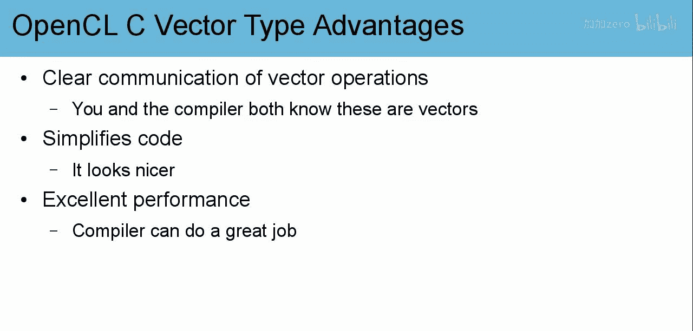

This is the typical way of aggregating data and C。

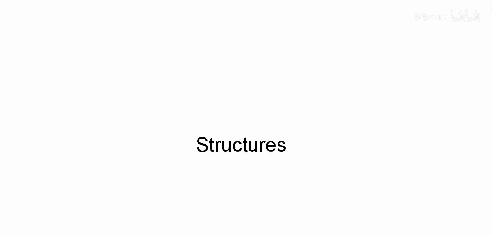

You can do structures in openCLC you can do unions also by the way。

 it's just like C it's well you know， however， there's really good reasons to avoid openCLC structures and the reason has to do with performance and another talk will discuss this in detail as to why that is。

 but trust me you probably want to avoid their use。In addition to that。

 be very careful of data exchange。 remember we have a host and device that both have to agree on a representation。

 and the binary layout of the struct must be the same on the host in the device when we copy data。

 it's a binary operation to copy from hosted device or vice versa。

 and it's almost impossible to get the layout correct when you take into account alignment it can be done。

 but in my experience， it is very hard to do， because if you take， for instance。

 a struct and you try to compile it in open CC and you compile it in C。

 it will be pad it differently for the alignment of the different architectures。

 and you have to start adding padding manually and it becomes a real mess。 And as I said。

 you probably don't want to usestructs anyways because of performance。

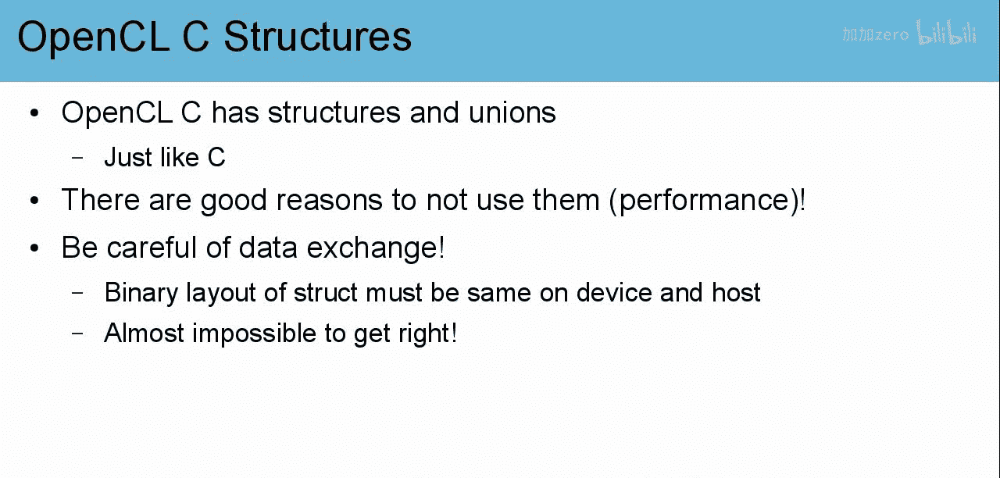

So let's talk about functions， we've seen the basic types。

 we've seen that we have special types called vectors and we've seen that we can aggregate things together intostructs sorry the special types are vectors and then we have structures so what's the deal with functions and open CLC Well they're just ordinary C functions nothing special about them you can't recur however I mentioned this in the beginning of this talk that recursion is forbidden and。

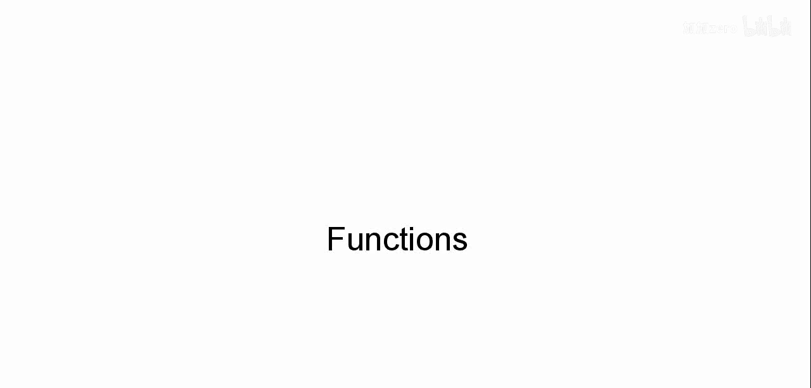

Functions might be expanded in line by the compiler。Doesn't necessarily affect you。

 but it's something you should know。 So let's see an example of a function。 We have a float for。

 We're going to add X and Y。 Here it is。 perfectly valid。 Now。

 we can change this to add some pointers。 This is okay， too。

 but I will note that there's something implicit here and hopefully remember from the first set of few slides。

 is that the private memory space is implicit。 So we actually have an addd function。

 It is adding two private floats。 and we have to add another function if we want to add to global floats。

So bear in mind that the memory region is part of the signature。

 this can make it a little bit difficult or very annoying to say the least。

 if you're writing code that has to handle different memory regions in the same way。

 just taking pointers as argument， so be aware of that。

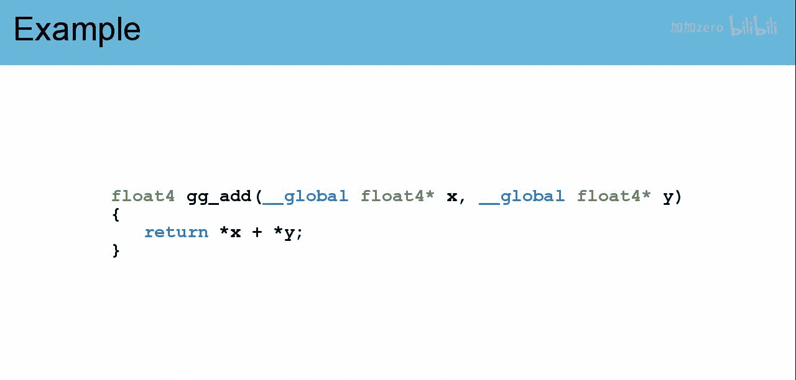

Now we're going to talk about kernels， so functions there really isn't much to say it's everything you've seen before and kernels。

As you will recall from my discussion。On the execution model。

This is really what you're calling to do work on the device。I am hoping。

That the time I spent explaining to you the execution model is going to pay off here because it's very simple now to describe the colonels。

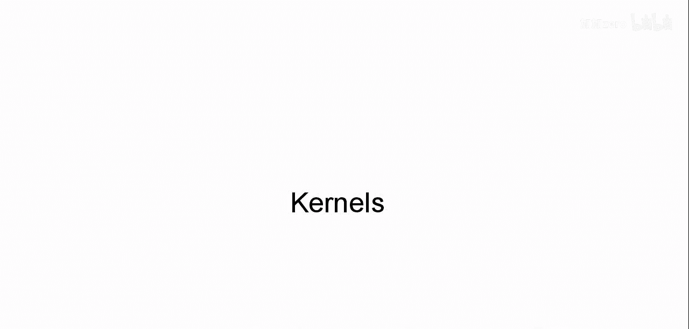

The first thing to understand is that kernels are really entry points of device execution。

We're familiar with this concept with C， in fact， we have an intmae which takes this particular argument list and it's an incantation。

 we just always write this when we write a function。

 and something is going to call that the operating system is actually going to call inmae for us。

But in this case， all a kernel is just an entrych point like inma。

 except we get to name the main part， whatever we want though you can think of it as having multiple main functions in some sense。

Now the kernels get called by the host， we discuss this in the philosophical part of this。

 the host is going to set up parameters for the call which control the execution and the host is also going to set up the argument list and is' going to supply it and then it's going to issue a host's API call that says okay。

 go ahead and execute this let me know when you're finished so that's the complete picture and the device is going to run that function。

Now， the kernel arguments are pointers to either something in the global space or just value。

's a there's a couple of things in here that。嗯。This isn't entirely accurate because and you will see that in the slides。

 but you should think about it this way， the non accuracy is really kind of。

Is really kind of a silly that I'm saying it's not accurate。Let's pretend I didn't say that。

 I suppose。 So kernel arguments are pointers to。Something that is global or just values that are copied。

 Remember that every single kernel。Launch or every invocation of the function。

 remember we talked about the execution model is going to have the same values specified they have the same argument list it they use the indices to figure out what they're actually doing so let's look at an example this is the first openC C program you have seen and it is very disappointing because all it does is add two arrays together so。

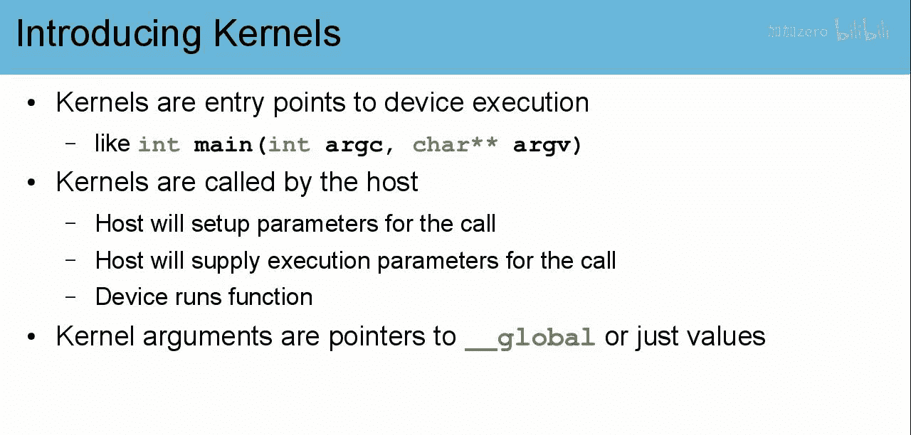

We're going to add these two arrays。 We're given the array X and y， which are inputs。

 and we're going to add the results and store it in the same locations component Y to Z。

 Now we have the length of the array supplied， the reason for that is that we need to terminate if we have a work item that's ined that's overflowing。

嗯。And this is something that we're accomplishing by this if statement here。

 So the first thing to note is that we have this if statement that all it's really doing is saying。

 you know， if I've gone beyond things， I'm going to stop。 I'm not going to do anything。 Otherwise。

 I'm going to do the addition。 Now， this index part is calling gett global I D。

 Remember how I said that we have these global Is that are completely unique that's what this is about。

 the0 in here is really just an indicator。Of the dimension zero dimension of the good of the ID。

 remember， I said that we can have multiple dimensions in the call。 So here is your complete。

Colonnel call now this is completely valid and I will note that the kernel void is always required。

 We can't return anything。 We're just going ahead and calling it and on the device has nowhere to return it has to use global variables for that and the underscore kernel just marks it as a special function tells a compiler that hey you can call me I'm an entry point to the device and it can go ahead and build all the code that's required so let's review our execution model remember that execution has dimensions we have global work size global offset workgroup size I spent so much time explaining these concepts because they're very important when you actually write kernels and there's relevant functions to access those。

 remember again， the argument list is fixed so the only way to figure out what we're doing is to use external functions to ask the system whatever is running these functions where we are so the relevant functions in openCLC are get global I and where。

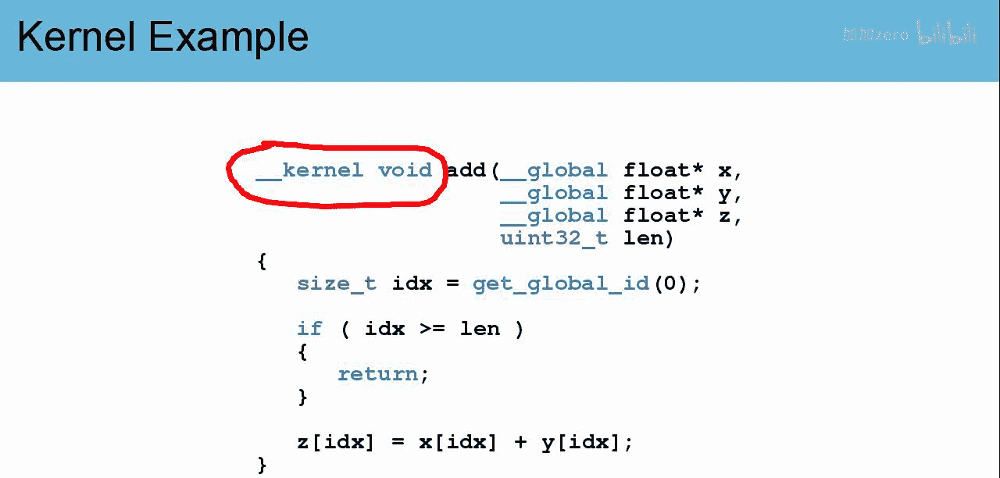

I mentioned n is the dimension sorry where n is the dimension so this is going to give us the work item ID and dimension N Now we also can say Git global offset I mentioned the offset in my previous discussion in terms of a number that's being added to everything all of the indices okay and we have the Gitg ID which is just which work item am I inside of my workgroup now these are only a handful of the functions I encourage you to go look at the documentation and see what the rest are but these are the few you're going to use and I would say that the one that you're going to use most of all is GitG ID you're probably going to use this one more often than not。

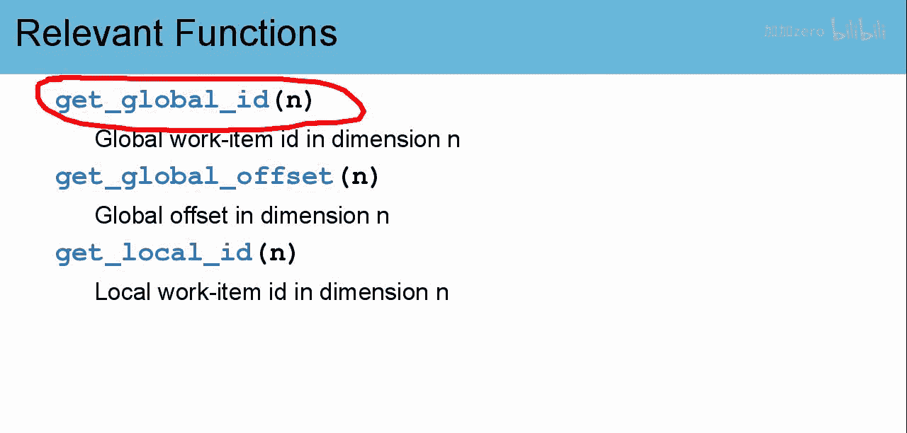

Now let's look at another example here。うん。This is the same example in fact。

 but I want you to just take a quick look at the fact that we're using this function again。

 I' want to stress that this is you're figuring out our location based on this call I'll also point out by the way that I'm using size T which is device specific。

 it could be 32 or 60 to4 bits based on the device。

 but it doesn't matter because it's not in our list of things that are being called externally。

 I'll also note that I'm going ahead and using the type depth that I suggest that you do just because it makes your life a little bit easier。

Now。Let's talk about local memory。 This is how come we've had to modify our idea of execution to bring local memory into kind of the picture here。

 So memory is shared by work items within the work local memory is shared。

 And the local memory might be a physical thing in hardware it might not be。

 but because it's a model， it doesn't always map the same weight to all the hardware on a GPpU it is going to map to something physical。

 So you want to use local memory when you can。 and oftentimes local memory is key to obtaining top performance。

 So how do we declare something to use local memory。 There's a couple of ways to do this。

 The first way is that we can provide a parameter。 So you'll see here that I've gone ahead and provided a parameter to local memory。

 Remember that local memory。

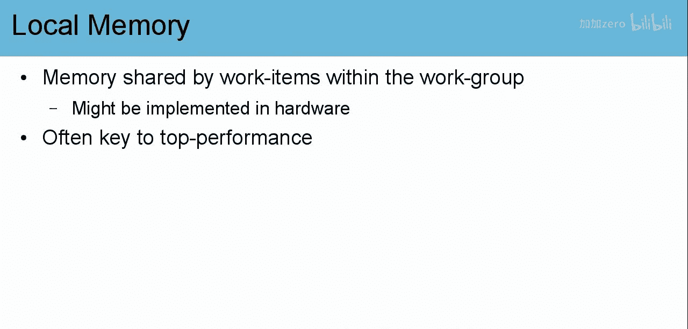

The fact that you can do this in the argument list。

 remember I said the argument list is either pointers to something global or it's pointers to value or it's of value。

 and then I kind of stumbled a little bit in my discussion here。

 I wasn't completely sure how to mention this exemption you aren't actually declaring when you call the function to declare local to call so sorry when you are inqueuing the kernelel and you're going to call Colel Fo here okay。

When you have a local value or a variable。I keep。Problem is。

 I'm using terms that exist in so many other places。

 when you have an argument that is a pointer to something that is local。

 The expectation on the side of the host is not that you're providing a real pointer。

 but a size of how big that memory should be。 So it still is true that all you can do is ever supply pointers to something that is global or something that is a value。

 So that's。What you should recognize from that now here I'm using two indices。

 I'm using local information， so what is this doing， Let's look at this for a second。

I'm getting a global index and again， if I've overflown， I don't do anything。

What I'm doing here is I'm loading into scratch space something okay so I take my global index。

 I'm loading something into scratch space and then I'm going ahead and the scratch space is going to go from zero to oh that's not what I expect it to do my apologies is going to go from zero to K for instance where K is the work group size okay so this index is different so I'm loading something my global value into a local value and then I'm writing it back out so not the most interesting kernel。

 I just want to show you how you use local memory， there's another way to use local memory which you might prefer。

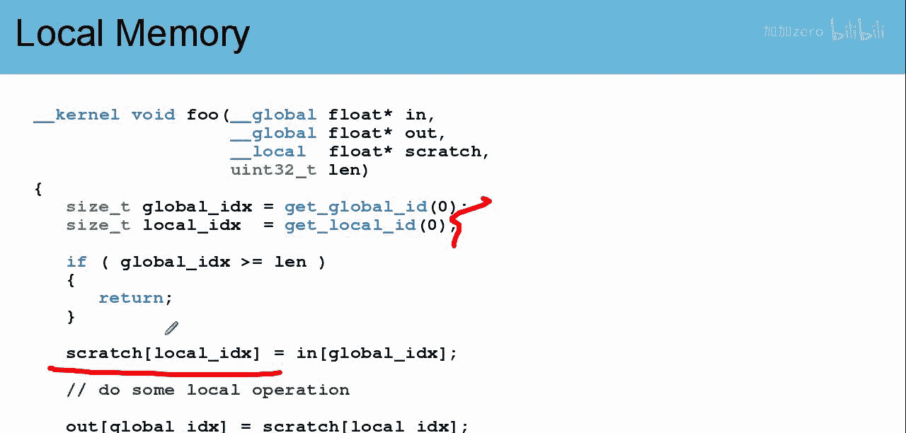

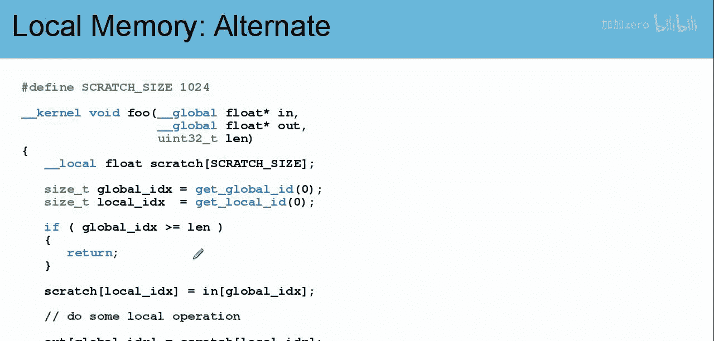

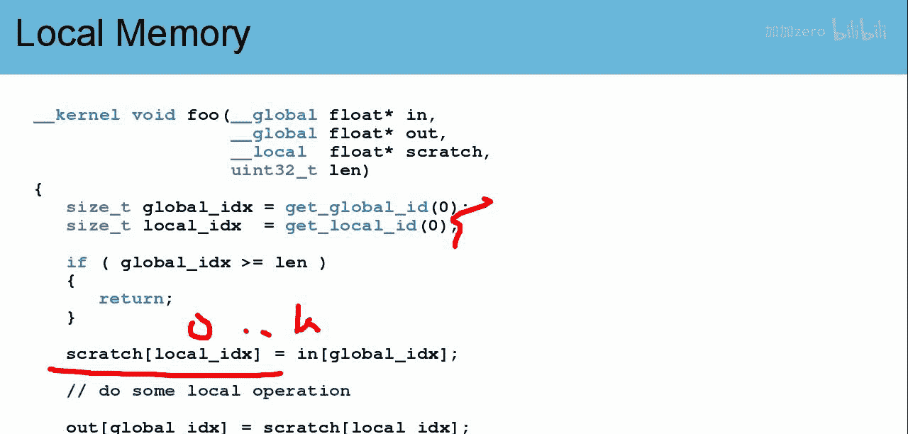

Which is， it makes a little bit more sense。 I prefer this method when I can。 I just go ahead and say。

 hey， I'm using a local variable， this is scratch base。

 but I'll note that even though it appears to be inside of a single work item。

 okay it's actually shared amongst all work item in the work group。

 So this is syntactically appearing as if it's a single work item executing this。

It's not executing anything。 It's just an allocation。

 so it's something that all work items are going to see this allocation and it's fixed and size to be 1024 in this example。

 and everything goes exactly how it did before。 So this is another way to do exactly what you saw in the other example。

Now constant memory， it's read it it's read only memory it's shared by all the work items we saw this very fast to read。

 but it's a relatively small amount of space。 it's useful in some circumstances if you think of lookup tables。

 you should really be thinking of constant memory now because of look constant memory relatively small and if you have an enormous lookup table it won't be so useful but I want you to just remember that constant memory kind of the same as local now how do you populate the constant memory Well you could just put it directly in your file or you could just go ahead and put it into a。

You can。Habit is an argument in past a pointer to global memory region to it。Now。

 there's some limitations in terms of what kernels can do。

 First thing to recognize is that kernels might execute concurrently on the device。

 So when I say kernels， I'm saying the ad kernel and the F kernel。

 Two different kernels no not work items in the same one， two different ones。

 They can they might both share the same device。 but they can't cooperate。 at all。 They really can't。

 anything you do that makes them attempt to cooperate is a programming error。

 You should not be doing it some defined behavior。 Now。

 a single kernel is really limited in what it can do。

 Can you write something like in main that is doing everything。 No， you can't。

 You probably need to launch several kernels to get a particular job done。

 This is something you'll see when you actually see how to write algorithms using Open C right now。

 you're seeing how to just the rules of the game， the syntax。

Colonnels cannot allocate memory themselves。 Everything is fixed in place。

 and then they just run until that index space I described in the previous set is emptied。

 So everything is set up。 Cols just keep running， running， running， running。 Everything finishes。

 They terminate。 okay， They cannot all memory because that would violate this kind of philosophy。

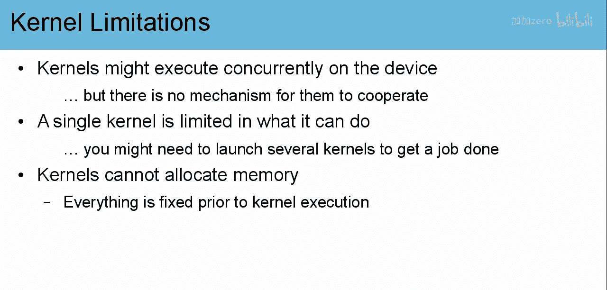

There's a few attributes， these are very important。

 attributes are things that are you can see in the documentation you'll see in more advanced presentations。

 everything I'm doing is building towards a more advanced talk so they can rapidly get you into writing very fast code using OpenCL one of the attributes。

That you can have is a hint。For vectorization on the width of vectors。

 this is something that allows you to do a really good job to convey to the compile or something it might not。

Figed out for itself in terms of how you imagine things being vectorized。 The other thing you can do。

 there's a couple other attributes， by the way， but the most important one。

 these are the two most important is a required work group size。 This force is the work group size。

 and this is very useful for performance。 You are going to see me use this in every single kernel I write that I'm attempting to get top speed。

 This is going to force a particular work group size。

 And what happens is that because the compiler knows that the work group size is say 64。

64 is a special number to AMD whatever it is， so if it sees that the workgroup size is 64 it can apply very special and very particular optimization and do a very good job of doing things like register location and all these funny things we'll get into when we talk about the actual way that these models are being transmitted or sorry transformed into real life code so we've pretty much talked about openCLC Now there's a few quick topics that I'm not going to talk in detail about but I want to provide you enough background that you can go and learn about these yourself so OpenCL does provide support for images。

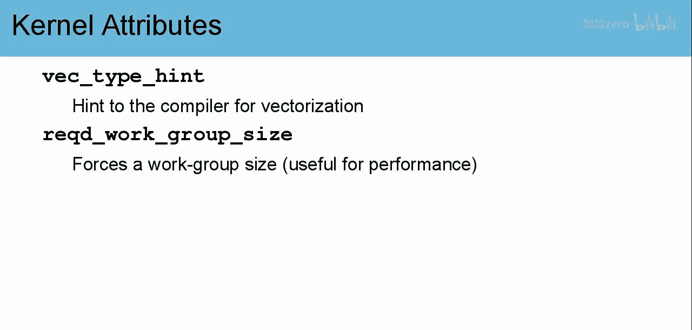

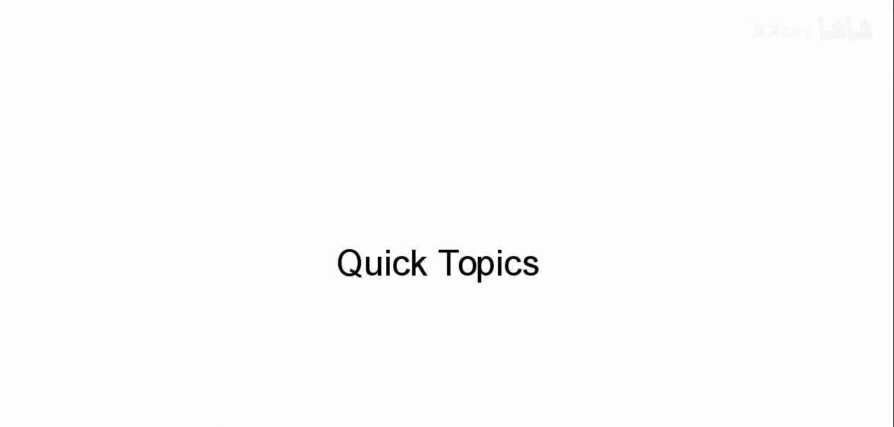

You can load an image， you can do something with it。

 you can write an image these things are directly supportive of OpenC you'll see quite a bit of the specification does provide things about images stuff three you know there's things you can do with images I personally don't like images in OpenC and it's not that I don't like graphics or that I have a problem of images and I'm saying get off my lawn。

 the problem is that I think they represent a deeper flaw Now this is a more advanced topic if you see the summary notes you can read about my issues with images in a article I wrote about SPIR which is something else's if you never heard of it don't worry about it it's just feedback I've given。

So they are there， but I'm not going to cover them， I've actually never even used them。

TheyThey're not。There's interesting properties about images， but I do general purpose stuff。

 I do things that is not image processing if I' doing image processing。

 I'd be using them Now you can read about images in the specification if you want and the key thing that I did motivated at the beginning was that they're opaque types。

 we don't know the memory representation of them。That's for performance reasons and that's all there is to say about images now there's built in open CLC functions so。

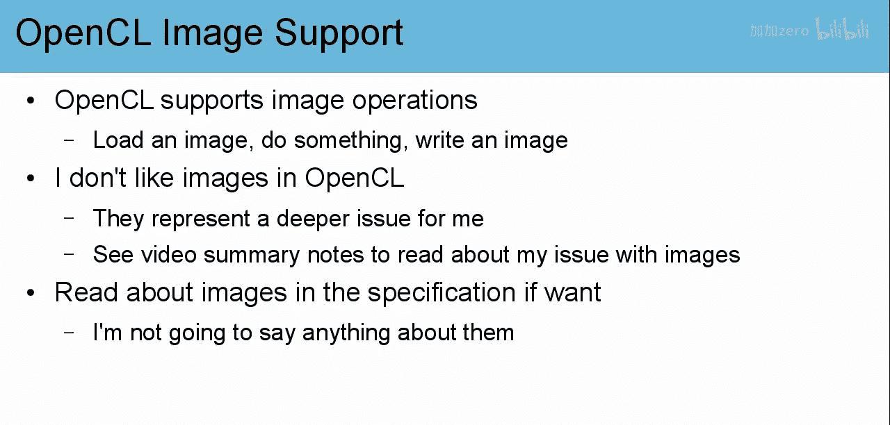

We have many functions built in that we can just go ahead and call it's not exactly like a standard library but it's kind of like a standard library so we have work item functions we can figure out our parameters that we were in queue with。

 there's math functions， there's integer functions。

 there's geometric functions and you should really see the documentation I'm not going to bore you by going through every single function。

 but there's some real goodies in there in terms of things like the cross product or the do product and there are opportunities for you to really use those to get good performance。

Because these implementations are likely going to have been implemented by the vendor and the fastest possible way for that architecture may even call a special instruction。

 I don't know it depends upon the device and the implementation， so synchronization。

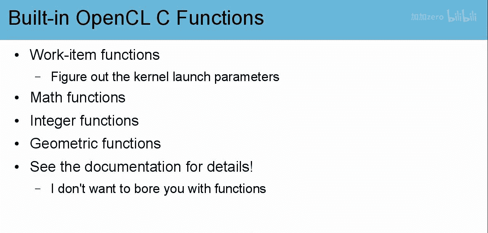

I meanan open CLC， you haven't seen it yet is really a parallel programming approach and synchronization is very important。

 It's also a very complex topic you're going to have to watch for me to do another video where I'm going to talk just about synchronization OpenclLC provides atomic operations and parallelism in openclLC is a little bit tricky。

 you're really going to start to appreciate someone like me who has a background in waitfree algorithm design because this means that I can write algorithm is they suit it to the openclLC programming model If you're used to using locks or Mutexes。

 however you wish to call them， you're going to have a really hard time with open C and that's not to say that you're having a hard time because there's something you're not aware of iss that there's really hard the way that openclLC has been designed for performance。

 Everything that's been done for performance almost excludes the。Use of locks。

 So you have to be careful。 Now the reason that I've broken these topics into bite size pieces is that at this point you have seen so much of open C that now I can discuss the execution model。

 I can say， okay， let's talk about work groups。 Let's talk about work items。 How do things map。

 What's the interface of the compute unit， How does a compute unit see things。

 How does the processing element see things。 How does everything relate。

 You now have enough background after these two hours of talks that you can appreciate all of the extra topics I really want to do these talks have been boilerp for me。

 They provide it you with something that now we can have some really interesting and serious discussions。

 The final thing I'm going to leave you off with in terms of the talk is extensions。

The OpenclLC standard has extensions can things have been added to it and these are extra features that you can enable by using a pragma directive and as always with pragma or anything external that's not quite in the specification yet be careful。

 use good judgment， be safe out there， be careful how you are designing your code because you may find that your favorite extension disappears or that it really maybe wasn't such a good idea to use the extension because of vendor lockin so be aware when you use it。

 you can peruse the extensions are provided， they are useful， some of them are take a look。

So in conclusion。First of all， congratulations you now understand OpenCL the models associated with it and OpenclLC you understand the basics and I encourage you to go out and read the specification pick it up。

 take a look through it， flip through random pages and you now have everything that you need to really understand what's going on bear in mind is going to take some time for everything to sink in and if anything's unclear to you that I haven't described something as well as it potentially could have please go ahead and leave me a comment and I may have another video that amends whatever you felt I didn't do a good job at or maybe I'll write an article to help you well understand that concept so I encourage you to subscribe to my blog you can check it in the about section on this video Ill post a link in the next slide and I'm available as a consultant that includes helping you actually get good performance how do you structure your programs to be a reusable。

 what are the design patterns of OpenCL I'm running about these it's going to take me time to convey this information to the general public。

But if you hire me as a consultant you can get my you can get the benefit of my advice today and right now my name's Aion so thank you very much for checking things out and go ahead and send me an email or check out my website and I will post as new videos become available to this channel and to。

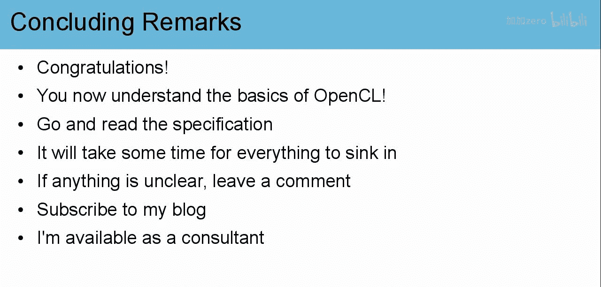

That website， so thank you very much for your time and good night。

