# 【OpenCL编程 RayiYanuTara】 p03 p2 OpenCL GPU Architecture -BV1X2BRYyEeM_p3-

Welcome to my next talk in my installment here on OpenCL。

 and I'm going to discuss today the general GPU architectureiture。

The particular examples in this lecture are going to be from the AMD 7970 GPU。

However the general concepts here apply to GPUs from NVDdia or from other vendors and in fact the concepts you're going to see also apply to SIMD instructions on a CPU。

 so this is a generally useful discussion and many people are coming to openCL with the misguided impression that we're only talking about GPUs that's not the case。

 I've tried to motivate that OpenCL is generally useful even in terms of doing vectorized instructions on a CPU。

But today， we're going to take a really deep look at how GPs work。

 And this is going to provide general。AF for us to have a general discussion about algorithms and data structures later on that are tuned to this unique architecture。

 So let's go ahead and。Begin the talk， I'm going to once again introduce myself。

I'm a parallel programming guru， so I'm very familiar with many of these topics。

 in fact I feel that I'm providing a lot of background so that we can have much more interesting discussions than what we've had so far。

I'm an expert in C++ OpenCL and Linux。This means that I'm quite happy working on backend servers and squeezing out every ounce of performance that I possibly can。

I'm concerned with real life software。And doing open C middleware development。

 you'll start to see more information on on this towards December。

 where I will start to show you the type of stuff I've been working on。

 I've been doing high performance computing for a long time and long before it was cool。 right now。

 we see big data who dupe all this type of stuff。 I see that H PC existed long before this。

 And I'm certainly available to help you out with these things I'm available for consulting。 In fact。

 many of the presentations you're seeing here。And lectures are really meant to show you the type of stuff I can help you with。

 it's watching these lectures is certainly not sufficient to call yourself an expert。

 it's going to take years of expertise， years of experience before you can call yourself an expert in these matters。

Go ahead and subscribe to my。Blog available at this websitettpwww。jon。

com go ahead and send me an email， just tell me whether or not you like these presentations。

And let's go ahead and get started。

So let's start with a motivation here。Remember this particular talk is on GPU architecture。

 so let's think about for a second how GPUs fit into the world when we're talking about using them for general purpose type of applications。

 His GPUs have been for graphics processing， and it may not make sense to you that you can use a GPU to get any sort of performance for a nongraphs application and you should really be asking yourself why should I care about using a GPU for my problem and I want to assure you that I really don't care about graphics either。

I've enjoyed trying out video games with the new video card that I've obtained for doing research on these matters。

 but I've never really been interested in graphics processing。

 I've been much more interested in physics problems， I've been interested in weather modeling。

 but interested in engineering problems， I have never been interested in graphics other than just enjoying pretty pictures。

So。This is interesting that the GPU。Which is what we call general purpose GPU computing。

 It was completely unintentional。 It makes it very interesting to deal with the fact that hardware vendors and entire industry have accidentally sprung up。

 It's something that was never intended for GPus to fill the role that they are filling today。

If you're interested in this topic， you can go read the history about GP GPU computing。

But suffice to say we're in this very weird situation today where GPUs are very useful at general purpose applications。

 but it was purely by accident and the architecture was motivated by doing。Rendering of games。

 doing manipulations on pixels， and it just so happens that these constructs evolve to allow us to do really interesting things and you were going to see the architecture of a GPU today。

You have to be aware that marketing departments are really misleading。 If you look at Wikipedia。

 you'll see a term called market texture。 Unfortunately， Nvidia， in particular。

 is doing itself no favors by。Marketing their GPUs in the way that they are。

 you don't have an opportunity to see what's actually novel or interesting about a GPU when you're being given a flashy presentation。

 trying to show you what's great about their equipment。

 when what you really want to know is how the thing actually works。

 This is a very big issue when you approach GPUs。When you're trying to。

 and you have a background in say computer science， you're trying to understand what's novel。

 how to actually use this。 and you wind up seeing these very flashy。诶。

Pictures that show you nothing and actually give you no interesting information。

 so be very aware of that。Unfortunately， the marketing departments of these companies are really working against them。

 but we're going to try to unwind what's actually novel and then from here you can make informed decisions as to which GPU you choose。

 whether you buy one from AMD or NV。AtThe end of this talk。

 you're going to appreciate GP architecture and another talk's going to help you to actually use this knowledge。

 we're still filling in background here， so without further introduction or motivation。

 let's go ahead and start talking about。

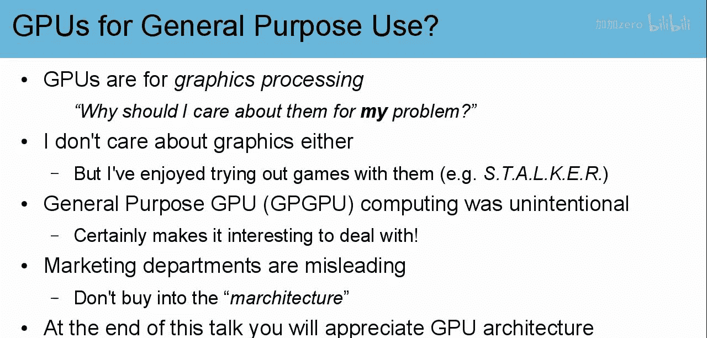

The openCL GPU architecture， the openCL word in here means that we're not talking about the GPU architecture in general。

 we're talking about how OpenCL views it， there are the features inside of a GPU that really aren't exposed to you and it's not really of interest to us since we're doing OpenCL development。

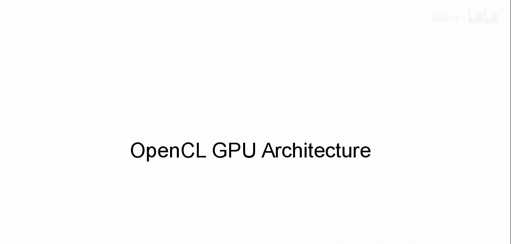

Now you should remember this diagram。This diagram was in the high level discussion we've seen it a few times。

 this is the device model。If you don't recognize this diagram。

 you need to go back and read other sorry， you need to watch my other videos so that you can understand what we're talking about。

 Everything is building。 And I'm going to assume that you understand most of the concepts of open CC。

 I'm going to。I'm going to approach this as if you've also seen my first video。

High level architecture， so you should go see that if you haven't yet。

So the first thing to see here about a GPU that's different than what we've seen so far is that the constant memory space is actually implemented in hardware。

The global memory space is implemented in hardware。

 and so we see that even though we have a model of these things on a GPU。

 these things physically exist， there is a physical global memory on the card。 There is a physical。

 constant memory on the card。So let's go ahead and descend into the compute unit。

 and this is still a model。 This isn't how it's completely physically implemented， but。

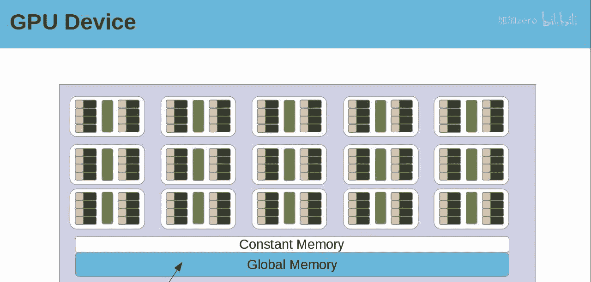

We are looking at a slightly different model。Then the OpenCL compute unit model。

 as you recall I showed you the device model has compute units within it。

 but we're going to revise this a little bit to show you how GPUs work。Now。

Inside of the compute unit of a GPU， you have a collection of processing elements。

We've seen this kind of thing before。The local and private memory are implemented in hardware。

 This wouldn't be the case if you are looking at something like a CPU architecture。

 So there is something novel here that the local and private memory has actually been implemented physically。

Local and private memory are also shared with all the processing elements。 Now。

 this deviates from the open seal model that you've seen previously。

 where I showed you that the private memory was in some way attached to the processing element。

 This is still basically the case。 Procesing elements cannot see each other's private memories。

 However， there's a pool that's allocated。InVdia in the Kudo world。We'll call this a register file。

You'll also see something new here， it's called a work scheduler which is part of each compute unit。

 and we're going to talk about this soon。The GPU execution model is a little bit odd。

 in particular the instruction pointer of all processing elements within a compute unit are locked together。

 So let's go ahead and take a look at the implications of this。

 I want to trace through it so you understand this。Let's look at some instructions here on the left。

These program instructions are in a made up low level assembly language。

This language doesn't exist I just made it up to illustration on the right you if you see the physical hardware I'm only going to show you four processing elements only to condense the discussion today and save some room on the slides and we see a little box here which is going to show us the current instruction so let's go ahead and start execution。

We're going to start with addition。 Now， you see here that each of the four processing elements has its own。

Copies of the registers R 2 and R1。And they're going to have their own output to R3。However。

Each of these processing elements is executing the same ad instruction Now you could look at this a different way and kind of think of it as a four width S IMD instruction。

 What that means is that we have。F operations that we get at the same time， it's， if you recall。

 we talked about open CLC and we looked at vectors， this might be a， let's say。

 float for vector addition。Might be considered to be implemented this way。

 but I don't want to distract you too much we're talking about GPUs here， so let's talk about this。

So each processing element is going to execute add and these R2 or1 variables are coming likely from the private memory。

We're going to skip to the next instruction。 They're all going to run multiplication altogether。

 And when they fetch memory， they're all going to do a memory fetch by themselves independently。

Even though the operations are in on independent data。

 they are all locked together and all processing elements must perform the same operations。

 This is a little bit odd。We're going to introduce a term here， NviDdia calls this a warp。

 AD calls it a awayfront， same basic idea， a wavefront is a collection of work items from the same work group。

 execute together with a locked construction pointer。The way to think of a wavefront。Is that。

We are taking our work group and we're slicing it up into pieces。

Where we're fixing the instruction pointer to lock together。

 So the wavefront is the kind of the smallest unit of the work group that's。Executing together so。

You can also think of it as just the number of work items within the work group for which the instruction pointer is locked。

 we're going to see examples of this but it's very important to understand this concept。

Here's an interesting problem。 I told you that the instruction point are locked together。

 but we do have the situation where sometimes we want to execute conditional statements。

 So here we have a conditional statement where're going to assign two different values。

 depending upon whether or not A is less than B。 Now， these A and Bs are private。

 These are each processing element or each work item will have its own copy of these。

So what are we going to do， let's go ahead and trace through this。

Everyone is going to evaluate the conditional by themselves， and in this case。

 every single work item within the wave front has agreed that a is indeed less than B。

Each processing element。Or work item is going to go ahead and execute this instruction。 No problem。

 And there is no penalty if all the processing elements within the wayfront take the same path。

 perfectly okay。So let's consider a slightly different situation。

Let's say that one of these processing elements evaluates false； A is not less than B。

Now we have a strange situation because we have to figure out which path to take。

So let's go ahead and trace this execution， what's actually going to happen。Well。

What we're going to do is say that。For the processing elements where A was less than B。

 we're going to do the assignment。For the processing element where this was not true。

 it's just going to think to itself。 Okay， well， F is equal to x。 Now。

 think to itself is not really a technical term。 What we want to say is that。

The processing element is actually going to do the instructions。

 but it's going to have a flag set where it's not actually going to have any side effects。

 It's not going to be capable of writing anything。 So it's going to be participating in the operations because it has to。

 It has to do something， but it's not actually going to do anything。

 and this is the best way to think of it is that。For the processing elements for which A was less than B。

 something's going to be done。For the other ones。It will participate in the execution。

 but it will actually have no effect， so it's just wasting time。

Now we take the other part of the conditional expression， which is f equals y。

 one processing element will do it because it was determined that it had to do it。

 all the other processing elements will mask the right bit and we'll just say， okay。

 I'm going to pretend that I'm doing it， but I really won't。

This is an example of divergence you probably have seen a。

Definition of this or a discussion of this in papers。

I try to show you an example so you can understand what divergence is。

Divergence simply occurs when multiple work items within the same wave front take different paths。

So what are we going to do to fix this particular situation。

 let's say that I do want to execute this conditional， what am I going to do？

OpenCL has a built in function called Select， which will allow you to write this instruction。

 and this is going to likely compile to a single processor instruction。

It's going to be a conditional mav， C mav。Or something that is most efficient on that hardware。

 you're expressing that you could do this and allowing the compiler to choose how to actually do it。

But be very careful。If you write code like this。It's not a good idea。In this case。

 we're doing a select where we have multiple functions to execute。

We're not just selecting between two scalarrs or executing complicated functions at this point。

 you might as well have just written an if statement because you're just making your code difficult to read。

 The compiler will still do this correctly， but you're making your life very difficult and the people who have to maintain code after you are going to hate you。

 so you should go ahead and do a better job of expressing your code because you're not going to get any real performance gains from something like this。

So let's talk about GPU memory now。Now， I really enjoyed a particular book called。

I believe it was UniX programming。And they try to show you just how slow memory access is。

 I'm going to repeat this mental experiment with a 7970。

So my question to you is how expensive is memory IO and we're going to try to look at this from the perspective of a single processing element and we're going to do a mental experiment where we say just to bring it into human terms that each processing element executes one instruction per second。

I can do 347 plus 532 in one second， I can do a times B in one second。

 so each operation takes one second to do。Let's go ahead and trace an execution here。

So let's grab data from global memory and we're going to just do the operation that Z is equal to x plus y and we're going to store the result back out to global memory。

 so how expensive is this in our mental experiment？

While the fetch from global memory of a single integer， which is 4 Bs。

Sorry we actually have to fetch two of them。 we have x and Y， so we have eight bytes to read。

This takes 57 seconds。The actual edition takes one second。

And writing the answer down takes 28 seconds This is a total of 86 seconds of time。

 and you will notice that only one second。Of time was actually performing， let's say。

 useful information。 Everything else is just waiting for data to arrive。

 So the actual efficiency here is we do computation 186th of the time。 This isn't terribly efficient。

 We're looking at 1。2% AL U efficiently。Sorry efficiency。

So what's the situation if we have to read more data， let's convert this to longs， a along is8 bytes。

 so let's go ahead and again we fetch the memory， this now takes114 seconds。

 still takes one second to do the operation， takes 57 seconds to write down the answer。

This is much worse。 Now we have 172 seconds total of operation。

And we've done computation 1170 tooth of the time。Now we hit 0。6% ALU efficiency。

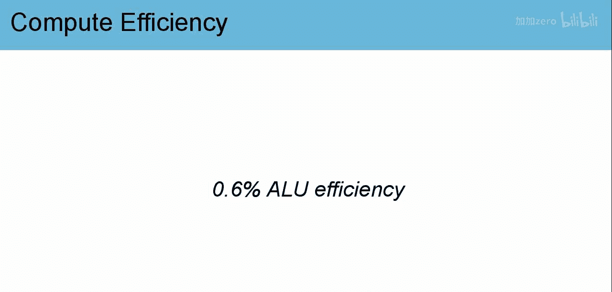

So here's a table so we don't have to continue doing these experiments to show you translation into this model。

 so if we have one operation per second， how long does it take to do accesses？

To do a global access for a 32 bit value takes us 28。6 seconds。Constant is one second。

 private memory is very fast， 0。3 seconds， and local memory is 0。5 seconds。For 32 B values。

 Now the 64 bit values we just multiplied by two。 it turns out that that's actually a big lie。

 You won't get that performance， and I'm going to have to explain a lot more to actually show you why that is the case。

 and you will see it later on in this presentation。

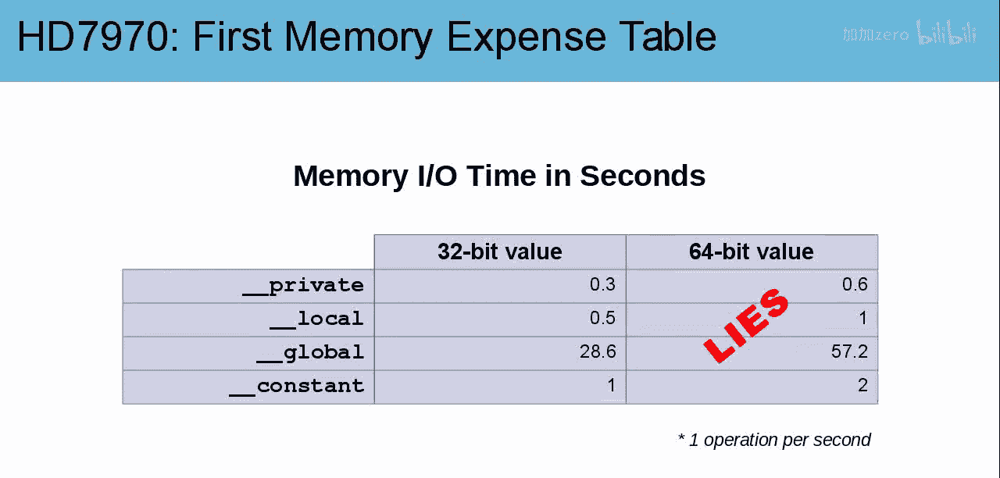

So here's a trick you can use The memory IO is actually constant so you can increase the number of ALU operations to pay for so if you have to read some data in any ways。

 your minds will just increase the amount of operations you do to actually pay for doing that memory operations so you increase the complexity of the operations you do to get better performance。

 so here's an example。We just go ahead and read in the same amount of four bytes of data。

And let's say we do a million operations， one million seconds worth of data processing。

 and then we have 28 seconds worth of writing down the answer。

To motivate where this might actually happen in real life， you might think of integer factorization。

It takes quite a bit of processing to do something like that。In this situation。

 we've done so much processing that we actually have achieved 100% ALU efficiency。

Now this isn't really a practical thing and if your problems like that， you are very lucky。

 so maybe if you're doing Bitcoin mining， if you're doing some operation like that， crypt analysis。

 you're probably in a very nice place in terms of getting great performance out of a GPU。

So let's talk about memory latency， it turns out that memory latency is a big problem for us。

 as you've seen it takes so long to fetch the data。And this doesn't matter。

 you can't just increase the speed of your memory controller。

 let's assume that the technology just isn't there to just continuously increase the speed of a memory controller。

So we have to deal with latency。Our problem is that memory transfer is very expensive。

 and let's suppose that our goal is 100% AL utilization。So that means that each processing element。

 so it has some sort of ALU in there it's doing some sort of computation， we want it to be very busy。

 we don't want it to sit there waiting around for processing to happen。So。

Just think about this for a second and recall that work items run on a single processing element。

Also recall that work groups are the thing that are scheduled onto compute units。

 so let's think about these facts and can we use this？

Is there something we can do to get better performance？Of course， the answer is yes， we can。

The key insight here is that we want to overload the compute unit with work groups。

That's what the insight is it's going to motivate this so let's look at this kind of visualization。

 we have a single compute unit let's just look at one of them and remember of course that work groups compose of multiple work items execute on that compute unit and we have a work pool connected。

 which is just a conceptual thing。

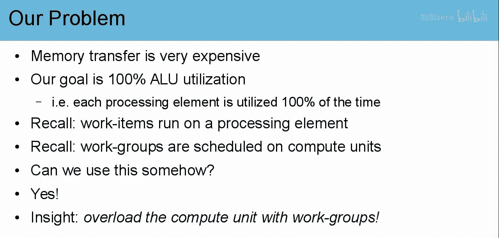

Let's go ahead and put work group ID0 into the workpo now we have one work group inside the workpo and this is what we just saw this is exactly what we just traced through so we have one thing in there each work item previously in the previous slides we saw multiple we saw a single processing element single work item if there is no sort of collaboration between work items you've just seen this。

So let's go ahead and say what happens if we go really crazy and just keep putting multiple work groups into the work pool。

Let's say that we top about the capacity of the workpool is 40 work groups。

So what does execution look like now， we're in this situation where we've provided a lot of work。

So let's flip our visualization， it'll be a little bit easier if we see the workpool in different way。

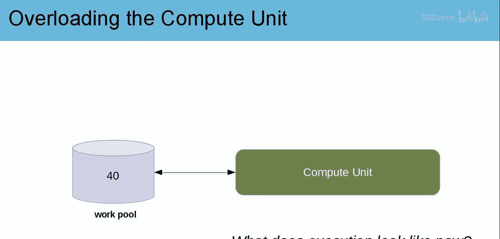

So here's our work tool。It's completely filled and what you see are the IDs of work groups to execute。

There are 40 of them just to save you from having to count so haven't really shown you anything you haven't seen before。

 we're just showing a different way of seeing it and this little box here is going to show us the current executing work group so the compute unit we saw can only do one thing at a time the processing elements within the compute unit are locked together so it can only do one thing so let's go ahead and use this little box to show what one thing is doing iss going to execute instructions from the work groups。

Let's see what instructions those are。 And let's provide a little legend here。

 So the sand color there shows that this。This work group is ready to run， we can run it right now。

 and the blue color here shows that it's blocked， we can't run it yet because the data has not yet arrived。

 so what are we going to do？Well， we're going to pull a ready work group down， let's say we get 68。

 and we're going to execute that work group for either a fixed number of cycles or until a memory request。

 so when it asks for memory we just say， okay， you're finished。

 we're just going to throw you back into the pool。And you're blocked now。So we're going to process。

 and let's suppose it blocks。 Now， we're going to put work group 68 back into the pool。

 and we're going to flag it to say， hey。This particular work group is waiting for memory to arrive now。

Now we're going to pull another work group down and we're going to process， for instance， number 23。

 you might as well just think of the work groups being pulled as random。

 there's no point in thinking of it as having any particular pattern or order。Again。

 we're going to continue execution for a fixed number of cycles or until there's a memory request。

Then we're going to put it back。 Now， the memory request， I should be clear here。

 are going to be either global accesses。They might be local。

 I'm not sure this becomes a very low level detail。But most of the。

Work here is trying to hide the large global memory latencies。

So here we're going to put this back and eventually it's very possible that we're going to hit this situation where everything has blocked all 40 work groups have nothing to do。

 but let's just say that this this just happened right now。

 we're at the point where the last work group， let's say 11 was pushed back， everything's blocked。

 but miraculously something arrives。 So just to highlight that dash here is a memory stall。

 there's nothing to do。And let's say here's our miraculous arrival of memory。

We're going to pull it back down， we're going to do processing again。

 we're going to push it back out， and perhaps as we're processing work group 68。

 data arrives for group 23 during processing。And when we put work group 68 back。

 we can grab 23 back down。

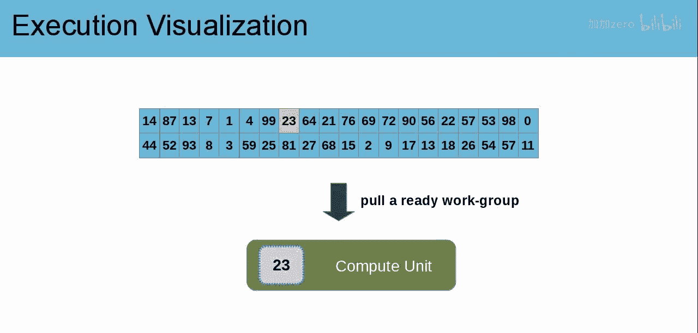

What this means。Is it we've actually hidden a latency， and this is called latency hiding。

 There actually does not appear to be a cost for memory operations because of the way that we've we've done load bouncing here。

 So we're attempting to schedule things in such a way that we're doing useful computation intermixed。

With these long latencies。In terms of doing the memory fetches and this is the most interesting thing about GPU programming is latency hiding。

 this is what you really want to know and this is a very important key to getting good performance。

I want to clarify that Lasey hiding works on wavefronts， not work groups；

 it is possible to have a work group that is larger than a wavefront。

 so we want to make the distinction that the wavefront is the smallest group where the instruction point is locked and it might be smaller than a work group。

So we're going to look at this a different way now。So let's come back out。

 we're going to look at this workpo。The work poolol really has。Two subsets。

It has ready wave fronts and has blocked away fronts。Now。

 if we're in this situation where we have 40 wave fronts ready to go。

 the compute unit' is going to hit， its maximum utilization is going to be busy all of the time。

Now in contrast。Sorry。The number of wave fronts， the ready number of wave fronts。

 and the blocked number of wave fronts is equal to 40。

So the total capacity of this pool is just a fixed number， that's what I want to show here。

I apologize for that distraction so in this case the compute unit has lots of work to do and in this case we flip it around and we have 40 units。

 40 wavefronts that are blocked the compute unit really can't do anything There's nothing that it can possibly do at this point。

Now， if we have just one thing ready to go， the compute unit is busy。

 and so long as we have something that continues， memory continues to arrive and there's always one thing to process the compute unit will be busy。

 so it's perfectly fine for performance that only one thing is ready to go at a time。

 you're not going to do if there's three things ready to go at a time。

 you're not going to do any better it makes no difference。

The key with latency hiding is that memory access can be free now of course， anytime you see free。

 there's always terms and conditions that are terms and conditions here。However， this is still。

 generally memory access can be completely hidden away if you write good code。

Now what happens when we have， remember we have this global workpool。When a work group terminates。

 another is loaded to take its place， so as soon as one work group finishes up it executes return or whatever。

 there's nothing else to be processed inside of a single work group。

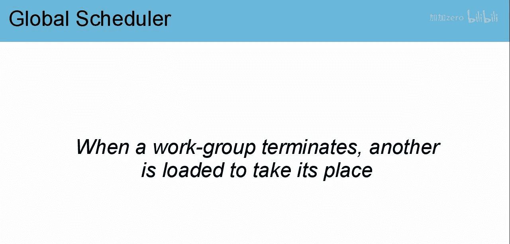

It's finished another work group is going to come in and beload it。

 So if we look at this at a global level。The card is going to have。

This set of unprocessed work groups is going to have a global scheduler which is then going to dispatch it to these compute units as it says。

 I need to pull something else to work on because。My work group has just completed。 Now。

 remember I'm talking work groups now， not way front， so let's make the distinction。

Now each compute unit has some set of work groups， work groups and wavefronts are very related so we can kind of interchange them。

A work group is at least one way front and potentially more。

 so it's okay to discuss either thing here。And where does this unprocessed workgroup that come from？

 Remember， in the previous discussions we talked about kernel execution， This is the index space。

 We fill up all of this index here。 This is all of the work groups we need to do。

 And then the role is。For the GPU Schr to pull all of these work groups out and try to execute them as fast as it can till it's empty。

 and then whatever the work was is now complete。

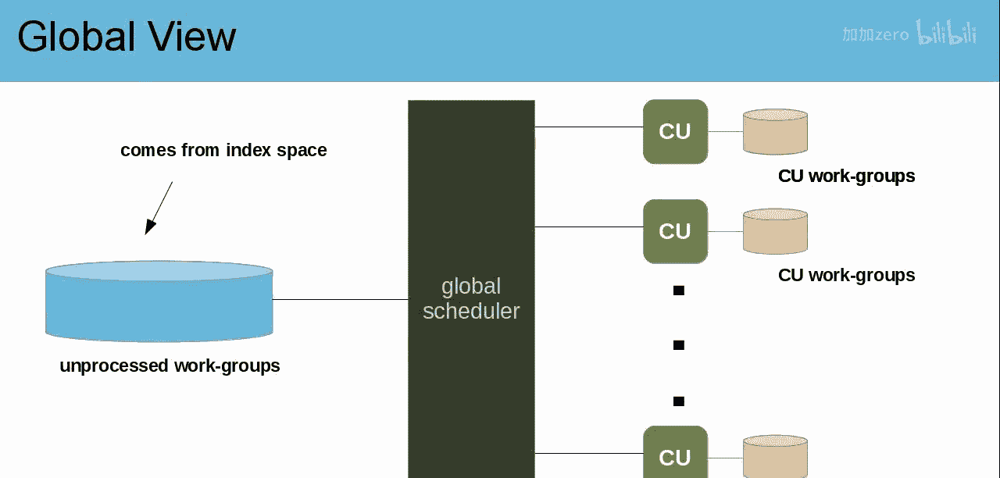

So let's go back here。And look at their compute unit again。Inside of that work scheduler。

 there's actually a fixed maximum number of wavefronts， whatever it is。

So we can't arbitrarily add work， physically there's only so many slots within the work scheduler。

 so the compute unit only has so many， there's a fixed capacity for the number of wavefronts that can be running at once。

Here in the previous discussions， we had， 40 wavefront slots。And as you load wave fronts。

 you take up slots， so in this case we have 30 wave fronts。

Now we're going to talk about a term called occupancy。

 so let's divide the 30 wave fronts that can fit。On this compute unit。

 and we'll talk about what limits the number of wavefronts it can run in a moment， but。

Let's say we have 40 slots here。And we have 30 wave fronts that can be running at any one time。

 so we have 75% occupancy。This is a term occupancy that you will see in profilers and you will see in a number of GPU papers and discussions and materials。

This number of fixed slots， that 40 number is fixed per compute unit and is device specific。

 the only way you know it is by looking up through your vendor's documentation。

So looking back at our compute unit， you have now seen the work scheduler。

The L1 cache we're not actually going to discuss。 the L1 cache is just a hit and mis cache where if you're fortunate enough that some of the data you need is there。

 then you get something for free， but you shouldn't really rely upon it。

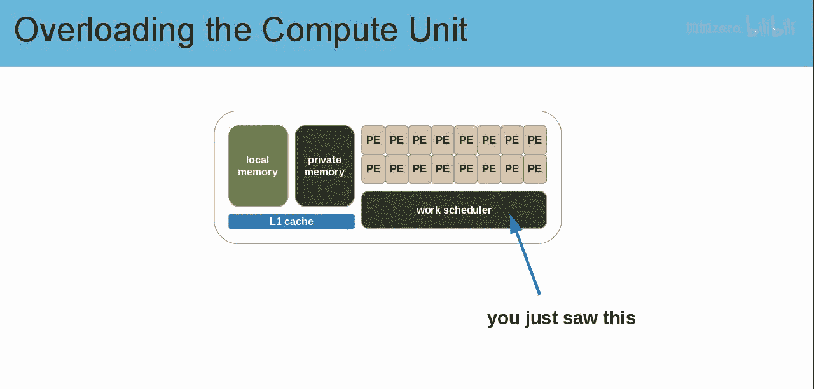

The key to latency hiding here is to make sure。That there is enough ALU work between memory accesses to hide the latency。

So let's look at an example。 I'm doing three I Os。 I'm doing a little bit of computation。

 I I don't intend to do architecture here。 I'm trying to show you that just there's。

Compared to the amount of IO instructions， there's very little computation being done。

 and then we have more IO， so there really isn't enough instructions to hide latency。

Remember when we discussed calculations。We're sorry， when we discussed the。

The way that latency hiding works。If everyone fetches data and says， I need to read data。

 I need to read data， I need to read data， and you have 40 way fronts doing that。

You may not have done enough for any of the instructions or any of the data to have arrived。

So you generally need to have enough not a crazy amount of ALU instructions but enough so that the hiding can work properly This is a much better situation。

 very hard to get this done in practice but if you can interleave ALU instructions with IO instructions you will do much better future talk will show you how to actually achieve this in openCLC right now we're just talking about general architecture so you have the background to appreciate that talk。

If you have this situation， we you do a crazy amount of ALU operations。

You probably are already paying for memory IO。What this means is that remember I discussed one of those examples where we do a million operations。

And then we only do a couple memory accesses， this is this situation。

 you're going to get 100% ALU utilization anyways because you're doing so much computation relative to the amount of memory。

 so latency hiding will do nothing for you in this case。So how do you calculate this occupancy？

I showed you what it is， and you actually can calculate it by hand。

You know the maximum number of wave fronts per compute unit by looking it up in your documentation for your card。

And you want to know how many wavefronts will actually run。

So why should you bother calculating it Well， it's actually going to help you design significantly faster kernels。

 You want to be able to look at a piece of code and immediately start to ask yourself what's its occupancy going to be The occupancy is going to tell you how many。

Wave fronts can be there and how efficiently you're using the hardware。 Now， of course。

 there is nothing is ever completely true。 So there are exceptions to this。 Of course。

 we'll get into it in future talks。 But by the occupancy is a really good indicator to tell you how well you're doing。

 if you see 5% occupancy。You know that you're not going to be likely paying for memory accesses unless you are doing so many AU operations that it pays for itself。

If you see 100% occupancy， then you know that you're probably doing as well as you possibly can。

 the best you can do is maybe add a few more ALU instructions to help the scheduler。

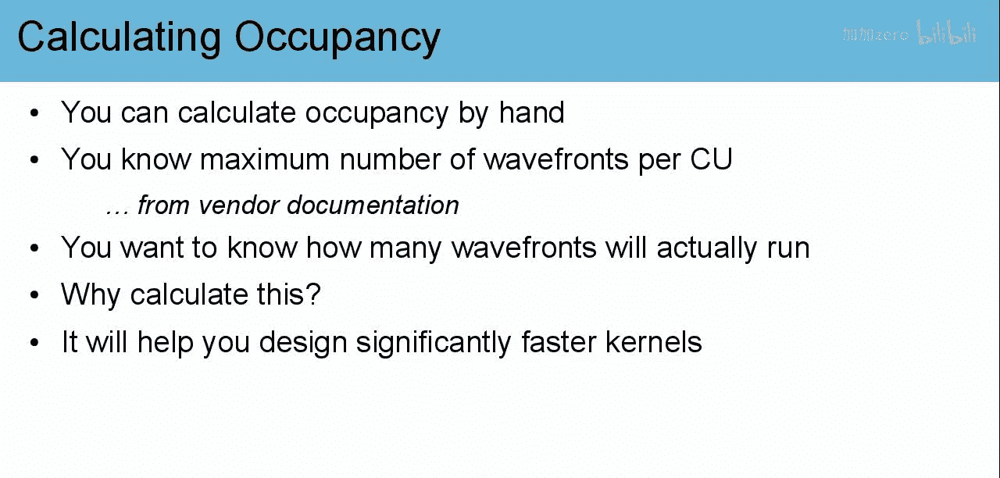

So what actually limits the occupancy， I mean the occupancy is the number of wave fronts that can actually execute versus the potential that could execute。

Well， it turns out that the private and local memory。

 because it's shared with all processing elements， actually limits the number of wavefronts that can be run。

Now we're looking at one particular compute unit， but just by the way things work。

 it doesn't matter that you have one compute unit， 100 compute units， 200 compute units。

 the occupancy is going to be the same。So on the 7970。

 we have 256 kilobytes per compute unit of private memory。

 and we have 64 kilobytes per compute unit of local memory。The more we use of these resources。

 obviously， the less the fewer wavefronts they can run。 These are fixed numbers。 So each kernel。

When we look at it， requires certain resources and the compiler knows that ahead of time。

 you can't do dynamic things and open Seattle like this。

You're going to take what you know and try to figure out the occupancy。

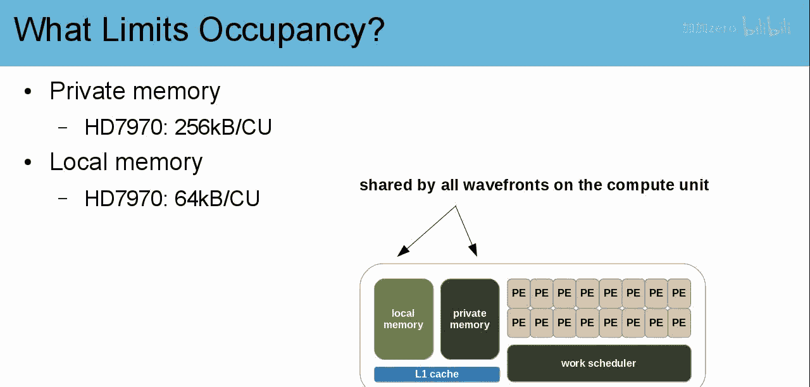

What you want to do going back to OpenCL now is reason in terms of work items。

You don't want to reason。You know， everything comes down to the work item。

 so looking at one pass through code is looking at what one work item is going to do。

 you want to get used to reasoning in that way。We're going to go ahead and just set the work group size to be the wayfront size。

 This is something that I generally do when I write code。

Because it helps you to reason about how the card's going to work。

 so in the 7970 the work group size should be 64。That's how many work items are inside of a awayfront。

Now when we look at the maximum number of wavefront slots。Sorry， that's just saying what I said。

When you look at the maximum of a wave fl front slots on the 7970 it's 40。

And what you should understand in general， is that。The more resources you use per work item。

 the fewer wavefronts are going to be able to reside on that compute unit and less latency hiding you're going to have。

Now if you use fewer resources， you get more wavefronts and you get more latency hiding。

 so it's a real trade off here and you need to decide what you're going for and a future talk will discuss how to make that decision。

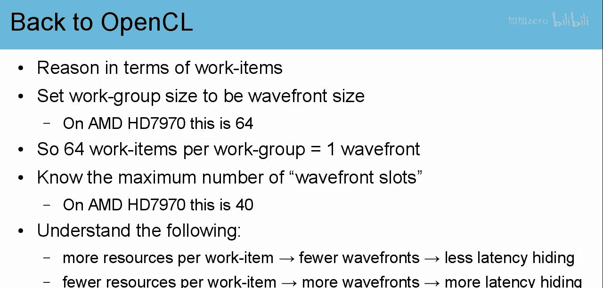

So let's do a sample calculation here。If we look at the private memory。Size here。

 we have some fixed size， and we divide that by what's required。

 So the private memory per work item that we have。Multiplied by the number of work items per wavefront。

 If we're going to divide this out， we're going to see the maximum number of wave fronts because we've looked at the could be resources of。

A。We're looking at the resources of a。Compute unit and we're dividing it out by what can possibly live on that compute unit and we're going to solve for whatever unknowns we're trying to work with here。

So for example， in the 7970， we have 256 kilobytes。

 and we're just going to convert this out to get rid of the kilobytes to bring it down to bitetes。

That's how much private memory we have and we know that the maximum number of work items or the fixed number of work items forfront to 64 so we can use this now to solve for either maximum number forfronts or the private memory per work item that we can have so let's do a sample calculation here。

Let's say that I want to maximize wave fronts。 How many 32 B values can I actually use。

 So this is a very important question。 How many 32 B values can you shove into private memory to get the maximum amount of latency hiding possible。

So， I take。The formula from the previous slide， I divide things out。

And I'm going to find that I get 102 bytes per work item that I can use before I start to lose way fronts。

This means that I get 25， 32 bit values。So that's not very much， that's 25 floats， 25 ins。

And just having an empty kernel will take a few of those。

 so you wind up having this situation where you don't have that much room to work with if you actually want to have a really efficient kernel that's achieving maximum occupancy。

It's the same thing with local memory， we just change the concept from private memory to local memory。

And now we just substitute into this 32 kilobytes because we get that from the vendor documentation。

 the local memory size is different。And everything is basically the same。

So how do we determine the actual amount of private memory that we're using？Well。

 that's something that'll come from another talk。This one we're just looking so far we're looking at general concepts so that when I show you the code and I show you how to do this in practice。

 everything starts to make a lot of sense。So we're going to talk about memory channels now。And。

This is another confusing aspect of GPU architecture。

When you look at global memory， you want to imagine that it looks like this。

 There is a huge global memory pool。 And you have all of these compute units can directly access anything they want in global memory without penalty。

This isn't actually what happens。In reality， we have many memory channels。

I'll describe what these things are and we have。Pieces of global memory that each can access。

 So the union of all of those memory。Memories behind the memory channels is global memory， but。

This isn't how it actually works physically， and you do need to know this for performance。

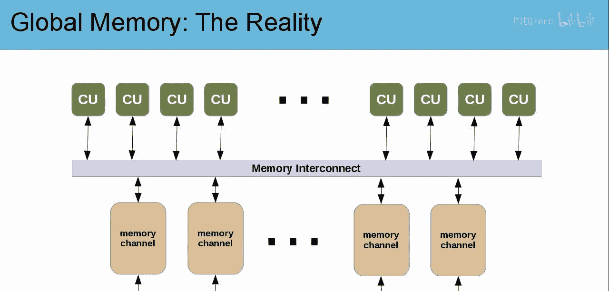

So。Global memory access is we've partitioned global memory into subsets。

 smaller pieces they don't overlap。And each subset has access through a channel。

 that means that if you say I want this piece of memory， you have to go through a channel。

 you can't ever bypass it。For example， looking at the 7970， we have 32 compute units。

 and we have 12 memory channels。 That means that every time。

 let's say that every one of those 32 compute units is making a request for memory。

 it has to go through a memory channel and。What's going to happen here is that。

All global memory has an address。 I mean， this is something's very natural to us from programming and C or anything。

 And when we access memory。Is going to map to a channel。

 So address 304 has a particular channel that it maps to always。

IAdds 512 has another channel it always maps to and it might be different。

You actually do need to know this general concept for performance。

The reason that you need to be aware of the concept is that memory request can be serialized。

 this means that if a single channel gets many requests from memory。Is going to serialize it。

 iss actually going to handle it in order one after the other。 So in the worst case。

 if you have all 32 compute units accessing one memory channel。

 you are really limiting your performance because every single。

Compute unit is going to have to wait for the ones in front of it to complete。

 you get no parallellyization here。We haven't talked about parallellyzization too much that's upcoming。

 but the general idea is that you're really limiting what you can do because you haven't bounced the load on the memory controller。

So you have to be careful of how you access memory。

So many of you should be coming from computer science backgrounds， all it motivated if you're not。

 but。You should be familiar somewhat with something called the Pieonhole principle。

This means that if you have， say， M。Pigeons， holes， and you have N pigeons。

 If you have more pigeons than pigeon holes， at least one hole is going to have more than one pigeon in it。

 Okay， so how do you apply this， If you have 32 compute units and you have 12 memory channels。

 It has to be that at least one memory channel has more than one request， Abute has to be the case。

Now， this means， know just reiterating that some memory channel will always get multiple memory requests。

Now the hard work guys are here to help us out。And they provide us with an efficient access pattern。

 so they tell us that okay， this is generally true， but if you write your kernels in a certain way。

We will give you still best performance。And the best way to do it is to have the adjacent work items access adjacent memory。

And this is called coolest memory accesses。 So if you have a number of。Work items。

 they should access memory adjacent to the each other。

 this is going to hit top performance on the card， it's not going to suffer。

 other access patterns can really start to limit the amount of parallelism and really start to limit your performance。

So you can get a little bit carried away into extreme memory architecture details when you look at。

The documentation， you'll see that there's a lot of information about how the memory controller works and how in particular it maps addresses to memory controllers。

 don't worry about it。Some people might care for really extreme performance， but。Even then。

 probably not。What you should really rely upon is informative benchmarks。

 And you want to know what is generally fast or slow and。They're talking about real hardware here。

What that means is that the performance you get in real life may not always be what you expect from a theoretical perspective。

 So you really want to do benchmarks to guide you。 General。

 what you're going to learn if you do damaged benchmarks， and I will show you in a future discussion。

 I'll actually do these with you to provide illustrations to help you。

 You're going to learn that work items loading adjacent values is very fast And work items loading things randomly is very slow。

Now remember you have latency hiding to help you there。

 so you don't have to be completely discouraged because latency hiding will help you。

 but if you're trying to get 100% utilization in every possible way。

 then you probably want to be using coal estimate accesses， it will help you。

You want to use high level facts to help you design these algorithms。

 So if you know when you're designing an algorithm or data structure that one particular memory access is fast。

 one particular memory access is slow， you really want to bias your work in your design so that you say to yourself。

 okay， well， I'm going to do everything I possibly can to limit the amount of random memory access。

 but if I have no choice， I'm going to try to really have as many AU instructions in there to allow mate latency hiding to do its job。

Okay， so you can use either thing here。So what you're really getting out of this is you don't want to rely upon the very。

 very， very low level details of how the memory system is mapping addresses to memory channels。

 What you want to know is that memory channels are there that you have to。

Access memory in certain patterns to get good performance。

 and you want to know basically the trade offs so that you can take it into account when you're doing design。

The future talk I'll actually show you what these trade offs are。

 I want to revisit this table where I showed you that the 64 bit values here actually lies。

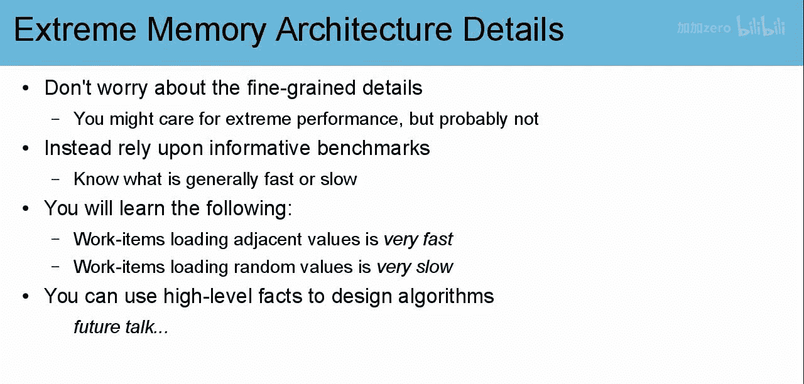

The reason that these are lies is that the memory coalescing on the 7970 only works with 32 B values。

So the 64 B value you see here， we can't just multiply the time by two。

 It's going to be significantly worse than that。 I don't have a benchmark here to actually show you because this information is just taken from theoretical measures。

But the general idea is that the reason the 64 B value is going to do even worse is because the memory isn't coalesc。

 It can't be because the 79，70 likes to do operations in 32 B strides。 Now。

 I haven't gone into detail as to the exact detail of the 79，70。

I feel that I don't have to at this time because I've given you a motivation as to basically how the GPU architecture works。

 Another talk will show you some illustrative benchmarks from the 7970 and how to get performance from that particular GPU。

 but everything I've shown you in this talk is relevant to every GPU architecture you just have to read the documentation。

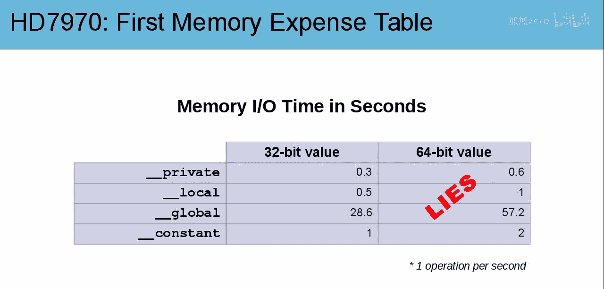

So let's do a quick conclusion here and let's see where actually are we in all of these talks？

You've seen open C at a high level that was the first discussion we had。You've seen some open CLC。

That was a second discussion， and now you've seen GPU architecture。

We haven't actually discussed parallel programming。

 and I want you to bear in mind that you still have a very naive view of open sale because we haven't discussed how to actually have things cooperate in parallel。

 This is intentional because it can really distract you from learning the the basics if you're trying to skip ahead to be too advanced at all at once。

So we're going to have to come back。And very quickly， in fact。

 to discuss how things work in parallel。 So we have to talk about atomic operations。

 We have to talk about how work items cooperate。 We have to talk about what happens when multiple work items attempt to write to the same location inside of global memory。

We have not discussed yet how to get good performance。

 You' are starting to see some trade offs in terms of how things are working。

 but you really don't know yet how to get great performance or how to measure it to see whether or not you're anywhere close。

We haven't seen any benchmarks。 I haven't shown you how fast a GPU is。

 Maybe youre doing all of this for 3 per cent more efficiency。 I understand we haven't seen that yet。

 I assume that you have seen something in your field that tries to persuade you to use GPUs。

 but you haven't seen any real gen benchmarks yet。And we have not yet seen how to write good software OpenC So these topics are coming it takes me quite a bit of time to prepare each video and takes quite a bit of research I'm going to continue to work on this。

 I am currently looking for sponsorship for companies or organizations who wish to to sponsor the work I'm doing here if you're enjoying the videos that you've seen or the conversations were。

Having in a very。One side of way， it would be helpful if you can support this type of work。

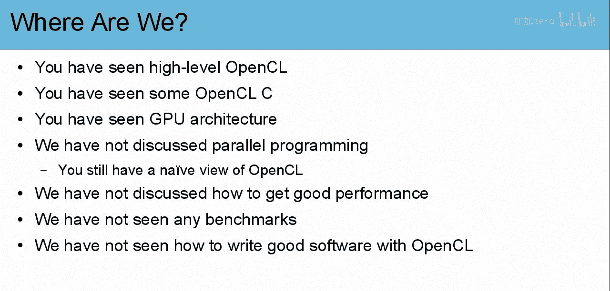

I'll just conclude by telling you again that you can check my blog。

 you will see everything about these videos as they are posted they will be posted there。

And I want to， really。Tell you that what you are seeing is。

These are things that are going to help you understand what's going on。

 But to actually gain the experience， to actually gain the insights。

 that'll help you look at something and actually tune it is going to take a long time。

 It's going to take even longer because it takes me so much time to prepare these videos。

 I'm available as a consultant。 And if you want me to come in and help you with one particular task for a few hours and get it Top performance without you having to understand completely how to do it yourself。

Go ahead and give me a call。Thank you very much for your time and I hope you've enjoyed this Sccast。

