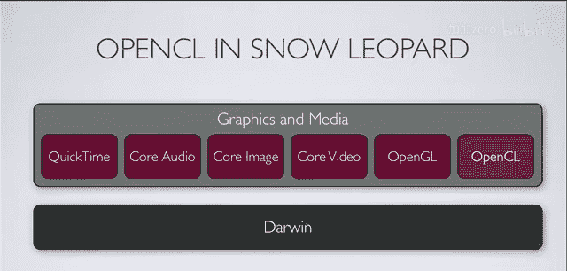

# 【OpenCL编程 RayiYanuTara】 p04 p3 Episode 1 - Introduction to OpenCL -BV1X2BRYyEeM_p4-

So welcome to the first of what I hope are many podcasts on OpenCL。And we'll be talking about OpenCL。

 what it is， how you can use it for your computations and things like that。

And hopefully youll find these things useful。 these tutorials are being brought to you by Mac Research。

My name is Dave Goharra and I'm with obviously Mac Research。

 but I'm also with the Center for Computal Biology at the Washington University School of Medicine in St。

 Louis。You know， hopefully you'll find these these things very useful and or at least interesting and if you need to get in touch with me。

 my email is up there， if you have any questions or things like that。

 there will be also some resources on Macresearch。org over time related to open C and and certainly related to anything that these podcasts have like。

The files and extra extra stuff and goodies and things like that。 So why don't we get going Open C。

 What is it Open C stands for open computing languagen。And。It was initially proposed by Apple。

In 2008 and there is a number of other big companies that are involved in developing the Opencl specification。

 I mean， OpenC is actually a specification。 it's not a particular specific technology per se and the other companies that are involved with it。

 there's quite a few some of the big ones are NviIDdia， AMD， Intel。

 I believe imagination technologies， it's a really large list of companies。

 so there are a lot of companies that are putting a lot of backing into this technology and and。

hopefullypefully it'll prove to be very useful for computing and specifically computing that's really designed for number crunching that is openCL is really designed to help people take advantage of all of the computing power on their computers for a variety of tasks。

 but really for tasks that that are parallel computing tasks take a long time and that really need a lot of horsepower to complete the open specification is maintained by the Chronos group they're the same group that maintains specifications for OpenGL and a few other technologies that are out there。

 open Open spec technologies because OpenCL is really a specification what that means is that in order for you to actually use it or do something with it。

 it has to actually be implemented by someone that somebody has to read through the specification。

 they have to build up the。Libraries in the frameworks and all of the resources that are required to actually make it go and make it work and this is actually very similar to the way OpenGL works as well OpenGL is a specification and numerous vendors Apple included but numerous other vendors write their own openGL implementations for use on their hardware and with their software and things like that and the important thing about this is that it's like OpenGL it's an open standard which means that anybody can really adopt it and can write their own implementation。

And the only important thing for anybody who's building an implementation is that they have to make sure that if they want to be compliant with it。

 they have to conform to the specification， that is you have to make sure that you meet all of the minimum sort of requirements that the specification lays out in your implementation and if you do。

 then you have a compliant implementation。And you can sort of carry the open seals type brand if you will。

 or whatnot， so that's an important thing to consider。

So why do we care about Opense and what's the big deal here， Well。

 as you know computational performance has shifted from clock speed to cores。

 there was a time where you just make the CPU run faster。 a lot of you know this already。

 but for the sake of completeness you increase the clock speed。

 you get more performance you kind of get it for free and for cheap almost and I say that knowing that it's really not that simple。

 but there's a lot of engineering that goes into it， but the idea being that on a single CPU。

 you could just increase the performance and the clock speed and you can get more performance out of it。

 whereas now people are looking to using multiple cores and。

So just a bunch of CPU stuffed in a box effectively。

 And the problem with that is that programming paradigms haven't kept up with that。 That is。

 you know we've constantly been focused on how do we get the most performance out of a single CPU and what can we do and let's write our applications in our programs that way not thinking in terms well。

 we might have multiple CPUs in a computer and how do we really split up our programs or how do split up the algorithms。

 which is even more important， the parts that really do the heavy lifting。

 how do we write these algorithms so that we can get the most performance across multiple cores where data might not necessarily be shared or may not be shared efficiently and things like that and we'll talk about those things in more detail as these podcasts go on But OpenC is also important because it's designed to sort of take all of the all of the various devices and all of the various pieces of hardware in your computer and kind of。

Like function is like kind of like a glue to kind of make it so that you can get access to all of these resources。

 OpenC is of course is a programming interface and so really the idea is that you know you have all of these resources that're sitting there you may only be using some small subset of them why not let's just try to open it up and get more access to to all of those system resources and so really openC is designed to support general purpose parallel computations that is calculations and computations that aren't say just specifically multimedia where you'd have a dedicated DSP chips。

 let's say or you know graphics only applications you might want to do scientific calculations or you might want to do some other things or you know with it And so OpenC is really designed to just kind of give you a good framework to build your applications on top of so that you can harness some of the underlying computational。

er。Open C， unlike some other technologies， which we'll talk a little bit about。

 is designed to be device agnostic and I'll give you an example of devices in a second。

 But what that really means is that open C again as a specification doesn't dictate what it runs on。

 It just says for you to be open C compliant， you must meet these these requirements。

 but you could be pretty much anything as long as you can meet those requirements。

 Probably more important is that opencl being an open standard means that your code should be portable across implementations。

 So one company， let's say Apple has an implementation of open C and that implementation is compliant with the standard then if you were to move over to Linux or Windows or something suicidal like that。

 then you should be able to port your code and you shouldn't really have to worry about that。

 It's the same with open G the same way open GL works right you can write your code and as long as they support that。

Spation or that version of the specification on whatever target platform you're on。

 it should all work。 And then of course， you know the specification since it's managed and maintained by Chronos that means that no single company controls the specification and so you don't have to worry about things becoming proprietary or closed Now the implementation itself may be proprietary and closed。

 but the specification is an open specification so anybody can compete in that space。

Let's talk about openCL devices， I guess when I say devices what I'm really referring to commonly are CPUUs and GPUs。

 but again it just has to be any type of hardware that meets the minimum requirements of the specification。

 so again it could be a DSP chip， it could be an FPGA。

 any type of embedded process or you name it as long as it can meet the requirements for the specification。

 it can be an openCL device。And this is important because as time goes on and people start maybe building dedicated pieces of hardware for specific functions。

 you might want to be able to they might do something that you want to take advantage of。

 and you might want to get access to that hardware。

 And so as long as the implementation supports that hardware。

 then you don't have to worry about the details， you write your code。By and large oneands。

 you might have to do some tuning here and there， but minor stuff。

 And you can take advantage of it with with very little effort。

 So it allows you flexibility and the ability to move from device to device without having to reinvent the wheel every single time。

 And I think that's probably one of the most powerful things about open C。

The goals of open OpenCL is designed to really be a clean。

 simple API for accessing all of the various devices in your system for performing general purpose。

 high performance computing it's sort of an extension of the C 99。 It's not really an extension。

 it's based off of C。 It has C 99 language support。 they've added some additional data types。

 some built in functions， additional qualifiers， and it can really be thought of as like as a thread management framework the ability to manage a lot of things going on under the hood so you don't have to worry about the details of creating and destroying threads and。

variarious things like that， locks and all the things that you have to worry about on using other technologies。

 some of which we'll talk about a little bit。Again。

 it needs to be easy to use it needs to be lightweight and efficient。

 it should not be a significant ho on the system， it should really allow you to take advantage of everything you've got in your really expensive computer that you spend a lot of money on。

 but more important it also needs to give you certain guarantees you need to know that when you move from specification to specification that you're going to get the same numerical results at the very least you'll get a minimum set of numerical results。

It needs to supply ideally some math functions and that those math functions should be guaranteed to return at least a minimum value of accuracy。

 but it also provides guidelines for new hardware so as people are designing new chips or new pieces of hardware they can also design them with this specification in mine or new specifications in mind as new versions of the specification I should say as they come along so that's also important so where can we use openCL we can use openCL in a lot of applications in a lot of places。

 this is not purely for scientific computing it's not purely for image and video processing it can be used also for medical imaging。

 it can be used for financial purposes a lot of computing is moving over in the financial services if you've kept up with some of these things for you how we can do trades as fast as possible well that's you know data locality but it's also being able to crunch through and to look through a lot of information quickly。

And things like that and for generating and analyzing financial models and data。

 so openCL can be used across a wide variety of things。

 but really it's designed and can be used with any kind of data parallel algorithm where the computational part is significant meaning that it's not just like a trivial kind of hello world app or something silly like that。

 something that really，It takes a lot of time and a lot of computational resources to get through。

So when we say data parallel computing， what are we really talking about， well。

 data parallel computing you know're。There's a huge spectrum of things and if were to just sort of break it down and we refer to the granularity in coarsegra parallel computing。

 we might be talking about grid computing and as we move down the list we might talk about finer things where OpenmpI or within a single system we might be talking about P threads or openmp just standard threading models and things like that where we might be talking about very。

 very fine grain parallelism where we're talking about SIMD single instruction multiple data these are things like SSE and Alvaec and vector engines and things like that so it covers a wide range of things really what we're talking about here with with OpenCL we're really talking about the last two which is openmpP thread type things and CMD for the most part。

 that's not to say that you can't use any of these technologies or these computing models interchangeably or mix and match and we certainly can and people do。

A great effect， but in the case of OpenCL， we're really talking about the last two。

Now when we talk about data parallel computing in the context of openC。

 we're really talking about two things we're talking about task parallelism and in this case we're talking about you could think of this as kind of like a co grain distribution model but within a single system where let's say each task is your programs running and you have a bunch of images that you want to do the exact same thing too you could use openCL to say okay to farm out the images to the different CPUs and say okay you deal with this one you deal with that one et cea and so forth。

 I mean that might be one example of say let's task parallelism probably what we're going to focus on the most here is really sort of data parallelism where we're talking about know let's say an array of numbers like we have here and we want to perform the same operation or sets of operations these could be complex functions on individual piece of data。

So for example， in this example， we're taking the absolute value where。

 you know we want to you know take the absolute value of this number and this number and this number and this is a data parallel task because I don't need to know the absolute value of this element here to calculate the absolute value of this element here so that is a data parallel task that we can do and something that we can do very well and openC。

 This is the kind of thing that openCL is really designed to excel at。

So let me give you another example， like like a sort of real world example of of。

A data parallel task。 In this case， we're going talk about the box filter。 And and for this example。

 I've got a picture here and the picture I'm just going effectively blur。

 And so what we do is in a box filter is you take a set of pixels in a box that's just look at this one down here where we take a set of pixels。

 And what we're going to do is we're going calculate the average value。

 we're gonna sum these all up and then divide by the total number of pixels to calculate the average value。

 and that value is going be placed right in the middle of the box。

 The pixel at the middle of this box is what's going to get that new value。

 And we do it for this set of pixels and then we can move over here and we do it for this set of pixels。

 But as you can see we also do it for all of the overlapping sets right。

 and what we end up with is a new pixel value here and here and here and here and over here and for the entire image really And this is what we do to calculate the box blur。

 The important thing here is that each one of these boxes a values。

 I'm reading from this image and I'm writing to this image。 So basically。From this data buffer。

 I guess I should say in writing to this data buffer to regenerate the image。

 But the important point here is that each one of these box calculations can be done independent of all of the other ones because I'm reading from here and I'm writing to hear and because again。

 the data is stored to a separate location， I don't have to worry about synchronization or updating values and this and that。

 And the most important thing is that this is a fair amount of work。

 Now if you were to just go and sum up all of these things that's actually a subpar algorithm。

 there are better ways to do this and we can talk about those things later if it comes up。

 But the important thing to keep in mind is that we have to do a lot of work because we have to sum up all these values and then we have to move over a little bit and sum up all these values and then we have to write them over here and we have to do this So this is a very good example of a data parallel type of calculation we would do or want to do that we want to do as quickly and cleanly as possible。

So。So so this is this again， so this is one example So how does then openC fit into say other technologies that we might be interested in again。

 you know I'm using an image processing as an example here what about things like graphics and whatnot So Open C also was really designed to work with Open GL OpenGL is a graphics programming language most of you probably know this and are familiar with it at least in name and like I said。

 OpenGL is also maintained by Kronos and the really great thing about openC is that openCL is designed to be the numerical number crunching part。

Of the graphics programming language， which is open GL。 there are sort of sister languages。

 sister technologies， I should say and they were designed。 Open C was designed。

 I should say Open G's been around for a long time。

 Open C was designed so that you don't have to worry about data。

You don't have to worry about the details of getting data from one to the other。

 That is to say that open CL can share data with open GL because they use the exact same bit。

 So if you set up your calculation properly and you go through the proper steps。

 you can create a buffer to use an open C to crunch some numbers on。

 And then let's say you want to display those values。

 you just feed it off to openg and OpengL knows what to do with it and it it does its thing。

 The important thing， and I'm going to show you an example here。

 actually at the end of this podcast of that。 And so you can kind of see it and get a feel for what that really means。

 And then the important thing to keep in mind is that when you do this kind of thing。

 you really get very little performance overhead from this kind of setup。 And so that's really nice。

 you can do number crunch and。 you can do displays， beautiful displays。

 you can do all of that kind of stuff and you don't really have to worry about a lot of overhead and doing this。

 So it's all very transparent。Now， what are the kinds of things I'm telling you you know all this stuff。

 you know， OpenC is great， You can do all this。 What are the kinds of things that you really can't use Opencl for Well the first and foremost things are sequential problems。

 sequential problems that are not inherently parallel are going to be bad choices for OpenC。

 You're just not going get the performance that you want out of it and you can either hopefully you can find some other way to refactor your problem or find another algorithm that might work better for you。

But if you're really stuck with a sequential problem。

 you're going you're going to have you're not going to have much use for openC unfortunately。

 another know a common example I think that people refer to as Huffman decoding is one example。

 but there's a myriad of them that it's just simply not possible to use open for calculations that require a lot of synchronization points where you're constantly having to communicate data back and forth and whatnot。

 probably also are not very good for openC， there are ways to synchronize certain kinds of calculations but you don't really want to rely on those。

 you really want your data to be as independent as possible and kind of go from there and do those do those。

Do those kinds of calculations with open CL that just can go and do their own thing and then come back and sort of report the results。

 And then there are also device dependent limitations， which。

 depending on the type of calculation that you do and what kind of factors and special you know handling you might need from a device you might not be able to use open C for either and we'll talk about those things as they come up in subsequent podcasts。

So。The point being that not everything is going to work well with OpenC and that's okay。

 OpenC is not designed to be the kitchen sink。 Open C is designed to really solve a problem。

 which is how do we take advantage of as much of the computational power in our computers you know as easily and portably and simply as possible and go from there。

 So talking about this and we're talking a little bit。

 we talked a little bit about know compute devices I've mentioned GPUs a little bit。

Open C is often sort of compared against。Cuda and so you know， so what about Ka Kuda。

 for those of you who don't know， is a very， very powerful advanced GP GPU programming interface for running calculations on graphics cards。

 And in fact， it's probably one of the it's a great success story。

 It's one of the things that is a really driven computation on GPus and really made it mainstream that's allowed people to get access to all this computing power without having to do you know rewrite their code using open GL and open Gl shaders and fragment all that kind of stuff。

 you don't have to do any of that stuff with Kuda I mean it's C C plus plus and you just have to use some special decorators and semantics。

 but you know you really get in there and you can get your code running on a GPU。You know。

 phenomenally， so it's really， really been a great a great tool， a great， great thing to come about。

 but there are a couple of issues that one needs to consider and the first is that couta is not device agnostic that is it only works on NviIDIdia hardware' it's maintained by NviIDdia。

 it's NviDdia's you know invention， it's theirs it's their baby so if if you go the coa route。

 you are primarily dealing talking about NviIDdia hardware。

Luckily they sell a lot of graphics cards so the probability that you can use at someplace is very high。

And of course， it's vendor control。 They control the whole thing。 So there's there's no。

 there's no ability for you to do your own coupa implementation。 let's say， or something like that。

 But that being said， though， this isn't an issue of where you have to say， okay， I mean。

 they're going to use Kuda。 I'm going to use open C。 You can use both。 And in fact， the hardest part。

 as we'll talk about in later podcast about really getting all of this stuff going isn't the the underlying frameworks。

 They make you know Kuta。NviDdia and Apple and all these companies。

 for Open CL really make the underlying part， you know， getting the thing going easy。

The the hard part really comes from where we when we have to write kernels and we have to do that。

 And even then， in some cases， it's very trivial to do。 And I'm going to give you an example。

 show you an example today， but give you details on it later of know very simple。

 simple things that you can do to really get some great performance right away。

 But the point being that going from couta to open C isn't really that hard because when you get down to the kernels。

 the kernels are pretty much the same。 It's just some minor modifications for some language semantics。

 But other than that， I mean。Whatever you invest in one。

 you're going to be able to sort of reap the benefits pretty quickly and easily in in the other。

 So you're not really locked in and that's the most important point。So openC， how do we get to it。

 how do we use it， where do we get it from OpenCL The first implementation。

 the first major rollout implementation is going to be in Mac OS 10 Snow leopard 10。

6 which will come out August 28th or will have come out on August 28th depending on when you're listening to this it's being supplied as a system framework which means that it will ship and it will be there on every copy of Mac OS 10。

6 or higher from then on out so you don't have to do anything if you're a developer writing an application it's there you write your application。

 you use it， you use the technology in the framework and if your users are running 10。

6 it'll go if they're not using 10。6 well and you haven't done the right things of course it'll crash but。

But we're not going to worry about those things。 All of our users are going to be on 10。6。

 And so that's the way it'll be。 But anyway， that'll be the first major rollout inviDdia AmD also are working on their own implementations Nvidia has been beta testing theres for quite some time as well So there are multiple avenues and that will also get you access perhaps to other operating systems other platforms things like that。

 So those are a couple of implementations。 So what computers now of course are going to be capable of doing opencl calculations well this being Mac research Mac we're talking about primarily Apple computers。

 this is kind of the way it's gonna all of these podcasts are going to be geared around Apple and Apple technology and Apple's implementation。

 but what are openC capable computer as well， if you have a computer， Mac that's running 10。

6 or higher you have a computer that's open C capable because of course it has a CPU。

If you want access to the GPU， you might need you'll need a newer one you'll need either Mac Pro。

 certainly all the new Mac pros that are coming out have are shipping with cards that are open C capable。

 the 24"ch Iac is open C capable， some of the MacBook pros， certainly all the new ones。

 the ones with the black bazels on them， some of the previous generation。

 I think MacBook pros the all silver ones as well， I think are。I I think are also capable。

 I'm not I'm not 100% certain what the exact models are。

 but you'll always be able to run an opencl type calculation on a Mac as long as it's running 10。6。

 all currently shipping cards from NviDdia are open C capable。

 they ship I think the numbers I saw last where like one to2 million cards a month a week I can't remember obnoxiously huge number I mean。

 it's just amazing know so anyway， so there's a lot of there's a lot of GPs out there and that are opencl capable。

 So this is a really great technology。 It's a great time to get in to using technology。 But again。

 this is Apple Mac related。 So we're gonna really focus on apples and Mac。

 and let me just give you a really quick idea of where things sit in snow leopard there's Darwin which is the underlying sort of Unix BSD layer。

And then on top of that， Apple has built a whole range of technologies。

 a whole lot of different things from you know， IO to graphics and media to， you know。

 you name it it's there mostly and in the graphics and media section， there are a lot of。

Very powerful technologies， Quick time， core video， core image， open GL。

 things like that that really allow developers to write really full feature， you know。

 rich applications without having to reinvent the wheel every time and to take advantage of all these technologies that Apple is has really。

 really。Made shine， so open C fits into that same sort of framework。

 It's in the graphics and media sort of。Hiererarchy bundle because it's so well tied to open GL and things like that。

 and really because you know when we think of openC。

 primarily what people are thinking about is how do we get access to the GPU easily I mean we've been developing on CPUUs for so long people people are used to the programming paradigms there。

 but how do we really get access to the GPU and make it easy and so this kind of begs the question of course why the fuss over the GPU and I've sort of hinted at this。

 but you know GPUus are floating point monsters they're designed to crunch numbers。

 they're very highly scalable in terms of you know when they're building these things out。

 So if you have an algorithm that's data parallel and you've optimized it well for being parallel。

 It's gonna you know it can perform very well and it will scale well as more powerful GPUus are rolled off the production line and things like that And let me just give you one really quick sort of idea if we compare say the core2 duo over here。

Which is， you know， the standard CPU in most Macs。 Now， we're talking about， you know。

45 gigaplops of。Of computing power on a core2 duo， whereas when we compare。

 say the top of the line or close to the top of the line in V card， the Gtx 285。

 we're almost talking about a tariffop。 And this graphics card， you might think， oh。

 it must cost a fortune。 I mean， you can get this graphics card for 3 or 400。 I mean。

 it's not super expensive。 but there's a massive amount of bandwidth internally to the card and there's a massive amount of floating point。

 computational power， if you can， if you have a problem that can really sort of take advantage of that。

 but there's also some limitations and some things that you want to be aware of before you get crazy excited about all of this unharnessed computational machinery there。

 And's that one of the things that you have to consider is that when you try to get data from the main part of your computer over to the graphics card。

 it has to go over the PC bus。 and that's really slow compared to certainly the internal bus or the internal speed of memory on the graphics card。

 which is again very， very fast。And as an example， sort of point out that， you know。

 just just to kind of give you， we won't go through the whole thing， but you know。

 just to kind of give you an idea of what we're talking about。

The PCI bus supports about 3 to 4 gig per second of data transfer。 and on a 3 gigH machine。

 let's say 3 GB per second that gets us to about 1 B of data transfer per clock tick。

 And during that time it would take to say copy 16 B of data， I mean。

 a useful amount of data that you could do something with， say。

 like add two double precision numbers together， for example。

 or for single precision numbers together or whatnot。 What could you have done on the CPU。 Well。

 you could have done all of these things that are listed right here on the CPU in the same amount of time it would take to copy just to copy 16 B of data from from say the system side over to the GP。

 So you really need to sit here and think， know do I want to go and invest some effort in this。

 do I have a problem that is computationally expensive enough to justify this kind of overhead and we'll talk about those kinds of things as the podcast go on。

 But it's something to think about the other things you really want to think about it or it should know。

 And I。Pretty sure these things are going to get better over time is that GPUs aren't really smart。

 All of the sophisticated error handling and debugging and things that we're used to on the CPU really aren't that mature on the GPU yet and readily available yet。

 they will be， but you know right now it it's kind of tough。

 And so there are some tricks and there are some things that you can do to debug and to get some ideas in terms of how things are working。

 And we'll talk about those in later podcasts as well。

 The other thing is that I want to point out is that GPUs also like their data organized in really。

 really specific ways。You need to really take advantage of them。

 the things that we do for simplicity or for you human organization like in our minds to sort of abstract and rationalize you know how we've laid out our data and things like that on the CPU side。

 we really can't get away with on the GPU， the GPUs really like things a very particular way。

 And if you do them their way。Then you're get you're going to reap the rewards of having played by their rules and really get some awesome performance out of the GPU so those are some things to consider nothing you know nothing that's you know you can't work around or that you can't deal with。

 but just things to be aware of。So openC again， it's an open specification。

 it's designed to be device agnostic to really get make it so that every computational device in your system。

Can be used together and or so that you can get access to it easily using the same kind of programming paradigm。

 I should say， I think that's probably the more important thing。

 of course it's portable because it's an open specification anybody can write their own implementation。

And it makes programming for on the GPU much easier。 and in the case of Apple。

 they're doing a great thing with 106， it's going to be a standard part of the O。

 so if you're a developer， you don't have to worry about installing anything or having your users install anything or。

Whatnot， I mean， it's all there and it's well integratedrated with a lot of the other technologies that they've rolled out in 10。

6 that are under the hood， All of these changes they've made to really make the performance of the OS much。

 much faster and much better。 And's it's just amazing technology I think and I think as time goes on。

 people are going to really appreciate all of the work that's gone into this release。

 so that's there。 And of course， it also is absolutely is available for other platforms。

 hardware platforms and other operating system。 So again， it's not just limited to Apple， but again。

 since this is Mac research。 and know this is all about Mac。

 we're going to be focusing primarily on that。 So right now what I'd like to do is I'd like to switch over and I'd like to show you just a really quick demo openC in action on a real worldorld type of problem and hopefully that'll just kind get you excited about the technology and some of the things that you can perhaps even use it for or just。

thinking and moving along that， so I'm going to switch over to the demo part。

 we'll do this and then we'll switch back and then finish up here in a couple minutes。

Okay， so enough yammering， I guess about like all the background stuff what I'd like to do is just give you a really quick demo of OpenCL and hopefully just sort of seeing something will get you excited。

 like a real- worldorld example of something so that way you can really appreciate what the technology can do and some of the things that you could expect from it if you were to use it in your own stuff。

And so what we're looking at here is a demo from a talk I gave at WWDC this year。

 and it really highlights the ability to take existing code and then to move it from running on the CPU to running on the GPU and the really nice thing about this is that it's real worldorld code。

 this is from a program I work on called in my day job that I work on called APBS and the software is designed to evaluate the electrostatic properties of biological molecules。

 so for like。Drug delivery systems or。Rational drug design and understanding protein protein interactions。

 things like that and one of the things that we have to do in this calculation initially certainly is when when the calculation is running one of the stages is we have to set up what are called boundary value conditions and those portions of the calculation can be quite slow if we want to do them as accurately as as we're able to we have some shortcuts and whatnot but if we really want you know high accuracy really good numerical results we need to do this slower method and so what you're observing as a visualization of that portion of the calculation and what you can see is that the calculation for setting up these boundary value problems just getting through this one stage actually takes you know some time I think this is going end up taking about maybe 50 or 60 seconds to complete and this is running on a single core and a single CPU this is all C code。

sort of straightforward stuff and we'll talk about the actual code and use this as an example in later thing so about you know 50 56。

 57 seconds for that thing to run so on a single CPU。This is an Acor Mac Pro。

 it's one of the Na Him systems so it actually has hyperthreading enabled so we can get actually 16 almost like virtual type processors course running so we can run this on 16 threads。

 we can parallelize this calculation relatively straightforward either using OpenM or OpenCL either way。

Paraallelize it on the CPU and if we run that you can see it runs。

 it takes advantage of multiple cores， it runs， it does its thing and we get a pretty good performance boost 4。

7 say 4。8 seconds on 16 CPUs so that's really really good it tells us at least that you know we've got a well definedfined problem a parallelizable problem and that we can。

Get additional performance if we have the resources available。Now， what's really interesting， though。

 is that we can also do this。The GPU and what we want to know is can we get more performance and things like that and obviously we can but the important thing here before I show you this is that I want you to understand is that the results that we're going to get on the GPU are identical to the results we're going get that we currently get on the CPU and I think that's probably one of the more important things is that we're talking about numerical accuracy so basically what I'm saying is that there's no trickery there's no mathematical shenanigans or anything going we're getting the exact same results So let's run that on the GPU the GPU in this case is the GTX 285 from NVdia。

And let's see that。Do again。And again。And I can do this all day and so what you can see is we took a calculation that was running took about 60 secondsds on this system down to about 180 milliseconds on a single GPU on a single graphics card。

 which is phenomenal I think and I think it really sort of goes to show you that you can really really get a lot of floating point and numerical performance out of these cars and the other thing to point out not only is there no mathematical trickery but the code that we're using over here on the CPU is pretty much the exact same code that we're using on the GPU。

 there's some slight modifications just to kind of to get like a little bit extra performance out of it but by and large we're talking about exactly the same code from C to an openC kernel and like I said in later podcast and whatnot we'll talk about those and how you go from one to the other and I'll give you plenty of examples and show you how some techniques for optimizing these things and whatnot but anyway I just wanted I want。

To kind of show you this demo because I think again。

 it really sort of highlights the power of the technology and hopefully it'll kind of get you excited and thinking about some of the things that you can do in your own code and your own work。

With with this technology， so we'll switch back to the podcast now and then we'll go and then we'll finish up。

Okay， so hopefully from what you just saw， I hope， hope you're really excited。

 I hope I hope that was kind of something that's really sort of compelling that kind of shows you that you can really。

 you can really do a lot with the technology and you can really do some。

 do some some phenomenal stuff that makes。gettingt access to all of these computational resources。

 you know， much， much easier。 And I'm really excited every time I， you know。

 watch this or or not this particular podcast。 But I mean， when I watch， you know， like the。

 you know， these。Things that you we're building using open C。 it just really， really， you know。

 it's just things we wouldn't have thought of even  six， nine months ago。Actually。

 I should probably say a little bit more than nine months ago， maybe even a year ago now。You know。

 things we just sort of， you know， had had written off。 We never。

You know you know we're doing now and I think that's really exciting。

 I think that that really is a good thing。 It's a good thing for science。 It's a good thing for us。

 It's a good thing for our users， the people who use our software I think so hopefully you feel that way too I'd like to point out a few things just real quick and then we' end this the first is that know obviously this is being brought to by Mac research org We're an online community for scientists using Macs。

 but there's a lot of great stuff and a lot of great things people talk about on our site it's an open community people are welcome to join and participate and do things we try to you know talk about things that we think are going be know primarily to scientists and scientists on the Mac。

 but anybody's sort of welcome to stop by The openclL tutorials will be on Mac research org these podcasts be linked there。

 any additional files like I mentioned the beginning of the podcast I'll post up there so you can grab them source code things like that as。

As they're needed， just so you can get it from someplace really easily。

I'd like to point out a couple other things if you're really looking into getting programming into programming on the Mac。

 specifically using some of Apple's amazing programming technologies。

 Drew McCormac has this great series called Coco for Scists it's up there it's a huge series start to finish it's really great and so I'd encourage you to check it out。

 even if you're just curious if you have no desire。

 but you kind of want to see what the hubub is about about coco objective C and all this kind of stuff Mac programming it's there and it's not only for scientists a lot of a lot of people can get some benefit from。

 it's really well written put together the other series。

 if you're interested in if you're interested in say grid computing and parallel computing technologies are the Xgririd tutorials that Charles Parneau has put together and again another great series of tutorials written by somebody who's really a master at this type of stuff he he really understands this technology quite well and he's gone to。

He's gone and put together a great series of stuff。

 So I'd encourage you to check that out if you're interested in Xgririd， parallel computing。

 those kinds of things。 it's very useful information。 And then finally。

 I'd really like to encourage you if you find these things useful and you're willing to maybe help us out。

 it does cost us you know some time， certainly some money to have the servers up and running and maintaining hardware and things like that and if if you're interested in helping us out。

 we've got an Amazon store。 we've got know some software up there。

 we're adding more things time goes on we just put it up but if there's something up there that you think hey I could buy。

 I was going to get it through Amazon anyway， if you want to get it through our Amazon store。

 it costs the exact same as if you buy it the main Amazon store。

 we get a small percentage of the sale and it would really help us out so we would appreciate that so。

With that， I would like to end this first podcast， I hope it was useful for you。

