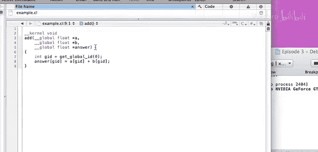
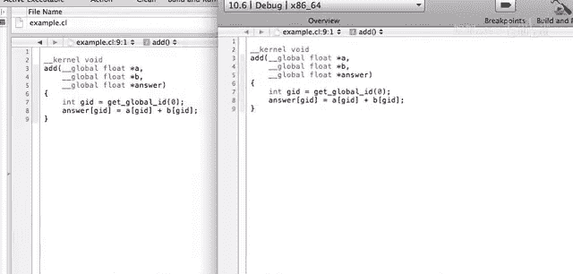
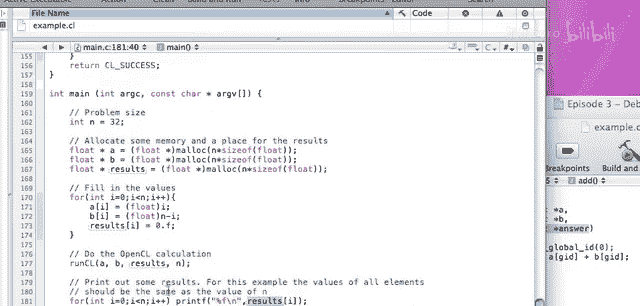
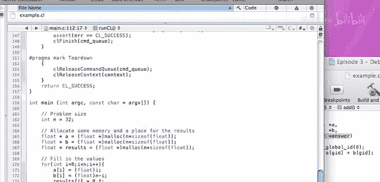
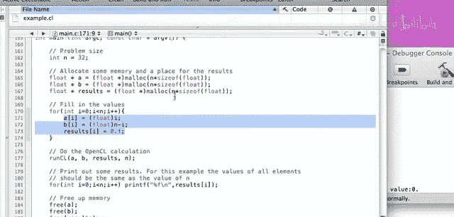
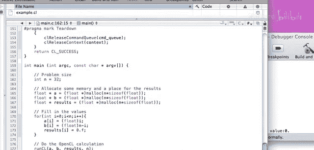

# 【OpenCL编程 RayiYanuTara】 p06 p5 Episode 3 - Building an OpenCL Project -BV1X2BRYyEeM_p6-

Welcome to the OpenCL tutorial series， my name is Dave Gohara and I'm with Macresearch。

org and also at the Center for Computal Biology at the Washington University School of Medicine this is the third episode and in this episode we're going to talk about how to build an openCL project we'll talk in a little bit more detail about some of the key functions and functionality in terms of what you can do in setting up your calculation and some of the tools that you can use briefly like Xcode for building projects running。

Running your calculations， building applications that will use openCL under the hood。

We'll also start off though with like in the previous podcast with some Q&A there' have been a lot of really great questions posted to the Macrese。

org website or via email to me so I'll address some of the more common ones and then certainly if you have any more questions or if you have questions about some of the stuff that's presented here again feel free to post to the Macresearch。

org website or send an email to me I'm also on Twitter so if you want to send it via Twitter feel free to do that it's of course 140 characters or less so it have to be I guess a short simple question but anyway there's multiple ways of getting a hold of me and if you have any questions or comments certainly feel free to send them a along I like to start off again with a little bit of housekeeping。

I want to thank our hosting provider Maciaus certainly over the last week or so last couple weeks that whatever the series started。

 I guess this was last week the traffic to Macre。org really gone up and I'm sure it's put you know a lot more bandwidth that we've been using and they've been really great great service。

 great support and so I would really like to thank them and if you're interested or looking for applicationhoing server server hosting things like that I'd really encourage you to check them out they're a really great group of guys and they've treated us very well so thank you to the guys at Macchus so let's start off with some Q&A there were quite a few questions that either came to me directly or via post on the website and so I'd like to address some of the more common ones that have come in。

And so that would be covering double precision arithmetic。

 which is important for a lot of scientific computations。

 object oriental programming and how that integrates into openCL how you can use these things together if at all。

 there was a question about asking for some clarification on global versus workgroup sizes when you want to tune one versus the other so we'll talk about that and then generally we'll talk generally a little bit about the classes of scientific problems that you can solve or work on using OpenCL and when and how those might be appropriate it's a little bit of a complex sort of discussion so what I'm hoping is you know to just kind of broach the subject now and then over time as these podcasts continue maybe you know hopefully people will get a better feel for the kinds of computations and calculations that they'll be able to do using OpenCL or perhaps having to use this separate technology。

So let's start off with double precision， double precision in the open CL spec at the moment is optional。

 so the 1。0 version of the spec it's optional。You need to know there are a couple things that sort of determine whether or not it will be supported on a device or within an implementation and there are ways to sort of probe the hardware and the implementation as well to see if it supports these sort of optional extensions if you have hardware that does support double precision and the implementation also supports double precision there's a pragma that you can use and that you need to use before you issue any statements to double precision calculations if you don't do that the specification defines that double precision behavior is undefined so depending on the type of graphic card graphics card that you have or the implementation itself it could just crash and burn the calculation could just crash it just may not run you might get compile time errors during the kernel or program compilation there could be a number of kind of behaviors and it's very tough to tell so you want to make sure that you're checking for these things and that you're。

And that you're looking for them before you do anything that really relies or requires。

This to have happen and so like I said， double precision graphics cards， for example。

 CPUs we know support double precision I mean they have for a very long time on graphics card this is something that's a little bit more recent and so if you have a very new graphics card the chances are probably higher that it does support double precision if the card supports double precision the implementation in the implementation also supports it you're guaranteed that the implementation form will conform to the IE standard just the same as and so in terms of rounding modes and things like that exactly the same as it does for single precision so you're at least guaranteed that but there's no guaranteed that it's going to actually work because again this is an optional extension。

Now there's one thing that you do need to consider。

 especially for scientists if they're doing scientific computation and they really。

 really need double precision is that there's a big performance hit that you take。

 so for example on the GTX 285 single precision floating point operations。

 you can get about 1000 gigaplops per second， so about a abte terofloop per second of floating point computation in single precision in double precision because the number of floating point units for double precision are much less on eachSM you get about 90 gigaplops per second on again on the GTX285。

 so you're talking about an order of magnitude performance hit。

If you do have a graphics card that does not support double precision or you're not really certain there are ways to kind of get around this。

 you can kind of sort of emulate it using mixed precision math and for right now probably that discussion is a little bit beyond the scope of what we want to talk about here but there's a link at the end of this podcast。

Or if you're looking at the PDFs on the very last slide that will take you to a really nice presentation that some people have put together on the and that's available online that talks about mixed precision arithmetic and how you can use this to effectively emulate higher precision arithmetic on devices that don't support it and also if you need this without incurring such a huge performance penalty so that double precision arithmetic hopefully that answers the question that was posed the next question that was asked was in regard to object oriented programming so openC obviously is derived solely based on the C language so this sort of concept of object orientation does not exist in the language itself what that means primarily is that you cannot pass complex objects into openC kernels。

You can certainly copy the memory blocks and things like that in there。

 but they're not going to behave the way that you'd want to the Jit compilation that occurs on your kernels is assuming that this is C with the openCL extensions being supported and that's it so for example。

 while you can call openCL routines from object oriented programs。

 you can't pass objects in so if you're using say C+ or objective C your methods say an objective C can make calls out to openCL。

 they just can't pass any of the instantiated objects into the kernel So what does that really mean it means that for example let's say you have an NSRA of NS numbers using objective C you can't pass in that NSRA and expect it to be utilized and to be utilized efficiently I mean even if it could take it it's not going be utilized well because an NS numbers a complex object and they're all sorts of little things what you can do however is you can have routines that might。

Take all of the NSS numbers in an array， convert them to floats and dump them into a regular。

Intrinsically typed array that openCL would understand so that's kind any C array or any of the extended primitive types that openCL supports。

 you can pass those into the kernel and then the kernel can process you know the information and do whatever computation you want and then when you come back out you can put the number back say into your NS arrayray or something like that the important thing to keep in mind is that know all of that extra overhead may or may not be value to so you do have to evaluate those kinds of things。

In cases like in our case， for example， in APBS where we're spending so much time doing the actual calculation parts。

 the little bit of overhead that we take in reformatting our data structures and things like that really doesn't affect us all that much because it's just a minuscule amount of copying that takes place and we sit in and we spin and crunch on the numbers for quite a while。

 so that's not something that we need to。We we need to concern ourselves with too much。

 The one thing that open C will support。 It doesn't support obviously complex objects。

 It does support structures。 So you can make complex structures as long as those structures are built up from intrinsic types from the C language or any of the extensions that open C supports。

 So those types of things you can pass in and you can use， but if you're looking for any kind of。

Any any kind of you know more higher level object orientation。

 it's just not going to work in open C and this is actually slightly different。

 I think from what you get with Kuda where Kuda can't kind of support。

where it does support object oriented languages like c++ and things like that。

 so that's that's something that's very sort of important to think about depending on the kind of project that you work on and how your data is your data and your data structures are organized so continuing on。

The next thing was workgroup sizes and let's talk about that let's do just a little bit of just like a refresher。

 let's say we're talking about an array of 16 elements。

And our global work group size is going to be 16 the local work group size has to be some value less than that obviously and it needs to divide evenly into the global workgroup size and so let's take two as an example if our local workgroup size is two that means we'll have eight local work groups。

 eight work groups of two elements each。So just just so we're all on the same page now the one catch to that is that the local work group size on a CPU is it always has to be one。

And the reason for that is that it a technical reason and that the ability to synchronize workgroup to have communication between workgroup you may have to do some synchronization and synchronization points on a CPU to implement them are extremely expensive the number that was quoted to me was somewhere around 10。

000 cycles I believe to implement synchronization points and's I mean it's 0。

68 seconds it's really it's an eternity to the CPU so it's actually not quite literally 0。

68 seconds that's a star Trek reference， but the point being is that to a CPU at 1000 cycles is a very。

 very long time and so。You really need to kind of think about it in that way。

 so on the CPU your local work group size always needs to be one or you need to set it to just set the value to null when you invoke the argument so that's the thing now on a GPU。

 how do you determine what the local workgroup size should be and often honestly it's a little bit of trial and error。

NVDdia makes this Excel spreadsheet， this little worksheet that you can plug some numbers into。

 like the number of floating point operations， things， you know。GPU type， you know。

 probably clock speed， things like that。 You can put in some numbers and it'll give you some recommendations in terms of what your local work group size should be and and things like that。

 But often even even with that， that's just guidance you often have to go and you have to try different few different things just to kind of see what it is Now there's a couple things that you want to think of your global。

Work size in your in your local work group size certainly should never be less than the size of a warp on NviDdia hardware or of a wavefront on AI hardware。

 So the on NviIdia hardware warp is about is 32 threads。 and and we'll talk in。Great。

 great detail and other podcasts about warps and wavefronts。

 but basically these are sort of units of work and how the GPU likes to think of things and process data andwas swaths of data as it's working on them and so on NVIdia hardwareware the Warp is 32 threads 32 elements and so you definitely don't want your workgroup size to be any smaller than that。

On older NVIA hardware actually a warp， the warps used to get broken down into what are called half warps。

 so they'd be 16 elements each but that's a hardware abstraction on the latest hardware it's not really done that way I think they're done as full  32 element。

Loads into the SM so you don't you don't have to worry about that。

 but that's your smallest size now the other thing you want to think about in terms of work group size and things like that powers of two or variants of powers of two or you say have like two powers of two added together or something like that are typically your friend but even numbers you know are really the kind of the thing that you want to shoot for if you can as much as possible that also might mean padding out your calculation a little bit having just some no ops like a bunch of zeros at the end or something if that gets you a power of two and makes things nice and neat that little bit of extra work and wasting a couple threads on on those calculations will pay off handsomely sometimes if that's what's really necessary。

And just something else to point out in the snow leopard openCL implementation。

 at least on NviIDdia Hard， the maximum local workgroup size is typically around 512 so you're not going be able to have a local workgroup size that's going to be any larger than 512 elements and in fact on NviIDA hardware I think the maximum number of threads that you can run on a single S is somewhere around 7784 I believe or something and there's a point above 512 actually where as you approach that 700 number where kicking off more threads it really doesn't gain you much there's a reference for that out there somewhere I couldn't find it but I know I've seen it or hurt it someplace so that's something to keep in mind and there may be cases where having 512 threads maybe overkill。

 you might not get any additional benefit from the workgroup so you might want to pick some smaller number so again you do have to play around with it a little bit more。

The last thing related to this question that was posted was dimensioning where we talked about in the last episode if you have like an ND range。

 you can partition problems into one， two or three dimensions in openCL and the question was well why for example。

 you can take a 2D image and all of the data might be stored technically in one very long array but we're indexing multidimensionally and I think the point in having that capability is that for scientific problems。

 sometimes it's just easier to think， and I'm speaking from scientific problems from a scientist's perspective that's all not that that those are special but it's sometimes easier to think of the problem as a twodimensed problem。

Verssus you know as one long one dimension problem and so when you're doing indexing or trying to index into arrays and things like that。

 it just might make a little bit more sense to think of it as， you know here's my x coordinate。

 here's my Y coordinate， okay this is say this is the pixel value I want or if you do three- dimensional calculations。

 say doing things on a grid where thinking of it in three dimensional terms might make a little bit more sense。

There's really no performance gain from doing it one way versus the other。

 as far as I've been able to tell。 so it just could be， it just might be problem specific。

 What makes you know more sense in one way versus。You know what makes sense in one in one context might not make any sense in the other context。

 so it's just it's just a way of thinking of things and and and doing them。

 so that's work group sizes hopefully that answered some of those the questions that were asked。

The next thing is problem classes What are the kinds of problems that canonical scientific problems that people can use openCL for where it might work or might not work and the examples that were sort of given were like FFTs。

 bs， LAPAC， Monte Carlo simulations， partial differential equations。

 things like that for the first three there are implementations there are ways to do all of those things on GPUs and that's actually very and not only to be able to do them but to be able to do them very efficiently。

 partial differential equations it kind of depends some you can do some implementations you can do very efficiently。

 some don't it might depend on your data structures。

 data layout and things like that I'm saying this simply because I know I mean we deal with partial differential equations and APBS so。

嗯。It really depends and sometimes you have to refactor your problem like where you're just taking data data structures。

 copying them into some more optimal format， doing the calculation。

 and then copying the results back and things like that， but there are FFT implementations。

 bs LA PA implementations I've seen Monte Carlo simulations done on GPUs PDEs we've done of course so。

are they're all possible and doable。 There might be some specifics to the type of calculation you're doing that might make it a little bit more complex or impossible to do so a lot of that you have to do on a case by case basis。

 but these are all tractable problems on a GPU and in a lot of ways you can do these very efficiently So this sort of begs the question well what is the optimal range or you know what sizes of problems can I do And so then this kind of in a lot of ways comes down to hardware limitations how much RAM can you get on a GPU certainly today you can get you can get some graphics cards with up to 4 gig of Ram so that's quite a bit but not everybody's gonna have that so you need to also consider well。

 I can only copy you know I've got a graphics card that has 512 mete that's going to be a limiting factor and so those are the kinds of things that you have to think about as well and again it's very problem specific and specific to the kinds of work that you'd be doing but again you know that and so。

Think of that as some kind of guidance in problem classes now all of that being said again not all algorithms or implementations of an algorithm are going to be optimal on a GPU so there's going to be some tweaking that you may or may not have to do depending on what specifically you're trying to work on it's sort of the nature of the game in any kind of optimization or any kind of computation problem the problem with the GPU is that there are very specific thing excuse me specific ways that it likes the data sort of laid out and if you can get your data in that format。

 you're going to be golden I mean itll really your calculations will really shine and so you may have to do some refactoring of your algorithm or your code or you might have to modify your data structures a little bit or create temporary data structures where you put the data into before doing the calculation。

Now， the last and most important thing is that you might think， well。

 I'm doing something a very complex kind of calculation that involves several steps or I might have to loop and do a lot of different iterations。

You know you know how would that work and and the important thing to keep in mind is that computations do not need to be run in a single kernel or Q call so you can you can break these things up into multiple kernels or multiple queue calls and it'll work you know you'll take a little bit of a performance hit between Q calls。

 but it's not a huge amount， especially again， if you have a problem that is very computationally intensive So you know you don't you have to do a little bit of trial and error。

 but you can certainly get this thing get this working。

 And so let me give you a really quick example of a computation that you might break out into multiple。

Clonnals or cu calls and so in this case we're looking at conjugate this is a conjugate gradient algorithm and so one of the things where you know anybody who's familiar with with conjugate gradient or these kinds of calculations you'll note that there there are several discrete steps that you would do and on a CPUU you can sometimes merge these things together or do you know special things because you have access to all of the memory at once and things can share information a little bit easier on the GPU it's a little bit different and so what you can see is you can see that。

 for example， there are saxby operations in this case there are three of them。

3 saxby operations so you would create one saxby kernel and then you would just change the the arguments to that kernel and the kernel invocation depending on which step of this you're doing You can see that we're doing some multi some vector multiplication。

Fector matrix multiplication， things like that， so you might have to generate a special kernel for that or whatnot。

So， so but but the point being that you can go and you can queuee up all of these types of calculations and you can execute them。

And then you can execute them in order the way that you would do it on a CPU the one thing that you have to to keep in mind。

 for example， in this case， certainly conjugate grading is there are cases where you'll be doing calculations and the calculations will say。

 you is there an early exit condition have I converged or have I done what I'm supposed to do and the problem with those is that once you queue something up into an open CQ。

It has to finish it's there and there's no way that I know of at least to pull something out of a queue to terminate early and so if you're doing conditional checks。

 what you really want to do is you want to maybe say let's do you know 10 loops of conjugate gradient minimization and。

Then you know let's just do a check， let's sum up everything。

 look at our residual over on the CPU because that might be just a small like a single value that we have to send over to the CPU。

You know， a couple bytes of data。 check it。 Oh， is it done Okay let me let me do another loop or another 10 loops or something like that。

 So you have to think about things in that regard。 It's best if you know。

 I have to do a minimum of 200 iterations then do 200 iterations and then go check and if you have to do a few more then go do a few more or something like that But the more work you can do without interruption the better So that is something important really important to think of when you're talking about things like molecular dynamics and you know these types of these types of calculations electrostatics we have similar problems in electrostatatics well you need to think of those kinds of things。

 So hopefully that gives you a little bit of a better idea in terms of problem classes and I think over time what you'll see is as we go through the tutorials or as these tutorials this podcasts continue。

You'll get a better feel for the kinds of calculations that you can do and the data layout and how you go from one form to another to make things work a little bit better and then also。

You'll also get a better feel yourself in terms of this is applicable to me or this won't work for me。

 things like that， so hopefully you'll get a better feel for this as time goes on as well if it's not。

 you know if you're not like， you know I got it so。What I'd like to do then is move on。

 we'll do an openCL example this time and this have a real project。

 you'll be able to download the project from the Macresearch。

org website if you have snow leopard Xcode， you can launch it， run it。It's nothing fancy。

 this is in fact a very， very bare bones。Project and I did this very intentionally because a lot of the other example code that you might see on the Apple website or in other places。

 they're very complicated。 They're trying to show you you know all of the stuff that you can do and I think and doing that。

 sometimes things get a little bit more it makes a little bit difficult if you're coming into this you know from the get- go。

 if you already are somewhat familiar with this kind of stuff you're going to be bored senseless。

 but I think this would provide a nice framework for people who are looking just to kind of you know get a little to get a bit of a feel for how the code is and you what are you know what's going on and how it looks。

 so。This will run on Macs 10 Snow leopard， got to have it。

 you need to have the Xcode tools installed。And， like I said。

It's a it's a very simple example just to kind of get you familiar with some actual code and get you familiar with the tool chain So what I'm going to do first is I'm going to without before we go and step through the go through the code itself in Xcode and show you the layout I want to talk about a few sort of functions we talked about some of these functions either in episode one or episode two I can't really remember but I want to go into some of these in a little bit more detail just so you get a bit of an idea of some of the things that you can do with these functions and。

And so you can kind of understand more。The， you know， sort of the power and how， how you figure out。

 okay， this is， you know， what the hardware is capable of and things like that。

 So the first thing that we're going to talk about is， you know， discovering devices。

 So the function is C get device Is。 And overall， this is a very sort of simple。

it's a simple function call， but what's important what you'll notice here are there are probably three elements that you really want to focus on the second parameter to this function call is what type of device are you looking for by default you may be wanting to look for the CPU device but you can also look specifically for the GPUs only you can look for accelerator devices so something like that would be something like an FPG or I believe the openC spec references the cell processor as being defined as an accelerator。

 so things like that would be an accelerator if there's a multimedia chip。

 something very specific that might be an accelerator as well。

You can ask the implementation what's the default device。

 you know whatever the implementation is specified as being a default type of device or you can say just give me everything that's on the system and let me know you also specify the number of devices you're looking for you might just be looking for one very specific device if you're looking for one that's easy if you're looking for multiple ones or you just want to get a list and then parse through that list to see oh this is the one that I really want。

 you can do that as well and you do that by passing in either the address to to C device type or to an array of devices or where the devices would be stored and then you'll get those back by saying okay I want know the top three or I want the top two if you have say a computer that has multiple graphics cards in it return all the graphics cards and then I'll figure out which one's the fastest or something like that so。

CL get device Is Now， once you have the devices， you want to be able to get information about them。

 And so， for example， in this example， what we're looking at is the device vendor。

 I want a string and the types that are returned are different， sometimes it'll be an integer。

 sometimes it'll be a string of characters as in this case C device vendor but you might want to be probing the hardware to say you know what's the global memory size。

 how much Ram is on my graphics card or what's the maximum number of work items or for example。

 if you're looking to see if the hardware supports double precision。

 you can get a list of the device extensions and then you can check against that list of device extensions to see oh you is double precision one of these device extensions that's supported and if it is great I'm going to do double I'm going to do my calculation and double precision if not then I'm going to have to fall back to single precision mixed arithmetic things like that So C device get C get device info is what。

We'll help you do that figure out what the device properties are and there are more options those are again in the openC spec and I can't remember if I mentioned this and are not already。

 but we may have one podcast like I said if I did say already that where we go through the specification just so people can kind of get familiar with it but check it out there's a lot of really good useful information in there and it's really not that hard to read so they've done a really good job with it so check that out now when we're building programs。

CL build program very straightforward， there's nothing very complicated about this。

 you can read the spec but once you build the program。

 you might want to get program the program build information， so for example。

 say you build a program and you want to look at the log say there was an error that happened and you're like you know know what was this error well the compiler when it compiles this it does Jit compilation so it's doing it at runtime primarily。

You want to get， you want to say， okay this failed， Why did this thing fail。

 You can look at the build log， the build log might tell you wait a minute theres there's a syntax error in your kernel or something like that because by and large you cannot compile your kernels outside of open C I mean I'm sure there are ways to do it。

 I've never I haven't learned how to do it so I'm I'm not really certain one way or the other if you can do it I always do mine just in time when the when the program is executing so。

SoBut anyway， so sometimes it's hard to tell you might just have overlooked putting you know you a comma or something or whatever。

 or you specified the wrong data type or something like that。

 and so the compiler might have thrown an error， you can check the log。

 you can also look at what the build options are and what the build statuses in terms of the program build so there's ways to figure out know what has happened during your build with using CL gett program build In。

There's also memory buffers when we。We have memory buffers and there's two types of memory buffers。

 there's the memory that's on the host， which is our input data typically。We may be。

Reading this from disk or we may be calculating it some someplace else。

 you know in some kind of calculation and then we want to do something with it。

 but to get it on the device， we have to use a very special buffer and these are C memory object buffers and those buffers are tied to a to the context that you're performing your calculation in now there are different types of memory that you might say allocate and so in this case we're talking about allocating a memory buffer that's read only。

 meaning that when we execute our kernel our kernel can't write into this memory location。

And there may be reasons that are hidden by the implementation。

 so they might be opaque to the user where it's more beneficial to use read only memory versus readr。

 so they might be able they might be doing some caching behind the scenes in terms of where they store memory if it's a read only it might be in the constant cache or something like that I'm not very I'm not too familiar with。

With what's going on in the implementation and why one would be more beneficial than the other。

 But it's probably something like that。 And then also you could again。

 you could have read right memory， you could have right only memory if you're only writing results to it。

 you don't need to say an array but you never need to read them back while you're on the graphics card or in a kernel doing the calculation。

 I should say there are other types where you can reference memory that exists on the host So you don't even copy it over to the GP Now again。

 you don't want to do this that would be madness to do because if you're running on a GP because it's just gonna to be slow your data is transferring over that PCI bus and that's just I mean it's just horribly horribly slow。

 So but if you're on the CPU and you're only staying on the CPU。

 there might be some benefits to that。 So those are。

Those are some of the options for memory buffers now continuing when you create the memory buffer。

 but you need to also write the memory buffer， there's another version of that function I'm pretty sure that we'll do the creation and the writing。

 but there may be benefits to not doing that simultaneously and one of those benefits might be that you want to create a whole bunch of memory buffers and then queue up all the rights at once and then force them over to the GPU it might be a little bit more efficient and actually there's some there are also some other more advanced functions where you can do asynchronous copies and things like that。

 but we won't talk about those for right now。Or any more about those for right now， but in this case。

 you have two options really with the C and Q right buffer where。You know。

 we either want it's this value， C true or C false。 If C true for the right is given。

 that means it's a blocking。Calculation， we block until the right is complete and and that's important because or it may be important because you want to make sure all of your data is over on the device before the calculation actually starts。

 If you specify C false， that means that things， you know。

 it could be continuing to write the buffer while you're。Colonel kicks off。

 your kernels are kicking off and they might be reading。

 so some of them might be reading the wrong information or no information。

 So it's something to think about and consider thatre when you're writing these things。

 so CNQ write buffer can be either a blocking or non blocking and it's either if it's true。

 it's blocking if it's false， it's a non blocklocking。

Kind of calculation the next things are execution and read so we know that we have we have to set our kernel arguments。

 this is pretty straightforward。 there's nothing terribly complex about this the in Q and D range kernel where we might specify a specific kernel so let's say we you know we might have an array of kernels we may have five kernels in our program。

In this case， we're going to pass off the first kernel and because say we're going to run this on the CPU。

 let's say。TheWe pass in a global work size， but no local work size Now if this were to run on the GPU and we don't pass in a local work size。

 the open CL implementation is going to decide for us and。It may get it right。

 and it may find the most optimal in my experiments in earlier ins of open sea on snow leopard back back before it was back when you know they were still working very heavily on this。

Getting getting it in。What the openC implementation would actually decide for the local work size it was pretty good in terms of you know finding the most optimal ones。

 So I don't know what they're doing to figure it out。

 but it seemed to work pretty well because if I go in and manually set it and then look at timings and things like that。

 it was often hard for me to sort of beat it but there were but there may be cases where you're doing something very specific in your kernel where you're using shared memory or things like that and you need to limit the size or you need to pick a very specific size for your local work size on the GPU So that would be times where you might have to play around with with those values and experiment a bit。

 And then of course know we do the calculation， we do it on the graphics card。

 but we really need the results back over on the host and so I mean unless we're going straight out to display but by and large we're probably not if we're doing this so。

We also need to incu a read and again， C true or C false means that it's either a blocking read or we just don't wait by and large you're going to be doing blocking reads would be my guess because you want to make sure you've got everything right out before you go and start doing something else with。

You know， with the results， you want to make sure you have them and that you've read them into whatever array you specified。

 So what I'd like to do now is I'd like to。overI'm going to switch over to Xcode。

 close out of this here real quick， go over to Xcode and then。

We'll walk through the Xcode projects just so you can get an idea of what's going on。

This is our Xcode， this is a standard Xcode project。

 this is a little C or a little utility that you'd run。

 say on the command line or something like that and like I said this will be posted on Macresearch。

org so you can。You can download it， play with it you know take a look at it basically the only framework we have to include is the openCL framework over here and we've got as our source。

 we've got the actual C code that gets compiled by the compiler once to produce our executable and then we have our openCL kernel which gets compiled by the。

By LLVM at runtime。 So this is what's actually going to be doing our calculation。

 This is an ad kernel。 So it's very know very simple。' we've seen these in previous episodes。

 So let's just walk through this really quickly。 And I've tried to sort of annotate things just so it's kind of clear what's going on。

 But a lot of this I'm sure is very clear to most of you。

 So our problem size in this case it's gonna to be small， it's gonna to be 32。

 Now if you' were going to do an ad of 32 elements。And who said， okay。

 I'm going to go do this on the GPU， you'd be absolutely nuts because by the time this got back from the GPU。

 the CPU would have finished this a thousand times over easilys there's no point in doing that。

 but this is just for illustrative purposes so we set aside size we allocate some memory some arrays filling with some values and then we call run C now and run C。

We start again， we're passing our variables， things like that we。We're creating a program。

 we might have two kernels， you know， let's say but we actually are really only going to use one。

 we have one kernel in our example over here。We're going to build up a command Q contacts contacts。

 excuse me， devices， things like that， and so I've tried to organize these things in blocks。

 you don't need to put in these pragmas and you don't need to put in these braces or anything just to kind of you focus your attention on the different things so。

Again， device information， C get device IDs。What you typically might want to do is because you're not necessarily going to know every computer has a CPU in it。

 obvious， so you're always going to have an openC capable device in any computer。

 so it's always best to at least have that as a fallback just in case and so so you want to set that and you want to pass in a CPU variable you get a CPU back you get a CPU device back。

Then what you want to do is you want to go actually look for the GPU。

 let's say okay we want to run this on the GPU。 we want you know all this amazing performance and blah。

 blah blah and all this kind of stuff。 So you go ahead and you set this up and then you check you say is there a problem if error did not come back as successful then set my default device to actually be my CPU device and then let's just assert that we actually have a device before we continue so we don't reak hac on the system and then what we're gonna want to do is we're going print out a little bit of information to standard out we're gonna probe the hardware device。

 will hopefully be our GPU with the device vendor and the device name print that out。

 make sure everything's working what we want to do after that we set up our context and command queue and this this is straightforward。

 these are just straightforward function calls nothing really specific about this the context。

Is always tied to the device， so you need to at least do that and then your command queue is is tied to the context and device so both and so。

So so that's that part then what we're going to do is we're going to say， okay。

 now let's build our program， so we have our our file now。Here's the important thing。

 I think this is where some confusion may come from and where people might get， you know。

 a little concerned， even open C kernels are basically。

They're read from a file and they effectively boil down to just you know regular C functions There are multiple ways of bringing in openCL kernels into into the program。

 they could be as an external file like we have here。

 which I think is a little bit neater and easier， you can also create C strings and inline those into your application somewhere somewhere above and then load those in that way。

 there are pros and cons to each one if if they're separate files。

It's just cleaner to look at and it's it's a lot easier to kind of see when you make them into sea strings。

 you have to you have to quote them and things like that， and it can make it a little bit tough to。

Excuse me to debug。The code if there's a problem and and so I personally don't do that and I don't recommend it。

 but this brings up two important questions。 One is， well。

 what if I don't want people looking at my kernels Fair enough and what if is there a performance hit if I'm constantly you know loading these things from disk and I have to do this every time so let's address both of those if you are protective of your kernels and things like that you can precompile them which which I'll talk about in。

And you can create a binary。 I know you can do this。 The specification supports it， how you do it。

 I'm not really certain， but。And I'll talk about that a little bit more in a second the other thing though is。

In the context of looking at like the sea strings or whatever where we're。It's I don't know。

 it's just kind of a mess。 And it's really tough to figure out what's going on when you're debugging。

 you can do it later。 And if you inline them， for example。

 then you know somebody's gonna to have to run strings on your application and then they may or may not see them。

 but it might be a little bit more garbled and it might be one way of sort of obfuscating those things for the user So that's one thing now this issue of compilation whether you want to precompile or do it just in time。

 there are pros and cons to both。 obviously if you want to just ship a binary and you don't want people looking at your stuff without having to disassemble it or anything like that then that's what you can do that's certainly an option。

 The problem with that though is that you lose the benefit of the compiler to make the right decision at run time for the hardware it's running on。

 So that is you may have two people running your application both onvi cards where's again。

 warp sizes are both 32 but one of them。Might have some special feature that the compiler might know about and this is LOVM is what does the compilation。

 the Jit compilation， so that might know something specific and it might be able to do some special optimizations that you wouldn't be able to do on the other one so by doing these things at runtime you're always guaranteed or hopefully you're guaranteed to get the best sort of compilation out of your program。

Then people are saying， well if I'm trying to do things fast。

 why am I wasting time you know I' mean recompiling this just seems silly Well you know the compiler is very fast and of course there is overhead but there's oftentimes in your program where you're just doing other stuff and that setup is very slow and before you get to the meat and potatoes of doing your calculation and so you might just be able to sort of absorb the overhead of doing that compilation at those points so it may not really be that big of a deal。

Or your program might you stay you know running， you know all the time and you just reuse the program over and over and over again or something like that。

 So you compile it once， you do it， take the hit， but you know it might not be that bad if you're doing hello worldld you're right。

 it's not really worth it but it's not really worth going through the effort for this anyway so this is really again designed for really big problem so that's that's kind of the point that I wanted to make here is that you know there are pros and cons you're aware of some of them now hopefully hopefully that will help sort of guide your decision in terms of what you use so basically we load the program code from disk and we create。

we create an actual program file then once we create the program file we need to build the program this is where we do the actual compilation and if we wanted to where we would go and check the build info say if something went wrong。

 we could just copy and paste in that function and look to see a you know。I forgot， you know again。

 I forgot a comma I didn't pass in enough arguments to the kernel or something to one of the kernels or something like that。

 And then once we have our program now remember our program can have multiple kernels So we need to create kernel objects for each single one of those and what basically what happens is when we create the kernel it'll go and look and say what is the name of the kernel or effectively the function that I'm looking to build or to create。

 and so let me take that and then take that chunk of code and assign it to this C kernel and it's now it's now tied to that So if I want to invoke a Saxby kernel or an add kernel I sign it here and then I just recall that kernel and I might just have to change the kernel arguments or something like that So then continuing down we're doing memory allocation as we did before we create our buffer。

This is an input array that we that we're bringing in here， so this is going to be read only。

 we're never going to modify it。 we can queue a write into the command queue。

 We're going to write into our newly created buffer and we're going to be writing from。

From from this a array， this a value that a set of values that come in and it's going to be a blocking right Okay。

 now that doesn't mean that once we've done this and we move past it that the Nq right is actually going to happen the command Q can dispatch these at any time okay and that's important to know。

So what we do is we do the same thing for the other one and then we also create a content buffer where we want to store our results。

 but in this case you'll notice we're not doing any in Q rights because there's nothing to in Q I mean who cares what the values are now we're going to overwrite them later on anyways in this buffer and we're setting it to read right it could be right only then the kicker here though。

 is that we issue this command C finish on our command queue and basically what this says is that if you haven't whatever things you have in queued that you have not taken care of yet。

 do it and I'll wait I'm going to sit here and wait until you're done and everything is in queue so by the time you get past this point you know that everything in this program and everything that was in the command queue has been addressed by open C。

So then the next thing that we'll do is we'll set up a kernel argument we're going to be passing in。

 let me open。诶。Let me open up the kernel side by side so you can。

Kind of。Take a look。Our first argument is the A array。

 our second argument is the B array now remember these are now CLMM objects。

But we address them internally as their intrinsic data type okay and then we also have a third memory object。

 which is what's going to hold our answer again， we address it internally as the type of data it is。

 but we pass in the memory object that we've created up here okay。

And then so once we're through that， and if everything looks okay， all of our arguments were set。

Properly， then we go and do the execution part， we set our global work size in this case to end。

 that's the number of elements we want to process and in this case it's 32。

We're running this on the GPU， we could break this down into multiple local work sizes or not because it's just a single one it's a 1D problem and it's a very small problem breaking it up would be。

It just doesn't make any sense we in queue this， but again the in queue isn't necessarily a blocking in queue so we tell CL to finish in in queue whatever but now I'm going to wait I want this done before I proceed and do anything else and that's important you need to make sure that your command queue is completed before you try and read the results for example and so and in fact if you were to comment this out。

 there may be circumstances where this will have been in queue you'll go to do the read and you'll get the wrong result and you can play around with that to see you know that to see how that happens and how these things know pass through and so we read the buffer and then when we're done。

We do another C finish just make sure that all the results are done and then we just kind of you know release this stuff and then at that point since we've read our results from the answer back into the results array。

嗯。And control is returned back to mainine， we can now read the results。

 print the results out to screen and then just do some memory free up and I think here actually I may have I think I may need to do some releases here I need to take take a look at this so the code might be slightly different when I post it。

Up there， there we might need to do some freeze here for the for the buffers。 So anyway， so。

 so this is basically the the the function。 and so we are just kind of run this。

嗯。What you can see had happened was it went connected to the device and then silently it built the program。

 did a few other things。Did the calculation， we get 32 across the board。

 which is what we would expect given the input values that we've put in here so。So it works。 Okay。

 so hopefully that's clear and hopefully that helps。 but certainly， you know。

 poke and pride through this and look around。Give it a try and see what happens。

 The one thing I'd say is that if you go and you make this some very， very huge number， of course。

 make sure you have enough memory on your system and then turn off the prints because it iterates through the array so if you set this to 10 million you're gonna get 10 million values printed out in the debugger console which you really don't want just be aware of that so let's switch back here really quickly and then finish up so that was basically the demo hopefully things are a little bit more clear in that regard and what I'd like to finish up with or just a few more just a couple things again all of this information is posted on the Mac research org website feel free to grab it any of the other things if you have questions about a particular episode you can post the questions there of course you can email me also again if you find these things useful helpful and you have something that you might be interested in getting through Amazon we have an Amazon store doing us a huge favor a lot of people about Snowlepper。

Through our Amazon store it's a great help。 we really appreciate it even other things as well some people bought you know software and books and things like that。

 so that's really really helpful so thank you very much the other thing I forgot to point out actually earlier is that there was this great paper that was put out at the end of December by Nathan Bell and one or two other people from NviDdia on sparse matrix vector multiplication on GPU so if this is something that you're interested in they talk about the different storage formats。

 the different optimization single versus double precision very very well written very well done I encourage you to check that out。

It's one of the things that I had actually referenced when I started doing some of our matrix vector。

When I was optimizing some of our kernels and things like that and so really really good stuff very approachable they've done a spectacular job with that so check that out and then also that other the other presentation online on mixed precision arithmetic so I encourage you to check those two things out I think I I think they're both very interesting and worthwhile reading and so with that we'll end we'll end this podcast if again if they're questions or comments certainly send them my way and we'll see you next time where we'll probably talk about data layout and we'll talk about like warps and memory access and things like that unless something else comes up but that's the plan for right now so hopefully enjoy this hopefully it was informative and we'll see you next time。

