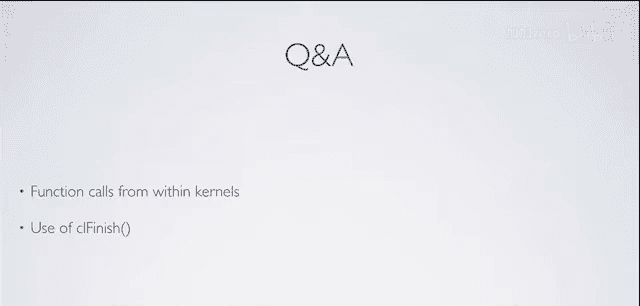

# 【OpenCL编程 RayiYanuTara】 p07 p6 Episode 4 - Memory Layout and Access -BV1X2BRYyEeM_p7-

Welcome to the fourth in the OpenCL tutorial series， my name is Dave Gahara and I'm with Macresearch。

org and with the Center for Computal Biology at the Washington University School of Medicine in St。

 Louis， if you need to get a hold of me my email is shown up here so if you have any questions or comments。

 please feel free to send those along。I had a lot of good questions posted。

 either sent to me directly or posted on the Macresearch。

org website and I'll be sure to either address those directly to you if it seems appropriate or we can address them on the forms or as Q&A。

In a future podcast so please don't hesitate to contact me in this episode we're going to talk about memory layout and access this is really important stuff because being able to get the most performance out of your code。

 certainly on GPUs will require that you have data laid out and that you access that data appropriately the way that the GPU is designed to handle it。

And。Most of this actual podcast is actually going to focus actually the entire podcast is really going to focus on the GPU's perspective on things and the reason for that is that well there's there's a lot of information out there already about CPUs that you can get access to and you're probably already familiar with those。

 but CPUs are a little bit more liberal and a little bit more。

Forgiving in terms of how we access data certainly than GPUus and they're able to do other things to kind of to work around our coding habits and whatnot。

 but the important thing to keep in mind is that if you optimize your code or your data structures or things like that to work really well on a GPU there's no reason why you can't necessarily move that back over to the CPU by and large in fact those kinds of changes they may be beneficial actually to how your code runs on the CPU they may I mean sometimes they won't sometimes they will。

 but oftentimes they will because although the requirements are very stringent on the GP。

 the CPU actually doesn't mind that kind of stringency as well。

 it's just that it's been designed to also work around those kinds of issues for general purpose code so this is what we'll beucking about in today's episode。

Before I start I'd like to again do some just quick housekeeping once again I'd like to thank Macus。

 our web hosting provider， the traffic， the bandwidth that we've been consuming has definitely shot up and they've been very good to us all of this time but certainly now when we're really kind of hitting。

Htting them hard so thanks once again and if you're looking for web hosting services or anything of that nature certainly consider Macs they're a great group of guys and they provide a very valuable service so thanks once again。

Q&A。There was a couple questions very most of them were pretty pretty straightforward and so we'll address those now there were two questions。

 one was about function calls within kernels， the other was my use of C finish in the previous source code examples that I'd posted from episode 3 so let's talk about those function calls from within kernels so what ended up happening was that a user was taking the source code that I'd posted and was just trying to I guess get a feel for it and had you know put in a function。

 a call to a function in this case the function was RAN。

And he went， went to try to run it， and of course， the thing didn't run and it didn't run for a number of reasons。

 One is that the default target was a GPU and this will make a little bit more sense in a second。

 And the second was that the application actually didn't even compile the kernel that's where it sort of bombed out at。

And the reason for this is that the only functions from within a kernel that you can call that you're guaranteed will work are functions that are part of the openCL specification。

 RAN is not one of those other functions that you might call like print。

Also are not part of the openC specification。 So there's no guarantee that those function those functions are there or will exist。

 And so you have to keep that in mind when you're writing kernels that if you have a kernel that depends on a function like RAD Well you're going to have to implement your own RA function that can be compiled as part of your kernel if RAD in and of itself has to do something like call the system time again。

 that's not going to work opencl will not support that as part of its specification so if you're looking for functions and so I guess the other question is well what does it support well it will support again functions from within the specification and it will support any intrinsic data types that the C language supports or that the opencl provides as an extension to the C language so keep those things in mind now there's an exception to this rule where functions where you can use functions like RA or print or things like that and that's if you're going to run your code on the CPU。

AndThat's not guaranteed to work okay it's just that it happens to work under snow leopard the implementation doesn't make that a requirement as far as I know。

 so if you're relying on that behavior， your code may not be portable between different implementations and so that kind of begs the question well why would you want to use print for example in a kernel and sometimes it can be useful if you're debugging your code so typically what you'll do is you'll write a kernel。

 you'll run it on the CPU first or you should at least try to。

Because it's much easier to debug there and you might want to say。

 I'm not getting the exact right results。 let me just print out some values or something like that。

 And so that's a really good and valid use of print。

 And then once you have that working and you know you're getting the right results then you would remove that code those statements or function calls and then you would run this over。

 switch it over to the GPU and try and run it on the GPU so there is there's some value to using those kinds of things。

 but if you're really looking for very specialized functions or functionality you might have to roll your own so which brings up the third and last point I guess really is that kernels can call functions。

 but those functions again have to be compile compileilable at runtime as long as they're compileilable at runtime as part of your program source meaning the program source that contains all of the kernels。

嗯。Then you'll be okay。 if it's not， then then this isn't going to work。

 you're going have to find some other approach or you're gonna to have to use some other technology。

 So that's with regards to function calls， hopefully that answers the question clearly and if other people maybe ran into this or thought of something similar。

 this will kind of help guide you a little bit。 The second was with my use of C finish in in the previous source code example and somebody had posted the question。

 well， know why are you using C finish， This doesn't make any sense。

 in a lot of ways it doesn't make sense what I neglected to say in the previous podcast was that those C finishes primarily were there。

 there are vestiges of timing code So I taken an example and just really stripped down and just put this in and I left the C finishes in there。

 Now there are times where you're going to want to use C finish So let's talk about what C finish really does。

 C finish is a brute force method for making the CPU block it does this specifically by。

Let's say you issue a whole bunch of commands to your command queue CL finish once you hit that CL finish。

 okay。C I finish will sit there and wait until the command Q has emptied and all functions from within your command Q have returned。

 so it will not return until everything else。Prior to it has returned and what does that mean， well。

 that means that your application is going to effectively block on that C finish。

 so if you're running a single threaded application。

 then your application is going to come to a screeching halt whenever it hits a C finish。

That doesn't mean that things that have been issued to your command Q aren't going to execute because otherwise C finish is pretty stupid。

 there's no point in having it。 things that are that have been dispatched。

 the command Q will be dispatched by the dispatcher and they will go and they'll run and they'll do what they're supposed to do。

 It's just that the rest of your program that's executing on the CPU will not be able to continue on。

 Okay， and so you might be asking， well， what's the point of having a C finish。 Well。

 there's a couple things。 again， if you're doing timings， you have to use C finish。

 because there's no guarantee even on blocking operations that the。Well。

 certainly even on blocking operations， those aren't going to from the CPU's perspective。

 those operations are being serviced someplace else。

 and so they're not going to happen if you need to guarantee a synchronization point if for example。

 you need to ensure that your code all of your code everywhere has reached this point before anything continues then you need to use a C finish。

 there's a third sort of there's a third example which may or may not be necessary anymore。

 but which which I had certainly discovered in earlier stages when debugging code and that is in earlier stages when。

The implementation when they were still implementing this in snow leopard and that was with overflowing the command queue and that is I'd issue a whole bunch of commands and then things would go a little bit haywire and issuing an occasional C finish from time to time was necessary to kind of flush things out just to make sure that the command queue didn't overflow and so this hopefully is gone and certainly as the person pointing out this would be a considered a bug not feature the specification doesn't require it so it may or may not I haven't gone back to look so but if it's still there you may need to do this if you have very very long command cues or you exceed the size of the command queue with your with your calculations and I would need to also check the spec to see if there are actual practical limits on the number of commands that can be issued to a command queue I'm not certain if the specification imposes those or not the implement if they do then you need to be cognizant with that fact because an implementation may work around that but that's not guaranteed if it's not part of the specification so by and large if you're using blocking operations。

In order execution， which you will be if you're using a default command queue then you don't need to worry about CL finishish if you want more information on this checkout sections 5。

1 and 5。8 of the OpenCL reference and there's a link at the end of this podcast to the Chronos website where you can find more information about OpenCL and the openCL specification so in this episode we're going to talk about GPU architecture and specifically we're going to be talking about NviIDdia hardware only because NviIDdia Hardware is typically is certainly what I'm most familiar with but primarily because there。

Is a lot of information out there because of couda and there's a lot of source and examples and things like that And so it's very important。

 I think you know just to kind of pick something rather than make this too generic。

 we're just going to pick something and stick with it and talk about that and so we're going to be using NviDdia hardware it's what I have in my Mac Pro here and on my laptop and all that kind of stuff so and it's probably what a lot of you also have as well so this is what we're going to talk about this isn't meant to say that if you have ATI or if you're from ATI。

 this isn't meant to be a slap in the face at all， it's just simply that this is what sort of there's more of out there if there's a need or desire certainly down the road to talk about things in AT ATI specific terms I'm certainly happy to do that we can we can put together a podcast or have a discussion about those kinds of things as well That being said we're also going to be using NviDdia terminology throughout this meaning that I'm not going to stick with the openCL。

Tminology where they've abstracted away a lot of a lot of these terms I initially thought， well。

 you know I can try and interleave them in this and that。

 but it's gonna to get I think too confusing so the only thing you really need to remember is that when I say thread or threads I'm talking about a work item in openC parls okay so when we talk about a thread we're talking about a work item a work item executes a kernel okay if you can remember that if you can sort of in keep those things together here in good shape when I talk about a thread block I'm talking about a work group okay a thread block is a collection of threads。

And a work group is a collection of work items Okay。

 so as long as you can remember all of those kinds of all of those things will be golden again。

 a thread is equal to a work item， a work item executes a kernel。

 which means a thread also executes a kernel a thread block is a collection of threads。

 a work group is a collection of work items Okay so as long as we keep that straight。

 then we should be in good shape。GPU architecture continuing so we're going to talk and I'm using the GTX 285 which is one one of their newer nvi graphics cards。

 so I'm going to kind of any numbers that I quote or talk about are really going to be in regard to that I'll try if I remember to quote numbers from some of the earlier series of cards but this is really what I'm thinking about these days so this is what I'm going to talk about。

The 1 series is called that I believe I'm assuming because of the number of thread processing clusters。

 so when we talk about GPU architecture， there are multiple levels of encapsulation of groupings of the various pieces of technology in there and one of the key concepts that they talk about GPU architecture Nvidia does and about their hardware is with regards to these thread processing clusters and so some of this is marketing some of this is you know and I mean engineering I don't really know I'm not privy to how GPU engineers talk so I don't really know but so they're talking about thread processing clusters。

 thread processing clusters can be thought of as like the most coargra sort of unit that exists on the GPU in terms of where the computation occurs okay and in the latest series of hardware theres 10 of these thread processing clusters per graphics card。

Each one of these thread processing clusters is broken down or contains， I should say。

 a bunch of streaming multiprocessors SMs on the GTX 285。

 there are 30 of these streaming multiprocessors the streaming multiprocessor is further broken down into smaller chunks and each streaming multiprocessor contains the following。

 it contains eight streaming processorors。It contains two special functional units。

 it contains a double precision unit， and it contains local memory that local memory is shared among the eight streaming processors。

 There are some additional things， but the things that we would tend to talk about and think about are these groupings okay。

 so let's talk about those in a little bit more detail。The eight streaming processors again。

 there's some terminology that's used interchangeably。

 streaming processors are sometimes called scalar processors。

 they're sometimes called shading processors， or there're sometimes just simply referred to as cores so for example。

 when you hear that a graphics card has 240 cores which the Gtx285 does it's because it has8 streaming processors per streaming multiprocessor and there are 30 streaming multiprocess。

8 times 30s 240 that's where the number of cores come from a core on a GPU is not the same as a core on a CPU as well so I just I want to point that out there is a distinction between the two but they're not logically the same Andvidia thinks of them separately differently from the way say Intel thinks of a core so they're not one to one。

The special functional units， there's two of them on eachSM okay special function units。

 not functional special function units， basically those are special functions such as transcendentals。

 sine， cosine， tangent probably you know things like that。

 they also do other kinds of operations square root， reciprocal square root。

You know things of that nature。A what are handled in the special function unit。

 So if you call sign within your things that's typically done in hardware rather than a software implementation that gets done in the SFU Okay there's a double precision unit we all know what double precision is a double precision floating point arithmetic this is in stark contrast to the sheer number of a single precision floating point units ALU and FUs excuse me FUs that exist on。

The on the S there's much more of those relative to the double precision unit， but there is one on。

 for example， the Gtx 285 so you can do native double precision calculations and then of course finally then the local memory shared memory we're going to talk about this extensively。

 This memory is a block of ultra fast memory that is used for sharing data between the various streaming processors and for sharing it between work excuse me between thread groups thread blocks that are executing on the GPU so let's talk about the thread processing cluster real quickly So again there are 10 of these on the latest on on the Gtx 285 we have each thread processing cluster has an of course these are dumbed down sort of schematics and I don't mean dumb down in the pejorative sense I just mean they're very simplified so we have an SM controller our。

Our streaming multi processorcessor controller， there's one streaming multi processorcessor controller per TPC。

That SM controller。Services three different SMs okay so0012 would be 34，5。

 et cetera and so forth and all of these SMs share a 24 kilobyte L1 texture cache okay and that's an increase from the G80 series which used to be 16 kilobytes so this is the TPC now and again。

 each TPC has a dedicated controller services3 Ss the three Ss also have access to a shared texture cache okay now each SM if we were to look a little bit more closely。

EachSM is broken down into eight streaming processors now I'm only showing two here just for clarity。

 but we have zero through seven， but there would be six others that would be in here each streaming multiprocessor has access to local memory。

 shared local memory， this memory is different than the the L1 cache that I was just talking about this memory is very fast and this memory is what's used to share data between to share data between threads in thread blockslocks。

 thread groups。And to share them between。And then that's also shared between the streaming processors。

Conceptualally， when we talk about breaking up the shared memory and things like that。

 it'll it'll make more sense when we do this in in a real world example。

 which I'm hoping that we're going to do in the next podcast。 So we'll do like a like a actual。

Example where we go through and we look at an unoptimized kernel。

 we look at a more optimizeized kernel to see how we take advantage of local memory and things like that。

 So if the concepts don't gel in this podcast entirely。

 they will in the next one hopefully and or whenever we get to that one。

 but I'm pretty sure it'll be the next one and hopefully hopefully'll make a lot more sense。

 but you need to start thinking about these kinds of things because they're important so each SMM can execute eight thread blocks concurrently each。

And this would make sense we have eight streaming processors。

 so you can have eight thread blocks going。 Now， there's a further subdivision here where the thread blocks are broken down into organizational units called warps。

 okay。And and again， this is NviDdia parlance， each warp is defined as consisting of 32 threads。

 so you may have a thread block that consists of 1024。Threreads。Okay。

 actually you wouldn't have a thread block that consists of 1024 threads you might have a thread block that's slightly smaller。

 but you might have some larger superet， let's say 256 threads the thread that thread block is going to be broken down further into into the small serviceable subset。

 which is called a warp okay and that warp is explicitly defined as being 32 threads okay so。

What is a warp。A warp again， is our 32 threads is our subset of 32 threads， okay。

 each one of those threads is going to invoke an instance of your kernel。Okay。

 each one of those threads in a warp okay within a warp。

 each one of those threads has to move in lock step with the other threads and we'll talk about that more in the next slide。

And only threads that are in the same thread block can share data between each other。

 and they share that data between one another using the shared local memory and we'll talk about that in more detail when we do the matrix transpose example at the end of this podcast So those are all important concepts。

 Now there's one additional concept that you need to understand and that's with a warp and warps are further broken down if this isn't confusing enough into what are called half warps and this is due to hardware this is a hardware requirement that that warps are broken down into half warps and the reason for this will make sense in a second。

 but well not a second， but in a few more slides it'll make a lot more sense。

The reason why though I'm sorry， half warps are 16 threads if a warp is 32 threads。

 a half warp is going to be 16 threads， okay so the magic number here is 16 all right。

 and so keep that number in your head， but going back to what I talked about when we're talking about kicking off threads。

 the number of threads， how GPUs are good at managing a lot of threads the important information I want to remind you of is that。

There's a reason why only want you don't want to go below 32。

Threads a you don't want to partition your problem smaller。Excuse me， then say 32。

 And the reason is that if you， if you do that， you're not going to be utilizing all of the threads in a warp。

 Okay， you want to actually make， if you can， you want to make your thread group sizes a little bit。

Bigger maybe say 64 because you're going to be needing to do things like hiding latency。

 memory latency， memory access latencies， things like that。

 And so having additional threads that are running at you know at the same time or that are in flight at the same time is important So let's just talk about that really quickly each SM okay can have 32 warps in flight at any given moment okay on this hardware okay and so what that means is that。

嗯。If you think about this， we have 32 warps。 we have 32 threads in a warp。

 that means we can have 1024 threads in flight at any given moment。

 You're not going to be servicing all of those threads or warps at the same time。 So again。

 why would we want that many if we could have that many。

 why would we want that many And again the reason is because we want to do things like mask memory latency access to say global memory is very slow and so the more threads we have。

 we can go and we can say okay this warp of threads this warp is executing right now a piece of data it needs isn't available。

 the hardware will recognize that and say， look you're not ready。 this other warp。

 the memory required for it is ready。 I'm going to contact switch over to that and execute that and so basically what it's doing is it's masking the latency for loading data from global memory into say local memory or into registers by doing context switching and by having all of these threads available GPUs。

Love threads， they have dedicated hardware for thread management。

 they context switch extremely fast so the more threads the merrier I guess so keep that in mind but the key concept here when we're talking about warps is that they are simply a collection of 32 threads that move in lockstep with one another when your kernel is being executed okay so if one thread has to pause in in a warp entire the entire warp pauses okay。

嗯。And then the concept of a half warp， which will make hopefully a lot more sense in a little bit。

 the one thing I want to point out is that a half warp is 16 elements， okay。

 so if you're loading data into local memory。We're doing a 16 element load， the native size is 32 B。

 which means that we're loading effectively 64 bys。 so if you want to do the fastest load possible。

 you're going to load 64 bys at a time and each thread is going to be responsible for loading 4 bytes。

Okay， this will make more sense in the upcoming slides。

Instruction scheduling so remember I said each each warp。

 each thread into a war has to move in lockstep。 So what does this mean， Okay。

 so this is obviously the C code， this is the human readable code。

 This is going to be compiled into a bunch of instructions that the GPU is going execute。

 but there's going to be an instruction to say add these two values Okay， every thread in a warp。

Or at least in the half orp is going to execute these instructions at the exact same time， okay？

There's going to be evaluation of this conditional。

 Every thread in the warp is going to evaluate this conditional。 And so this begs the question。 Well。

 what happens if。Some threads need to evaluate this conditional and others evaluate this conditional true and the other ones evaluate it。

 let's say false。 Okay， what what would happen， And this is where you're going to start getting divergence。

 and this is where you start running into some problems， not major technical problems。

 There are going to be times where you're going to have to do this， but。

What would happen is that because every thread has to execute every instruction in lockstep。

 what that means is that let's say half of your threads go into here。 All right。

 the other half of threads are not going to skip over this and start executing this block。

 They're going to wait。 and they're going to wait until everything。

 all of the threads that have entered this have finished doing this。

 Then the threads that entered this are going to wait。

 and the threads that needed to start executing this block will execute this block。

 So basically what you've done is you've serialized your problem。

 And you've partitioned the number of threads that are able to do the work simultaneously。 Okay。

 this is divergence。 And this is something you want to avoid as much as possible when you're performing or when you're writing kernels。

 again， you may have to do it。There may be no way around it， but if you can' avoid it。

 try to avoid it。So that's instruction scheduling this is warp and thread stepping through。

Through instructions， instruction scheduling。Now let's talk about local memory so the local memory remember I said this local memory is it's 16 KB。

 there's 16 kilobytes per SM each SMM has eight cores， eight streaming processors。

 they all share this。Block of data All right now how is this block of data broken up Well。

 the block of data is organized into 4096 entries y 4096。

 well each entry is actually 32 Bs or 4 bytes okay and so 4 times 4096 gets us our 16 KB okay。

Each one of those entries is addressed， hardware addressed into one of 16 banks， okay and the。

So that means that each bank has two services，200 a range of 256 entries。 Okay。

 this is really important because。The ability to use banks means that or the ability to break this up means that you can have 16 simultaneous memory accesses going on now and you be saying oh 16 right 16 is the size of a half orp and so hopefully a bell's going off right now is that each thread in a half orp will access ideally if if you organize things properly will access one of these banks each one of these banks individually and when that happens if you have 16 threads in your half orp。

 each one of them accesses one of the 16 banks you have a situation where you have no bank conflicts and this will sound a little I'll talk about this very specifically。

 itll make sense when you see the picture but just remember this is that you don't want to have bank conflicts。

 you want to avoid them and if you can avoid bank conflicts when you're accessing memory in。

When when you're doing bulk accesses in local memory。

 then that memory the shared memory is as fast as the register file。

 so you've effectively just increased your register pool by 4096 entries。

 perhaps or 16 kB I guess your register file has increased by that。

 but by and large the local memory used to coordinate data sharing between threads within a thread group。

 okay。嗯。😊，Threads can cooperatively load data into shared memory and you'll see what that means here shortly and this is called memory coalescing。

A thread in a workgroup can load data on behalf of another thread， and again。

 this will make a little bit more sense when we talk about the matrixtri transpose example。

And once you load that memory once you load the data into shared memory。

 you lose most of the performance penalties for accessing data element wise。

 meaning if thread zero wants to access data that would be offset。

 say like five elements off or something like that。

 it can do that and it can do that at will without any without any serious performance penalties。

 assuming that you don't have a bank conflict during that thread access， that's the key to the thing。

 but by and large you're effectively treating these shared memory locations as register register file so as part of the register file so you can access that data very。

 very quickly and very easily。That's local memory。 So now let's talk about memory alignment。

 And what we're going to talk about is memory alignment relative to global memory and pulling data。

 let's say， into local memory。 So let's start off with the bad examples。

 So looking here in this slide。If we have， you know memory and memory continuing off on on this side and memory continues off on this side。

 we're going to be loading data。 Each one of these represents a thread。 Okay。

 so let's say that thread 0 starts at an offset of 4 bytes from the hardware address now， say， well。

 what's the actual legitimate hardware address。 Well。

 the hardware address is always a multiple of the load size type so。

If we're loading an array of floats， a float is4 bytes and a half warp is 16。

 that means we're loading 64 bytes or ideally we would be loading 64 bytes as part of our coalesced load into memory okay what that means is that。

If I start at address 132， for thread 0， okay， I'm doing a misaligned load。 Okay。

 because all of my threads in my， I want， I will always want to coalesce memory loads。

 I always want to have each thread load a consecutive element。Of memory into local memory Okay， if。

 if if that happens or in the hardware detects that's happening。

 it's going to load that whole chunk of memory from global into local or into you know just into into the into register even。

It will do that as one single transaction。 And that's why it would be so fast。

 And that's why we want to do this。 Okay so we want to try and break this into 64 by chunks。

 but if the starting address is offset。 it's a misaligned load。

 that's not going to work as well because everything is going be everything is not going be at the correct。

 we're not going to be addressing from the correct set of addresses。

 it wants to do it based on a multiple of what the starting address would be 128 is evenly divisible。

 but let's say 64。 So that would work 132 is not there's other types of loads where called permuted loads where let's say we have a couple threads。

 you know they might be loading from the correct address。

 but then you might have another thread that's going to load you know this guy over here and this one's here blah blah blah these are permuted loads。

 These are also bad because we're not the hardware is not going to detect a coalesce load。

 it's going to say these are individual loads and so you're going to serialize on each one of these individuals。

Loads into the registers so registered or local memory or wherever the wherever the data is going to ultimately end up being。

There is another case where we only have some threads loading data okay。

 where so not all the threads are participating。 that's also bad because again。

 that's not detected as a coalesced load。 the hardware doesn't see that you're loading this huge swath in Okay so you might say。

 well what if I don't really need this piece of data well load it anyways if you can afford it into in the shared。

Shared memory location if you can load it if if you can afford the extra space， if you can't。

 you might want to consider reorganizing your data or your data structures if you can just so that you you can avoid not having to and again。

 if you load it and don't use it， who cares if if you have the space just load it in because then you're going to get what we call an aligned coalesced load okay so in the perfect case。

 what we would have is 64 bytes that we want to load in again。

 these are floats So each one is four bytes。And each thread is going load its respective element。

 threadread 0 is going to load from bank 0， thread1 is going to load into bank1。

 et cetera and so forth。 And as it does this， we get what's called a coalesce load。

 it's an aligned load， this is going to be the fastest possible way to get memory from to get data from global memory into the faster local memory or into the registers。

 So if you can do this， this is how you want to do it。

 this is the key to making to making some of these things really， really shine。

 make some of these calculations really shine。 is to make sure that you're doing everything aligned and organized properly。

 Okay so now we've been talking about a line loads。 we've been talking about banks。

 let's let's talk about this a little bit more。 So for our data loads。

There are many threads that'll be executing in your warp if if you if there'll be 32 of them in your half warp。

 there's going to be 16 of them Okay， so because memory because multiple threads can access memory simultaneously again。

 these data loads are divided are these。Memmoory is divided into banks。 okay on current hardware。

 there are 16 banks。 I'm pretty sure that I tried to look actually to see if this had changed between the previous generation and the current generation。

 I'm pretty sure they're still doing 16 banks on the 10 series。

 but I couldn't find a definitive definitive answer。

 I saw some speculation that there might be 24 banks but I didn't see any real clarification on that。

 So I'm pretty sure they're still using 16 banks。 if they're not。

 they're probably using either 24 or 32 banks， but I'm guessing for right now that it's 16 banks multiple simultaneous accesses to the same bank may result in what's called a bank conflict。

 And I say may because there's one exception that I know of at least where they won't And we'll talk about that in a second。

 So what are so how do we how does this really work。 Okay。

 so let's talk about bank addressing in this case over here。

We have thread zero loading into bank accessing bank one， thread1， bank one thread0 bank 0， thread1。

 et so and so forth， these are one to one Okay， so this is stride this is a stride of one。

 there would be no conflicts in this case， each thread is accessing its own dedicated。

The bank that's effectively assigned to it， okay？This case， it looks permuted and it is permed。

 but no thread is accessing the same bank where the piece of data would be necessary。 now again。

 if this is in local memory so this is a fast access。

 the data may have been loaded into local memory， but each thread is now accessing the bank individual separate from the other ones。

 and so no two threads are accessing the same bank So again， no bank conflict。

 what would be a case where we get a bank conflict okay in this case， we have two way bank conflicts。

 thread 0 and thread 1 are accessing bank 0， thread2 and thread3 are accessing bank2 etca and so forth。

 And so when we do something like this， we have what's called a twoway bank conflict you could have a higher order bank conflict where you might have three or four threads that are accessing a single bank the important thing that you have to remember is that anytime there's a conflict。

Data access to that bank becomes serialized。 Okay， so if thread 0 and thread 1。

 both want the data from bank0。Then thread 0 is going to get it。 Then after thread0 gets it。

 thread 1 will get it。 So you've now created a serialization point and the higher。

the more number of threads that are accessing the same bank for a piece of data。

 the greater the level of serialization， if you are accessing from global memory that's a 400 to 600 cycle stall that you've created times6 let's say 16。

 let's say every element of your half warp is accessing a particular bank then from global memory you've now serialized all of those data loads into the various threads so that's a big performance and that's something you really want to avoid as much as possible now I said that that might not have necessarily been the best example because there is one exception where you can access where all threads can actually access a bank a single bank。

And that is in the case where。Well， I guess where all threads are accessing one bank。

 that is an exception where you won't have conflicts because whatll happen is that that data will be。

 in fact broadcast。 So in my previous example， where I said if you have 16 threads accessing a single location。

 that's actually this example and you'll get no bank conflicts actually where you would is if you had say half of them。

 let's say you had eight accessing bank zero and then you had another group of eight that were accessing。

 say bank 2 that would be an eightway bank conflict and you'll get eight-way serialization for each one of those on the data load from either global memory or from the from the or from the global memory load。

 so just keep that in mind so let me just back up here cases where you have no conflicts。

 you have one to one correspondence or each thread is accessing a piece of data that is separate so you won't serialize on that where you will have conflicts is or you have like two- way multiple threads accessing the same bank for the same piece of information you will have two way bank conflict。

Or multiple multi way bank conflicts。And again， you'll serialize on each of those accesses with the exception being that if you're all accessing a single bank that's treated as a broadcast and you won't take a performance hit from that。

 but by and large you want to avoid those kinds of patterns if you can。

Let's put this all into perspective with like sort of a real world kind of example and I think to do that what we'll do is talk about the matrix transpose because this is a really。

 really good example that highlights local memory and a few other things。

So with the matrix transpose basically what we're talking about is we're talking about， let's say。

 multidimensional array， let's take two dimensions。

 and basically what we're doing is we're swapping elements on each axis。

 So we're swapping effectively the X and Y axes。 this is again。

 this is a great example of the benefits of using shared memory for getting performance。

 and it's also an example for illustrating coalesced loads in stores。 Now in this example。

 because drawing out the little blocks and all that kind of stuff is is a little bit of a pain。

 I've made my warp， my half warp size before threads。 Okay this is not the case。

 this is purely for illustrative。Purposes， okay a warp in real life is 32 threads。

 a half warp is 16 threads。 that's the way it is at least right now。

 so remember that but in the case of for this example a our half warp unit our loading unit is going to be four threads okay。

So matrix transpose， what are we really doing conceptually here's this picture of this beautiful picture of these sunflowers。

 beautiful， absolute beautiful flowers right， and what we're trying to do is if we had this picture and we were to do a matrix transpose of all of the pixels if we were effectively to do a transpose I should say。

 of all of the pixels in this in this sea of sunflowers we would go from what we see here on the left to what we see on the right。

 so it's basically amounts to us flipping swapping the axes as you can see。And then inverting。

This is more clearly shown， I would say， with numbers。 Okay， so basically。

 we have a set of blocks where we have element 1，1，1，2，1，3，1，4， It's， you know ceter and so forth。

 And we're effectively swapping these things along。

The along this axis that runs diagonally from 11 to 44。 Okay， so this element will stay the same。

 but2，1 will be swapped with  one，2。Three，1 will be swapped with  one3。Et cetera and so forth。

 And so what you see is that the gray is now here。Blue， green， red。

 whereas before they were running vertically。 Okay， so this is。

 this is effectively what we're doing when we do our transpose。 Okay， now why is doing a transpose。

 Why would you say， okay， well， this doesn't seem very hard。 In fact， if you do this on the CPU。

 this is。You can do it a lot easier without the same performance penalties。

 there are very optimized ways of doing that in vector units and things like that。

You don't have the same performance problems that you would have in the case on the GPU。

 why is that Well， if we read the data for memory， okay， we're going to read in a swath。

 remember a half orp is now four， so one and half orp is going to bring in this then this then this and this we're reading for memory in a coalesced fashion Okay we're reading in chunks of memory with a stride of one。

If we were to take those values and then write them out， okay， so thread0s this piece of data。

 thread1 owns this piece of data。The read in is coalesced。

 the write out is not our stride is un is for。 so writing to memory is uncoaleesced。

 This is also bad。 We don't want that。 not only is reading from memory。

 do we want to do it in a coalesced fashion。 We also want to write to memory in a coalesced fashion。

 And we're not doing that kind of thing here。 And so this is a really。

Good example of why memory coalescent reading from reading and writing to memory in a coalesced fashion is very important。

 So this begs a question， how do we do this， How do we do it。

 So we're reading and writing to memory in coalesced fashions because one of these two。

 if we just use the sort of。😊，Sort of just like the generic you know approach where we're just inverting indices or excuse me where we're swapping indices is going to result in one of these two having to be either one of these two having to be uncoesced so how how do we get around this and so this is how we would do something like that we would read from memory in from global memory using a coalesced。

Read， okay， we would take that data and store it into shared memory in a coalesced fashion。 Okay。

 so that means that each thread is responsible for reading in its respective data element。

 that respective data element would also be aligned。 Okay， so we've done two things。

 we've we've done aligned data。We've read in data aligned and we've now read the data in a coalesced fashion where each thread is pulling in data simultaneously。

 the hardware detects this and says， I'm going to do one load in a single swath。

And we're going to write this to shared memory Now。

 what does writing it to shared memory do for us because all we're basically going to do is transpose it。

 move shuffle it around and then write it back out。 Well， remember， shared memory is fast。

 and once the data is in shared memory assuming that no two threads are going to access the same piece of information which they're not in this casere each going to access the own unique piece of piece of data we don't have things like bank conflicts or anything like that。

 So when we write the so when we read the data once we load it into shared memory。

 each thread is free to just read it at well， they don't have to worry about oh is this the right address or is this the right bank or is this the right whatever I can just go in。

And access the data element that I need。What's going to happen is that we've we've now loaded this data and this is how it exists in shared memory。

 Okay each thread now is going to say wait a minute。

 I'm going to go read the data element that I'm supposed to read that I would need to read to do the transpose so for example。

 thread0 is going to read this element， it's the same element， it's been reading。

 It's the same element that it wrote to shared memory。

 It's not going to really be doing all that much， but it's not going to incur a performance hit either way。

Thread1 is going to look at this element and it's going to say this is what I wrote。

 but what I really want is the element over here。In order for me to do my transpose。

 so it's going to read that piece of data because it can do it and it can do it very， very fast okay。

And then。And and so on， and so we're going to do this。

 and you're going to have cases where a thread is going to read the data that it's been handling the entire time。

And then you're going to have the other cases where they don't。

 but the point being that because it's in shared memory。

 they can access whatever piece of data they want and they can do it at will and they can do it extremely extremely fast as fast as reading registers okay then what's going to happen is that that thread is going to effectively take ownership of that piece of data。

For all intents and purposes， and it's going to write that out to global memory。

 So now when thread one writes out。Data element 21。

It's goings going to it'll write it out as if it's its own piece of data， okay and so。

And then you know， thread zero through whatever they're going to do this， and when they do this。

 when they do this right， because remember everything occurs in lockstep。

 the harder is going to say I'm taking a bunch of data。

And I'm going to write it out into I'm going to write it out at once。

 this is all of these threads are trying to write out this data at once， therefore。

 this is a coalesced right。And it's going to write it out to the。嗯。

It'ss going to write it out to global memory as a coalesced right。

 So 64 bytes is going to get written back out and then it's going to happen all across across the spectrum here for the other for the other effective halfwarps。

 So hopefully hopefully this is clear look over this and think about this a little bit more。

 but the key here really is that everybody reads in a piece of data。

 whether they're going to use that data or not so thread one， for example。

 here loaded in this piece of data。 it's not going to use this piece of data。

 it's actually going to use a piece of data that another thread loaded。

 So they're also doing cooperative。they're loading things in cooperatively so that's， you know。

 so hopefully these concepts are starting to become a little bit more clear And because it's in shared memory。

 each one of them can share the information， the data and and they have access to the data and they can do what they need to do with it very。

 very quickly without taking the performance hits that they would have to do if they read this and wrote to it directly from global memory and then of course。

 once they own it， then they can do the right out to global memory and they can do that out and one big chunk and as they do that then again you realize these performance gains for getting data in and out of the。

Out of the GPU。 Now， again， this isn't a very In fact， there's no arithmetic going on。

 So you're not you're not taking advantage of any of the Fs。

 but you might have to do matrix transpos if you say， for example， want to。Quickly。

 you know permute some data so that way you can rather than operating with large strides which you always want to avoid。

 you want to just do you want to do it quickly， you can load the data。

 permute it with a quick matrix transpose and then do whatever operations you need to do you might need to transpose it back to get back into its logical order but these are the kinds of things and more important this is a very excellent example of how you combine shared memory with memory coalescing with reads and writes and data alignment and things like that so hopefully that makes some sense if it's helpful there is an example on the Apple website。

 others there's NAcode project you can download。I think it's called matrixtri transpose。

 so just do a search in that for the developer bird documentations for openCL matrix transpose。

 you'll find that example， you can run it， you can look through that code。

 it's the optimized advanced version。Which brings me to the last point with this example is that there's a caveat to how we do this。

 So in a real halforp in the real halforp case， if you would have done what I just said。

 you're going to have a little bit of a problem because you're going have the 16 element coalescce load if you do that into shared memory reading the memory is going to result in bank conflicts because our stride is 16 and that's a problem because again。

 we have 16 banksre hitting we're going to be hitting addresses that are multiples of 16。

 which means that're going we're going to have bank conflicts in this case so。

That is elements that are 16 units apart are going to be serviced by the same bank address。

 bank zero in this case。Hopefully that makes sense， let me say it one more time。

If we're using a stride of 16 and we have 16 banks， all right， then every element， element 0。

 element 16 element 32 are going to all be serviceable by bank 0。

 which means that if keep if we keep everything，In， you know， that that way。

 we're going to have all of these things that are trying to access the same。

 All of these threads are attempting to access the same banks。 These are bank conflicts。

 This is really bad because this is the worst case scenario， because we're going to be serializing。

16 times on the same bank address。So。Excuse me， on the same bank address for different elements of data。

 I should say， the same not the exact same piece of data。

A highigh performance matrix transpose will pad the local memory by one element。

 so so you'll actually have 17 values that you'll be loading into。

 And this is what you use to sort of resolve these bank conflicts and the developer example does this。

 So if you see if you see this value where they're adding plus one to dimensions。

 it's because they're padding by one。 And so we can talk if people do have a question about that or they really just they're not getting it。

 will'll do a podcast just on that one because it's really。

 really informative to see it and to understand it。

 But I think you'll get it if you just think about these things a little bit more in terms of know banks。

 bank organization and addressing it banks。 But if there' are more questions， of course。

 certainly feel free to ask And I'll do my best to address them。

 These are some things that you just kind of often have to think about。

 and then you also have to do in the context of an actual practical example。

To get a better sort of feeling for how addressing works， for how coalesce loads work。

 for how shared memory works and how addressing in bank conflicts and things like that how to avoid them。

 so over time if it's not geling for you now over time hopefully it will。

And so that's basically it I hopefully you've gotten a better understanding of data layout memory access and some of the key concepts。

 we'll keep hitting on these things as we do as the series goes on。

 especially as we're talking about kernel optimization and things like that these are all key concepts they're all core concepts once you can understand these and you can get a very good feel for these kinds of things。

 then you're going to be you're 95% of the way there I think so once。If you can understand this。

 you're golden if you still need if you're still not getting it。

 there's no shame in that this is some of this stuff can be very hard or very confusing if you're not used to thinking about it and so。

We'll talk about it more and again if there are questions certainly feel free to ask and'll。

Excuse me， I'll do my best to to answer those to answer your questions。

 So finally I just sort of want to end up again， you know if you need more information or if you're looking all of this stuff is available on the Mac research website Macre。

 org s open C there's some other great stuff there a lot of。You know。

 community stuff in terms of you know people upgrading snow leopard， you know。

 if you're scientists you're looking for you know people had problems with the XYZ application。

 there's a thread going on about that check it out。

 but there's also other great information other tutorials， the Xcrrid tutorials cocoa tutorials。

 things like that it's all there it's all free so feel free to use it check it out。Again。

 we have our Amazon store if there's something you're looking to buy through Amazon and you can buy it through us great you'll be helping us out every little bit helps No problem if you're not。

 if you have special pricing elsewhere， that's fine of course any little thing you can do is very helpful to us and then of course the Corronos website if you're looking for the opencl spec or any other additional information regarding opencl。

 they're the maintainers of the specification and so if you go to coronos。

 org opencl you'll be able to find tons of information there in terms of how to in terms of open with regards to opencl the specification。

 how to use it other developer resources， things like that so that's it I hope you found this useful again this is a little bit more heavy stuff and so but hopefully it was useful hopefully it helps to kind of clarify things in your mind if you if you had questions if you continue to have questions again feel free to ask and will go from。

And so with that， we'll end this and I will hopefully see you next time where we will do a。

 I believe we'll do a real world example with some actual code and we'll talk about some kernel optimizations and things like that so until then talk to you soon。

