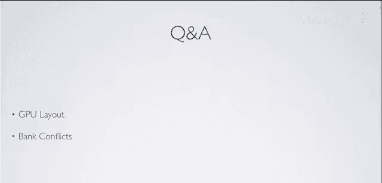

# 【OpenCL编程 RayiYanuTara】 p08 p7 Episode 5 - Questions and Answers -BV1X2BRYyEeM_p8-

Welcome to the fifth episode in the OpenC video series。

 My name is Dave Gahara and I am with Macresearch。org。

 as well as with the Center for Computal Biology at the Washington University School of Medicine in St。

 Louis in this episode we're going to do questions and answers only it'll be a really quick episode I've been really busy so I apologize and I haven't had much time to devote to putting these together some of them can take quite a bit of time to put together so my apologies in the delay in getting some of the questions answered as well as for delay and getting the next installment put together。

 but hopefully over the next couple weeks I'll be able to put together find some time to put together some more episodes and get those out。

As always， if there continue to be questions or you or other questions come up or things like that。

 feel free to send me an email and I will do my best to answer the question or post the question to the Macresearch。

org forums I monitor those as well obviously and so if it's something that people are asking a lot of。

 obviously I'll try and do it as a Q&A if it's just a one off or something very specific I'll usually just try to get back to via email but again things have been really hectic around here so if there are some delays I apologize for that before we get to the actual questions and answers。

 I want to just do a quick thank you once again to our hosting provider Macchus if you are looking for hosting services manage services I'd encourage you to check them out。

 they've been really great with us。

And you know especially with this sort of uptick in bandwidth and the number of the amount of just general traffic that's been going to the site it's really gone up in the last couple months and so they've really been doing a great job for us and we're really thankful so thank you very much and with that why don't we start with Q&A so。

Q&A is really simple， there are just two things。 One was there was a couple questions that came in about like GPUs and I think it was really the questions were really around terminology I think and so try to address that and just talk about like GPU layout on the current series of hardware or at least the hardware we talked about in the in the last episode and then also there was a question regarding bank conflicts and so as you'll recall in the last episode we were talking about memory access memory layout shared memory specifically and how to use it what constitutes efficient access or not and and then this concept of bank conflicts came up and towards the end I gave a very specific example about matrix transpos and you why you would get bank conflicts but I didn't really provide an actual detailed portion like representation of it so I'm going to try to do that here just sort of reformulate the matrix transpose。

In terms of why you would get bank conflicts under a very specific set of conditions and hopefully that will address the question that the person had。

And actually weren't there wasn't only one person there or there are actually multiple people who had this had this question。

 So hopefully this will address it for you know for all of you as and if if or if it's something that you just missed or just wasn't clicking or whatnot hopefully this this will make a lot more sense when when we're done。

 so that's what we'll talk about So starting with。

Terminology like GPU layout and things like that。 So what I did was I grabbed this portion。

 This is from an NviDious slide actually， from I think one of their standard slides。

 you'll see it quite frequently in their materials and and talks that NviDdia gives。 And so。

 but but I think its it's it's actually。Neat and clean enough that it that it。

It's easier to make the point with this and so this whole black area could be considered the let's say the GPU and in the10 series the GPU consists of 10 thread processing clusters so that's this sort of darker gray box each one of these gray boxes represents one thread processing cluster。

If we drill down a little bit and we look at this sort of lighter gray box there are three of these lighter gray boxes per thread processing cluster。

 these lighter gray boxes are our streaming multiprocessors okay so that's the next level of hierarchy in terms of the functional organization of the GPU so the black box is the GPU portion itself。

 the gray box， the dark gray box is the is a thread processing cluster going down next is the streaming multiprocessor and each thread processing cluster has three streaming multiprocessors。

 so in the 10 series architecture we have 30 SMs per GPU。Then when we drill down even further。

 we have these sort of little orange boxes that we were refer to。

 well actually depending on who you talk to， they might refer to it as something different。

 so these are either called cores more commonly they're called cores。

 but they can often be referred to as scalealar processors or streaming processors and this is I think where a lot of the confusion comes from because you hear this term core and it's really like know what are we talking about and the use of the word cores completely different than the use of the word core on a CPUU。

And I'll explain that a little bit more in a second。

 but each one of these orange boxes represents the next kind of functional or a functional unit on a streaming multiprocessor。

 each streaming multiprocessor has eight Sps or eight cores okay and。

Because there are eight per streaming multiprocessor， we have 30 streaming multiprocess。

 we have 240 cores， so when NviDdia says they have 240 cores。

 what they're referring to are the streaming processors now。What is this actual core。

 What does this core actually do， This core primarily does AL。And F。Okay。

 floating point is the floating point unit and the arithmetic unit okay and this is different than what we would refer to as a core on a CPU on a CPU when we're talking about a core we're talking about ALU FP。

 but we're also talking about vector units perhaps a memory controller caches of course all of that stuff would be on a core that is not what they're talking about when they're referring to as a core here and part of this may be marketing because 240 cores sounds a lot better than 30 and 30 sounds better than 10 so you can kind of see where this goes so but when they're talking about cores they're talking about these little orange blockss and this is where your floating point。

 single precision floating point and arithmetic is occurring now there are other units on other portions of hardware on these streaming multiprocessors that are shown here and that also aren't being shown here of。

Is the double precision unit， so in the latest series there's dedicated hardware for double precision arithmetic。

 there's one double precision unit per SM， which means we have 30 double precision units total。

And then each SMM also has two special function units。

 and so that means there's 60 special function units per chip。

you know per GPU and if you'll recall the special function units are things that do things like transcendentals reciprocal square roots。

 things like that so transcendentals being signed co-signed those kinds of operations but they're obviously being done in hardware so there's dedicated hardware for those kinds of things and then of course we have local memory which is our shared memory。

that's used for。Sharing information between threads and work work items work groups that are running on each of the core so hopefully that kind of clears things up but the important thing to keep in mind and to note is that the terminology that's used for CPUUs is not one to one with the terminology that's used for GPUs and I think that makes it a little bit confusing and specifically when we're talking about cores we're not talking about the same type of logical unit on the CPUU on the GPU as we are on the CPU so remember that a core is really is we're talking about ALU and FU on ALs and FUs on the streaming multiprocessors so hopefully that clears that up a little bit more and again if there's still more questions then I will I'll try and。

I'll try and explain this a little bit better still。

The next part is bank conflicts and local memory and so the previous episode was again was really dense。

 there was a lot of stuff but I think the part where people had the most questions with regards to bank conflicts and specifically a very specific kind of bank conflict and why it would constitute in the example I presented that the way you would read memory or access the memory the local memory would generate bank conflicts。

 I had stated it when I spoke about it that we would actually get bank conflicts。

 but I didn't give an example or show in a diagram why that would be and so I put together a slightly different diagram that will hopefully make it a little bit more clear。

 but let's just do a quick refresher with regards to local memory。

 local memory on current hardware is 16 kilobytes。That local memory is broken up into 16 banks。

 so each bank is effectively 1 kilobyte that means each entry in the banks is 32 bits wide。

 so4 bytes， which means that per，嗯。16 kilobyte block， we have 4096 entries。In total， okay？Now。

 the important thing to remember about these。Banks， okay， again， they're 1 kiloby in length。

 All right， but the the important thing to remember is that successive 32 B words are assigned to successive banks。

Okay， if。You can。Understand this concept and hopefully you will once we're done。

Once once we're done with this presentation， if you can understand this。

 then you'll understand why we're getting bank conflicts and why would get bank conflicts under certain circumstances and under other circumstances we wouldn't。

 Okay and the other important thing to remember here now is that whether we're reading or writing okay two or more simultaneous accesses to the same bank result in a serialization okay of the memory access in that serialization is what we refer to as a bank conflict with。

 of course， the one exception that is if all threads in a half warp access。

 the exact same bank All right， the same entry。That does not result in a bank conflict。

 and it has to do with what's called that bank is usually given what's called the broadcast word。

 and there's special handling for that situation， But all other situations where you might have two threads accessing one bank。

 let's say simultaneously， will that will be a result in a bank conflict if you had three or four or five threads accessing a single bank simultaneously Again。

 that's a bank conflict in that serialization only if every thread in a half warp is accessing the same bank simultaneously。

 Will you not get a bank conflict or， of course， if every thread is accessing them properly in each thread is accessing its own。

Is accessing an individual bank for those parts， go back and look at the previous podcast because there's some diagrams in there that I haven't included here that sort of make that portion very clear I think so so and hopefully all of that part was clear。

 but what I really want to address is why we would get bank conflicts in the matrix transpose example as it was presented last time。

 so we'll do that so recall in the matrix transpose example， we're talking about。

 you know I presented this picture of this field of sunflowers。And basically。

 we're doing a permutation along the diagonal。 So from a to C of the values。

 we're swapping indices values at the various indices。 So going from。Um。

 from landscape in this case to a more portrait type representation， you see that A and C， you know。

 the pixel， the values that would be here and here。Would all be the same， in fact。

 any pixel value along the diagonal here would remain the same。

 but that the elements set here are swaps， so B and D are now swapped in terms of where they're located of course。

 our axes and dimensions have changed。 I presented this in terms of a four。Unit half warp last time。

 and maybe that wasn't the best idea。 maybe maybe I should have done a little bit differently。

 but again， as a refresher， basically what we do is if we we read in each thread will read from global memory and write that to shared memory。

 Okay， these are all coalesced loads。And that also means because they're coalesced that we're not having。

Bank conflicts。 So we're doing a， there's a one to one correspondence。

 Every thread is reading from an address， writing it to an address in local memory。

 There's a one to one correspondence。 all of those rights are done to aligned locations。

 etc ce and so forth。 So that's all one to one。 Okay。

 then what would happen is when we want to actually do the transpose part。 Okay。

 this thread is going to read from this location。 The second thread or actually really thread1。

 So thread 0 is going to read from this location。 thread 1 is going to read from this location now。

Thread2 is going to read from this location and so on。 And we kind of do this。

 This actually is what would generate this， this read here。 Okay， a read or a right。

 but but in this case， a read will generate the bank conflict。 And the question is。

 why you would say， well， they're reading from a different bank。 And they're really not。

 And so I think that this gets sort of obfuscated in this the way this diagram is。

 So the next series of slides will hopefully clear that up。And then of course。

 once we've transposed it and the things are actually sort of contained。

 each thread has the data written to the output， the local memory output array then when they write they all write it's a coalesced right out out to global memory and so that's all okay it's really this read portion here in this example where we're going to get the bank conflicts and so why is that。

So what I've done is I've taken。The equivalent of one warp。 I've created one warp。 Remember。

 warp is 32 threads。 Okay， but on current hardware， we really deal with half warps。 Okay。

 so we're talking about 16 threads per half warp。 All right，16 threads，16 banks。 All right。

 each thread effectively wants to an ideal situation。

 Read from a single bank and write to a single bank。 Okay， now why would this matrix transpose。If。

 we were to do this， cause a bank conflict。 And so what I've done is I've labeled the banks on top of the actual。

嗯。Data。Okay， so if this is our data， let's say we have an array of 32 elements or whatever。

 and it's going from  zero to 31 okay， each element is four bytes wide。Okay。

 so a single precision float or an integer or 32 bit integer or something like that。

One warp would take us from 0 to 31。 one half warp is going to take us from 0 to 15。

 the second portion of the half warp is going to take us from 16 to 31， but。

0 to 15 is going to be assigned to banks0 through 15。When we read。From for this data of the half orp。

 okay 16 to 31， this will also be assigned to banks 0 through 15。 remember， we only have 16 banks。

 okay， and the each bank， each element。Is going to be assigned to a successive bank。

Each element is going to be assigned ideally to the bank。Whose offset is effectively modo。

 It's corresponding offset in the array。 Okay， ideally， All right， and when you're on。

 if it's aligned， which is what you really want it to be。

 that means that element 0 is going to correspond to bank 0，1 is going to correspond to1。

 et ce and so forth。 El 16， modo 16 is。0，17 modo 16 is1 and and so forth。

 So this is how they get assigned to each bank。 All right now。Why do we get a bank conflict？

 All right， so we've， we've written all this stuff into memory， Okay， so。

Element 0 is being serviced by Bank 0。 El 16 is being serviced by bank 0。Okay， that portion is okay。

 but when we want to read it， okay， we're now dealing with our half warp， okay。

 so only focus on the first 16 elements here， the half warp。When we want to。Do our matrix transpose。

 Okay， if it's 16 elements wide， let's say。This。Thread 0 is going to read from here。

 which this element is in bank 0。 That's fine。 That's not a problem。Thread number one。Okay。

 which is the one that has element number one。 Okay， is going want to read the 16th。Element。

I'm sorry， well， I guess the 17th element really， but it'll want to read number 16 here。ok。

The number 16 has been assigned to Bank zero。Okay， because of the way this memory and the way this data has been loaded into the local memory。

All right， so what that means is we now have and when they do this because half warps all do because remember every thread and a half orp moves in lock step。

 which means that this thread is going to read this at the exact same time this thread is going to read this。

 that means that we now have two threads。Running at the exact same time that are both trying to read separate pieces of data。

 But where those pieces of data have both been assigned to the exact same bank， the same bank I D 0。

 Okay， this is not allowed。 and because it's not allowed。

 what we end up with is a bank conflict or serialization。

 threadhread 0 is going to have to read it first， then thread 1 is going to have to read it second。

 and every time we do this， we end up with a 6 we end up with some kind of stall。

And so this is what's causing the bank conflict。 So how do we get around this， Now。

 I said it the last time， but I didn't really show it。

 And so the way people get around this is by padding their local data array。

 And you only have to really pad it by。One value。 So how does that work。So。Now。

 when we load data from global memory， which isn't shown here into shared memory， we load elements。

0 through 15 data elements，0 through 15 into banks 0 through 15。 Okay。

 but then we pad the local array by one element。 Okay， and we don't use that value。 We don't care。

 We don't care about that memory location。 We never use it。 We just assume that our memory。

 shared memory。Size， effectively is equal to for containing a half war worth of information is no longer 16。

 but now it's 17。 Okay， and what that means is that when we load when we。

 when we deal with the next piece of data， okay， it's going to be placed into local memory at an offset。

OkayWe're reading from local or from global memory， coalesc and aligned。

 but we're writing to the local memory unaligned， there's no penalty for that。 Okay。

 so basically what we do is we offset everything and we put in this sort of dummy。

Memory and we just leave it。 It's nothing。 There's nothing there。 It's just whatever， you know。

 it's just blank。 Okay， And then similarly， at the end of this one。

 there would be another blank entry， and it would just kind of go down the line。

 And so what does this get us， That means that。When we want to read。Okay。

 element0 is going to be serviced by bank0 element。16。Is going to be serviced by bank 1。

 So when we do the reads for the transpose， right， thread 0 is going to want to read this element。

 threadread 1 wants to read this value， but it's going to be reading it from。嗯。From bank1。Okay。

So now we've avoided the conflict， we don't have these two threads simultaneously accessing。This。

Element。Okay， and then if we were to go down， remember。

This one here is going to be so if we talk about thread number two okay thread ID number thread ID2 it's going to be reading there's going to be a blank value plus another one。

 which means it's going to be offset by yet another value and so each one of these will be reading successive elements and they won't all be serializing on the exact same bank okay so。

Hopefully that clears that up a little bit。 let me let me just go through this one more time just so that it's completely。

Or， you know， so that is that is more clear。 threadread 0 is going to be accessing element 0。

 El 0 is serviced by bank 0。 threadread 1 is going to be accessing element 16。 Okay。

 El 16 because of this padding is now shifted by one。

 So element 6 number 16 is really being serviced by bank1， okay。If we go down the line。

 thread number two wants to read element number， it's actually not going to be 16。

 it's going to be value number 32， which is will be ultimately serviced by bank 2 and so forth down the line。

 so each one of these is offset by one。And that's what gets us all the performance。

 If we were to go back here， actually， to this one and we were to continue with the same sort of model。

 like， like I just did， remember that this is going to read this element。

 which is serviced by bank 0。 This one is going to read element 16， which is service by bank 0。

 This one is going to read element 32， which will be serviced by the next bank 0。 Okay。

 this is a 16 way。嗯。This is a 16 way， read。On the same bank。

 But it's a 16 way read on the same bank for different data。 Okay， if they were， again。

 if they were all reading the same data， if this thread was trying to read this zero value。

 which is serviced by bank 0。 This one was trying to read this zero value serviced by bank 0。

 This one was trying to read this， et cetera。 you know， all the way down the line for the half warp。

 then that would not result in a bank conflict， again， that's a broadcast and that's allowed。

 in this case， this is different because they're reading different elements that are all being serviced by the same bank and that has to be serialized。

 Okay， so when we go down here， by adding in this padding。To the very to the success of groups。

 we've now shifted everything by one for each thread， and we've avoided the bank conflicts。

 So hopefully that makes things a lot more clear。 If not。

 then I will still try and find a way to to redo this。 But think about a little bit more。

 The key thing here to remember is that we're reading different elements。

That are being serviced by the same banks in the case of the bank。

 And that's what's causing the bank conflicts。 And so we need to shift the things a little bit so that we're reading。

Different elements that are being serviced by different banks。

 This is how we force them to be to be different banks。 If again， you know。

 we were just doing a one to one read。 that is this guy was reading this guy。

 this guy was reading this guy， this guy was reading this guy。 There would be no bank conflicts。

 Each one is is accessing a successive element， which means there's accessing a successive bank。

 There's no problems there， okay。The problem really comes up in this specific example for the matrix transpose because we're accessing at an offset equal to the bank size。

 which is also equal to our half orb size。So hopefully that makes a lot more sense and there'll be cases where you're going to find that you may need to pad or you may not need to pad if you can access data in。

Sequentialally， that is you can always access thread zero is always serviced by bank zero thread1 is always serviced by Bank1 it you know down the line of a half warp。

 then you're never going to have to deal with these kinds of issues this is a very special case because we have to then do large strides we have to do strides of 16 into these various locations and these strides are modo the actual bank size and so this is what's causing the problem okay so hopefully that makes more sense if not let me know and will go over it again or'll find another way to sort of present this or give you know and even sort of more indepth example。

And so obviously with that I'd like to just point out a few couple things real quick。

 all of this information obviously is available at Macresearch。org/opencl。

 all of the video podcasts are up there， there are some other great stuff on the website。

 I'd encourage you to check it out coco for scientists by Jer McCormack。

 he's got a great great series that he's been putting together on how to use if you're on the Mac and you want to learn how to。

Right right coco applications， great programming series he recently also did cover some things with GCD Grand Central dispatch。

 how to use it， how to begin using it blocks， things like that so I would encourage you to check out those posts Also if you're thinking of buying snow leopard buying you know some various other things we do have an Amazon store anything you purchase through there we get a little bit back on and the prices are the same as if you buy it through the straight Amazon store through our affiliate store's there's no difference so you'd be helping us out quite a bit。

So if you can do that， that would be great and then also I want to point out that NVDI also has some online seminar series。

 they do these things live。😊，As webinars， I guess is what they're calling them。

 but they also after they're done， they post the videos and I think they may post slides。

 but definitely the videos you can also see the videos and so they have a lot of great stuff up there also just general like using couda GPU programming in general。

 openC things like that so I would encourage you to check that out the URL is up here as well so check that out and we'll see you next time hopefully next time we'll talk about we'll actually do a real-word example I promise I've been saying this forever but next time I'm hoping we're gonna to do a real- worldorld example that will bring everything together where we'll be looking at kernels。

 we'll be looking at the kernel how to optimize the kernel how to take advantage of local and shared memory padding。

 things like that and hopefully then all of this will gel completely and you'll have something that you can actually work with and play with to。

对。Really， really start hopefully understanding this if you're still having some problems。

 so if you're still having problems understanding this。 So with that。

 I'd like to end this and I will see。