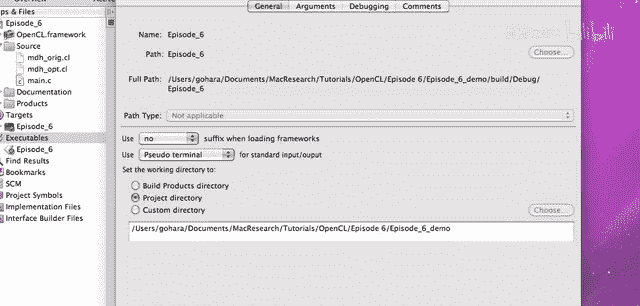
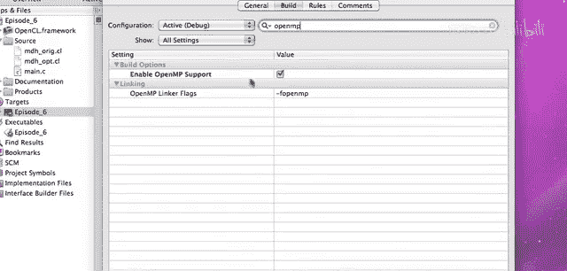
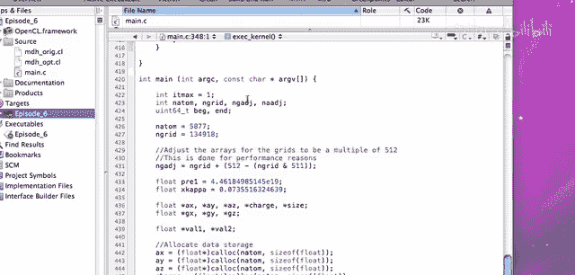
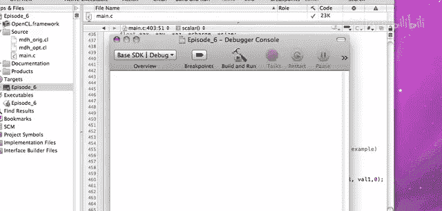

# 【OpenCL编程 RayiYanuTara】 p09 p8 Episode 6 - Shared Memory Kernel Optimization -BV1X2BRYyEeM_p9-

Welcome to the sixth episode of the Open C video series。 My name is Dave Gohara。

 and I'm with Macrearch。org， as well as with the Center for Computal Biology at the Washington University School of Medicine in St。

 Louis in this episode， we're going to talk about shared memory kernel optimizations。

 and really what that means is we're going to be sort of bringing home all of the concepts that we've talked about thus far in terms of shared memory。

 what it's used for how to take advantage of memory layout， things like that。 And so if you've。

Understood what we've talked about in that regard so far。

 then this should be a very simple extension of that and kind of give you an example of how it's actually used in practice。

 if you're still having some troubles with the concepts。

 hopefully this will help solidify them in your mind by actually looking at an example and seeing how it makes a difference and that in fact it can using shared memory can in fact make a big difference in the efficiency with which calculations can run。

I'd like to then also want to point out， of course， that if there are any questions or comments。

 feel free to either post them to the Macresearch。org forums or by emailing me。

 my email address is up here on screen and letting me know I'll either answer the question directly or I'll try and address it in a future podcast if it's something that a lot of people are asking about。

And so with that I'd like to just do some quick housekeeping once again I'd really like to thank Macchus。

 our hosting provider for really giving us some great service and for really doing a fantastic job for us if you're looking for applicationhostingmanage services。

 they're a great group of guys to deal with their services has been phenomenal。

 they've really been a pleasure to work with us to work with and we appreciate them working with us and we appreciate their support that they've given to Macresearch。

org so thanks again guys。Since we had the last podcast was all Q&A there's really no Q&A this time。

 so let's just get to it in this podcast we're again we're going to do you're going to be able to download an Xcode project that's derived from some real worldorl code that code example comes from a program called APBS which I work on in my day job and it's used primarily to understand the electrostatic properties of biological biologically relevant molecules and the reason why this is important is for a number of things but for understanding say protein ligand interactions drug design understanding how therapeutic compounds might interact with a molecule of interest in molecular dynamics as well。

 things like that and so。The code snippet that you're going to see here is derived from that code and so you'll see a real application in how we've used OpenCL to really increase the performance of one of our computations。

This。I is a really good example because the example actually uses shared memory to get a lot of performance。

 in fact it's a really good example first because it shows you that you can in many cases you can just take your code your C code if you have it and just move it over to the GPU and out of the box get some really great performance。

 but then it shows you how to take advantage of certain features of the hardware that really allow the code to shine and get a lot of performance performance that you otherwise wouldn't necessarily have access to and so。

With regards to shared memory， we're going to use this to take advantage of accessing the same read only kind of data over and over again and shared memory allows us to speed up that process quite a bit。

 but then this example is also good because it also highlights the use of synchronization points and how you communicate between work items in a work group and how you coordinate all of their work and effort to do some really sort of amazing things and so this is this is I think I think a great example for all of these。

For bringing home all of these kinds of concepts。Now the calculation that we do is that we're going to talk about here is we do perform in the program a complex set of calculations that are broken up into into stages。

 we're really only going to look at one stage here and this is the boundary value setup up of the problem and so the problem that we're generally looking at in our case we're looking at biological molecules so we're really talking about atoms and we have to discretize our problem to a grid and how we deal with the grid points that are internal to the grid are different than how we deal with the grid points on the edge of the grid and not just the edge and the faces the boundary of the grid and those。

The way we treat。The calculation on the boundary of the grid is completely different than how we do it internally and so it's very important for us to a make sure that you know we're doing the calculation properly。

 but it's also very computationally expensive how we treat the values on the boundary and so we need to make sure that we're doing this as efficiently as possible now the calculation in this case。

 the way we do it is that for every grid point we're going to be calculating a value over all atoms in our model now I put atoms in quote in this because I don't want people to think that oh you know what we're talking about here is you know only relevant to this one particular case what we're talking about conceptually is applicable to all kinds of problems and so even if you don't deal with biological molecules but you deal with you know particle type problems or problems that you know can that are conceptually。

t of as you particles or even grids and things like that。

 then you know these kinds of concepts will be directly applicable and then of course in this calculation we're also going to show performance between the CPU and the GPU。

So what are we talking about initially here we have you know a typical molecule of you know small to medium size in this case this is from PDB2 aKG and it's the G quadrupplex from oxyricconnova so it's a solution structure that was determined of this。

Of this molecule and the details of the molecule itself aren't important what's important is that we have you know a bunch of atoms in this case and in setting up our boundary value problem we put these atoms you know into a grid and here I'm just showing the boundaries of the grid but we have you know a grid point here a grid point here。

 grid point here and we're going to need to calculate the contribution of all of these atoms to each and every grid point and there are a couple ways to do this kind of calculation on a serial machine。

You can either or actually i'm getting ahead of myself。

 we can either do this from a grid centric approach or from an atom centric approach now in the atom centric approach。

 what we're saying is that。This atom is going to you know。

Calculate the value for this grid point this atom is going to calculate the value for this grid point and then we're going to iterate over every atom。

B。And calculate the contributions to every grid point。

 so this guy would be calculating you know this grid point， then if there was another grid point。

 it would go on to that one and that one and then you know we do this now in a serial calculation。

 the atom centric approach works just fine there's no problems here because each atom is going to be accessing a grid point serially one after the other after the other in a parallel system this is a not so efficient approach because you can imagine that there will be times when this atom might be accessing this grid point but this atom may also be accessing this grid point and this guy might happen to be accessing it and so if they're accessing it modifying the value remember this is a rolling sum were calculating a summation on this grid point of the contribution of every atom to it that we end up with this guy might be overr the value that this guy just put there and so what this requires in a parallel environment is that we have to use either locks or reductions now on a CP。

Reductions can be relatively fast， as' a little bit of overhead to it。

 but doing a sum across an array， you know we can cash each of these values into their own array and whatnot。

 but that will come at a cost of increased memory。In the case of a lock on a CPU。

 locks are extremely expensive in a multi threaded environment。Well， they're expensive。

 certainly compared to the size of the calculation that we're doing and so we want to avoid them on a GPU we don't have access to locks and reductions are very inefficient to perform anyway。

 they're possible and I shouldn't say they're very inefficient but it's another kernel call and you can't easily do summations in current GPU hardware across a bunch of elements。

In data that's being you know stored in and out of the card。

 so this isn't necessarily the best approach the better approach is to do this from the gridcentric point of view because every grid point is going to is going to only be reading data and and the data we read is the X Yz position of the atom plus its charge in the size of the atom okay that's all read only data none of that data is getting modified during the course of the calculation the grid point value is getting modified but it just has to know it just needs to have a snapshot or a copy of what the values are for all of these now each grid point you might say well you know that's also bit of a problem but since。

It's read only what we're going to do is we're to see we're going to show you how on the GPU。

 grid points can work cooperatively to bring a bunch of data in。

So increase performance of doing that and then they can then access that data very very quickly。

 do the calculation that they need， and then they can work cooperatively again to bring additional data in and do this iteratively。

And so this is the approach that we're going to take the grid centric approach to this。 and again。

 the beauty of this is that doesn't require any locks and it doesn't require any reductions all the grid points when the calculation is complete will have been fully updated and we don't have to worry about one grid point stepping on the value the answer for another grid point because the value is each one of the grid points the value for them can be calculated independent of the other one and the reason for this will become apparent as you look at the code and so what is the actual code so we've taken our problem it's a three dimensionmenal problem but it's been linearized for simplicity and so basically it's very simple it's a double loop for every grid point we're then going to loop over every atom in our model and we're going to calculate an expanded version of coom's law so it's just basically from each grid point。

We're going to calculate a distance value and we're going to offset we're going to do a summation of every atom to that grid point that's it。

 this is a very， very simple calculation and so how do we take something like this from the CPU and move it over to the GP well conceptually this is very straightforward the core portion of our code is effectively the same and our grid iteration effectively becomes our Nd range and our Nd range is equal to the number of grid points so if we had 256 grid pointss。

 our Nd range would be 256。 it's that simple and so basically this is what the code in our kernel effectively becomes and so let's look at the kernel code。

In this case， our unopimized kernel code would be something like this。

 we've got a grid value based on our global ID We pull in the grid coordinates because remember're calculating a distance and we pull in the grid coordinates based on our grid I now we could calculate some of this stuff on the fly we have plenty of floating point machinery we could do that this way this is just done for simplicity again in some historical reasons and once we know that we are just doing our main loop over all of the atoms and then we store the value out once once we've done that so each work item okay invokes this kernel。

Okay， now hopefully what you can see is that there's an inefficiency here and。

The inefficiency comes with the fact that every kernel that would be executing。

 let's say we have a grid size of 16。 so half warp size， all right。

 every thread is going to be every work item， excuse me， is going to be executing at。

Aom zero at the exact same time。 Okay so that means that every thread is going to have to read in a value for serially is going to read in you know this。

 this value for AX A Y Z now they probably won't all read them in the hardware would probably detect that they're reading in the same value。

 it'll do the load once， and then they'll share it sort of among themselves。

 but you're then going to be serializing on all of the all of these loads。For X， Yz charge and size。

 you're going to serialize these when you jump from atom to atom to atom。

 so as I go from at 0 to at 1 to at 2， those are all going to be loads from global memory。

And each thread is going to have to wait to service that load okay or wait till that load is service before they can continue with the calculation。

 and so you either have to kick off a whole lot of threads and flood the pipeline so that you overcome these latency issues which you can do and this might be something you might want to play with in the code。

 or you have to find some sort of way to bring in this data in larger swaths do it cooperatively a bunch of a group of threads so that they can all access this data as quickly as possible。

 and so this is where the concept of shared memory comes into play。Okay。

 so shared memory basically what I've done for this calculation is I've allocated a shared a chunk of shared memory。

 okay， now remember that shared memory currently on current hardware you only have 16 kilobytes of shared memory per SM that means that all scalar processors。

 there's eight of them， eight cores on an SMM have to use that same block of shared memory。

So you don't inherently get access to the full 16 kB but then on top of that you want to remember that we don't deal with typically individual bytes of data we're dealing often with floats or things like that and so really what we get is some actual useful the number of elements that we can actually you know service might be less than that and so you have you have to keep this in mind when you're partitioning your problem and you're coming up with partition size is how how you go about setting this up but in this case what I've done is I've taken a shared memory block and I've allocated a block that's five times my local size and in the case of this example my local size is 64 elements okay so I have five times 64 times the size of float because I'm dealing with floating point data which is equal to 1280 bytes so I have a block of 1280 bytes that's going be used per work group。

Okay。And each work group is。Again， 64 elements wide， okay？

And this will make a little bit more sense in a couple slides， the sort of breakdown。

 but what I'm saying is that。And then what I do with that is I partition that into five groupings because remember I have my X data。

 which is all linear in memory， my Y data， which is all linear a stride of one in memory， Z data。

 my charge data and my size data I could have allocated five smaller shared memory blocks that's fine。

 This was just sort of easier just kind of makes the code a little bit more concise in terms of having to do all the setup and overhead。

 you know know what I have to allocate and things like that and variables and whatnot so this makes it a little bit simpler and then what I do is I use offsets to index into this data so。

We calculate a local ID now again， my work group is 64 elements。

 that means that every that means I have 64 work items in my work group okay。

 and each one of those is going to have a local ID between  zero and 63 inclusive okay。

And when I want to calculate the value。A value that it's going to need to read， okay。

 to load the data from global memory， okay？It's going to be calculated based on some kind of。

Local ID offset okay nows that's the initial positioning。

 the local ID we're going to use to index into global data and also to index into index into here at some point when we're copying the data in and then I'm gonna to have this other notion of offsets where I add a value to my local ID so when I want to get to my x data if I want to get to the first value of my x data。

 I add zero to it If I want to get to the first value of my y data。

 I take my local know I could take my local I or an I value or something like that and add l size to it。

 which is my local size， which is 64 if I want to get to my Z data I add in two times the L size three times the L size 4 times the L so I'm just calculating a bunch of offsets。

 This is all very straightforward stuff if you're familiar with taking a 2D array or something and then addressing it linearly this is the exact same concept That's what we're doing。

Here so basically this is how I've done it again， there are multiple ways to do this。

 you could do this， you can do it with an index， you can offset set it just by doing some point arithmetic ones in your kernel six or one half does and it doesn't matter what you do the compiler will probably。

End up producing the exact same thing anyway， so anyway。

 this is this is how the problem was sort of set up。 And so when we look at the optimized code。

 just that the inner loop， what we do is looks a little bit more complicated is a little bit more complicated。

 but it's not。It's not terribly difficult to sort of understand so the first thing is that we our loop has changed our loop structure has changed slightly instead of doing itating over every atom。

 we iterate over atoms plus equal to L size again this is equal to 64 so we're going to be iterating in groupings of 64 okay。

And the reason why this works is first we say if the atom plus we just have this security measure in here。

 if the atom plus our local size is greater than the total number of atoms that we have because there's no guarantee that the number of atoms we're going to have is going to be a multiple of our local size。

 then we just adjust the local size now I want to point out that there's actually in this code。

 there's a bug of sorts， there's a performance bug of sorts。

 and I'm going to leave it to the viewers to see if you guys can kind of figure out what it is and where it's going to crop up but see if you can figure out maybe I'll give the answer next time if I remember to。

 but there is something here in here， but see if you can figure it out。And so anyway。

 so we we just do this catch all just to make sure that everything's okay and then in the second sort of。

Grouping here what we do is we just make sure that the atom that we're dealing with。

 we want to make sure that it's less than you know the number， you know。

 when we add in our local I value that we're less than the number of atoms by and large this will be true。

 And so this is our copy operation and so basically what we're saying is。I am， let's say。

 work item zero in a work group， okay， I'm going to load the I at value。0 plus my offset。

 my offset is0， so I'm going to load in the x value0 and I'm going to store it into the shared position。

 I'm going to do the same thing for the yz charge in size。

 This is all going to effectively get stored into the equivalent of the zero position at each one of these places in shared memory okay and because our shared memory。

 the way we're breaking it up is a multiple of is a power of two or a multiple of a power of two。

 We don't have to worry about any misalignment or anything like that。

 everything will always be aligned in this case。So now what happens if I work item two， okay。

 I'm still going to load in i at zero， but plus。An offset of now two。

 and that's going to get stored into shared memory location 2 shared memory location 2 plus my Ls。

 So 66， two times ls， So 130， et cetera and so forth。 And so what you can see and you say， well。

 how is this any more efficient。 Remember the hardware is going to detect that all of these threads are simultaneously accessing data from global memory。

But they're accessing sequential addresses。 And so the hardware is going to say a what do I do in this case。

 Let me do a full。Let me do a full coalaleesced load into memory。 And then we're going to。

And then this is where we hit our first barrier。 so it's going to do these coalesce loads and it's going to hit a barrier Now you might say。

 well why is there barrier here， why do I need to have a barrier。

 So let's talk about that So I put together a slide now。

 remember we have 64 work items in our work group。And in this case， is equal to 64 elements。

Of floats， floating point values， okay， if our shared memory block was just 64。

Was was was of local size so we had 64 just for simplicity okay。

 remember a warp is equal to 32 elements， so if we wanted to service the loads all of the loads for shared memory okay。

Equal to this， the size of 64。 we'd have to break this into two warps。 Okay。

 two warps are going to have to do this。Calculation， because our work group size is equal to 64。

 All right， Now， what's going to happen， though， is that there's no guarantee that this warp。

Isn't going to continue doing its calculation before this warp has finished doing its load remember this warp is going to execute something on the scalar processor this one is going to have to is going to wait or is going to be delayed no two warps are going to execute at the the same instruction at the same time per se so they're going to be temporarily temporarily temporarily displaced。

By at least one instruction， Okay， but remember， we also don't service full warp。

 we service them as half warp。 so it gets a little bit more complicated。

 The first half warp is going to do its load from shared memory。

 The second half warp is then going to do its load from shared memory。 Okay。

 to service this warp and and it'll cascade up。 So basically what's going to happen is you're going to have four half warps that need to execute just to get 64 elements。

Just to get our 64 elements loaded for a single instruction。

 So let's say we're dealing with this line right here。 Okay。

 we're just doing this line here in all of this。 This is what has to happen just for that single load。

Okay， and so what would happen if this half warp continued。

 started continuing on with its calculation or was scheduled to continue on with its calculation before this half warp had finished even loading the shared memory that's going to be needed well the values are going to be wrong the answers you're going to get will be wrong and you can do this test you can you know try and comment out the barriers and see if you you know always get the right answer chances are you probably won't。

And so basically， what this does is our barrier becomes an implicit block here that says every work item in this work group。

 all 64 of them。Has to get to this step before any。

Work item in this work group can continue to the next stage。

 This is how we guarantee that all of the data we need has been loaded into shared memory。

 Once we know all of the data has been loaded into shared memory。

 then everything within the work group is free to continue。 So hopefully， that makes sense。

So once that happens， then we get to the point where we actually do our calculation and we just iterate over our local size again。

 this is 64， this is the exact same code except now， instead of reading the data from global memory。

 we're reading it from shared memory。Okay， so we're reading in a read only Adamom data from shared memory and we do this calculation now you might be saying。

 well wait a minute if all of these are going to be occurring in lockstep that is true。

 so every thread or every work item in a half warp。Um， or in a work group is going to every every。

 excuse me， every work item in a half warp is going to execute each one of these structures。

In lockstep。 now， you might be saying if they're all accessing this， is this not a example。

 would this not。Result in a bank conflict， they're all reading value0 and remember there is one exception to bank conflicts and that's in the case of a broadcast。

 remember if all threads are all work items in a work group are accessing the exact same element from shared the same location and shared memory。

 that is a broadcast and that does not count as a bank conflict so。

We avoid the bank conflicts and all of this we're just indexing in， we calculate our values。

 we do this over a loop and then we wait so now why do we have a barrier here Well again remember that。

Only。That remember that not all of the half warps that are going to be executing are going to be executing simultaneously the hardware is going to execute a bunch of them。

 and it's going to say， let me just do a context switch over to the other one for one reason or another。

 something might get stalled something it might be waiting on something I mean who knows why it might do it。

 but it's going to it's going to have to context which at some point。

 And so you can imagine that if the first half warp finishes or the first warp finishes and the second warp is still working on doing its calculation and it were to iterate back over into the loop。

 You can imagine that you'd get into this situation where the data in shared memory might start getting overwritten while the previous warp might be writing to it。

 So as another exercise， try commenting out this barrier。

 try commenting them both out and see kind of what happens just to get a feel for how barriers work and why they're necessary。

 Sometimes it'll make a difference， sometimes it won't。

What you don't want to have is that kind of variability so it's important that you understand this concept so really this is the code there's a little bit on top that's not shown here。

 but this is the core portion of the code and so what we're going to do is we're going to switch over to Xcode。

And we'll just do a walk through the project， we'll run the example and I'll point out a few things and that'll be it and then hopefully you'll have something to work with and that'll make things a lot better so why don't we switch over to Xcode。

And we will。And we'll do that part of the demo。

Okay， so here we are， we have our Xcode project and I just want to point out a couple quick things in the executable portion last time we had source code some people have problems running it and it seems like this was checked and say what you want is this radio button set to project directory if you do that it'll find the kernel and it will run properly from there the other thing that I want to point out is under the build settings for this currently set to 64 bit Intel so if you have a 32bit Intel CPUU then you'll want to obviously change that it might auto detectect it I'm not certain what would happen。

 I'm using LLVM GCC 4。2 Kang 1。0 doesn't support Openmp it seems so that's why I'm using this and you'll see where I'm using Openmp in a second and then but you could also use GCC4。

。Or if you don't really care about the Openmp at all， then you can use client 1。

0 and then I have openmp obviously turned on for openmp support。

 but that's basically it and then just regular optimizations I think were enabled to something like minus03 or something but it doesn't really matter。

For this well， I guess it does you still want know some optimizations turned on so that way we're getting a good measure of the scalar performance of the CPU code so。

With that said， let's just look at the actual and then over here of course we have openC。

 the openCL framework included， we have our C file and then we have two kernel files。

 I split this out into two kernel files。I had a valid reason for doing that initially but it turns out it wasn't really all that valid。

 but I was too lazy to put them back together so anyway this is what I've done so they're split out we have our original version and then the optimized version of the kernel file and let's look at main real quick so we have our atoms in our grid points now you'll note that I actually pad the number of grid points out to 512 y 512 well it turns out that our maximum work group size in openC is 512 work items and so。

Having it be a multiple at 512 is always safe in case you dynamically assign a work group size and you'll see how to do that actually in a second。

 but so you're always guaranteed to at least be padded whatever you need to be padded would be padded out to 512 in general just needs to be。

It's ideal for it to be a power of two or a power of or a multiple a power of two。Your total value。

 but you。Sorry excuse me， you want it to be a multiple of a power of two and or at the very least you want it to be a multiple of a warp size。

 which in this case 34 and if you're on ATI hardware the size of a wavefront which is 64 elements so I did 512 you know no harm no foul。

 I think that it should be fine， we allocate some memory。

 we generate some data I was going to include some actual atomic data， but。

It kind of balloons up the download and so it's not really worth it and the actual values that we get out of here are terribly important to be honest with you so we just generate some data and there's a function that just fills up these arrays with random numbers and then we do our calculation and so we start off with the scalar calculation on the CPU it's serial and then we do some timing with mock absolute time。

And print out the value， print out the time for that loop。

We do another version of the Scalar calculation， but at this time it's actually in parallel。

 we do using Openmp， print out the values， and then we do our two GPU calculations and an unopimized version and optimized version and then some cleanup。

Let's go up to the top of the file here。Again， just the general utility routines here。

 there's one that I've included that's not actually turned on in the example I'll show you where you can turn it on or how to turn it on and this is called device stats and this will actually print out a bunch of useful information about your devices so you know if you're running on the CPU if you're running on the GPU you can kind of call this function for a specific device and it will query the hardware and tell you exactly you know what it's capable of clock frequency。

 the device name， extensions that it may support etctera and so forth So you'll。

You might find that useful so i've included it here as well in our kernel this is similar to what we've done before we you know go and then if you want the device stats you can just comment out this line right there and then when the program runs it will。

It'll execute that and prono some information to the screen we load our program， we create a context。

 a command queue， we do a program， if there's a problem with the program。

 it'll print out a build log it'll print out build log anyway but the log may be empty but if something goes wrong during the building it'll print out and tell you this is how you can also query to see like if something goes wrong with your kernel file because remember the kernel is compiled at runtime so you don't get any of the。

wararnings that you would get like say Xcode gives you if you if you you know if there's a mistake in your actual code and so it's important initially when you're debugging kernels that you might want to print out the build log and this is how you can kind of query it and print out the information。

We create a kernel for the program called MDH and we allocate memory for what we need， including our。

Including our shared memory are I'm sorry， the memory that we're going to write data out to as well。

And all of this is， and then we do a C finish now again， you don't need the C finish。

 but we're actually timing these portions of the phases and so we have a C finish and then mock absolute。

Time calls to get to get that information and then we come in and we set up the actual kernel now here's the important thing is that we have a global work size which is equal to the number of adjusted grid points remember paded out to a multiple of 512 our local work size is 64 and remember that the global work size has to be evenly divisible by the local work size and then we have our shared size now remember if you go back and look at the if you look at the slides that it's five times the local work size times the size of float and so this is where we kind of specify what that is but we don't actually allocate any dedicated memory so you'll note up here that we actually allocate memory on the device and push it out there and do those kinds of things this actually gets allocated dynamically。

By the Jitt compiler and then on the device specifically。

 so you don't have to all you have to tell it is how much you want。

 you don't actually have to create it and pass in a handle like you have to do with with these other memory objects。

Now， the question in variable comes up， what do I make my local work group size or my work group size？

a lot of this again is trial and error now there's a way to find out based on your kernel and the device OpenCL can give you a recommendation back on what it thinks is a good work group size and the recommended size that it'll print out in this case on my system it prints out for my GTX285 it prints out a work group size for these kernels of 512 now what I've found is that if I actually use 512 a I can't really use it because there's not enough shared memory but then also again in the shared memory calculation but then there's also the issue of it actually it doesn't help the performance at all and so playing around with this I found 64 to work the best so that's kind of what I've stuck with in these examples but you can use this to you know maybe dynamically get some idea of what a good workgroup sizes you just move this up a little bit higher and then you could use this to set your local。

WorkS， for example， at runtime， so that would be one way to do it。

Then we go and we in queuee the kernel and we have our kernel with an N range of one passing in our global work size。

 our local work size， ItMax actually turns out to be one so we're only doing one iteration of this it takes long enough that we can get pretty reliable timings from it and we force the CL finish on the command queue and and then get some additional timings and then we also read back the data and then finally what we do is we print out information about how long it took to allocate in queue and then read the information and then we print the total values now we could run this on the CPUU in OpenCL and the GP you can do that as an experiment if you want for the CPUU code I'm actually running the original CPUU Scalar code and then I'm using Openmp just so you can kind of see an example of you know Openmp and compare and contrast how I would parallelize this kind of thing using Openmp。

 which actually just turns out to be this one line of code and openmp。

Or how we do it in OpenC now you might be saying well look at all this work I have to do for OpenCL and look what I have to do for Openmp。

 what you're going to find when we run this is that although on 16 CPUUs the performance is actually quite good compared to compared to the unoptimized GPU code it still doesn't compare to the optimized GPU code and so you know it definitely becomes worthwhile to pursue these things on GPUus until we get you know 30 to 64128 core type systems but even then GPUs maybe even further along so right now we have 16 cores that we're working with on this system and this is what we do and so anyway so this is basically the project and we can go ahead and run this。

And if we run the calculation， what's going to happen is， you know。

 so it generates its data then it's going to go and then do the calculation first on the。

First， the scalar calculation on the CPU and this takes 20 some oddseconds to run so you know it's going it's doing its thing it's running on a single CPUU right now and then it'll do 16 CPUs and then it'll do the unopimized GPU and then the optimized GPU and those happen really really fast so we'll wait and。

C， so 32 seconds。And you can see， you can see that from the output here。

 So it took 32 seconds on the CPU and actually it takes about 25 seconds。

 I think the screen capture software might be doing something。 I'm not certain， but。

But anyway we get a about 10x speed up on 16 CPUs relative to the 20 I'm using the 25 number because that's what I reliably get but compared to 32 it would be greater than 10x and then we look here at the original version of the function so again remember it came out with recommended size of 512 we can look at the time it took and these are values are in seconds so it took 8。

8 milliseconds to allocate and push all of that information to the device so pretty fast。Well。

 slow to a computer， but fast too human， and it took 1。4 milliseconds to actually read it back。

But to actually run the calculation， it took 1。2 seconds。

Maybe a little under you know two times slower than on 16 CPUUs。

 but it's on the order of 20 times faster than running on a single CPU so already there we're getting a huge performance increase over a single CPU so that's actually quite good and then also want to point out that the numbers that we're getting back for the accumulated values are identical so far so the total runtime for the GPU loop unopimized was 2。

32 seconds so it's actually if you compare to the CPU loop all the overhead and things like that we're getting you knows maybe it's not a win in this case or。

Again， depending on how you look， if you're in queuing a bunch of these kinds of things。

 it may end up you know the overhead diminishes and so it may end up being a win win this is why you want to print out these kinds of statistics now let's look at the optimized version of the kernel if we look at the optimized version of the kernel again recommended sizes 512 so that hasn't changed write and read times are you know close to the same these numbers will fluctuate a little bit but if you look at the runtime the runtime is 0。

125 seconds so 125 milliseconds to run the exact same kernel so it's 10 times faster than this。

And it's about 200 times faster than this guy， so that's a pretty big performance when we get the exact same answer again and。

It's， you know， it's it's really this is hopefully will show you and the only difference between this one and this one。

 of course， is the fact that in this case， the optimized case orre using our。Shared memory version。

 that's it。 This is the exact same code that was in the。That was in the in the presentation。

 So that's the only difference between these。 And so hopefully you can see that the。

That this you know using the GPU and optimizing your code for the GPU is really worthwhile。

 so with that sort of in the demo， you've got this code， you can download it。

 play around with it again I do want to point out one thing very。

 very important that if you have a system that only has one graphics card in it be very。

 very careful when you run these examples because what will appear to happen is that your system will appear may appear to freeze depending on how long it takes for this to run on your system okay so be very very careful。

 your system probably has not frozen， but remember graphics cards cannot be preemptively scheduled so there's no preemptive interruption on a graphics card so if it gets a whole bunch of stuff that it has to run and do it's going to go and do that and it's going to wait to service any other graphics request until those commands are done and so you may be sitting there and it'll be like you can't move your mouth。

or you might be able to move the mouse but windows aren't responding or things like that your system isn't frozen your graphics card is just busy so ideally you would have two graphics cards in your system okay but if you only have one what you may want to do is tune down these numbers。

Substantially just in case just to be on the safe side to get you know until you're comfortable with you know that it's executing and you get some feel for how long it's going to take for these various stages to run or you might want to just not run the GPU portion or something like that and you just look at the code or something like that but it's better to have two graphics card if you have like a MacBook Pro to graphics cards。

 you might want to set one one graphics card to be the one obviously that displays and then use the second graphics card for openC and basically what you'd have to do is pull for multiple devices instead of one whichever one opencl finds by default。

 perhaps even just switch over use that one for openC but then make sure you're actually viewing your screen with the other graphics card so both of the graphics cards and the newest MacBook pros and the dual MacBook pros dual GPU MacBook Pros are opencl capable ones faster than the other obviously。

嗯。Anyway， so that's where you would that's where you would do all that。

 So please do not email me and say， oh no， you know， you froze my system or something like that。

 It's not frozen， but the graphics card will have gotten consumed with instructions。

 and if it gets really kind of messed up or confused。

 you may have to force reboot So you really want to avoid that。

 Another way to do this is if it's running and the system does seem to get bogged down。

 you could probably you can still S into the system。

 And then you might be able to kill the process and then regain control over the regain control over the system。

 but again， try to avoid that as much as possible。 but you've been warned。

 So just be careful when you when you when you run this。 So anyway。

 that's that we'll switch back to the presentation， finish up and go from there。

 Okay so hopefully that made。That makes sense， you see you how the projects are set up。

 you see obviously the kernels， what's happening in the sort of various stages and you see the benefit of using shared memory in terms of performance。

 so I really， really hope that this makes things a lot more clear for people if they're having trouble with this conceptually and but if it doesn't certainly ask questions and will I'll try to address them and try and come up with other examples。

 but I think this will really sort of drive the concept home for a lot of people。

嗯。Finally， so what I'd like to end up with is again all of this information is available on Macresearch。

org you can download the other podcast if you haven't you can subscribe to this viaTunes。

 there's instructions on the website for how to get to this via iTunes we can get notifications that way there's an RsS feed et and so forth we have an Amazon store so we get a little bit of a small percentage back on any purchase you might make through Amazon if you buy it through our Amazon store if there's something that you want to get that's not up there and let me know we can will add it and you'd really be helping us out everything that you comes back and helps us cover costs and take care of things that that we couldn't do otherwise or not for profit of course so we don't have much revenue so anyway anything that you can via the Amazon store would be through our Amazon store would be great help to us it doesn't cost anymore if you buy it through our store directly through the Amazon store the only。

we get a little bit back so if you do that or if you have done it。

 thanks we really appreciate it and then finally again just a reminder you can go to the Chrons group website。

 they've got all of the they have the openCL spec up there。

 they've got a little cheat sheet card and then some other information about openCL。

Great great resource， great thing to go to so check it out and that's it we'll see you next time I'm not certain just yet what we'll talk about next time I'm still thinking about it。

 but if you have questions or suggestions for a podcast let me know and we'll try I'll try and see what I can do so until then have a great week couple weeks good day and I'll talk to you soon。

😊。