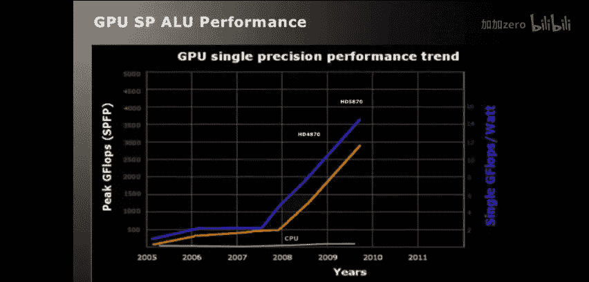
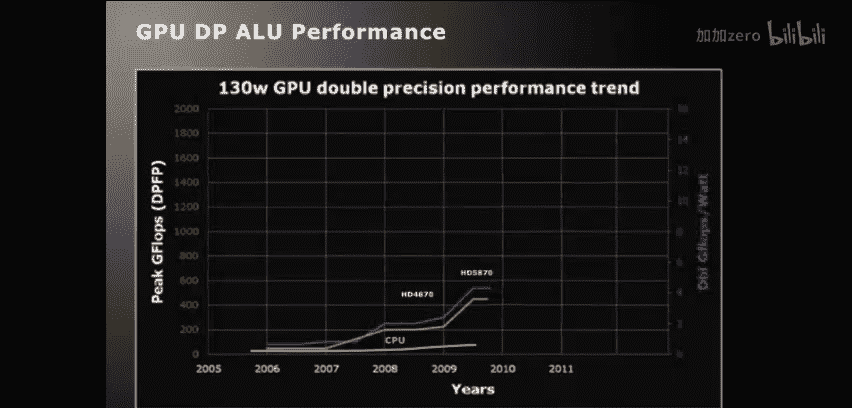
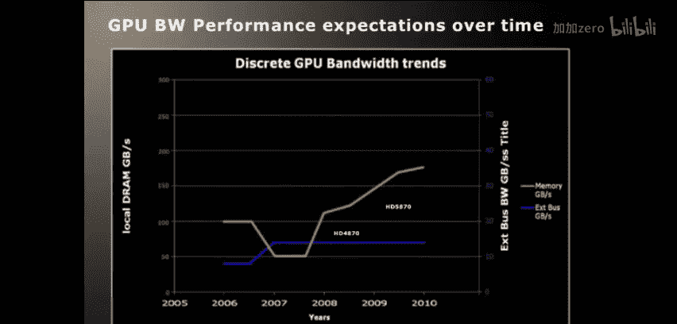
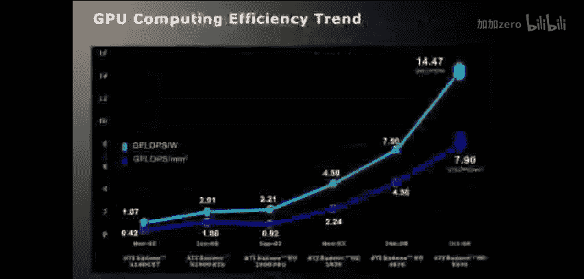
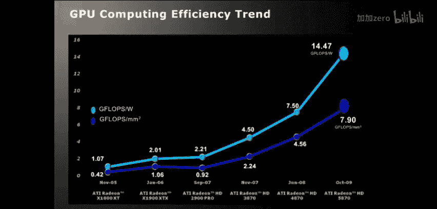
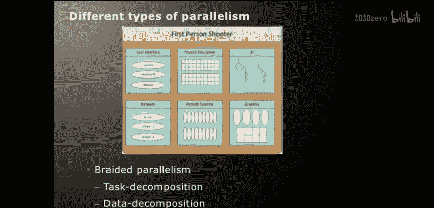
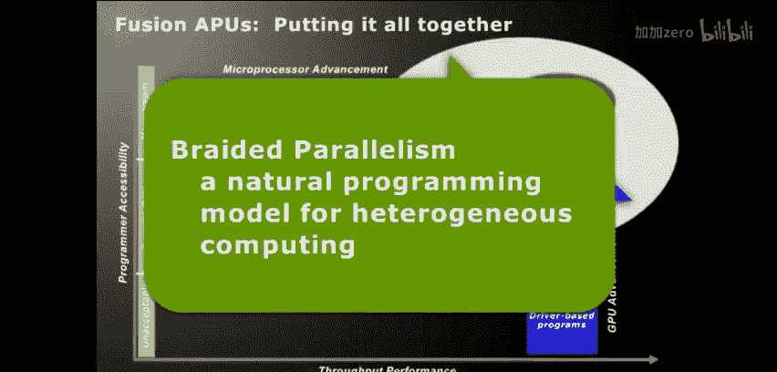

# 【OpenCL编程 RayiYanuTara】 p10 p9 1 - Introduction to Parallel and Heterogeneous Computing -BV1X2BRYyEeM_p10-

Hello， welcome to today's webcast。😊，My name is Brand， and I will be your event specialist today。

Following the presentation we'll have a question and answer session。

 you can ask questions at any time during the presentation， click the Ask a question button。

 type in your question in the open Are and click Ask Quetion to Subit。😊。

If you should need technical assistance， please type your inquiry into the tech support box on the left side of your screen and click the sendend button。

If you are disconnected from the webcast， you can log on again using the log instructions provided to you。

If you cannot log back on with these instructions， please call support at 866。2，7，1。759，2。

It is now my pleasure to turn the webcast over to your speaker， Benedict Gaster， Benedict。

 the floor is Shores。😊，Thank you。 So， I was kindly introduced。

 my name is Benedict Gasster and I am a architect。On the programming side。

 the kind of software side of programming models and things at Amd。 And in particular， my focus。

 certainly over the last three years since I joined M has been。GPGPU computing。

 particularly focused on the GPU。But。As we move toward merging our cause on to give run to a single die。

 which we call a fusion architecture。Overall， we are starting to look at programming models for the CPU。

 as well as the GP and combining those on what those mean。

you're joining the first of a webinar series which is focused around OpenCL。

 OpenCL is a low level programming model for programming。Particularly GPUus。

 but it's also one of the first GPGPU style programming models for CPU as well。

And we're going to have a number of those and I'll give you the timetable and the program the program for what will be coming up in the future a bit later。

 but what I wanted to talk about today was let's not dive straight into software。

 OpenC OpenC is just kind of one part of the ecosystem for parallel programming。

 and today I just wanted to give a little overview of what all that means for heterogeneous computing and in particular what it means for our fusion based architectures both the ones that will be coming out in the very near future yesterday we announced Lano。

Which is a really kind of medium arranged part for kind of networks and everything with GPU and CPU support。

 It's a very nice part。 And in the future， we'll be announcing much more forward looking and different types of architectures based on that notion of the GP and the CPU on the same piece of silicon so。

Moving to the next slide。So today I'm just going to give a little bit of motivation of kind of what we're trying to do and everything。

 and you know why heterogene we think heterogeneous computing is the future why it's important I'm going to stop every now and then do a little bit of terminology。

 but I will start at the beginning because I think there is，Often。

 lots of different meanings to the same names， given it， particularly in parallel。

 when we talk about parallel things， for example， parallelism and concurrency often come up。

 And what I have at my own set of definitions。 and I'm going to cover those。

 they may not be necessary。And。The ones everyone else has but just so we're all on the same page。

 everyone knows that and then I'm going to talk a little bit about hardware in a heterogeneous world and particularly obviously because I'm from MDD I'm going to focus on what we see that vision and I'm sure you'll hear from other vendors and other places their vision and sometimes they'll be overlap and sometimes there won't。

And then I'm going to just talk a little bit about software and Hegene as well and what that means you know for this things again I'm not going to dive down into the low levels of the programming languages today that's going to come on in openC and other parts of these webinars today I just want to give you an overview of kind of where AMD and particularly me this vision going over the next few years so I had a question is OpenC similar to the Kuda language and developed sorry let me just check。

For NVIdia， and absolutely OpenCO is very similar to Kudo。

 it's a GP GPU language which means it's a data parallel language designed to efficiently run on GPUs and they share many of the same characteristics。

And we'll talk more about that as the series goes on。So okay。

 so let's dive in so I'm sure everyone on this call or most people would have heard of you know there's an article very famous article by Herbs Sautter in 2005 and Dr Jobs that kind of talked about the free lunch being over and what he meant by that was that。

You know hardware and particularly vendors can no longer depend on increased clock speed。

 execution optimization， so for example instruction level parallelism。

 longer pipelines and those sorts of things and everything that have been going on。

 particularly in the 1990s and large caches you know， we just came up against a wall in the physics。

And you know， everyone talks about this slide and know， areas of this。

 so I'm not going to go into details of this，This is kind of where we're starting from， you know。

 I mean， obviously we' starting quite a while， this was 2005 I think many of us had already realized。

This was the case and the more interesting question now， kind of you know， the follow on from that。

 you know， what's the corollries from that statement or theorem that he put How is this？

How is this being addressed。You know， so the the。The key to it is parallelism that's you know lots of it you know what I mean by parallelism you know we're going to put more and more more cause down and these things can run independent things in parallel and that's you know that's the kind of crux of it I don't think this will come to any surprise I'm certainly not。

嗯。

In any way stating that I've come up with this idea or anything like that。

 you know it's an idea that's been around for quite a while。

 but I just wanted to make sure that we're all on the same page and where we're starting from。

So I think at that point。It's important then just to have a little stop on just cover a little bit of terminology about what we mean by these things because it's very easy to assume that everyone has the same definition that you're thinking。

 I often make that mistake and then realize I spent an hour explaining something to someone。And。Yeah。

 so I just got a question。I I't come back to the questions on OpenC on direct Comp。

 Someone asked the question in between the difference between OpenC and direct Comp。

 they're going actually to be covered in much more detail in the following webinars。

 and so I can come back to that at the end， but I won't go into that detail now。So definitions。

 so parallelism， know it's a property of computation where portions of the calculation are independent。

 which means that they can be you know for us， what we want to be able to do is execute those concurrently or at the same time。

 So， for example， here， we had this little set of assignments that were happening in ABCD are purely。

Independent of each other so they can all be executed or run them in parallel。

 You don't have to run them in parallel， but they can be an opportunity。

 So that means that hopefully， we could get to calculate the result for R。

Than if we executed them in a sequential order。 And I think that's an important thing about parallelism。

 parallelism is about performance。It's about trying to increase the performance of an application。

 So the overall time taken is shortened in some sense，Theyre find what that might mean。

And so this is in contrast。Are we come to the next slide？Yes， so this is in contrast to concurrency。

 And these two things are very strongly related。 Some people argue they're the same thing。

 but I'm not going to do that。 I think concurrency is， it's a logical programming abstraction。

And in particular， what it allows you to do is build up abstractions that。

It can communicate between to each other in a kind of way that could enable parallelism so for example。

 you could have two processes or threads running concurrently now if you only had one core。

 you'd have to swap one thread in， run it for a little bit and then swap the other thread back in and sort of if you just had two threads you know it doesn't inherently imply。

Sorry， I'll trying to do that。Is that better affect to make someone's asking a question about the microphone？

Now that doesn't inherently imply。🤢，that need they can be paralyzed or they should execute concurrently but they could do。

 so it does not preclude running tasks in parallel it's just the point is with concurrency and parallelism is that it's not a requirement for concurrency whereas parallelism you are indeed executing them。

In parallel and together at the same time， in some sense。Okay。Okay， so。

Definitions I wanted to get to heterogeneous computing。 What do we mean by that？ And so。

 heterogeneous computing is a system comprised of two or more compute engines with significant structural differences。

好。I can't get the microphone any further away。I'mSorry， is that any better？Yeah， it sounds good。Okay。

 but I'm getting lots of questions， people saying。Try to lower the mic boost。Yeah。

 I'm working with those people right now Okay， great， thank you。😊，Okay。As I say。

 a system of comprised of two or more complex compute engines and what we mean by most structural differences is that you know they are really quite different。

 know for example our GPUs today don't have the large caches that the CPUs have asked and CPUs today are designed very much for low latency accessing and this is part of the idea of having the caches where our GPUs are designed for massively high throughput of memory accesses of artists multithreading architecture。

 so they are quite distinct in their design and implementation。

 they obviously have similarities they both computers。

 chips and so forth and the executing instructions but at some level we see them different。

So that's how we see heterogeneous computing and infusion the idea is that we're going to bring two or more of these components and join them into a single unified hole and in particular in our case。

We're going to take one of our CPUs or many of our CPUs and or many of our GPs。

 And we're going to integrate those onto a single silicon dye for high performance and low power。

And there's other reasons as well， because obviously there could be costs involved at just combining one part rather than multiple parts。

Yeah。Okay。嗯。Moving on to the next part of the presentation。

 we're going to look at what the hardware in this hetero geniusous world might look like。

Yes。So the question has come up。 Does parallelism involve effort on part of the compiler to。诶。

Iolate instructions that do not create hazards we have write and so on and execute them in pipelines first Well that is one type of parallelism so that there is loop nest parallelism。

 for example， that can be achieved by compilers doing things which is called approach say for example。

 called strip mining where you might tile the loop to expose parts of the loop that can be executed independently。

 for example， across SSE or ABX style instructions。

So that is definitely one approach to achieving parallelism and doing that， but however。

 personally I'm actually a believer in explicit parallel program models and so you so whilst you can do it for some loops。

If the program has not been designed to be paralyzed。

 then it's very unlikely that you're going to be able to fully achieve that。

 and I'll come back to a little bit that in the later few slides when we get to them。Okay。

I'm getting a lot of questions， so I'll try to move on and I'll come back to some of them towards the end。

So actually the one about Fusion， CPUU and GPU Shed memory。

 I'm going to get to that in just one second， so I'll come to that。Why do we need CPUUs。

 we'll come to that。Okay， so an AMD is a balanced platform and one of the questions was why do we need a CPU。

 well I think the CPUs are very good at doing a low latency， know they have very large caches。

 the idea is to hide lowtency so that means that you can do very small pieces of work。

 maybe with lots of control flow and things like that very effectively on the CPU。

And so here you can see that we could do serial workloads or task parallel workload， I mean， yeah。

 task parallel workloads， and I'll come to what task parallel is in a little bit。

And of course you know there is a whole wealth of existing applications out there for the CPU and we can't just replace those。

 you know we have to be able to support the legacy and so you know if we came out of a chip that wasn't capable of running Windows and its legacy applications。

 then we would be a bit stuck getting forward， I think one of the reasons that GPU computing has been successful。

 particularly if you think about NVDdia and that motion of couder and things。

 then is because there was already a large market out there。

 so which they could tap into and they weren't trying to bring out something completely。咁疫边去。

I hope the post will be recorded， I'm sure it will be。So GPU， on the other hand。

 is an ideal place for parallel processing。 And in particular， it's very。

 very good at running data parallel processes today。 You know， and one of the。

 big problems with today's models of GPus and CPUs is that the CPU。

Is quite a long way in quotes from the GPU。 and it has to go via the PCIe bus。

 They're different memories。 So things have to be managed。

 and there's costs of managing those things。Which if you have them on the same die and they're sharing the same memory。

 which absolutely fusion parts for the CPU and the GP will have a shared memory。

 There will be a single unified memory， and。Then we can reduce the cost。

Of both producing them financially， but also the overall performance for a wide range of configurations and。

Okay I， you the reality is today you know that the single core era。

 you know the kind of Herbter thing where he said that was stopping to scale。

 you know it was certainly enabled Moore's law and other things and microarchitecture challenges and enhancements such as instruction and level parallelism helped to keep that going the problem was we came up with that the power just became too much you know we couldn't build the chips within a reasonable power envelope and the complexity of these things you know some of the microarchitectures that are under X86 or arm and other chips like that you know are very。

 very complex and become very difficult to build a very challenging verification you know often the teams of verification are much larger than the engineering teams and so on。

So then we slowly moved into the Multicore era and again this continued with Moore's law we started to reach for desire throughput and you know we had a lot of experienceer of S&P style architectures and software started to develop the problem came then was that again we was constrained by power we still had some limitations on software availability。

And the biggest issue， I probably would say， is the scalability。

 The problem is is that if you want to have coherent caches with four processors or even eight processor all communicating。

 that was one thing。 But if you then wanted to have a coherent cash， you had 64。

Processes communicated。 And that became a pretty difficult thing to build and had real issues with scalability。

And so as we see it， we're starting to move into the heterogeneous。嗯。Era。

 you know and we're just really right at the bottom of this you can see this at the little bullet point at the bottom again。

 Moore's law is enabled by this， there's lots of abundant data parallelism and GPUs are very power efficient you know there's lots of replication of units and they're not clocked nearly as high as something like the X8 to6 we know which ones at three or four gigahHtz whereas the GPUs are running probably a gigahHtz or less you know。

And the biggest issue today probably with the heterogeneous systems is the programming models you know that they're quite limited today。

 you know OpenCL is excellent， I think it's a great starting point but it's certainly not the finishing line and there are lots of the kind of things we'd like to be able to do on the CPU side of programming models and maybe move some of those to the GPGU programming model too the other thing of course is communication overheads I talked about the PCIE being a bottleneck and we need to start addressing those and of course fusion does start to do just that but I think I really want to make clear the whole point about this slide is that we are really right at the start of this era it is a new era that seems to be emerging and not just us you know Intel have their sandybridge parts。

And I'm sure Ar and others will be developing heterogeneous systems in this way that that's really going to move。

Into a new era of computers。So and you can see why on this。😡，Why the GPpU is important， I think that。

 this is the key thing。 You can see these lines here。 You can see the。

The gigabflps of single precision performance going on and on， know for us but with our latest GPU。

 actually our last generation of GPUs， 5870， that's up over two tariff flops of single precision performance。

And。We continue to improve that over time and at the bottom here you can see the CPU so now this is not a criticism among CPUU it's just an observation that you know the data parallel or design of the GPU it's very easy to kind of keep scaling that up and adding you know ALU units to get more single position performance now of course the drawback with that is that the wider and wider rid of these things come the more things you need to be able to find to execute at the same time you know if some of those are hidden within a bit of control flow and things like that then you don't necessarily always get to the peak performance。

And I really think that it' the combination of the CPU kind of start our workloads drawn in。

to a GPU execution of very wide data parallel tasks that will really bring out the best of an application。

So we can see double precision continues at a slightly lower rate but it still is still pretty high。

 you know so here we're just under 600 gigablops， you know and the NVIDO have a similar number here for us and you can see that double precision which is important for many applications continues to improve over time。

here we can start to see the nice thing about double precision is that if we do it against what。

 you can see that the amount of power for the same you know for the much bigger performance。

Is across here for the GP， for example， We're not as low as the CPU， but then we're over。

嗯。In nearly 600 times as much flops， for example。What double precision flos。

And you can see the bandwidth trends here we can see that discrete memory is continuing to bandwidth is so this is on a discrete GP your device where it has its own DDR5 memory and you can start to see that the memory bandwidth are still going up。

 but they're not increasing huge there is a difference between the number of flos that we're adding and the bandwidth width and the memory bandwidth that is increasing。

 but you can still see considerably high。Bandwi， at 150 gigabits per second compared to the CPU。

 which is probably around 40 gigabs。

The second one， I know high end CPUUs as well。And of course， unfortunately。

 the external bus gigaby does not increase， So that is one of the bigger issues that we face in the future。

Again， you can see the trends with gigab per when we start considering Giafopps per watt or gigabopps per square millire。

 where millimeter the GPU has a real kind of influence here and continues to improve。

Out of the generations。Okay， so。I really think that there is a need for a CPU。 some people ask。

 why can everything not be done on a GPU， and I just think that。

If we try to do all the workloads that you can do on the CPU today on the GPU。

 those's slides I've just showed you for power， for Giapflps。

 and those sorts of things won't look the same because we'd have to sacrifice some of the performance。

On those。Device on the GP device to add much larger caches said， for example。

 to start being able to handle much more complex control flow。And I'm not saying that at all。

 GPpus won't start to have some of those features because， of course， they will。

 know particularly once we start putting them onto the same silicon， which this slide is showing you。

 It's showing you that one。Onearrow we're moving from the unacceptable program accessibility of kind of GP GPU computing into mainstream computing。

 and here we're bringing the drivers up on the red line all of that to make it more。

Unified programming model。I'm a think。That。Is bringing the two together is kind of really where you'll get the key benefits。

 Don't necessarily add everything the CPU can do to the GP。 And equally。

 don't make the CPU into a giant GP。 know， we've lately the。

 because when we get the best of those worlds without necessarily sacrificing。

Those things from one another。Okay。Someone asked do you consider FPGAs or other hardware accelerators so I'm not going to talk about those directly at these things but of course they could well make up a H juniorni system you know that an FPGA is quite different from a GPU at least in some sense and how they're programmed is quite different and so I think they are an interesting area of development and research。

How they will appear in future systems is unclear to me。

 and I'm sure people who are more expert in FPTAs would have maybe more to say about that。

 I would certainly hope so。Okay， so why AmD Fusion As。

 And I think this is coming back to what I said before。 This is a balanced approach。 You know。

 X86 CPU owns a software universe。 So this is really another key reason why we can't just drop。TheCs。

 all right we could add the GPUs， make them handle all this stuff。

 but there would be a lot of silicon and would probably increase the power and the benefits that we get from GPUs today。

 So we still need to be able to support the Windows， the Linuxes， the many thousands of applications。

 some people I'm sure still run applications that were written in the 80s。and so forth。

 And I think on a more technical level of kind of， you know。

 we need to be able to handle very branchy scalar code。 Still， you know。

 it's not likely that all applications。Will suddenly emerge as a parallel application。

 from one thing I don't actually think that would be sensible because you know you only need to accelerate the hotspots in your program to get a good performance improvement you know。

 and some things just don't easily express。Well， as a parallel computation， for example。

 if you want to do it。A print statement followed by another print statement。

 they are inherently sequential。In execution。So there's always a time for kind of ordering in that way。

 I think。So I'll try and announce a couple of questions before moving on。

 And just let me just skip to the other of here。 The GPpU is the game changer。 You know。

 I kind of think that theres certainly。YouI'm not really I'm proposing that you know the GPU is the best thing in sizefr and is solving all the problems。

 it's just it adds a level of parallelism and throughput that the CPU does not have today so adding them together all of a sudden you know you get this kind of really kind of significant future you know and it becomes much more programmable and these potentially much more power programmable that we've increased the flops considerably without actually ramming up the amount of power we're consuming。

And you could argue that know we're now providing with the best of both wells， you know。

 that's kind of， you know， I mean， obviously I put that with a pinch of salt because you know nothing comes completely to three。

So is's the idea behind fusion related to systems in the chips？In any way， absolutely。

 fusion is an SOC， so it is a system on a chip， but it is very closely coupled with that idea。

 that we are bringing multiple types of devices into a single chip and integrating them together。

And as I'm just going to try and answer a few questions。

 I I promise to answer all of them at this time。So I saw one of my favorite topics。

 do you expect pure functional programming languages， HaS skill， ML， et cetera。

 to be key to enabling heterogeneous computing？Now that's an interesting question。

 I don't completely see that， I think that those languages have already massively influenced existing languages。

 for example， I see much of that is in CSF has come from the functional programming world。

 for example， they call it delegates and Hakell call it Lambda functions and CSp and see of course C++ is going to have Lambdas。

So absolutely， do I think that Hakell is going to become mainstream in programming language。

 I probably not。No， do I think that elements of it will make it into other languages， absolutelyute。

 And those languages will become mainstream， definitely。 And as's true as M now。

And all those other languages as well。Okay， I'll answer one more question and then move on what will happen if you use GPU to handle CPUUs tasks or so how do we know a task can be paralyzed？

Well， that last one is pretty tricky and I can't cover that in details today。Do I I think。

 So I think today， if you use GPus to handle CPU tasks， you'll be running at a very low efficiency。

 So， you know， for example， we're 64 wide vector machine on our GPus today。

 If you're running a single scalar threat， then you're just running。

One of those so you're losing 164th of the GPU。 And that's not to mention that we have 2020 of those units replicate replicated。

So I think that's a big issue。 The other issue is， of course。

 that we can't handle all of the CPU tasks， for example， we don't have。

Preemption on the GPU and things like that。 So there are some things that we don't today support。

 I'm not saying we'll never support those because I think we probably will。

 but but today we don't support those。Okay， I'm going to move on because I haven't got that long。

Okay， so this will give you an idea of what the first generation of our。

Fsion devices will look like and not this slide but the next slide will so today this is what PC looks like with a discrete GPU you have the CPUU。

 you know many core CPUU via the North bridge it talks to the discrete GPU via PCIE the discrete GPU has its own graphics memory and the CPU has its own system these memories are completely distinct。

 they have no relationship other than they're on the same machine they are no way synchronize together the only way to move data through and forward is to use explicit memory transfer operations you DMs or whatever。

And then we move to the fusion APU based PC so this I want to be clear about this whilst I can't talk about our later fusion GPUs this is really a first step to where we're going so for example you know you'll still see this kind of Northbridge bus kind of in here I'm not going to talk about quite what happens to that but you can imagine what could happen to it I think the key thing here is that the fusion GPU is moved inside the single divers little green faded box is a single。

piece of silicon， and they're talking directly together。 So all of a sudden。

 we've massively increased the amount of memory bandwidth between the CPU and the GP together where we' no longer have to communicate via the PCcie。

 Of course， we can still have discrete GPpus attached to this。But that's not the goal。Again。

 you can see that attached to this green box is the system memory。

 so now the fusion GPU and the CPU are sharing the same system memory and again so we're starting to merge those together。

And yes， it is true that it's 12 gigabytes both ways。

 but it's often the case that you can't run both those channels。

July because of the way that the GP will be worked up。

 it means that you'll have to be reading and writing so you have to double buffer things。

 so it's not to say that's not completely doable， I completely agree that that is doable。

 but again that's putting another layer of complexity onto the programming model and the programs that are done。

So some asked the latency of fusion versus PCIE latency， so the latency of a fusion part is。

 I don't know， I can't remember the exact numbers， but it's much。

 much lower than it is on PCIE latency。And of course we don't have the set up。

 there's a lot of other things that you can factor into here I just giving the kind of broad numbers for the actual feasible peak performance that you could get。

But I think the important thing to think about with these the Fusion GPpUs is that in the end。对啊。

They're really enabling a much simpler programming model you know so it's absolutely not necessarily giving everything away to getting that maximum maximum performance。

 but again you're getting pretty close peak performance whilst being able to simplify the program model。

 for example， in the future you can imagine that you might be able to just dereference an X86 pointer on the GPU So all of a sudden you can just pass around your data structures and everything and there's no way that's going to happen easily on the discrete GPU。

Yeah， so someone's asked you have 150 gigabytes only on 20 gigabytes for actual memory bandwidth so 150 on the discrete parts and 20 gigabytes for action memory bandwidth on the fusion APUs and that's absolutely the case for this particular fusion APU that I'm showing you so this is a middle to low end part that I'm showing you I can't talk about the high end parts but hopefully you can extrapolate from that between those two numbers and start to think about how they might relate and where we might be getting to with a fusion GPU high end fusion GPU we just haven't announced that and today I can't talk about those things。

Okay， so I run be wrong because I do't have quite a lot of slides I'm not that long。

 So unparalleled processing capabilities in mobile form factor。

 you know with shared memory for CPU and GPU eliminates a number of copies。

 So even though we've reduced amount of memory bandwidth on these smaller parts compared to the discrete parts。

 you can actually think that in reality， a lot of the。

And we're not necessarily throughput on the GP itself。

 but transfers between the CPU and the GPU and going back and so we've kind of improved the performance there。

 even on the lower end parts。They get a performance that benefit。And of course。

 we've enabled architectural innovations， between the GPU and the CPU。 a lot of that still going on。

 We haven't made any of that public yet。 these parts are just the first step in that。

And the key thing is that we're starting to build a scalable architecture that can be a broad range of platforms。

From mobile to data center。 And really， you know， these first if you use adjust just this kind of。

We're touching the very tiniest bit of the iceberg that it's going to become and again。Okay。

 so I'll answer one more question before moving on。 previously。

 you made the point the GPU memory bandwidth has been increasing to keep pace with the gearofflps。

 How is this overcomecom in the fusion GPU or is that not important， It is absolutely important and。

Okay， so I'll answer this question then I've got to hold on， okay。So the reason being is that。

 So this is。It is very important and the first generation of the APUs probably don't resolve this problem completely。

 They resolve the problem of the PCI bandwidth that and increase that。

 But what they don't do is and the latency in particular。

 But what they don't do is they don't necessarily completely resolve the gigabflps per。

Memory bandwidth， however， the GP itself is a much smaller part。

 And so it doesn't have quite the number of the gigabops that I showed you are the high end parts originally。

 So the trade off is actually smaller。 And so it's not that is not important。

 It's actually the impact is not quite as much。I don I do need to move on。

 so I'll get back to questions at the end。So I think the key question is that heterogeneous systems are being built and there is no question that they will be built more and more of them。

😡，The question becomes is that。How do we program them we know there's enough workloads to utilize these things but we' just you know programming 10 core is complicated enough。

 but what happens if we have to program  a0 core， maybe even more than a thousand0， you know。

 I really believe that the future of performance is entirely about software。

He it's entirely about how we're going to program these things。And。

There's a couple of slide slides here that talk about where you can find out more about this stuff and one of them is at the Fusion Development Summit。

 which we just announced and will be in June the 13th to the 16th in 2011。

 you can find more about that online。And the OpenCL webinar series itself is designed to help you advance your experience in parallel programming。

 but particularly focus today on OpenCL， I expect over time。

 we'll have more webinar series which will be more targeted at CPUU and GPU programming。And again。

 you can find more information about this webinar series online。

So getting into the final section of the talk was softwareware in a heterogeneous world。

you know what lies ahead so from a talk the guy still gave in 2009 guy still is from the Java community and scheme and other places。

 but in petition he says the future is parallel， what's the program they going to do？You know。

And so I think this is a million dollar question， you know and it does have many。

 many different answers， you know here's just some of them I can go on and on and on and on and on and on。

 you know and we keep going and going and this is just some of my favorite languages by no means theyre all of the things that are out there today so all of the green ones。

I kind of you could argue that they are parallel programming models， you know。

 Poss and132 are very kind of coarse grain thread APIs while something like concurrent ML is all about abstraction。

 not necessarily running things in parallel。And then Microsoft's task Para library is about breaking things down into nice tasks of work。

 which could be offloaded to different calls for execution。

And these kind of bring me to my two orange boxes where I want to like talk a little bit about task parallelism and date the parallelism。

 so these aret programming languages they're more about methodologies and the kind of I think are the key to any success。

So an application I've just taken what I consider to be a kind of course look at a first person shoot them up and you can see that there are many different types of parallelism in such an application。

 you know here we have the AI was very much tasked our parallelism。

 we have these two things doing physics systems and particle systems in the middle which are very much data independent data parallel systems and so on we can have things for user interfaces。

 maybe some cloud stuff by the network。So you know。

 a term that comes from Nafana Intel is this notion of braided parallelism。

 most applications that we're going to want to accelerate in the future are kind of decomposition of task。

And data decompositions， know， and you could see this from this application。these conversations。

 the idea is that we divide the problem by type of task to be done， for example， in a game。

You know we can have many tasks and jobs， some maybe fine grains I very shortrun others might be long running and very data parallel for example as we saw for the particle systems you know and so if you're building or using a programming language a model based on tasking you know you need to be able to have dependencies between task I run one task get the result and pass it on to another task you need to possibly communicate between tasks。

 you're probably going to want to make sure that if one core or one part of the system is not doing something then let's get give it some work and get that busy and it's often called low balancing and so on and so on these are kind of the major factors that you'll find in any kind of tasks。

Based one time。And most of these systems are based on a notion of low balancing。

 which comes from some seminal work in the 1990s by people at MIT on a language called Silk and the idea here is that you know。

You're going to want to have these are your core。 They' sorry the little boxes。

 the side faces are core and the green faces are happy because they've got lots of work。

 which are these blue boxes。 And， of course， the idea is， is that， you know。

 you're going to distribute some work。It's generally done by this kind of workt。

 So For has stolen some work from the others。So I think this will come up time and time again in task based。

and programming models and probably is what will happen I need to move on there are lots of examples。

 most of them today are all for the CPU you know so as Intel said building blocks。

Apple's Grand Central dispatch。OpenM has a tasking。

 Openmp3 I'm not a fond of tacking on parallelism it comes back to my belief that programs need to be explicitly paralyzed using constructs that are part of the language。

 that's not to say you shouldn't use Openmp I'm just saying that I'm not a big fan of it and then from the managed language perspective I think the most prominent one to date is the Microsoft's recent。

net for runtime which supports this task parallel library all of it。Languages， you know。

 C sharp or F sharp and so on。One of the big things today there are choices about whether you have a different OS。

 so for example if you're using Apple， then the Grand Central dispatch might be the right choice and there are different options。

'm going to move quickly on。おた。Okay， so data decomposition so this differs from task decomposition is the idea that you have many elements and they are independent and they're going to be worked on together in parallel。

So we talked about that in a modern game， this could be a particle system， thousands。

 maybe hundreds of thousands of millions of independent little sparks in a fireworks system that are just independently reacting to forces and so forth applied to them。

Obviously you might want to be able to group some of those together and so in a real implementation of data power execution might account for some local communication。

 so for example you might have a little customer。Cluster of particles flying around the system which are communicating with each other。

🤧You need to be able to synchronize those kind of communications and so on。

So they share a lot in common with task parallel law systems。

 except that they are really executing independence。

Pieces of work There are popular languages and so today we'll get to the unmanaged kind of C star stuff then I think the two most prominent ones today for these are probably Chronos opencomp language OpenCL which we're going to talk about in a future in future seminars and you can notice that this is probably the only one that really has CPU and GPU at least in the unmanaged support the1vis Quda which is obviously for GPUs only and then there's openmp certainly has a lot of data parallel is written designed for data parallelism again that CPUU only managed languages we're starting to see different things emerge a Microsoft accelerator I think is an interesting thing fornet4。

There they do support both the CPUU and the GPU。And more recently， MDDs a parel API for JavaA。

 which is basically a high level。APpiI within Java that can target OpenCL， CPU and GPU。Again。

 you're running into different OS and different options。Okay， so let's move on。So。

I think that in the end， that is there going to be a combination of these two things that become the emerging programming model of the future。

 You know， it's not just going to be one。 I think that know this is a job graph on the right hand side is supposed to be very small。

 It's a very large job graph from a single scene in Dce's Bafieldll bag company too。

 And you can see if you can see here， there's the little ones that are all running alongside at the bottom here next to each other horizontally。

 then they are all data parallel operations whilst all the little line。

 the edges in the graph are describing task dependencies between one another。

 And you can see up here there are more。Data parallel execution。 So really。

 I think that the future is a combination of these two things。 And again。

 it's not a coin the eye term， but braed parallelism seems to be a nice term for this。So。Again。

 we can put this all back together， so I'm again bringing through a slide that we talked about in the hardware section of things。

 you can see the MDD's fusion APU， you know how we're going to lift this stuff to the mainstream。

 to make this a programming model that not just experts。Can use I mean openCL is not too difficult。

 but I think that it's probably not， you know it's going to be a little bit of a shock if you're a Javava a programmer or if you're a C sharpp programmer for example。

 and why would you want to step outside of those languages is that's where your day job is you know I'm not saying you should never do those things but if we want to bring parallelism to the mainstream I think that we need to merge these different these models and that kind of brings me I think braed parallelism is a natural programming model for heterogeneous computing。

And so combining things like OpenCL with PPBB are kind of a strong ways of moving that forward and making a strong approach。

The future。So。I'm sorry resting。Those last few slides a little bit， but I have just made it in time。

And。I'm now going to take some questions。And answer questions。

So there are a lot of questions I'll kind of just work up from the bottom。For that。

Can I just ask the operator， can everyone see the questions when I select them or do I need to read them out？

 No， you need to read them ala。Okay。Okay so this is a long question so OpenCL is driven by GPUs。

 how does that programming model fit to the CPUUs， does it make sense to use OpenCL for programming CPUUs。

 or in other words as a software developer I would prefer programming language in which I can describe solutions to my problems and a kind of enhanced compiler that maps my solution to HeG hardware。

So。That long that's a quite complicated answer， I think to this absolutely I think that OpenCL can be used to program CPUUs Now the question comes do I believe that the same openCL kernel which is the unit of function that gets executed on either the CPUO or to GPU devices can be written easily for the CPUO to GPU No I don't think that's possible today today。

You really， you have source language portability， but you don't have performance Portability。

 The problem is， is that for the GPpU， for example。

 it makes sense for me to have reasonably large number of。

Threads or what openC calls work items running in parallel on a single compute unit on a CPU。

 you're really just having one you know thread I'm going to call it a work item as openC calls and running on a particular core is more effective。

 that， of course will then influence the way that you design your program and your algorithm。

And so today that' certainly， I don't think OpenCL provides the answers to that。

I think that future generations of open CL。Are being developed that will provide features that make that much more easier for portability。

 for example， container types， so for example， something like a vector type from the superT standard STL。

 that would be useful because if you had routines that could then underneath be compiled using a special compiler to either a GPU or the CPUU that would hide away some of those idiosyncrasies from the developer。

So I do think that。Enhanceed compilers that will map solutions to different parts of the systems will play a part。

Okay， so。So there's a lot of people have asked，Will does presentation be available for downloading？

And I'm had to try a few of those， absolutely the presentation will be available。For download。

 I'm not quite sure when it will go up， and I'm sure it will be go up in the next few days。

And it'll be freely available on our website。Okay， so this is a good tool， this is a good question。

 what about debugging tools？It is one thing to compile an algorithm。

 but without a way to trace for GPU code。PIX for X360 on Windows。

 all you end up with buggy programs and the wrong answer and no way to figure out why。

So I completely agree。 I think that。Debugging on the GPU has taken a while。

 I think that N video have made some very good progress with some of their tools。

And we are empty is about to in the next few months we'll have a very similar solution。

 I'm not saying the same solution， but we'll be able to provide similar functionality where you can do full step debugging you can do you know。

Break points you can do watch points， those sorts of things。

 So that will be available on the GPU as well from us too。

And of course they'll be integrated at least into some of your favourite IDs and so forth so I think that will become easier over time now that is not to say that you know we're going to be able to provide debuer where you can debug a single lane or a single work item or thread in OpenCL。

Or Dx compute， for example， what I won't be able to do is。

We're not going to be able to provide you with be able to resolve every program。

 If you have a deadlock， for example， a live lock， know， these problems debugging。

Paraallllel programs are still complicated， and introduce new。Difficulties。In the world of debugging。

Okay， so the next question， you used a Bafield company too， as an example。

 of something that can benefit from GP， GPGpu， Can we expect a future where infus asset level systems will have the GPU core on the APU or handle or 100%。

GP GPU tasks， while this great GPU will continue to handle graphics。I think that's quite feasible。

 And I can't predict exactly what will go into different things。

 but I certainly could imagine that if you if you're an enthusiastic level system。

 you may well have a。A discrete GPpu。 And you may well have an APU in your machine as well。

 even maybe two Aps。 And so the distribution of how that。

Will be divided up between graphics or GPGPU， I think will probably depend on the runtime at that date and also user configuration。

 but yes， absolutely I can imagine systems existing like that。So I've got a question。

 can I use OpenCL for Kuda based GPU， Abolutely NV support OpenCL and it runs on all of their well the same set of families at the KUa。

Run on。 So I'm not saying it's all of their GPSps， but certainly anything you can run Kud on。

 I think will run open C。I mean， obviously you need to check the details with them， but yeah。Okay。

 I'll try to slide up a little。 I have a lot of slides。 I'm going from the bottom。

 but that seems to bit I very okay so。How different is the fusion GPU from the discrete GPU so that doesnt the GPUs are actually very very similar。

 they have some slight differences because of the process they're on and silicon design for example but what it really comes down to is that a particular fusion CPU system will have a particular know depending what market is designed it so for example。

 the one I showed you we talked about Lano Lano is a kind of middle to low end part aimed at low power nets and so forth。

 then that will not have the highest the biggest the superduper GPU on it just because of the power constraints wouldn't fit and the need the market is not there whereas if it was a very high end fusion part know targeted say servers or enthusiast machines。

 then you can expect that to have a much stronger and。Deep view on it。

 So we will have a whole range of these fusion parts over time， you know。

And to challenge all markets， I suppose。So we've got the question an openC extension for shared memory。

 CPU and GPU。So。We do indeed have an open C extension for this。 I mean。

 it's basically at the moment is based around the idea that。

It still fits into the OpenCL programming model in the sense that you still deal with buffers and things。

 but we have a way of saying these are shared between the CPU and GPU so you get basically zero copies as we and some other vendors like to call them。

Now。That's not to say that the Open CR model today is that you can take an X86 pointer and dereference that on the GPU on the screen。

GPU I'm sorry on a fusion GPU and the reason being is because you know we're not today going to be mapping all of the X86 virtual page tables and so forth you know again I said not today so I'm sure you can extrapolate what that might be in the future but。

You that's where the model is today。Okay， let me have it。Okay， sorry。😔，Okay。

When do you see FclL being used in a mobile space， what OS or programming languages would be best fit for the emergence。

 I'm quite sure our client has done that but。I mean， obviously I can't talk about I Chronos。

 there are a number of embedded mobile。People involved in the development of open C。

 So I think you could read from that that there definitely is going to be opencl implementations for the mobile space。

 You know， All of the main vendors are there。 know， All of the main people harm Apple。

Who have these embedded devices not here， know Qlcomm design embedded chip。 they're all there。

 and I believe that they will be releasing open sea implementations for that space。あう。

I really think I can't say much more about that because it's not well one I don't necessarily know exactly when those things are going to come out。

 but also it kind of would be you know the Chronos thing is under confidentiality。

 so I can't share that generally。Okay， so here's another question。

 how does fusion compare to Intel's Sandy Bridge？So I think the two are very related theyre strongly。

 and I think that's what I was trying to hint at at the beginning of the talk。

knowIt's not just MDD that believes that heterogeneous systems of diff fusion or Sandy Bridge style are the future。

 I think that。We're seeing it with Sandy Bridge， I think the industry in general has been looking at SOC designs。

 particularly in the embedded space for 1520 years now， at least。

 And that seems to be the general consensus of where we're going。

So I think they definitely compare very similar to that now of course the actual chips themselves have different benefits。

 I think that you know and I don't want to get into a marketing thing and something but personally it looks like the MDDs GPUs are much stronger than Intel's GPUs today on the Sandy Bridge and then you could argue that maybe know the X36 course of the Sandy Bridge are pretty strong as well so I think there kind of trade offs and benefits。

 I think that。You knowThe more technical details and comparisons would need to be done by our marketing department and that's not what I'm involved in but they are quite similar in many ways and they certainly would in the future as both of these things develop。

 I would expect that the programming models for these will be similar as well。So as I reminder。

 that Ka has CPU support now。 it's certainly been。 It was certainly announced at the recent Nvidia conference。

 I don't think you can actually get it yet。And I am。Absolutely， I mean， I think that's true。 I mean。

 I think that if you want to run and could to start an application on the CPU。

 then that would be a good choice。I think。There are benefits from Open C， I think。

 is that it's cost spendnder or the obvious things I would say。I think that。

Cudar is going in a slightly different path to open Se。

 and that's not to say one is better than the other。

 I think that there are just different choices and different decisions。And for me。

 I think be interested inside of Brady parallelism， those sorts of things。

 That's where I see open C going and。Whether do to order that， I honestly don't know。 I mean。

 I don't work at that company， So I can't say。And it'll be interesting to see how good the CPU support is。

So yes， so there was another question about the same thing。

So there was a question about in your opinion which languages offered the best braed parallel well that's an interesting question I don't really have the complete answer for that today。

 I think that in the managed space which I've been looking at quite a bit recently。

 I think that' something like C sharpharp actually know it has a very nice level abstraction where you can program both in。

Pas based parallel and they have like these four each constructs and you can do like reductions across groups of tasks。

 which are basically data parallel tasks。Of course that's not being accelerated today on the GPU and hopefully in the future there will be the case and so somewhere there I think that Intel's threat building blocks for a CPUU certainly has both of those models has some nice data parallel constructs。

 parallel for construct say for example and then also is a very nice task parallel based model and again I can enviss that something like TB or some derivative of it。

 TBB moving to support scheduling onto the GPU as well as time goes by。Okay。

How many much longer do I have？You're currently at the top of the hour。😊，Okay。

 so I'll answer one more question then。So are there any applications that are waiting to take advantage of this capacity in the near future？

So absolutely， I think that data mining is an obvious application。

 and I'm not just kind of thinking of on the data centers the Google star data centers。

 data mining in something like， searching for someone's face in an image in Facebook is hugely popular。

 for example， and I know that there are。Applications that are emerging from some of our partners that will address that I think that's an obvious one。

 you know image processing image search is very is an obviously data parallel operation。

 I think that there are games， you know definitely the accelerating of games around some of the other systems so accelerating AI accelerating some of the physics based systems in that is something that we've been looking closely at。

And then I think the more traditional data mining。 So from a K means perspective。

 that accelerates very well。So there I think these are good applications。

 they are obviously the obvious HPBC kind of supercomputing style applications which would always benefit from accelerating things like matrix multifly and less interesting but obviously very require a lot of fls。

And those kind of operations are already being accelerated by these kind of systems。

And do you have any closing remarks？😊，So I kind of think that does actually close quite well is that I believe that。

You know， I think that， you know， the emergence of these heterogeneous systems。

 whether it be M fusions or Intels Sandy Bridgedge style architecture is really， you know。

 is moving us into a new era。 And I don't believe yet that anyone really has a complete answer to the programming model question。

 You know， I think that I wanted to show you for this slide。

It's clear that AMD are very strongly thinking about this know and we believe we'll be a leading contributor to that going forward and I think it's clear that companies like Intel have also already been know TBV is an excellent product and it is leading the way forward in that as well。

 and I think we can expect these things to become together。Over time。All right， thank you， Benedict。

 and thank you everyone for joining us today。 This concludes our program， and you may now disconnect。

😊。

