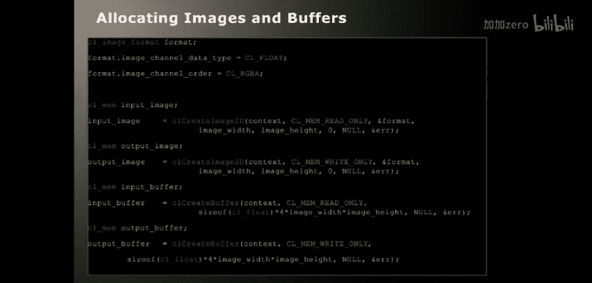
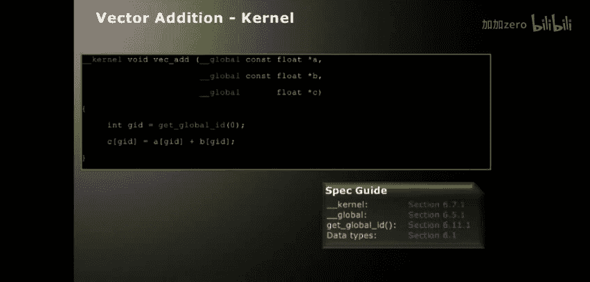
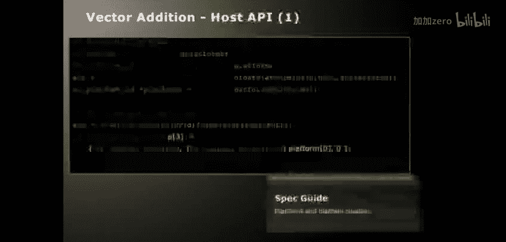
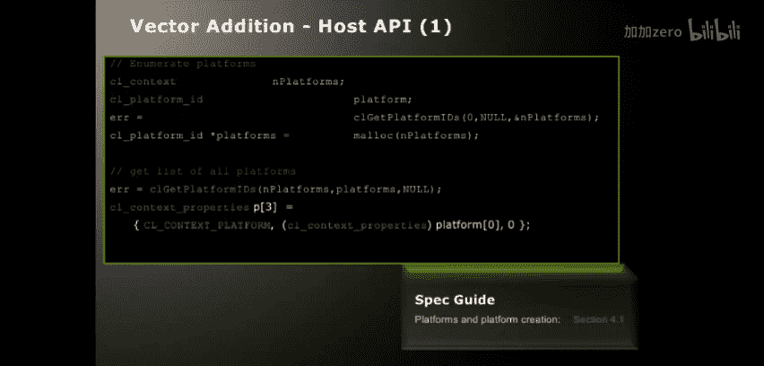
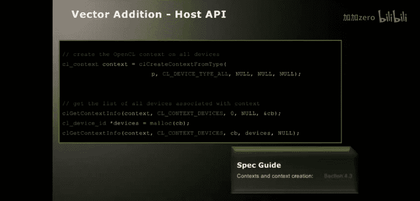
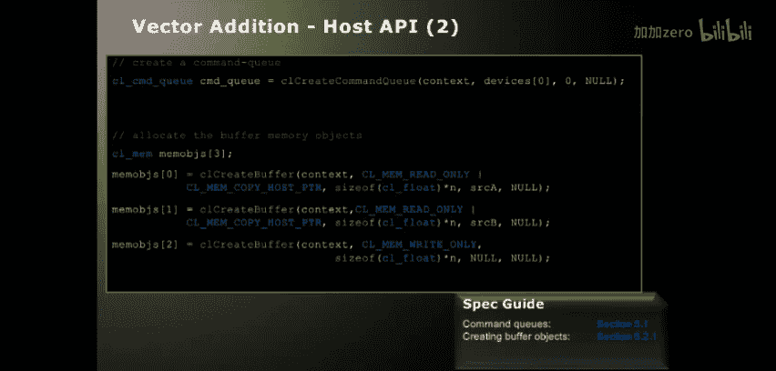
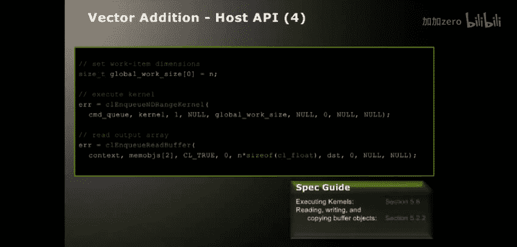

# 【OpenCL编程 RayiYanuTara】 p11 p10 2 - Introduction to OpenCL -BV1X2BRYyEeM_p11-

Hello， welcome to today's webcast。😊，My name is Brian， and I will be your event specialist today。

Following the presentation， we'll have a question and answer session， however。

 you can ask your question at any time during the presentation。Click the Ask a question button。

 type your question in the open area and click Ask Quetion to submitit。

 we'll answer as many questions as time allows。If you should need technical assistance。

 please type your inquiry to the tech support box on the left side of your screen and click the sendend button。

If you are disconnected from the webcast， you can log on again using the login instructions provided to you。

If you cannot log back on with these instructions， please call support at 866。2，71。7，5，9，2。

It is now my pleasure to turn the webcast over to our speaker。Ben Cator， Ben the floor Shos。

系 thank you。My name is Ben Gusster and I'm an architect at OD AMT， sorry， and I in particular。

 over the last few years， I've been working on GPGPU computing， which is mainly focused to date。

On the GP， in particular， But as we go into the hasgene kind of era。

 that Md is spring out with its fusion parts and number of things I've been looking more at CPU again as well。

Last week， I gave a kind of introduction high level kind of bird's eye view of。

Hegenous computing and what that means with respect to MD and its fusion parts and kind of what the programming models kind of need to adapt to and kind of one element of that programming model is open CL and the rest of this webinar series is going to really specialize on that and today I'm going to give a kind of quite quick and high level overview of OpenC and don't need to worry because lots of the coming seminars I'm going to go into much more detail。

 for example， Leehouse next week we'll be talking about the GPU architecture in detail and how it relates to compute and the following ones from there will'll have deep dives into different aspects of OpenC and I will return later in the series。

Okay， so opencl with open C， you can leverage both CPUus and GPus to accelerate parallel computations。

And you can in some cases and in many cases get dramatic speedups that's not to say everything we'll give you a dramatic speedup and it's often quoted people like to quote numbers from like 100x to 1。

000x and I'm sure that you will get those in some very specific cases。

 but the reality is we really you know you're talking about maybe 10 to 20x for an optimized program if the program suits the programming model and in particular it suits the kind of data parallel execution that I'll talk about in a bit。

So， I mean， I don't think 10x is anything to laugh about that。 that is a good speedup。

 So even if you don't get the 100x that some people like to to it still。

 you can expect good speedups if your program has lots of parallelism。

And you can write portable code across different devices and architectures in particular。

At the source level， you can take a language， an opencl program that was written for Md GPus。

 You should be able to run it fairly simply without modification on MbiDious GPus。

 You may have slightly different performance characteristics because of the memory hierarchy and those sorts of things。

 And you'll hear all about those in future talks。 But overall。

 the codes should pretty much run on different places。 For example。

 it might well run in IBM cell and things like that。And with Nd's implementation。

 we provide both a CPU and the GP implementation of opencl。

 So what I mean by that is that the CPU devices are exposed as compute devices and can accelerate parallel computations as well。

And that's not necessarily true， in some of the other competitors implementations。

And we've had a release for approximately a year now it's just coming up to December。

 2009 was when we released both the CPU and the GPU implementations of OpenCO and we're up to 2。

2 now and in the near future we we have 2。3 as I release it。

So just to give you a higher level kind of overview of heterogenous Comp。

 what would your application look like if you're using Open C， Well。

 that's most likely going to be this kind of brownish kind of gray box that sits at the top。

And then coming down， you're going to have the obvious libraries， the middleware libraries。

 the video， the image in the math libraries， you might have some high levell frameworks。

 a object oriented framework or something like that。 And then you're going to have some tools。

 compilers and debuggers all going down into these different layers。 And at the bottom layer here。

 I've got opencr and direct computer because if you're on Windows， direct computers。

Is definitely a choice， an option。To use。 And underneath that， of course。

 is all the hardware and everything。 And so open C is quite low level。

 And it's probably not for everyone。 And so it's quite verbo in places。

 But if you're willing to put in the effort and your application has the right characteristics。

 then you can expect to see nice very good reward in terms of performance。

Okay so today I'm going to talk about what is openCL。

 it can be broken down into what's called the OpenCL platform。

 which is kind of basically the host API and its model of connected devices， BG。

 the GPU is execution characteristics and also I'll touch briefly on its memory model and again。

 particularly the execution and the memory model over the next few seminars will go into a deeper discussions about these things and their impact on designing OpenCL applications。

I'll talk about the ECL framework， what you need to do to set it up and allocate resource allocation means things like allocate memory and things like that on the devices。

 and you need to build up and compile your kernels。

 which are the unit of execution that will run on these devices。

These kernels are expressed in a language called OpenCLC， which I'll talk about。

 and I'll give an example。 And then at the end， I won't answer any questions during。

 but please feel free to submit them。 at the end， I will try and answer as many questions as time allows。

Okay， so what is OpenCO？So OpenCL is a platformbased model and this is at the highest level you have a host to which you can think of as a conventional CPU is the most likely thing in a desktop with a number of devices which could be the host itself connected via some bus so if it's another CPU or as a CPU itself and it'll be connected via the hypertransport。

 or if it's a GPU then it's most likely today to be connected via a PCI Express and over time us and Intel and others are kind of removing the PCIE bus and replacing that with maybe hypertransport or some other。

That sits in the middle of that。And a device itself， from an open sale perspective。

 is seen as a collection of compute units。 You can see in this diagram here。

 we have a number of compute units going from front to back。 and the compute unit itself is。

Broken into a number of processing elements which execute in SMd。 So Sdy， a single re。

 multiple data execution or a single program， multiple data execution。

 And so each of these little blue。Vertical rectangles will be executing in lockstep down on the compute your program。

So they will be executing in parallel or the compute is completely executing in parallel and thebu blue units execute many instructions at the same time。

 sorry， they execute one instruction but multiple times on different data potentially。

And so the execution model itself is based on a notion of a kernel， as I said。

 this is kind of basically the unit of executable code。

 it's very similar to a C function and it's what you will call from your host sign application you'll do what's called a dispatch and to execute this code on the device and so basically it exposes an entry point that can be called from the host and so you can see it very similar to a dynamic library in some ways when you collect them together into what's called a program and a program is a collection of kernels and other functions。

 so kernels have this property that they can be externally visible and externally called from the host while functions can be called from kernels and other functions but are notly exposed。

To the host program。 So you can see them as kind of analogous to static functions in C， for example。

 if you're familiar with that。And then one of the main kind of contributions， I would say， of Open C。

 one of the things that differentiates it from Kuda， for example。

 which is quite similar in many ways to Open C。Is that we have this notion of cues where you can in queue work on the host so you can create a queue and then you can say perform this read operation or perform this write operation or in queueA dispatch a kernel for execution。

And these are things can all happen asynchronously so you can build up cues of work。

And these cues can be in order and so I if you submit Col A for execution and then you read about the data from that as the next command。

 then the kernelel will have completed before the read begins to that you don't have to worry about the dependencies。

 but they can also execute in out of order。Execution， and if they're happening in out of order， then。

 of course， things might creep ahead。 So the read might creep ahead of the kernel execution。

 which could give you the wrong behavior， unexpectedpect behavior。 So there you would introduce。诶。

An event which I'll come to later on， to enforce a dependency。Okay， so。

There are two kind of main execution models in OpenCL and data parallelism and task parallelism。

 the most kind of prominent one today certainly the most efficient for execution on the GPU style devices。

 not necessarily on the CPU devices is the data parallel model and the data parallel model you've basically got an ndimensal computation domain。

 So what I mean by that is if you can take picture a grid in your head which could be one dimensional so itll just be like an array of independent elements that executed on so you can think of that as a sequential loop。

 for example， very analogous to that， and then you could also have it in the two or three dimension so you can now start thinking of that as nested iteration domain there's a nested loops for the 2D one you can have a one that iterates through the X and one that iterates through a Y say for example。

 in the image。And， and。That should hopefully become more explicit in the example below。

Whereas and so each individual element in this domain， we call a work item。

 And these can all execute in parallel， potentially。

And that will obviously depend about how many CD units you have and those things。

 depending how many work items you create。 But take this as example at the bottom。

Where we're going to work on a 1K by 1K image， which is our global problem dimension。

 So this overall 1024 by 1024 is the number of actual work items。

 the total number of work items that we're going to execute potentially in parallel。

And you can see that's a very large number there on the right hand side。

And so we're going to have one instance of our kernel stamped out for each pixel。

 So each of these 1024 by 1024。 And you can see this if you look at the。

The left hand side for the scalar multiply example here， it takes a two inputs of two float buffers。

 inputs， A And B， and right the result of multiplying those two inputs out into。

The result we pass in N because it end is the amount of arguments that we're going to process in this thing and then we do a simple loop where we iterate it through and I'm sure that everyone should be familiar with this kind of standard iterative approach on the CPUU。

 for example， to multiply two buffers and sort their result out to each element of the buffers。

And in the data parallel world。 So in the opencl world， we go to the right hand side。

 you can see that we've introduced this keyword now called Colnel。

 So kernelel is just a keyword to Mark to say this is an entry point from the host。

 a potential entry point。And you can see that if we don't worry about these attributes that say global here。

 these are called address qualifiers。 We'll come back to those in a minute。

 We can see that we've got our normal A andmb inputs and our result output。 but the loop's gone。

 We've completely flattened loop because now the loop is implicit and what we do instead。

 because obviously we still need to get the value for I or in this case， Id。

 we can use the Ge global identifier。Routine and use that to index into our A and B。

 So get global Id will return exactly the same values for I across the whole iteration。

 assuming that we've launched our global work size to be the same as N。

And we'll come more to that in a minute。Okay。So as I say。

 so we're basically are going to express data parallelism in OpenC by stamping out these kernels。

 executing them across a global domain of work items。

 so that was our totalL work items are 1024 by 1024 for example。

 and this is what we call it global dimensions and they defined the range of the computation and one element within that is called a work item。

And work items can be grouped into local。 and what I mean by that is that these global work items are completely independent。

 There's no way of doing communication。 actually， we do have atomic operations。

 but generally there's no way of doing very fast communication between collections of work items until you group them into work items。

 Now work groups。Have a local dimension。 So you could have a， if you had a。

 you could have a two by two。Or let's say we had four work a global size of four work items。

 And then we wanted a work group of size 2。 Then you could see that we could have two work groups executing because they'd each to take two work items and group them into a work group。

Now， the key point about those workgroup is that they get executed on one of the SIMD core。

 and so if you had a giant work group that had all of the global work items and you had 20 CIMD units you'd actually only be using one of them。

So you wouldn't be fully utilizing the device， by any means。

There's lots of other reasons why you might not be fully utilizing it， but that's just one of them。

And then。You can see that they are the key thing about them though is that they can share local memory and they can synchronize between each other Now this local memory is similar to a cat it's called a scratch and it's managed by the user。

 but it's very， very low latency， so for example， a load or a store on AMD architectures you can take four cycles。

 assuming there's no conflict with memory accesses but if you're independently accessing memory locations in local memory。

 then you can it's very very fast， certainly compared to the hundreds of cycles that it can potentially take to go out to a global memory。

And synchronization allows you to say that I'm going to write to this memory location。

 wait until that memory has been that memory operation is completed and then another thread running locally another work item can then read back that from that memory location and know that it will get the value that was written by the other work item so now you're starting to share information and communicate between work items in a work group。

And the key thing is that synchronization can only be done within the work group。Okay。

 and you can see this in a little bit more of this problem here。 We can start to build it up。

 We have a single work item， and we have another work item， and then multiple rows of work items。

And then you can see that we have this whole grid of execution。 in this case， it's a 2D grid 1024。

 by 1024。And。You can see that。If we put a workgroup we group them into these two workd items within this box here。

 you can see that we can perform synchronization and communication， however。

 if we have two individual work groups because these are actually work groups。

 then you can see that these two work items cannot communicate via each other。

 there are atomics to global memory so they can do some kind of communications but the latency again is much bigger than it would be by doing the communication within the work group。

Okay， so I've talked a lot about data parallelism。 And that's mostly what we'll focus on with Opencr over the coming talks and weeks ahead。

 However， it does support task parallelism so you can execute the kernel with just a single word item。

And so there's noreration spatial or the O race is just one and the advantage。

 the nice things about this are that if you're running this on the CPU device or the host device you can actually pass in natively compiled code。

 so one of the advantages here would be that you could start to build up using the OpenCLqueuing model and synchronization features of the host API and benefit from that and integrate down into your program while still running standard C and C++ calling IO functions and so on or maybe you' got some C library or C++ library on the host that you don't have a source too so you can't port that to the OpenCL for example。

Okay， so now。I talked about， I kind of glossed over back in our example when we did the vector multiply I glossed over the fact that I had these address qua。

 as I called them。 and when we said global。 Now， Opencr differs from C in this case。

That it explicitly exposes the memory hierarchy of particularly of the GPUus。

And you can expect this to visit views as well。 And in particular， it says that the host memory。

 which is this red box down here， is a distinct memory。 The orange memory here is a global memory。

 which is distinct。Memory again。 And then we've inside。 And you can see the global memory of course。

 is visible from any work group， but it is not other than using atomic。

 you don't get any consistency guarantees。Or anythinging like that。

 And you can't do barrier or synchronization operations。 So you can't induce those。

Consistency guarantees， either now。Inside the work group， we have this green box。

 This is the shared memory that I talked about。 the local memory we call it。

 and the work items can all get access to this local memory。

 And because we have the barrier operations and the synchronization， we can。

The programmer can induce an ordering so they can get consistency。

 They can get one work item to write a value and then do a synchronization。

 And then you can have another work item， read that value back， and you'll get that result。

 You going get some。Undefined answer。 And then each work item also has its own private memory。

 which is completely confined。And define within the work item itself。

And so this is the memory hierarchy。Now。ItHa these advantages。 It's very powerful。 You can really。

 really get a lot of performance from it and programming to the size of your caches on the CPU and knowing about those things can really improve performance。

 too。The biggest issue is that。Whilst the CPU will often help you with implicit caching and those sorts of things is that all the memory management has to be explicit in openC。

 So moving from host to global and global to local and all the way back again or all has to be done by explicit operations。

 either by host calls to transfer the data onto the compute device or by doing loads from global memory into local memory and then back again。

And so forth。So。That can be slightly complicated， and requires some。

Some thinking about of your algorithm。The compilation model。It's based around OpenGL。

 and so it has an online compilation model where you can pass in streams or strings of open OpenclLC source programs。

 and I'll come to openclLC in a minute。And you can compile this， and online。And。

Then you can build up and you can extract kernels from it and you can dispatch to it and execute them。

 It is possible to OpenC provides an API for querying from a compiled program to extract the binary。

 and then you can then serialize that binary to disk and then read it back at some later date Now the advantage of that would be one that you you avoid。

Compilation time。Penalties at start of your application， for example， and the other key。

 probably more。Important。Fact is that it allows you to hire your I。

 so no need to distribute the source。Within your program。And of course。

 you could encrypt your source and everything， but it's always possible to have things。

 If you don't transmit your source， then there's never going to be an I issue around that。

And MDd and as I believe， some other vendors do all support different types of binaries that you can save anything from a simple text file style。

Representation to a full Ir。Representation。Okay。So using the OpenC framework。

So openCL is really built around this notion of a context， context is a openCL object。

That allows you to associate devices with it。 It allows you to associate memory objects。

 and I'll talk about it those in a bit more， and it also defines the memory consistency model between those memory objects。

 for example， you allocate a memory object against context。

 and so even if you generate data on the GPU into that memory object once。

At some point after that event is guaranteed to be complete and I'll talk about events a bit later then you'll know that that memory is consistent and consistently visible from the CPU in this context if you have to negotiate it if we have two context and the GPU was in one context and the CPU is in the younger context then there is no guarantees across context it's just within a context。

And you can see that we've associated cues here with one and with the context but it's also bound to a device。

 so a device queuees sorry is associated not only with a context。

 but it's also associated with a queue。 You can see it as the kind of execution engine for a device。

Given them particular context。And generally， what you'll do is you'll probably query the。

The system to the OpenC API allows you to query， I'll show you some examples of that in a minute to query what devices you have in the system。

 you know， for example， you can select all the devices or you can query， can I get the GPU。

 Do you have a GPU or do you have a GPU with these capabilities。

 Do you have the cell broadband is not a separate type， It's actually an accelerator type。

 You can say do you have any accelerators， Do they have these capabilities。

 So there's lots of different things you can query about the devices， These are statically known。

 of course， to the OpenC runtime as it starts up。And so the topology， it configuregs the depoology。

 it goes on。And then you get to。Context， which I told you。

 a collection of devices and also a collection of memory objects， which I'll talk about in a minute。

And queuees， queuees are the place where you submit work to a particular device。

Associated with the context。Now memory are buffers， so buffers are one dimensional blocks of memory。

 I can think of them as a rays， and they're allocated as opaque types on the host and appear in the openclLC program or the kernel as a pointer to a memory region。

And because these things， a lot of this stuff was based on work from GPUs。

 there is also an opaque type of notion of images because it turns out the GPUs have a lot of hardware built to optimize the access of images so that for example。

 certain data formats and you can do these things called samples which allows you to set up how you read edges of images and things like that wherever you want to set them to zero when you're out of bound。

And things like that， there's lots of different types。

And images are strange because they're not that common to people who don't work in a graphics。

 think so when I first came to， I was a little surprised on of these image objects。

 but they can turn out to be useful。 certainly if you're doing imaging style applications。And then。

 of course， the other thing that you'll do have open Ci objects for。

 or you want to manipulate on the host side is you want to be able to build up programs and compile them。

 extract kernels from them for kernels。 You're going to want to be able to set their arguments。 And。

 of course， you're going to want to be able to execute them by inqueing them onto these cues。And。

Finally I talked quite a lot about that and I'll come back to that in a little bit is that almost all of the NQ commands in OpenCLI asynchronous and so of course if anything's happening。

 if you want to build up dependencies between these things that needs to be some way of doing that。

 it needs to be say you cannot execute this command until。This one has completed， for example。

 and that's what Opencl events for events allow you to。

 you can query them to see what status the command is。

 but you can also pass them into Ncu Mountains and say。

 don't do anything until this event or this set of events。Has reached a certain status。

I'll talk about that a bit in a minute。So you can see the overall framework。Here for opencl。

 you've kind of got your compiling your code， building your programs。

 You can see that from a single source。 We've built up a CPUU binary and a GPU binary。

 and you can extract kernels from here。 You see we've got the ad the kernel objects。

 You want to be able to set their argument。We have memory objects。

 images and buffers that we talked about。 of course， we have these command cues。

 And here you can see that we've created a command queuee for the GP。

 You can have multiple command cues pointing to the same。To the same device。 And so even if。

Your cues are both in order。 if you're doing if your operations that you're submitting down one queue are dependent on operations that you've submitted down another queue。

 these cues run asynchronously， even if they're in order。

 you're still going to need to build up dependencies between them to guarantee the correct execution。

 It may work， but it is undefined whether it would or not。

 So you need to make sure that you use those things carefully。ok。

So here's kind of getting into a little bit of code here。

 you can see that for the setup that we talked about。

 you can use CL gett device IDs to query GPU device or query the device ID for CPU devices now if you have multiple CPUs in there I mean we actually expose an aggregate device。

 which means that even though you might have an a corere CPU machine we actually will expose that as one open CL device。

 but if you had multiple GPUs in here， then because we're just put in past in one as the third parameter to get CL devices Is。

Then we're just going to pick up the first GPU。Most likely I think that's what our implementation does。

 Of course， it could pick anyone。 but obviously the easiest thing is if you knew that there was two GPUus in there and you can do that by using this same function。

 just to query the number of devices returned without actually poing passing in a place to store it。

 So this devices could just be null here。And then you get back just a number of GPU devices。And then。

 of course， you could then allocate that number for devices and then pass in that total number if you wanted to get back all of them。

So that's very common way in Opense because it's a CApi and it doesn't want to do any memory allocation for you because of all the issues of kind of space leaks and so forth。

 What it does is that it allows you to query how much， what size it's going to return。

 You can then allocate some memory and then get those values back。And。So this is device Ids。

 as I said， are kind of static in the sense of that。

 the OpenC runtime at start time knows exactly how many of they are。

 you can't just come and stick in another device。 It's not a hot swapping thing。

 Once once it's determined how many devices are in the system， it will get that。

 So get device Is returns， a static number， it will always return the same number of GPUs if you ask youraman he has installed and CPUUs and so on。

And so in that case， when we're not actually returning a newly created object， an opense object。

 we will always see that these commands will return the error code。Here at the end。

And you can see that in the case when we get down to the C create context here。

 you can see that we're actually going to be passing in our list of the devices。

 We're saying that we have two devices， please create that。

 you can see that we're not actually returning an error code we're actually returning the C context object type Now this is the two distinct API's types in signatures in openCL if it's not returning a C object it will return the error code as its result if it's returning a C object。

 it will return that as its result and the last parameter here you can see the amander at the end of CCre context will be where the error code is returned Every function returns in error code。

And you can see that， again， we can see that's with the CL createre command queue。

 you can see that this takes a context， takes an individual device now we're not just a set of devices。

 it takes one particular device because cues are associated with a device。

 and you can see that these of course are returning an openC object， the queue。

 so this gets returned as the return value of the function。Okay， so I' kind of describe that。

So devices， there are multiple core of CPU and GP together as a single device。 and so。

So I thought about the CPU， we exposed that as an aggregate device if you have a four corere CPU。

 we'll give you one openC device， there is an openC extension I'll talk about later in this series called device fission。

 which allows you to divide to subdivide one of these devices and talk about cash affinity。

 for example， and get back multiple devices from that。

 and that's very useful today we support that on the CPU and you can potentially expect that maybe in the future that might be something we'll be looking at for the GPUs too。

And obviously， we have a number of SimD units and compute units that are on the GPU。

 I think in our 5068，000 series that we've just launched。

 I think the high end part there has 20 core。And openCO execute kernels across all these core in a data parallel manner which is kind of what we talked about。

 it does do the task one as well， but particularly the data parallel is the thing to focus on here。

 context now I talked about that memory is allocated at the context level。

 you know the buffers and images and so these are shared across。

Devices and went to know that certain things， events have completed。 So， for example。

 if you in Cu right to a particular buffer on a particular device， once that event is completed。

 you know that it will also be visible on any other devices that are available in the system。And。

There are lots of kind of these get info functions。 So if you see here down here。

 you can query a device info。 It's C get device info。 There's actually many。

 many opencl functions called C get X infofo So for X being， you know。

 device or context or where you can query information about C objects。Now。

 I put the device one in because that's probably the one that has the most and it has maybe 100 different queries。

And it's probably one of the most useful ones in the sense that it's something where you can really ask a device for what are its capabilities。

 for example， what's this maximum number of computing's what's its clock frequency， for example。

 what's this global memory size， does it support certain extensions， double precision， for example。

 as an extension in one0 atomics or an extension and 64 Bomics are still an extension。

And so you can query these capabilities to determine what device， So maybe you have multiple GPUs。

 maybe one of them doesn't have atomics and one of them does。

 maybe you want to use atomics so you just use the one that has it so you can query these capabilities and that's one of the thing it's quite painful the first few times when you set this up in your program but once you have a little routine or maybe a library routine that can query this and get back the information that you're interested in。

 and it becomes very useful and it is say pick the best device for your algorithm。

And so buffers are simple chunks of memory。 They are kernel can access them。

 however they like they can be arrays or pointers or struts。

 so you can store user types in their struts or unions。

And Colel can read and write them they can do full scatter together on those images on the other hand are opaque special types represented in hardware on the GPU and within the kernel for that restriction you can only access them by these read image and write image accesses functions and it turns out actually you can only read an image or write an image in a kernel。

 you can write to one image and read from another image that's fine but what you can't do is read image A write image a in the same kernel and again that's to do with the way that addresses and everything are precalculated for images。

I'm not going to go into details about images， but you can have a look both the slides when they get posted。

On the open zone。In the next few days。 and you'll be able to see that there's lots of things around formats and all this things。

And。And as I say， the benefit of the images is that we have special hardware。

 particularly on GPus to accelerate。Their access。And here's some more code on how to allocate the buffers and images you can see that we have。

 again， when we do a C create image or a C create buffer， as we do here， we get back a opencl object。

 So it's as a return value because of course， we're creating a new object。

 You can see these pink enumeration values here allow you to describe how you're going to access。

These buffers or images from within the kernel that will end up using them as either input or output。

 So you can say a read only for a。For an input。 so it knows the opencl runtime could then cash that always would never have to make that back to the host and never need to do any consistency。

 so it may have special ways of putting that in the right places。 And of course。

 if you do want to re back， then you might get the wrong error because that's not what you said you're going to do to it。

For example， if you want it right to a read only buffer and a kernel and we've stored it in constant memory。

 you might get an exception， for example。Reading and writing memory objects， How do we write that。

 So these are our explicit commands to access memory object data。

 So this is why I go back to my original diagram on my memory hierarchy where I talked about everything's explicitly managed in open C and so this does make a bit of a burden on the programmer but obviously you can control your data placement and data move and so you can this is the first time we've seen that in Q commands So an NQ command is how you in queue commands to a queue and you can see this is a C N queue read buffer。

And here we've passed in a queue， we've passed in an object， which is the buffer object。

 We've got this blocking parameter which I'll talk about in a minute。 You can have an offset。

 the size of data that you're writing， the host pointer that you're going to copy the data from and this will get transferred to the device associated with this queue and this object and of course。

 because it's against the context it will become visible to everyone in a bit。

 and this dot dot dot is how we make that visibility and I'll talk about that in a little bit。

And of course， you can do the opposite。 You can write to a buffer。 So that was the read。

 And this is the right。And then you can map a region。

 So what you can do is you can actually get a host point to it or put it in pinned memory。

 for example， you can then iterate it through with a for loop and then write to that buffer。

 Now there are some advantages of doing that， and that you'll need to look at your vendors specifics around that。

 we have some advantages of doing that for small regions， but of course。

 you won't be using the DMA units in general then， whereas with the read and write buffers。

 It's quite potential that you'll be using the dataynchronous DNAA transfers。

And you can copy data as well， and so there you can copy from bufferett to buffer now of course if the data is just on one device。

 then it may not need to come back to the host at all。

 it can use the data transfers on the device itself， so there may be some benefits there。And。

In general，NQ commands are asynchronous。 So that means they'll return before the command is completed potentially。

 And except in the case of these read rights， where you can pass in a blocking parameters。

 So this is the one up here。On these two wings， it says blocking， and if it's set to sealL true。

 then it will operate synchronously， otherwise if it's set to seal false or anything else。

 it will execute asynchronous。Okay， so as I said， program objects encapsulate sources or binaries。

 and it contain a list of kernels。 You can query them to find out the list of kernels。

 If you know the kernels， you can do that， kernelnal objects encapsulate a kernel function in the program。

And you can set argument values for them and you can use different ones。

And here you can see that we can compile the same program。To accept the6 order GPU。

And here you can see at the top here， we're going to be able to set some kernel arguments。

 everything like because it's a C， we start kernel's argument0。

 we use the zero index and then one for the second argument， set kernel log takes a kernel。

 it takes the size of the input that you're setting and then an a point to the values that you want to set。

 we're going to set up our global dimensions here， So this is our image width and image hyp from our previous example。

 so its the 2D we put zero in the third dimension because we're not going to do anything。

 and then we see an Nd range kernel So this is executing the dispatch that we talked about right back at the beginning。

 the domain or the grid of execution that're going to perform。

 Of course we're going to run this on a queue because it's going to get dispatched onto a particular device we're going to pass in a kernel because we want to run a particular kernel and of course we pass in our global dimensions。

And then。Okay so here we have I had these dot dot dots at the end of that and here is where we can start talking about events。

 you know a command queue has some notion of dependencies can be built up on here and in particular you can see that if we have this Q1 and Q2 here even though they're in order because these events C2 and C1 in Q2 depends on the event the command C3 we need to set up some dependencies and we need a way of doing that and obviously in this red one which is an out of order queue we may need to set up dependencies within the queue itself to guarantee that things don't overtake each other。

🤢，And so。This brings me to the dot dot dot arguments and I the dot dott the front for the NQ commands。

 but every NQ command takes three arguments at the end of the function here is the number of events in a waitlist and a waitlist so these two things correspond to the events that you can pass into the NQ command to say do not execute this command until all of the events in this waitlist are completed and then the final argument is appointed to the event that you'll get back out associated with this queue which you could then pass into other ones or you can use it to query information about it。

So， for example， you could use C Wait for events to。Wait for all events to complete。

 and they'll block the host thread at that point。 You can in queue a marker into a queue within a particular event。

And you can in weight for events too， soynchronously you'll get back an event associated with that。

And you can actually query using the get info functions again。 But this one for an event。

 you can query the type of。嗯。Status of the commodity considers four different states that it can be。

And finally， you can actually query if the queue was created correctly with profiling information enabled。

 you can query different times for each of these four different states that you have。

 so you can start to do naive， reasonably naive but 64 bi accuracy。Point is， okay。

So the final part of the talk is going to be about the OpenCLC language。

 again there's a lot of detail here in OpenCLC and you're going to be able to get lots of that there's going to be the seminar Aex is going to go into a deep dive into OpenCLC language with a much further developed example and here。

I'm just going to say that it's based on C99， it has some restrictions， for example。

 that recursion is not allowed。 It has some additions for working with parallelisms so we talked about work items。

 work groups， it has these vector types， which I'll give you a little example in a minute and it has some synchronization primitives So the barriers and things like that。

 It has addressbased qualifierifies that we talked about local。

 global private and it also has constant， it has images。

And it has a vast amount of built in functions that you'll need to look to expect。

 there is a large number of those。For those， but anything ranging from sign to gamma to things on vectors and some simple matrices operations。

And you can see that an example of one of these built in operations。

 which is to do with work items is the get Global I。

 which will give you the independent index in the launch domain， the global In and your things here。

 you can see that we're getting the 11。Here I reading the value and the output。😔。

And there's lots of different ones so if you're working in a work group。

 you can do get my group ID and then you can get the local size， which is the size of the group。

 and of course you can then calculate the global size。

 for example on the global ID by doing different calculations so there's different ways to get the same results and obviously use get local ID。

 which is your local zero to n of the work group size will give you an index inside the workgroup so you can do local indexing。

Independent of the global size。You have all the expected scalar data types。 know。

 nothing surprising there。 And there's the image types that you'd expect。

 And then there's also the vector types。 And so vector types are all the scalar types。

 but they can be of size 2，4，8 or 16。 All of the operations on vectors are lifted to that space。

 And then we have a nice algebra for constructing and deconstructing。Vctorors， too。

 and there's lots of different operations。 This just gives you an example。 And as I say。

 there'll be lots more of this in the coming talks。And address spaces。

 kernel arguments can be global， local， local is the shared memory on the compute unit itself。

 the global as the buffers that get stored into global memory。

 you can have things that are private as well， of course they can't be passed as arguments to kernels。

 but they can be passed as arguments to functions and they can be private values can be stored allocated inside of the kernel itself or a function。

And。HereYou can see that there are also constants constants a special address space that just appears at the global level and。

So forth。 And as I say， there is lots， lots more about OpenC C in particular。

 And I just wanted to give you a kind of flavor， kind of touch on what that is。

 because that's a seminar in itself。 and it will be。

 we're going to go into a lot more detail about that。

 So I don't fear that I've kind of gone over it very quickly and worrying。 But what we do have now。

Is that we have enough information We've covered enough， even though very quickly。

 to go for an example。

And this is going to be the end of my talk now and so this is going back to a very similar one that we have at the beginning of the talk。

 but I've done that vector ad here rather than a vector mole and you can see that we've got our inputs and output so we've doing the GOD and we're doing an ad and we're storing the result into C here so that's our kernel。

To our host API， the first thing we do is we can clear a platform because we could have multiple platforms。

 which means multiple vendor implementations installed in the same system。

 Maybe you've got an Nvidia implementation and ND implementation on the same machine。

 And you can query that。 the whole platform API for doing that。We can create a context here。

 We decide， just give me back a context with all possible devices。

And I'll do that with a particular platform。 So maybe a CPU and the GP if for using our platform。

 You can query the context to get about the set of devices。 We first queried by the how many we got。

 And then we get the actual set of devices returned。

Because we'll need that。 Remember， to create our command queuees。

 We just picked the first device just for simplicity in this example。

 and then we're going to create our memory objects here。 We can create that against the buffer。

 as you expect， we create three memory objects，2 for input1 for output。

 use the enumerations as expected。And we'll build our program， we create program with source。

 We use a context because we're going to build it against the devices for that context。

 We pass in the source file， and so we create the program and then we build it。

 and then of course we extract the kernel So this how we create the kernel object。

 We pass in the string back to underscore add because we know which kernel we want to do。

 We set the kernel arguments。 It's going to be three arguments So that will be0 to2 and expected and we pass in the size of the CMm object because we're actually going to pass in a CMm object as we're doing here。

多 it。And then finally， we'll just do a single one dimensional launch。 We'll set that to N。

And is's a number of elements we're going to do for the ad。 And then we'll simply in queue that。

And as we're going to do the read buffer here， we're going to do a blocking readback。

 We don't need to worry about events because we know that we have an in order queue and that we're going to the read buffer will not start until the kernel execution is completed。

 and we know that as we're getting Se true that the read will not return until we're just completed。

And so that's the whole program。Pretty much。 I mean， obviously。

 there's a little bit more that you need to add header files and those sorts of things， but。

Hopefully， that gives you a kind of whistle stop tour of openC and what it's。His。Okay。So now。

I've just about got there， and I'm going to try and answer some questions。

 I've got lots of questions。 So I'll go through as many as I can。

 given the 10 or 12 minutes that we have left。So one of the questions is。

 how is data parallelism different from compiler before loop pump rolling。没。

In fact it not so loop pump rolling well not loop pump rolling but loop tiling so you might want to do some loop pump rolling because know if you just done roller looping orll still just execute that sequentially。

 if you can discover that there are independent the actual iterations of the loop are independent or at least some number of those iterations are independent and it's feasible that you could execute those in parallel and that would be a data parallel execution。

 absolutely one of the big problems is of course that compilers aren't that good at doing that。

 they struggle to do that for ICC which is Intel's the compiler it does a reasonably good job for quite a basic loops and that's on SSE4 wide machine you with 64 wide CD plus you can run 10。

000 of those threads and so imagine trying to vectorize for that。knowThat's quite a difficult task。

And it's possible。For some programs， but it's not possible for many。

 And without doing a lot of restructuring。 And then it's very difficult then to do memory optimizations and memory parallelization as well。

 So in the end， I think you do need to。😔，Explicitly paralyze your program。

 even if it's not for open C， you'll need to explicitly paralyze it for some other model。

That's my genuine belief going forward。So I have a question。

 C how Nq marker would only be useful in an in order queue。

 Presuming it signals the event or N our event handled。

 especially always only signaled when they're placed in the queue it actually reached。

 So an Nq marker。Allows you to say that in and out of order queue。

 that you can just you could stick in the marker into the queue after you've submitted ABC。

 and then you could submit。You know。X， Y， Z， let's say。 And then。Those commands， X， Y。

z could mix up in the order of those execution， but they could never go before ABC is completed。

 So what it allows you to say is that nothing can go past this point。

 Anything I'll submit behind that will not get executed。

 So it's useful for out of order usees as well。嗯。When you refer to constant memory。

 that's not to say that the values are constant。 is it seems like the word constant global we're almost using to change a bit。

 No， actually， is it does mean that the values are constant。

 So I'm sorry if I was not clear about that。 They are。They are a globally visible memory。

 so they are at the same level。 All work items can see it， but you cannot write to constant memory。

 And we actually have special memory， particularly in our GPUs， where we will load it up。

Into very fast， constant memory because we know you're never going to write to it。

 We complete a special place where it can get very nice cash capabilities and so forth。

 And on the debugging side on the CPU side， we mark constant， we put them in the special page。

 if you're debugging and we'll mark that page as read only。

 so you get an exception if you did the right just so that you can actually track your program。

 debug your program a bit。So I got one question missed the whole thing unexpected airport pickup。

 Can you suggest an online web resource I can use to catch up。

 So we are going to post all of the seminar series on NDs OpenC Z and there's lots more information about OpenC and obviously the OpenC Z has lots more information on the MD website generally you'll find lots of information about parallel programming and other programming models such as tasking and things like that。

 but the OpenC Zone is a great place to start resourcing it。And finding out that openscale。

 there are lots of other good websites， too， But I would say， recommend looking there。

So get Global IDd0 returns the same value for every call of the kernel。

I'm not quite sure I understand that question。 So if I understand you right。

 so when you launch a kernel for N work items， you'll get back0 to n -1 values for each each of the work items that were that call get global Id 0。

TheNext time you call that kernel， if you launch it again for N work items。

 you'll get back exactly the same value，0 to n -1。 So basically it's the same as you in your loop if you were doing I in our original loop that we had at the beginning。

 I equals 0 to I less than N I plus plus you'd always get the values 0 to。

N minus1 So it's exactly the same really all it's doing is saying it's a way of getting back that value for I in the loop because the loop's gone now so we need to have some sort of built in operation for getting them back We've made the loop implicit rather than explicit。

So。What happens when two different applications are both running and both trying to use OpenC simultaneously on the same machine。

 do they share the hardware or is one application locked out。

 Well as for example will depend on the vendor， but as far as I know。

 all implementations today will share the hardware and that the OS will kind of multiplex the applications when you submit a kernel because the GPUs today are。

Not preemptive。 Then that vendor will run to execution。 then it will come back。

 And then if your quantum， your time slot is up， the Os will swap you out and maybe run the other application。

 and it can submit some kernels and so on。And so no one's locked out。And。So，Obviously。

 if you run a very big， very long， long kernel， then bad things might happen。

So which profiler would you recommend OpenCL？For open C。 So compute visual profiler。

 So we have a visual profiler， which allows you to query lots of information about Andy hardware。

 You can query the And GPpUs。 You can do that。And there， I'm sure Nvidia have Ash。

 I know Nvidia have a very similar product to which you could use too。

 if you're working on their hardware。 So both of those things are good solutions， and。

I think they're good， but that they。They maybe not the familiar。 They're you're not doing。

 They're not the kind of profile is where you're kind of profiling how many times you hit a loop。

 for example， and stuff， What they're really looking at is how many Lu operations you've entered how many cash misses you did and so forth。

 We have two versions of it。 We have one that is a plugged individual studio。

Which if you're using Viual Studio and Windows development， then that would be a good one to use。

 if you're using Linux， for example， then we have a command line version that you can run。

 and then you can get back a spreadsheet to view different operations。

So the visuals Studio one is basically the same。 We just have that will give you front end for it。

And in the near future， we'll be having an integrated environment for all of those things on both platforms。

And。Okay， so how large is the overhead of loading the data into the image object or buffer now so I'm assuming you mean that by kind of transferring it。

 I mean that would depend on the device and how you set it up， So for example。

 you could allocate it as a host buffer， use host memory and then on the CPU that the cost would be very small。

 It would just be a simple data transfer， you you'd be running out the bandwidth we've or a CPU so it'd be alloweding a copy copy memory for example。

Now， on if you're transferring across the PCe bus， then the overhead is the startup up of setting out the PCE bus。

 And then of course the max you're going to get is the bandwidth for the PCI， which is 16 gigab。

And approximately at least， I think， and obviously， it is dual channels。

 So you might be able to overlap some of those things。

 and we have DMmaA engines and everything that will kick in those things。

 So you could be doing things asynchronously。 But of course。

 the latency or the PC is still reasonably high。 So you want to be transferring large amounts of data。

 you're probably going to want to be double buffering。

 If you have got a lot of data that you want to work on。

 So say you've got a video stream that's coming in。 you're probably going to want to be doing。

 maybe five frames and another five frames depending how you do that to kind of batch it up。

 I know that's for some work I've been working with someone who's been doing doing it like that。

 They've been doing some video editing software。嗯。Okay。I'll take one more。A question。

 So what changes to。To and Seattle best。What changes to see our best programming practices are expected considering recent introduction in new MD 68000 GPU series。

 if any， so actually there aren't any so the 68 series that we've launched so far are all based on our evergreen architecture。

 which was as same as 58，000 series， they have some innovations there's some more Sds and the memory is slightly different。

 but the actual characteristics of the GPUs themselves and the way that they're designed。

 there are 5 wayB IW was it's a4 wayby IW for 68 series and I that's an not as 5 wayby IW and things like that。

Because they're based on the Evergreen architecture。 They're pretty similar。

 So if you have the best practices and you're already doing that。

 your code is optimized for Evergreen。 You can pretty much expect that You'll see a benefit from the 68000。

And the parts that we've launched so far are these are really targeted at the middle to low end market。

 and there you'll get some real benefits， both F cost and in performance。From the same application。

At least and De。Okay， well， we're dead on 8 o'clock。

 And so I'd let's say thank you very much for joining us。😊。

