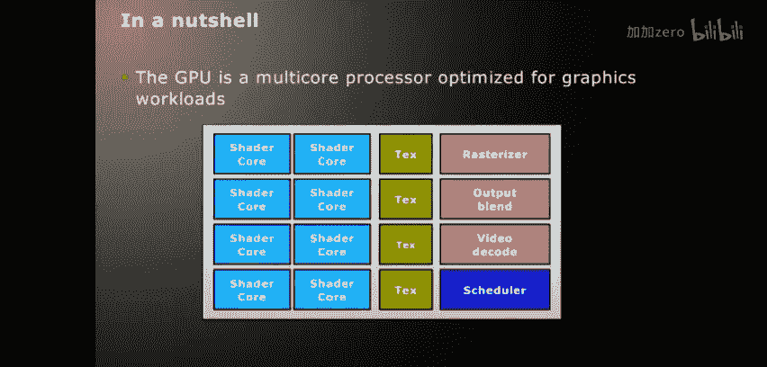
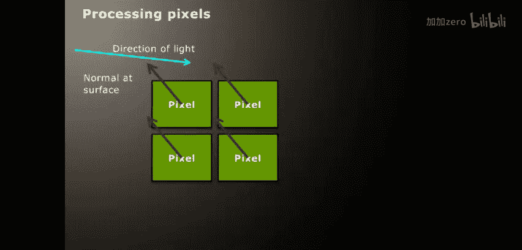
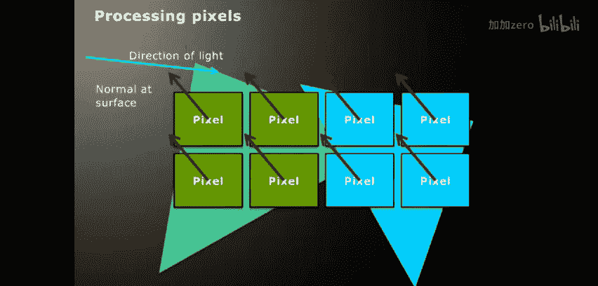
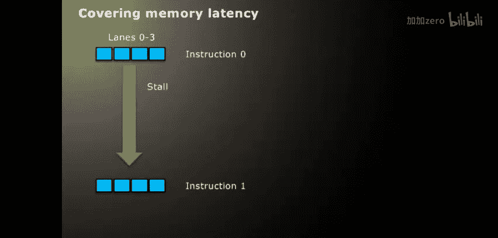
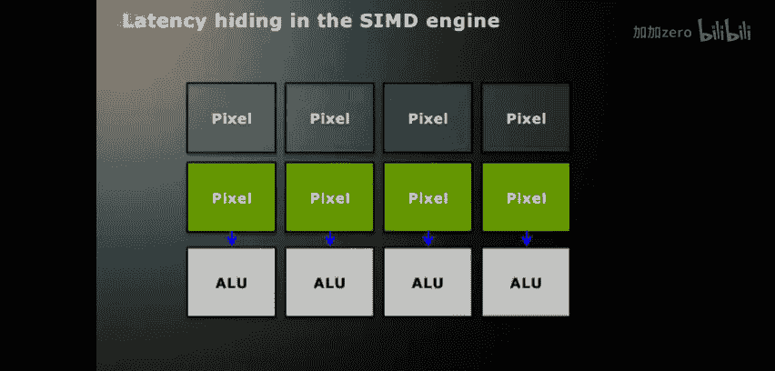
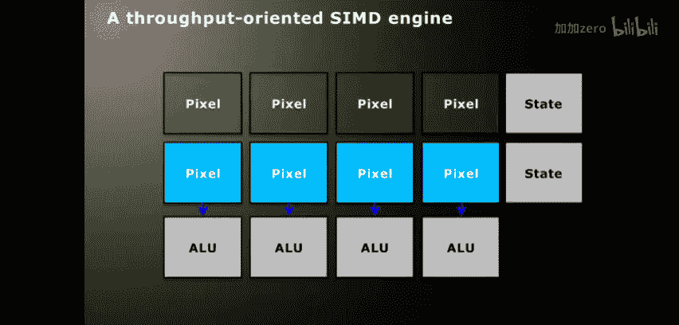
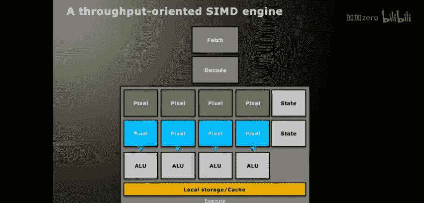
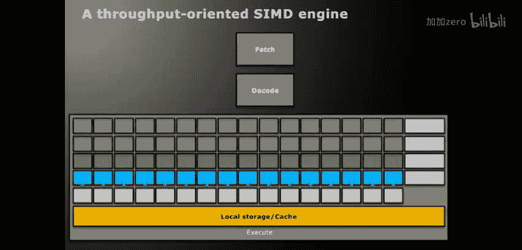
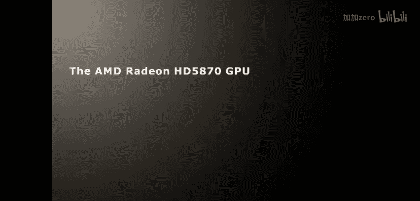

# 【OpenCL编程 RayiYanuTara】 p12 p11 3 - GPU Architecture -BV1X2BRYyEeM_p12-

Hello and welcome to today's webcast。 My name is Brandon and I will be your event specialist today。😊。

Following the presentation， we'll have a question and answer session。However。

 you can ask questions at any time during the presentation， click the Ask a questiontion button。

 type your question in the open area and click Ask Quetion to submitit。

We will answer as many questions as time allows。If you should need technical assistance。

 please type your inquiry in the Tech support box on the left side of your screen and click the Send button。

If you are disconnected from the webcast， you can log on again using the login instructions provided to you。

If you cannot log back on with these instructions， please call support at 866。271。7，5，9，2。

It is now my pleasure to turn the webcast over to your speaker， Lee Houseus， Lee， the floor is yours。

😊，Very much。Okay， so the purpose of this webinar really is to give an introduction to GPU architecture from。

To somewhat an open sale programmer's perspective。So my name is Lee How。AD Sunvale。So。

What we want to do is。嗯。Look at the architecture using a slightly different approach from the normal rather than just describing the architecture at the low level or describing optimizations for it。

 and those will be discussed later during a performance optimization webinar。

 we want to put the GPU architecture in context。So one problem we often see talking to people is that it can be hard to grasp why the GPU is designed the way it is and what its differences from CPUs really mean in context。

And。Without understanding that， it can be quite hard to tell。

What types of algorithms are likely to run well on a GPU and why they're likely to run well？And。

So this means that you can choose the rights tool for the job rather than wondering why your application does not go 100 times faster when you port it to the GPU naively。

So。The agenda for this webinar is first to talk about GPus as graphics processes。

 Ie their origins and their main use case。And this will lead to some discussion of the implications that that has on the architecture。

 followed by some discussion of C execution and its implications of application development。

We'll then briefly discuss local memory and some aspects of latency hiding processes of state。

And attempt to place the GPU in context with the wealth of CPU designs available with a couple of simple examples。

And the point of thats to show the GPU was not out。 there it was a fundamentally different design。

And then we'll end the discussion by discussing some specific features of the Radium HDD5870 GPPU。

So， we can start with。What might seem in the obvious question of what is a GPU。

I'm looking at it from。A compute program is specific。It is that it hearts a multichore processor。

To be tuing for processing pixels。So it has wide SD cores。

 which allow a high degree of data parallelism where many pixels are processed together and it has course that are optimized for through and we'll see what that means。

And this is because traditional GPU picks on in vertex workloads show a high degree of independence of computation。

 the GPU core doesn't need the same low latency pipeline that CPU designed for scalar processing requires。

It also has optimized hardware blocks that are designed for accelerating a range of graphic specific tasks。

Example， the UD block on the AD devices， which accelerates video decocode。

And these features offer high performance for very specific workloads。

 but don't tend to offer the flexibility you might need for general purpose computation， So most of。

It ignore them。So we can start from the beginning， really。 Let's say we're processing pixel data。

If we poke the same data for a single pixel， we might have light source defined in a buffer。

We might have a color and normal， some properties of the pixel。

we can read these values from their real input registers and computer value for how we want the light to affect the pixel。

 And this generates output color。That much is simple enough。Of course。

We can process multiple pixels together， and here on this slide we see the quad。

Basic units of most GPU processing。Of course。SQud is part of some polygon that was drawn to the screen by the rendering API。

And the vization hardware will generate quads for。For the hardware process based on the input stream of polygons that are being passed over by the directexs or open jail on time。

So。When we want to generate this output result。We're going to we execute a fragmentment program。

 which will be written in a language such as GLSL or HLSL， depending on your graphic API choice。

And in this case， we see some HLSL code。So what's important about this is that the program is written as if it's independent。

So it relates just to a single pixel， no notion at all of how these pixels appear together。

And the output of the program depends only on the inputs that relate to that specific pixel。

 or at least some gather operation from the input buffers。And there's no into pixel communication。

so this is important because this allows the hardware to do very efficient parallelism with no dependence analysis。

And the early general purpose GPU work was written in this fashion using four screen polygons to generate large rectangular workloads。

Yeah。Sorry about that。But。So as a slightest aside， for each polygon we。

 we might be running a slightly different fragment program。And in this way。

 as well as having to execute vertex。Data。Performed escalation and so on。

 There's actually quite a high degree of programmatic。We at。

Thread level parallelism the GPUus also have to deal with。

And this also affects the design of。So。That's the basic idea of what the GPU is doing。

 nothing complicated about that。But。That pixel data is major components of graphics workloads。

 and so that affects。the way the hardware will be designed。So we still have quad。And we saw。

When writing that code， it makes sense to think in terms of a program for each pixel。

And that's because， of course， it's the pixels we' be generating data for them as that's the concept or the level that we're thinking at。

And we usually don't have any real idea where on the screen that pixel will be or how it will relate to other pixels。

 the camera can move， the objects can move and so on。

So that means data power execution at the hardware level is inferred from a dependence free。Program。

Now， we know that each of these pixels can be executed independently。And he parallel。

But at the same time of executing the same program。

Or at least small groups of them will be because they're executing that same shader code。

And we know that because the GPU's front fluization and work scheduling hardware was generated a quad as four neighboring pixels from the same polygon。

And in addition to that， it will make an effort to package quads from similar polygons or a single larger polygon together。

So that the same shader code is being executed。So the first thing we can see from this is that we can map these pixels to a C engine。

So， that means。Single instruction， multiple data。In that the same。The sameme instruction。

 the same program will be executed on all four pixels at once。

So that's much like the SSC extensions to X86 processes。And on MDD's GPU hardware。

 this is known as a wavefront。Now what this means。Is that we can get quite high ALU density。

But the problem comes in when we have block code branches。

So we have ostensibly separate programs that are now executing together on a single CMD unit。

Which means they're all executing that single instruction。 and as a result。

IfThat's a single vector instruction now covering all four programs。So for simplicity。

 we have showed slightly different code here that has added some branches。Obviously。

A clamampicle would perform this same operation， but。For the purposes of explanation。

 we'll keep the branches in。So。The question is what's going to happen when we hit those branches？

the branches all go the same way。Proble。If they don't， we might see the following sequence。

So the first gather operation from memory will be the set of memory addresses for each pixel in a single instruction。

And that's fine。嗯。Pixel shade of instances of executing together。And then。We reached the。

Now what this will actually do is this will generate。The mosque Hol。Now。

 if that mask is all going the same way。This might do a ex voting instruction， and。

Realize that and then turn into a branch。But if it does。As we see them。This slide。

Then because not all pixels have satisfied the test。We don't want them all to execute。

But because this is a SD instruction。There is no way for them to not execute the instruction will be issued for or four lane。

So what it will do is that mask that we compute will mask out the pixels that don't satisfy it。

 and so it will only output a result for those that do。And then。When we reach the else。

We're going to inver the mask。And the rest of the pixels will be covered by the following。

Conditional assignments。And then the very last instruction。Will be the return statement。

 which will then execute again for all four lanes。So note that the shader that appeared to be four operations。

 a read， a test， an assignment， and a return， has become sick。🤢，Meat。A conditional assignment。

 inverting the firstir， a conditional assignment and a vi。

And that's true for all four pixels in the quad and indeed any pixels that have been grouped together over an entire 64 wide waveafform。

So note in particular the gaps in the execution trace。

 so these are places where the ALUs are being wasted where CMD lanes are executing instructions。

 but they're not writing useful results。Obviously， the larger those FN else blocks are the be of the nest of conditionals。

The wider the wavefront。The greater the divergence between the computations occurring on different lanes and the lower the utilization of the CD engine overall。

And that means that we get less data parallel execution。

And so the actual mean throughput of the hardware， while it can have a very。

 very high peak throughput。Thanks to these wide SD engines and the efficiency that we'll discuss later。

The realistic throughput will be a lot lower because of this divergence。So， one thing。

That this brings up。Is whether SIMD execution requires SMD instructions。So。

What was done with pixel shaders and this is why I I've。

Set this up as a gradual introduction from pixels。Is that we've written the C program without using vector instructions。

The vector instructions can be generated either live by the hardware。

It just automatically masks or by a compiler。So in the X86 world。

 people are used to using SSC intrinsics and the like。

The difficulty of thinking about those instructions can make development fidly。U。

And it becomes quite a skill。We have to think about manually packaging different operations。

 the gathering。Mgisters， and then we'll have to issue a gather or scatter instruction on that。

And that means we also have some manually。嗯。Iperform bunch masking。

And we have to hard carefully hand code all of that with sure effects as that possible。

 but with very wide。True vector programming like that。Be a bit of an art。So on the other hand。

 there is an advantage div vector instructions。So by programming the MID code lanewise in this way。

 it has the risk of making the developer。Thinks that the lanes branch independently。

Think that each instance of the shader or open to our kernel branches independently and while that can appear to be true in the hardware it really isn't true。

And， and so this is important to take into consideration if you want to achieve good performance。So。

 while there's a。An argument， either way， for wide Cdy hardware。

 It seems the letter to evils to program it lane wise this way， because it's easier for。

The program is to think about。For current AMD GPUs。

 the masking is controlled by hardware and is inlic。In the intermediate language。So。

Why does this matter for compute？😡，Which is really the purpose of this talk。Well。

Graphics code traditionally， has relatively short shaders。On quite large triangles。

 so this all gets less through with time。And so the level of advanced divergence overall will not usually be very high。

 and it's also hard in those cases to control because you don't have a clear idea of what pixels will be map to the same S engine。

Because even if you know you have a large triangle。

 you don't know how close the camera will be to it。So。You can work around the divergence。

You only have a limited amount of control over it。Whereas Frency L code you're defining your execution spacespace precisely。

 you choose what work is performed by which work item and how that work item is placed in the grid。

Relative to other work items and so you can choose how to structure your algorithm to avoid this divergence。

So what that really means is that if your code diverges an open and sale program， it's your fault。

 you've made a decision to leave it that way and hopefully that's because it was appropriate for the algorithm。

And later webinars in the series are better suited to explain what that。

I think really means in terms of optimizations。So the other primary visible aspects of GPU architectures based on my original claims are but there' for through book computing。

So the question is， what does this mean？Well let's say we have four wide C vector that's executing instructions and it stalls。

Say it's waiting for the number of cycles it takes a floating point to add to complete。

Now a fast clockgged out of order CPU with a complicated control logic attempts to cover this store with other instructions from the same instruction stream。

Hence out of order and that don't depend on the opposite of the instruction in question。

Or they forward data in the pipeline to reach the next instruction earlier than it would if it entered a register and had to be read again。

And all of this requires a complicated hardware ever that occupied space consumes power that could alternatively be diverted to ALUs。

So the GPU takes a slightly different。First。On Co's architectures。

 we usually run a much wider vector over multiple cycles。

AndThis means that we can be used the same instruction to cover the store time。So the time。That the。

First quarter in the diagram of the Vexa is stored for is covered by the second。

 third and fourth quarters executing that same instruction。

And this also has a benefit of reducing construction decocode bandwidth。

So it makes the store much shorter once you view what the areass are they're doing on those cycles。

So on the 58 70 GPU， we run a 64 wide vector on the 16 wide hardware SID unit。

That to achieves this four cycle design。So what we actually see。Is that in this very simple example。

 we've completely covered the story。The air user are being kept busy reaching 100% utilization。

Of course， that was a very simple case。What if the stools much longer？

Say we're waiting for the return date from a memory request。

That can't be covered by the compiler inserting other instructions between the creation and use。

Access。So even with our wide vector。There's going to be a gap。And we could execute it。

Very wide vector。 We could double the width of the vector。Diagram and that would be enough。

But there comes a point that you can make your vector wider and wider。

 but because of that CMD advanced divergence issue that we saw。That's just going to increase the。

Inefficiency is going to reduce the utilization of the ALUs。

And so that might not be the right solution。So the alternatives。That。3 proposal that we use。

Is that we can sneak in another instruction from another running thread。And in this。

So I define a thread as a waveth that's finally on the same C unit。

So we can see the instruction 0 from the。T has filleded that gap between instructions 0 and1。

And the more wavefronts we have running on each S unit， the more latency we can cover in this way。

So if we have enough on swell AU instructions， we need never stored S unit waiting for。

Textture units to return memory data。Obviously， there'll be cases where that's just infeasible。😡。

But for the most part。Yep， you're close to doing that。What this means is that single waveth。

Takes longer to execute。So instead of taking four cycles between the first instruction and the second instruction for the first quarter of the wavefrontund。

Is now taken eight。And the more wave funds you in search。The longer that gap becomes。

But the whole point is that rather than trying to mini the latency of execution of a single thread on the hardware。

 we're trying to maximize the throughput of a whole set of threads。

And that means we try and increase the utilization and we don't care how long it takes for this first one to finish。

So the effect of that。Is that where we had a single C engine。

Because we have many threads to cover that latency we can feed in the next wavefront or another part of the wavefront。

On the next cycle。As showed here。

And in turn， once we've obtained the results of whatever computation that first。

Set of pixelss were confusing。We can feed those back in the top。

And we can repeat that with as many pixels as available to keep the pipeline as close to full occupancyccants as feasible。

But what you should notice here is that we now have multiple pixels。All of them。

While not actually in the AOU pipeline， they're sitting waiting to enter it and you certainly don't want a delay before they're ready to enter。

So that means。We need to store states。To each。Bafront' that's waiting to use the Alus。So。

Each thread in flight has its own set of register states covering any of the registers。Was using。

And not only that set of registers has to cover the full width of the vector。

So this register states takes up space on the device and will scale both with the number of state sets and the width of the vector。

Now the GPU。Work by maintaining a large pool of registers。

They're just generically allocated for the state set based on the resource requirements。

Of each wavefronts。Now，Most multi threadreaded CPUs have multiple copies of a fairly precise architectural state set。

So there tends to be a fixed maximum number。

But that's just a qui。The point is that the more waves you want to on the more red powerism。

The more state sets you're going to need。So。We don't care very much about latency。

Because we have a three per target。So。This is another difference from the GP to the CPU。

Where is the CPU？Wants to reduce the average access time。For a member we read as much as possible。

And the cash hierarchy is designed with that in mind。You want to read from the closest level of cash。

As much as possible， because that has the fewest number of cycles and delay to return that value。

And that's because you have a small amount of state in there but you're trying to feed through with small latency。

But because the GPU is already designed to cover la。

We can look at this from a slightly different point of view we now。U。Are running a lot of threads。

But because we have a lot of threads。They're accessing a lot of member addresses。

So rather than trying to minimize latency。We now have to。

Maximise memory bandwidth available so that we can satisfy all that parallelism。

So one approach is that GPU use high bandwidth with high latency memory interfaces， such as GDDR。

But even then， it's worth reducing the amount of data traffic。At a large number of threads。

 the total amount of data。Required can be very large。

So that is where texture caches and local memory come in。

So both of these are really intended to support the reuse of data between work items。U。

On our architecture， the local memory regions are called。E localcal data share。

So that's to say they support spatial locality， but less so temporal locality。

So these caches and programmer controlled shared memory regions achieved data transfer reductions by allowing data to be copied just once over the main memory interface and then reused by different work items in varying path。

So。The text to cash。Particularly designed for this in the tick can automatically enforce 2D structure on its data。

To efficiently capture 2D accesses by those quas and by the fact that on any given polygon。

Pixels are likely to be accessing closely related data from the input buffers。

With the local data regions we have considerably more control and like structuring the branches with the SID。

 it's the developer's responsibility to structure loads to efficiently use this memory。

To share data to reduce the global memory requirements。

So another benefit of this local memory over a cache is that it can be built much more efficiently in the cash。

Because it does not have the need for tag lookups and management structures that are needed for automated caing。

So for the same number， transist， higher capacity and bandwidth for both possible。So。

You will remember that I said earlier that each TD unit shares a single instruction。Decode block。

So by sharing this hardware among multiple A use in S fashion， we minimize the amount of silicone。

Consumed by control logic。

And while these fact decode steps。Stay relatively fixed in size as we increase the number of state sets。

 we increase the size of the execute block at the bottom of this diagram。

 And that is dedicating more silicon to computation， where it's useful。So in this case。A much。

 much larger block。And。We can do that because not only can we scale the S engine up。

 we can also increase the number of state sets。 So the vertical dimension of this is really the amount of state in the system。

And horizontally is the number of valuess the width of sym vector。

So we're getting much more reuseed how the infection decocodes you。

And that's why the current GPUs have very widened the engines with a lot of state sets。

The amount of both。U。So not only does the amount of。Register estate growth。

 but also the amount of locals storage and cash will need to grow。

So there is still going to be some trade off。Based on the amount of non AU。Hdware on the chip。

That has to be traded off against the amount of。Sweating you can。But there does come a point there。

Pure data parallelism is no longer adequate。So as we saw earlier。

 not all polygons need to run the same fragment program and particularly。嗯。

When we're doing compute code。If we carefully design the code， knowing how it's going to launch。

Say we have each work group。Blanch a different way。

Then there's no problem with branch divergence because。Those sets of code are completely independent。

What that means is that we can then reach a point。Where we have。Multiple core on the hardware。

So depending on the workload， designed with now a MDD course and more of them might be more efficient。

The programs with a high degree of dependence and control flow， may be。嗯。

An architecture that doesn't lie。on them。Say why simply might be better。

But and the maximum airlu density would be achieved with one enormous C unit executing a single instruction stream that that would have no latency hiding。

So each state set or core you add decreases theLU density。

 but with the benefit of increasing utilization of VLUs。

And where that trade off falls depends very much on the workload。

And the trade off falls the way it does with the GPU。

Because we have graphics workloads that are very parallel。So。

This is essentially what the General purposese Comp programmer， computer GPS。

 a collection of wire STD course， each one carrying multiple program states and interleaving4816 threads to cover pipelinely。

And so that means that we can think about。Putting the GPU in the design space of the CPU core designs that were available。

Because that we have his GPU design is not。Completely different in some abstract sense。

 It relates to this design space。 And it's just a point to where the trade off has fall in a certain way。

So these examples of。Slight simplification。They should give the general idea。So for example。

 the ND phome 2 x。S course。Well known， each one has a single state set per core。

 there's a single hardware thread running on each core， and each one uses four wide S。In reality。

 we have multiple symptom inter of pipelines。simple。

So Intel's I7 takes a very slightly different approach and that Peny Ford did something similar。

Where we now have a slightly larger core， but it contains two states。

So they can interleave instructions that are executing on different ALU simultaneously on the same core。

And so that helps increase the amount of instruction level powerism available rather than just trying to extract it from a long instruction sequence。

But that does come at the cost of more complicated control hardware。

Some took an interesting approach on this with the Ultrapar T2 or Niagara 2。

The original Niagara similarly。And that has eight cores。With eight state sets per core。😡。

Because that was designed for scalar web processing。

So it foregoes data parallelism entirely in favour of a high degree of F parallelism。And so then。

 of course， the ND GPU design。You could argue this is at the extreme end of the spectrum。

Which is what we'd expect， given of a high degree of data problems in GPU workloads。So。

Competing GPpus on the market choose fairly similar design points。 NviDs， Gtx 4 80， for example。

 has 15 core and 16 wide Cd。Similarly， large number of state sets。

Slightly different implementation of how it extracts instruction level power。

The general point in the design space is relatively similar。

So if we looked at the question of whether the GP and CPUU designs would converge。

Ignoring putting them on the same dive with fusion， but really converge。Really。

 what we have to ask is what the workloads are and how those are best executed and the current CPU workloads just don't execute that well on GPUs and the same is true andverse。

And until they come together。The designs are always going to be different points of the design space。

So what I want to do now is run over some of the technical details of a particular GPU implementation。

 This is the AMD Von HD5870。

From a compute programmer's point of view， most of the same details apply to devices further down the hierarchy。

And into the 6000 generation。So as a general summary， it's 2。

72 teleflop architecture that absolutely。Single position。And a little under 550。Yeah。Gaopps。

Double position。In 2。15 billion transistors。So note in particular， the。2。啊。So the 2。

560 bys a clock of LDS power。Is it about 2。1 terabytes a second。And that's。

Twice as high as the L1 bandwidth。Because of what I said earlier about the higher efficiency of designing a programmer addressable。

Chahared memory compared with Ka。And it's an order of magnitude higherening external bandwidth。

And the number of concurrent waveamps on the device。P。At 496。

But that's based on the number that the scheduling hardware can deal with。The reality is。

That the number of concurrent wes will depend on how many registers each we。Out of thats 5。

24 megabytes。Thanks， General purpose， register。And indeed， out of the 640K of local data share。

 which are both divided up among wayfs and work groups， depending on the requirements of each。So。

 this diagram。Gives us a high level view of the GPU。So when a kernels dispatch command processor？

At the top， well decode it and generate some number of wavelus to one device。Or indeed。

 we generate quality switch it or package together if it's processing and vizing pixel data。

If a CMD unit has free resources。And a full work group occupies purely enough resources to fit in that space。

 it will be assigned to that Hindy。The entire chip has 20 CD engines。

She's arguably 20 cores like comparison to CPUUs。With eight GDDR5 memory banks full cross bars and need caches。

And in addition， there were light combining caches and read light caches。

 which use for global memory Atomics。So one important design feature is that the design it follows a relaxed global memory consistency model。

 which requires fence instructions to ensure visibility of lights。Unlike。X86 designs。

 which are largely。And that ensures that the CM engine is in texture you。

Maintain a high degree of date paraex。Possible。Without the power performance of the head of care。

So one unusual feature。Is that the hardware？Has a clause based execution model。

Which you'll see whenever you look at。Iotoed in the stream terminal analyzer。

So the green code on here is control flow code。And that be executed by the two senc units at the top。

Each of these units interleaves control flow programs from all of the threads。So between them。

 they were inter to leave control furthers up to 496 wave fundss that we saw。So。

TheFirst line of the example is an AOU clause start instruction。

 which means that the sequencer will execute that instruction by dispatching the content of that clause to whatever Cdy you know。

 the current wave fundss。Has its state living on？😡。

And then we'll see that that simply unit will execute the clause while the sequencer goes away executing control clause code from other wavefronts。

And the other SD units will be executing clauses of their own。At the end of the course。

 medication value has been generated。Used to continue control flow。

And here it's then executing a jump instruction。Which may mean it has to generate a branch mask。

 it may actually do a branch depending on how the vote of that predication goes。

And this advanced generation the mask generation will then be automatic。In the hardware。

When it reaches。Textra clause。That will be farmed off to the member controller。

Tex unitss wellned to a CD engine。And while that data fetch is executing other clauses from other control flow programs can be executing on the SD engines。

That increases the amount of power execution possible on the device and helps with covering latency。

And the overhead of that is minimal if there is a large number of clauses available to execute。

That it can become significant if your program does not contain much threat level power。

 you have not issued enough wave fundss to occupy the device。And so it's important to aspect。Kathy。

Tuneing the code for peak performance that you look at these。Blocks of isocoe。

Get some idea of how the code is likely to perform。So on that diagram。

 we saw those 20 assembly engines。This is a。A simplified diagram with a simply agent。

Contains 16 processing elements。That make up physical effects。InHar。And。

These will execute a single instruction in A L you clause across a waveland。

For over for consecutive Well， not for consecutive cycles， but every other cycle of a block of8。

And so each wavefront in an application sits on a given S engine。

 and that's where all it's registered and LDS data is maintained。

 so this data isn't being moved about because that would be inefficient。

And each engine can execute bayfronts from multiple kernels simultaneously。Interlaaving to。

Reeffs from separate clauses over those eight instructions。

Les in the S engine will of course be enabled and disabled to support masking as we discussed。

So within the CMD engine block here there are two major components useful for compute programs。

 the first is the local data share。Which allows sharing a data between work items in a work group。

And the other is the processing element or sometimes confusingly known as a stream core。

 and this executes instructions from ALU courses in the car。As I said， there was 6。

And we'll brieflyle us together。Over the next few slides。AndI will go back a slide again for you。

So the local data share comp proposes 32 banks。And each of the 16 processing elements in the assembly engine can request to read or write two 32 bit words from LDS on each cycle。

At arbitrary addresses。Or at least the reads that were arbitrary addresses the vis。

Thanks to the number of slots in an instruction。Can be it a base address and a stride。

In the case of conflicts on LDS banks， the units will detect the conflict and reissue the read rights over subsequent cycles until all requests have completed。

Atomic operations are performed using this row of small。

Integer only Alus associated with each bank near the bottom of the diagram。And then that way。

 non returning LDS atomics are processed entirely within the LDS。Independent， further exit。

Sity engine。It enables very high instructions。The code with a large number of atomic operations。

And because locking and everything else is very efficient when it's done directly in。The LDs。

It doesn't mean that floating point atomics would be more complicated。So。

The LS has a much higher bandwidth that can be produced to external memory。 It more。

More efficient than cash。As a result， each T。Can achieve。One kilobit per clock cycle。

With a singlely instruction licenseencydirect。And of course。

 a single instruction latency doesn't mean one cycle， it actually means eight。

And all of this can be pipelined through the LDS。So this is another example of throughput execution in action。

So we can cover that peak cycle latency comfortably by the time the next instruction。Might of life。

So the other feature。Of the C engine。Is de processingcessing out。

So the processing element of the 5870 architecture。

Is a cluster of five ALUs that operates on a very long instruction word of the AIW packet of instructions。

What this means is the rather than executing a single instructor。Unit execute。

A single instruction packet。A five operations that have been packaged by the compiler with some set of known depends。

So four of the air use are identical and connects you。Basically， any 32。It's point operation。

Or they can be combined to execute more complicated ones。

TheFifth AU is also capable of executing most of the basic operations。

 but in addition contains a special function unit that can generate signing。Who signed so？

The VLIW you design。Means that the compiler has to generate packet of instructions to fully utilize the device。

But in moving this work to the compiler。The hardware。Could very densely pack air use。Again。

 we're trading off。U。We're moving for。High peak throughput。By reducing the amount of。

Control hardware says that。So that's why the design has a very， very high peak。

But of course you'll never quite achieve that because you'll never get 100% packing。And again。

 this can be seen in the ISA code when we saw the code list before we saw this XY，WT。

Set of five operations。And you can tell at a glance that you're。Loops aren't un， for example。

 enough because。You see the UNDC。😡，And then you're not getting very high packing。Analy the tools。

We'll give clues about that。If you can see this net， Yes， it took a while to return the next slide。

To me。So one of the features is it can co issue certain sets of dependence operations in a single packet。

 and so this helps increase the amount of packing the compiler can do。

 it doesn't have to be five completely independent operations。So for example。

 a dot4 could be issued that is。Of course， it has to do the adding operations between the lanes。

The him。That can be achieved as a single package。Yeah。

Each lane can also do a 24 bit integer operation， those who do 32 bit integer multiplies。

 they have to be combined。And there are different ways that the vein can be combined。

Qu that knows about。So the final feature， which is a less known feature， is the global data share。I。

Mentioned this initially， but it was shown on the。The large diagram。

 and as you can see this doesn't look significantly different from the local data share。

It's 64K in size， twice the size of VLBS， and the general functionality is the same The important thing about this is that it's connected。

To the entire set of C engines on the device。Now。It's not fully exposed as a memory。😡，In OCL。

Or indeed in direct。But the way it is exposed in direct text。At the moment。And。You can imagine。

 expose you an openC。Is that it allowed it supports faster independent counters。

And so the append buffer feature that is visible in directex。

Which allows you to create compacted output dataset sets with optional output from each work item is accelerated using this。

So these features allow acceleration of specific constructs。Even though。

They might not be available as a general purpose memory。U。So that offers 25 clock cycles latency。

 so it's far lower latency than。OfEven。And can deal with eight work item requests。A cock cycle。So。

 that was。Just a brief introduction。To the hardware。We can answer。Some questions。

If you have any or maybe you've asked some already。

 so in summary we've looked at the basic principles of GPU architecture in the context of the process of design space and I hope that。

For some of you， at least， there's a slightly different point of view on the design。

We've seen some of the tradeoffs that lead to GPU features。

And we've gone over the basic features of the 5870 architecture that affect compute applications。

 but later talks will actually go into detail on GPU optimizations。And the architect。

The way these architecture features are really used。Now。We can answer a few questions。So。First。

Question。Can the cause access random pixels in the texture of cache。

 will that cause performance issues？They can access random pixels。

It will cause performance issues in that。If the weeds are clustered together。Either as a。A cash line。

 I mean， you can think about aligned operations。On the CPU in a similar way if you bridge。

To cash lines， then it will have to do to fees。And the texture cache is the same。U。

It will be faster than doing。Global memorys。Of course。

 because any parts that do fall in the cash line can be read。Immediately。

And then it will depend on the banking。Cash structures。Precisely how those will be。

Add to the air use from the account。In much the same way as the LDS， but more。啊。So the next question。

 are the special functions or transcendentals for the fifth ALU， the native？

Verssions of the opense functions or the full possession ones。Those would be native versions。

If the native functions in open scale are generating them。The full position。I was so those。

Transtendental functions generated by that if lane are not。Full position。

They were a fast observation。That is good enough for the majority of graphics code。

And it may or may not be good enough for compute code depending on your needs。

 so actual full position would have to execute a longer instruction。

So what's the best way to obtain full occupants？For example。

 should work groups consist of multiples of 16 work items， 64 work items？

That's a complicated question。We'll probably go into more detail in a later webinar。Sshannie。

The immediate thing that's brought out in the question。

 they should consist of multiples of 64 work items。They were only multiples。

6 say there were 32 in a group。You would。Only ever get 50% occupancy。

 that would be like a branch that masked off。Half of your wayfront。So that would definitely be bad。

What the actual？Full occupancy of the system will depend on。Is not so much the size of the group。😡。

But。The number of wavefronts。Fit on each core。So if your groups are very large and they don't have too many barriers in them that obviously core stall by paid design。

Then the larger group will have more w fundss。But if the group's too large。

 then you might not be able to fit two。 And so half of the core might not be utilized。

 so fitting smaller。Gups might pack this。But independent of that。

 if each wavefront has too many registers used。Then you won't be able to fit many wavefronts on it。

If each wavefront or each work group requires too much。Local memory。 Then you won't be able to。

So it really depends on a halt。Aaxes。U。Based on。How many registers you're using。

 how much local memory。How big your groups are factual efficiency。

 How many barriers you're using how much bunch diversions there is and so on。 So it is a complicated。

Question。啊。There is a question about the Ra on 6000 series。And so I should say that at the moment。

 I can't really say。Certainly， I can't say anything about the cards that have not been made public。

The barts card。58 the 6870。Is already public。Is very similar in most ways to the 5000 series evergreen cards。

嗯。From the point of view of compute， there are no。Significant differences to think about。

In the rest of the hardware， there are significant differences。the video decocode block， for example。

 has been improved a lot， but from a compute point of view， there's nothing。

Two significance to think about。啊。Is there a way to query the wavefront size of open sale devices？No。

No。Really。There is a query that will get you。The preferred work group， multiple。

I think in Open sale 1。1。嗯。Which our runtime， as far as I'm aware， does return 64，4。But of course。

 you know， it's 64 for our hardware anyway， the question is whether everyone's hardware would return that correctly。

If that's the question you're asking。And there's no guarantee。

You can of course do some sort of lookup table on the different devices that you might be running on。

So。Could you explain what fully coalesced？So。This would refer to global memory acts。

And what it would really mean。In the simplest。Is that your？

Quart wavefront that's going to issue a member request in one go。We'll be accessing。Float or。

4 vectors from each lane。 So 128 Bs from each lane at consecutive。Aligned addresses going across the。

C d  units。Because that's the absolute peak。For memory access。ThatThere are then levels of。

Fuall off efficiency if that's not aligned， or if the。If that's a random gather。

 and then that all depends on whether it's a cash access or not a cash。So at that point。

The actual performance， it becomes complicated。In the simplest case， that's what fully coalesced。

So this is a good question， in case then I wasn't very clear earlier。

 someone's asking what exactly I mean by a wavefront。So just to clarify that。A wavefront is。

64 work items。Simple terms。What it means in terms of the hardware is that it is the。

It is the unit of work that is executed as a CD chunk。So there is a single instruction。

It is executed over those 64 work items。So they will branchlanch together。 They will。

Do everything together unless they're masked out。But even then they will still execute through the AU and just not write anything。

U。That's subtly different from the hardware vector。

 which will execute that 64 work items by running it over four different。But。

That's what the wavefront is。ItThe logical MD。Have time for。One or two more questions。So yes。

 the wavefront is the equivalent of NVDdia's war。Basically the same thing。

If a kernel needs many registers， will different work groups still switch to hired latency？

Meaning the register contest must be shifted in and out of RAM or the kernel runs for completion。

 so the register contests are never stored in RAM。With the current designs。

 the hardware will not automatically shift registers to RamM。

A work group will runs the completion on a core。And this is why you can't guarantee global synchronization between weight and work groups in the dispatch and why global synchronization is not recommended。

 because you have no control over which work groups are actually on the device at any given time。

However， if your kernel does use a large number of registers。The compiler can generate。

Oations that move that register data。Inter private private memory， which is sitting in VRAM。

And then back again， this is known as a spill， and in that way。

 the compiler can reduce the number of registers that that kernel requires。

But the hardware won't automatically spill。So one last question in OpenC speakeak is a wavefront work group。

No。A work group yes。A set of。bo。A work group is a set of work items。

If you're programming efficiently， the wavefront will be one or more sorry。

 the work group will be one or more wave。That is it will be one or more sets of 64 work items。So。

You want your work group to be a multiple of 64。So your work group might only be one wayfront in size。

 many of you can see our programs over a design that way。U。But it might be more。

 and if you have more than one， then when you issue a barrier instruction。

Your synchronization will then be between those multiple waves。

If you only have one work wavefront in your work group， then barriers don't mean anything。

They will be reduced。Non operations。嗯。