# 【OpenCL编程 RayiYanuTara】 p13 p12 4 - OpenCL Programming in Detail -BV1X2BRYyEeM_p13-

Hello， welcome to today's webcast， my name is Brand and I will be your event manager today。😊。

Following the presentation we'll have a question and answer session。

 however you can ask questions at any time during the presentation， click the Ask a question button。

 type your question in the open area， and click Ask Quetion to submitit。😊。

We will answer as many questions as time allows。If you should need technical assistance。

 please type your inquiry into the Tech support box on the left side of your screen and click the sendend a button。

If you are disconnected from the webcast， you can log on again using the login instructions provided to you。

If you cannot log back on with these instructions， please call support at 866。2， seven，1。Seven，5，9，2。

It is now my pleasure to turn the webcast over to your speaker， David Rich， David。

 the floor is yours。😊，Okay thank you today what I want to talk about is open sale programming in detail with a focus on discussing the implementation of an Nbody algorithm。

So here's the agenda for the presentation， I'll begin with a brief review of some openCL concepts。

I'll then discuss the use of standard CL， which simplifies host code programming and which we'll use to simplify the host code for the implementation。

And then I'll move on to discuss the main focus of the presentation， which is a code walkthrough。

For an implementation of the Nbody algorithm。So just to begin with the emergence of these hybrid CPUU GPU architectures。

 from a programmer's point of view， they create a lot of issues for programming。

 some of the big issues are distributed memory management。

Concurrency in that you now need to orchestrate to。

To orchestrate operation on multiple devices at the same time to get good performance。

And there's also the issue of platform and vendor portability of any APIs that the programmer may choose to use。

OpenCL provides a platform and runtime layer for managing the concurrent execution of operations across multiple devices。

It also provides a C language extension for programming the actual devices。

 so you would use this to actually program operations on the GPU。

And perhaps most importantly is it that this API is a platform and device independent API with broad industry support。

 So right now， there are several SDKs that are provided that provide open sale implementations for various devices。

So here's the basic structure of the OpenCL API， it includes a language specification。

 so this is the C language extension that you'll actually use to program， for example， GPU。

And it has some added extensions， but also some restrictions in the programming language。

Then there's a platform API， and this provides routines that allow you to query your system to identify the available resources and set those resources up。

For the compute layer。And then there's a runtime API and this is what you use to on the host side to manage kernel objects。

 memory objects， and to execute the kernels on the OpenCL devices。So as far as the execution model。

 it's broken up into two parts， so there's the kernel。

 so the element this represents the executable code that will actually run on the OpenCL device。

 so this would be， for example， the actual kernel code that will run on the GPU。

And an OpenCL kernel is designed to support both data parallel and task parallel types of programming models。

The other part of the execution model is on the host side。

 so this is the host program and on the host side。You basically are managing performing memory management and managing the execution of these kernels on one or more devices and you do this by using the command queue。

 that's the essential element programming element that you use you'll queue up commands。

For memory management and kernel execution for the various devices in your system。

So as far as the C language extension that you'll use for kernel programming。

 it's based on IOC 99 with some restrictions。And there's also some additions to the language to support parallelism。

 for example， there's an introduction of vector data types。

 which map to many of the types of devices that you'll want to program， for example， with GPUs。

 they support some level of vector operations。There's also an introduction for support for work items and work groups。

 the way to think of these is essentially these are your threads and the threads are grouped into work groups and there are built in functions provided to help the kernel manage execution。

And there's also synchronization built ins that are introduced because this programming model requires fine grain parallelization across threads and there needs to be some ability for synchronization。

There's also the introduction of address space qualifiers because the memory model with OpenCL is more complicated than one would use。

 for example， a S C program to reflect the very distributed memory elements that you'll find in a hybrid system like this。

And there's also a large number of built in functions that are introduced， for example。

 there's a lot of math built in functions that are introduced that you have available as a programmer。

So with kernels， so the first thing you need to understand with programming a kernel is understanding how data parallelism is expressed with these kernels。

 so essentially what you do is you define your computational domain。

 which is an n dimensional computational domain where n could be either one， two or three dimensions。

Each element in your computational domain is referred to as a work item。

 and so one can think of this sort of as a thread。And so in this n dimensional domain。

 you have a global dimension which defines the total number of work items or threads that are going to be executed in parallel。

😡，And the main idea is that each work item or thread executes the same kernel。

 so the kernels provide thread level programming here so as an example。

 if when were processing an image that was 1024 by 1024。

The kernel would be executed a little over a million times。

 so it's 1024 squared over this two dimensional computational domain。

The work work items are grouped into what are referred to as work groups。

 which have special properties in terms of synchronization and access to shared memory。

 so there's a local dimension and it'll define the size of this work group and typically this is chosen to align well with architecture that you're using in other words it'll map to the hardware the work items within a work group are executed together on the same compute unit。

And they have access to the same shared local memory and they have the ability to be synchronized in contrast。

 work items or threads that are executed within different work groups are not going to be synchronized。

 so you don't have an ability to synchronize between those across work groups。

As far as the execution model on the host side， your host program will essentially everything is gathered together in a context so you have to create an openC context to manage the resources on the host side so within a context what's included there is a collection of devices。

That you want to execute your kernels on there's also program objects openCL supports a just in time compilation model and so it provides an API for managing both source and binary kernel implementations there's also the kernels themselves so these would be the compiled and。

Compiled and linked executables ready to run on one or more devices。

 those are managed within the context and also there are memory objects to support the management of memory across the various devices。

 so this is done with memory buffers that are common to both the host and the devices that allows a sharing of memory across the distributed memory that's available in the system。

And on the host side， there's also the command queue， which is also part of the context。

 and so you use these command cues， there's one per device to basically queue up kernels and memory or data transfer operations and also synchronization operations。

 these cues， openSa supports both in order and out of order execution command cues。

As far as the memory model， OpenSa supports a hierarchy of different types of memory to reflect the nature of the memory that one would find in a hybrid system like this with distributed memory。

 so there's global memory， constant memory， local memory and private memory。

 each of which has different degrees of access from the work items and the work groups。

And the important point with OpenCL is that it has a completely relaxed memory consistency model。

 so what that means is as a programmer， you have to manage the memory the data transfers within memory explicitly。

 you have to manage exactly when you want the data to move from memory from one device for example to another。

And finally， on the host side， synchronization becomes very important。

 especially in using multiple devices， and this is the programmer's responsibility to synchronize events。

including kernel execution and data transfers， and so you can do this by using the command cues。

 you can basically synchronize on the completion of one event。

You can synchronize a subsequent event to follow that。

 and you can also explicitly block on certain events on the host side。

 so synchronization becomes an important aspect of programming on the host side。Next。

 what I want to discuss is the use of standard CL， which is a simplified interface to open CL that we're going to use in the Nbody implementation discussed later on。

So here's the idea， openCL provides very explicit platform and device independent control over the execution of kernels and data movement in practice there's a lot of steps with openCL especially to set up your context that are essentially boilerplate that you're going to do the same every time。

 so the idea is to provide a simplified interface based on typical use cases and construct this interface in sort of a familiar UniX style and so that's what standard CL provides and that's what we're going to use for the host code for the code walkthrough later on。

 and the advantages here is that this allows us to focus on the concepts which are in some sense complicated enough without getting lost in a lot of the low-level syntax it's important to point out that this API has no restrictions on terms of access to the full functionality that OpenCL provides the API is sort of close to open very close to the openCL calls themselves。

So you're not shielded from any capability you may have with the raw calls， and in some sense。

 the use of an API like this is going to be inevitable for any serious programming project。

API that we're going to use here is freely available open source license under or the GP license。

So just to introduce some of these simplified API calls that we're going to use。

 first of all obtaining a compute layer context in openCL with OpenCL you would have to query the platforms that are available。

 you would select a platform， you would then have to get all of the devices available for that platform。

 you would create context for each device， and then you would create command cu for each device。

 with standard CL it provides default context that are in some sense ready to go so simply by including standardclL。

h and linking in the library you have a context that's ready to go that includes all devices includes all CPUU devices and then includes all GPU devices which are essentially the typical use cases that one would find。

As far as managing the kernels， as I said， it's a just in time compilation model that openC supports。

 so you would have to manage your program text， you'd have to manage the raw strings of your program。

 you'd have to create the program， build the program and create the kernel what standard sale provides is just to simplified way to do this so you essentially can get your kernels with two calls so use CL open to open up the file that you have your kernel code in so you get a handle from that call。

 and then you use that handle and query by name， the kernel that you'd like to build and link and the result is that you get an openCL kernel that's ready to use。

As far as memory management， openCL requires the use of opaque memory buffers and you have to ine readb and rate buffer commands within the command cues in order to transfer data。

 which is a little bit different than what most C programmers are used to in terms of memory management。

 so standard CL provides。CL Malock， which essentially allocates memory in using a semantic very similar to MaOc。

 except that the memory that's allocated is actually shareable across opense devices。

 and so what SEL MaOc is really doing is it's creating those memory buffers for you and managing them helping manage them for you。

 so you can use the SEL MaO memory in exactly the same way that you would use ordinary memory that you might obtain with the MaL call。

And finally managing the execution of events with openCL you would in queue things on the command queue and you would have to manage the resulting events with standard CL you use CLM syncnc and CL4k。

 in the case of CLM sync， you use that to either synchronize data to the device or to to one of the devices within the system or to synchronize it back to the host。

 and this effectively manage the data transfer for you。

 CL4k is then used to execute your kernel on one of the selected devices。

And COLW is a synchronization call that you would use to wait for the events that have been pushed onto the queue to complete。

 so CL MCInc and COL4， they have both blocking and non blocklocking variations that you can use and this is very important once you begin to use multiple devices to achieve concurrent operation on multiple devices youd want to use the non blocklocking calls。

All right， now I want to move on to the main focus of the presentation。

 which is a code walkthrough of the implementation of an N body algorithm。

So here's an overview of what I want to discuss here。

 I'm going to discuss the basic antibody body algorithm itself。

 and then I'm going to discuss what the openCL program structure is that you would use to implement this algorithm。

I'm going to then move on and walk through the implementation of。The kernel code。

 and then I'm going to walk through the implementation of the host code。

 and I'll mention briefly how one would compile their program， the resulting program。

And then finally， I'm going to discuss how one would extend this to include two GPUs to how you would use multiple devices within openCL。

 so I'll discuss how you would modify the kernel code。

To include two GPUs and then also the host code。Okay the basic end body algorithm。

 it's a fairly simple algorithm， it's very typically used to sort of show off performance of a lot of these accelerator coprocessors。

 it models the motion of n particles subject to some type of particle particle interaction so for example it's typically used to model gravitational force you would model stars in a galaxy for example。

 it also be used to model charge particles， the nice thing about this algorithm that it's computationally order n squared what that means is if you double the number of particles in your simulation。

 you increase the computational load by a factor of four。

 so this is useful because a lot of these coprocessors are connected to the host through a PCIE interface which has some limitations in terms of memory transfer bandwidth。

 so what one can do is simply use a large n value and you essentially have data transfer scaling as order n a computation as order n squared。

So you can show very good speed up using this algorithm。

And you can use that to sort of study the bandwidth to compute ratio issues by tuning in there。嗯。

The algorithm has two main steps。😡，The first step involves calculating the force on each particle and this is determined by summing the contributions of the interaction with all other particles in the system so that's the n squared aspect to the algorithm once you have the force on every particle you then update the particle position and velocity over some small time step。

And this is just implemented using basic Newtonian dynamics and then you repeat this over and over again and what you'll end up with is a simulation of these particles moving subject to the in this case it would be gravitational force。

 for example。The entire algorithm， unoptimized algorithm can be written in C with just a few dozen lines of code。

 so it's a fairly simple algorithm from that perspective。

 and down on the bottom here I'm just showing the this is the actual force equation that's going to be implemented that defines the particle particle interaction force。

So here is the beginning of a very simple C implementation of the Nbody algorithm。

And so on line one there we begin with a loop over eye。

 so here what we're going to do is simply loop over all particles。Lines two through four。

 we're zeroing out the acceleration， that's what we're going to use to accumulate the total force on the particle which is related to the acceleration through the mass。

 it's a very simple relationship。Line5， we then begin a loop over all particles again。

 so this is the loop over J。So here what we're going to do is begin to accumulate the interaction between all other particles to the particle eye。

Lines six through eight， were simply calculating the component wise difference。😡。

Between for particle I and particle J。Then in line nine， we're essentially calculating the distance。

So that's with some small correction factor added there at the end。

 the epsilon is just the variable EPS is there only to keep the particles from getting too close together。

 so it's really a numerical trick that keeps particles away from each other。

 so we're going to calculate the distance and then we're going to take the inverse of that distance。

 then in line 10 we cubed the inverse distance。And that's essentially the physics is essentially done at that point。

 so then lines 12 through 14 what we're doing there is we're accumulating the force on particle I and we're doing that component wise。

 so then line 15 there we close out the loop body for the loop over J so when we're done at that point we essentially have the total force or total acceleration that needs to be applied for particle for particle I。

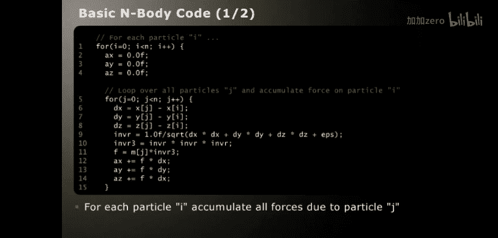

So once we've done that， we can then use that acceleration and update the position and velocity of particle I。

 so we do that with lines 16 through 21 and notice that when we update the position。

 we don't write the position back into the original array that stored that we were using to read our particle positions from if we did that the physics would be wrong in the sense that you would overwrite data that you need to calculate the force for subsequent particles。

 so we use a temporary array arrays xnu， ynu and znu， and then once we're done with our loop over I。

 we simply copy that back over to the original arrays in 23 through 26 there。And then we're done。

 so that essentially is an implementation of the antibody body algorithm and by repeating that over and over again。

 you'll be able to model the motion of particles subject to this n square N body force。😡。

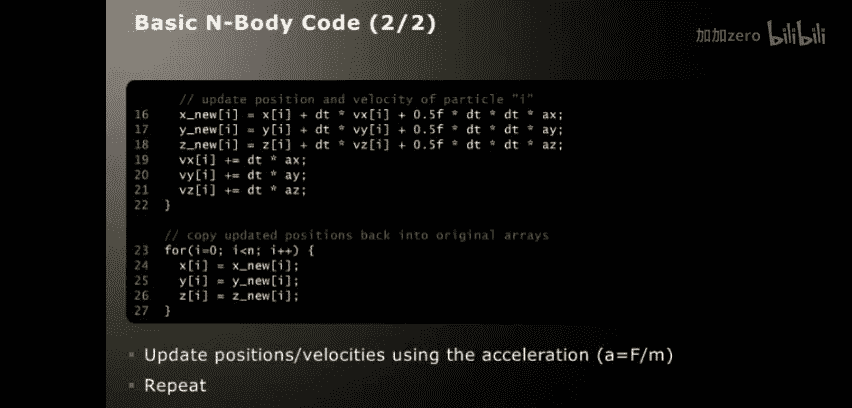

All right， so now I want to discuss the OpenCL program structure for OpenCL implementation of this algorithm。

So as you'll remember the as I said， the OpenCL implementation will consist of two pieces so there'll be kernel code and then there'll be host code。

 the kernel code will be compiled to run on the GPU and this actually performs the actual computation。

This is typically in applications based on critical loops within a larger program that you want to accelerate to provide an accelerated implementation of some given algorithm。

Then the host code it's going to perform no meaningful computation。

 so there's no calculations done by the host code， however it's still very important。

 especially as you'll see in the case of multiple devices。

 the host code will handle initialization and bookkeeping tasks and then it'll move on and coordinate the operations on。

The OpenC devices， and this is primarily involved with operations and memory management and the kernel execution itself。

Okay， now I want to move on and discuss the implementation of the kernel code。

So with the kernel code， the goal here is to provide a reasonably standard implementation that's understandable with an attempt to use good practices from an openCL perspective。

 however， I should point out it's very likely not optimal for particular architecture。

 it very likely can be optimized for a given device but the idea here is to keep it somewhat general to make it more understandable。

It's important here to remember the context of the OpenCL kernel code。

 this kernel will be executed for every work item within an index space。

 so another way to put that is the kernel will be executed for every enumerated thread in a range of enumerated threads where each thread is simply updating the is responsible for updating the position and velocity of a single particle。

 so this application has a simple one- dimensionional index space with the number of work items simply being equal to the number of particles in the system。

The as I said， the kernel code will be invoked once for each of the N particles in the system。

And the task for the kernel code is to simply update the position and velocity of one particle used being Newtonian mechanics。

So to begin the kernel code， here's the prototype for the kernel code。

And so the prototype looks a lot like the prototype for a C function with some qualifiers added。

First of all， the。The kernel itself， the prototype itself has to be qualified with this underscore kernel qualifier and that's to signify that this is a kernel function and not simply a generic function that might also be included within that file also there's qualifiers that have to qualify the address space so in this case the old and new particle positions and the velocity array also are going to be stored in global memory。

 so we use the global qualifier there to qualify those pointers。

And we're also going to use a blocking scheme that can be used to improve performance。

 and that relies on the use of local memory per work group。

So that's the last argument there PB is going to be used as sort of a local cash for each work group。

 and so we're going to pass that in as a。Pointter qualified to be local memory。

I should point out that this kernel code is then placed in a separate file given the extensionion。

cl to distinguish it from ordinary C code， so this will be put in a separate file and used in a just in time compilation manner when the programs are run。

Okay then the next thing we do in the kernel is we have to do some size and index determination and some other bookkeeping tasks。

 but before that on line nine， this is an example of the vector data types that are available with openCL so what I'm doing here is the time step was passed in as a simple float what I want to do is I want to construct a float for essentially a four vector that I'm going to use later on to perform essentially small SID operations for vector type operations later on。

And so that's how you can sort of cast a float and build up a vector data type。Lines 10 and 11。

 this is where the kernel is able to in some sense self identify and find out where when it's being executed。

 how does it fit into the larger index space over which all of the threads so line 10 it's getting the global ID that OpenCA is built in functions that allow you to get this information。

 so GTI is providing the。😡，The global ID， which is where it fits into the global index space。

 whereas in line 11 we're getting the local ID， so this is the idea of the thread or work item relative to the local work group。

 this is this local ID。嗯。In On 12 and 13， we're just simply getting the size here of the global index base and also getting the size of the local work group。

😡，In line 14， we just calculate the number of blocks for our blocking scheme。

 which is simply going to be the number of particles divided by the number of particles in a given local work group。

So sometimes it's useful to put actual numbers on this just to make things clear。

 so if we assume that we have an example where we have 8192 particles。

Typical values that you might choose for a Cypress GPU， so for example， for a Radian 5870。

 and would be 8192， the number of threads in T would be chosen to be 64 and that turns out to be a good number for the architecture。

 and then this would result in having 128 blocks in our blocking scheme。

Further the global threat ID and the local threat ID， GTI and TI。

 these would be then in the range of  zero to 8191 and 0 to 63。

 so that's where those global and local threat IDs would fit。

Okay so with line 15 we begin the actual calculation， the actual physics here。

 so the first thing we do is we read in the particle position and the particle velocity from our global arrays。

 one thing to note here is that whereas in the C code there was this outer loop over I。

 you won't see that in the kernel code and that's because that outer loop is in some sense implicit in that the kernel will be automatically executed for every particle in the system so sort of swept over your index space so there's no outer loop within the kernel it's implied so we get the particle position and velocity and then we zero out the acceleration。

And then we begin our loop over blocks。So this is at line 18， we begin looping over blocks。

And line 19， we perform what we thought of as a cooperative read to fill the cache and this is very common with OpenCL kernels and it can be at first a little bit confusing so I want to go over this in some detail the idea here is that the kernel will cache one particle position but notice that the indexing in line 19 there is offset in on both the left and righthand side by the local thread index TI in other words the index within the local work group。

 the idea here is that the kernel cache is one particle position。

 but then relies upon the other work items or threads in the work group to do the same to load up the cache and then at line 20 you have to use a barrier so this is a built-in function that OpenCL provides in order to wait for the other threads or work items within the work group to catch up。

So atlying 20， the kernel then in some sense knows that the cache P block has been filled up with the particle positions using the numbers before there would be 64 particle positions that would be read into cache。

 so the kernel only reads one and then relies on the other 63 to be handled by the other threads。

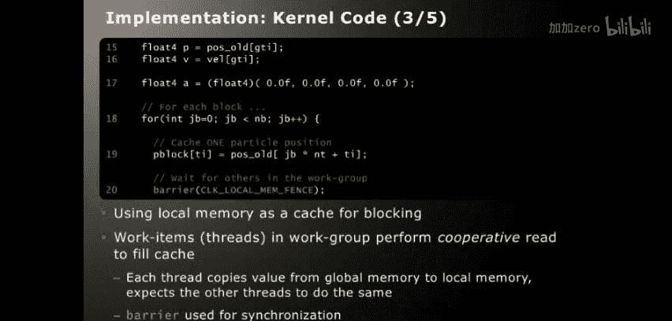

So once these particle positions are cached， then we're simply going to loop over those particle positions。

 so using the numbers that I mentioned before this would be a loop over 64 positions so we're going to loop over those cached particle positions and then in lines 22 through 27 we're essentially doing this implementing the same force calculation that was shown in the C code with some notable differences here for openCL。

 so for example in line 22 we're reading in the particle position but we're reading it in as a float4 so remember this is a four vector。

That allows us then in line 23， we perform the instead of performing componentwise differences。

 we can get the difference in the x， the y and the Z direction all at once by using essentially a SD or SSE like operation there。

In line 24， then we go and actually access the specific components。

Of these differences before where we had Dx，DY， DZ。

Now we have to access the components of our four vector， so that's the notation there is the dotX。

 doty and dot Z， which simply accesses our elements the elements of our F for data type。

So in line 24， we're calculating the inverse distance and one notable difference here is that we're using an openCL builtin function。

 R square root， which performs the square root followed by the and then calculates the inverse。

 but it does it all at once in a single operation， so this can be advantageous on a lot of architectures that have hardware that may be specialized for that operation。

Then in line 25， this is where we sort of finish off the physics here and one bit of notation that might be curious is where it's multiplied by P2。

w， what we're doing there is what we've chosen to do is store masses in this unused fourth component or fourth element of our float force。

 so we essentially have stored particle position XYz。

 and then we've put the mass for slot so to speak， just as a matter of convenience。

So at line 27 we're done with our loop over the cache particle positions when we get to line 28 we have to use another barrier to wait for all of the other threads or work items in our work group to catch up if we don't do that。

 we'll go back to the beginning of the loop body and we'll begin overriding cache that may be needed by some of the other threads that are not finished yet。

 so we have to have a barrier there for synchronization。

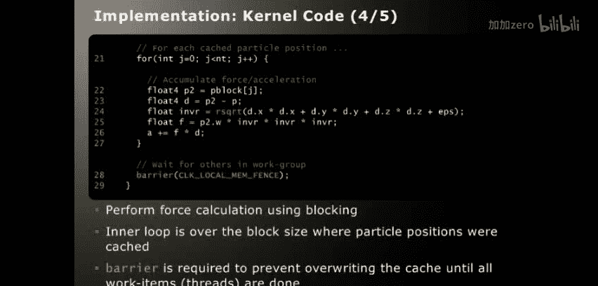

And so once we're done with the loop overall blocks。

 then we simply need to update the particle position and velocity。

 and that the equation there is very similar to what we used for with the notable exception that instead of having to do that calculation component wise。

 we're able to do that the X， Y and z components all at once。

 so we're using the fact that we're using these float for data types there。

So that's all performed on a single clock， for example。

 when in went updating the position and the velocity and then we write the new position and new velocity back to global memory and again we're writing it back not to the original array of particle positions we're having to write it back to a new array so that we don't overwrite data we may need or that other threads actually would need and the way this is going to be used is it going to be used to set up sort of a double buffering scheme later where we're going to switch between two arrays to update the particle position without in a way that'。

Thread safe。

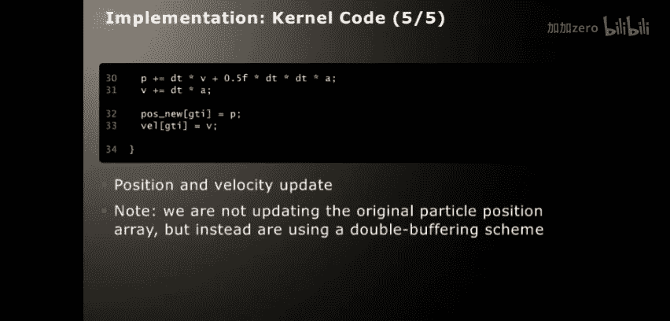

Okay， now I want to move on and talk about the host code implementation for this kernel。

So here's the beginning， so we begin by including standardcl。h。

 which I should mention also includescl。h， which is the standard open CL header file。

There are some prototypes for two helper functions， andbody and knit and endbody output。

 I'm not really going to discuss these helper functions。

 they can be as complicated or as simple as a programmer may wish to make them and these are just handled on the host side sort of simple bookkeeping and IO issues so we're not going to really discuss those and then the main program begins and initially we simply set some parameters。

Are set up for the rest of the program here， so in this case we're simply hard coding our system to have 81 92 particles。

We're going to simulate this for 100 time steps。We're going to do this in bursts of 20 steps。

 which simply defines the time between when we read data back from the GPU。

And we're going to set the number of threads or the local work group size to be 64。

And this is chosen simply to be a good number for a radian 58，70。

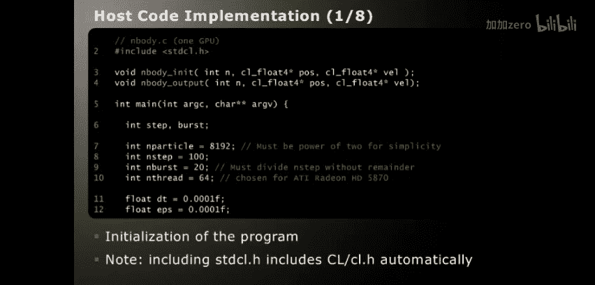

Okay then the next step is to allocate memory that'll be shareable between the host and our GPU and when you do that with CL Malock calls here。

 and so one thing to note is that the size of these arrays here are n particle times the size of a float for。

 not a float and that's because we're going to pack the data。

 the particle positions are going to be stored there in the order XYZ and then the mass。

 and then we repeat。So we're able to do this with our CL mailout calls。

 and that way we don't have to manage any of the opaque memory buffers。Okay。

 then the next step is to call this helper function to initialize our positions and veloc。

 So for example， if you're doing a simulation of a galaxy or something like that。

 you might use some sort of model to initialize。The state of the system。

Then line 17 and 18 we're going to。We're going to build and compile and create our openCL kernel。

 we do that with two calls， sealL open returns a handle to the compiled to our compiled openCL kernel code。

And then we query by name， our inbody current to extract it。

 and the result is that we have an open CL kernel that's returned in KRN there and that's then ready to use。

Okay， the next thing we need to do is set up our computational domain and we need to set our kernel arguments。

So and we use some。Macros to do that here， so basically what we're doing is we have a one dimensional kernel a computational domain。

 the size of the computational domain is of size n particle and our local work group size is n thread and so all that's happening in line 19 there is we're creating a very simple struct that has our computational domain stored in the order offset global size and then work group size and we're going to use that struct later when we execute the kernel。

Line 20 and 23 through 23 we have to set our kernel arguments and this is something that's a bit different from basically for standard C programs。

 for example， normally in C when you call a function when you make that function call you assume that your arguments are simply pushed for example onto the stack so there's a very implicit call model there that doesn't require the user to do very or the programmer to do very much。

 but these openCL kernels are going to be executed on other devices for example on a GPU and the host sort of executes them by proxy so what you essentially have to do is directly set the arguments for when that kernel is executed and so this is essentially the call model that you used for openCL in terms of setting your argument so line 20 we're setting first argument which is a simple intrinsic float representing the time step。

In line 22， we're setting a pointer to the array that's stor the velocity for all of the particles。

 and so there we use a call that's setting a global pointer。For argument for kernel argument5 well。

 it starts with zero。 so Col argument 4 and then finally in 23。

 we're not actually setting the argument to setting the。Colonnal argument to an element of data。

 but we're actually simply sizing our local shared memory。

 our local cache that we want to use for a blocking scheme。

 so they use a slightly different a different API call。

So one question that comes up is that you'll notice we haven't set we've skipped arguments two and three。

 so why haven't we set kernel arguments two and three in this case。

 that's because we're going to use， as I said a double bufferuff frame scheme so we can't statically set those kernel arguments but we're going to have to set those kernel arguments just before we execute each kernel call。

 because we're going to switch back and forth between two array。

 that's why we haven't done that quite yet。The next thing we need to do is we've initialized the positions and velocities of all particles。

 but we've done that on the host site so we need to transfer that data over to the GPU。

 so we do that with a CLM sync call， so what we're essentially doing here is we're synchronizing those arrays to the device so in this case to the GPU and we're using the other flags there are implying that we want to do this with these are simple blocking calls。

 so when in line 24 when CLM syncy returns we know the data has been transferred。

 it's a blocking call。As should mention here， the second argument being zero， this is the device ID。

 but since we only have one GPU in this case， it's very simple the device ID for our GPU is going to be zero in this case。

Okay， and then in line 26 we begin our loopover steps so we've nominally set this to run for 100 time steps。

 so we're going to begin our loopover steps， and as I mentioned we also introduce this idea of this value Nbu。

 that's simply going to be the number of steps that we iterate before we transfer data back from the GPU to the host and that's used both for diagnostic purposes but also in reality since there's a bottleneck there in terms of PCIE bandwidth most applications that may use an algorithm like this typically don't need to have the data every time step。

 but in fact can run for a little while and bring data back in infrequent events or stride the data so to speak。

 so our step loop is broken up into two pieces there in 26 and 27。嗯。

Then we're going to actually execute our kernel so as I said we needed to delay setting our kernel arguments two and three where we're going to do that now。

 so we had allocated two arrays to hold particle positions for this double buffering type scheme so we're going to set those global pointers for arguments two and three and thenre we're going to execute the kernel and what we're really doing is inqueuing the kernel to be executed on the GPU that's an important point。

In this case we use the flag sealL event no weight。

 this means that it's effectively going to be a nonblocking call。

 so sealL Fork will return immediately regardless of whether the kernel has finished or even begun executing on the GPU。

In Line 31 through 33， we're essentially going to repeat this with one small bookkeeping change。

 and that is that in this case the initial particle positions are now position in a 2。

 and then the updated particle positions will be then stored in array 1。

We then go ahead and in the kernel again， execute our kernel， and then we're going to loop over。

 we're going to execute this loop。呃。We're going to execute it and we're going to in cu and burst kernels。

 so essentially when this loop is completed line 34。If we've chosen， for example。

 NB to be equal to 10， we'll have queued 10 kernel executions will be on the queue to execute at this point。

😡，At line 35 then we're going to wait so having queued up all of those kernel executions。

 we're now going to wait for them to complete， so we do that with a synchronization call CL Wait。

 so when CL Wait returns on line 35 we know that the has all of the kernel executions have occurred。

Then at line 36 what we're going to do is we're going to bring the data back from the GPU to the host and we do that with CLM sync we're here the difference is that we're syncing to the host in this case。

 so we're going to bring the particle positions back。

 so at that point if you were doing some type of visualization along with this calculation you could display the particle positions maybe every10 steps for example。

 and again in both of these calls the zero there in the second argument that simply indicates that we're using device ID zero which represents our single GPU in our system。

And finally， at line 36 we've not completed the iteration over as many steps as we wanted。

 so we'll use a helper function to output the results and then we will then clean up the resources。

 so we do that with a CL close which simply closes out the handle that we used to build our kernels to compile our openCL program。

 and then we just free the memory that we allocated。And that's it for the host code。

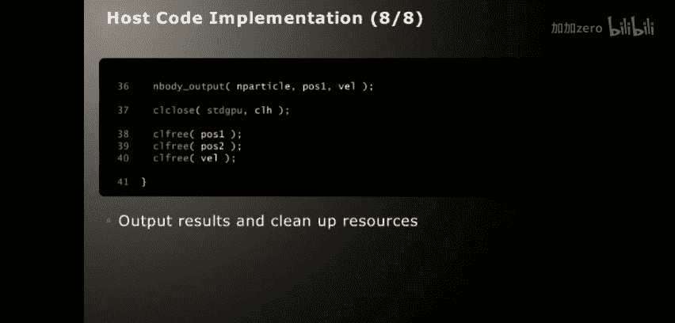

So I just want to mention how one would actually compile the code and just mention this very briefly what I've done here is I've simply shown an example of a make file that one would use and really the only thing to notice is that you simply have to provide the right path for the openCL headers and you have to in this case using standard CL you have to provide a path to the standard C header as well。

 and then link in the corresponding libraries but other than that there's no real difference so this will compile our host program one point to make is that if you move that executable around you're going to have to carry with it are the doclL file that has our kernel code because that is compiled at runtime using the just in time compilation approach。

 so that file has to be carried with the executable。

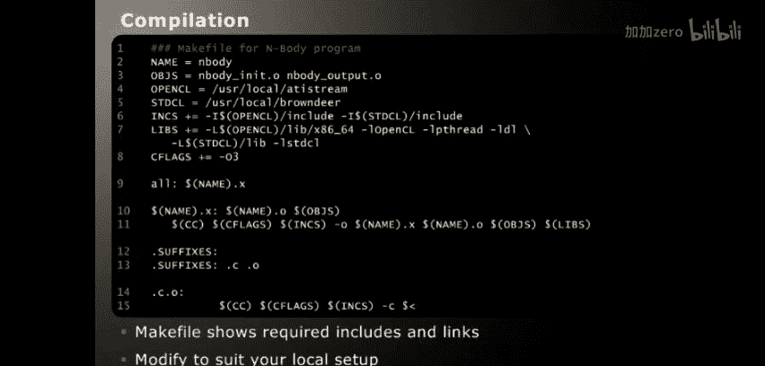

Okay， so now what I'd like to do is discuss how one would modify this code to support multiple devices and in this case I'm simply going to assume that we'd like to execute the code on two GPUs as a simple example。

So。The approach here is going to be very simple。What we want to do is divide up the work for the force calculation and the updating of particle position and velocity。

 we want to just divide that up between the two GPUs。

 so basically we we're going to have one GPU responsible for one half of the particles。

And so the important elements here are， you'll see there's very little change in the kernel code itself。

 but there are some notable changes on the host side involving the synchronization and memory management issues that are introduced now that we're using two devices。

So I want to begin with discussing how we would modify the kernel code。

So to begin with here's the prototype for the kernel code and as a matter of notation。

 what I'm doing here is I've indicated the red line numbers indicate code that's been introduced that's different from what we saw with one GPU so in this case in the prototype there's one change that we make and that is that we have to add an additional argument。

And this is this position remote。 What that is effectively going to be is that's going to be a position to。

It's going to be a pointer to particle positions。For particles that a given GPU is not responsible for updating。

 but still needs in order to calculate the total force。😡。

Because we've basically divided up our particles， we're going to divide them up into two arrays。

 we need to have an additional argument which points to the what I'll refer to as the remote particles in this case。

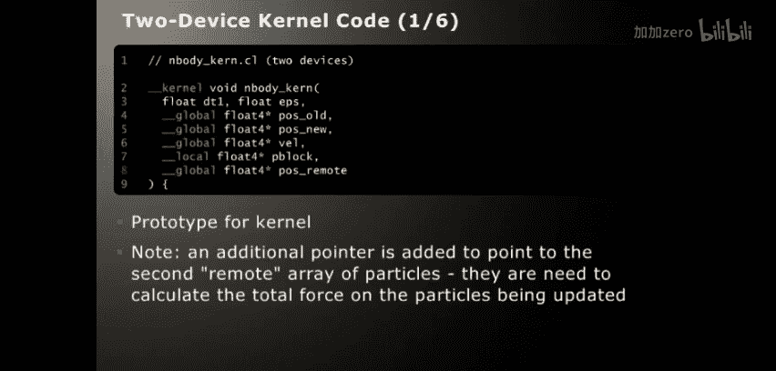

As far as this initial bookkeeping up front， there's no change at all in terms of getting the thread ID in the。

In the global size， local work group size， things like that， there's no change at all there。

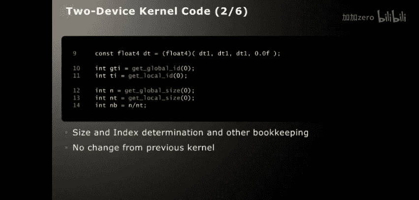

Also so now we begin sort of the actual physics here within the kernel。

 and again there's no change here in the code， there is a very subtle change though in the comment within the code that I would point out here。

 so the kernel code at this point looks exactly the same as before。

 but what I've noted just before line 19，I that line 19 is caching one particle position。

 it's caching it from the local particle array， so in other words。

 it's reading this in from the array of particle positions that this GPU is responsible for updating。

 so that's the only change there is just to understand the context of what's going on in line 19。

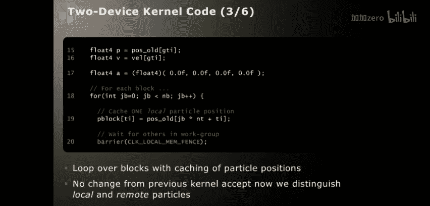

And then。Again， there's no change at all in terms of where we loop over the cache particle positions and actually calculate the start to or accumulate the force or acceleration on a given particle。

 there's no change at all in the code except before line 21 again I've noted that this loop now is over local particle positions。

 in other words particle positions that this GPU sort of owns or is responsible for。

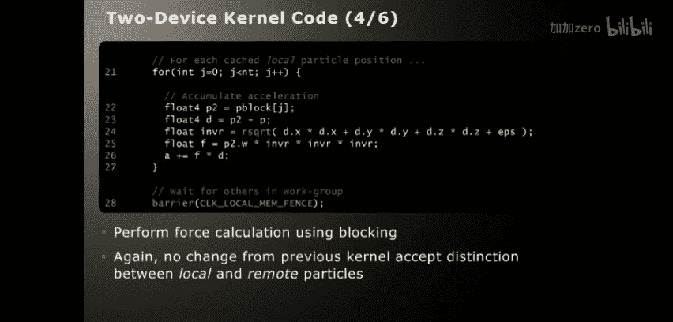

So here is the actual the significant code that needs to be added to our kernel code。

 so what we're doing here is。

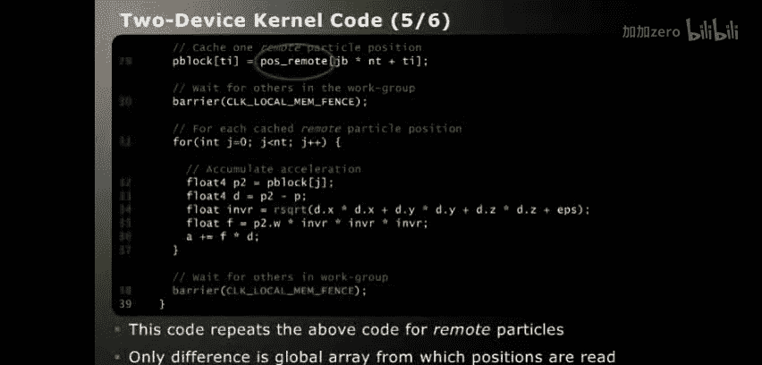

Having accumulated the force due to the local particle positions。

 what we then have to do is we have to also include the force due to particle positions for the particles that the other GPU is responsible for updating so this is what I refer to as the remote particles so here this code is essentially repeated from above and the only real difference is sort of highlighted at line 29 there and that is where we're reading particle positions in from when we cache them。

 so having cached the particle position there， we then go through exactly the same the same set of operations that we did above so we have essentially split up our loop over particles into two pieces so this may not be the optimal approach but it's fairly simple to introduced and these changes in a very compact way。

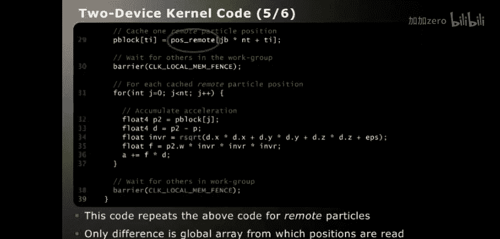

And then this finishes off our kernel， there's essentially no change at all in terms of the updating of the particle position and velocity once we've calculated the total acceleration。

 it's exactly the same as before。

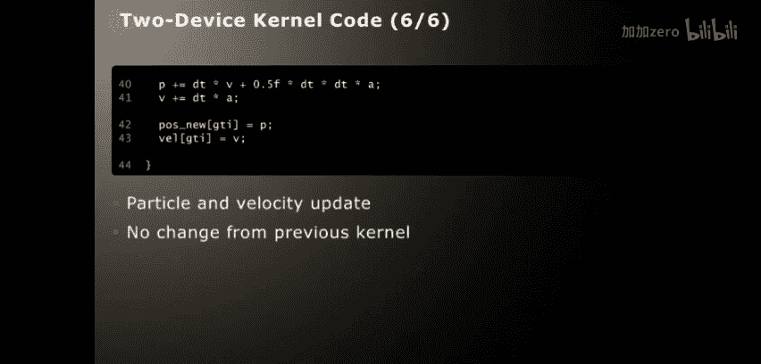

Okay， now what I want to talk about is how we would modify the host code for two GPUs。

 and this is where' the more significant changes occur。The upfront code doesn't change at all。

 it's exactly the same as before， so the initialization has no change at all。

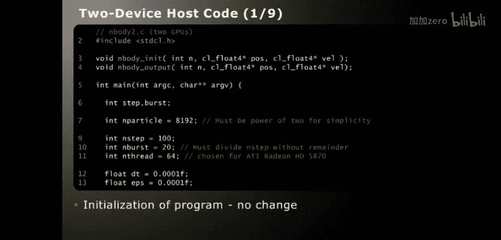

嗯。The first changes appear when we begin allocating memory， so just for convenience here。

 what we've done is so we allocate a position an array to start the particle positions that holds all of the particles just as a matter of convenience。

 but what we do at line 15 and 16 is we begin allocating half sized arrays so since we're going to have to divide the particles between GPUs we allocate arrays that are one half the size for one half of the particles and so I've just highlighted there that this is N particle。

Or you know these are halfsized arrays there， so we have to do that in the case of the position arrays。

 we have to do that twice because we're going to still use this double buffering approach and then for the case of the velocities we just have to allocate two halfsized arrays that'll help divide up the particles between the two GPUs as a matter of notation here。

 I'm using A and B to correspond to the two GPUs within our system to help as just a matter of bookkeeping here。

Okay， so the only change then， so we initialize our particle positions and velocities exactly as we did before。

 but now we need to divide them up into these half sized arrays and that happens there it lines 23 through 26。

Where we're basically taking the particle positions and velocities and we're splitting them up into these half sized arrays that we allocated。

嗯。And here there's only one subtle change when we set up a computational domain。OurOur work。

 the index space now is going to be only one half。The size of the original index base。

 the idea here is fairly straightforward， we've split our computational domain up into two parts and have the work being shared between the two GPUs。

 so this shows up here it's highlighted in line 29 we essentially have to create a computational domain that's one half the number of particles。

But other than that， it's the the。Same as what we did before。

There's also a very subtle change in lines 30 through 32 in that code hasn't been added。

 but code has been removed。嗯。What's happened is initially we were able to sort of statically set the argument which was the pointer to the velocity array。

 we're not able to do that now because as you'll see when we're executing the kernel or inqueuing it to be executed between these two devices。

 we're going to need to set that dynamically just as we were setting the particle position arrays dynamically before。

So here this is the equivalent of where we previously copied our positions and velocities over to our GPU。

 in this case now we need to copy over these halfsd arrays that we've allocated to the two respective GPUs and so what I've highlighted there is that the second argument indicates the device ID and so with two GPUs this would either be zero or one in order to。

To define which device or which GPU you want the data to be written to， but other than map。

 the calls are exactly the same as before。Okay， and now we begin the loop over steps， which again。

 39 lines 39 and 40 just reflect that we've sort of broken this up into our step loop into two parts。

😡，But lines 41 through 45 is where we actually begin executing the kernel or' inqueuing it to be executed。

🤢，So what you see here is that we have to set more arguments dynamically。

 so just as before we set kernel arguments argument two and three to point to the old and new position arrays。

😡，But now we also have to set argument four to point to the velocity array。And then additionally。

 we have to set kernel argument six to point to the array of particle positions that I refer to as being the remote particle positions that are the particles that are not being updated by this GPU。

 but having said all those having set those kernel arguments。

 then we've simply in QR kernel very similar to what we did before。嗯。Lines 46 through 50。

We basically repeat these steps with just a difference in bookkeeping because now what we're doing is we're incuuing the kernel to execute on GPU number one or on the second GPU with device ID1。

So if you look at the bookkeeping there and how the kernel arguments are set。

 it's sort of the reverse or the mirror or duall of what was done above there to allow the second GPU to update the other half of the particles。

Okay。Now here's a step that's entirely new that you have to introduce when you go from one device or one GPU to multiple devices。

😡，that is that we have to exchange data between the two GPUs because as we're updating the particle positions on one GPU。

 it needs to have the updated particle positions that were calculated by the other device。

 so this is a data exchange operation and so the way we do this is lines 51 through 52。

We're synchronizing the updated particle positions to the host。

So we've synchronized that data to the host。Then in line 53 and 54。

 this is a synchronization step where we're going to wait for everything to catch up up till now the kernels that have been ind the4k calls and these CLM sync calls。

 these have all been non blocklocking， so they returned immediately and simply queued all of this up。

In line 5354， we're going to wait for the data， the updated particle positions to actually be transferred over to the host。

😡，啊。Having had that happen there on line 55 and 56。

 we then synchronized these updated particle positions back to the GPUs。

 but I've highlighted the bookkeeping there， we basically switched the half-sized particle arrays that were that we were representing there。

 so this is where the data exchange happens， so this is going to cause the particle position that we' updated on one GPU to then be written back over to the other GPU for use。

At one point I should mention as well， for some implementations of openCL。

 one would have to introduce a CL flush call at line between line 52 and 53 to flush both GPUs flush the cues。

 some implementations wait for a weight call， before actually beginning to execute commands so it have true concurrency。

 you have to introduce that in some cases， this is implementation dependent。

 it's not really part of the standard， which is something to be aware of。

 but you can in fact then to get both GPUs working at exactly the same time。Okay， so this code here。

 and I'm not going to go through it， essentially what you're looking at now is a repeat of。

The steps above。And the reason this is repeated is because of this idea that we have to use a double buffer scheme to have the old and new particle positions swapped between these two arrays。

 so this really implements everything that was done above。

 with the only difference being subtle differences in terms of the bookkeeping here。

 and I'll leave that as an exercise to follow through。

 but it basically the end result is that then the updated particle positions are back into the array number one。

 either 1 B or 1A。So the at this point at line 68， the data。

 the particle positions are synchronized to the host。

 but what we have to do is we have to copy them back into our。

Larger array that holds all particle positions and this is really just a matter of convenience so we can reuse some of our helper functions essentially so this is just taking the line 60 and 69 or copying one half of the particles positions back into our larger array and after that everything follows that's essentially the same the only additions were that we have to free up more resources because we had to allocate extra these extra arrays to divide up the work。

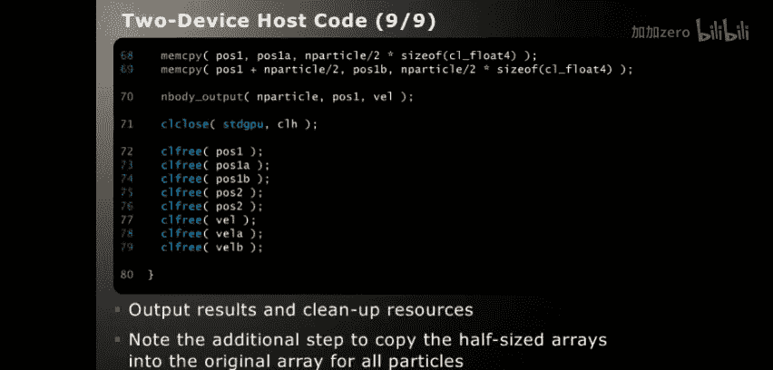

And that's it then those are all of the changes necessary to use to GPUs what I want to do at the end here is just mention some resources that would be very useful and sort of go along with this and first and foremost is the openC standard itself so there's a URL there where you can find the standard and I highly recommend any OpenC programr having the standard you know。

Readily available it's very easy to follow I find useful as a programmer this to the code that was presented here has been tested against version 2。

1 of the ATI stream SDK and I've provided here a URL where you can find a download of that SDK and also documentation。

That goes along with it， this standard CL API that we've used that sort of simplified the host code programming。

 there's two URLs where you can find that。To download and also there's documentation that's available at that final URL I've shown there。

 you can find documentation on that API。And as I mentioned， it's open source。

 so you can go there and you not only get the code。

 but you can actually look and see how all of these calls are implemented and connected with the raw openCL calls。

And thats that concludes the presentation。 so now I think I'm going to move on and。

Take some questions here。Let's see， okay， the question is。

 is it possible to use openCL for singular value decomposition or non negative matrix factorization。

 can it be highly parallellyzed？I haven't worked on those specific algorithms before。

 so I don't know the specifics on that， but I would think that there would be a good likelihood if those can be fine grain parallelzed。

 then then there would be an opportunity to use OpenCL for an implementation on GPU for example。

 so I can't give a definite answer， but I think there's a good chance that that would be true。Okay。

 this is a good question is does data does the data in global memory on the GPU on your graphics card。

 for example， does the data in global memory stay the same in between kernel executions on the GPU and in fact it does stay the same so you can rely on the fact that your data in global memory on your graphics card will be the same in between kernel executions。

 and that becomes very important because in a lot of cases，For more complicated algorithms。

 one would actually break up their algorithm into multiple kernels so you can execute multiple kernels in succession and you can rely on the fact that your global memory is maintained there。

 the data is stable within that global memory between calls。

Okay so this is a question is Standard scale API for UniX Linux only at present the implementation is only for supported for Linux。

 but a Windows port is being worked on and should be available soon。

 there's no reason in principle why one can't use the same API for Windows is just a matter of providing a port for that。

 that's an ongoing effort that should be done shortly。Okay。

 can you share memory between a GPU and the host？And there's added here。

 especially from the fusion processor's point of view， this would seem to be useful with OpenCL。

 there are some flags that allow you to qualify the memory buffers a bit to help the implementation choose how to implement the underlying memory。

 it is possible for a GPU to use memory on the host。

 the reason why you so and there are some advantages to doing this。

 but there are also some disadvantages， so for a typical graphics card。

 there's a bit of a performance penalty for doing that。

 so typically you would want to use global memory thats specifically allocated on the graphics card。

 although an implementation can cache the memory on the host somewhat to mitigate the performance issues。

In the case of a fusion processor， things get a little bit different there in the sense that the performance for access for the GPU accessing main memory may be faster。

 and so OpenCL has the ability to allow for that， but it's really an implementation issue。Oh。ちっと。

Okay， does or how does OpenCL decide which memory to allocate when you allocate memory through the API。

 how this actually happens， as I said， it's sort of related to the previous question。

 there are some ways to specify or control how you want that memory allocated。

 but the underlying implementation， so for example， the AI Stre SDK， and at the driver level also。

 there's some implementation specifics there。Where they will try to handle this efficiently。

 so you have some control over this， but some of this is handled below the API and at the implementation level。

Okay， so here's a good question， is there a difference in memory allocation between global and local pointers？

There is a bit of a difference there。😡，In terms of global memory。

 you actually allocate the global memory in some sense in a more traditional way。

 even though you're using these underlying memory buffers that are allocated。

 it's more like allocating traditional memory， in the case of local memory。

This memory really refers to local caches。That are very close on the chip， for example， close to the。

A given compute unit。And so you don't， when you allocate those。

 what you're really doing is you're specifying how much of that shared memory should be allocated for a work group。

 and this is really done at execution， so you really are sort of defining what you would like allocated when the kernel is executed。

Okay， can you explain why for example， 64 is good for a 5870 so that you could make predictions maybe for another architecture？

The number 64 isn't an absolute， it would really depend on your algorithm。

 but it's generally in determining a good number。A lot of times it's generally a multiple of the underlying。

Coourres that are supporting the execution of thread so to give a specific example with the 5870。

 every compute unit has 16 physical cores that are going to execute a work item or a thread。😡。

We choose the number 64 in this case， which essentially oversubscribes the compute unit。

 but that's actually good because it's a multithreaded processor。

 so what it is it allows the processor to hide memory latency by very fast context switches between threads。

😡，64 just turns out to be a nominal way to oversubscribe the physical chorus by a factor of four。

 which tends to lead to good performance。呃。Okay， in Linux。

 do we need to load and run the FGLRx module to run openCL apps or is it okay to just install？😡。

The stream SDK。And use open source ATI drivers to my knowledge。

 the open source drivers different from FGLRX， I'm not aware of any that have support for OpenCL at this point。

 so practically speaking if you use the ATI stream SDK to target a GPU。

 you will need to run the have the FGLRX module loaded。Okay， here's a question。

 is LibB Standard C compatible with the C++ binding？

So if I interpret that in terms of whether you can use this API with NC++ code， you can。

It is compatible with C plus plus code。 In， it's used with C plus plus code quite a bit。

 So it is compatible with those binding， although the underlying。

Implementation doesn't use the C++ bindings， so it's a pure C implementation。

 but it is compatible with C++。This is a good question I see okay。

 so it says I see indexes such that are declared as 32 B。

 would it not be better to use short or unsigned short？As long as 16 bits are enough。

 I think the thinking there is whether there's going to be a performance advantage for that。

So I think this stems from there may be an issue in terms of whether 24 bit integer operations it can be done faster by the streamP。

 I don't know the specifics on that as to whether that actually would lead to a performance advantage or not in the current architecture。

Okay， so this is a follow up to that question basically asking about the 24 bit integer issue。

So whether that leads to a better performance， I'm not sure whether that would be the case whether。

there be a performance improvement。Okay， here's a general question。

 are there any tools for editing OpenCL kernels？And then have features like code coloring or syntax checking。

 et cetera。I'm not aware of any specifically， I do believe that there may be some that， for example。

 for visualual Studio plugins for that or another example might be whether if you're using EMs or something like that when there are extensions。

 I'm not aware of any， but I wouldn't be too surprised if you Googled around and found that there are。

 I just haven't used them。Okay。In the dual GPU example。Okay， let's do。Okay in the dual GPU example。

 the question was would the it says position one array， this was basically the large array。

 not the half-sized array it says would that have been could that have been allocated with the simple maillock and not done using openCL and the answer is yes。

 in order to keep the code as similar as possible I simply allocated that with a CL maillock call。

 it wasn't actually necessary， so since we only had as holding all of the particle positions or velocities。

 werere only used on the host side， they could have been done with simple。Maylocked memory。

 although using sealL Malock actually has there would have been no penalty at all。

 it would have allocated the same type of memory。Okay。

 are there any performance benefits for using the CLMM Read only or sealLMM Re？

Right when allocateocd memory buffers， I think those are introduced because they can on certain architectures。

 but that would be very architecture and implementation dependent。

In terms of whether or not a more efficient memory。A type of memory could be used in those cases。

Okay， that's a good question， could you say some more something on specific optimization that you might use？

For in the case of ATH GPUs。Because I mentioned that the code might not be entirely optimal。

Once you get into the optimizations， it can be very， very subtle and require a lot of tuning。

 some of the general ideas one might use is to try to exploit the ability to do vector operations a little bit better。

 so we stored particle positions as XYZ and then mass。That's not always the best way to do it。

 there are cases where it's better to store what you would basically do is arrange to have all of the X components of particles in one array and then another array for the Y component the Z component etc cea。

 or essentially organize your data in some variant of that so there are opportunities to exploit the vector operations but they start to make the code a little bit more complicated to follow also。

😡，in a lot of algorithms， perhaps even in most， controlling memory access becomes the most critical issue。

 so very carefully organizing how you're reading and writing memory can be very critical and lead to optimizations also。

There are source level optimizations you can do that essentially reflect the fact that the compilers right now aren't generally optimizing。

 so for example one might choose to manually unroll loops， for example。

 there can actually be an advantage to that， so optimization is a very complicated topic。

 but there are a lot of different things you can try for a given algorithm。Okay。Let's see。

Is it possible to avoid memory transfers to the host side。

 so I think this refers to the dual GPU example， the idea there being could we simply transfer the data between the two GPUs without going back to the host？

嗯。I think in principle you could， this would definitely be architecture specific and implementation specific。

 but I know for example， with a dual GPU card like the Radian 5970。

 the last time aware you were not able to transfer data between just between the two GPUs。

 but you had to come back to the host， this is something that may change in future releases of different implementation。

 so it's probably possible in theory， it's really a question of implementation。嗯。

Is it possible to read and write to the same global memory buffer in one kernel？OhOkay， yeah， yeah。

 so as long as the global memory was allocated as ReadWrite， which is sort of the default。

 you would be able to do that， the only problem would be that if you had qualified the memory to be read only。

 for example， you wouldn't be able to write to it， but yes， you can read writer to the global memory。

Okay。What happens if C MayLc runs out of memory is their virtual memory？

As opposed to the way memory allocation would occur on the host side within open Seattle。

 it's a little bit。A little bit trickier in the sense that when memory is allocated with open C。

Since it has to be shareable， it has to be available from all devices。

There has to be the ability to allocate the memory in all devices。

 so there really isn't the concept of virtual memory in that case。

 if you're going to run out of memory you would probably have to as a programmer find a way to get around that and recycle memory。

 but there really isn't the concept of virtual memory。

 at least not in most implementations at this point。How about using？Complex data types。

 is it possible to use predefinedstruct as an example， so I mean in principle yes。

 I think what you'll find is that that'll kind of depend on the implementation of the compiler in terms of the degree of sophistication it's able that you're able to use more complicated data types。

 but in principle yes， the standard supports that。Let's see。Okay， so this again relates to。

 is it technically possible to do GPU。GPU to GPU memory transfers is that possible with openCL。

 so that's essentially an implementation specific issue within openCL you could request to transfer data from one GPU to another。

 the question is whether the implementation would necessarily bring the data buffered back to the host。

Is there some size limitation for memory buffers， there are size limitations that're going to be essentially defined by the available memory across your various OpenC devices in your system and the implementation will have chosen some sort of way to put an upper bound on that。

Okay， would it be beneficial to store DT and apps， these are basically simple floats or intrinsic data parameters passed in。

 would it be better to store them in constant memory？

It's possible I think that would be an architecture and implementation specific issue。😡。

Because it's not clear， in fact， when you pass these intrinsics in。

 the implementation decides how it's really going to do that。Let's see。

How can I be sure that the memory buffer is placed in the fastest accessible memory， for example。

 the AGP memory for the GPU， so again， when you allocate the memory。

 you have some control over whether you want to use host memory or，🤢。

Global memory on the graphics card。So you have some control and then at the same time the implementation itself will define how it may buffer the data a little bit。

 so there's some optimization that you don't have to worry about。

 but you can specify that you want it allocated on the graphics card。嗯。

Is there a syntax file for VM for openCL files， again I'm not sort of related to a previous question I'm not aware of one。

 but I wouldn't be surprised if I I'd be surprised if someone hadn't at this point constructed that or if they haven't。

 they certainly will soon。Are there any open SE profiling tools， for example。

 to measure computational units utilization or memory transfer utilization？

There are tools that you can use that are provided in the various SDKs to analyze just that。

 so if you look at your OpenC implementation， the SDK comes in there are some tools to look at。

 there are also some third party tools available， for example there's a way to trace host side。

 OpenC calls， things like that。Let's see how about memory fragment， Okay。

 so this question relates to memory fragmentation。On the GPU side。

 how can you prevent memory whether or not memory fragmentation may prevent the allocation or large memory allocations。

 it can this is a very implementation specific issue so essentially the implementation is going to have to make sure that it manages that properly。

 so that's not something you can really get access to directly through the API。Okay。

 if you use double precision， so if you wanted to implement this with double precision。

 would you still use 64？For the local work group size or maybe it says it suggests over 32 or 16 instead。

That's something you would have to really test， it's a good question。

 you would want to test that on whatever architecture you're using， there's not an obvious answer。

 if you implement this for double precision， your data is essentially doubled so it's going to change a little bit the relationship with the memory bandwidth and latency and so you would want to test that there's no obvious reason why lowering at to 32 or 16 would be advantageous though。

U。The standard cell provide GPU information， for example， the number of cores， et cetera。

 there are some helper calls that you can use that you can very easily get the information for all of the devices。

 for example， within the standard GPU context。呃。And it looks like that's the last question。

 so I think。嗯。In conclusion， I'd just like to thank everybody for their interest in the topic。

That's all I have for today。Thank you。Thank you， David， and thank you everyone for joining us。😊。

The recording of this webinar will be made available to you， and this concludes our presentation。

 you may now disconnect。😊。