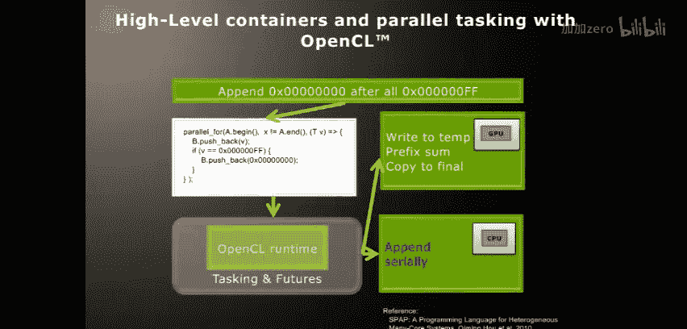
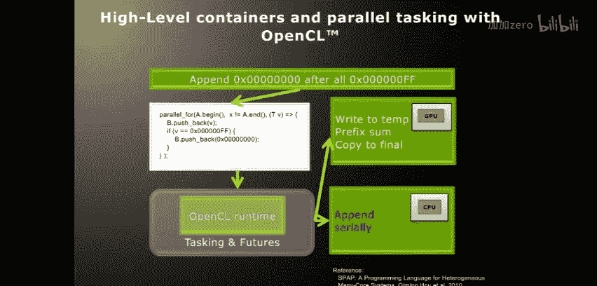

# 【OpenCL编程 RayiYanuTara】 p15 p14 6 - Device Fission Extensions for OpenCL -BV1X2BRYyEeM_p15-

My name is Ryan， and I'll be your event specialist today。Following the presentation。

 we'll have a question and answer session。 However。

 you can type your question at any time during the presentation。Click the Ask a question button。

 type in your question in the open area， and click Ask Que to Submit。

We'll answer as many questions as time allows。If you should need technical assistance。

 please type your inquiry into the tech support box on the left hand side of your screen and click the sendend button。

If you are disconnected from the webcast， you can log on again using the login instructions provided to you。

If you cannot log back on with these instructions， please call support at 866-271-7592。

Its now my pleasure to turn the webcast over to your speaker， Ben Gasster， Ben， before floorjo。Hi。

 thank you。😊，My name is Benedict Gasster， and I'm a software architect。At Amd， where in particular。

 I've been focusing in recent times on GpGpU computing as we move into this kind of heterogeneous。

Era， I suppose I've been more and more focusing on both the CPU and the GP in the past。

 Maybe it's been more on the GP。And today， actually。

 I'm going to take the opportunity to talk to you about。

A useful and exciting extension for openC called Dev Vission。

 and actually it highlights that the kind of transition back from just the GPUs to both the CPUs and the GPUs to because I'm going to talk mainly about this feature。

 and it's what we support today on our CPUs。So。Before I begin。

 let's talk about before we get to the device vision extension。

 Let's talk about extensions in overse in general。 I don't think so far in the。

The seminars and webinars that have gone over the last few weeks in OpenCO and the 1 I did originallyly on heterogeneous how our languages and computing。

We didn't talk about extensions for open andCL and well in fact OpenCL has three different types of extensions and the first is what's called a KHR extension and this is an extension that is basically approved by the OCL working group。

And it comes of a set of conformance tests， just like all of the other。

 like the standard itself has a set of conformance tests for anyone who wants to use the Opencl logo or claim that they're open C compliant。

Has to pass these conformance tests。 And you don't have to pass them。

 You have to submit them to Chronos for verification。

And so if you want to support an extension at a KHr extension， then you have to do this， too， so。

Obviously， in general， you don't want to encourage kind of using too many extensions and having too many of those because of it means there'll be a divergence in implementation and you won't get the portability that's been promised over seal。

There are definitely needs for。Extensions and one of the most common ones is the D3T10 sharing one。

 which is basically allows you to interrupt between the DirectXX10 API and OpenCL without going back to the CPU say if you've got your data on the GPU。

Now， of course， some of the vendors， including AMD。

 support Linux as a platform and Apple support OSX， the platform， and in those cases。

 direct deck doesn't make sense because it's not supported on those Os。

 And so that's why this is an optional extension。 and you'll find at least most of the vendors on their Windows。

Platforms support this extension。As an example。And one of the things that's true for all of the extensions available in Opense are the documentation for this extension will appear on the Kronos。

Open C restry website。 And so that means that you don't have to go via a vendor to get the documentation。

 And you'll see that later on， even for vendor extensions。

 that's true as well that these extensions are documented on the Open C Chronos website。

 So they're all open and above board， in some sense。So the next kind of extension is called an EXT。

 now an EXT has is an extension that's developed by at least two or more of the working group members。

 however， it does not need to be approved by the whole working group so it could just be November vendor A and AMD doing work together to develop an extension。

And this will be class as an ExT extension。 There's no required performance tests。

And so it is possible that implementations might diverge。

 even though they've tried to implement the same spec。I mean， that might happen anyway。

 but it's a conform assessed。And they some。We're going ahead to try and remove those differences。

I will limit them in some sense。And so the documentation is， again， on the Kronus website。

 and you can find that。Now， the third and final type of an extension is called vendor extensions。

 and this is， for example， CL_ MDD_ Printf is MDD's own printntF extension。Now。

 these are developed by a single vendor and most likely will only be supported by a single vendor。

 not necessarily true， but most commonly true。And。Of course， if you use these extensions。

 then you'll find and we implement another vendor。 So the portability becomes a bit more of an issue。

 your code depends on those extensions。 And so you should use those with discretion。

And when necessary so， the printf1 in some plants might be a useful one to use because you can use it for debugging。

 and it's unlikely that you'd use it on your deployed。The deployed code。

And so there you wouldn't have to worry about。Haapability。

 depending on what the user had installed and so forth。

So there are three different types of extension and then I want to talk to you today about an extension called device fission Now device visionssion is a KHR。

Is a KHr extension， I say I think it's supported as an ExT， but it's about to become a KHr。Extension。

 and so there will be performanceance tests。 More than one vendor will implement it。And。

The idea behind device vision is that you have this big device that has lots of compute units on it。

 So if you think of as CPU， for example， you might have a four corere CPU。And OpenC。Okay。

Will expose this device as a。Single opencl compute device。

 And so the problem with that is that it's great if I have four calls and you can and work in the work groups and everything that we've talked about in Opencl previously will be executed dynamically。

On these。Devices and spread across it maybe load balance a little bit， and so forth。

AndBut what happens if you wanted to reserve one of those calls for doing high priority type work。

 or you wanted to be able to control how assignment is laid out to different calls。 So say。

 for example， you knew that you had an FMP based system and you wanted to make sure。

That you allocated some work groups and was some kernel dispatcherches there group of work groups to one CPU that have four core CPU。

 maybe that was sharing the same cache。 so you can guarantee some sense of cache reusability and things like that。

 So you might have a numer aware application。And so device visionion allows you to subdivide up these Uber devices in some sense。

 take the four cores， divide them into two new openCL devices。

 or maybe divide them into four openCL devices as we'll see in our application。

 we divide it into units of one and you can divide them both up by name， so you could say。

 you know each core might be call one， core two， core three， call four for example。

 and so on you can divide them up by that， or you can divide them up by memory affinity so you say that the shared the same cache。

For example， so in a nu system， you might want to do that。

And there's are lots of other different types of dividing policies that you can choose to use。

 And I'll show you one today that I've been using in this work。And today。

 this is supported on the CPU implementations and the cell broadband devices。

 so AMD supports this for their multico CPUs， and I believe that we support both AMD processes and Intel processes for doing this。

And you can actually divide enterprisees up with respect to hyperthreads as well。

 instead of some knowledge of those， and the IBM cell。

 I believe supported on both their power cause and also on the FUs themselves so you can divide them up you can split up the SPUs into two pairs。

 say for example。And it's quite possible in the future that you can imagine this kind of extension being moved onto something like the GPU as well。

 But today we don't support that， but。But we're looking forward towards that， as I said。

 an EXT extension， in which this actually is an AXT extension at the moment is moving into a KHR。

And that was developed， has to be developed by one， a two or more。Working group members。

 And this actually was developed by AMD， Apple， IBM and Intel。

And so it gives you an idea of the kind of people that are interested in this。

 I suppose these are the people that all have CPs today that can support this feature。Okay。

 so now I'm going to motivate you and to motivate the use of device vision or one use case of device vision。

 and also give you an example of how it works。🤧I'm going to motivate this by an example。

 And I always think that's a good way to motivate things， to give you a practical example。

 to see where it can be useful。And hopefully this will give you ideas where you might want to use。

In the future。So some of the work that we've been looking at in AmD is looking at parallel algorithms built on top of occupancyncancy。

 also， for example， parallel4 and parallel reduction。

 So features the kind of things you get in task based libraries。Like TVB， for example。

We've also been looking at parallel containers so you know very useful features in C++ and Java and other high-level languages is to have container types like vectors or cues and dictionaries and of course once you go to the parallel world you might have a queue that originally will just have an in and out for it but you may have multiple people reading from it。

 you may have an empty queue and a thread reads from it and so you want to block on that so you start introducing blocking and unblocking。

Ces。And of course， parallel dictionaries and things like that。

So they could be implemented as a parallel hash table， for example。

Vectctorors are very straightforward， but the important thing about vectors is that they have operations for inserting and pushing back into a vector。

 and so if you take a sequential loop where you're pushing back on the back of the vector。

 you'd expect that operation to always appear as a function of the loop itself， so for example。

 if you're inserting at iteration 4 and you've already pushed back four elements and you do expect that to push back the fifth element。

In the resulting vector， now the problem becomes， of course。

 if you paralyse this and you don't have any ordering on it。

 then you could quite easily insert the fifth element first。

And then the first element may be at the end， for example we'll see an issue with that coming up later。

Now。We're going to focus on this talk on the vector pushback operation。

And what we're going to try and do is retain the sequential semantics of that I just described。

 so that so when I'm at iteration 4 and I push back a value。

 I really want that to be the fourth or fifth value to get pushed back into the vector。However。

 we're going to make sure this only happens at the end of the kind of region that we're paralyzing。

 so inside a loop， for example I may choose to execute this in any order and that's a benefit because then I can hopefully accelerate it with parallelism。

 but at the end of the loop I'll provide some guarantee that the ordering as though will look as though you didn't implemented it。

 executed it sequentially。So have a look at an example of where this would actually be important in an application。

 So this is a kind of simplified version of an impact to。

Stream， impact2 stream。 and in particular， if anyone's aware of this。

 what you normally do is you'll go through an input stream。 and whenever you discover an FF。

 you need to induce some padding and you pad this by adding a zero after the point where you find an FF in the input stream。

And so this is very easy to write in this white box here with the pseudocode。

 the parallel for pseudocode here， we're going to have some ifator that starts at the beginning of A A is our input set and its all the way through to the end of our input set A。

And。It will kind of extract。 It will check that it's not at the end。

 And then we had this little Lada expression here。 This is in C sharp kind of syntax。

 and basically we're going to bind the value， the current value of the iteration。

 So we start iteration 0 and then1 and then2 and3 and so on。

 bind this to V and then inside this little block of code。

 we'll simply push back the value of V into our result vector B， and then we'll check。

 see if it's FF， if it's FF， then we'll simply push back the value 0 into B as well。

And you can see that on the CPU today， the most common way to do this。

 and there's a reference down here of this paper that actually shows how to do it in parallel on a GPU。

 but not on the CPU。

And the way they implement it today is just to append it serial if it's running on the。

CPUus are basically implemented as a simple iterative for loop。Whilst on the GPU。

 there's techniques using prefix sums to calculate blocks。

Of the data into local memory and then have a final global pass which goes through and then in order it writes those blocks of memory out to the global memory and to the resulting buffer B。

And。

What we're going to talk about today is how can we do this on the CPU。

 Can we accelerate it in parallel in the CPU， Is there a way of mapping this into opense that we can accelerate it。

And so here's a little C function。 This is what I looked like。

 we're not actually going to talk about vectors themselves。

 We're just going to talk about as I described as a simple theeration。

 so you can see here we have an input array， an output array and you can see that we have some N and is the size of the input data and of course。

In general， if everything in the input array is Fff， then we're going to write。

Two times the amount of the input because we're going to write0。

0 we're going to write zero behind every FF。And so we just allocate the maximum possible size。

 even though， of course， we might not actually do that in total。

And then here's the simple loop that does that， nothing， no surprises really。

🤧We read in the value and we write it out and it starts to give a hint about how we can start to do these kind of implementations in parallel is that you can see that we need to keep two iteration spaces here。

 we keep the index into the input to I here， which is basically just incremented by one each time。

 and then the index into the output which may get incremented twice， depending if there's FX。Okay。

 and then you can see how this would work diagrammatically。

 You can see as we have this input inside here。 So three Fs， Fs， F2， FF。You can see that。

 We end up with。3， we don't insert zero， that's fine。 And then we have the FF。 we insert the0。

 and you can see and so on the0 here。 and then zero， it's the last one after the last FF。

So you can see that the ordering is important because we want it to map。With the input to the output。

Okay。So what we' do is we can take a very naive approach to doing this on the。In OpenC。

On the CPU and initially course just that we have in other examples。

🤧If we're going to turn our C function into a kernel or an open C function that can be called from the host。

 the executed on the device， we need to。 And， of course， we have to mark each of our input。

 of the address space here。 We're just assuming in there in the global address space。

 we're not doing any fancy optimizations into local memory or anything like that。🤧And this time。

 because this is not the aim of this talk。 Other talks will talk about how to optimize for data locality。

Example。And we did make a little bit of use of that later film。Nothing in general。

 Or so we'll use the global Id to get the unique。And inputput。Index into the input。

 So the I in our previous C program。And then， of course， if we have Fs， then we need to。

 we're going to use this counter to increment the address into the output by two。

And here you can see that we've simply， if we have an FF into it。

 we're going to write both the one and the x and the0。 And if we don't。

 we're just going to write the counter here。 And you can see that we've written those values at the bottom here and x followed by 0。

 for example。Now， patting values with this are inserted correctly。

 but there is no guarantee that the ordering will preserve， because。

 of course all of this could be executing in arbitrary order。

 so global I 20 could execute before global I is0， for example。

 and so here's one possible execution path。For this。

 what could happen is that we actually end up inserting global I0。

 which would read the three here miles down the road。

 so you can see that the padding is getting inserted just fine。

 but here the three is completely in the wrong place because there's no guarantee in ordering。Okay。

 so that's really not going to work。 And so what we need to do is we need to recast this problem into。

 And the way we're going to do this is using the patterns。

 So there's a great book by Tim Matson and others on parallel Pat。And one of the course。

 the most famous patterns is the pipeline pattern and the pipeline pattern basically says that we're going to have some function so that you could take each of these green boxes as functions。

 we're actually going to replicate the same function。

 but they don't actually have to be like that each time。

 so it's one of these green columns here is it's basically representative of a function executing in parallel。

And then what you do is you have this one compute something So the left hand one computes the value。

 and then it could pass it on via some communication mechanism to the next one and the next one and so on and so on。

And now the idea is， is that。As a pipeline， they basically run in parallel。

 although they may be kind of slightly out of sync because either you couldn't start them altogether or one of them is waiting for another one to produce a result just like we're going to do and what we're going to do。

Is we're going to read and compute the block into local memory， so。Basically。

 we read the amount of the bit that we're going to work on the input data。

 We're not just going to read one value。🤧We're actually going to read。

 say end values in or end values in。 and we're going to process that in one of our work items。

In the thing。 And then once we've read it into local memory， or luckily， we know the offset。

 we know how many zeros there are， how many Fs there are。

 So we know how many zeros we're going to insert。 And so what we can do is write this offset out via a mailbox。

To the corresponding。Work item or work group。 maybe that's waiting for this value。

 And I going to be a work group。 That's waiting and saying， okay， now I've calculated my offsets。

 I know the。The person who's gone before me offsets so I can start writing out。

 and I can also tell the person on from me， here's my offsets。 Here's my value。 Overall enough。

 course the value that he computed and the one that was computed by the one before him。

And so you get these two valuess and added that on and then pass that on to the next one and so on and so on。

And these groups could either be represented as work groups。

 or more importantly they might be the running concurrently so each one might represent the core in the system。

 and that's going to be a key to our final solution。In just a bit。Okay， so here's another go。

 So this is our pipeline first attempt。And here you can see that we're using the term counter because that's what we used previously。

 And Ash， we're going to use the counter as a mailbox now because we've actually gone a bit beyond just being a counter。

 It's actually going to be the place where we write the previous offset to it。

 The person who calculated their offset before。We are going to pass in group Id so we can do some indexing into that and use that to actually access the mailbox。

And that allows us to get into the global mailboxes。 And， of course， we've got our input stream。

 and we've got our output stream。And we do some simple calculation at the beginning of local memory and global memory。

 And basically， we're going to use local memory to do a bit of blocking。

 but we don't need to worry about that too much here。 We do some simple counts。

 So if it's not the first。Group Id。 Then we know that our work group is actually going to have to read the value from the mailbox before it can compute one。

 So it is going to wait and read the value。It's going to wait and do that。🤧And of course。

 once it's done that， it can then increment its values and write its calculate down the bottom here。

 You can see it's actually writing its value， its overall result out to its mailbox。Now。

 the problem with this approach is that we think， oh， great， that's going to work。

 But the problem is， is that there are no guarantees。To work group execution。

 So if you imagine that we have in this example， three work groups。Running on a single device。

 And we have a single command queue。 So we execute this command。 These work groups get generated。

And work group 1 is busy working away， which is great。And。And then on call one。

 work group two is busy working away waiting on work group one。

 the problem is that unless work group one finishes then work group3 is going to be waiting for。

 you know it's going to be blocked and blocked and blocked and never get the data from work group two but worse。

What happens if we actually switched over work group3 had and work group one here。

 so these two were running in reverse order so work group 3 was actually executing that means work group two is stuck waiting and waiting and waiting。

 not making any progress and work group one of course has never come on now work group one is the one that kicks off work group two to make progress and work group3 is dependent on work group two so we've hit a deadlock situation。

In this sense， so as a live block situation。 And we're going through time。 And the problem is。

 is that there's no guarantee。Of ordering of work groups， Opencl makes no death guarantee about that。

 And this actually， with that implementation， I have before。

 I can get this to happen on my six core ten quite easily。

And so basically we have no guarantee of progress。Now， if we could。Divide our device。

 our two core device into two separate cores and make them as two command cus，1 associated with core。

1 and onecc associated with core2。Then we can guarantee over sometime。

 it may take quite a while for it to happen。You know。

 we might take quite a while for this work to happen。

 but we can guarantee at some point that work group one and Work group two will be executing and of course then can share the mailbox communications between one another work group one will get to a point where it writes to its offset and work group two will get to a point where it reads that value and so on。

And so the idea is just we'll split our machine using device vision because that can guarantee progress and if we just launch one working group on each core。

 then we can guarantee that that work group will at some point， OS allowing。

🤧That those work groups will make progress。And so we can guarantee at some point。

 we'll get to the end of our algorithm。 And hopefully， potentially。

 if the O is doing a good job and we're not over subscribing our machine。

 we'll actually get there quite performly。You know， and give a benefit of speed up。Okay。

 so I wanted to introduce another feature of Opense。

 which we haven't talked about in these webinars yet。

And the key thing here is that I've made a choice I'm going to execute only a single work group。

On each of my calls。 And furthermore， I've made a choice that I'm actually going to today。

 I'm going to implement this only on the CPU because device vision is only supported by the CPU。

🤧Well， it turns out that Opencr providess an important mechanism that if you're running on the host device。

Then actually can be on other devices， but most likely on the host device。

 you can run a native kernel， which means basically I could just run an arbitrary C or C++ function。

 It doesn't have to be an open C function， a kernel。

And to do this you can use NQ native kernel command and thiss actually really useful a lot of the reasons was because we wanted to try out different things in I++ kernels。

 try out implementations of mailboxes and different approaches we could even call OS routines to put the native kernels sleep if the Q wanted the block and of course one day we expect to expose these things as built in into OpenCL so any device can support them so today we're just doing experiments and trying things out so we can do that Another reason you might want to run native kernels is the course that you can then call standard IO routines or you can call other library functions which might not be available in OpenCL so there are benefits of being able to do this。

I'm not saying you should always do it， but there are some。Okay， so how does the native kernel work？

Well， a native kernel， you pass in a command cube， as you'd expect。

 and if you're familiar with Posss or win32 threads。

 basically what you do is it' very similar to creating when you call create new thread in Posss。

 then you pass in a void function which is taking a void star。

 which basically are is arguments and you basically pass in a function that you want to run natively。

The native function that you want to run so， But with open C， you pass in a list of arguments。

And youre pass in the size of the argument。And now。Because you want this。

 you may want to associate openC memory objects such as buffers。With this native kernel。

 then you'll need some way of taking the open CL abstract representation。

 which is called a box type quite commonly so this is where we have C underscore mem here and we have a list of those an array of those。

And we pass those into the native kernel with some hooks。

 which I'll show you in a minute back into the arc so for example what the EvanCL kernel will do then is nativeative kernel runtime will do is it will look inside that memory object to get the pointer to it。

 catch it into the argument list and then call the user function so then he just gets so the user function itself just gets a standard pointer as you'd expect。

And then of course， just like any other commute NQ command。

 you get a number of events to wait in a wait list and you get a corresponding waitlist。

 which will say any of the events in this list must have completed。🤧。Before this command。

 can execute。 And， of course， it being an NQ command。

 you get back an event which you can then use to wait on to check the status because all NQ commands。

 except that some re blocking reads are asynchronous in execution。One small caveat。

 which is very important to think about， particularly when you think about that most of the OpenCO implementation on the market are heavily multithreaded is that when your function is executed that you've en queueed。

 it may well not be executed in the same thread。That included it。

So this means you need to be very careful about fed local storage because you can't guarantee。

🤧That the Fred local stories that was valid when you called this function will be valid when you did the NQ。

 so it will be valid when the function SD gets called。Okay。

 so let's think about our pipeline second attempt for now。

 And here we're getting into the crux of it。 So today。

 I'm going to use the OpenclC plus plus bindings API， which was ratified in。June。

 as part of the Fcl 1。1 process。 If you're not familiar with it。

 I wouldn't mind too much because of it's actually very。

 it's very similar and straightforward to the underlying CApi。

 I just thought it'd be a good chance to introduce some of the differences and to mention that it's well worth going to take a look at。

As it provides some knife abstractions on top of the CApi。

 but the CA can't provide because of it doesn't have templates， for example。Okay。

So the first thing we do， like we do in all opencl programs is we query the set of platforms that are available。

 there could be the Nvio implementation， the Md implementation。

 The newly released Intel implementation could all be installed。 And so you query a set of platforms。

 Check that you've at least got one platform。 and then。Just for simplicity。

 we're going to pick platform 0。 But， of course， you could iterate through and choose the platform that most meets your needs。

 You could， of course， use all of the platforms。 It's completely possible。

 But just for simplicity and space， I'm going to use platform 0。 So whatever that platform might be。

I'm going to then。We then call CL context， C context。

 and we're going to just use the CPU device type because we know that in fact that is the device vision extension is supported on CPUs today and it is supporteded on sales SPUs which I haven't。

Work at table on the CPUUs。And we'll pass in the properties。

 So we're passing the platform that we're going to use。

 assuming that we get back at least one valid device。

We're going to query and get back the list of devices。 So obviously， I'm emitting error codes。

And error checking here。 Of course， we could be using the C plus plus exception mechanisms。

 which means we get that for three。 But otherwisewise you can just check the error code。

And so we query the context and get back the set of devices and that gives us back a vector of devices and we then just picking the first device and seeing okay。

 does this support device visionsion， again you'll probably want to iterate through a set of devices here and as you find one that supports device visionsion but I just knew that that my first device because I picked CPUU and I ran it on the AD implementation。

 I knew that the first device CPU device would always support device visionsion because we support it on all our CPU devices。

So here I just checked that。But just gives you an idea what you can do。Okay， and then。

Now we're going to come to the bit， which is new to the Open C API and it requires the extension。

Mechanisms but we know that device visionion is supported。

 And so we know then that we can basically describe a partition。

 So what that means is very similar to the。Context properties on the previous slide。

 which was set up here with respect to the platforms。But this time。

 we're going to set up some subdvised properties。And in particular。

 we're going to use the partition equally， so we partition equally。

 we're going to partition it into devices of units of one。

 So they the smallest device that we can find。 So if we have a four call。

 we're going to get back four devices。And so on， if there's a hyperthreaded intel call you would get a cause in that situation。

 but you can use there are some other enumererations which allow you to ignore hyperthreads。

 say for example， and so on。And then of course， you just put in the end of list because this is how you build this upper property list of that form。

 You then take that device so guess pick we knew that it was a device zero because we checked previously that it supported device vision。

🤧And then we're going to call the create subds， things we pass in our property list that we generated up here。

And we pass in a vector of subdicees， and it will return。The values each pushed into the vector here。

 So assuming that we get at least one device as well， we check that we got at least。

One or more sub devices depending on how many calls we have。And so if not。

 we do some handle of errors。 Then we're going to create our mailboxes。

 We create a mailbox for every subdevice that we have。Just as you'd expect。And now again。

 one of the reasons for using the C++ API， we're just going to iterate through the number of subdicees that we have and what we're going to do is create a command queue for each of these devices。

🤧We're going to initialize the mailboxes to zero。 This is just the kind of hostide initialization of mailboxes。

 We're going to have to copy that into a buffer。And this is where this would happen at the end where we have this。

 the comment we need to allocate and set up buffers on all those sorts of things。

 I'm not going to talk about those today， but they're kind pretty straightforward。

You should be able to do that。宠物俾同细胞。So moving back on to the device vision itself。

 and actually what we're really getting to now， we've done everything with device visions。

 We've set up all of our devices。 we've got。We've can as far as the rest of open sales plan once you've done the fision operation。

 the device that you get back is exactly like any other device。

You knowIt looks exactly it has all the same properties。 You can do get C devices， device info。

 all of those things， and it'll be exactly like a normal device。🤧And that's very important， because。

If you think about that， you might have some libraries and stuff that are expecting a device。

 that library doesn't want to need to know that it's either a non。

Fssion device or a visionsion device。 It just wants to know that it's a device and it share has the same properties。

And so that's an important characteristic of div vision。Okay， so now once' we've got our devices。

 everything is the same from now on。 we know that we've just got four more of them because we had we had。

 well， initially， we had one core。 and now we've got four cores， for example。

And so we have four times as many devices， but they're all just open seal devices。

 so now we're going to move on the next bit to do is just to kind of set up the native kernel call so here going back to when we had our previous the CONQ native kernel。

The first one of the things it takes is a list of arguments。

And here's the pointer with the list's a list of。We're actually going to define it as an unsigned integer pointer to unsigned integer。

 an array of six of these。And the first four arguments are going to be noll，1，2，3，4。

 And these are where we're going to stick our memory buffers。

 So it's exactly what I was saying you before。 Initially， we don't need to worry about。

The arguments doesn't have that。 We're going to get the F and runtime to unbox them and put the pointer values in here。

 So these four elements here are exactly where those pointers will get put。

 And the actual inputs that we're going to put in there， we're going to build up this memory as。

 vector， which is going to the input and output， the mailbox and some blocks blocks where we're doing cash based。

Optimizations， which I'm not going to talk about today。

 but you can imagine we've queried the devices found out the size of the cache line。

 and we're doing some block allocation to read chunks of memory into the cash blocks and then write them back out for better performance。

And once we've got those some other arguments， we need to pass in。

 because now we're using a native kernel。 We're going to pass in a number of compute units。

 And the reason that's important is because we want to。

Know how many blocks we're going to process and so on， for example。And things like that。

And we want to be able to calculate unique Is。 You can think of these unique ideas。

 just like the work work group Is that we had before。 And this is where this 0 x will go here。

 This will be a unique I that we'll set up in just a minute。

 And you can see we have this group I down here。So we're going to build up a set of events because what we want to do is asynchronously and queuee each of the kernels and then get back in the event for those。

 And then after we've queued them all。' running asynchronously。

 we're going to wait for them all to complete。So each each。

Intance of the kernel is going to run on an individual device。 So we' if we've got four cores。

 we got four devices， and we're going to run the kernel。You know the。

That each one of those green lines in the pipeline， we're going to run。On each of those core。

 just one instance， and we're going to get back a corresponding event。

 and we're going to wait for those settlements to complete。And once they've all executed。

 done all their copies， transferred that through the mailsbox。

 and then written out the data respectively， we're going to get back the events are going to complete and we know that the data has been written out with the padding inserted。

And so then we move on to here。Which is the main loop that's doing the dispatch。

 We have a number of compute units， The number of compute units is the number of devices that we had。

 So maybe a four and a fourcom machine。And what we're going to do is， we're going to。Firstly。

 what we're going to do is we're going to set up argument 5 to have the group Id。

 The group Id is originally set to 0 and is incremented each time around the loop。And。

We're then going to do NQ native kernel。And padding is our kernel that we had。

 but now it's just a CP+ function， we do the second argument。

 we're going to pass in the list of arguments and the size of the argument array。

 and we're going to then pass in the memory arguments and the memory locations which are the two arrays that we set up so that the runtime can unbox。

The input output counter and so on。Memory objects and passing the pointers to the kernel。 And。

 of course， in the end， we're going to get back an event because we want to build up a vector of events that we associate with each one of these N queues。

 because after we've then queueed everything， everything is now running asynchronously going along。

 Hopefully， we're making good progress because we know that we're guaranteed to make progress because each court。

 each kernel is executing。On his own core independently and not being balanced。

 But the Openfield runtime is not making any choices about ordering of execution。

 We've made all of that explicit， now。And then we can do a COL wait for events， you know。

 so wait for events in the CF+ runtime and we'll get back that and then once the event is completed and so all the data has been padded and written back out to memory then we know it's been completed。

And there events will completely we move on。 So finally， what does the kernel itself look like。

 And this is the final one。 There are some optimizations。

 which I'm going to miss out with respect to kind of blocking and caching that you can do。

 But they're all fairly straightforward blocking optimizations。

 And there are things like we could only actually do， say， four blocks per。

Per iteration of the kernel。 And then we could get loophole the way back round。

 And the core 0 could start on blocks 1，2，3，4。 And then it can move on to。

Blocks 24 and so on onwards， depending you can have a do iterations or things like that。

 But I'm not going to talk about that today， because they're just simple optimizations that are not related to device visionion itself。

But， of course， because we passed in some void Stars。

 just like in Poss's kind of thread creation functions。

 you need to unpack your argument array that you've got。 You know， by some handhaking agreement。

 what each of the types of the。Arguments are really are。 And so we can unbox those。

 And well we can not unbox them， but we can cast them and move them back to valid types within the paddding operation。

 Of course， CNnc plus plus don't allow you to。To directly use void type so you need to cast them back into more standard types and here we casting them back into end。

Instar staff arguments and so forth。And， of course。

 the advantage of that is that we also get the type checking throughout the rest of the kernel as well。

 So we make sure that they're all cast to the type they're supposed to be。

And here you can say with the input output， the mailbox。The local block arrays。Block size。

 the group Is， just everything you'd expect really。

 And then we start doing some calculations with offset times group I times block size， for example。

 so we can start doing so basically these calculations。

 calculations might offset from the group I and block size。

 It's just the kind of calculations that you would use to get。

Global Id and things like that within a work group。 We're just doing these by hand。

 We pass in values and doing the same calculations。

 So just the sort of things you need to index in parallel into data sets。🤧。Okay。

 so then we're going through the code itself。 We're going to do some blocking optimizations on the top here where we're loading into local memory。

 But more interestingly， if we are not group  zero。 So we're group 1 or above。

 then we're actually going to check our mailbox to see if it's in a value greater than0。

 And if the value has been read。If the value' has been written。

 then we can calculate our offset and continue to move on to the rest of the loop and do the。

Write them Dave to back out。 But， of course， before we do that。

 because we want to do as much in parallel as possible。 If we read all our data in parallel。

 we're doing a little bit of spinning here， course。In practice， we might not really want to spin。

 we might have a mailbox， which would put us to sleep after a few attempts or something like that while we're waiting。

 And again， that's the sort of thing that we can do in native kernels。

 We could have a much more fancy mailbox implementation。 But I think you get the point here。

 We're just doing simple busy waiting。And so the first thing we're going to do， though。

 is because we want everything to execute as much as possible in parallel。

Then we're going to write out the offset that we just read。 plus our local block size。

 And we're going to write that out to the mailbox who's waiting for us。 The next one along。

🤧So if we work group or Group I3， then we're right out to Group I3。

 and Group I4 is busy waiting on it hopefully， and gets that value and they can do its computation。

 So you can see the pipeline in action now。And again。

 we're having to do the serialization points because we want to guarantee the ordering of the data in the final output。

 but we're only making this point just here in the middle which where we're doing these group I calculationcs。

 the rest of it can all execute in parallel。🤧And I want to stress that， even。

And this very simple application， where we're doing。All we're doing is inserting zeroes。After FS。

input stream we can see depending on so on a random input stream of we can see up to 2。3， 2。

4 times speed up on a four corere machine， which you think about that if as soon as you start putting in a large amount of LU operations。

 you know let's put in some nice vector operations and things like that so we get our SSC or ABX。

Out the back of that。 Then you can really start to see that with this kind of techniques。

 we can get really nice speed ups on the CPU。 We've managed to get a 2。3，2。

4 speed up on something that has basically no。AU operations。

 so just imagine what you can do when you have four or8 wide vectors that you're working on。

So the potential is quite big。Okay， so this is the last slide now， actually， I'm coming to that。

 and I'll take a few questions as we seem to be okay for time。Okay。

 so what I wanted to make clear here is that we presented an implementation that uses native kernels。

 so that was useful in itself just showing you what you can do with native kernels。

 you don't need to use them with device vision they're completely through if you want to do work on the CPU。

 I know people commonly use native kernels to tie into the Em so they can do some sort of logging by the IO system or the sea。

F printer or whatever。We've shown how to use device fission just in one application。

 there are lots of other applications， One of the key other use cases for it is around Numa space systems and dividing with respect to affinity and there's another extension which I'm not sure we're going to talk about in this webinar series。

 but you'll see it coming we're going to support it in our next release I know our are too。

 which is called。Memory affinity， which allows you to describe the affinity of buffers in a more precise way。

 So it's only a hint， but it just gives you this chance。To say， okay， I want this。

 this buffer is going to be used mainly on this device。

 So if you imagine that you then divide via nuomer and then you then say that this buffer should be associated with this device。

 and then you'll get much better cash locality again， say， for example， and avoid contention。

Of the Boston and things like that。🤧And。There are more fancy optimizations we can do。

 What we actually do in the actual implementation is we're very careful to lay out the mailboxes so they don't cause clashes over cash lines。

 for example。 And so we don't get any negative sharing and things like that。

And so all of those sort of things make a considerable difference to the performance of these implementations and it all depends how much effort you want to go into to get how much performance you want to get out just like on the GPU you can do an implementation kind of reasonable performance speed up but if you want to get a killer performance speed up。

 then you'll spend another week tuning it to use local memory in certain ways avoiding bank conflicts and the same is true for the CPUU if you do cashware algorithms and things like that or cash a Blivious algorithms and these things are designed to run efficiently in the cash hierarchies。

Of the CPUs， you know， it's just as important to do if you want to get maximum performance。

We can extend the mailbox scheme。To support multiple iterations。 So what I mean by that。

 I talked about that briefly was that what we could do is we could have。You know call 1， call 0。

 So I do。🤧Handled two blocks and so on and so on The next course， handle the next two blocks。

 And then once core 0 has done those， it could then。Start again doing the blocks after that。

 And it can actually be waiting for the mailbox to be signaled by the final one and doing a big loop background round and saying that not only would do we have this waterfall pipe in the pipeline model。

 we actually have this loop that comes all the way back that start the war for again。

And back in the course。 So， again， that can help benefit and keep things running smoothly。

 And if one call， for some reason， does get a little bit dragged off and assuming that the mailbox has been tagged。

 it can then be picked up again。As I say so the mailbox implementation are not blocked and things like that。

 you know we could do much more fancy implementations with mailboxes。

 but again this is all well published and work， I don't need to go over how mailboxes are implemented。

 not in this open SE course at least it's an interesting area of development and some not three algorithms and so forth。

 but they're described elsewhere。And so。Okay， and so this just gives you an idea of what this might look like with an extended version of the mailboxing systems going back around。

So finally， we get to the last slide， and we're going to talk about questions and answers。

 So if you want more information， then please go to the opencr zone on developer Amd com。

 And here you can find out all sorts of things about Opencl。 There's lots of tutorials。

 developers guys。And many more， there's information about the new book that's coming up from Alice and Wesley on the Opencr programming guide。

And that will be released in next year。 And there's information about our up and coming summit that MDD are going to be having。

 where we'll be talking about all things such genius。And that should be exciting in a new year。

There is。A wholehole thing， of course， about the webinars。

 All of the schedules for up and coming webinars。 And there's quite a few more to come。

 and some of them more in depth open C。Tuttorials。And then， of course。

 you can go back in past and find out about all of the earlier versions and both the slides and the。

The presentations in audio are available too all on demand。

And so go and check that out Open Seattle our Z in alluckinbury。Fancy。So I'll take a few questions。

 And sorry my throat is going a little bit out got of cold at the moment。

🤧So I'll do the best I can to get for this question， so。Someone's asking。

Will we support device vision on the GPU？So。So， yes， we might。In the future。

 it's probably the best I can say。 So I think that should give you a good hint。

 I expect that device vision is a very useful feature。

 both for being able to divide for making progress。

 but also to divide to reserve a part of the one core say， for example。

 for doing we're not going to guarantee realtime access。

 but maybe you want to guarantee thats something in your system gets priority over others。

 and there are different ways of doing that， but device fishingishing is an obvious way。

 particularly if you added a priority to those cus as well。Different。

To start allowing you to describe quite complex relationships and divide up your device。唔嚟。

So I think that the future probably we'll see a device vision moving to other devices， yes。诶。

Is device vision available？For Intel。 No， I believe that Intel haven't released。

 They have released absentcl 1。1 last week， which I think is great。

 I think is's just a verification of the absentcl story being cross spender and cost platform。And。

So I'm not certain but I think they did do not support device vision at this time。

 and as far as I know， as I said at the beginning， the only people I know who support device visionsion are AMD and IBM。

 However， there were many other， as I said， there were at least two other vendors who worked on that proposal。

And I believe there is a lot of interest within the working group itself on device visionsion。

 So I can expect that。In the future， more and more implementations will support device vision and its variants。

嗯。This question， this question is saying。Willll be releasing math libraries。 Okay。

 that's a strange question。 Well， So OpenC already has math libraries。

 So there are some built in libraries and everything in sign and cause。Oh， I see what they're saying。

 yes， so they're asking， how are we going to support Blas and FFT and libraries like that？So yes。

 yes， we are working internally on openCO implementations of both Blas。And different variants。

 and different。Types of matrix multiply and so on。 implementations for linear algebra。 Yes。

 that's coming soon。 I believe。 And Ffts， again， we are working on lots of different types of implementations。

 which will be presented in in a kind of Fft style library。

 I think if you think of the Q barss and Q Fft， I think that。They won't bit the same。

 but they'll have similar functionality because that functionality was derived from FftTw and other libraries。

 which are ever so popular in the mainstream。So quite a different question from device Vim， but yeah。

 it's good that you asked。And。Okay， well， I think thatll probably， I'm going to wind up there。

Because my f is quite sore and is coming on to time。 So thank you for attending。 Good night。

